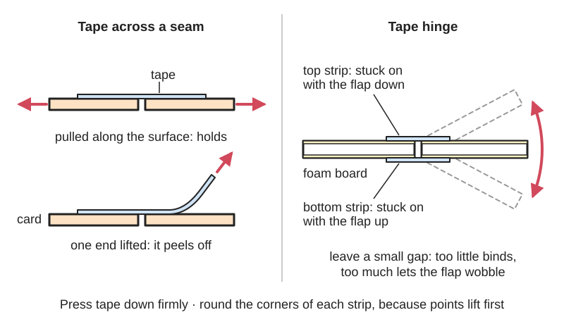

<figure class="eoc-pic eoc-pic-main"><figcaption>Diagram drawn for the encyclopaedia from the research notes. ⚑ Needs confirming: a drawing can simplify or get details wrong; a real photo or a better diagram is welcome.</figcaption></figure>

A strip of tape whose adhesive grips under finger pressure (or, for gummed paper tape, when wetted) holds two parts together at once with no drying time, and a strip [bridging](../glossary.md#overhang--bridging) a gap between two parts makes a quick, light, bendable hinge.

**In plain words:** A strip of sticky tape pressed across or between two parts so they hold together straight away, or laid across a gap so the parts can bend like a hinge, as on parcels, cardboard models, torn pages and the moving flaps of foam model planes. **Proper term:** Adhesive tape joint and tape hinge (pressure-sensitive adhesive tape, PSA tape).

**Also called:** sticky tape, self-stick tape, adhesive tape (Wikipedia 'Pressure-sensitive tape'); Sellotape, Scotch tape, Durex tape (brands used as everyday names; Wikipedia 'Pressure-sensitive tape'); transparent office tape, clear tape, invisible tape (matte clear tape) (Wikipedia 'Pressure-sensitive tape'); masking tape, painter's tape; drafting tape (lower tack) (Wikipedia 'Masking tape'); box-sealing tape, packing tape, parcel tape (UK), shipping tape (Wikipedia 'Box-sealing tape'); filament tape, strapping tape, fibre tape (Wikipedia 'Filament tape'; Fold 'N Fly); gummed paper tape, water-activated tape, gummed tape (Wikipedia 'Corrugated box design'; 'Pressure-sensitive tape'); double-sided tape, double-sided tissue tape, adhesive transfer tape (Wikipedia 'Double-sided tape'; 'Pressure-sensitive tape'); duct tape, duck tape; gaffer tape, gaff tape, gaffa tape, spike tape (Wikipedia 'Duct tape'; 'Gaffer tape'); hinge tape, gapless hinge tape, tape hinge (model aircraft; Model Aviation FAQ 2010/02; Flite Test); tape weave hinge (Flite Test); Blenderm (3M, brand): a soft medical tape used as hinge tape on very light model planes (Model Aviation FAQ 2010/02); taped seam, taped joint ⚑ [uncertain: informal names].

## How it works

Pressure-sensitive adhesive is soft enough to flow into the surface (wet it) when pressed, yet firm enough to resist flowing when the joint is loaded, so it grips at once without solvent, water or heat; how well it sticks depends on how hard it is pressed and on the surface's smoothness, cleanliness and temperature (Wikipedia 'Pressure-sensitive adhesive'). A strip across a seam carries the load through its backing; it holds best when pulled along the surface and worst when an edge or corner is lifted and peeled, so corners start lifting first (Wikipedia 'Pressure-sensitive adhesive'). A strip across a narrow gap leaves a short free length of backing that bends like a hinge; taping both faces holds the hinge line in place (Flite Test 'RC Plane Hinge Types'). Gummed paper tape works differently: water reactivates a starch glue that soaks into the cardboard's fibres and dries into a permanent bond that cannot be peeled off without tearing the box (iTape; Wikipedia 'Corrugated box design').

## Parts

A few parts: the two parts and the tape. The tape is a backing (plastic film, paper, cloth or foil) coated with pressure-sensitive adhesive, sometimes with embedded glass-fibre filaments for strength, and with a release liner on double-sided tape; adhesive transfer tape is adhesive alone on a liner (Wikipedia 'Pressure-sensitive tape'). Gummed paper tape is paper with a dry starch adhesive that is activated by water (iTape 'The Science Behind Water-Activated Tape'). A tape hinge is usually two strips, one on each face, or a 'woven' pair.

## Everyday examples

- A cardboard parcel closed with brown or clear packing tape (Wikipedia 'Box-sealing tape')
- A torn page or a sealed envelope fixed with clear office tape (Wikipedia 'Pressure-sensitive tape')
- Masking tape holding paper to a drawing board or marking off a wall for painting (Wikipedia 'Masking tape')
- The moving flaps on foam radio-controlled planes, hinged with clear packing tape (Flite Test 'RC Plane Hinge Types')

## When to use it

Use tape when you need a joint right now with no drying or clamping: closing boxes, mocking up cardboard and foam-board prototypes, holding parts while glue sets, temporary holds that must come off cleanly (masking, drafting or gaffer tape), hidden flat joints in paper and card (double-sided or tissue tape), strong closures and bundles (filament tape), permanent tamper-evident box seals (gummed paper tape), and light hinges for card covers, flaps and the control surfaces of electric foam model planes. It is also a quick reinforcement: packing tape over foam-board seams, or over skewer holes that tear out (Fold 'N Fly; Flite Test 'FT Old Fogey' comments).

## When not to use it

Avoid tape for anything that must last for years, stay outdoors, carry steady weight or survive heat (use glue, glued tabs, screws or rivets). For durable cardboard builds, Make: advises avoiding tape, especially duct tape, and Cool Tools notes that tape is clumsy, unpeels outdoors and won't take paint, so use hot glue, starch paste, box rivets or cardboard screws instead. Never use ordinary tape to repair valuable documents, books or art: it stains and damages them; conservators use Japanese tissue with wheat-starch paste instead (Manitoba Museum; JAIC 1984). For model planes with fuel engines use pinned or slot-in hinges (Model Aviation FAQ 2010/02). Thick foam tape is a separate entry (Double-sided foam tape), as is copper tape (Conductive tape).

## Details

- **What it does (jobs):**
  - join and hold: closes boxes, holds cardboard and foam-board prototypes and repairs torn paper at once, with no drying time
  - glue or bond: the adhesive layer is the bond; double-sided and transfer tapes make hidden flat joints
  - let it move (turn, slide or bend): a strip across a gap makes a light, bendable tape hinge for flaps, covers and model-plane control surfaces
  - seal it, or pass cables or fluid through: a continuous strip over a box seam, or an 'H-seal', keeps dust and dirt out (Wikipedia 'Box-sealing tape')
- **Movement:** none for a taped seam; flex for a tape hinge, which bends through the full movement of the flap, limited by the gap and the bevelled edges (Model Aviation FAQ 2010/02)
- **Directions it can move (degrees of freedom):** 0 for a taped seam. 1 for a tape hinge (folding about the gap); a hinge with too wide a gap also lets the flap flutter sideways ('flapping or vibration'; Model Aviation FAQ 2010/02).
- **Special behaviour:**
  - quick-release: low-tack masking tape, drafting tape and gaffer tape are made to [peel](../glossary.md#peel-vs-shear) off later without damaging the surface or leaving much residue (Wikipedia 'Masking tape'; 'Gaffer tape'); other tapes may leave residue or tear paper
  - none otherwise: tape holds, or bends as a hinge; it does not lock, click or limit force
- **How it holds:**
  - [material bond](../glossary.md#form-fit--force-fit--material-bond) (glue, solvent or melting): a pressure-sensitive adhesive that grips under pressure, or for gummed tape a water-activated starch glue that dries into the fibres
- **Input and output:** not applicable
- **Power:** passive (no power needed)
- **Load:** Light to medium. Strong when pulled along the tape: filament tape reaches up to about 600 lb per inch of width (100 N/mm) in tension (Wikipedia 'Filament tape'). The adhesive resists sliding (shear) well but is weak in peel, so tape fails from a lifted edge or corner (Wikipedia 'Pressure-sensitive adhesive'). Holding under a steady load drops as the tape warms (Wikipedia 'Pressure-sensitive adhesive'). On paper and thin card, the paper usually tears before good tape lets go ⚑ [uncertain].
- **Play and precision:** Taped seam: no play, but the backing stretches a little and the adhesive slowly [creeps](../glossary.md#creep) under steady load, so taped parts can drift out of line over time ⚑ [uncertain: no figure found]. Tape hinge: precision depends on the gap: too little causes binding and limits travel, too much causes flapping or vibration (Model Aviation FAQ 2010/02). A woven tape hinge has no gap on either side, but its pivot line shifts slightly depending on which way the flap moves (Flite Test 'Tape weave hinges' and comments).
- **Taking it apart:** semi-permanent (can be undone but may damage parts): it depends on the tape. Masking, drafting and gaffer tape are meant to come off cleanly (within a limited time for masking tape; Wikipedia 'Masking tape'; 'Gaffer tape'); box tape and duct tape usually come off but can tear paper or leave residue (Wikipedia 'Duct tape'); gummed paper tape is permanent and tears the carton if removed (iTape).
- **How often it can be reused:** once: tape is used once; the parts can usually be re-taped with new tape
- **Sealing:** dust-resistant: a continuous strip over a seam, or an 'H-seal' with cross strips over the box ends, helps keep contaminants out (Wikipedia 'Box-sealing tape'). Duct tape resists water and was first used to seal ammunition cases (Wikipedia 'Duct tape'), but taped seams are not reliably watertight long term ⚑ [uncertain].
- **Adjustable:** Partly: removable tapes (masking, drafting) can be lifted and repositioned; other tapes cannot be moved once pressed down without damage. The gap of a tape hinge is set when it is taped, using spacers (Model Aviation FAQ 2010/02). Some permanent adhesives grow stronger over hours or days after application (Wikipedia 'Pressure-sensitive adhesive').
- **Access needed:** one side only (blind) for a single strip over a seam or a one-piece gapless hinge; both sides for the usual two-strip hinge (top and underside) or a woven hinge (Flite Test; Model Aviation FAQ 2010/02)
- **Materials:** Tape sticks best to clean, dry, smooth surfaces; surface smoothness, [surface energy](../glossary.md#surface-energy) and cleanliness all affect the bond (Wikipedia 'Pressure-sensitive adhesive'). Suits: paper and card (office tape, masking and drafting tape), corrugated cardboard (box-sealing tape, filament tape, gummed paper tape), foam board and foam model planes (clear packing tape and fibre tape; Fold 'N Fly; Flite Test), balsa (Flite Test 'Tape weave hinges' comments), painted walls and car body panels for masking (Wikipedia 'Masking tape'), wood and veneer as a temporary hinge in mitre folds (Woodweb). Gummed paper tape needs a fibrous surface such as cardboard to soak into (iTape). Poor: dusty, oily, damp, rough or very low-energy surfaces such as polyethylene and polypropylene film ⚑ [uncertain: surface energy named in Wikipedia but no plastic list opened]; fragile or valuable paper and documents (tape stains and damages them; Manitoba Museum; JAIC 1984); anything to be painted, since duct tape won't take paint (Cool Tools).
- **Heat, cold, water and wear:** Pressure-sensitive adhesives lose tack in the cold and hold less under load when hot (Wikipedia 'Pressure-sensitive adhesive'). Rubber-based tapes such as masking and older clear tape age by oxidation: first little change, then the adhesive turns sticky, oily and yellow and soaks into paper, and finally it hardens, discolours and lets go, with the backing falling off; acrylic tapes discolour much less but slowly flow (cold flow) into porous paper (JAIC 1984, 'Pressure-sensitive tape and techniques for its removal from paper'). Ordinary duct tape fails on hot heating ducts, and tests at Lawrence Berkeley National Laboratory found it becomes [brittle](../glossary.md#brittle--ductile), fails and can fall off (Wikipedia 'Duct tape'). Masking tape is meant for temporary use at room temperature and to come off cleanly only within a limited time (Wikipedia 'Masking tape'; 'Pressure-sensitive tape'). Tape unpeels outdoors in weather (Cool Tools), and hinge tape loses adhesion over time, so check model hinges often (Flite Test). Sunlight speeds ageing ⚑ [uncertain: no UV figure found on an opened page].

## Making it

- **Ways to make or get it:**
  - off-the-shelf part: rolls of tape applied by hand or with a dispenser (Wikipedia 'Box-sealing tape')
  - used with any making method for prototypes and quick fixes: cardboard and foam-board builds, papercraft, woodworking mitre folds (Woodweb)
  - 3D print (FDM): not for the tape itself; printers can make tape dispensers and bevel cutters for hinge lines
- **Printing it in one piece (print in place):** no: tape is a bought material applied after making the parts.
- **Tools:** none beyond scissors or a knife; a hand-held tape gun or desk dispenser makes long strips easier (Wikipedia 'Box-sealing tape'); a water dispenser to wet gummed paper tape (iTape); for model-plane hinges, scrap 1/16 in (1.6 mm) balsa spacers to set the gap and painter's tape to hold the parts while taping (Model Aviation FAQ 2010/02)
- **Difficulty:** easy: no drying, no tools, instantly strong enough for prototypes; the skill is choosing the right tape and pressing it down firmly.

### 3D printing tips

not applicable to the joint itself, but a printer makes useful helpers: a 45-degree bevel cutter for 6 mm foam, so control-surface edges can be bevelled before taping a hinge (Printables '6mm foam bevel cutter 45°'; Model Aviation recommends bevelled edges for top hinging), and wall- or magnet-mounted masking-tape dispensers (Printables '24 mm masking tape dispenser with magnetic mount'). Tape is also handy for holding printed parts while glue sets ⚑ [uncertain: general practice, no source opened].

### Buying one (off-the-shelf parts)

Search names: 'masking tape', 'painter's tape', 'drafting tape', 'transparent office tape', 'archival tape', 'box-sealing tape' or 'packing tape' (BOPP or polyester backing, 36, 48 or 72 mm wide), 'filament tape' or 'strapping tape', 'water-activated tape' or 'gummed paper tape' (plain or fibre-reinforced), 'double-sided tape', 'double-sided tissue tape', 'adhesive transfer tape', 'duct tape', 'gaffer tape', 'spike tape' (Wikipedia 'Pressure-sensitive tape'; 'Corrugated box design'; 'Box-sealing tape'). For model planes: 'hinge tape', 'gapless hinge tape', soft medical tape of the Blenderm type (3M, brand; sold by Du-Bro as Electric Flyer Hinge Tape) (Model Aviation FAQ 2010/02). Dispensers: hand-held tape gun, desk dispenser, water-activated tape dispenser.

## Rules of thumb

- Box closure: a single centre-seam strip should run 50-75 mm (2-3 in) down onto the end panels; add cross strips over the ends (an 'H-seal' or six-strip closure) when the tape is weak or the box needs reinforcing (Wikipedia 'Box-sealing tape'). Filament-tape L-clips likewise extend 50-75 mm onto the panels (Wikipedia 'Filament tape').
- Packing tape is commonly 48-50 mm wide (also 36 and 72 mm) and about 40 um thick for low strength, 45 um normal and 50 um or more for extra strength (Wikipedia 'Box-sealing tape').
- Filament tape: usually 12-24 mm wide, with grades up to about 600 lb per inch of width (100 N/mm) in tension (Wikipedia 'Filament tape'); on foam board it is strongest with its fibres running across the cut edge (Fold 'N Fly).
- Press tape down firmly, since the bond depends on pressure, and round the corners of a tape strip or label, because pointed corners start to lift first (Wikipedia 'Pressure-sensitive adhesive').
- To remove tape with least damage, pull it off slowly at a low angle; heat or a solvent softens residue, and freeze spray makes many adhesives glassy so they release (Wikipedia 'Pressure-sensitive adhesive').
- Two-strip tape hinge: tape the top with the flap fully down, then tape the underside with the flap fully up (Flite Test 'RC Plane Hinge Types').
- Hinge gap: set it with scrap 1/16 in (1.6 mm) balsa spacers and press the tape down thoroughly; too little gap binds, too much flaps or vibrates; bevel the edges for top hinging (Model Aviation FAQ 2010/02).
- Pick hinge tape by model weight: soft Blenderm-type tape for micro and indoor models under 8 oz (about 225 g); a gapless hinge tape for 8-48 oz (about 225 g-1.4 kg); very few tapes resist fuel, so tape hinges suit electric models and gliders (Model Aviation FAQ 2010/02). Flite Test limits tape hinges to electric foam planes.
- Woven tape hinge: cut a strip in half and stick the two halves together so they overlap in the middle by about the foam thickness (about 1/4 in), then stick one free end down on each part, keeping the overlap over the gap (in a woven hinge the two ends usually go on opposite faces ⚑ [uncertain: not stated in the text]), giving a hinge with no bevel and no gap (Flite Test 'Tape weave hinges').
- Masking-tape adhesives: rubber-based grip hardest but tolerate the least heat; acrylic works from below freezing to about 150 °C; silicone tapes tolerate intermittent use up to about 260 °C (Wikipedia 'Masking tape', partly unsourced there).
- Mitre folds in wood: cut 45-degree V-grooves, lay the pieces face up edge to edge, tape across the face with heavy packing tape, flip, glue and fold; with brittle materials cut right through and slightly into the tape (Woodweb 'Miterfolds for clean corner joints').

## Common failures

Lifting at the corners or edges: corners not rounded, tape not pressed down, or a dusty, damp or oily surface (Wikipedia 'Pressure-sensitive adhesive'). Sliding or creeping apart under steady load or in warmth (Wikipedia 'Pressure-sensitive adhesive'). Drying out, yellowing and falling off with age (JAIC 1984; Manitoba Museum). Tearing paper or pulling up veneer when removed: use a less aggressive tape, or peel slowly at a low angle (Woodweb; Wikipedia 'Pressure-sensitive adhesive'). Tape hinges that bind, flutter or let go: wrong gap, unbevelled edges, too stiff a tape for a light model, or old tape; re-tape with the right spacers and check often (Model Aviation FAQ 2010/02; Flite Test). Duct-taped cardboard looking lumpy and refusing paint (Cool Tools).

## Safety

None special for the tape itself; the main risks are to the work: residue on surfaces, and stains and damage on paper that are often permanent (Manitoba Museum). Removing old tape residue from paper can need solvents, which should only be used with fume extraction (Connecting to Collections Care 'Book Repair' handout). A tape hinge on a flying model that loses grip can cause loss of control, so inspect hinges often (Flite Test). Blenderm-type medical tape is mentioned here only as a hinge material for models, not for any use on people.

## Related

- Double-sided foam tape: thick foam tape for mounting and [gap filling](../glossary.md#gap-filling), a separate entry
- Conductive tape: copper or conductive fabric tape that also carries current, a separate entry
- Stretch-release adhesive strips: tape-like pads that come off cleanly when stretched
- Glued tab joint: the permanent glued alternative for papercraft and boxes
- Glue stick and starch paste: the reversible paper glue that conservators use with Japanese tissue instead of tape
- Score-and-fold hinge: the fold in the card itself, which tape can reinforce
- Slot-in model hinge (CA hinge, hinge points): the stronger, longer-lasting hinge for model-plane control surfaces, especially fuel-powered ones
- V-groove fold: a mitre fold in foam board or wood where packing tape on the face can act as the hinge while the glue sets
- [Living hinge](../glossary.md#living-hinge) and Knuckle hinge: one-piece printed or moulded hinges and pin hinges for parts that must last
- Heat-shrink tubing: the entry that covers electrical tape for insulating wires

## Make it yourself

- [6mm foam bevel cutter 45° (Andries Muylaert, Printables) (URL from Printables API, page not opened)](https://www.printables.com/model/309041-6mm-foam-bevel-cutter-45deg): A printed blade holder for cutting 45-degree bevels in 6 mm foam, useful for bevelling control-surface edges before taping a hinge. Read through the Printables public API. *(licence: GNU GPL v2.0)*
- [24 mm masking tape dispenser with magnetic mount (Printables) (URL from Printables API, page not opened)](https://www.printables.com/model/29505-24-mm-masking-tape-dispenser-with-magnetic-mount): A printable dispenser for 24 mm masking tape that mounts magnetically, e.g. on a printer frame. Read through the Printables public API. *(licence: CC BY-SA (Creative Commons Attribution-ShareAlike))*

## Pictures, videos and models

- [Filament tape - 01.jpg (Wikimedia Commons, by Phliar)](https://commons.wikimedia.org/wiki/File:Filament_tape_-_01.jpg): Filament (strapping) tape used to mend part of a model airplane; used on Wikipedia 'Filament tape' *(licence: CC BY-SA 2.5)*
- [Tape weave hinges (Flite Test)](https://flitetest.com/articles/tape-weave-hinges): Step-by-step photos and video of making a woven tape hinge on foam board, with the non-sticky side coloured to show the overlap *(licence: link only)*
- [RC Plane Hinge Types (Flite Test)](https://www.flitetest.com/articles/RC_Plane_Hinge_Types): Explains pin, iron-on and clear-packing-tape hinges for model planes, including the top-and-bottom taping method *(licence: link only)*
- [Tape is evil (Manitoba Museum conservation blog)](https://manitobamuseum.ca/tape-is-evil/): Photos of yellow tape stains, failed tape and pages stuck together by old tape in a scrapbook, and its repair with Japanese paper and wheat-starch paste *(licence: link only)*
- [Foam Board Tools & Techniques (Fold 'N Fly)](https://www.foldnfly.com/lounge/foam-core-tools-techniques.php): Photos of foam-board folds and joints, with clear packing tape and fibre tape used to seal and reinforce seams *(licence: link only)*

## Needs confirming

⚑ marks something nobody has confirmed yet: a fact the research could not confirm from a source, a finder value that is a best guess, or an open point from the research notes. Corrections are welcome (see `research/needs-confirming.md`).

- ⚑ 8 sentences on this page marked [uncertain].
- ⚑ Finder value `glue_traits` =  (best guess): no glue traits found
- ⚑ Finder value `bonds_well` = wood, paper or card, foam (source uncertain): `materials` is marked ⚑ [uncertain] here: "…very low-energy surfaces such as polyethylene and polypropylene film ⚑ [uncertain: surface energy named in Wiki…"
- ⚑ Finder value `bonds_poorly` = slippery plastics (PE or PP) (source uncertain): `materials` is marked ⚑ [uncertain] here: "…very low-energy surfaces such as polyethylene and polypropylene film ⚑ [uncertain: surface energy named in Wiki…"

## Sources

- <https://en.wikipedia.org/wiki/Pressure-sensitive_tape>
- <https://en.wikipedia.org/wiki/Pressure-sensitive_adhesive>
- <https://en.wikipedia.org/wiki/Double-sided_tape>
- <https://en.wikipedia.org/wiki/Masking_tape>
- <https://en.wikipedia.org/wiki/Duct_tape>
- <https://en.wikipedia.org/wiki/Gaffer_tape>
- <https://en.wikipedia.org/wiki/Box-sealing_tape>
- <https://en.wikipedia.org/wiki/Filament_tape>
- <https://en.wikipedia.org/wiki/Corrugated_box_design>
- <https://blog.itape.com/blog/the-science-behind-water-activated-tape>
- <https://www.flitetest.com/articles/RC_Plane_Hinge_Types>
- <https://flitetest.com/articles/tape-weave-hinges>
- <https://www.flitetest.com/articles/FT_Old_Fogey_Scratch_Build>
- <https://library.modelaviation.com/article/frequently-asked-questions-201002>
- <https://www.foldnfly.com/lounge/foam-core-tools-techniques.php>
- <https://woodweb.com/knowledge_base/Miterfolds_for_clean_corner_joints.html>
- <https://makezine.com/article/craft/working-with-cardboard-tips-cut-fold-mold-papier-mache/>
- <https://kk.org/cooltools/?p=1518>
- <https://cool.culturalheritage.org/jaic/articles/jaic23-02-003_2.html>
- <https://manitobamuseum.ca/tape-is-evil/>
- <https://connectingtocollections.org/wp-content/uploads/2019/08/Book-Repair_handout-1-1.pdf>
- <https://commons.wikimedia.org/wiki/File:Filament_tape_-_01.jpg>
- <https://api.printables.com/graphql/>
