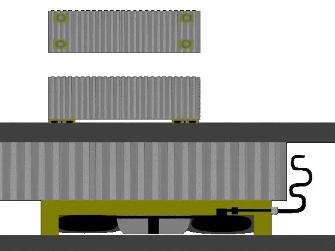

<figure class="eoc-pic eoc-pic-main"><picture><source media="(prefers-reduced-motion: reduce)" srcset="../media/air-bearing-and-air-caster.still.webp"></picture><figcaption><strong>Animation.</strong> <a href="https://commons.wikimedia.org/wiki/File:Aircaster.gif">Aircaster</a> by Anynobody, <a href="https://creativecommons.org/licenses/by/2.5">CC BY 2.5</a>, from Wikimedia Commons.</figcaption></figure>

A bearing with no contact: compressed air is fed through tiny holes or a porous face into a gap a few thousandths of a millimetre thick (air bearings) or under a flexible ring-shaped bag (air casters), and the pressure of the escaping air carries the load, so parts slide or turn with no [stick-slip](../glossary.md#stick-slip) and no wear, and tonnes can be pushed across a smooth floor by hand.

**In plain words:** A flat pad, or a ring-shaped rubber bag, that blows a very thin layer of air out underneath itself, so the pad and whatever sits on it float a hair's breadth above a smooth surface and glide with almost no friction, like the puck on an air-hockey table. **Proper term:** Air bearing (aerostatic bearing) and air caster (air-cushion load mover).

**Also called:** aerostatic bearing, gas bearing, gas-lubricated bearing, externally pressurised air bearing (Wikipedia 'Air bearing'; Slocum); aerodynamic (self-acting) air bearing: a version that makes its own air film from fast motion instead of a compressor (Wikipedia); porous air bearing (porous carbon or graphite face), orifice air bearing (drilled holes or jewel nozzles), flat air pad, air bushing, air spindle (PI Nelson Air; IBS Precision Engineering); air caster, air skate, air pad, air cushion, air film mover; originally called an 'air bearing' (AeroGo white paper; Wikipedia 'Air caster'); Aero-Caster and Gapmaster (AeroGo brands), Airfloat (brand) (AeroGo; Wikipedia); air table, air track, air-hockey table (low-pressure versions for pucks and gliders) (Wikipedia 'Air hockey', 'Air track'); air-cushion vehicle (hovercraft): the vehicle-sized relative (Science Buddies).

## How it works

Compressed air flows through a restriction (small holes or a porous face) into the narrow gap under the pad and leaks out at the edges; the pressure in the gap pushes the pad up, so the two surfaces never touch (Wikipedia; Slocum). The design is self-regulating: if extra load squeezes the gap, less air can escape (the gap's resistance to flow rises roughly with the cube of the gap), so the pressure under the pad rises and pushes back, which gives the bearing its [stiffness](../glossary.md#stiffness) (Slocum; IBS). An air caster first inflates its ring-shaped bag until it seals against the floor, then air fills the space inside the ring and lifts the load until it escapes under the bag's lip, riding on a film less than a millimetre thick (Wikipedia 'Air caster'). An air-hockey table is the same idea turned over: the table blows air up through many tiny holes and the puck floats (Wikipedia 'Air hockey'; Slocum).

## Parts

A few parts. Air bearing: a pad or bushing whose face is either porous (carbon, graphite, bronze) or fed by small holes with grooves, an internal plenum (air chamber), an air fitting, a very flat or round guide surface (granite, glass, ground or lapped metal), and a [preload](../glossary.md#preload) (weight, vacuum area, magnet or an opposing pad) (Wikipedia; PI Nelson Air; Slocum). Air caster: a ring-shaped (torus) airbag under a load plate, an air supply hose and a control valve (Wikipedia 'Air caster'). Toy versions: an air-hockey puck on a table drilled with tiny holes and fed by a fan, or a CD, bottle cap and balloon (Wikipedia 'Air hockey'; Science Buddies).

## Everyday examples

- An air-hockey puck floating on air blown up through tiny holes in the table (Wikipedia 'Air hockey'; Slocum)
- The air track and gliders used in school physics labs to show motion without friction (Wikipedia 'Air track')
- A hovercraft, or the CD-and-balloon toy hovercraft made in science classes (Science Buddies)
- Heavy machines and loads moved across factory floors by a few people on air casters (AeroGo; Wikipedia 'Air caster')

## When to use it

Use an air bearing when you need motion with no friction, no stick-slip, no wear and no oil: precision measuring and positioning stages, optics and wafer handling, fast clean spindles, low-friction test rigs such as satellite attitude simulators, and gravity-offloading rigs for unfolding solar panels (Wikipedia; PI Nelson Air; IBS). Use air casters to move very heavy or delicate loads short distances over a smooth floor by hand, with precise positioning in any direction and low floor pressure (AeroGo). Use air-cushion tables and pucks for games, demonstrations and physics experiments, where a fan supplies low-pressure air (Wikipedia 'Air hockey', 'Air track').

## When not to use it

Avoid it when there is no steady supply of clean, dry compressed air, or the surfaces are dusty, oily, rough or not flat: the gap is only micrometres, so dirt and unevenness make it touch (Wikipedia; IBS). Avoid it for high loads in a small space or where you need [damping](../glossary.md#damping): oil-fed hydrostatic bearings carry about five times more and damp better (PI Nelson Air; Slocum). For everyday maker machines, a plain bushing, ball bearing or linear guide is cheaper and needs no compressor (see Linear guides; Plain pivot and rolling bearing). Don't use air casters on sloping, cracked, porous or broom-finished floors without overlays, or where the load can't be restrained (Airfloat; AeroGo); use roller skates, wheels or rollers instead. For high-speed air spindles, buy rather than build: they can whirl unstably unless carefully designed (Wikipedia: 'half-speed whirl').

## Details

- **What it does (jobs):**
  - let it move (turn, slide or bend): lets a part slide in any direction across a flat surface (flat pads, air casters, air-hockey pucks), along a rail (linear air bearings) or spin (air bushings and spindles) with almost zero friction (Wikipedia; PI Nelson Air)
  - line parts up exactly: in precision machines it guides motion with no play, stick-slip or wear, so positions repeat to a micrometre or two (Wikipedia: chip-making wire bonders need 1-2 um [repeatability](../glossary.md#repeatability--accuracy); PI Nelson Air)
  - hold or release using power (loosely): the load only floats while air is flowing; switch the air off and it settles onto its pads and stays put by friction (IBS Precision Engineering FAQ)
- **Movement:** multiple: flat pads and air casters slide in any direction across a plane and can turn on the spot; linear air bearings slide along a rail; air bushings, journal bearings and spindles rotate (Wikipedia; PI Nelson Air). Travel is limited only by the size of the smooth surface, and the lift is tiny (micrometres for precision bearings, under a millimetre for air casters) (IBS; Wikipedia 'Air caster')
- **Directions it can move (degrees of freedom):** 3 for a single flat pad or air caster on a floor (slide in two directions and turn about a vertical axis), with height held by the air film. A pad supports a force but not a tipping moment, so precision machines use about six sets of opposed pads on a carriage to leave just 1 degree of freedom (straight-line travel), or opposed [radial](../glossary.md#axial--radial) and thrust pads to leave 1 (rotation) (Slocum)
- **Special behaviour:**
  - self-aligning or self-centring: opposed pads centre a shaft or carriage, because the side whose gap shrinks builds higher pressure and pushes it back (Slocum; PI Nelson Air lists 'Self Centering' and 'Error Averaging'); the air film also averages out small surface errors (IBS)
  - [fail-safe](../glossary.md#fail-safe--fail-secure) or breakaway (loosely): if the air supply fails, the bearing depressurises and the moving part slowly comes to a stop on its pad rather than running on (IBS FAQ); a porous graphite face resists scratching when this happens (IBS). The reverse is the danger: while floating, a load has almost no grip and drifts down any slope (AeroGo)
  - none of the locking behaviours: it does not lock or index; it only removes friction
- **How it holds:**
  - suction or air pressure: the pressure of the air film carries the load (load = area x supply pressure x efficiency) (IBS; PI Nelson Air); vacuum-preloaded pads also use suction over part of the face to pull the pad down and stiffen it (PI Nelson Air)
  - magnetic: magnet-preloaded pads are pulled towards an iron guide to keep the gap constant (PI Nelson Air; Wikipedia)
  - friction or clamping ([force-fit](../glossary.md#form-fit--force-fit--material-bond)): with the air off, the pad rests on the surface and friction holds it (IBS FAQ)
  - not a holding joint (it moves or passes on motion): its job is to let parts move, not to hold them together
- **Input and output:** Not a motion converter. As a support: compressed air in -> lifting force out. Load capacity is roughly pad area x supply pressure x efficiency, with efficiency about 25-40% (Slocum), 'expect 30%' (PI Nelson Air) or about 50% for porous pads (IBS). Friction: essentially zero static and running friction (PI Nelson Air); an air caster needs only 5-25 lbf to push a 5,000 lb load, about 0.1-0.5% of its weight, against about 300 lbf on wheels (AeroGo). Back-drivable: yes, completely free in every direction it is not constrained. Shaft arrangement: not applicable.
- **Power:** powered: needs a continuous supply of compressed air: precision pads typically run at 20-120 psi (PI Nelson Air) or 4-6 bar (IBS), and Slocum notes air bearings are typically kept below 10 atmospheres for safety; air-hockey tables and air tracks use large amounts of low-pressure air from a fan or blower (Wikipedia 'Air hockey'; 'Air track'). When the air is lost, the film collapses and the load settles gently onto the pad and stops (IBS FAQ); it does not stay floating
- **Load:** light to very heavy, but mainly in one direction: a pad pushes; it can't pull or resist sideways shove or tipping unless opposed pads or a preload hold it (Slocum; PI Nelson Air). Precision pads carry about 50 N to 20 kN each (IBS); air casters move loads from 500 lb to over 5,000 tons (AeroGo) and press on the floor at only about 2-50 psi, against over 1,000 psi under rollers and wheels (AeroGo). For the same pad area, oil-fed (hydrostatic) bearings carry about five times more (PI Nelson Air)
- **Play and precision:** none: no [backlash](../glossary.md#backlash) and no stick-slip, so it repeats very well (linear repeatability about +/-10 microinches, PI Nelson Air; 1-2 um in wire bonders, Wikipedia). But it tolerates almost no [misalignment](../glossary.md#misalignment) or unevenness: gaps are about 5-50 um (Wikipedia), about 5 um for porous pads (IBS) or about 10 um (PI Nelson Air), so the guide surface must be flat and smooth to a fraction of that, and PI holds parts to +/-0.0001 in for gaps of about 0.0005 in. Air casters are far more forgiving: a film of 0.003-0.005 in (AeroGo) on a smooth, nearly level floor
- **Taking it apart:** removable: precision pads bolt on through ball-pin (ball-stud) or stiff joint mounts (Wikipedia); air casters are simply slid under a load, inflated, used and taken out again (AeroGo; Wikipedia)
- **How often it can be reused:** effectively unlimited: there is no contact and so no wear; 'the durability of air bearings is unlimited if they are designed and calculated correctly' (Wikipedia)
- **Sealing:** none: air leaks out of the edges all the time by design, so the film is not a seal (Slocum; PI Nelson Air). An air caster's flexible ring makes a near-seal with the floor only so that pressure can build under it (Wikipedia 'Air caster')
- **Adjustable:** yes: supply pressure and preload set the gap and stiffness (IBS; PI Nelson Air); ball-pin mounts let a pad tilt to sit flat on its guide (Wikipedia); for air casters, using more casters spreads the load and lowers the floor pressure (AeroGo)
- **Access needed:** one side only (blind): a flat pad or air caster simply sits on top of the surface it glides on, with the air hose connected to the pad; bearings with opposed pads need both sides of the rail or plate (Slocum; PI Nelson Air)
- **Materials:** Pads: porous carbon or graphite, porous bronze or steel, or aluminium or steel with drilled orifices or jewel nozzles (PI Nelson Air; IBS). Guide surfaces: granite, glass and precisely ground metal (Hackaday 2019: granite reference plate; AeroGo: polished plate glass is the reference surface). Air casters: urethane or nylon bags (Airfloat). Floors for air casters: sealed steel-trowelled concrete, epoxy-coated concrete, steel or aluminium plate, varnished hardwood, vinyl, formica (AeroGo); broom-finished or porous floors don't work (Airfloat). DIY: stainless steel discs with a face of JB Weld epoxy cast against float glass and plaster of Paris as the flow restrictor (Hackaday 2024); EDM graphite electrodes in a 3D-printed plenum (Hackaday 2019); printed vortex pads in PLA or polycarbonate (Printables 1055797). Air-hockey pucks: polycarbonate (Wikipedia)
- **Heat, cold, water and wear:** Dirt and dust: small [clearances](../glossary.md#clearance) make gas bearings sensitive to particles in the environment and in the air supply (Wikipedia). Air quality: water, oil, dirt and rust in compressed air shorten life and clog porous faces (IBS; PI Nelson Air). Heat: friction heating is negligible below surface speeds of about 30 m/s (IBS); special versions work above 400 C (Wikipedia). Floors: cracks, expansion joints, porous or textured surfaces let the air escape so casters can't lift (Wikipedia 'Air caster'; Airfloat). Slopes: floating loads drift downhill (AeroGo; Airfloat). Printed parts: plastic plenums soften with heat and [creep](../glossary.md#creep) under steady preload ⚑ [uncertain: general plastics behaviour, not tested for air bearings].

## Making it

- **Ways to make or get it:**
  - off-the-shelf part: porous and orifice air bearing pads, air bushings, air-bearing stages and spindles; air casters and air-caster rigging kits (PI Nelson Air; IBS; AeroGo)
  - 3D print (FDM): plenums (air chambers) and housings for graphite or epoxy pads, drilling and casting jigs, vortex pads, air-hockey pucks and tables, balloon hovercraft toys (Hackaday 2019; Hackaday 2024; Printables)
  - epoxy replication: casting the bearing face against float glass to copy its flatness (Hackaday 2024)
  - lapping or grinding: flattening graphite or metal faces against a reference plate with abrasives (Hackaday 2019; Printables 1055797)
  - CNC and laser drilling: commercial orifice and micro-nozzle pads (Wikipedia: laser-drilled micro-nozzles 0.02-0.06 mm)
- **Printing it in one piece (print in place):** partly: toy versions print in one piece and only need a balloon (Printables 386417 and 437647). For working air bearings the printed part is usually a housing, plenum or jig, and the bearing face is a separate graphite insert, epoxy layer or lapped surface (Hackaday 2019; Hackaday 2024); a printed vortex pad works directly but needs its face lapped flat and a tapped air fitting (Printables 1055797)
- **Tools:** To use: an air compressor or blower, a filter and [regulator](../glossary.md#regulator), hoses and push-in fittings (IBS; PI Nelson Air). To mount precision pads: spanners or hex keys (Wikipedia: ball-pin mounts) ⚑ [uncertain]. DIY builds: a hand drill with 3D-printed drilling jigs, epoxy, a sheet of float glass as a flat reference, abrasives for flattening, and plaster of Paris (Hackaday 2024; Hackaday 2019); an M5 tap for a printed vortex pad's air fitting (Printables 1055797)
- **Difficulty:** easy for a toy (a balloon hovercraft or air-hockey puck: Science Buddies; Printables). Hard for a real precision air bearing: it needs surfaces flat to a few micrometres, clean dry compressed air and careful restrictor design, though makers have done it with float glass, epoxy replication and porous graphite (Hackaday 2024; Hackaday 2019). For moving heavy loads, buy commercial air casters and check the floor first (AeroGo; Airfloat)

### 3D printing tips

1) A bare printed face is far too rough and wavy for a precision air bearing, whose gap is only about 5-50 um (Wikipedia; IBS recommends a guide-surface finish of 0.4 um Ra or better). Use the print only as a holder: press a porous graphite slug, flattened on a granite plate, into a printed plenum (Hackaday 2019), or cast an epoxy face against float glass using printed jigs (Hackaday 2024; open-air-bearings repository). 2) If you do use a printed face, lap it flat: the designer of a printed vortex pad says lapping the face on glass with high-grit paper 'really amplifies the air bearing effect' (Printables 1055797). 3) Wall strength: that designer prints PLA with 4 walls or polycarbonate with 3 walls, holes facing down, no supports, and taps the air inlet M5 for push-in fittings; he warns 'this item can obviously explode', so choose material and settings with care and keep the pressure low (Printables 1055797). Never use a printed part to store compressed air (HSE HSG39: vessels of compressed air 'can explode violently once their integrity is lost'). 4) Restrictors: each pad needs a restriction between the air supply and the gap, otherwise the pressure won't rise when the gap closes and the pad has no stiffness (Slocum); DIY builders use plaster of Paris, porous graphite, or small drilled holes (typical orifices 0.004-0.015 in, PI Nelson Air). 5) Keep the volume of grooves and pockets on the face small: large 'dead volumes' cause self-excited vibration (Wikipedia). 6) The open-air-bearings project includes a simple Python simulator that predicts lift versus gap from an image of your groove pattern, to choose a design and preload before building (open-air-bearings README). 7) For toys and demos, print light: the balloon hovercraft prints with 20% [infill](../glossary.md#infill) or less and no supports (Printables 386417); test air-hockey pucks and hovercraft on a smooth table or floor (Science Buddies). 8) Filter the air: oil and water from a workshop compressor clog porous faces (PI Nelson Air; IBS).

### Buying one (off-the-shelf parts)

Porous carbon flat round and rectangular air bearings, air bushings (porous bronze or carbon), orifice and jewel-nozzle air pads, vacuum-preloaded and magnet-preloaded air pads, ball-pin (ball-stud) mounts, air-bearing linear and rotary stages and spindles, granite surface plates and guide rails (PI Nelson Air; IBS; Wikipedia). Air casters, air skates and air-caster rigging kits with a control console, plus low-step 'gap-crossing' casters (AeroGo; Airfloat). Air preparation: filter (ISO 8573 class 3 or better recommended), coalescing oil filter, dryer and regulator, push-in fittings and tubing (IBS). Air-hockey tables, pucks and blowers; school air tracks and gliders (Wikipedia)

## Rules of thumb

- Load capacity is about pad area x supply pressure x efficiency: efficiency about 0.3 (PI Nelson Air: 'Force = 0.3 x Supply Pressure x Area'), 25-40% (Slocum), or about 50% for porous pads (IBS)
- Gap (fly height): about 5-50 um for air bearings (Wikipedia), about 10 um (PI Nelson Air), about 5 um for porous pads, sized so the maximum load never squeezes it below about 3-5 um (IBS); 20-100 um for conveyor pads (IBS); 0.003-0.005 in for air casters (AeroGo)
- Air use rises with the cube of the gap: a 5 cm porous pad carrying 34 kg needs 1.57 normal litres per minute at 5 um of lift but 25.18 at 10 um (IBS), so keep gaps small
- Supply pressure: 20-120 psi for precision pads (PI Nelson Air), 4-6 bar for flat pads and bushings, 2 bar for conveyor pads (IBS); keep air bearings below about 10 atmospheres for safety (Slocum)
- Air quality: clean, dry, oil-free air filtered to ISO 8573-1 class 3 ideally and class 4 at least (IBS); oil vapour clogs porous faces (PI Nelson Air)
- Guide surface: smooth to about 0.4 um Ra or better (IBS); a single pad carries force but not moment, so use opposed pads or a preload (weight, vacuum or magnet), and about six pairs of pads to guide a carriage in a straight line (Slocum; PI Nelson Air). Opposed-pad preload doubles stiffness but roughly halves load capacity (PI Nelson Air)
- Orifice-fed pads use holes about 0.004-0.015 in across (PI Nelson Air); conventional nozzles 0.1-0.5 mm, laser-drilled micro-nozzles 0.02-0.06 mm (Wikipedia)
- Air-caster floors: smooth and non-porous (machine-trowelled concrete or better), cracks and expansion joints filled or covered, projections flush, and blind holes under about 10% of the caster diameter; slope no more than about 0.2% (1/4 in in 10 ft) for hand-pushed loads or 0.4% (1/2 in in 10 ft) for powered ones; sheet overlays up to 1/32 in thick can bridge poor floors (Airfloat)
- Never clean a porous air bearing or its guide with the air turned off; clean with 70% isopropyl alcohol on a dry cloth, not ketones (IBS)

## Common failures

1) Touching down and scraping: the load is too high, the pressure too low, the gap too small, or there is dirt or a bump on the guide; check the lift-versus-load curve and keep at least 3-5 um of gap (IBS; Wikipedia). 2) Self-excited vibration ('air hammer'): caused by large dead volumes in pockets and grooves, too large a gap or a poorly chosen restrictor; use many small holes or porous faces and shallow pockets (Wikipedia). 3) Half-speed whirl in fast air spindles (Wikipedia). 4) Clogged orifices or porous faces from dirty or oily air; a clogged porous bearing is much harder to clear than a clogged orifice (PI Nelson Air). 5) Tipping or wobbling: a single pad has no tilt stiffness, so it rocks unless preloaded or opposed (Slocum; PI Nelson Air; Wikipedia notes very poor tilt stiffness for single-nozzle pads). 6) Air casters that won't float: floor too rough, porous or cracked, or the air supply too small (Wikipedia 'Air caster'; AeroGo: hairline cracks only matter when the air supply is marginal). 7) Air casters drifting on an uneven floor (Airfloat; AeroGo). 8) Scratched faces from cleaning with the air off (IBS). 9) DIY pads: faces not flat enough; make them against float glass or a granite plate (Hackaday 2024; Hackaday 2019).

## Safety

1) Compressed air: it can enter body openings 'causing severe and often fatal injuries', can penetrate the skin at high pressure, and particles in an air jet can damage the eyes; damaged hoses can rupture and 'whip' and 'snake' dangerously (HSE HSG39). Wear eye protection and never point an air line at anyone. 2) Runaway loads: a load on air casters has almost no friction, so on any slope it moves downhill unless it is secured; AeroGo says 'the load must be secured; or you will have an immediate safety problem moving downhill'. Plan stops and restraints, and push slowly. 3) Crush risk: when the air is switched off the load drops onto its pads, so keep hands and feet out from under it ⚑ [uncertain: inferred from how air casters work]. 4) Bursting printed parts: the designer of a printed air pad warns it 'can obviously explode' (Printables 1055797); keep pressures low, never store compressed air in a printed part, and remember Slocum's note that air bearings are kept below about 10 atmospheres 'for safety reasons'. 5) Cleaning solvents: isopropyl alcohol is flammable ⚑ [uncertain: general chemical hazard]. 6) Toys: Science Buddies advises adult help and care when using super glue to build a CD hovercraft.

## Related

- Bernoulli gripper (non-contact air gripper): uses the same thin film of escaping air, but to hold a part close to a pad rather than float a load on it
- Linear guides (bushings, wheels or carriages on rails): the usual contact bearings for straight-line motion; cheaper and need no air, but have friction and wear
- Plain pivot and rolling bearing: the everyday contact bearings for turning parts
- Knife-edge and jewel pivots: another way to get very low friction, but only for small rocking or turning motions and light loads
- Turntable bearing (lazy-Susan bearing): a rolling bearing for heavy turning platforms, where an air bearing would need a flat floor and an air supply
- Parallel leaf-spring [flexure](../glossary.md#flexure) (linear flexure stage): frictionless and play-free like an air bearing, but only for very short travel and with no air needed
- Hydrostatic (oil-fed) bearing: the same principle with pressurised oil, which carries about five times the load and damps better but needs an oil return (PI Nelson Air; Slocum)
- Hovercraft and air-cushion vehicles: the same air-cushion idea on a vehicle scale, with a flexible skirt to trap the air (Science Buddies)
- Vacuum hold-down table: also uses an air supply through a perforated surface, but sucks the work down instead of floating it

## Make it yourself

- [Open Air Bearings (0x23, GitHub repository github.com/0x23/open-air-bearings; README read via raw.githubusercontent.com because github.com pages block automated access)](https://raw.githubusercontent.com/0x23/open-air-bearings/main/README.md): CAD files for the 3D-printed tools used to build steel-and-epoxy flat air-bearing pads, a DIY glass pad design, and a Python simulator that plots lift versus gap and pressure maps from an image of the groove pattern *(licence: MIT)*
- [How Does a Hovercraft Hover? (Science Buddies)](https://www.sciencebuddies.org/stem-activities/hovercraft): Classroom activity: build a CD-and-balloon hovercraft and time how long it floats with different amounts of air *(licence: link only)*
- [Air Bearing Vortex Cup (emb26, Printables) (URL from Printables API, page not opened)](https://www.printables.com/model/1055797-air-bearing-vortex-cup): Printed compressed-air pad with an M5-tapped inlet for SMC push-in fittings that works as a vortex non-contact gripper or, on a smooth surface, as an air bearing; PLA with 4 walls or PC with 3; lap the face on glass *(licence: CC BY)*
- [Levitating Air-Hockey disc + Paddles (KIO-Design, Printables) (URL from Printables API, page not opened)](https://www.printables.com/model/437647-levitating-air-hockey-disc-paddles): Balloon-powered printed air-hockey puck that floats on its own air cushion, with paddles; PLA, no supports *(licence: CC BY-NC)*
- [Hovercraft V2 - balloon powered (uhltimate, Printables) (URL from Printables API, page not opened)](https://www.printables.com/model/386417-hovercraft-v2-balloon-powered): Two-part printed balloon hovercraft with a screw-in balloon holder; infill 20% or less, no supports *(licence: CC BY)*
- [Mini Air Hockey Table (Cocoa Press, designed by Bryan Vines; Printables) (URL from Printables API, page not opened)](https://www.printables.com/model/1247872-mini-air-hockey-table): Printable mini air-hockey table kit with brackets for fans and batteries that blow the air cushion *(licence: CC BY-NC)*

## Pictures, videos and models

- [Aircaster.gif (Anynobody; Wikimedia Commons)](https://commons.wikimedia.org/wiki/File:Aircaster.gif): Animation of an air caster: compressed air fills the ring-shaped bag, then the space inside it, and escapes as a thin film that lifts the load *(licence: CC BY-SA 3.0, GFDL or CC BY 2.5 (multi-licensed))*
- [Nozzle-air_bearing_with_chambers_and_channels.jpg (Aerobearing; Wikimedia Commons)](https://commons.wikimedia.org/wiki/File:Nozzle-air_bearing_with_chambers_and_channels.jpg): A nozzle-fed (orifice) air bearing with chambers and channels that spread the air across its face, as used in the Wikipedia article *(licence: CC BY-SA 3.0)*
- [A build guide for DIY Air-Bearing Pads [4K] (Diffraction Limited, YouTube)](https://www.youtube.com/watch?v=XmUgO-BsIdA): Video of making flat air-bearing pads with 3D-printed jigs, steel discs, epoxy cast on float glass and plaster restrictors, and a demo of them floating (described in Hackaday 2024) *(licence: link only (YouTube))*
- [Used EDM Electrodes Repurposed As Air Bearings For Precision Machine Tools (Hackaday, 2019)](https://hackaday.com/2019/11/18/used-edm-electrodes-repurposed-as-air-bearings-for-precision-machine-tools/): Article and video of porous-graphite air bearing pucks in 3D-printed plenums, plus a rotary air bearing *(licence: link only)*
- [How Does a Hovercraft Hover? (Science Buddies)](https://www.sciencebuddies.org/stem-activities/hovercraft): Step-by-step photos of a CD, bottle-cap and balloon hovercraft that floats on a thin cushion of air, with an explanation of air-cushion friction *(licence: link only)*

## Needs confirming

⚑ marks something nobody has confirmed yet: a fact the research could not confirm from a source, a finder value that is a best guess, or an open point from the research notes. Corrections are welcome (see `research/needs-confirming.md`).

- ⚑ 4 sentences on this page marked [uncertain].
- ⚑ Finder value `power_loss` = not applicable (best guess): uses power, but `power` does not say what happens when it is lost
- ⚑ Finder value `tools` = drill and tap, hand tools (source uncertain): `tools_needed` is marked ⚑ [uncertain] here: "…unt precision pads: spanners or hex keys (Wikipedia: ball-pin mounts) ⚑ [uncertain]. DIY builds: a hand drill wi…"
- ⚑ Research note: *Float valve* and *Air bearing* cite some Thingiverse models whose licences weren't shown (marked [uncertain]). A Commons page for a ram-pump video shows the uploader's email address; the entry credits the name only.

## Sources

- <https://en.wikipedia.org/wiki/Air_bearing>
- <https://en.wikipedia.org/wiki/Air_caster>
- <https://en.wikipedia.org/wiki/Air_hockey>
- <https://en.wikipedia.org/wiki/Air_track>
- <https://commons.wikimedia.org/wiki/File:Aircaster.gif>
- <https://commons.wikimedia.org/wiki/File:Nozzle-air_bearing_with_chambers_and_channels.jpg>
- <https://pergatory.mit.edu/resources/FUNdaMENTALS.html>
- <https://pergatory.mit.edu/resources/FUNdaMENTALs%20Book%20pdf/FUNdaMENTALs%20Topic%2010.PDF>
- <https://www.nelsonair.com/NA_primer.htm>
- <https://www.ibspe.com/air-bearings/faq>
- <https://www.ibspe.com/air-bearings/operation-cleaning-and-care>
- <https://aerogo.com/wp-content/uploads/2020/03/Aero-Casters-can-work-perfectly-on-imperfect-floors.pdf>
- <https://airfloat.com/air-caster-flooring-requirements/>
- <https://hackaday.com/2024/10/20/diy-air-bearings-no-machining-required/>
- <https://hackaday.com/2019/11/18/used-edm-electrodes-repurposed-as-air-bearings-for-precision-machine-tools/>
- <https://raw.githubusercontent.com/0x23/open-air-bearings/main/README.md>
- <https://raw.githubusercontent.com/0x23/open-air-bearings/main/LICENSE>
- <https://www.youtube.com/watch?v=XmUgO-BsIdA>
- <https://www.sciencebuddies.org/stem-activities/hovercraft>
- <https://www.hse.gov.uk/pubns/priced/hsg39.pdf>
- <https://api.printables.com/graphql/>
- <https://www.printables.com/model/1055797-air-bearing-vortex-cup>
- <https://www.printables.com/model/437647-levitating-air-hockey-disc-paddles>
- <https://www.printables.com/model/386417-hovercraft-v2-balloon-powered>
- <https://www.printables.com/model/1247872-mini-air-hockey-table>
