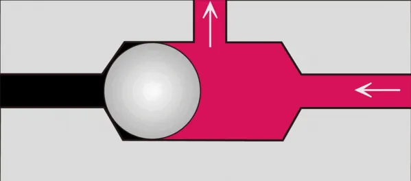

<figure class="eoc-pic eoc-pic-main"><picture><source media="(prefers-reduced-motion: reduce)" srcset="../media/air-logic-valve.still.webp"></picture><figcaption><strong>Animation.</strong> <a href="https://commons.wikimedia.org/wiki/File:Shuttle_valve_action_principle_cross_section.gif">Shuttle valve action principle cross section</a> by 鐵路Railway, <a href="https://creativecommons.org/licenses/by-sa/4.0">CC BY-SA 4.0</a>, from Wikimedia Commons.</figcaption></figure>

A valve whose on/off state is set by air pressure in a control tube instead of by a button or an electric coil; combined with other such valves through tubing it performs simple logic (AND, OR, NOT), memory and timing, and a loop of them oscillates to drive the legs of an electronics-free soft robot from one steady air supply.

**In plain words:** Little air-switched valves that act like electronic switches: air pressure in one tube opens or pinches shut the air path through another tube, so several of them joined with tubing can make 'only if both', 'either one' and 'not' decisions, remember an on/off state, or tick on and off by themselves, letting a soft robot walk or grip with no electronics at all. **Proper term:** Air-logic valve (pneumatic logic element; soft [bistable](../glossary.md#bistable) valve; shuttle valve as the OR element).

**Also called:** air logic control, pneumatic logic, pneumatic logic gate (AND, OR, NOT) (Wikipedia 'Pneumatics'; Power & Motion); fluidic logic, fluidics (strictly, logic with no moving parts, using jets of air or water; Wikipedia 'Fluidics'); soft valve, soft bistable valve, soft kink valve, snap-through membrane valve (Rothemund et al. 2018; Decker et al. 2022); pneumatic Schmitt trigger (a valve with two different switching pressures; Preston et al. 2019); pneumatic transistor, fluidic transistor; microfluidic membrane valve ('Quake valve') (Decker et al. 2022; Hackaday 2025); pneumatic ring oscillator, air oscillator, pneumatic central pattern generator (Drotman et al. 2021; Hackaday 2025); pilot valve, air-piloted valve, pilot-operated valve (Wikipedia 'Pilot valve'); shuttle valve = OR element (Wikipedia 'Shuttle valve'); two-pressure valve = AND element; YES (active AND) element (ATHS Basic Pneumatics module 7; Power & Motion); NOT element (normally open 3-way valve), FLIP FLOP or MEMORY element, ONE-SHOT (impulse) timer, TIME-ON and TIME-OFF delay (Power & Motion); 1-bit pneumatic memory, set-reset latch, toggle (Conrad et al. 2024; Preston et al. 2019); electronics-free control, electronics-free soft robot (UC San Diego; University of Freiburg); FluidSIM (brand): simulation software used in school pneumatics courses to try logic circuits (ATHS Basic Pneumatics module 7).

## How it works

Air pressure in a control (pilot) line pushes a membrane, piston or ball, which opens or blocks the main air path, exactly as a small current switches a transistor or relay (Wikipedia 'Pilot valve'; Power & Motion). In the soft valve, pressurising the lower chamber makes a dome-shaped membrane snap through like a 'popper' toy; the membrane then kinks the tube on one side and unkinks the tube on the other, like kinking a garden hose (Rothemund et al. 2018, via TechXplore). Because it snaps up at a higher pressure than it snaps back, it has two clean states ([hysteresis](../glossary.md#hysteresis), the pneumatic version of a Schmitt trigger), and the same valve becomes a NOT, AND or OR gate depending only on which tubes are connected to which pressures (Preston et al. 2019; Conrad et al. 2024). Feeding the output of an inverter, or a ring of inverters, back to its own input makes it switch on and off by itself, giving the rhythmic signal that drives walking legs (Rothemund et al. 2018; Drotman et al. 2021; Wikipedia 'Ring oscillator'). A shuttle valve is the simplest OR element: pressure at either end pushes the ball against the opposite end, so air from either input reaches the middle outlet but cannot flow back to the other input (Wikipedia 'Shuttle valve').

## Parts

A few parts or a single piece. Industrial air-logic elements are miniature 3-way and 4-way valves (a body, a spool or diaphragm, a small piston worked by the pilot air) (Power & Motion). A shuttle valve is a tube with three openings and a free ball or 'shuttle' inside (Wikipedia 'Shuttle valve'). A soft bistable valve is a cylinder split by a dome-shaped silicone membrane into two chambers, each with a soft tube inside that the membrane kinks (Rothemund et al. 2018, via TechXplore). A 3D-printed gate is one TPU print with two pressure chambers and a 1 mm printed tube between them (Conrad et al. 2024). A low-cost version uses two drinking straws, an elastic tube, a heat-sealed TPU film piston and an elastic band (Decker et al. 2022). A working circuit adds tubing, an air supply and a pressure [regulator](../glossary.md#regulator).

## Everyday examples

- The two-button safety start on a factory press, where both buttons must be pressed together (an AND function, which a school pneumatics course builds with a two-pressure valve) (ATHS Basic Pneumatics module 7)
- Pulsing shower heads, hot-tub jets and toy squirt guns, which use no-moving-parts fluidic oscillators, a cousin of air logic (Wikipedia 'Fluidics')
- A shuttle valve that switches a machine over to a standby air tank when the compressor fails, or works a winch brake (Wikipedia 'Shuttle valve')
- Research toys and robots: an electronics-free drinks dispenser and a soft walking robot that can be run over by a car (University of Freiburg)

## When to use it

Use air logic when a machine already runs on air and you want it to make simple decisions or keep a rhythm without wires: a soft robot that walks from one air supply (Drotman et al. 2021; ScienceDaily 2025), a soft gripper that closes by itself when it touches an object (Rothemund et al. 2018) or releases when turned (Zhai et al. 2023), a two-hand safety start, or an OR choice between two air sources (Wikipedia 'Shuttle valve'). It suits places where electronics are unwanted or can fail: wet, dusty or explosive areas (no sparks; water splashes don't matter) (Power & Motion), near strong radiation, chemicals or MRI machines (University of Freiburg; UC San Diego 2021), and robots that must survive being squashed (University of Freiburg). It is also a hands-on way to learn digital logic.

## When not to use it

Not for complex logic, precise timing or counting: electronic controllers replaced air logic in most new machines because they are smaller, cheaper, more precise and more capable (Wikipedia 'Pneumatics'), and printed air logic is bulky, so it suits simple, predictable patterns like a walking gait (Hackaday 2025). Not over long distances, since air signals in long lines are slow (Power & Motion). Not where you have no clean air supply. If you only need to switch air by hand or from a microcontroller, use a switching (directional or [solenoid](../glossary.md#solenoid)) valve; if air must only flow one way, use a [check valve](../glossary.md#check-valve).

## Details

- **What it does (jobs):**
  - hold or release using power: air pressure in a control tube switches the air supply to soft [actuators](../glossary.md#actuator), grippers or cylinders on and off (Rothemund et al. 2018; Power & Motion)
  - seal it, or pass cables or fluid through: it routes air from one or more inputs to an outlet and blocks or vents the others; a shuttle valve passes air from either of two sources without back flow between them (Wikipedia 'Shuttle valve')
  - change the kind of motion: an oscillator circuit turns one steady air supply into a repeating on-off rhythm that drives legs in turn (Drotman et al. 2021; ScienceDaily 2025)
- **Movement:** multiple: inside, a membrane snaps between two positions (flex), a soft tube kinks or is pinched (flex), or a ball, spool or piston slides a few millimetres (slide); the outside of the valve does not move
- **Directions it can move (degrees of freedom):** 1 inside the valve: the switching part has two positions (open/closed); as a connection between parts it has 0, since it only switches air
- **Special behaviour:**
  - [over-centre](../glossary.md#over-centre) (snaps past a point and stays): the dome membrane snaps through at one pressure and back at a lower one, so the output jumps cleanly between two states (Preston et al. 2019)
  - one-way (moves freely one way, locks the other): a shuttle valve stops air from one input flowing back into the other input (Wikipedia 'Shuttle valve')
  - motion conversion: a ring of inverting valves turns a constant pressure into [oscillating](../glossary.md#oscillating) pressure pulses (Drotman et al. 2021; Hackaday 2025)
  - [fail-safe](../glossary.md#fail-safe--fail-secure) or known state on power loss (depends on the element): soft bistable valves and NOT elements return to their resting state when the air is removed, a MEMORY element resets when supply pressure is turned off, but a FLIP FLOP stays in its last position even with no air supply (TechXplore 2018; Power & Motion)
- **How it holds:**
  - not a holding joint (it moves or passes on motion): it switches air flow rather than holding parts together
  - suction or air pressure: control pressure holds the membrane, piston or ball in its switched position (Power & Motion; Preston et al. 2019)
  - spring force: the springy dome membrane, or an elastic band in the drinking-straw valve, returns it to rest (Rothemund et al. 2018; Decker et al. 2022)
- **Input and output:** Air-pressure signal in -> air-pressure signal out (on/off, digital). Gain: a small control pressure can switch a larger flow or a higher pressure (Decker et al. 2022; Zhai et al. 2023), and the soft silicone gates pass about 2 to 4 L/min (Preston et al. 2019). Speed: printed TPU gates respond in about 100 ms (University of Freiburg); ring oscillators built from complementary ('CMOS-type') soft valves had reached about 0.3 Hz, while designs with a constant bleed (pull-down resistor) reach 10 to 15 Hz (Decker et al. 2022). A steady supply -> rhythmic pulses when wired as an oscillator. Not back-drivable in the logic sense: a shuttle valve's inputs are isolated from each other (Power & Motion), and the output does not switch the input.
- **Power:** powered: needs a supply of compressed air or gas (or vacuum for some membrane valves; Hackaday 2025), but no electricity. Soft logic in the research robots ran from one constant pressure source, a tether or a compressed-gas cartridge (UC San Diego 2021 and 2025). On loss of air: soft bistable valves and NOT elements go back to their resting state, a MEMORY element resets, a FLIP FLOP keeps its last state (TechXplore 2018; Power & Motion). Soft CMOS-type gates use no air while sitting still in either state (Preston et al. 2019).
- **Load:** light: it carries air, not mechanical load. Pressures range from about 15 kPa logic levels in silicone gates (Preston et al. 2019) and 45 to 50 kPa before silicone kink valves fail (Decker et al. 2022), up to 80 to over 750 kPa for printed TPU gates depending on the filament (University of Freiburg); industrial pneumatics normally runs at about 550 to 690 kPa (Wikipedia 'Pneumatics'). The fully soft printed walker survived a car driving over it (University of Freiburg).
- **Play and precision:** not applicable (it does not locate parts); its switching points differ on the way up and down by design (hysteresis), which makes the on/off states clean (Preston et al. 2019)
- **Taking it apart:** removable: discrete valves are joined with push-on tubing and push-in fittings and a circuit can be rearranged after it is built (Preston et al. 2019; Printables 'livMatS Turtle Walker' uses a 4 mm tube socket); fully printed one-piece circuits, such as the UC San Diego gripper and walkers, are permanent (Zhai et al. 2023; ScienceDaily 2025)
- **How often it can be reused:** many times: drinking-straw valves were tested to 10,000 cycles each before an elastic band failed on one (Decker et al. 2022); printed walkers ran non-stop for three days on a constant air supply (ScienceDaily 2025); industrial air-logic elements need clean air for long life (Power & Motion)
- **Sealing:** airtight or pressure: the membrane or tube pinch must hold air in the closed path; printed versions must be printed airtight, which needs tuned TPU settings (Zhai et al. 2023; Recreus interview); bought air-logic elements seal with elastomer seats (Power & Motion)
- **Adjustable:** partly: the switching pressure is set by design and material, e.g. a printed bistable valve tuned from 15.3 to 65.2 kPa by changing material [stiffness](../glossary.md#stiffness) (Wang et al. 2021), or by swapping the elastic band in the drinking-straw valve (Decker et al. 2022); oscillation speed can be changed with the supply pressure (Decker et al. 2022); industrial timers have adjustable orifices (Power & Motion). The logic function changes by re-plumbing the inputs (Preston et al. 2019)
- **Access needed:** end of a tube or shaft: connected where air tubes end, at push-in or barbed ports
- **Materials:** Soft valves: silicone rubber (other elastomers also work) (Preston et al. 2019). Printed valves: flexible TPU filament, e.g. Shore 60A to 82A grades (Zenodo data for Conrad et al. 2024; Recreus interview: only a 70A filament gave the needed layer adhesion and airtightness in their tests), or an experimental 80A TPU (Zhai et al. 2023); multi-material printing in Wang et al. 2021. Low-cost valves: polypropylene drinking straws, elastic tubing, TPU film heat-sealed with parchment paper as a release layer (Decker et al. 2022). Printed rigid valves: PLA with silicone-sheet seals and petroleum jelly (Printables 245125). Industrial elements: metal or plastic bodies with elastomer seals (Power & Motion).
- **Heat, cold, water and wear:** Water, dust and sparks: industrial air-logic works in wet and dusty areas and cannot ignite an explosive atmosphere, but needs clean, dry air or valves block and wear (Power & Motion; HSE HSG39: dirty or wet air can block valves). Radiation and chemicals: soft printed gates are proposed for places that would harm electronics (University of Freiburg). Over-pressure: silicone valves fail at about 45 to 50 kPa (Decker et al. 2022). Wear: elastic bands in straw valves failed after about 10,000 cycles (Decker et al. 2022). Temperature limits of printed TPU valves: ⚑ [uncertain] (no source found).

## Making it

- **Ways to make or get it:**
  - off-the-shelf part: shuttle valves, two-pressure (AND) valves, NOT, FLIP FLOP, MEMORY and timer elements for industrial air-logic control (Power & Motion; Wikipedia 'Pneumatics')
  - 3D print (FDM): one-piece TPU gates and complete walkers and grippers printed with their valves inside (Conrad et al. 2024; Zhai et al. 2023; ScienceDaily 2025); rigid PLA spool-type valves with fittings (Printables 245125)
  - 3D print (multi-material): bistable conical-shell valves (Wang et al. 2021)
  - moulding and casting: silicone membrane valves (Rothemund et al. 2018; Preston et al. 2019)
  - hand assembly from household parts: drinking straws, elastic tube and heat-sealed TPU film (Decker et al. 2022)
- **Printing it in one piece (print in place):** yes: the Freiburg TPU gate prints complete with its hollow chambers and 1 mm internal tube, needs no [support material](../glossary.md#support-material) and is ready to use straight off the printer (Conrad et al. 2024); UC San Diego printed a gripper and legged walkers with their valves in one piece that work with no post-assembly (Zhai et al. 2023; ScienceDaily 2025). Rigid spool-type printed valves are assembled with screws, seals and fittings (Printables 245125)
- **Tools:** none to connect bought valves (push the tube on or into a push-in fitting). To make them: a 3D printer that can print flexible TPU (Conrad et al. 2024; Zhai et al. 2023), or silicone moulds and casting (Preston et al. 2019), or for the low-cost version drinking straws, elastic tubing, fast-drying glue and a heat sealer for TPU film (Decker et al. 2022); an M5 tap for printed rigid valves with push-in fittings (Printables 245125); a pressure regulator and gauge to set the supply
- **Difficulty:** moderate: bought shuttle valves and air-logic elements just plug together (Power & Motion), and drinking-straw valves take under 12 minutes and under US$0.40 each (Decker et al. 2022); printing airtight TPU gates needs a well-tuned printer and 3 to 7 hours per gate (Kendre et al. 2023; Conrad et al. 2024); cast silicone valves are hard (27 hours by moulding, Kendre et al. 2023)

### 3D printing tips

1) Material: use a soft TPU; the Freiburg gates were printed in FilaFlex 60A, 70A and 82A grades (Zenodo), and the researchers said only the 70A grade gave the speed, layer adhesion and airtightness they needed, with membranes as thin as 0.5 mm and nozzles up to 0.8 mm (Recreus interview, a filament vendor's article). 2) Airtightness is the main problem: FFF-printed soft parts 'often ... contain a large number of leaks' (Zhai et al. 2023). Over-extrude: UC San Diego used a 135% flow multiplier (Zenodo 8127332) and the livMatS walker uses 125% (Printables 782835); a maker printing NinjaFlex actuators needed about 140% flow (Printables 11188). 3) Print one continuous path per layer where possible ('like drawing a picture without ever lifting the pencil'), avoid travel moves and retractions, and turn on 'avoid crossing [perimeters](../glossary.md#perimeters)' (ScienceDaily 2023; Recreus interview; Printables 782835). 4) Example settings that worked: 0.3 mm line width, 0.1 mm layers, 2 wall lines (0.8 mm actual wall), 25 mm/s, 230-235 C, cooling fan off for the first layers then 40% (Zenodo 8127332, 80A TPU); or 0.4 mm nozzle, 0.3 mm extrusion width, 0.1 mm layers, 5 perimeters, 10 top and bottom layers, 95% [infill](../glossary.md#infill), 220 C, max volumetric flow 0.5 mm3/s, random seam (Printables 782835, TPU A70). 5) Design so internal channels and chambers need no support, as removing support from a sealed chamber is impossible (Conrad et al. 2024; Recreus interview). 6) Expect long prints: about 7 hours per Freiburg gate (Conrad et al. 2024), about 3 hours for a TPU bistable valve (Kendre et al. 2023). 7) Test each valve on its own with a regulator and gauge before building a circuit. 8) Rigid printed spool valves: print PLA at 100% infill, sand or iron the sealing face smooth, tap M5 threads for push-in fittings and seal with silicone sheet and grease (Printables 245125).

### Buying one (off-the-shelf parts)

Shuttle valve (OR valve); two-pressure valve (AND valve, dual-pressure valve); NOT element (normally open 3/2-way air-piloted valve); YES element; FLIP FLOP (double-piloted 5/2-way valve) and MEMORY element; ONE-SHOT (impulse) timer, TIME-ON and TIME-OFF delay valves; air-piloted 3/2 and 5/2 directional valves; push-button and limit valves (3/2 normally closed) (Power & Motion; ATHS Basic Pneumatics module 7). Also push-in fittings (e.g. M5 to 4 mm tube), 4 mm and 6 mm polyurethane air tube, pressure regulator with gauge, flow-control (needle) valve, silicone tubing, flexible TPU filament (Shore 60A-85A)

## Rules of thumb

- One soft bistable valve can be wired as NOT, AND or OR just by changing which tubes go to which pressures; NOT plus AND (or NOT plus OR) is enough to build any logic circuit (Preston et al. 2019)
- Soft gates have two switching pressures (hysteresis): the output switches when the input rises above one threshold and only switches back below a lower one; Preston et al. used 0 mbar for '0' and 150 mbar (15 kPa) gauge for '1' (Preston et al. 2019)
- An oscillator is a ring of inverters (NOT gates) with the last output fed back to the first; it needs an odd number of at least three (Wikipedia 'Ring oscillator'). UC San Diego's walker used three inverting valves (Drotman et al. 2021); a printed version used five stages to drive five muscles (Hackaday 2025)
- Complementary ('CMOS-type') valve pairs use no air while holding a state but had only reached about 0.3 Hz in oscillators; designs with a constant bleed to atmosphere (a 'pull-down resistor', which in a printed circuit is just a narrowed channel) waste air but oscillate at 10 to 15 Hz (Decker et al. 2022; Hackaday 2025)
- Shuttle valve (OR): if both inputs have pressure, the higher pressure reaches the output. Two-pressure valve (AND): the lower pressure, or the signal that arrives last, reaches the output (ATHS Basic Pneumatics module 7)
- Soft silicone kink valves reach 45 to 50 kPa before the material fails (Decker et al. 2022); printed TPU gates run on 80 to over 750 kPa depending on the filament (University of Freiburg); always feed them through a regulator set below their rating (Wikipedia 'Pressure regulator')
- The printed livMatS walker needs about 1.75 bar (175 kPa) at 3.44 L/min through a 4 mm tube (Printables 782835)
- Industrial air-logic lines longer than about 10 to 15 ft (3 to 4.5 m) cycle noticeably slower than electrical controls, and the air must be clean and dry for reliable switching (Power & Motion)
- Switching pressure of a printed bistable valve was easier to tune by changing material stiffness than geometry: 15.3 to 65.2 kPa (Wang et al. 2021)
- Printing a TPU bistable valve took about 3 hours versus 27 hours for replica moulding (Kendre et al. 2023)

## Common failures

1) Leaks in printed TPU valves: fix by over-extruding, printing continuous paths and avoiding retractions (Zhai et al. 2023; Zenodo 8127332; Recreus interview). 2) Wrong pressure: too low and the membrane never snaps; too high and silicone valves rupture at about 45 to 50 kPa (Decker et al. 2022), so use a regulator and check the switching pressures of each valve. 3) An oscillator that won't start: a ring needs an odd number of at least three inverters (Wikipedia 'Ring oscillator'), and the valves must have enough flow resistance and volume between them to create a delay (Drotman et al. 2021 used a delay element to set the gait). 4) A circuit that starts in the wrong state: memories behave differently when air is removed (FLIP FLOP keeps its state; MEMORY resets) (Power & Motion). 5) Slow or erratic switching from long tubes or dirty, wet air (Power & Motion; HSE HSG39). 6) Worn parts: elastic bands tire after about 10,000 cycles (Decker et al. 2022). 7) Wasted air: bleed (pull-down) designs leak continuously, so a gas cartridge empties faster (Preston et al. 2019; Decker et al. 2022).

## Safety

1) Compressed air can injure: never point it at skin or a person, since even 15 psig (about 100 kPa) can cause serious injury (FRC Zero), and at high pressure it can penetrate the skin and blow particles into eyes (HSE HSG39). 2) A burst or disconnected hose can whip (HSE HSG39); clamp tubes and keep pressure at the lowest that works. 3) Feed soft or printed valves through a pressure regulator set below their rating (Wikipedia 'Pressure regulator'; University of Freiburg; Decker et al. 2022); gas tanks and cartridges need a regulator, and any vessel holding compressed air 'can explode violently once their integrity is lost', even at fairly low pressure (HSE HSG39), so never store pressure in a 3D-printed part. 4) Vent the circuit before undoing fittings (HSE HSG39), and remember a FLIP FLOP or latched circuit can keep an actuator in its last state, so a robot may move when air is turned back on (Power & Motion). 5) Don't use a NOT element as a safety limit switch: it can't tell a stalled cylinder from one at the end of its [stroke](../glossary.md#stroke) (Power & Motion).

## Related

- Switching valve (directional control or solenoid valve): the same job but switched by hand or by electricity; air-logic valves are switched by air
- Check valve: also passes air one way only, but reacts to flow direction, not to a separate control signal
- Tesla valve: a no-moving-parts channel that acts like a leaky fluid 'diode'
- Fluidic amplifier and fluidic oscillator: logic with no moving parts, where one jet of air or water deflects another (Wikipedia 'Fluidics')
- Bistable [compliant mechanism](../glossary.md#compliant-mechanism): the snap-through spring idea used inside the soft valve's membrane
- Push-push latch and click-pen mechanism: mechanical versions of the 'push once on, push again off' toggle that air logic can also do (Preston et al. 2019)
- Soft pneumatic bending actuator, pneumatic artificial muscle and bellows actuators: the soft 'muscles' that air-logic circuits switch
- Pressure regulator and pressure relief valve: needed to give logic circuits a safe, steady supply
- Microcontroller with solenoid valves: the electronic alternative for complex behaviour
- Heat-sealed seam: how the TPU-film piston of the drinking-straw soft valve is made, heat-sealed with parchment paper as a release layer (Decker et al. 2022)

## Make it yourself

- [Desktop fabrication of monolithic soft robotic devices with embedded fluidic control circuits (Zhai et al., UC San Diego; Zenodo dataset)](https://zenodo.org/records/8127332): STL files for a printed normally-open air-switched valve, two soft actuators and an electronics-free autonomous gripper, with the full TPU print settings in the README *(licence: CC0 1.0)*
- [livMatS Turtle Walker - fully integrated bioinspired soft robot (Falk Tauber, Printables) (URL from Printables API, page not opened)](https://www.printables.com/model/782835-livmats-turtle-walker-fully-integrated-bioinspired): One-piece TPU A70 walking robot with built-in pneumatic logic gates from the Freiburg team; walks on 1.75 bar from a 4 mm tube; print settings included *(licence: CC BY-NC-ND)*
- [Pneumatic-mechanical 4/2-way valve (Vincent Groenhuis, Printables) (URL from Printables API, page not opened)](https://www.printables.com/model/245125-pneumatic-mechanical-42-way-valve): Printed PLA air-piloted (or hand-operated) 4/2-way valve with M5 push-in fittings and silicone seals, used as the switching element of a pneumatic Turing machine *(licence: CC BY-NC-SA)*
- [Programmable soft valves for digital and analog control (Decker et al., PNAS 2022)](https://pmc.ncbi.nlm.nih.gov/articles/PMC9546565/): Open-access paper describing soft valves made from drinking straws, elastic tubing, heat-sealed TPU film and elastic bands, with full fabrication steps in its SI appendix (SI not opened) *(licence: CC BY-NC-ND 4.0)*

## Pictures, videos and models

- [Shuttle valve action principle cross section (Wikimedia Commons, user 'Railway')](https://commons.wikimedia.org/wiki/File:Shuttle_valve_action_principle_cross_section.gif): Animated cross-section of a shuttle valve: the ball is pushed to the opposite seat so air from either inlet reaches the outlet (the OR element) *(licence: CC BY-SA 4.0)*
- [Fluidic AND XOR.svg (Joseph Fyfield; Wikimedia Commons)](https://commons.wikimedia.org/wiki/File:Fluidic_AND_XOR.svg): Diagram of a no-moving-parts fluidic gate: two input jets give an AND output and an XOR output *(licence: Public domain)*
- [Electronics free, air-powered robot (JacobsSchoolNews, UC San Diego, YouTube)](https://www.youtube.com/watch?v=X5caSAb4kz0): The four-legged soft robot walking from a constant air supply, controlled by a three-valve pneumatic oscillator *(licence: link only (standard YouTube licence))*
- [3D-printed pneumatic modules replace electric controls in soft robots (University of Freiburg press release, 2024)](https://kommunikation.uni-freiburg.de/pm-en/press-releases-2024/3d-printed-pneumatic-modules-replace-electric-controls-in-soft-robots): Photos and videos of the 3D-printed TPU logic modules, the walking robot being driven over by a car, and the electronics-free drinks dispenser *(licence: link only (photos credited Lucia Brunold and Falk Tauber))*
- [I Printed a Microchip That Runs on Air - A Nervous System for Squishy Robots! (soiboi soft, YouTube)](https://www.youtube.com/watch?v=QJdBp5dGrww): A maker printing membrane valves and channel 'resistors' on an FDM printer and building a five-stage pneumatic ring oscillator that makes a soft robot walk *(licence: link only (standard YouTube licence))*

## Needs confirming

⚑ marks something nobody has confirmed yet: a fact the research could not confirm from a source, a finder value that is a best guess, or an open point from the research notes. Corrections are welcome (see `research/needs-confirming.md`).

- ⚑ 1 sentence on this page marked [uncertain].
- ⚑ Finder value `power_source` = electricity, compressed air, suction (best guess): `power` names several power sources, and not all may apply
- ⚑ Finder value `power_loss` = not applicable (best guess): uses power, but `power` does not say what happens when it is lost
- ⚑ Finder value `usual_process` = off-the-shelf part (best guess): first-listed process is off-the-shelf, but `print_in_place` is yes

## Sources

- <https://en.wikipedia.org/wiki/Shuttle_valve>
- <https://en.wikipedia.org/wiki/Pilot_valve>
- <https://en.wikipedia.org/wiki/Fluidics>
- <https://en.wikipedia.org/wiki/Pneumatics>
- <https://en.wikipedia.org/wiki/Ring_oscillator>
- <https://en.wikipedia.org/wiki/Pressure_regulator>
- <https://techxplore.com/news/2018-12-soft-valves-robots.html>
- <https://www.gmwgroup.harvard.edu/publications/soft-bistable-valve-autonomous-control-soft-actuators>
- <https://pmc.ncbi.nlm.nih.gov/articles/PMC6475414/>
- <https://pmc.ncbi.nlm.nih.gov/articles/PMC9546565/>
- <https://www.ebi.ac.uk/europepmc/webservices/rest/PMC9546565/fullTextXML>
- <https://arxiv.org/abs/2110.01743>
- <https://arxiv.org/abs/2312.01131>
- <https://today.ucsd.edu/story/airwalker>
- <https://www.sciencedaily.com/releases/2023/07/230727212035.htm>
- <https://www.sciencedaily.com/releases/2025/03/250325115131.htm>
- <https://kommunikation.uni-freiburg.de/pm-en/press-releases-2024/3d-printed-pneumatic-modules-replace-electric-controls-in-soft-robots>
- <https://www.sciencedaily.com/releases/2024/02/240201121800.htm>
- <https://zenodo.org/records/10517611>
- <https://zenodo.org/records/8127332>
- <https://recreus.com/en-en/blogs/sci-articles-flexible-tpu-filaflex/soft-robotics-filaflex70a-pneumatic-logic>
- <https://hackaday.com/2025/10/15/printing-an-air-powered-integrated-circuit-for-squishy-robots/>
- <https://www.powermotiontech.com/home/article/21122363/basics-of-pneumatic-logic>
- <https://www.quia.com/files/quia/users/sfah6922/BasicPneumatics2011.2012/ATM1132_Basic_Pneumatics_module_7_Teacher_version.pdf>
- <https://www.frczero.org/pneumatics/pneumatic-safety/>
- <https://www.hse.gov.uk/pubns/priced/hsg39.pdf>
- <https://api.semanticscholar.org/graph/v1/paper/DOI:10.1126/scirobotics.aay2627>
- <https://api.semanticscholar.org/graph/v1/paper/DOI:10.1126/scirobotics.adh4060>
- <https://api.semanticscholar.org/graph/v1/paper/DOI:10.1126/scirobotics.adg3792>
- <https://api.semanticscholar.org/graph/v1/paper/DOI:10.1002/aisy.202400876>
- <https://api.printables.com/graphql/>
- <https://www.printables.com/model/782835-livmats-turtle-walker-fully-integrated-bioinspired>
- <https://www.printables.com/model/245125-pneumatic-mechanical-42-way-valve>
- <https://www.printables.com/model/11188-pillow-soft-robotic-actuator>
- <https://commons.wikimedia.org/wiki/File:Shuttle_valve_action_principle_cross_section.gif>
- <https://commons.wikimedia.org/wiki/File:Fluidic_AND_XOR.svg>
- <https://www.youtube.com/watch?v=X5caSAb4kz0>
- <https://www.youtube.com/watch?v=QJdBp5dGrww>
