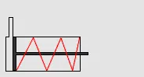
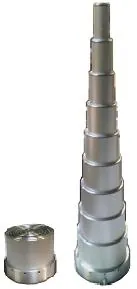
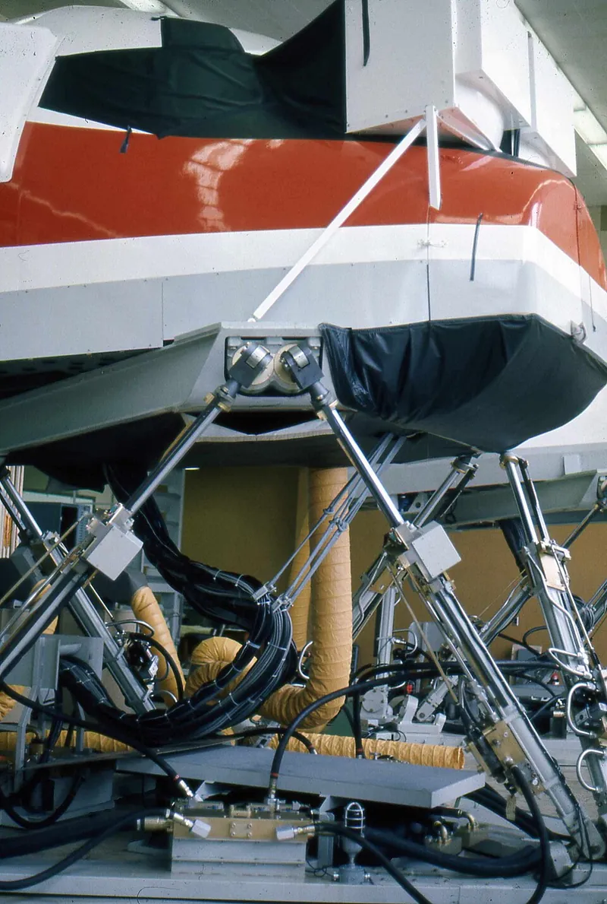

<figure class="eoc-pic eoc-pic-main"><picture><source media="(prefers-reduced-motion: reduce)" srcset="../media/air-or-hydraulic-cylinder.still.webp"></picture><figcaption><strong>Animation.</strong> <a href="https://commons.wikimedia.org/wiki/File:Einfachwirkender_Zylinder_funktionsprinziep.gif">Einfachwirkender Zylinder funktionsprinziep</a> by RainerB., <a href="http://creativecommons.org/licenses/by-sa/3.0/">CC BY-SA 3.0</a>, from Wikimedia Commons.</figcaption></figure>
<figure class="eoc-pic"><figcaption><strong>How it works.</strong> <a href="https://commons.wikimedia.org/wiki/File:8-stage_single-acting_air_cylinder,_Ergo-Help.jpg">8-stage single-acting air cylinder, Ergo-Help</a> by Ergo-Help Pneumatics, Ergo-Help, Inc., <a href="https://creativecommons.org/licenses/by-sa/3.0">CC BY-SA 3.0</a>, from Wikimedia Commons.</figcaption></figure>
<figure class="eoc-pic"><figcaption><strong>Photo.</strong> <a href="https://commons.wikimedia.org/wiki/File:Air_Canada_flight_simulator.jpg">Air Canada flight simulator</a> by Piergiuliano Chesi, <a href="https://creativecommons.org/licenses/by-sa/3.0">CC BY-SA 3.0</a>, from Wikimedia Commons.</figcaption></figure>

A powered straight-line pusher: compressed air or pressurised oil let in behind a sealed piston drives a rod out with a force equal to the pressure times the piston area, and a spring, the load or fluid fed to the other side brings it back.

**In plain words:** A metal tube with a sliding disc inside and a rod sticking out of one end: let compressed air or oil in behind the disc and it shoves the rod out hard; let the air out (or feed the other end) and the rod goes back in. A spring or the load's weight pulls back a one-way type, and a two-way type is driven both ways. **Proper term:** Fluid-power cylinder (pneumatic cylinder or air cylinder; hydraulic cylinder or hydraulic ram).

**Also called:** air cylinder, pneumatic cylinder (Wikipedia); hydraulic cylinder, hydraulic ram, hydraulic [actuator](../glossary.md#actuator), linear hydraulic motor (Wikipedia); 'pneumatic piston' or 'air piston' (informal maker wording seen in model titles); single-acting cylinder (SAC), spring-return cylinder; double-acting cylinder (DAC) (Wikipedia; Tameson); telescopic, telescoping or multi-stage cylinder (Wikipedia); rodless cylinder (magnetically coupled, or slotted with sealing bands), cable cylinder (Wikipedia); through-rod or double-rod cylinder, cushioned (cushion-end) cylinder, tandem cylinder, impact cylinder (Wikipedia); tie-rod cylinder, welded-body cylinder, flanged or threaded-end cylinder (Wikipedia); round or mini cylinder (ISO 6432), profile cylinder (ISO 15552, formerly ISO 6431 and VDMA 24562), compact cylinder (ISO 21287) (Tameson); pneumatic gripper, air gripper (parallel or angular jaws) (Wikipedia; Tameson); swinging, [oscillating](../glossary.md#oscillating) or 'wobbler' cylinder (fed through its pivot; Thang; Printables); floating cylinder, fixed-piston cylinder, three-position cylinder (Thang).

## How it works

The piston divides the tube into two chambers. Letting air or oil into the chamber behind the piston pushes it, with a force equal to the pressure times the piston's area, and the rod passes that force to the load (Wikipedia 'Hydraulic cylinder', 'Pneumatic cylinder'). A single-acting cylinder has one port and is returned by a spring, the load or gravity when the air is let out; a double-acting cylinder has a port at each end and is driven both ways by switching the supply between them with a valve, the return [stroke](../glossary.md#stroke) being a little weaker because the rod takes up part of the piston's area on that side (Wikipedia; Tameson). Air is springy, so an air cylinder is fast and soft-stopping but hard to stop exactly in mid-stroke, while oil hardly compresses, so a hydraulic cylinder is stiff and very strong (Wikipedia 'Pneumatics').

## Parts

A small assembly that acts as one unit: a tube (barrel), two end caps (the cap end and the rod end, which holds the rod seal, wiper and bearing in a '[gland](../glossary.md#gland)'), a piston with seals and guide rings, a piston rod, one or two ports, and often tie rods, a return spring, end cushions and a magnet in the piston for position sensors (Wikipedia 'Hydraulic cylinder'; Tameson). An air gripper adds jaws driven by the piston (Wikipedia 'Pneumatic gripper').

## Everyday examples

- The arms and bucket of a digger (excavator or backhoe) and the tipping body of a dump truck, which uses a telescopic cylinder (Wikipedia 'Hydraulic cylinder', 'Telescopic cylinder')
- The puppets of Disney's Enchanted Tiki Room, moved by air so that no fluid can drip on visitors (Wikipedia 'Pneumatic cylinder')
- Grabbers and launchers on school robot-competition robots (FIRST pneumatics manual)
- Clamps and part ejectors in woodworking and plastics factories (Tameson)

## When to use it

Use an air cylinder for fast, strong, back-and-forth moves between two end positions: grabbing, clamping, pushing, kicking, opening and closing, where a motor would need sensors and gearing to do the same and could burn out when stalled (FIRST pneumatics manual). It is light, simple to control with one valve, and its force is set simply by the [regulator](../glossary.md#regulator) (FIRST). Air suits clean places because leaks don't drip (Wikipedia 'Pneumatic cylinder'), and it absorbs shocks (Wikipedia 'Pneumatics'). Use a single-acting spring-return cylinder where the part must go to a safe position if the air fails (Tameson); a rodless cylinder for long strokes in little space (Tameson); a telescopic cylinder for a long reach from a short body (Wikipedia). Use hydraulics when you need very high force or a stiff hold, as in diggers, presses and lifts (Wikipedia 'Pneumatics'); in animatronics, air drives small figures but large ones need hydraulics (Wikipedia 'Animatronics').

## When not to use it

Not for accurate stopping in mid-stroke or smooth controlled motion: air is springy, so use a lead screw, ball screw or servo motor, or a cylinder with a lock and position feedback (Tameson). Not if you have no compressed-air supply: an electric linear actuator, lead screw or [solenoid](../glossary.md#solenoid) avoids the compressor, tank and noise. Not for continuous rotation (use a motor) or for gentle, soft gripping of odd shapes (use a soft pneumatic actuator, vacuum gripper or jamming gripper). For hobby projects avoid making hydraulics: high pressure brings injection injuries and messy oil leaks (HSE), so use air, syringe hydraulics or electric actuators. For a part that only needs a constant push, a gas spring is simpler.

## Details

- **What it does (jobs):**
  - hold or release using power: pushes, pulls, lifts or clamps when air or oil is let in, and lets go when it is let out (Wikipedia; HSE HSG39 on clamping and lifting cylinders)
  - change the kind of motion: turns fluid pressure into a straight push or pull (Wikipedia 'Hydraulic cylinder')
  - let it move (turn, slide or bend): drives a part back and forth between two end positions, e.g. a robot grabber or a door (FIRST pneumatics manual; Tameson)
- **Movement:** slide: straight in and out along the cylinder's axis, from a few millimetres of stroke upwards; a single-stage cylinder is about 110% of its stroke long when closed, while a telescopic cylinder closes to 20-40% of its extended length (Wikipedia 'Telescopic cylinder'). Mounted on pivots at both ends, the whole cylinder also swings as the mechanism moves (Wikipedia 'Hydraulic cylinder' mounting options; Thang 'Swinging cylinder')
- **Directions it can move (degrees of freedom):** 1: the rod slides in and out along one line. With pivot mounts (clevis or trunnion) at both ends the cylinder acts as a link whose length you control, swinging freely as the mechanism moves (Wikipedia 'Hydraulic cylinder'; Thang)
- **Special behaviour:**
  - motion conversion: fluid pressure becomes a straight-line force (Wikipedia)
  - torque-limiting (here force-limiting): the push can never exceed pressure times area, so setting the regulator sets the maximum force, and an air cylinder 'can stall ... against a load indefinitely with no issue' (FIRST pneumatics manual)
  - [fail-safe](../glossary.md#fail-safe--fail-secure): a spring-return (single-acting) cylinder goes back to its spring position if the air is lost (Tameson); HSE advises controlling cylinders that must reach a safe position with a spring-returned (mono-stable) valve (HSE HSG39)
  - indexing: special cylinders stop at set points, e.g. a three-position cylinder with floating pistons that settles at left, centre or right depending on which port is fed (Thang); tandem cylinders give extra positions ⚑ [uncertain]
  - [self-locking](../glossary.md#self-locking) (hydraulic only): with its ports shut, the almost incompressible oil holds the piston firmly, with 'a minimum of spring action' (Wikipedia 'Pneumatics'), as long as the seals and valve don't leak
- **How it holds:**
  - powered hold: it holds its position or force only while air or oil pressure is kept on it, through a valve (Wikipedia; HSE HSG39)
  - spring force: a single-acting cylinder's return spring holds it at rest, and can provide the clamping force so that a clamp doesn't release if the air fails (HSE HSG39 para 123)
- **Input and output:** Pressurised air or oil (from a compressor, tank, pump or hand pump through a valve) -> straight push or pull. Outstroke force = pressure x piston area; instroke force = pressure x (piston area - rod area), so it is weaker (Wikipedia; Tameson: a 40 mm bore at 4 bar gives 502 N out and, with a 6 mm rod, 491 N back; FIRST: a 2 in bore at 60 psi gives up to 188 lbf). Seal and bearing friction take roughly 3-20% of the force at 4-8 bar (Tameson). Speed depends on how fast air or oil can flow in and out, so it is set with flow-control valves (FIRST pneumatics manual). Arrangement: in line with the rod. Back-drivable: an air cylinder can be pushed back like a spring if the load exceeds pressure x area; a hydraulic cylinder with closed ports cannot (Wikipedia 'Pneumatics').
- **Power:** powered (needs compressed air or gas, or pressurised oil, switched by a valve; Wikipedia). What happens when power is lost depends on the cylinder and the valve: a spring-return cylinder springs back (Tameson); a single-solenoid valve returns to its rest position, sending a double-acting cylinder to that end, while a double-solenoid valve stays where it was (FIRST pneumatics manual). Lifting cylinders 'may collapse dangerously if the supply fails', and clamps may let go (HSE HSG39 paras 122-123). Stored air keeps a machine working for a while after electrical power is lost (Wikipedia 'Pneumatics')
- **Load:** medium to heavy: a 40 mm air cylinder at 4 bar pushes about 502 N (Tameson) and a 2 in (51 mm) bore at 60 psi about 188 lbf (FIRST); hydraulics usually run at 1,000-5,000 psi against 80-100 psi for factory air (Wikipedia 'Pneumatics'), so small hydraulic rams push tons. Strong along the axis in push and pull; weak against side loads, which wear the rod bearing and seals (HSE HSG39 para 117; Tameson), and long rods can buckle when pushing: treat a rod longer than 10 times its diameter as a column and check buckling (Wikipedia 'Pneumatic cylinder')
- **Play and precision:** Repeatable at the two ends of the stroke, where it stops against the end caps or a hard stop (FIRST: 'simply and reliably moves to two locations'). Poor at stopping in mid-stroke with air, which is springy; for that use locking cylinders and position feedback (Tameson FAQ), or hydraulics, which are much stiffer (Wikipedia 'Pneumatics'). The rod has a little play in its bearing; it tolerates very little sideways [misalignment](../glossary.md#misalignment), so connect the load with a rod eye, clevis, spherical rod eye or alignment coupler and guide the load separately (Wikipedia 'Hydraulic cylinder' parts list; Tameson on side loading)
- **Taking it apart:** removable: bolted or pinned in place by its mounts (clevis, trunnion, flange, foot or rod eye) and connected with threaded or push-in fittings (Wikipedia 'Hydraulic cylinder'; HSE HSG39 para 108). Tie-rod cylinders can be fully taken apart for service; welded and crimped ones can't (Wikipedia)
- **How often it can be reused:** effectively unlimited strokes in normal use, though seals wear and are replaced through the gland (Wikipedia); a home-made printed double-acting cylinder passed 10,000 cycles without failing (Hackaday). It can be unmounted and refitted many times
- **Sealing:** airtight or pressure: piston seals, rod seals and static [O-rings](../glossary.md#o-ring) keep air or oil in, and a wiper keeps dirt off the rod (Wikipedia 'Hydraulic cylinder'). Rolling-diaphragm cylinders seal with a rolling rubber sleeve and no sliding seal (Disney Research)
- **Adjustable:** yes: force by setting the pressure regulator, speed with one-way flow-control valves (meter-out preferred), and end-of-stroke cushioning on ISO 15552 cylinders with adjustable cushions (FIRST pneumatics manual; Tameson). The stroke is fixed by the cylinder, but external stops can shorten it, and magnetic pistons with reed or Hall-effect switches report the position (Tameson; HSE HSG39 para 121)
- **Access needed:** both sides: you need to reach both the base mount and the rod-end mount, plus the ports to connect the tubes
- **Materials:** Barrels: aluminium, stainless steel or plastic (Tameson); nickel-plated brass, aluminium, steel or stainless steel for air cylinders (Wikipedia 'Pneumatic cylinder'); honed seamless steel tube for hydraulics, with hard chrome-plated steel rods (Wikipedia 'Hydraulic cylinder'). Seals: nitrile rubber (NBR) or polyurethane for lower temperatures, fluorocarbon (FKM, Viton) for higher; wear bands of filled PTFE, fabric-reinforced resin or bronze (Wikipedia). Working fluid: compressed air, or hydraulic fluid that is mostly mineral oil (Wikipedia 'Hydraulic fluid'); hobby machines such as combat robots are often run on compressed carbon dioxide, which is an asphyxiant and a freezing hazard if vented badly (Wikipedia 'Pneumatics'). Home-made: PVC pipe barrel, printed PLA end caps and piston, steel rod and O-rings (Hackaday); printed TPU 95A seals sanded to fit (Printables 1492011)
- **Heat, cold, water and wear:** Seals set the temperature range: nitrile rubber and polyurethane suit lower temperatures, fluorocarbon (Viton) higher ones (Wikipedia 'Hydraulic cylinder'); ozone can crack pneumatic seals (Wikipedia 'Pneumatics', see-also). Dirty or wet air causes corrosion and blocked valves (HSE HSG39), and humidity, heat or chemicals corrode cylinder bodies (Tameson). Seals dry out and fail without [lubrication](../glossary.md#lubrication) (Tameson). Hydraulic oil can burn, while compressed air has 'a very low chance of fire' (Wikipedia 'Pneumatics'). Printed PLA parts soften when warm and [creep](../glossary.md#creep) under constant load, so keep printed cylinders cool and lightly loaded ⚑ [uncertain: not checked against a source here].

## Making it

- **Ways to make or get it:**
  - off-the-shelf part: ISO round, profile and compact air cylinders, rodless and telescopic cylinders, grippers, hydraulic rams (Tameson; Wikipedia)
  - 3D print (FDM): end caps, pistons, mounts and toy-scale cylinders, used with a bought smooth tube, steel rod and O-rings (Hackaday; Printables 1519000, 1492011)
- **Printing it in one piece (print in place):** no: printed cylinders are assembled from separate end caps, piston and rod with a bought tube, O-rings or printed TPU seals, and fittings (Hackaday; Printables 1519000, 1492011)
- **Tools:** spanners and hex keys for mounts, pins and threaded fittings; a tube cutter, because push-in tubing cut off square seals best (FIRST pneumatics manual lists off-square cuts as a leak cause); a tap to thread printed end caps for standard fittings (Hackaday; Printables 245125 uses an M5 tap)
- **Difficulty:** easy to buy and fit: standard sizes, push-in fittings and a 3/2 or 5/2 valve (Tameson). Moderate to make a low-pressure printed one that seals and lasts (Hackaday: the first version leaked). Hard and not advisable to make hydraulic ones: buy them

### 3D printing tips

1) Buy the tube: a printed bore is not smooth or round enough, so Michael Rechtin used PVC pipe as the barrel and printed only the end caps and piston (Hackaday); another printed design uses 50 mm and 30 mm pipes with an M8 threaded rod, rubber gaskets, super glue and lubricant (Printables 1519000). Note that OSHA's position is that PVC pipe 'shall not be used' for compressed air, after a PVC air line shattered and threw plastic fragments (OSHA), so run such builds at low pressure, behind a guard, or use a bought cylinder. 2) Never hold stored pressure in a printed part: a printed PLA tank burst at 5.5 bar, and its makers warn that 2 bar can do nasty damage (CVRA). 3) Thread the ports: print the end caps solid and tap them for standard push-in fittings (Hackaday; Printables 245125 uses M5 fittings and recommends 100% [infill](../glossary.md#infill) PLA). 4) Seal the piston with O-rings in printed grooves on a steel rod (Hackaday) or with printed TPU 95A seals wet-sanded to fit (Printables 1492011); see O-ring seal for groove sizes. 5) Cushion the ends: Rechtin added springs at both ends to soften the hits, which helped his cylinder pass 10,000 cycles (Hackaday); commercial cylinders use rubber bumpers or air cushions for the same reason (Tameson). 6) Lubricate the seals (Printables 1519000; Tameson lists poor lubrication as a cause of failure). 7) Swinging cylinders: oscillating ('wobbler') air engines feed air through a flat port face at the pivot, which must be printed or sanded smooth to seal (Printables 9878 Oscillating Steam (Air) Engine; Thang 'Swinging cylinder'); moving parts are printed at 100% infill (Printables 9869). 8) Printed engines report hoses popping off at 80 psi (Printables 355266), so clip or clamp the tubes. 9) Test at low pressure first, wear safety glasses, and keep hands out of the stroke (FRC Zero).

### Buying one (off-the-shelf parts)

ISO 6432 round mini cylinders (8-25 mm bore), ISO 15552 profile cylinders (32-320 mm), ISO 21287 compact cylinders (20-100 mm), all up to 10 bar (Tameson); single-acting spring-return and double-acting cylinders; through-rod, cushioned, tandem and impact cylinders; telescopic cylinders; rodless (magnetic or slotted band) and cable cylinders (Wikipedia 'Pneumatic cylinder'); rotary cylinders; parallel and angular pneumatic grippers (Tameson symbols table); hydraulic tie-rod and welded-body cylinders, single-acting rams and bottle jacks (Wikipedia). Mountings: rod eye, rod clevis, spherical rod eye, clevis bracket, trunnion, flange, foot, pivot pins and alignment couplers (Wikipedia 'Hydraulic cylinder'). Also: reed-switch or Hall-effect position sensors, push-in fittings, silencers, one-way flow-control valves, pressure regulators and seal kits (Tameson; FIRST pneumatics manual)

## Rules of thumb

- Force = pressure x piston area: a 40 mm bore at 400 kPa (4 bar) gives 502 N (Tameson); a 2 in bore at 60 psi gives up to 188 lbf (FIRST pneumatics manual)
- The return (instroke) of a double-acting cylinder is weaker because the rod's area is subtracted (40 mm bore, 6 mm rod, 4 bar: 491 N), so size the cylinder for the return stroke if that is the one that does the work (Tameson; Wikipedia)
- Allow for friction of roughly 3-20% of the force at 4-8 bar, plus any spring force in a single-acting cylinder, and choose a cylinder rated slightly above the force you need (Tameson)
- If the rod is longer than 10 times its diameter, check it for buckling (Wikipedia 'Pneumatic cylinder'); avoid side loads, which wear bearings and seals (HSE HSG39 para 117; Tameson)
- Typical pressures: factory air 80-100 psi (5.5-6.9 bar); ISO standard air cylinders up to 10 bar; hydraulics 1,000-5,000 psi (Wikipedia 'Pneumatics'; Tameson). Robot competitions store at 120 psi and work at 60 psi or less (FIRST pneumatics manual)
- Slow a cylinder with one-way flow-control valves that restrict the air leaving it (meter-out); restricting the air going in (meter-in) can make it jerky (FIRST pneumatics manual)
- Single-acting cylinders give less force near the end of the stroke as the spring compresses, and their stroke is limited by the room the spring takes (Tameson)
- Telescopic cylinders close to 20-40% of their extended length, usually have at most 6 stages, and must not carry side loads (Wikipedia 'Telescopic cylinder')
- Mount the valve as close to the cylinder as practical, for quicker response and less wasted air (Tameson)
- A double-acting cylinder that has been emptied (e.g. after an emergency stop) can shoot out when air first returns, so fit a soft-start valve where that could hurt someone (HSE HSG39 para 120)
- Feed moving cylinders with loops of plastic tubing that absorb the movement (HSE HSG39 para 108), through the pivot of a swinging cylinder, or through a hollow fixed piston rod so the hoses stay still (Thang)

## Common failures

1) Side loading wears the rod, bearing and seals and scores the bore: guide the load and use self-aligning rod ends (Tameson; HSE HSG39). 2) Seals dry out without lubrication (Tameson). 3) Dirt, oil and water in the air block or damage it: filter the air (Tameson; HSE HSG39). 4) Hissing leaks from a worn rod seal or damaged piston, giving slow or weak strokes (Tameson). 5) Repeated end-of-stroke shocks damage end caps or loosen the piston: use cushioning (HSE HSG39 para 118). 6) Bent or buckled rods from overload or long strokes (Wikipedia; Tameson). 7) Jerky motion from restricting the incoming air; use meter-out flow control (FIRST pneumatics manual). 8) Slow response from a valve mounted far away or undersized lines (Tameson). 9) Home-made: leaks past printed parts (Hackaday), and hoses popping off fittings (Printables 355266; FRC Zero lists air leaks forcing hoses off).

## Safety

1) Crush and pinch points: cylinders move suddenly and hard; check for people and objects in the path before turning on the air (FRC Zero), and keep hands clear of the stroke. 2) Trapped air: a stopped air cylinder can still move. HSE warns that if a connection to a locked cylinder is broken, air under pressure on the other side of the piston expands and moves it, 'which could lead to injury' (HSE HSG39 para 139). Vent all pressure before working on it (Tameson). 3) An emptied double-acting cylinder can shoot out when air returns; use a soft-start valve (HSE HSG39 para 120). 4) Lifting cylinders can drop their load and clamps can let go if the supply fails; add mechanical props (scotches) or spring-applied clamping (HSE HSG39 paras 122-123). 5) Hard end impacts can eventually break the cylinder or separate the piston from the rod; use cushioned cylinders (HSE HSG39 para 118). 6) Hydraulic injection: a fine jet of oil from a leak can go through the skin; serious cases above 100 bar, possibly as low as 7 bar; get immediate hospital treatment (HSE hydraulic injection bulletin). 7) Never point compressed air at skin, even at 15 psig, and wear safety glasses (FRC Zero); air can 'penetrate the skin' at high pressure (HSE HSG39). 8) Burst hoses can 'whip' and 'snake' (HSE HSG39). 9) Don't use PVC pipe for compressed air (OSHA) and never hold stored pressure in a printed part (CVRA). 10) Manual-override buttons on valves fire the cylinder next to you: use them with 'EXTREME CAUTION' (FRC Zero).

## Related

- Switching valve (directional control or solenoid valve): the valve that sends air to one end or the other; every powered cylinder needs one
- Syringe hydraulics: the hand-powered version, where a second syringe drives the piston instead of a pump and valve
- Gas spring: a sealed cylinder that always pushes, with no supply or valve
- Dampers: cylinders that only resist motion
- Lead screw and nut, and Rack and pinion: electric-motor routes to straight-line motion that can stop anywhere
- Solenoid latch: a small electric push-pull actuator
- Rigid chain actuator: a long-stroke electric pusher
- Pneumatic artificial muscle (McKibben muscle) and Bellows and inflatable actuators: air actuators with no sliding seals, which pull or push softly
- Soft pneumatic bending actuator, Vacuum (suction) gripper and Granular jamming gripper: air-powered grippers without a piston
- Rotary air actuator: pistons driving a rack and pinion to turn a shaft
- Air tank and hydraulic accumulator, Speed-control valve and Pressure regulator: the supply parts around a cylinder
- Clevis joint and Rod end (rose joint): how cylinders are usually mounted
- Linear guides: carry side loads so the cylinder only pushes
- Slip ring and rotary union, and Cable carrier (drag chain): ways to get air to a cylinder that moves or rotates

## Make it yourself

- [Pneumatic cylinder (Henry, Printables) (URL from Printables API, page not opened)](https://www.printables.com/model/1519000-pneumatic-cylinder): Printed pneumatic cylinder parts used with 50 mm and 30 mm pipes, an M8 threaded rod, nuts, rubber gaskets, glue and lubricant *(licence: CC BY)*
- [Lego Pneumatik Zylinder XXL (Andreas, Printables) (URL from Printables API, page not opened)](https://www.printables.com/model/1492011-lego-pneumatik-zylinder-xxl): Large LEGO-compatible pneumatic cylinder printed in PLA with TPU 95A seals wet-sanded to fit *(licence: Public domain)*
- [Oscillating Steam (Air) Engine - 1941 Popular Mechanics Magazine (kmccon, Printables) (URL from Printables API, page not opened)](https://www.printables.com/model/9878-oscillating-steam-air-engine-1941-popular-mechanic): Printed oscillating-cylinder engine run on compressed air: the swinging cylinder is fed through a port face at its pivot, with a reversing lever *(licence: CC BY)*
- [Wobbler Engine 2.0 (kmccon, Printables) (URL from Printables API, page not opened)](https://www.printables.com/model/9869-wobbler-engine-20): Printed 'wobbler' compressed-air engine with a swinging cylinder, 608ZZ bearings and a spring; moving parts printed at 100% infill *(licence: CC BY)*
- [Pneumatic-mechanical 4/2-way valve (Vincent Groenhuis, Printables) (URL from Printables API, page not opened)](https://www.printables.com/model/245125-pneumatic-mechanical-42-way-valve): Printed valve with a small internal cylinder that switches it, which the designer says can also be used as a pneumatic actuator *(licence: CC BY-NC-SA)*

## Pictures, videos and models

- [Einfachwirkender Zylinder funktionsprinziep.gif (RainerB.; Wikimedia Commons)](https://commons.wikimedia.org/wiki/File:Einfachwirkender_Zylinder_funktionsprinziep.gif): Animation of a single-acting cylinder: air pushes the piston out and a spring brings it back *(licence: CC BY-SA 3.0)*
- [Doppelwirkender Zylinder Funktionsprinziep.gif (RainerB.; Wikimedia Commons)](https://commons.wikimedia.org/wiki/File:Doppelwirkender_Zylinder_Funktionsprinziep.gif): Simplified animation of a double-acting cylinder driven both ways through its two ports *(licence: Public domain)*
- [Pneumatic cylinder (animation).gif (Kamarton; Wikimedia Commons)](https://commons.wikimedia.org/wiki/File:Pneumatic_cylinder_(animation).gif): Animated cutaway of a pneumatic cylinder working *(licence: CC BY 3.0)*
- [8-stage single-acting air cylinder, Ergo-Help.jpg (Ergo-Help Pneumatics; Wikimedia Commons)](https://commons.wikimedia.org/wiki/File:8-stage_single-acting_air_cylinder,_Ergo-Help.jpg): Photo of an 8-stage telescopic air cylinder, retracted and extended *(licence: CC BY-SA 3.0)*
- [DIY Pneumatic Actuator Does Great In Action (Hackaday, 2023)](https://hackaday.com/2023/12/23/diy-pneumatic-actuator-does-great-in-action/): Article and embedded video of Michael Rechtin's home-made double-acting cylinder: PVC barrel, printed tapped end caps, printed piston on a steel rod with O-rings, 10,000-cycle test *(licence: link only)*

## Needs confirming

⚑ marks something nobody has confirmed yet: a fact the research could not confirm from a source, a finder value that is a best guess, or an open point from the research notes. Corrections are welcome (see `research/needs-confirming.md`).

- ⚑ 2 sentences on this page marked [uncertain].
- ⚑ Finder value `power_source` = electricity, compressed air, liquid (best guess): `power` names several power sources, and not all may apply
- ⚑ Finder value `power_loss` = lets go (best guess): versions differ: lets go, keeps its last state
- ⚑ Finder value `overload_response` = not applicable (best guess): listed as torque-limiting or breakaway, but no overload behaviour matched
- ⚑ Finder value `powered_does` = move or push something (best guess): set by Claude from the entry's name and power text (R33), for "What should it do?" under "Hold or let go using power"

## Sources

- <https://en.wikipedia.org/wiki/Pneumatic_cylinder>
- <https://en.wikipedia.org/wiki/Hydraulic_cylinder>
- <https://en.wikipedia.org/wiki/Single-_and_double-acting_cylinders>
- <https://en.wikipedia.org/wiki/Telescopic_cylinder>
- <https://en.wikipedia.org/wiki/Pneumatics>
- <https://en.wikipedia.org/wiki/Pneumatic_gripper>
- <https://en.wikipedia.org/wiki/Animatronics>
- <https://en.wikipedia.org/wiki/Hydraulic_fluid>
- <https://tameson.com/pages/pneumatic-cylinders>
- <https://tameson.com/pages/pneumatic-cylinder-parts>
- <https://tameson.com/pages/single-acting-double-acting-pneumatic-cylinder>
- <https://tameson.com/pages/pneumatic-cylinder-force-calculator>
- <https://tameson.com/pages/pneumatic-cylinder-maintenance>
- <https://tameson.com/pages/directional-control-valve-pneumatic-cylinder>
- <https://tameson.com/pages/pneumatic-component-symbols>
- <https://www.firstinspires.org/hubfs/web/program/frc/resources/pneumatics-manual.pdf?hsLang=en>
- <https://www.frczero.org/pneumatics/pneumatic-safety/>
- <https://www.frczero.org/pneumatics/pneumatic-control/>
- <https://www.hse.gov.uk/pubns/priced/hsg39.pdf>
- <https://www.hse.gov.uk/safetybulletins/hydraulic-injection-injury.htm>
- <https://www.osha.gov/publications/hib19880520>
- <https://cvra.ch/blog/2016/airtank>
- <https://hackaday.com/2023/12/23/diy-pneumatic-actuator-does-great-in-action/>
- <https://cs448m.github.io/lectures/machines/doc/3.pdf>
- <https://studios.disneyresearch.com/wp-content/uploads/2016/05/A-Hybrid-Hydrostatic-Transmission-and-Human-Safe-Haptic-Telepresence-Robot-1.pdf>
- <https://api.printables.com/graphql/>
- <https://www.printables.com/model/1519000-pneumatic-cylinder>
- <https://www.printables.com/model/1492011-lego-pneumatik-zylinder-xxl>
- <https://www.printables.com/model/9878-oscillating-steam-air-engine-1941-popular-mechanic>
- <https://www.printables.com/model/9869-wobbler-engine-20>
- <https://www.printables.com/model/355266-3-cylinder-air-engine>
- <https://www.printables.com/model/245125-pneumatic-mechanical-42-way-valve>
- <https://commons.wikimedia.org/wiki/File:Einfachwirkender_Zylinder_funktionsprinziep.gif>
- <https://commons.wikimedia.org/wiki/File:Doppelwirkender_Zylinder_Funktionsprinziep.gif>
- <https://commons.wikimedia.org/wiki/File:Pneumatic_cylinder_(animation).gif>
- <https://commons.wikimedia.org/wiki/File:8-stage_single-acting_air_cylinder,_Ergo-Help.jpg>
