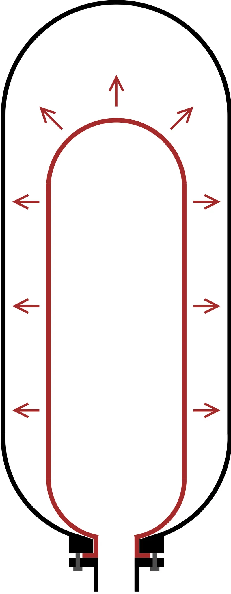
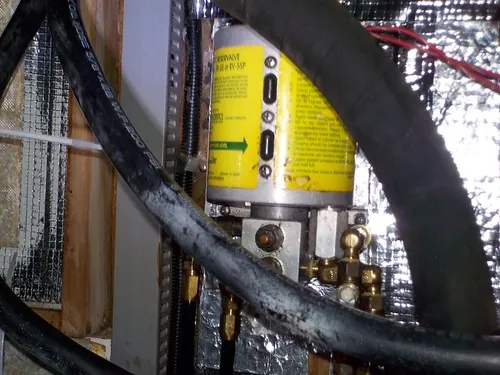

<figure class="eoc-pic eoc-pic-main"><figcaption><strong>Cross-section.</strong> <a href="https://commons.wikimedia.org/wiki/File:Hydraulic_accumulator.svg">Hydraulic accumulator</a> by MasterTriangle12, <a href="https://creativecommons.org/licenses/by-sa/4.0">CC BY-SA 4.0</a>, from Wikimedia Commons.</figcaption></figure>
<figure class="eoc-pic"><figcaption><strong>Photo.</strong> <a href="https://www.flickr.com/photos/136938983@N07/51949887673">Fluid leak, auto-pilot accumulator</a> by MUSTAD MARINE, <a href="https://creativecommons.org/publicdomain/mark/1.0/">Public domain</a>, from Flickr via Openverse.</figcaption></figure>

A rated container that stores air (or oil pushed by trapped gas, a spring or a weight) under pressure, so a small, slow pump can fill it over time and it can then drive short, fast bursts of motion, smooth out pressure pulses or keep a system pressurised.

**In plain words:** A strong, sealed bottle that a pump slowly fills with squashed air, so the pressure is stored like charge in a battery and can be let out in a quick, powerful burst when a valve opens. The oil version (hydraulic accumulator) is a cylinder of oil pushed on by trapped gas behind a rubber bag, by a spring or by a heavy weight. **Proper term:** Air tank (air receiver, compressed-air reservoir) and hydraulic accumulator.

**Also called:** air receiver (UK HSE term), compressed-air reservoir, air reservoir (truck air brakes; Wikipedia 'Air brake (road vehicle)'); pneumatic tank, air storage tank (FIRST Robotics Competition); pressure vessel; gas cylinder or gas bottle (Wikipedia); CO2 cartridge, CO2 charger, CO2 bulb or capsule (8, 12, 16 and 88 g sizes); Powerlet (brand, Crosman) (Wikipedia 'Crosman', 'Bicycle pump'); paintball tank, HPA (high-pressure air) tank, scuba cylinder (Wikipedia 'Water rocket', 'Crosman'); hydro-pneumatic accumulator or gas-charged accumulator: bladder, diaphragm, piston and metal-bellows accumulators (Wikipedia 'Hydraulic accumulator'); spring-loaded accumulator; raised-weight (weight-loaded) accumulator; accumulator tower (Wikipedia); air chamber or air vessel (a pocket of trapped air that smooths pulses and [water hammer](../glossary.md#water-hammer); Wikipedia 'Hydraulic accumulator', '[Reciprocating](../glossary.md#reciprocating) pump'); pressure tank or pressurizer (well-water systems) and expansion tank or expansion vessel (heating systems) (Wikipedia); water rocket pressure bottle (a PET soft-drink bottle; Wikipedia 'Water rocket'); pressurised reservoir of a pump-up water gun, e.g. Super Soaker (brand) (Wikipedia 'Super Soaker'); 'capacitor' (makers' nickname for a small reservoir after a valve; Programmable-Air README).

## How it works

Pumping air into a closed tank squashes it: by Boyle's law, pressure x volume stays constant, so the more air you pack in, the higher the pressure (Wikipedia 'Boyle's law'). A [check valve](../glossary.md#check-valve) keeps it in, and when a valve opens the air rushes out far faster than the small pump could supply, then the pump slowly refills the tank (FIRST pneumatics manual; Wikipedia 'Hydraulic accumulator'). Oil hardly compresses, so a hydraulic accumulator stores the energy in something springy behind the oil: nitrogen gas in a bladder or behind a piston, a heavy spring, or a raised weight; oil pumped in squeezes the gas, and when the system needs more than the pump gives, the gas pushes the oil back out (Wikipedia 'Hydraulic accumulator'). Gas and spring types lose pressure as they empty, a weight type stays almost constant, and a CO2 cartridge holds liquid CO2 that keeps boiling to hold about 57 bar at 20 °C until the liquid runs out (Wikipedia 'Hydraulic accumulator', 'Carbon dioxide').

## Parts

A single strong shell plus a small assembly of fittings that act as one unit. Air tank: the tank, a filling inlet with a check valve, a pressure gauge, a safety (relief) valve, a drain valve for condensed water, a pressure switch on the compressor, a hand vent valve, and a [regulator](../glossary.md#regulator) on the outlet (HSE HSG39; FIRST pneumatics manual). Hydraulic accumulator: a steel shell divided by a rubber bladder, a diaphragm, a floating piston or a welded metal bellows, with a gas-charging valve (usually a Schrader valve) on the gas side and an oil port, often with an anti-extrusion plate or spring-loaded poppet (Wikipedia 'Hydraulic accumulator'; Machinery [Lubrication](../glossary.md#lubrication)). A CO2 cartridge is a single sealed steel capsule pierced by the device that uses it (Wikipedia 'Crosman').

## Everyday examples

- The tank on a workshop air compressor (Wikipedia 'Air pump': the compressor's energy 'is stored in a tank')
- A bike CO2 inflator with a 16 g cartridge (Wikipedia 'Bicycle pump')
- A pump-up water gun with a pressurised reservoir, such as a Super Soaker (brand), and a water rocket made from a drink bottle (Wikipedia 'Super Soaker', 'Water rocket')
- The pressure tank of a home well-water pump or the expansion vessel of a central-heating system (Wikipedia 'Pressure tank', 'Expansion tank')

## When to use it

Add an air tank when a small compressor must drive short, fast moves, such as robot cylinders that act in bursts, or when you want to pre-charge air and run pneumatics without a compressor running all the time (FIRST pneumatics manual). Add a small reservoir after a valve to smooth pressure for soft [actuators](../glossary.md#actuator) (Programmable-Air README calls it a 'capacitor'). Use a hydraulic accumulator to give a short burst of oil far bigger than the pump could supply, to absorb pump pulses and water hammer, to keep pressure through small leaks, or as an emergency reserve, e.g. to apply a brake when power fails (Wikipedia 'Hydraulic accumulator'; Machinery Lubrication). Use a pressure tank to stop a water pump switching on and off for every small draw (Wikipedia 'Pressure tank'), and a CO2 cartridge for a small, portable, one-off gas supply such as tyre or life-jacket inflation (Wikipedia 'Carbon dioxide', 'Bicycle pump').

## When not to use it

1) Never make a tank from 3D-printed parts or PVC pipe; buy a rated one (CVRA; OSHA). 2) Never use stored air to fire projectiles (FRC Zero: 'Never use compressed air to propel a projectile'). 3) If the job is small and slow, such as a hobby soft robot, you may not need stored pressure at all: run the pump directly or use suction, which can never push harder than the atmosphere (about 1 bar) ⚑ [uncertain: design advice, no single source]. 4) Don't feed actuators straight from the tank: use a regulator to get a steady working pressure (FIRST pneumatics manual). 5) Don't charge a hydraulic accumulator with air or oxygen (Machinery Lubrication). 6) A tank is not a safety device: it still needs its own relief valve, gauge and vent (HSE HSG39).

## Details

- **What it does (jobs):**
  - store energy: holds compressed air or pressurised oil until it is needed (Wikipedia 'Hydraulic accumulator': 'a type of energy storage device'; Wikipedia 'Air pump')
  - hold or release using power: lets a small pump drive short, fast cylinder [strokes](../glossary.md#stroke) or soft-actuator moves; a hand vent valve releases all of it (FIRST pneumatics manual)
  - slow it, stop it or keep its speed steady: smooths pump pulses, absorbs water hammer, rides through small leaks and stops a pump switching on and off too often (Wikipedia 'Hydraulic accumulator', 'Pressure tank')
- **Movement:** none: the tank doesn't move. Inside an accumulator a rubber bladder or diaphragm flexes, or a piston slides, as oil goes in and out (Wikipedia)
- **Directions it can move (degrees of freedom):** 0: it is a fixed container; the bladder or piston inside moves with the oil but is not a joint
- **Special behaviour:**
  - none: the tank by itself only stores pressure
  - [fail-safe](../glossary.md#fail-safe--fail-secure) or breakaway (with its fittings): a safety (relief) valve vents above a set pressure and must be able to discharge more air than the compressor can supply (HSE HSG39); FIRST robots must relieve at 125 psi (FIRST pneumatics manual)
  - quick-release (with its fittings): a hand vent plug or self-venting valve empties all the stored pressure (FIRST pneumatics manual; HSE HSG39)
  - one-way (with its fittings): a check valve between pump and tank keeps the air in when the pump stops (Wikipedia 'Hydraulic accumulator': non-return valve next to the pump)
- **How it holds:**
  - not a holding joint (it moves or passes on motion): it stores and releases fluid pressure; nothing is held together by it
- **Input and output:** Not a motion converter. As a store: slow input (a small pump running for minutes) -> fast output (a short burst of the same air or oil), at the stored pressure. The energy stored grows with pressure x gas volume; safety rules size vessels by this product (HSE HSG39: air receivers above 250 bar-litres need a written scheme of examination), and only the gas volume counts, not any liquid in the vessel (Wikipedia 'Pressure vessel'). Output pressure falls as a gas or spring accumulator empties, stays nearly constant with a raised weight (Wikipedia 'Hydraulic accumulator'), and with a CO2 cartridge stays near the vapour pressure (5.73 MPa at 20 °C, Wikipedia 'Carbon dioxide') until it chills from fast use (Wikipedia 'Crosman'). Back-drivable: not applicable
- **Power:** passive (no power needed): it holds pressure with no power at all, which is exactly why it is dangerous; it stays fully pressurised after the compressor or pump is switched off until someone vents it (FIRST pneumatics manual: vent plug 'used to release all stored pressure when operated by hand'; Hydroll; Machinery Lubrication)
- **Load:** heavy pressure in a small package: FIRST robots store up to 120 psi (about 8.3 bar) in tanks rated above 125 psi and use under 60 psi at the cylinders (FIRST pneumatics manual; FRC Zero); CO2 cartridges hold about 57 bar at 20 °C (Wikipedia 'Carbon dioxide'); industrial piston accumulators reach thousands of psi (Wikimedia Commons: an 80-gallon, 6,500 psi piston accumulator); water rockets are pumped to about 50 psi and never above 90 psi (NASA). Mechanically, mount the tank firmly without squeezing it, and shield it from impact (FIRST pneumatics manual)
- **Play and precision:** not applicable
- **Taking it apart:** removable, but only after venting: tanks connect through threaded or push-to-connect fittings and are bolted or strapped down (FIRST pneumatics manual); disposable CO2 cartridges are pierced once and thrown away (Wikipedia 'Crosman')
- **How often it can be reused:** many times for rated metal tanks: steel cylinders can be used indefinitely if they pass periodic inspection and testing (Wikipedia 'Gas cylinder'), e.g. DOT-3AL and DOT-3AA cylinders are tested every 5 years (Wikipedia 'Hydrostatic test'); PET water-rocket bottles weaken and should be retired after 10-15 launches (NASA Glenn water rocket safety); disposable CO2 cartridges once
- **Sealing:** airtight or pressure: rated tanks with sealed threaded or push-to-connect fittings; a good target is less than 10 psi pressure loss in about 30 minutes (FIRST pneumatics manual). Accumulators keep gas and oil apart with a bladder, diaphragm, piston seals or welded bellows; oil slowly [creeps](../glossary.md#creep) past piston seals (Machinery Lubrication)
- **Adjustable:** yes: the stored pressure is set by the compressor's pressure switch and relief valve, and the working pressure by a regulator downstream (FIRST pneumatics manual); an accumulator's gas pre-charge is set through its gas valve with a charging rig, e.g. about 80% of the minimum working pressure for a bladder accumulator used as a reserve, or close to the maximum when used to absorb shocks (Machinery Lubrication)
- **Access needed:** end of a tube or shaft: connections are made at the tank's ports or neck; the drain valve, safety valve, gauges and vent must stay easy to reach and see (HSE HSG39; FIRST pneumatics manual)
- **Materials:** Tanks and cylinders: steel, aluminium, or composite-wrapped metal or plastic liners (Type 1-5 cylinders; Wikipedia 'Gas cylinder'); some rated robot tanks are plastic (FRC Zero); CO2 cartridges are steel (Wikipedia 'Crosman'). Water rockets: PET soft-drink bottles (Wikipedia 'Water rocket'). Accumulator separators: rubber bladders and diaphragms, pistons, welded metal bellows; gas charge: dry nitrogen only (Wikipedia 'Hydraulic accumulator'; Machinery Lubrication). Not suitable: PVC pipe for compressed air (OSHA) and 3D-printed plastic (CVRA test; Prusa: PLA 'breaks along layers or into shards upon impact')
- **Heat, cold, water and wear:** Heat: gas pressure rises with temperature, steeply for CO2 (about 57 bar at 20 °C and supercritical above about 31 °C; Wikipedia 'Carbon dioxide'). Cold: fast discharge chills cartridges and lowers their pressure (Wikipedia 'Crosman'), and chilled PVC and ABS become [brittle](../glossary.md#brittle--ductile) (Wikipedia 'Water rocket'). Water and corrosion: compressed air condenses water, so receivers need draining, and corrosion [fatigue](../glossary.md#fatigue) weakens them until they can explode (HSE HSG39). Chemicals: polycarbonate filter bowls can be weakened by solvents, alcohols and cleaning fluids, and even minor knocks may make damaged bowls explode (HSE HSG39). Store hoses away from heat sources and direct sunlight (FRC Zero). Fatigue: PET bottles weaken with repeated filling and should be retired after 10-15 launches (NASA). Creep: oil slowly passes accumulator piston seals and the gas pre-charge must be checked (Machinery Lubrication); air dissolves into the water of un-bladdered pressure tanks until they become 'waterlogged' (Wikipedia 'Pressure tank'). CO2 escapes through rubber inner tubes faster than air (Wikipedia 'Bicycle pump'). Printed PLA softens above about 60 °C (Prusa).

## Making it

- **Ways to make or get it:**
  - off-the-shelf part: rated air tanks and receivers, robot air tanks, gas and CO2 cylinders and cartridges, hydraulic accumulators, well pressure tanks and expansion vessels; PET drink bottles for water rockets, used within published limits (FIRST pneumatics manual; Wikipedia; NASA)
  - 3D print (FDM): only for parts that never hold pressure, such as tank mounts, guards and water-rocket nose cones and fins (Printables 811753 and 1393152)
- **Printing it in one piece (print in place):** no: never hold stored pressure in a 3D-printed part; print only mounts, shields and other parts that carry no pressure
- **Tools:** spanners and thread sealant (PTFE tape) for threaded fittings; a tube cutter that cuts tubing square for push-to-connect fittings; pressure gauges; soapy water for leak-finding (FIRST: about 4 parts water to 1 part dish soap); for accumulators, a charging rig and a nitrogen bottle (Machinery Lubrication)
- **Difficulty:** easy to buy and fit a rated tank, cartridge or accumulator and its standard valves (FIRST pneumatics manual); hard and dangerous to make your own: don't build pressure tanks from printed parts or PVC pipe (CVRA test; OSHA)

### 3D printing tips

1) Don't print the tank, its caps or its adapters. A club built a printed PLA air tank for a 4 bar robot: a 65 x 40 x 80 mm version exploded into pieces 'just centimeters' from the maker's face at 5.5 bar, and the version that survived still leaked at the corners (CVRA, reported by Hackaday). Printed PLA 'breaks along layers or into shards upon impact' and softens above about 60 °C (Prusa PLA guide), and FDM prints leak through their layers. 2) Do print the things around a rated tank: clamps and mounts (e.g. Printables 811753 for Clippard (brand) robot tanks), impact guards and labels. Don't over-tighten the clamp or squeeze the tank, and place it where other robots or tools can't hit it (FIRST pneumatics manual). Use PETG for mounts near a warm compressor (Prusa: PETG suits temperatures below about 80 °C). 3) Water rockets: the pressure must be held by a real PET drink bottle, not a print; printed nose cones and fins are fine, ideally in flexible TPU for safety (Marimo Labs, Printables 1393152). 4) Hydrostatic (water-filled) testing is far safer than air testing, because liquid stores little energy, but it is not a licence to use printed vessels (Wikipedia 'Hydrostatic test').

### Buying one (off-the-shelf parts)

Rated air tanks and air receivers (marked with their safe working pressure; HSE HSG39); robot air tanks, e.g. Clippard (brand) tanks for FIRST robots (Printables 811753); compressor with pressure switch; safety (pressure relief) valve; pressure gauges; vent plug or self-venting (3-port) ball valve; check valve; pressure regulator; manual or automatic drain valve; push-to-connect and threaded pneumatic fittings, PTFE tape (FIRST pneumatics manual; HSE HSG39); CO2 cartridges (8, 12, 16 and 88 g) and CO2 inflator heads or regulators (Wikipedia 'Crosman', 'Bicycle pump'); paintball and HPA cylinders; hydraulic accumulators (bladder, diaphragm, piston, metal bellows) with charging rigs (Wikipedia; Machinery Lubrication); well pressure tanks and expansion vessels (Wikipedia); hose restraints (whip checks, 'whiplash arrestors'; Wikipedia 'Hydrostatic test'), air fuses and hose-rupture valves, and self-venting quick couplings (HSE HSG39)

## Rules of thumb

- Use only tanks rated above the highest pressure the pump can make: FIRST robots store at most 120 psi in tanks rated above 125 psi, with a relief valve at 125 psi, a regulator down to 60 psi or less for the actuators, two gauges and a hand vent plug (FIRST pneumatics manual; FRC Zero)
- A safety valve must be able to let out more air than the compressor can push in, and must open as soon as the safe working pressure is exceeded; the tank also needs a gauge and a drain (HSE HSG39)
- A tank only helps while its pressure is above the working pressure: once it drops to the pressure the cylinders use, they slow down or stop (FIRST pneumatics manual). By Boyle's law (pressure x volume is constant at constant temperature; Wikipedia), each 1 bar (about 1 atmosphere) the tank drops releases about the tank's own volume of free air; calculated example: a 1 L tank going from 8 bar to 4 bar gauge gives out about 4 L of free air
- Industrial receivers are usually sized at 6-10 times the compressor's free-air output in litres per second (HSE HSG39); for robots, simulate tank pressure over a match with a calculator such as ReCalc (FIRST pneumatics manual)
- Leak test: aim for less than 10 psi drop over about 30 minutes; find leaks with about 4:1 water and dish soap (FIRST pneumatics manual)
- Pre-charge accumulators only with dry nitrogen, never air or oxygen, which can explode on contact with oil under pressure; release all oil pressure before checking the pre-charge (Machinery Lubrication; Wikipedia 'Hydraulic accumulator'; Hydroll)
- A gas or spring accumulator loses pressure as it empties; a weight-loaded one gives almost constant pressure (Wikipedia 'Hydraulic accumulator')
- Water rockets: pump to about 50 psi and never above 90 psi; retire bottles after 10-15 launches; keep spectators back about 26 m at 20 psi, 51 m at 40 psi, 77 m at 60 psi and 102 m at 80 psi (NASA Glenn water rocket safety)
- CO2 is about 57 bar (5.73 MPa) at 20 °C and becomes supercritical above about 31 °C at 73.8 bar, so its pressure climbs steeply when warm; emptying it fast chills it and the pressure drops (Wikipedia 'Carbon dioxide', 'Crosman')
- High-pressure cylinders need periodic testing, e.g. every 5 years for DOT-3AL and DOT-3AA cylinders (Wikipedia 'Hydrostatic test'); UK air receivers above 250 bar-litres are examined every 24-48 months under a written scheme (HSE HSG39)
- Quick-connect hoses wider than 10 mm, longer than 10 m or above 7 bar should have self-venting couplings, or air fuses or hose-rupture valves, to stop them whipping when uncoupled (HSE HSG39)

## Common failures

1) Leaks at threaded fittings without sealant, at push-to-connect fittings with tubing cut off-square or not pushed fully home, from a missing plug, or from a relieving regulator fitted backwards (FIRST pneumatics manual). 2) Tank too small: the pressure falls below the working pressure part-way through use, so cylinders slow or stop (FIRST pneumatics manual). 3) Relief valve missing, wrongly set or blocked, letting pressure climb past 125 psi on a robot (FIRST pneumatics manual) or past a receiver's safe working pressure (HSE HSG39). 4) Water left in the tank, causing corrosion and blocked valves (HSE HSG39). 5) Accumulator pre-charge lost or set too high, which can cut the bladder; neglecting it 'can destroy an operating accumulator' (Machinery Lubrication; Wikipedia). 6) Pressure tanks becoming 'waterlogged' and short-cycling the pump (Wikipedia 'Pressure tank'). 7) CO2 devices 'freezing up' and losing pressure when used rapidly (Wikipedia 'Crosman'). 8) Plastic bottles and printed parts fatiguing, leaking at corners or bursting (NASA; CVRA). 9) Hoses slipping off fittings or whipping (FRC Zero; HSE HSG39).

## Safety

This is the main topic for this entry. 1) Bursting: 'vessels containing compressed air, even at comparatively low pressure, can explode violently once their integrity is lost' (HSE HSG39); the main causes are exceeding the safe working pressure and loss of strength from corrosion fatigue (HSE HSG39). FRC Zero lists 'Tank Shattering' as a hazard. 2) Never hold stored pressure in a 3D-printed part: a printed PLA tank exploded at 5.5 bar centimetres from its maker's face, and the maker warns that 2 bar is enough to do nasty damage (CVRA). Never use PVC pipe for compressed air: OSHA's position is that PVC pipe 'shall not be used' for it, after plastic fragments from a ruptured PVC air line cut a worker's hand (OSHA). 3) Whipping hoses: a burst or uncoupled hose can 'whip' and 'snake' dangerously; restrain hoses and use self-venting couplings or air fuses (HSE HSG39); leaks can also push hoses off their fittings (FRC Zero). 4) Air on skin: compressed air can enter body openings with severe, often fatal, injuries and can penetrate skin; never point it at anyone, even at 15 psig (HSE HSG39; FRC Zero). Wear safety glasses (FRC Zero). 5) Stored pressure stays after the compressor stops: always vent the system with the vent valve before touching fittings or cylinders (FIRST pneumatics manual; HSE HSG39 recommends lockable venting valves). 6) Hydraulic accumulators stay charged after the pump is off: release all pressure before working on them (Hydroll; Machinery Lubrication); a jet of hydraulic oil or grease can be injected under the skin, with injuries reported above 100 bar and possibly as low as 7 bar, needing urgent hospital treatment (HSE hydraulic injection injury alert). Pre-charge only with nitrogen, never air or oxygen, which can explode with oil (Machinery Lubrication). 7) Water rockets: pump to about 50 psi and never above 90 psi, retire bottles after 10-15 launches because they 'can weaken and will explode', wear eye protection, keep people well back, never stand over a pressurised rocket, and remember a rocket that didn't launch is still pressurised (NASA). 8) CO2 and gas cylinders: keep them cool, use a regulator, and leave very high-pressure cylinders to trained people (Wikipedia 'Water rocket'; Wikipedia 'Carbon dioxide' for the temperature effect).

## Related

- Gas spring: a sealed strut whose trapped gas is the spring; the pressure never leaves it
- Coil spring and other springs & energy storage entries: store energy mechanically, with no gas to escape
- Air or hydraulic cylinder: what the tank's stored air usually drives
- Pressure regulator: turns the tank's high, falling pressure into a steady working pressure
- Pressure relief valve: the spring-loaded valve that stops a tank being over-filled; every tank needs one
- Check valve: keeps the air in the tank when the pump stops
- Shut-off valve: the hand valve, ideally self-venting, used to isolate and empty the tank
- Diaphragm pump and squeeze bulb: the small pumps that fill small reservoirs
- Quick couplers for tubes and hoses: self-venting versions stop hoses whipping when uncoupled
- Dampers: an air chamber or accumulator also cushions pressure spikes, much as a damper cushions motion

## Make it yourself

- [FRC Clippard Air Tank Mount - Single and Dual (DeclanD_, Printables) (URL from Printables API, page not opened)](https://www.printables.com/model/811753-frc-clippard-air-tank-mount-single-and-dual): Printed clamps that hold rated Clippard (brand) robot air tanks to 1 x 1 in framing; the printed part carries no pressure *(licence: Public domain)*
- [Water Rocket Parts for 0.5L Polar Seltzer Bottle (Marimo Labs, Printables) (URL from Printables API, page not opened)](https://www.printables.com/model/1393152-water-rocket-parts-for-05l-polar-seltzer-bottle): Printed nose cones (in TPU 'for safety and durability') and fins that clip onto a 0.5 L PET bottle; the bottle, not the print, holds the pressure. Pair with a launcher that follows NASA's pressure limits *(licence: CC BY-NC-SA)*
- [ReCalc pneumatics calculator (FRC & FTC robotics design calculator)](https://www.reca.lc/pneumatics): Web calculator that simulates air-tank pressure over a robot match from tank size, compressor and cylinder use, recommended by the FIRST pneumatics manual *(licence: Free web tool (licence not stated))*

## Pictures, videos and models

- [Hydraulic accumulator.svg (MasterTriangle12; Wikimedia Commons)](https://commons.wikimedia.org/wiki/File:Hydraulic_accumulator.svg): Cutaway of a bladder-type hydraulic accumulator: oil fills around the rubber bladder, compressing the gas sealed inside the shell *(licence: CC BY-SA 4.0)*
- [Pressure tanks empty and in use.jpg (PAR; Wikimedia Commons)](https://commons.wikimedia.org/wiki/File:Pressure_tanks_empty_and_in_use.jpg): Diagram of a diaphragm pressure tank empty at its charging pressure and in use with water squeezing the air, labelled with the pressures and volumes *(licence: CC0)*
- [Water rocket.gif (Anynobody; Wikimedia Commons)](https://commons.wikimedia.org/wiki/File:Water_rocket.gif): Animated illustration of a water rocket: compressed air in the bottle forces the water out of the nozzle *(licence: CC BY-SA 3.0 / GFDL)*
- [Bicycle CO2 inflator with threaded 16 g cartridges (JaredMcKenzie; Wikimedia Commons)](https://commons.wikimedia.org/wiki/File:Bicycle_CO%E2%82%82_inflator_with_threaded_16_g_cartridges.jpg): A bike CO2 inflator head on a threaded 16 g cartridge, with three spare cartridges *(licence: CC0)*
- [Water Rocket Safety (NASA Glenn Research Center)](https://www.grc.nasa.gov/www/k-12/rocket/BottleRocket/safety.htm): Safety rules for pressurised bottle rockets, including the maximum pressure, bottle retirement and a table of safe distances for each pressure *(licence: NASA web page (link))*

## Needs confirming

⚑ marks something nobody has confirmed yet: a fact the research could not confirm from a source, a finder value that is a best guess, or an open point from the research notes. Corrections are welcome (see `research/needs-confirming.md`).

- ⚑ 1 sentence on this page marked [uncertain].
- ⚑ Research note: *Air tank and hydraulic accumulator*: Hackaday's 2016 article on printed air tanks says PVC pipe is safe for compressed air; OSHA's bulletin says never use it. The entry follows OSHA.
- ⚑ Research note: Numbers the agents worked out themselves are labelled "calculated" in *Syringe pump* and *Air tank and hydraulic accumulator* (µL per motor step, syringe pressures, a Boyle's-law example).

## Sources

- <https://en.wikipedia.org/wiki/Hydraulic_accumulator>
- <https://en.wikipedia.org/wiki/Pressure_vessel>
- <https://en.wikipedia.org/wiki/Hydrostatic_test>
- <https://en.wikipedia.org/wiki/Gas_cylinder>
- <https://en.wikipedia.org/wiki/Water_rocket>
- <https://en.wikipedia.org/wiki/Carbon_dioxide>
- <https://en.wikipedia.org/wiki/Crosman>
- <https://en.wikipedia.org/wiki/Bicycle_pump>
- <https://en.wikipedia.org/wiki/Air_pump>
- <https://en.wikipedia.org/wiki/Boyle%27s_law>
- <https://en.wikipedia.org/wiki/Pressure_tank>
- <https://en.wikipedia.org/wiki/Expansion_tank>
- <https://en.wikipedia.org/wiki/Super_Soaker>
- <https://en.wikipedia.org/wiki/Air_brake_(road_vehicle)>
- <https://en.wikipedia.org/wiki/Reciprocating_pump>
- <https://www.hse.gov.uk/pubns/priced/hsg39.pdf>
- <https://www.hse.gov.uk/safetybulletins/hydraulic-injection-injury.htm>
- <https://www.firstinspires.org/hubfs/web/program/frc/resources/pneumatics-manual.pdf?hsLang=en>
- <https://www.frczero.org/pneumatics/pneumatic-components/>
- <https://www.frczero.org/pneumatics/pneumatic-safety/>
- <https://www.osha.gov/publications/hib19880520>
- <https://hackaday.com/2016/06/02/3d-printing-compressed-air-tanks/>
- <https://cvra.ch/blog/2016/airtank>
- <https://www.machinerylubrication.com/Read/31732/understanding-hydraulic-accumulators>
- <https://www.hydroll.com/en/why-must-hydraulic-pressure-be-released-before-checking-accumulator-pre-charge/>
- <https://www.grc.nasa.gov/www/k-12/rocket/BottleRocket/safety.htm>
- <https://www.nasa.gov/wp-content/uploads/2021/11/sls-activity-four-optimize-a-water-rocket.pdf>
- <https://help.prusa3d.com/article/pla_2062>
- <https://help.prusa3d.com/article/petg_2059>
- <https://raw.githubusercontent.com/tinkrmind/programmable-air/master/README.md>
- <https://www.reca.lc/pneumatics>
- <https://api.printables.com/graphql/>
- <https://www.printables.com/model/811753-frc-clippard-air-tank-mount-single-and-dual>
- <https://www.printables.com/model/1393152-water-rocket-parts-for-05l-polar-seltzer-bottle>
- <https://commons.wikimedia.org/wiki/File:Hydraulic_accumulator.svg>
- <https://commons.wikimedia.org/wiki/File:Pressure_tanks_empty_and_in_use.jpg>
- <https://commons.wikimedia.org/wiki/File:Water_rocket.gif>
- <https://commons.wikimedia.org/wiki/File:Bicycle_CO%E2%82%82_inflator_with_threaded_16_g_cartridges.jpg>
- <https://commons.wikimedia.org/wiki/File:Kocsis_Tech_80gal_6.5ksi_piston_accumulator.JPG>
