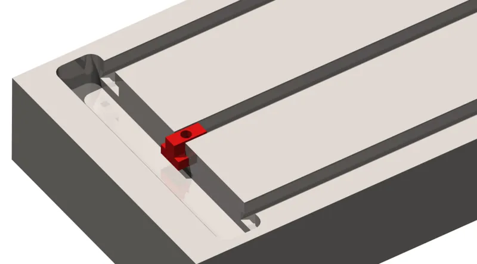
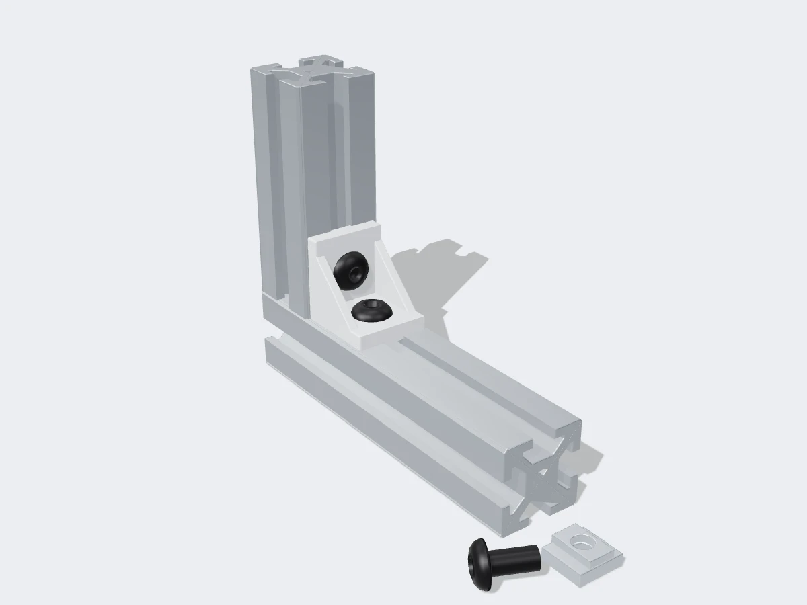

<figure class="eoc-pic eoc-pic-main"><figcaption><strong>Diagram.</strong> <a href="https://commons.wikimedia.org/wiki/File:T-Nut_-_Installed_in_a_T-Slot.png">T-Nut - Installed in a T-Slot</a> by Robert Hewitt, <a href="https://creativecommons.org/licenses/by-sa/3.0">CC BY-SA 3.0</a>, from Wikimedia Commons.</figcaption></figure>
<figure class="eoc-pic"><figcaption><strong>Render.</strong> A 3D model made for the encyclopaedia, not a photo: a stand-in until a good real photo is found. ⚑ Needs confirming: a model can simplify or get details wrong; a real photo is welcome.</figcaption></figure>

A family of nuts, bolts, brackets and hidden connectors that lock into the T-shaped grooves of aluminium extrusion, clamping onto the groove's lips when tightened so bars, panels, motors and accessories can be bolted together anywhere along their length and moved later.

**In plain words:** Special nuts that slide or drop into the grooves along aluminium frame bars, plus the brackets and hidden connectors that bolt onto them, so you can build and rearrange a frame with just hex keys, no welding. **Proper term:** T-slot fasteners for aluminium extrusion (T-slot nuts, brackets and connectors for T-slot structural framing).

**Also called:** T-nut / tee nut / T-slot nut / slot nut / sliding nut (not the same as the furniture T-nut with prongs that is hammered into wood); drop-in T-nut / roll-in T-nut / twist-in T-nut / hammer nut / hammerhead nut / spring T-nut / post-assembly insertion nut (can be added into the middle of a finished frame); slide-in T-nut / economy T-nut / pre-assembly insertion nut (must be slid in from the open end); self-aligning T-nut / anti-rotation T-nut; corner bracket / angle bracket / L-bracket / cast corner bracket / gusset / joining plate / connector plate / tee plate; inner bracket / hidden corner connector / internal corner connector; blind joint / end-tapped joint (a screw in the tapped end hole whose head slides in the other bar's slot); anchor fastener, end fastener, butt fastener, bolt connector, central connector (80/20 and item catalogue names); T-slot bolt / T-slot stud / drop-in T-stud; aluminium profile / aluminium extrusion / 2020, 3030, 4040 extrusion / strut profile / system profile (the bars they fit); V-slot (brand, OpenBuilds: a V-grooved profile that also works as a rail for wheels); 80/20 (brand), item (brand), MISUMI HFS (brand), Bosch Rexroth (brand), MakerBeam (brand); Nutenstein (German); strut channel, metal framing channel, Unistrut (brand)-type channel: the heavier sheet-steel relative, with inward-curving lips and a channel nut that 'may have a spring' (Wikipedia 'Strut channel'); channel nut, spring nut (the nut used inside strut channel; Wikipedia 'Strut channel'); fixed-pitch hole-grid systems: goBILDA (brand), Actobotics (brand) and Meccano (brand), the stepped alternative to a continuous slot (Game Manual 0; Wikipedia 'Meccano').

## How it works

Each side of the bar has a narrow slot opening over a wider hidden channel. The nut is wider than the opening, so once inside it cannot be pulled out through the slot (it interlocks), but it can slide along the groove. When the screw through a bracket or part is tightened, it pulls the nut up against the underside of the slot lips and clamps everything together, so friction (and on some nuts, teeth or ridges biting into the anodised surface) stops sliding. Slide-in nuts must be threaded on from an open end of the bar; drop-in and roll-in nuts are shaped so they can be pushed in anywhere and turned 90 degrees to lock, often with a spring or ball to hold them in place while you fit the screw. Hidden joints instead screw into the tapped centre hole in the end of one bar, with the screw head or a connector clamping inside the other bar's slot. Two relatives use the same ideas. Strut channel (Unistrut (brand)-type) is sheet metal folded into an open channel whose lips curve inwards; parts are fixed 'with a bolt, threaded into a channel nut, that may have a spring to ease installation', and punched versions also have holes or slots at fixed spacings for fixing the channel to walls (Wikipedia 'Strut channel'). Fixed-pitch hole-grid kits swap the continuous slot for a regular grid of holes, so parts can only be moved in whole steps: goBILDA (brand) uses '4mm holes on 8mm grid, M4 screws', Actobotics (brand) is its inch-based relative (Game Manual 0), and Meccano (brand) strips have holes at a standard 1/2 in (12.7 mm) spacing (Wikipedia 'Meccano').

## Parts

A few parts per joint: the extrusion itself (a bar with a T- or V-shaped groove on each side and a hole down the middle), a nut that sits inside the groove (plain block, drop-in or spring-loaded), a screw, and usually a bracket, plate or internal connector; hidden joints may add an end-tapped thread and a drilled access hole.

## Everyday examples

- the frame of a Creality Ender-3 or Voron 3D printer, with T-nuts holding the motors, rails and panels
- hobby CNC routers and laser-cutter frames built from 2020 or 4040 extrusion
- workshop enclosures, machine guards and grow-light racks with acrylic panels held in the slots
- a bicycle trailer or camper-van shelving built from aluminium profile (Wikipedia shows a trekking trailer carrying Euroboxes)
- strut channel (Unistrut (brand)-type) frames supporting pipes, electrical conduit and ventilation ducts in buildings, sometimes hung from threaded rod (Wikipedia 'Strut channel')

## When to use it

When you want a strong, stiff metal frame that you can build with hand tools, adjust, and change later: 3D-printer, CNC and laser frames, robot chassis, test rigs, jigs, enclosures, workbenches, camera or lighting rigs, and shelving. Great when you do not know the final layout yet, because every part can slide along the grooves and new parts can be added mid-bar with drop-in nuts. Also useful as a mounting grid: any accessory with a slot-sized screw can be clamped anywhere along the bar. Strut channel suits cheaper, heavier frames for building services and the workshop: pipe, cable and duct supports, workbenches, shelving and equipment racks, which go together 'with minimal tools' and can be changed later (Wikipedia 'Strut channel'). A hole-grid kit suits robots, where parts should land on standard spacings, for example shafts placed so that chain and belts fit exactly between grid holes (Game Manual 0).

## When not to use it

Not for the cheapest or lightest builds, where wood, plywood or printed parts with [captive nuts](../glossary.md#captive-nut) are cheaper; every joint needs special nuts and brackets (Hackaday: 'what you do need is a lot of special parts'), and their cost adds up. Not for permanent heavy structures that are never changed, where welding or bolted steel is cheaper and stronger; for building services use strut channel. Not where a joint must resist large sliding or twisting loads with only one screw: use two screws per joint, gussets, joining plates or butt fasteners, or add a diagonal brace. Not for precise locating on its own: add dowel pins, a [kinematic coupling](../glossary.md#kinematic-coupling) or a machined reference edge. Not for load-bearing joints with printed T-nuts or brackets.

## Details

- **What it does (jobs):**
  - join and hold: builds frames for 3D printers, CNC machines, robots, enclosures, racks and jigs, and fixes panels, motors, rails and accessories to them
- **Movement:** none once tightened; when the screw is loosened the nut (and whatever it holds) slides freely along the groove for adjustment
- **Directions it can move (degrees of freedom):** 0 when tightened (a joint with a single screw may still be able to twist until another part stops it); 1 when loosened (slides along the groove).
- **Special behaviour:**
  - self-aligning or self-centring: self-aligning or anti-rotation T-nuts have a raised neck that sits in the slot opening, centring the thread and stopping the nut from spinning while you tighten it (80/20; item)
  - none of the others: it is a plain bolted clamp, although drop-in and spring nuts make it quick to add parts to a finished frame
- **How it holds:** friction or clamping (the tightened screw clamps the nut against the slot lips, and friction resists sliding) plus shape (the nut is wider than the slot opening, so it cannot pull out)
- **Input and output:** not applicable
- **Power:** passive (no power needed)
- **Load:** Medium to heavy, depending on size: item's small steel 'T-Slot Nut 5 St M5' (Line 5) is rated 500 N (about 50 kgf) at 4.5 Nm, an item hammerhead nut for 8 mm slots 1,000 N, and a heavy-duty M12 T-slot nut 10,000 N (Wikipedia, citing item). Strong against pulling the nut out through the slot; sliding along the groove is resisted only by clamping friction, so slip under [shear](../glossary.md#peel-vs-shear) is the usual weak point; a joint with a single screw is weak in twist. Printed nuts and brackets are for light duty only.
- **Play and precision:** No play once tightened, but the position is only as good as the cut ends and your assembly: squareness is not automatic (Voron's build guide says measure the diagonals, which should differ by less than 2 mm, and notes that blind-jointed bars may rotate until panels and corners are fitted). Butt fasteners give 'near perfect alignment' end to end (80/20). Slot widths and shapes differ between systems (e.g. 5.25 mm versus 6 mm slots on so-called 20-series bars, and I-type versus B-type profiles), so nuts from one system may fit loosely or bend another's slot lips.
- **Taking it apart:** removable
- **How often it can be reused:** many times: frames can be taken apart, moved and rebuilt, and drop-in or roll-in nuts let you add parts without dismantling; self-tapped threads, over-tightened zinc nuts and toothed nuts that scratch the anodising wear a little each time
- **Sealing:** none (the open slots can be closed with slot cover strips, but the joint does not seal)
- **Adjustable:** Yes: loosen the screw, slide the nut, bracket or part along the groove to any position, and re-tighten; drop-in and roll-in nuts can be added later in the middle of a bar. Hidden end-tapped joints and end fasteners are fixed in position. Hole-grid kits adjust only in steps of the grid, e.g. 8 mm on goBILDA (Game Manual 0).
- **Access needed:** one side only (blind) for T-nuts and brackets, which bolt on from the outside face; hidden end-tapped joints and end fasteners need the end of the bar tapped and an access hole drilled in the mating bar to reach the screw head
- **Materials:** Bars: extruded aluminium, typically 6105-T5 (Wikipedia) or EN AW-6063 T66 (maunsystem), usually anodised. Nuts: zinc-plated or black-zinc carbon steel (80/20 standard slide-in nuts are 1215 carbon steel), stainless steel, or die-cast zinc for light-duty nuts. Brackets and connectors: die-cast zinc, aluminium or steel. 3D-printed PLA or PETG nuts and brackets for light accessories and prototypes. Panels of acrylic, polycarbonate, wood, sheet metal or mesh are fixed into the slots with the same nuts. Strut channel is usually zinc-coated (galvanised), painted, epoxy- or powder-coated sheet steel, with stainless steel, aluminium or fibreglass versions for corrosive or food-processing places (Wikipedia 'Strut channel').
- **Heat, cold, water and wear:** Anodised aluminium and zinc-plated or stainless nuts cope with normal indoor and outdoor conditions; heat is not a problem for the metal parts at maker temperatures, but aluminium grows about 24 µm per metre per °C, so a 300 mm aluminium plate grows about 0.58 mm from 25 °C to 105 °C (Rehorst), which matters where aluminium is bolted rigidly to steel or to a heated bed. Vibration can loosen screws over time: 80/20 sells 'vibration-proof' fasteners (Drop-Lock studs, anchor fasteners), item's hammerhead nut has a [self-locking](../glossary.md#self-locking) thread, and Voron builders are advised to use [threadlocker](../glossary.md#threadlocker) and proper [torque](../glossary.md#torque) (Wikipedia, Voron 2.4). Printed nuts and brackets [creep](../glossary.md#creep) and soften with heat, especially PLA.

## Making it

- **Ways to make or get it:**
  - off-the-shelf part: extrusion cut to length (often pre-tapped), T-nuts, brackets, gussets, joining plates, hidden connectors
  - 3D print (FDM): light-duty T-nuts and nut carriers, corner brackets, accessory mounts, slot covers and drilling jigs for access holes
  - laser cut: joining plates and brackets from aluminium or steel sheet
  - sheet metal: bent brackets and gussets
  - CNC: custom plates and machined connectors
- **Printing it in one piece (print in place):** no: printed T-nuts and brackets are single parts that are bolted on; a printed carrier often holds a standard steel nut
- **Tools:** Hex (Allen) keys or a T-handle hex wrench; a torque screwdriver helps avoid over-tightening. A saw with a square cut or pre-cut lengths. For hidden joints: a tap to thread the end holes and a drill (with a drilling jig) for access holes; anchor fasteners need a [counterbore](../glossary.md#counterbore--countersink); 80/20's self-tapping S12 connecting screws need only a T40 or T50 power bit and drill.
- **Difficulty:** easy: bolt-together with hex keys using bought nuts and brackets; moderate if you make hidden blind joints, which need accurate tapping and drilling of access holes

### 3D printing tips

Measure your own slot first: slot width and lip shape differ between systems and brands (I-type versus B-type, 5 versus 6 mm slots on 20 mm bars), and most printable parts on model sites assume 6 mm slots; a Hackaday reader found 80/20's 20-series slots were only 5.25 mm. Printed T-nuts are for light duty: one maker labels his PETG M5 T-nut 'NOT for structural use', and Hackaday warns that 'plastic brackets and extrusions won't be as strong as those made of metal'. A stronger printed option is a printed carrier that holds a standard steel hex nut (for example the popular drop-in carrier that turns an M3 nut into a T-nut for Ender-3 frames, printed flat on a large face without supports at 0.16 mm layers). If you print threads directly, ORM's T-nut pack recommends PLA or PETG, 100% [infill](../glossary.md#infill), a 0.4 mm or smaller nozzle, 0.12 mm layers, slow speed (about 50 mm/s) and a 2-3 mm brim because the parts are tiny. Brackets: print them lying so the layers run along both legs of the L rather than across the corner, use PETG and solid or high infill (a 5 mm-slot remix of a popular 'strong corner bracket' says it prints without support and works best in PETG), and treat printed brackets as prototypes or light-duty stiffeners until metal ones arrive (the customizable plate-bracket generator's author describes them as for prototyping or temporary use). Choose screw length so the screw passes fully through the nut but does not bottom on the extrusion: bracket thickness plus nut thickness minus about 1 mm (Hackaday: a 10 mm bracket and 6 mm nut take a 15 mm screw). Printed drilling jigs that snap into the slot make accurate access holes for blind joints (e.g. akak's 2020 blind-joint drilling jig for M6 button-head screws). Keep printed parts away from heated beds and hot enclosures if made of PLA (Prusa lists PLA as low in temperature resistance).

### Buying one (off-the-shelf parts)

T-slotted aluminium extrusion / aluminium profile (metric 20, 30, 40, 45 series; fractional 10 and 15 series; V-slot); T-slot nuts: slide-in (economy, standard, double, offset), drop-in / roll-in / twist-in, hammer-head nuts, spring-loaded roll-in nuts (ball spring, spring leaf, [set screw](../glossary.md#set-screw), flex handle), self-aligning / anti-rotation nuts, heavy-duty nuts, die-cast zinc T-slot nuts; T-slot bolts and drop-in T-studs; button-head and low-profile cap screws; corner brackets (cast, with alignment tabs), gussets, L, T and cross joining plates, 90-degree and 45-degree connector plates; inner brackets / hidden corner connectors with set screws; anchor fasteners (need counterbore), end fasteners (need end tap and access hole), butt fasteners, bolt connectors, central connectors; self-tapping connecting screws; end caps and slot cover strips; panel retainers; linear bearings and V-slot wheels that run in the profile.

## Rules of thumb

- Match both slot width and system type: slot width (e.g. 6, 8, 10 mm) must match the nuts, and the system type (I-type or B-type) defines the slot shape; a 'slot 8, B-type' nut may fit an I-type slot 8 but with a smaller bearing surface or wrong web height, damaging the anodising or bending the slot lip open (Motedis, https://www.motedis.com/en/blog/aluminium-profiles-guide; maunsystem, https://www.maunsystem.de/en/blog/slot-width-explained).
- Respect the tightening torque for the nut, not just the screw: item lists 4.5 Nm and a permissible force of 500 N for its steel T-Slot Nut 5 St M5; 8 Nm for Nut 6 St M5; 25 Nm for Nut 8 St M8; only 1-1.5 Nm for its die-cast zinc Zn nuts; and 6 Nm with a permissible operating load of 1,000 N for Hammerhead Nut 8 M6 (item product page https://www.item24.com/en-us/t-slot-nut-5-st-m5-bright-zinc-plated-37001; item T-slot nut datasheet, catalogue pp. 132-138, https://shop.tech-con.ro/media/catalog/product/pdf/item-MB-T-Slot-nuts.pdf).
- A joint is only as strong as the whole chain of T-slot nut, groove flank and screw (item product page, https://www.item24.com/en-us/t-slot-nut-5-st-m5-bright-zinc-plated-37001); the slot lips take the tensile force and their strength depends on the alloy (maunsystem, https://www.maunsystem.de/en/blog/slot-width-explained).
- Anti-rotation versions can be weaker: item's T-slot nut V 8 M8 with anti-torsion feature has 20 percent lower load capacity than the comparable standard nut, and its zinc nuts are 'not suitable for connecting profiles to other profiles' (item datasheet, https://shop.tech-con.ro/media/catalog/product/pdf/item-MB-T-Slot-nuts.pdf).
- Drop-in nuts that twist into place mid-bar 'are the least secure attachment but are often good enough'; slide-in nuts need access to the open end of the slot (Hackaday, https://hackaday.com/2021/05/25/getting-started-with-aluminum-extrusions/).
- Screw length: long enough to pass fully through the nut without bottoming on the extrusion, e.g. a 10 mm bracket plus a 6 mm nut takes a 15 mm screw, leaving a 1 mm margin (Hackaday, https://hackaday.com/2021/05/25/getting-started-with-aluminum-extrusions/).
- Hidden joints need machining: 80/20 end fasteners need an end tap in one bar and an access hole in the other; anchor fasteners need a counterbore; its self-tapping S12 connecting screws need no machining (80/20 Catalog 17, Metric Fastening Options, pp. 712-713, 737, 739, 741, http://www.gawirth.net/Metric_Fastening_Options_8020_Catalog_17.pdf).
- Check squareness: build on a flat surface and measure the diagonals, which should differ by less than 2 mm; blind-jointed bars may rotate until panels and corners are fitted (Voron mechanical assembly guide, https://docs.vorondesign.com/build/mechanical/).
- Heavy loads need heavy-duty nuts: a heavy-duty T-slot nut with an M12 screw is rated to 10,000 N (Wikipedia, citing item, https://en.wikipedia.org/wiki/T-slot_nut).
- Strut channel from different makers fits together because they follow the Metal Framing Manufacturers Association standard (MFMA-4, as of 2020); the basic channel is about 41 mm (1 5/8 in) square, and nuts inside the channel need special sockets, because normal sockets won't fit through the opening (Wikipedia 'Strut channel', https://en.wikipedia.org/wiki/Strut_channel).
- goBILDA's grid is 4 mm holes on an 8 mm [pitch](../glossary.md#pitch) with M4 screws; its 8 mm pitch chain and HTD 3 mm and 5 mm belts fit exactly centre to centre on the grid (Game Manual 0, goBILDA page, https://game-manual-0.readthedocs.io/en/latest/docs/hardware-basics/kit-and-hardware-guide/gobilda.html).

## Common failures

(1) Parts slide under load: screws not tight enough, too few nuts, or a drop-in nut; tighten to the maker's torque, use two nuts or a joining plate, or switch to slide-in or heavy-duty nuts. (2) Nut spins while tightening: use self-aligning or spring nuts, or hold it with a hex key. (3) Wrong-size nut: slot width or I/B-type mismatch; nuts sit crooked, damage the anodising or bend the slot lips; buy nuts for the exact profile. (4) Screw too long bottoms out before clamping, or too short grips only a few threads (Hackaday). (5) Frame out of square or twisted: uneven cut ends or blind-jointed bars rotating; check the diagonals and add corner brackets or panels. (6) Forgot to put a slide-in nut in before closing the frame: use a drop-in nut or take the end off. (7) Stripped end-tap threads: tap straight, clean the chips off the tap between holes (Voron assembly guide) and do not over-torque. (8) Cracked printed nuts or brackets: replace with metal ones for structural joints.

## Safety

Freshly cut extrusion has sharp burrs: deburr the ends and wear gloves and eye protection when cutting and drilling aluminium. Large frames are heavy and can tip over or pinch fingers while being squared; support them while tightening. Do not rely on printed T-nuts or brackets for anything that holds weight overhead or on a moving machine. Using a nut made for a different slot type can bend open the slot lips (maunsystem), leaving a weak joint that may let go later; over-tightening can strip threads or crack die-cast zinc nuts, which item rates for only 1-1.5 Nm.

## Related

- Captive nut pocket (nut trap): a nut held in a printed hexagonal pocket; similar job in plastic parts, but fixed in one position instead of sliding along a groove
- Heat-set threaded insert: a permanent metal thread melted into a plastic part; not adjustable along a slot
- Strut channel (e.g. Unistrut-type steel channel): the same slot-and-nut idea in cheaper, heavier steel for building services (Wikipedia 'See also'); described as a variant under how it works
- Modular grid mounting systems (pegboard, Gridfinity-style grids): hang or clip accessories on a grid of holes instead of sliding them along a continuous groove
- Quick-release plate (dovetail clamp): a clamp that slides and locks in a dovetail groove, usually released by a lever or knob
- Dovetail slide with gib strip: a groove joint designed for smooth sliding motion rather than clamping
- Knock-down furniture fittings (cam locks, cross dowels): hidden bolt-together joints for panels and wood rather than metal bars
- V-slot wheels and linear rails: use the same extrusion grooves as a track for moving carriages
- Threaded rod and studs: long bolts, tie rods and hangers; strut channel frames can be hung from threaded rod

## Make it yourself

- [Customizable Plate Bracket for Aluminium Extrusion Profiles (Misumi 2020, 2040, 4040, ...) (StarrEngineer's Printables port of mightynozzle's Thingiverse thing:2503622) (URL from Printables API, page not opened)](https://www.printables.com/model/382730-customizable-plate-bracket-for-aluminium-extrusion): OpenSCAD/Customizer generator that produces 21 plate brackets (L, T, cross and more) for any extrusion width, number of rails, bracket length and thickness and screw-hole settings; featured on Hackaday in 2017 *(licence: CC BY-NC)*
- [T-nut for 2020 aluminium extrusion profile by ORM (Printables) (URL from Printables API, page not opened)](https://www.printables.com/model/1245868-t-nut-for-2020-aluminium-extrusion-profile): Pack of printable T-nuts for 2020 profiles: drop-in and slide-in, pre-threaded or holding a standard nut, single and double, with print settings *(licence: CC BY-NC)*
- [Drop-in T-Nut 2020 / 2040 extrusion | M3 nut insertion | Ender 3 by Raschmaschine (Printables) (URL from Printables API, page not opened)](https://www.printables.com/model/203578-drop-in-t-nut-2020-2040-extrusion-m3-nut-insertion): Printed drop-in carrier that turns a standard steel M3 nut into a T-nut for Ender-3-style 2020 frames *(licence: CC BY-NC-SA)*
- [2020 Extrusion Blind Joint Drilling Jig by akak (Printables) (URL from Printables API, page not opened)](https://www.printables.com/model/815359-2020-extrusion-blind-joint-drilling-jig): Snap-in drilling guide for 6 mm slots that locates the access holes needed to tighten M6 button-head screws in blind joints *(licence: public domain (CC0))*
- [Strong corner bracket for 2020 aluminium extrusion by Matten79 (Printables; appeared in search results, details read via the Printables API)](https://www.printables.com/model/122072-strong-corner-bracket-for-2020-aluminium-extrusion): Popular printable corner bracket for 2020 extrusion (a 5 mm-slot remix by ripper is Printables model 145209) *(licence: CC BY-NC-SA)*

## Pictures, videos and models

- [T-Nut - Installed in a T-Slot.png (Wikimedia Commons, Robert Hewitt / ManufacturingET org)](https://commons.wikimedia.org/wiki/File:T-Nut_-_Installed_in_a_T-Slot.png): CAD render of a rotating T-nut (red) sitting in the T-slot of an extrusion; the related CAD model of a T-Nut 1-3 images in the same Wikipedia gallery show the nut from several angles *(licence: CC BY-SA 3.0)*
- [T-slot structural framing (Wikipedia)](https://en.wikipedia.org/wiki/T-slot_structural_framing): Photos of T-slotted profiles, a cross-section drawing of 80/20 fractional profiles, a 1964 patent drawing, the table of standard profile sizes and the T-nut gallery *(licence: text CC BY-SA 4.0; images per file (e.g. 8020-Fractional-Profiles-1.svg is CC BY-SA 3.0))*
- [Getting Started With Aluminum Extrusions (Hackaday, Al Williams, 2021)](https://hackaday.com/2021/05/25/getting-started-with-aluminum-extrusions/): Beginner guide with photos of profiles, slide-in, drop-in and spring T-nuts, brackets, inner brackets and blind (end-tapped) joints, plus printed extrusion accessories *(licence: link only)*
- [Aluminum Extrusion Blind Joints – The RIGHT Way to Do It (Brogan M. Pratt, YouTube; title confirmed via YouTube oEmbed)](https://www.youtube.com/watch?v=-I9Jsa1x880): Video of making hidden blind joints: tapping the end of one bar and drilling an access hole in the other *(licence: link only)*
- [SpringNutInPlace.jpg (Wikimedia Commons, by Bob Blaylock)](https://commons.wikimedia.org/wiki/File:SpringNutInPlace.jpg): Photo of a spring-loaded channel nut sitting inside the lips of a strut channel, ready for a bolt (used on Wikipedia 'Strut channel') *(licence: CC BY-SA 4.0)*

## Needs confirming

⚑ marks something nobody has confirmed yet: a fact the research could not confirm from a source, a finder value that is a best guess, or an open point from the research notes. Corrections are welcome (see `research/needs-confirming.md`).

Nothing is marked on this page.

## Sources

- <https://en.wikipedia.org/wiki/T-slot_nut (read as raw wikitext)>
- <https://en.wikipedia.org/wiki/T-slot_structural_framing (read as raw wikitext)>
- <https://en.wikipedia.org/wiki/Voron_2.4 (read as raw wikitext)>
- <https://commons.wikimedia.org/wiki/Category:T-slot_structural_framing>
- <https://commons.wikimedia.org/wiki/File:T-Nut_-_Installed_in_a_T-Slot.png>
- <https://commons.wikimedia.org/wiki/File:Kaffeemaschine_2.0_Rahmen_Schienenmutter1_ICEBE_B25.jpg>
- <https://commons.wikimedia.org/wiki/File:Kaffeemaschine_2.0_Rahmen_Winkel_ICEBE_B25.jpg>
- <https://commons.wikimedia.org/wiki/File:8020-Fractional-Profiles-1.svg>
- <https://commons.wikimedia.org/wiki/File:Aluminiumprofile_item.jpg>
- <http://www.gawirth.net/Metric_Fastening_Options_8020_Catalog_17.pdf (80/20 Catalog 17, Metric Fastening Options, pp. 711-742)>
- <https://www.item24.com/en-us/t-slot-nut-5-st-m5-bright-zinc-plated-37001>
- <https://shop.tech-con.ro/media/catalog/product/pdf/item-MB-T-Slot-nuts.pdf (item T-slot nuts datasheet, catalogue pp. 132-138)>
- <https://www.motedis.com/en/blog/aluminium-profiles-guide>
- <https://www.maunsystem.de/en/blog/slot-width-explained>
- <https://hackaday.com/2021/05/25/getting-started-with-aluminum-extrusions/>
- <https://hackaday.com/2017/12/16/if-3d-printer-then-custom-aluminum-extrusion-brackets/>
- <https://hackaday.com/2023/08/03/better-3d-prints-courtesy-of-a-simple-mass-produced-bracket/>
- <https://docs.vorondesign.com/build/mechanical/>
- <https://voron.dozuki.com/Guide/Voron+0+Assembly+Guide:+01.+Preparing+the+Frame+Extrusions/79>
- <https://drmrehorst.blogspot.com/2017/07/ultra-megamax-dominator-3d-printer-bed.html>
- <https://help.prusa3d.com/article/pla_2062>
- <https://www.youtube.com/watch?v=-I9Jsa1x880 (verified via YouTube oEmbed)>
- <https://www.youtube.com/watch?v=NLeTvSaPJIs (verified via YouTube oEmbed; 'Corner Brackets | Design for Mass Production 3D Printing', Slant 3D)>
- <https://api.printables.com/graphql/ (Printables models 382730, 1245868, 203578, 815359, 122072, 145209 and 1069061 read via the public API)>
- <https://www.printables.com/model/122072-strong-corner-bracket-for-2020-aluminium-extrusion (search result)>
- <https://en.wikipedia.org/wiki/Strut_channel>
- <https://en.wikipedia.org/wiki/Meccano>
- <https://game-manual-0.readthedocs.io/en/latest/docs/hardware-basics/kit-and-hardware-guide/gobilda.html>
- <https://commons.wikimedia.org/wiki/File:SpringNutInPlace.jpg>
