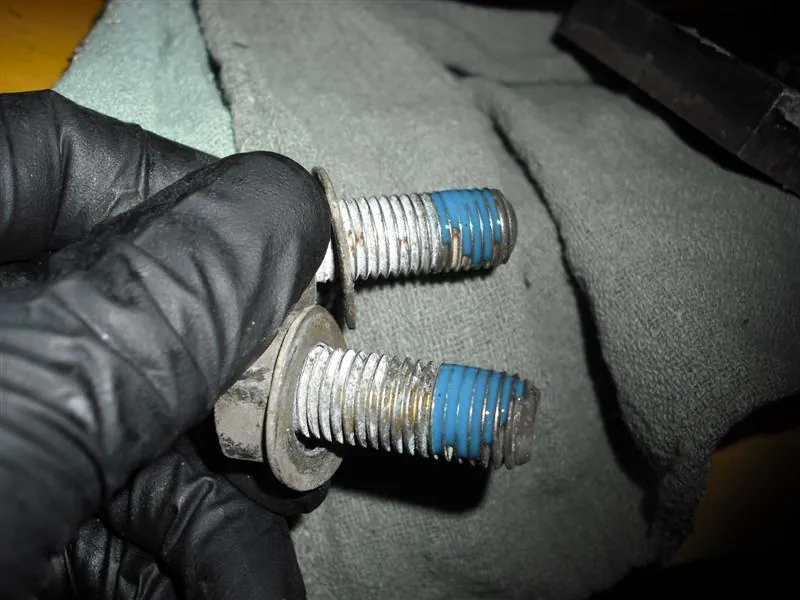
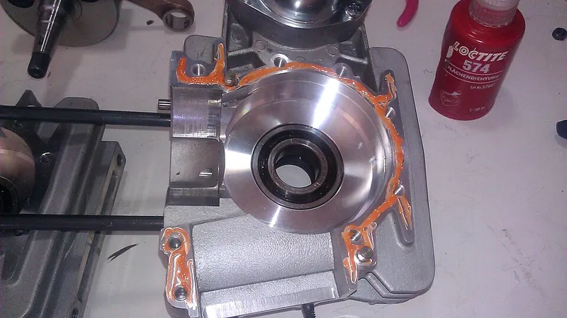
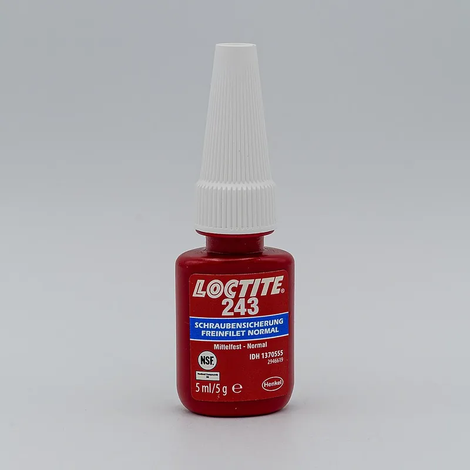

<figure class="eoc-pic eoc-pic-main"><figcaption><strong>How it works.</strong> <a href="https://commons.wikimedia.org/wiki/File:Thread-locking_fluid_applied.jpg">Thread-locking fluid applied</a> by Paul Breen, <a href="https://creativecommons.org/licenses/by-sa/4.0">CC BY-SA 4.0</a>, from Wikimedia Commons.</figcaption></figure>
<figure class="eoc-pic"><figcaption><strong>How it works.</strong> <a href="https://commons.wikimedia.org/wiki/File:Crankcase_Right_SeamSealant.jpg">Crankcase Right SeamSealant</a> by Sean Steven Philipp, <a href="https://creativecommons.org/licenses/by-sa/3.0">CC BY-SA 3.0</a>, from Wikimedia Commons.</figcaption></figure>
<figure class="eoc-pic"><figcaption><strong>Photo.</strong> <a href="https://commons.wikimedia.org/wiki/File:Thread_locking_fluid_Loctite_243.jpg">Thread locking fluid Loctite 243</a> by Hugo LUC, <a href="https://creativecommons.org/licenses/by-sa/4.0">CC BY-SA 4.0</a>, from Wikimedia Commons.</figcaption></figure>

An anaerobic adhesive is a one-part liquid that hardens only when it is shut away from air and touching metal, so it [cures](../glossary.md#cure) inside screw threads and close-fitting shaft joints, locking screws against vibration, holding bearings and gears on shafts, and sealing the gaps against leaks and rust.

**In plain words:** A few drops of coloured liquid you put on a screw thread (or around a shaft) that stays runny in the bottle but turns into hard plastic once it is squeezed between tight metal parts, so the screw can't shake loose and the bearing or gear can't slip. **Proper term:** Anaerobic adhesive ([threadlocker](../glossary.md#threadlocker), thread-locking compound, retaining compound).

**Also called:** threadlocker, thread-locking compound, thread-locking fluid, thread locker (Wikipedia 'Thread-locking compound'); retaining compound, shaft retaining compound (Loctite retaining compounds catalogue; Voron forum); anaerobic thread sealant, pipe sealant, anaerobic gasket maker or flange sealant: the same chemistry used to seal rather than lock (Permabond; Permatex); blue / red / purple / green threadlocker (colour-coded strength grades; Wikipedia; Permatex), 'removable' vs 'permanent' threadlocker; wicking or penetrating threadlocker (green) for screws that are already assembled (Henkel threadlocking guide); pre-applied or pre-coated threadlocker, threadlocker tape, threadlocker stick (Henkel threadlocking guide; LDO Voron kit notes); Loctite 222 / 243 / 242 / 263 / 271 / 290 (threadlockers) and 603 / 620 / 638 / 641 / 648 / 660 (retaining compounds) (brand and product numbers; Henkel); Loctite (brand, often used as a generic name, e.g. 'blue Loctite'), Permatex (brand), Permabond (brand); Schraubensicherung (German, 'screw securing'; Printables listings).

## How it works

The liquid is made of methacrylate building blocks plus a peroxide starter. As long as oxygen can reach it, the oxygen mops up any reaction and it stays liquid, which is why the bottles are only half full and made of air-permeable polyethylene (Loctite threadlocker manual). When it is trapped between a bolt and a nut, air can't get in and metal ions from the surface break the starter into reactive fragments that link the building blocks into a hard, cross-linked plastic (a thermoset) (Loctite threadlocker manual; Wikipedia). The hard plastic fills every gap between the threads, so the nut can no longer rock sideways and shake loose, and it also seals out water and rust (Henkel threadlocking guide). Any glue left outside the joint, in the air, stays liquid and can be wiped away. Retaining compounds are the same chemistry used between a shaft and a bearing, gear or bush: they fill the tiny gap and turn a slip fit or light press fit into a strong, solid joint (Loctite retaining compounds catalogue).

## Parts

Single piece: one liquid, gel, paste stick or tape, no mixing. Optional helpers: a [primer](../glossary.md#primer) or activator for 'inactive' surfaces such as stainless steel, zinc plating or anodised aluminium, and a cleaner or degreaser for oily parts (Henkel threadlocking guide; Loctite retaining compounds catalogue).

## Everyday examples

- The 'blue Loctite' used on bicycle, motorbike and car bolts such as water-pump and oil-pan bolts (Loctite products page; Permatex)
- Grub screws holding the belt pulleys on a 3D printer's motor shafts (Voron forum; LDO Voron kit notes)
- Small screws in electronics, instruments and carburettors locked with purple or green grades (Permatex; Henkel threadlocking guide)
- Bearings, gears and pulleys fixed on shafts in machines, and worn bearing seats repaired with a thick retaining compound (Loctite retaining compounds catalogue)

## When to use it

Use a threadlocker on metal screws, nuts, studs and [set screws](../glossary.md#set-screw) that are shaken, knocked or heated and cooled, where a lock washer or lock nut would add parts or not be reliable (Henkel threadlocking guide), especially on robots, RC models, vehicles, bikes and printer motion systems. Use a retaining compound to fix a bearing, gear, pulley or bush onto a shaft or into a housing when a press fit alone is too weak, when you can't press-fit, or to rescue a slightly worn fit (Loctite retaining compounds catalogue). It also seals the threads against water and rust, which makes screws easier to undo years later (Loctite products page).

## When not to use it

Don't use it on plastic screws, printed threads, powder-coated fasteners or on joints where the liquid will touch ABS, polycarbonate, acrylic, polystyrene or PVC parts; use a CA-based threadlocker, nylon-insert lock nuts or mechanical locking instead (Loctite threadlocker manual; Henkel threadlocking guide). Don't use red (high strength) on small screws or anything you'll need to adjust; the screw may twist off before the joint lets go (Wikipedia). Don't rely on it for loose or badly fitting parts beyond about 0.5 mm gap; it won't cure well (Loctite retaining compounds catalogue; Permabond). Avoid it where the joint gets hotter than its rating (about 150 °C for standard grades) unless you choose a high-temperature grade (Wikipedia; Permatex). For parts you undo often, use lock nuts, spring washers or a reusable non-anaerobic thread-locking coating instead ⚑ [uncertain].

## Details

- **What it does (jobs):**
  - glue or bond: bonds close-fitting metal parts, e.g. a bearing into a housing or a pulley onto a shaft (retaining compounds)
  - join and hold: stops screws, nuts, set screws and studs from loosening under vibration and thermal cycling (threadlockers; Henkel threadlocking guide)
  - seal it, or pass cables or fluid through: seals threads against leaks and corrosion, and related grades seal pipe threads and flanges (Henkel threadlocking guide; Permatex)
- **Movement:** none: a fixed joint. Low- and medium-strength threadlockers still let you undo the screw later with ordinary tools (Loctite products page).
- **Directions it can move (degrees of freedom):** 0: once cured, the screw or shaft is locked to its partner
- **Special behaviour:**
  - none of the listed behaviours in the strict sense. Its own tricks are curing only where it is needed (inside the joint, not in the bottle or on the outside), being graded by strength so you can choose how hard the joint is to undo, and a 'wicking' grade that [creeps](../glossary.md#creep) into screws that are already tightened (Henkel threadlocking guide; Loctite threadlocker manual). Its effect is close to [self-locking](../glossary.md#self-locking): it stops a screw undoing itself under vibration, while still allowing a person to undo low- and medium-strength grades with a spanner (Loctite products page)
- **How it holds:**
  - [material bond](../glossary.md#form-fit--force-fit--material-bond) (glue, solvent or melting): the hardened plastic bonds to both metal surfaces (Henkel threadlocking guide)
  - shape (the parts interlock; form-fit): the solid plastic fills the gaps between the threads or around the shaft, so the parts can't shift or rock (Henkel threadlocking guide; Loctite threadlocker manual)
  - friction or clamping (force-fit): the screw is still held by its clamping force, and the threadlocker adds friction and break-loose [torque](../glossary.md#torque); retaining compounds add to the grip of press fits (Loctite threadlocker manual; Loctite retaining compounds catalogue)
- **Input and output:** not applicable
- **Power:** passive (no power needed): it cures by itself at room temperature once air is shut out; heat or an activator only speeds it up (Loctite threadlocker manual; Permatex).
- **Load:** light to heavy, chosen by grade. On a 3/8-16 (about M10) bolt, typical torque to break loose is about 7 N·m for purple, 12-20 N·m for blue and 25 N·m for red, and the strongest permanent grades reach about 21 MPa (3,000 psi) in [shear](../glossary.md#peel-vs-shear) (Wikipedia, from a Permatex guide). Makers' figures vary: Henkel lists Loctite 243 at 230/40 in-lb (about 26/4.5 N·m) break/prevail on M10 steel in one chart and 106/26 in-lb in another (Henkel properties chart; Henkel threadlocking guide). Retaining compounds reach about 6.5-31 N/mm² (MPa) shear strength, e.g. Loctite 603: 22.5, 638: 29, 648: 31, 641 (medium, for parts that must come apart): 6.5 (Loctite retaining compounds catalogue). Strong against twisting and shaking loose; it adds to, but does not replace, a correctly tightened screw.
- **Play and precision:** No play once cured: it fills the [clearance](../glossary.md#clearance) in the threads so the parts can't rock sideways (Henkel threadlocking guide). It needs close fits: retaining compounds are chosen by gap, low-viscosity grades up to 0.15 mm, thicker grades 0.15-0.25 mm, and special pastes 0.25-0.5 mm for badly worn parts (Loctite retaining compounds catalogue); larger gaps cure slower and need an activator (Loctite threadlocker manual; Permabond). It does not fix the position more accurately than the parts' own fit.
- **Taking it apart:** Depends on the grade. Low strength (purple) and medium strength (blue): removable with normal hand tools. High strength (red): semi-permanent (can be undone but may damage parts); it needs local heating to about 230-260 °C and undoing while hot, and forcing it may twist the bolt off (Wikipedia; Loctite products page; Permatex; Henkel threadlocking guide). Retaining compounds: high-strength grades are for joints that won't be taken apart; lower-strength grades are chosen when parts must come apart for maintenance (Loctite retaining compounds catalogue).
- **How often it can be reused:** once: each application is single-use; clean off the old plastic and apply fresh liquid when you reassemble. The screws and parts themselves can be reused
- **Sealing:** airtight or pressure: the cured plastic fills the thread gaps and seals them against leakage and corrosion; threadlockers keep oil and coolant in through-bolts on gearboxes and engines, and dedicated anaerobic thread sealants are used on pipe fittings (Henkel threadlocking guide; Permatex). Ordinary threadlocker is not a gasket for large gaps.
- **Adjustable:** Only before it cures: there are minutes before it sets (typical fixture time 10-20 minutes on steel at room temperature, about 5 minutes with an activator; full cure in 24 hours) (Henkel threadlocking guide; Permatex). Low- and medium-strength grades can be broken loose later to re-adjust, then re-applied. A wicking grade can lock a screw after it has been adjusted (Henkel threadlocking guide).
- **Access needed:** one side only (blind): drops go on the male thread or into a blind hole before assembly; a wicking grade can be dripped onto the joint from outside after assembly (Henkel threadlocking guide)
- **Materials:** Made of methacrylate resins; cured it is a hard thermoset plastic (Wikipedia; Loctite threadlocker manual). Works on metal-to-metal joints. Fast-curing 'active' metals: iron, plain steel, copper, brass, bronze. Slow or 'inactive' metals that need a primer (unless you choose a primerless or surface-insensitive grade such as Loctite 243 or 638): stainless steel, zinc plating, galvanised steel, anodised or pure aluminium, titanium, cadmium, magnesium, black oxide, silver and gold (Henkel threadlocking guide; Loctite threadlocker manual; Loctite retaining compounds catalogue). Plastics: not recommended for plastic or powder-coated fasteners because they don't start the cure, and it can attack some plastics and cause stress cracking; Henkel rates ABS, acrylic (PMMA), ASA, polycarbonate, polystyrene, PVC, SAN and PPO as 'often not suitable', and nylon, acetal (POM), PET, PE, PP, PU, epoxy and phenolic as 'often suitable, test to verify' (Loctite threadlocker manual). PLA and PETG are not listed ⚑ [uncertain]. For plastic-to-plastic threads Henkel suggests a cyanoacrylate-based threadlocker such as Loctite 425 (Henkel threadlocking guide; Loctite threadlocker manual).
- **Heat, cold, water and wear:** Heat: most grades work from about -54 to +150 °C; above this the plastic softens and strength drops (Wikipedia; Permatex); high-temperature grades reach 232-340 °C (Permatex; Henkel threadlocking guide). Deliberate heating to about 230-260 °C releases high-strength grades (Wikipedia; Permatex). Cold: cures slowly when parts are cold; below +5 °C use an activator (Loctite retaining compounds catalogue; Loctite threadlocker manual). Chemicals: the cured thermoset 'resists most solvents' and is used in oil- and coolant-filled engines and gearboxes (Loctite threadlocker manual; Henkel threadlocking guide). Water and rust: sealing the threads prevents corrosion (Loctite products page). Vibration: this is what it is for; in Henkel's transverse vibration (Junker) test a threadlocked bolt kept its clamp load better than nylon nuts, serrated flanges and split or tooth washers (Henkel threadlocking guide). Creep: it does not stop the clamping force being lost if the bolt itself stretches or the joint settles (Henkel threadlocking guide) ⚑ [uncertain].

## Making it

- **Ways to make or get it:**
  - off-the-shelf part: small bottles of liquid (purple, blue, red, green), semi-solid sticks, threadlocker tape, pre-coated screws, retaining compounds and primers/activators (Henkel threadlocking guide; LDO Voron kit notes)
  - 3D print (FDM): used on the metal hardware of printers and printed machines, e.g. grub screws holding pulleys on motor D-shafts (Loctite 222 in the Voron documentation, per the Voron forum; LDO kits include threadlocker or pre-coated set screws); a retaining compound such as Loctite 641 has been used to fix pulleys on motor shafts (Voron forum)
  - CNC and metalwork: locking set screws and studs, fixing bearings, bushes, gears and pulleys on shafts, and repairing worn bearing seats without re-machining (Loctite retaining compounds catalogue)
  - robotics, RC, bicycles and vehicles: screws exposed to vibration (Loctite products page; Permatex)
- **Printing it in one piece (print in place):** no: it is applied to metal fasteners and shafts during assembly; it is not a printed feature
- **Tools:** The liquid (a few drops from the bottle; don't touch the tip to the metal, or glue in the bottle may start curing; Loctite threadlocker manual; Wikipedia), a degreaser or cleaner for oily parts, and a primer/activator for inactive metals or cold conditions (Henkel threadlocking guide; Loctite retaining compounds catalogue). Normal spanners, hex keys and screwdrivers to assemble. For removing high-strength grades: a heat source such as a blowtorch, heat-resistant gloves and safety glasses (Loctite products page). Nitrile or similar protective gloves (Loctite 243 SDS).
- **Difficulty:** easy: a drop on a clean thread and tighten as normal. The skill is choosing the right strength (purple for small screws, blue for normal service, red only for joints you never want to undo) and keeping it off printed plastic

### 3D printing tips

1) Use it on metal-to-metal joints only: screw into a metal nut, brass threaded insert or metal part, set screws on metal shafts, bearings on metal shafts (Henkel threadlocking guide; Loctite threadlocker manual). 2) Keep it off printed plastic: it does not cure on plastic and can stress-crack ABS, ASA, polycarbonate, acrylic and polystyrene (and, by extension, possibly HIPS) (Loctite threadlocker manual) ⚑ [uncertain for PLA and PETG, which Henkel does not list]. If you need to lock a screw in a printed thread, use a CA-based threadlocker (e.g. Loctite 425), a nylon-insert lock nut, a drop of CA or design in a friction feature (Henkel threadlocking guide). 3) Choose the weakest grade that works: for the small M2-M5 screws common in printers, low-strength purple (e.g. 222) is 'ideal for fasteners < 1/4 in (6 mm)'; blue for 1/4-3/4 in (6-20 mm); avoid red on anything you may need to adjust (Henkel threadlocking guide; Permatex). A Prusa MK2 builder who used red on the probe nut cracked the printed mount when trying to adjust it (Prusa forum). 4) Grub screws on motor pulleys: the Voron manual and documentation suggest 'grub screws with Loctite 222' (low strength) to secure pulleys on motor D-shafts, and LDO's later kits ship set screws pre-coated with threadlocker (Voron forum; LDO Voron kit notes). 5) Stainless and zinc-plated screws (very common in maker kits) are 'inactive': choose a primerless grade such as 243 or use an activator, or cure will be slow and weak (Henkel threadlocking guide). 6) Degrease oily screws and let it cure 24 hours before heavy loading; warm parts cure faster, cold parts slower (Henkel threadlocking guide; Loctite threadlocker manual). 7) Wipe off any excess that might run onto printed parts; it stays liquid in air (Loctite threadlocker manual) ⚑ [uncertain whether this liquid excess harms PLA or PETG].

### Buying one (off-the-shelf parts)

Search for 'threadlocker' by strength: 'low strength threadlocker purple' (e.g. Loctite 222), 'medium strength threadlocker blue' (Loctite 242 / 243, Permatex 242 blue), 'high strength threadlocker red' (Loctite 263 / 271), 'wicking threadlocker green' (Loctite 290), 'high temperature threadlocker' (Loctite 2422 / 2620), 'threadlocker stick' (Loctite 248 / 268), 'threadlocker tape' (Loctite QuickTape 249) and 'pre-applied threadlocker' or 'pre-coated screws'. For shafts: 'retaining compound' (Loctite 603, 620, 638, 641, 648, 660). Helpers: 'anaerobic primer' or 'activator' (Loctite SF 7649, SF 7240, 7088 primer stick; cleaner SF 7063; Permatex Surface Prep 24163). Related sealants: 'anaerobic thread sealant' and 'anaerobic gasket maker'. (Henkel threadlocking guide; Loctite retaining compounds catalogue; Permatex)

## Rules of thumb

- Pick strength by screw size and removability: low strength (purple) for fasteners under 1/4 in (6 mm), medium (blue) for 1/4-3/4 in (6-20 mm) and removable with hand tools, high (red) for 1/4-3/4 in and above when it may need heat above 260 °C (500 °F) to remove (Henkel threadlocking guide; Permatex; Loctite products page).
- Typical break-loose torque on a 3/8-16 (about M10) bolt: purple about 7 N·m, blue about 12 N·m (20 N·m for surface-insensitive blue), red about 25 N·m (Wikipedia 'Thread-locking compound', from a Permatex selector guide).
- Fixture (handling) time about 10-20 minutes on steel at room temperature, about 5 minutes with an activator; full cure 24 hours (Henkel threadlocking guide; Permatex). A general-purpose threadlocker takes about 10-15 minutes on steel and under 5 minutes on copper, and much longer on passive surfaces (Permabond).
- Service temperature for most grades about -54 to +150 °C; high-temperature grades up to 232 °C (Permatex red high temperature) or 340 °C (Loctite 2422 / 2620) (Wikipedia; Permatex; Henkel threadlocking guide).
- Retaining compound choice by diametral gap: up to 0.15 mm use low-viscosity grades (Loctite 603, 641, 648); 0.15-0.25 mm use 620 or 638; 0.25-0.5 mm use a paste such as 660 with an activator. Most withstand -55 to +150 °C, special grades 180-230 °C (Loctite retaining compounds catalogue).
- Apply below +5 °C only with an activator/primer, and degrease, clean and dry the parts first (Loctite retaining compounds catalogue).
- Most threadlockers keep for about two years at room temperature; never pour used liquid back into the bottle (Loctite threadlocker manual; Wikipedia).

## Common failures

It never hardens: the surfaces were oily, the metal was 'inactive' (stainless, zinc-plated, anodised aluminium), it was cold, the gap was too big, or the parts were plastic; clean, use a primer or a primerless grade, warm the parts, or choose a gap-filling grade (Henkel threadlocking guide; Loctite threadlocker manual; Permabond). The screw can't be undone: red was used where blue or purple was enough; heat to about 260 °C and undo while hot (Loctite products page; Permatex). Cracked plastic parts near the joint from contact with the liquid or from high removal torque (Loctite threadlocker manual; Prusa forum). The bottle goes solid because it was contaminated by metal (touching the nozzle to the part or pouring back used liquid) (Wikipedia; Loctite threadlocker manual). Loosening anyway because the bolt was not tightened to the right clamp load or the parts settled (Henkel threadlocking guide) ⚑ [uncertain]. Weak retaining joints from too large a gap for the grade chosen (Loctite retaining compounds catalogue).

## Safety

Skin: typical threadlockers are skin sensitisers ('May cause an allergic skin reaction') and cause serious eye irritation, and are toxic to aquatic life; wear protective gloves and keep it out of drains (Loctite 243 SDS). Removal: freeing red grades needs a blowtorch or heat gun at 230-260 °C, so wear heat-resistant gloves and safety glasses (Loctite products page; Permatex). Forcing a high-strength joint can snap the bolt (Wikipedia). Using too strong a grade near printed parts can crack them when you try to adjust later (Prusa forum).

## Related

- Nylon-insert lock nut (prevailing-torque nut): mechanical locking that works with plastic parts too, but doesn't seal the threads and kept less clamp load than threadlocker in Henkel's vibration test (Henkel threadlocking guide)
- Split, spring, tooth and serrated lock washers: cheap mechanical locking; performed worse than threadlocker in Henkel's vibration test (Henkel threadlocking guide)
- Jam nut, castle nut with split pin, tab washer and safety wire: positive mechanical locks, sometimes combined with threadlocker (Wikipedia; Henkel threadlocking guide)
- Thread-locking lacquer (German 'Schraubensicherungslack'): a paint-like lacquer dabbed onto a tightened screw joint, a different, non-anaerobic product (Wikimedia Commons photos) ⚑ [uncertain about how well it locks]
- CA-based threadlocker (e.g. Loctite 425): cyanoacrylate formulation for plastic screws and plastic-to-metal threads (Henkel threadlocking guide)
- Cyanoacrylate (superglue): also cures in a thin film between close parts but triggered by moisture, works on plastics, and is [brittle](../glossary.md#brittle--ductile)
- Press fit / [interference fit](../glossary.md#interference-fit) and keyless locking bushes: purely mechanical ways to fix a hub on a shaft; retaining compounds can be added to press fits (Loctite retaining compounds catalogue)
- Two-part epoxy: gap-filling alternative for fixing parts on shafts when fits are loose or the parts are plastic
- Tapered pipe thread: the NPT or BSPT pipe joint where anaerobic pipe-thread sealant (or PTFE tape or pipe dope) is actually used, to seal the threads rather than lock them (Wikipedia; Permatex)

## Pictures, videos and models

- [Thread-locking fluid applied.jpg (Wikimedia Commons, by Paul Breen)](https://commons.wikimedia.org/wiki/File:Thread-locking_fluid_applied.jpg): Photo of bolts with blue threadlocker on their threads *(licence: CC BY-SA 4.0)*
- [Thread locking fluid Loctite 243.jpg (Wikimedia Commons, by Hugo LUC)](https://commons.wikimedia.org/wiki/File:Thread_locking_fluid_Loctite_243.jpg): Photo of a small bottle of blue medium-strength threadlocker *(licence: CC BY-SA 4.0)*
- [LOCTITE Threadlocking User's Guide (Henkel, via Ellsworth Adhesives)](https://www.ellsworth.com/globalassets/literature-library/manufacturer/henkel-loctite/henkel-loctite-user-guide-threadlocking.pdf): Illustrated guide: why screws loosen, how threadlocker fills the thread gaps, vibration test graph, active vs inactive metals, and a decision tree for choosing a grade *(licence: link only)*
- [How to Increase Reliability and Prevent Threaded Assembly Failure (LOCTITE threadlocker manual, Henkel, 2020)](https://dm.henkel-dam.com/is/content/henkel/LOCTITE-Threadlocker-Manual.pdf): Four-step diagram of the anaerobic cure (Figure 52), photos of bolt platings and finishes, cure speed by metal, and a plastics compatibility table *(licence: link only)*
- [Nuts & Bolts - Loctite Red & Blue EXTREME Impact Vibration Test (YouTube, Hacks by Dad)](https://www.youtube.com/watch?v=lwtUWB2TIYA): Hobbyist vibration test of bolts with red and blue threadlocker (title and channel checked via YouTube oEmbed; not watched) *(licence: link only (standard YouTube licence))*

## Needs confirming

⚑ marks something nobody has confirmed yet: a fact the research could not confirm from a source, a finder value that is a best guess, or an open point from the research notes. Corrections are welcome (see `research/needs-confirming.md`).

- ⚑ 7 sentences on this page marked [uncertain].
- ⚑ Finder value `bonds_well` = metal (source uncertain): `materials` is marked ⚑ [uncertain] here: "…to verify' (Loctite threadlocker manual). PLA and PETG are not listed ⚑ [uncertain]. For plastic-to-plastic thre…"
- ⚑ Finder value `bonds_poorly` = PLA, PETG, ABS or ASA, nylon, slippery plastics (PE or PP), acrylic or polycarbonate, PVC, foam (source uncertain): `materials` is marked ⚑ [uncertain] here: "…to verify' (Loctite threadlocker manual). PLA and PETG are not listed ⚑ [uncertain]. For plastic-to-plastic thre…"

## Sources

- <https://en.wikipedia.org/wiki/Thread-locking_compound>
- <https://www.ellsworth.com/globalassets/literature-library/manufacturer/henkel-loctite/henkel-loctite-user-guide-threadlocking.pdf>
- <https://www.ellsworth.com/globalassets/literature-library/manufacturer/henkel-loctite/henkel-loctite-selector-guide-threadlocker-properties-chart.pdf>
- <https://dm.henkel-dam.com/is/content/henkel/LOCTITE-Threadlocker-Manual.pdf>
- <https://www.silmid.com/Documents/Brochures/Loctite%20Retaining%20Compounds%202022%20(1).pdf>
- <https://permabond.com/curing-anaerobic-adhesive/>
- <https://www.permatex.com/threadlockers/>
- <https://www.loctiteproducts.com/ideas/build-things/threadlocker-red-or-blue-which-ones-right-for-you.html>
- <https://www.farnell.com/datasheets/3202874.pdf>
- <https://forum.prusa3d.com/forum/original-prusa-i3-mk2-s-others-archive/thread-locker-loctite/>
- <https://forum.vorondesign.com/threads/where-to-use-shaft-retaining-compound-loctite-641.2181/>
- <https://docs.ldomotors.com/en/voron/voron01>
- <https://api.printables.com/graphql/>
- <https://commons.wikimedia.org/wiki/File:Thread-locking_fluid_applied.jpg>
- <https://commons.wikimedia.org/wiki/File:Thread_locking_fluid_Loctite_243.jpg>
- <https://commons.wikimedia.org/wiki/File:PXL_20211004_114900846.jpg>
- <https://www.youtube.com/watch?v=lwtUWB2TIYA>
