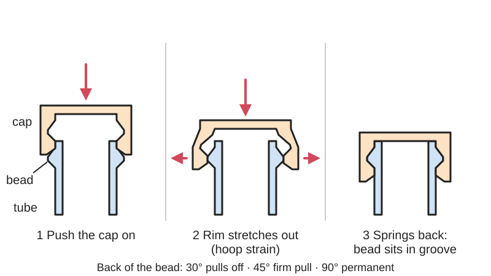

*Diagram drawn for the encyclopaedia from the research notes. ⚑ Needs confirming: a drawing can simplify or get details wrong; a real photo or a better diagram is welcome.*

A raised ring (bead) around one round part and a matching groove or lip on the other: pushing them together stretches the outer part or squeezes the inner one all the way round until the bead drops into the groove and the parts click together.

**In plain words:** A raised ring around one round part that pops over a matching lip or into a groove in the other, so they click together, like a pen cap or a push-on bottle cap. **Proper term:** Annular snap fit (annular snap joint, ASJ).

**Also called:** ring snap, ring snap fit; cylindrical snap fit (DuPont term); [undercut](../glossary.md#undercut) snap fit (DuPont heading 'Undercut Snap-Fits'); bead-and-groove snap, boss-and-groove snap (maker terms, e.g. Hackaday); snap cap, snap-on cap, snap-on lid, push-on or press-on lid (packaging terms; a snap cap is 'held in place by a bead ... rather than a thread', SKS Bottle); continuous annular snap (a full unbroken ring) vs discontinuous, slotted or segmented annular snap (a ring cut into fingers, designed as [cantilevers](../glossary.md#cantilever); Covestro); circular snap fit (Adafruit tutorial title); ball-and-socket snap, spherical snap (the same idea on a ball; Wikipedia lists ball-and-socket joints as annular snap fits).

## How it works

The bead on the plug is slightly bigger than the hole it has to pass (the difference is the undercut), so as you push, its sloped front face (lead angle) stretches the outer part outwards and/or squeezes the inner part, spreading the strain evenly around the whole circle (hoop strain) (Covestro; Hubs; Machine Design). When the bead reaches the groove, both parts spring back to their relaxed size and the joint locks, ideally with no stress left in it. The slope of the back of the bead ([return angle](../glossary.md#return-angle)) decides how it comes apart: about 30° pulls off easily, about 45° takes a firm pull, and 90° is permanent (Machine Design; DuPont). Because the joint is round, the parts can usually still turn on each other unless something keys them, which is how a snapped-on wheel spins on its axle or a pulley turns on its shaft (DuPont Fig. 10.15).

## Parts

Two parts and nothing else: a plug or shaft with a bead or ridge all the way round (or a groove), and a tube, cap or hub with the matching groove or lip. One of them must be thin and springy enough to stretch or squeeze; the plug is best made stiffer than the hub around it (Machine Design).

## Everyday examples

- A ballpoint pen cap that clicks onto the pen (Machine Design; Hubs; Wikipedia 'Snap-fit')
- Push-on bottle caps and snap caps held by a bead on the bottle neck rather than a thread (Hubs; SKS Bottle; Wikipedia)
- A child-resistant pill bottle cap that pops off only when arrows line up with notches in the snap ridge (Machine Design, Tylenol (brand) example)
- Round lamp covers and light housings (Covestro); ball-and-socket toy joints (Wikipedia 'Snap-fit')

## When to use it

Use it for round parts that should click together without screws: caps, lids, round enclosures and covers, end caps, knobs, and wheels or pulleys that should snap onto a shaft and still spin. It gives a stronger, stiffer and more compact joint than a few cantilever hooks (Machine Design: 'ASJs are often good choices for compact, stiff joints'), spreads the strain evenly around the circle, needs no extra parts, and a continuous ring keeps out dust and splashes. It suits 3D printing well when the parts are printed standing on their ends.

## When not to use it

Avoid it on square or irregular shapes (DuPont: rectangular versions 'do not work satisfactorily'; use cantilever snaps instead), when assembly force must be low on a large diameter (a big continuous ring needs a lot of force; slot it or use cantilevers), in [brittle](../glossary.md#brittle--ductile) materials such as PLA, standard resin or glass-filled plastics (use a screw thread), for pressure-tight or dependable waterproof seals (add an [O-ring](../glossary.md#o-ring) or use a threaded cap with a gasket), and where the parts must not turn (add a key or flat, or use a bayonet mount or thread). For caps that must resist children, use a push-and-turn child-resistant cap; for lids opened many times a day, a screw cap wears better.

## Details

- **What it does (jobs):**
  - join and hold: the main job, for caps, lids and round housings
  - let it move (turn, slide or bend): parts snapped together this way can still spin about their shared axis, e.g. a toothed pulley snapped onto a shaft (DuPont Fig. 10.15) or a toy wheel on an axle
  - seal it, or pass cables or fluid through: a continuous ring 'offers a semi-hermetic seal' (Covestro Fig. 6)
- **Movement:** none or rotate: fixed if the parts are keyed or tight, otherwise free to turn about their shared axis with no limit (as with a snapped-on wheel or cap)
- **Directions it can move (degrees of freedom):** 0 or 1: the bead blocks sliding along the axis and the round fit blocks sideways movement; turning about the axis stays free unless the parts are keyed, tight, or held by friction
- **Special behaviour:**
  - quick-release (tool-free): pull-off designs with a shallow back face (about 30°), such as pen caps, come off by hand (Machine Design)
  - self-aligning or self-centring: the round bead and groove pull the two parts onto a common axis ⚑ [uncertain]
  - none, for permanent designs with a 90° back face (Machine Design; DuPont)
- **How it holds:**
  - shape (the parts interlock; [form-fit](../glossary.md#form-fit--force-fit--material-bond)): the bead sits in the groove
  - spring force (a spring or springy part presses it in place): the stretched ring springs back into the groove
  - friction or clamping (force-fit): only if some interference is deliberately left after assembly, which then [creeps](../glossary.md#creep) and relaxes over time ⚑ [uncertain]
- **Input and output:** not applicable
- **Power:** passive (no power needed)
- **Load:** medium: annular snaps 'are generally stronger, but need greater assembly force than their cantilevered counterparts' (Machine Design; DuPont p. 72), and 'quite small undercuts give joints of considerable strength' (Covestro p. 6). Strongest against pulling apart along the axis, especially with a steep back face or a groove placed well away from the tube's end (Covestro p. 22); weak against twisting (the parts just turn) and against being tipped or pried from one side, which is also how they are opened. Slotting the ring for easier assembly lowers the [holding force](../glossary.md#holding-force) (DuPont p. 73).
- **Play and precision:** small: the round bead centres the parts well; there is some end play if the groove is longer than the bead, and a continuous ring fits tighter than a slotted one. It tolerates little [misalignment](../glossary.md#misalignment) when pushed straight on, so parts are usually tipped in on one side first and then pressed home (Covestro p. 23). Out-of-round or seam-bumped prints bind or leak ⚑ [uncertain].
- **Taking it apart:** removable: pull-off designs with about a 30-45° back face come apart by hand; permanent versions with a 90° back face need a hub that is open at the far end and can only be broken apart (Machine Design; DuPont p. 73)
- **How often it can be reused:** many times for pull-off designs such as pen caps, although 'repeated use can cause permanent strain and loosening' (Wikipedia 'Snap-fit'); once for 90° permanent designs
- **Sealing:** dust-resistant: a continuous (unslotted) ring closes the joint all the way round; Covestro calls this a 'semi-hermetic seal' and Hubs says an annular snap fit 'can provide a watertight seal' with proper geometry and material, but for a dependable watertight or pressure seal add an O-ring or gasket (not verified for 3D-printed parts) ⚑ [uncertain]
- **Adjustable:** no: the fit is fixed by the bead and groove sizes; the parts can still be turned to any angle unless keyed
- **Access needed:** end of a tube or shaft: the parts slide together along their shared axis; a permanent 90° design needs the hub open at the other end (DuPont p. 73)
- **Materials:** The part that stretches needs a tough, springy plastic with 'good recovery characteristics' (DuPont p. 72): acetal (POM, Delrin (brand)) and nylon (Zytel (brand)) (DuPont Table 10.05), polycarbonate (Covestro lamp example), polyester elastomer (Hytrel (brand)) stretched over a stiffer polyester part (Machine Design motor example), and polyethylene or polypropylene for bottle caps ⚑ [uncertain]. Amorphous plastics such as PC, PS, PC/ABS and ABS can be strained to about 70% of their yield strain in one brief snap (Machine Design). For 3D printing, use PETG, nylon, TPU or ABS for the stretching part; brittle PLA and standard resins suit only stiff, shallow or one-time fits ⚑ [uncertain] (Hubs calls PLA and standard SLA resins 'less suitable' for snap fits).
- **Heat, cold, water and wear:** Keep the joint stress-free once assembled: a ring left stretched creeps and loosens, and 'repeated use can cause permanent strain and loosening' (Wikipedia 'Snap-fit'; Covestro p. 20). Printed PLA softens from about 60 °C and PETG from about 80 °C (CNC Kitchen), so a printed cap in a hot car may loosen or deform. A metal shaft and a plastic hub expand by different amounts with temperature, which changes the fit ⚑ [uncertain]. Cold makes many plastics more brittle, so a tight snap may crack when pushed on cold ⚑ [uncertain].

## Making it

- **Ways to make or get it:**
  - 3D print (FDM): print round parts standing on their end so the ring is made of continuous perimeter loops
  - 3D print (resin): tough or durable resins only (Formlabs)
  - 3D print (SLS / MJF nylon): suits snap fits well (Hubs; HP MJF handbook) ⚑ [uncertain for annular specifically]
  - injection moulding: the standard process for pen caps and snap caps; the undercut is pushed off a core as the part is ejected, which needs a material with good recovery (DuPont p. 72), and inseparable designs need a split mould (Covestro p. 20)
  - CNC: turned plastic caps and bushes on a lathe ⚑ [uncertain]
  - off-the-shelf part: snap caps and snap-on closures for bottles and tubes
- **Printing it in one piece (print in place):** no: the two parts are printed separately and pressed together
- **Tools:** none to assemble or to pull off; a knife blade or thin screwdriver to pry apart a tight continuous snap (kaje notes his continuous annular test print 'can be separated again by prying apart with a knife blade'); a press or mallet for large, stiff joints ⚑ [uncertain]
- **Difficulty:** moderate: the shapes are simple, but the interference is only a few tenths of a millimetre, so printer [accuracy](../glossary.md#repeatability--accuracy), roundness and material choice matter; plan on a test print or two

### 3D printing tips

1) Print round parts standing on their end (axis vertical) so the bead and groove are true circles made of continuous perimeter loops; the hoop stretch then runs along the extruded lines rather than pulling layers apart ⚑ [uncertain], and the Anderson quick guide notes that when snap joints are loaded along the stronger direction of the layers 'the notches between layers have less impact'. 2) Give the bead and groove sloped faces no steeper than about 45° so they print without supports (Prusa: [overhangs](../glossary.md#overhang--bridging) of 45-60° print cleanly), which also gives a removable joint (a 45° return angle is typical for joints that come apart; Machine Design; DuPont). Use a lead-in bevel of about 30° on the plug (DuPont). 3) Size the undercut from the strain the material can take: undercut (difference in diameter) = allowable strain x diameter (Covestro p. 20). For example, a 20 mm cap stretched by 2% can have 0.4 mm of diametral interference, i.e. a bead about 0.2 mm high on each side, if the plug is rigid, and about twice that if both parts flex equally; the 2% figure is a starting guess to check with a test print ⚑ [uncertain]. 4) Keep the flexing wall thin and even: for FDM, an outer flexing wall no thicker than about 1.9 mm and about 0.35 mm design [clearance](../glossary.md#clearance) (Anderson quick guide); DuPont stresses uniform wall thickness with no stress risers. 5) Make the stretching part from the tougher material (PETG, nylon, TPU) and the plug stiff (Machine Design). 6) Watch the first layer: a cap printed mouth-down has a squashed, slightly wider first layer (elephant foot) that can spoil the fit; use about 0.2 mm elephant-foot compensation or a small [chamfer](../glossary.md#chamfer--fillet) on the rim (Prusa). 7) A continuous snap is hard to push on straight: tip one side in first and then press the rest (Covestro p. 23); kaje's continuous annular test print joins 'quite strongly' when pressed together all around the circumference, and he printed the annular pieces with 3 [perimeters](../glossary.md#perimeters) and no [infill](../glossary.md#infill). 8) If it is too stiff or cracks, cut slots to make a segmented snap: slots allow much deeper undercuts at the cost of holding force (DuPont p. 73), and the fingers are then designed as cantilevers (Covestro p. 5). 9) Put the groove near the open end of the tube for easier assembly: a groove further in than about 1.8 x the square root of (diameter x wall thickness) takes up to about 3 times the force (Covestro p. 22). 10) For a part that should spin (a wheel on an axle), leave running clearance on the shaft and use the bead only to stop it sliding off (Haas Design Studio's printed snap-fit wheel is removable and low-friction) ⚑ [uncertain].

### Buying one (off-the-shelf parts)

Search for: 'snap cap', 'snap-on cap', 'snap-on closure' or 'press-on cap' (bottles with a 'snap bead' neck), 'push-on lid', 'plastic end cap' or 'tube end cap' ⚑ [uncertain], 'ball stud' and 'ball cup' or 'ball socket' (RC-style ball links), and metal alternatives that do the same job on a shaft: 'retaining ring', '[circlip](../glossary.md#circlip)', 'E-clip'.

## Rules of thumb

- Permissible undercut (difference in diameter) = maximum allowable strain x diameter at the joint; if both parts are about equally flexible, each takes half, so the undercut can be about twice as big (Covestro p. 20).
- Hoop strain = (plug diameter - hub bore) / hub bore; amorphous plastics (PC, PS, PC/ABS, ABS) can be strained up to 70% of their yield strain in a single brief snap, and reinforced plastics to about 50% of their strain at break (Machine Design; Covestro p. 11).
- Lead angle generally under 30°; return angle about 30° separates easily, 45° is typical for joints that come apart, 90° is permanent (Machine Design). DuPont: a 45° return bevel suits most uses, a 90° return needs the hub open at the far end, and a 30° lead-in bevel helps entry (DuPont p. 73).
- DuPont Table 10.05, steel shaft snapped into a blind hub: shaft 10 mm, undercut 0.25-0.35 mm in Delrin or 0.30 mm in Zytel, hub outside diameter up to 17 or 20 mm; 20 mm shaft, 0.50-0.70 mm or 0.60 mm, hub up to 28 or 32 mm; 30 mm shaft, 0.80-1.05 mm or 0.90 mm, hub up to 39 or 44 mm (about 3% of the diameter; whether the table's undercut is per side or on the diameter is not clear from the text) ⚑ [uncertain].
- A groove at least 1.8 x the square root of (joint diameter x wall thickness) from the end of the tube counts as 'remote' and needs up to about 3 times the push-on force of one near the end (Covestro p. 22).
- The simple hoop-stress approach works best when the wall is thinner than 0.1 x the diameter (Machine Design).
- Circular is ideal: 'Rectangular shaped snap-fits do not work satisfactorily'; keep wall thickness uniform and keep weld lines, gates and voids away from the snap, where they cause cracks during assembly (DuPont p. 73).
- Slots allow much deeper undercuts but reduce holding force; for high holding force, 6 or 8 segments with 90° undercuts can be used (DuPont pp. 73-74).
- Big continuous snaps need a lot of force: Covestro's 200 mm polycarbonate lamp cover with a 1 mm [deflection](../glossary.md#deflection) per part needs about 1,346 N if pressed straight on, much less when tipped in by hand (Covestro p. 23).
- FDM starting values: about 0.35 mm clearance and a flexing outer wall no thicker than about 1.9 mm (Anderson, 'Snap Fit Design' quick guide).
- Caps on pens for children must either be too big to swallow (at least 5 mm of the cap must not pass a 16 mm ring gauge) or let at least 8 litres of air per minute through at a pressure drop of no more than 1.33 kPa; a single hole of about 3.4 mm² usually does this (ISO 11540:2021, 4.2-4.3).

## Common failures

Too tight to assemble, or the outer part splits while stretching: the undercut is too big for the material's allowable strain, the wall is too thick, or there is a weak spot such as a weld line, void or printed layer seam (DuPont p. 73; Covestro). Loose or pops off: the undercut is too small, the back face is too shallow, or the ring has taken a set from repeated use (Wikipedia). Won't seat evenly because the part printed oval or has a seam bump; tip one side in first (Covestro p. 23). Leaks because the ring is slotted, broken or not round. Permanent 90° designs break when someone tries to open them. Fixes: size the undercut with undercut = strain x diameter, use a 30-45° back face for removable parts, keep walls thin and even, and add slots if it is too stiff.

## Safety

Small caps and snap-on parts can be swallowed or inhaled by children: pen caps for children are designed to ISO 11540, either too large to swallow or vented so air can pass through them (ISO 11540:2021). Large, stiff snaps can take a lot of force and may crack suddenly or pinch fingers when they snap home ⚑ [uncertain].

## Related

- Cantilever snap fit: separate flexible fingers instead of a full ring; lower assembly force and works on any shape, but weaker and doesn't seal
- Torsional snap fit: a rocking hook on a twisting bar, easy to release again and again
- Press fit ([interference fit](../glossary.md#interference-fit)): held by tightness alone, with no groove to click into
- Crush ribs and spring-fit features (compliant press fit): small ribs that squash to grip, rather than a ring that stretches and springs back
- Printed screw thread: a threaded cap is easier to make tight and to seal, but slower to open
- Bayonet mount (push-and-twist lock): pins in L-shaped slots hold the parts without stretching a whole ring
- Push-and-turn child-resistant cap: adds a lock so children can't simply pull or twist the cap off
- O-ring seal: add one when the joint must really seal
- Retaining ring (circlip, E-clip): a separate springy metal ring in a shaft groove, when the plastic part can't provide the bead
- Ball-and-socket joint (lockable ball head) and Posable segmented arm: the spherical version of the same snap
- Tamper-evident breakaway bridge: thin bridges often added to snap caps to show they've been opened
- Press stud (snap fastener, popper): a tiny round snap on clothes and bags
- Open C-shaped clip that snaps sideways over a rod or pipe: a part-ring version whose easy-on, hard-off behaviour was explained by Yoshida and Wada ('Mechanics of a snap-fit', Physical Review Letters, 2020)

## Make it yourself

- [Snap-Fit Joint Test Prints - Eight Versions (kaje, Printables)](https://www.printables.com/model/151102-snap-fit-joint-test-prints-eight-versions): Printable test pieces including a segmented annular snap and a continuous annular snap ('deceptively simple ... joined quite strongly'), plus cantilever and torsion versions; details read through the Printables public API *(licence: CC0 / public domain (Printables: Creative Commons Public Domain))*
- [Parametric Snap-on Lid (Chris, Printables) (URL from Printables API, page not opened)](https://www.printables.com/model/12804-parametric-snap-on-lid): An OpenSCAD push-fit lid, inspired by a cleaning-powder cap, that you size by measuring your container's diameter *(licence: CC BY (Printables listing))*
- [Snap Ball Socket Joint Link - Gooseneck Articulated Arm (nickcin, Printables) (URL from Printables API, page not opened)](https://www.printables.com/model/393094-snap-ball-socket-joint-link-gooseneck-articulated-): Small ball-and-socket links (about 16 mm tall) that snap together into a flexible arm: the spherical form of an annular snap; printed in PETG *(licence: CC0 / public domain (Printables: Creative Commons Public Domain))*
- [The Best Snap Fit Wheel and Axle (Haas Design Studio, Printables) (URL from Printables API, page not opened)](https://www.printables.com/model/911006-the-best-snap-fit-wheel-and-axle): A toy-car wheel that snaps onto its axle, prints without supports, turns with low friction and can be removed; meant to be adapted into your own designs; snap type not stated, probably a ring-shaped snap ⚑ [uncertain] *(licence: CC BY-NC (Printables listing))*
- [Snap-Fit Calculator (Fictiv)](https://www.fictiv.com/tools/snap-fit-calculator): Online calculator with an annular mode ('snap-on caps, lids, collars, and cylindrical assemblies') that estimates hoop strain, insertion force and a pass/fail verdict from dimensions and material presets *(licence: link only (free online tool))*

## Pictures, videos and models

- [Snap-Fit Joints for Plastics - A Design Guide (Covestro, 2015), section D 'Annular Snap Joints', pp. 20-23](https://solutions.covestro.com/-/media/covestro/solution-center/brands/downloads/imported/1557218421.pdf): Drawings of separable and inseparable annular snap joints with the lead and return angles, a continuous annular snap on a lamp housing, the stress spread along the tube during joining, and design charts *(licence: link only (manufacturer design guide))*
- [Snap-fits: Design for HP MJF: Union joints design (HP MJF Handbook, 2019), Figs. 7-8](https://endeavor3d.com/wp-content/uploads/2024/12/Snap-Fits-Design-for-HP-MJF-Union-Joints-Design.pdf): Renderings of an annular snap fit and its assembly, alongside cantilever, L-shaped, U-shaped and torsional snap fits *(licence: link only (HP document hosted by a reseller))*
- [Annular Snap-Fits : Design, Key Features, Limits and Tips (YouTube, Xometry EMEA & APAC)](https://www.youtube.com/watch?v=UBC7qvdUpFA): Video on annular snap-fit design, features, challenges and typical uses *(licence: link only (standard YouTube licence))*
- [Fusion 360 Tutorial – Circular SnapFit Cases! (YouTube, Adafruit Industries)](https://www.youtube.com/watch?v=iF_P5ie_b8o): Modelling a round 3D-printed case whose lid snaps on with a ring-shaped snap *(licence: link only (standard YouTube licence))*

## Needs confirming

⚑ marks something nobody has confirmed yet: a fact the research could not confirm from a source, a finder value that is a best guess, or an open point from the research notes. Corrections are welcome (see `research/needs-confirming.md`).

- ⚑ 18 sentences on this page marked [uncertain].
- ⚑ Finder value `tools` = none, press or vice, hand tools (source uncertain): `tools_needed` is marked ⚑ [uncertain] here: "…apart with a knife blade'); a press or mallet for large, stiff joints ⚑ [uncertain]…"

## Sources

- <https://en.wikipedia.org/wiki/Snap-fit>
- <https://solutions.covestro.com/-/media/covestro/solution-center/brands/downloads/imported/1557218421.pdf>
- <https://www.distrupol.com/General_Design_Principles_for_Engineering_Polymers.pdf>
- <https://www.machinedesign.com/fastening-joining/article/21834620/fundamentals-of-annular-snap-fit-joints>
- <https://www.hubs.com/knowledge-base/how-design-snap-fit-joints-3d-printing/>
- <https://formlabs.com/blog/designing-3d-printed-snap-fit-enclosures/>
- <https://endeavor3d.com/wp-content/uploads/2024/12/Snap-Fits-Design-for-HP-MJF-Union-Joints-Design.pdf>
- <https://aarontyleranderson.com/wp-content/uploads/2022/02/SnapFit_Quick_Guide.pdf>
- <https://www.sks-bottle.com/Selecting_Cap.html>
- <https://cdn.standards.iteh.ai/samples/81889/9c3d070a4cea43d5af38070f80582924/ISO-11540-2021.pdf>
- <https://arxiv.org/abs/2003.13566>
- <https://hackaday.com/2022/03/14/3d-printing-snap-fit-joints/>
- <https://help.prusa3d.com/article/modeling-with-3d-printing-in-mind_164135>
- <https://help.prusa3d.com/article/elephant-foot-compensation_114487>
- <https://www.cnckitchen.com/blog/comparing-pla-petg-amp-asa-feat-prusament>
- <https://www.youtube.com/watch?v=UBC7qvdUpFA>
- <https://www.youtube.com/watch?v=iF_P5ie_b8o>
- <https://api.printables.com/graphql/>
- <https://www.printables.com/model/151102-snap-fit-joint-test-prints-eight-versions>
- <https://www.fictiv.com/tools/snap-fit-calculator>
