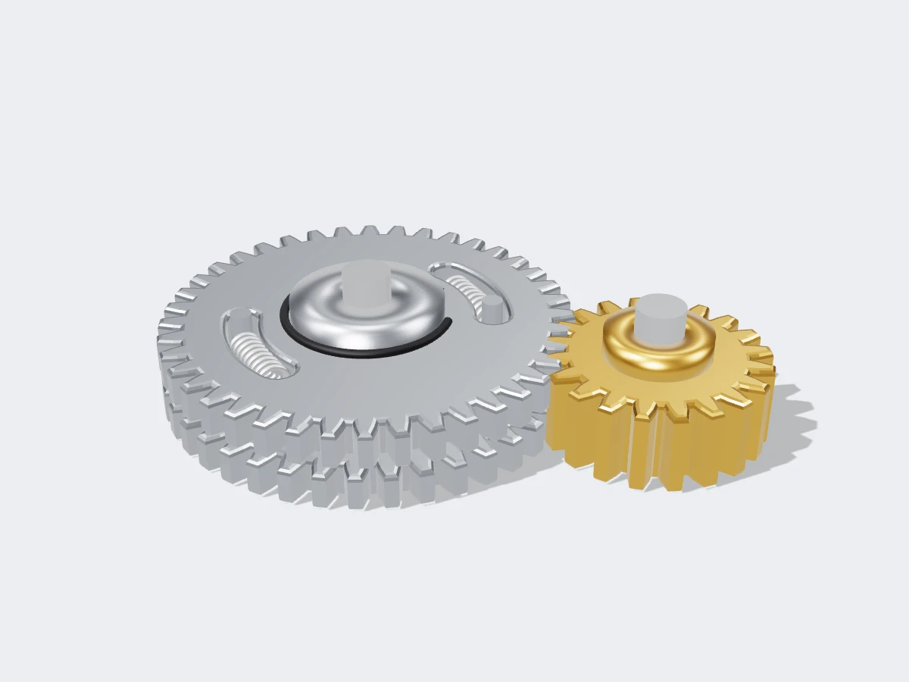

<figure class="eoc-pic eoc-pic-main"><picture><source media="(prefers-reduced-motion: reduce)" srcset="../media/drawn/anti-backlash-gear.svg"></picture><figcaption><strong>Animation.</strong> Diagram drawn for the encyclopaedia from the research notes. ⚑ Needs confirming: a drawing can simplify or get details wrong; a real photo or a better diagram is welcome.</figcaption></figure>
<figure class="eoc-pic"><figcaption><strong>Render.</strong> A 3D model made for the encyclopaedia, not a photo: a stand-in until a good real photo is found. ⚑ Needs confirming: a model can simplify or get details wrong; a real photo is welcome.</figcaption></figure>

A gear split into two side-by-side halves, one fixed to the shaft and one free to turn a little on it, pulled round against each other by springs so that together they fill the tooth gaps of the mating gear and remove the play ([backlash](../glossary.md#backlash)) that otherwise shows up every time the drive reverses.

**In plain words:** A gear made of two thin gears stacked side by side and twisted against each other by a spring, so their teeth grip both sides of the other gear's teeth and there is no wobble (play) when the drive changes direction. **Proper term:** Anti-backlash gear (spring-loaded split gear, scissor gear).

**Also called:** scissor gear / scissors gear (KHK Gear Technical Reference; engine trade); split gear / split anti-backlash gear (Wikipedia 'Backlash (engineering)'); spring-loaded split gear (Machine Design); anti-backlash spur gear / no-backlash gear / zero-backlash gear (KG Stock Gears catalogue); camshaft scissor gear / [preload](../glossary.md#preload) gear (car-engine trade; Southside Cylinder Heads); anti-lash gear (wording used in some patent titles); control-backlash gear (a non-sprung version whose two halves are turned to close the gap and then bolted; KG ASG type); circular-arc-spring type and coil-spring type (the two spring layouts in KG's BS and BW types).

## How it works

Ordinary gears are made with a small gap between meshing teeth so they don't jam and have room for oil, and that gap (backlash) lets the output lag or rattle whenever the drive reverses (Wikipedia 'Backlash (engineering)'; KG Stock Gears). An anti-backlash gear is split into two halves, each half the thickness; one half is fixed to the shaft and the other can turn on it but is sprung round relative to the first (Wikipedia). Once meshed, the teeth of the fixed half press on one side of each mating tooth and the teeth of the free half press on the other side, pinching it like the blades of scissors, so the gap is filled (KG Stock Gears; KHK). As long as the turning force ([torque](../glossary.md#torque)) stays below the spring's torque the springs don't give and there is no play in either direction; a larger or sudden load pushes the spring back and the play returns (Wikipedia; KG 'Precaution of usage'; patent EP3230626B1).

## Parts

A small assembly that acts as one unit: a main gear half fixed to the shaft (usually with a long hub), a second 'free' gear half of the same tooth shape that can turn on that hub, one or more springs between the halves (compression springs in slots, tension springs hooked between pins, a curved 'circular-arc' spring or a [torsion](../glossary.md#torsion) spring), and a snap ring ([circlip](../glossary.md#circlip)) that keeps the free half on the hub. Engine versions also have a hole for a service bolt or pin that holds the spring wound up while the gear is fitted (Wikipedia 'Backlash (engineering)'; BrightHub Engineering; KG Stock Gears; Southside Cylinder Heads). The mating gear is an ordinary gear (KG).

## Everyday examples

- Analogue radio tuning dials and tuning capacitors, which must turn precisely back and forth (Wikipedia 'Backlash (engineering)'; Aaron Dahlen's tuning-capacitor video)
- Camshaft gears in many twin-cam car engines, where a scissor gear stops a ticking rattle (Southside Cylinder Heads)
- Diesel and other engine gear trains driving the fuel-injection pump or accessories, to stop gear rattle (patent EP3230626B1)

## When to use it

When a gear drive must reverse without lost motion and the loads are light: dials and pointers, instrument and positioning drives, small robot joints and machine axes with a gear stage between motor and output, and places where rattle from reversing or pulsing loads is a problem (engine gear trains). It is also a good fix for 3D-printed gears, whose generous tooth [clearance](../glossary.md#clearance) otherwise adds noticeable play.

## When not to use it

Heavy or shock loads, which overpower the springs: use fixed-adjusted gears, a strain-wave (harmonic) drive, a cycloidal drive or a preloaded ball screw instead (Machine Design). Worm and screw gears: use a duplex-lead worm adjusted by shims instead (KHK). If the load always pushes the same way, a weight, torsion spring or small motor loading the last gear preloads the whole train more simply (Machine Design, 'gear train preloading'). Where a little play doesn't matter, an ordinary gear is simpler and a little more efficient. For a stepper-driven screw axis, software backlash compensation or always approaching a position from the same direction may be enough (Wikipedia).

## Details

- **What it does (jobs):**
  - change speed or turning force: it is still a gear, giving the same speed ratio as an ordinary gear pair
  - line parts up exactly: it removes the lost motion (backlash) so the output returns to the same position when the drive reverses, as needed for a radio tuning dial (Wikipedia 'Backlash (engineering)')
- **Movement:** rotate: continuous rotation in both directions, like any gear pair; inside the gear the free half only moves a fraction of a tooth relative to the fixed half
- **Directions it can move (degrees of freedom):** 1: the output gear turns in step with the input. Inside the anti-backlash gear the free half also has a small, spring-loaded twist relative to the fixed half (part of one tooth spacing in use), which is what takes up the play
- **Special behaviour:**
  - tensioning (takes up slack and holds): the springs keep the two halves pressed against opposite sides of the mating teeth, taking up the play; Machine Design notes that spring designs hold the gears at a constant (zero) backlash throughout their service life, unlike set-once adjustments that loosen as teeth wear
  - none of the other listed behaviours: it doesn't slip, lock or index; above the spring torque it simply behaves like an ordinary gear with play (Wikipedia 'Backlash (engineering)')
- **How it holds:**
  - spring force (a spring or springy part presses it in place): springs twist the free half so its teeth stay pressed against the mating teeth
  - shape (the parts interlock; [form-fit](../glossary.md#form-fit--force-fit--material-bond)): the torque itself is passed on by meshing teeth
  - not a holding joint (it moves or passes on motion): it is a gear that passes on rotation
- **Input and output:** Continuous rotation -> continuous rotation at the tooth-count ratio of the pair, exactly as for an ordinary spur gear pair. Shafts: usually parallel (spur gears); KHK says splitting a gear into two adjustable parts works for most gear types, but the sprung zero-backlash version is not suitable for worm or screw gears, whose teeth slide a lot and can lose their lubricant film and wear (KHK Gear Technical Reference, section 6.5). Efficiency: probably a little lower than an ordinary pair because the spring preload keeps both tooth flanks rubbing ⚑ [uncertain: no efficiency figure found]. Back-drivable: yes, like any spur gear pair. Play: none while the reversing torque stays below the spring torque; KG says its gears cannot completely remove backlash but greatly minimise it.
- **Power:** passive (no power needed): the preload comes from springs
- **Load:** Light. The no-play effect only lasts up to the spring torque: KG's module 0.5-1 catalogue gears keep zero play up to roughly 7-161 N·cm (about 0.07-1.6 N·m), depending on size, material and how many teeth the halves are wound (KG catalogue KG3001, pp. 53-55). Machine Design says split gearing is 'generally used in light-load, low-speed applications'. Each half is only half the width of a normal gear (Wikipedia), so teeth are weaker than a full-width gear of the same size ⚑ [uncertain]. Loads above the spring torque still get through, but with play in that direction (Wikipedia; EP3230626B1).
- **Play and precision:** None (zero backlash) while the torque stays below the spring torque; KG says its gears greatly minimise but cannot completely remove backlash. Reversal [repeatability](../glossary.md#repeatability--accuracy) is good because there is no lost motion (Wikipedia: used where precise movements are needed both forwards and backwards). It tolerates small tooth errors and interference because the springs let the halves give (KG: it absorbs interference 'by stretching the spring mechanism'). It only removes the play at its own mesh: in a gear train backlash adds up at every stage (Wikipedia). How much centre-distance or angle [misalignment](../glossary.md#misalignment) it tolerates was not found ⚑ [uncertain].
- **Taking it apart:** removable: the gear fits on its shaft with a [set screw](../glossary.md#set-screw) or key like any gear, and the two halves are held together by a snap ring and can be separated (KG 'Precaution of usage'); the spring preload must be reset each time it is refitted (Southside Cylinder Heads)
- **How often it can be reused:** many times: it can be removed and refitted repeatedly as long as the preload is reset each time and the springs are not overstretched
- **Sealing:** none: it is an open gear. Keep dust out from between the two halves (KG 'Precaution of usage') and keep the teeth lubricated, because both tooth flanks are always in contact (KHK)
- **Adjustable:** Yes. On catalogue gears the preload (and so the torque up to which there is no play) is set at assembly by turning the free half until its teeth line up with the fixed half and then a chosen number of extra teeth (2 or more) before meshing (KG catalogue: 'shifting [pitch](../glossary.md#pitch) n'). Non-sprung 'control backlash' versions are adjusted by loosening bolts, turning the halves to close the gap against the mating gear and tightening the bolts again (KG ASG type; Machine Design).
- **Access needed:** end of a tube or shaft: the gear slides onto the end of its shaft; you also need room to wind and pin the two halves before meshing
- **Materials:** Catalogue gears: carbon steel (C45 / S45C, nitrided), chromium-molybdenum steel, aluminium alloy (AlMg5) and stainless steel (with a PTFE (Teflon) coating to stop scuffing), with steel springs (KG Stock Gears). Engine scissor gears are steel ⚑ [uncertain]. Maker versions: 3D-printed halves in nylon, PLA, ABS or PETG with a metal spring, rubber band or printed flexing spokes; Instructables ranks printed gear materials nylon > PLA > ABS > PETG.
- **Heat, cold, water and wear:** Metal gears and springs cope with normal workshop and engine temperatures; printed halves and printed flexing springs soften and [creep](../glossary.md#creep) with heat: PLA has a low heat distortion temperature and ABS is the better choice above about 75 °C (Instructables). Spring preload may relax over time, especially plastic [flexure](../glossary.md#flexure) springs ⚑ [uncertain]. Vibration and torque pulses that exceed the spring force bring the rattle back (EP3230626B1). Dirt between the halves stops the free half moving (KG). Needs [lubrication](../glossary.md#lubrication), because both flanks are always in contact (KHK).

## Making it

- **Ways to make or get it:**
  - off-the-shelf part: catalogue anti-backlash (scissor) spur gears, e.g. KG's module 0.5-2 range
  - 3D print (FDM): two printed gear halves plus a metal spring or rubber band, or a one-piece design with flexing spokes (Thingiverse 'Anti-Backlash Gear')
  - 3D print (resin): fine-toothed halves for small instruments ⚑ [uncertain]
  - CNC: machined halves with spring slots, as in industrial and engine gears
- **Printing it in one piece (print in place):** partly: the two halves are usually printed separately (or joined by printed flexing spokes that act as the spring), and must be wound against each other and pinned before meshing; most designs add a metal spring, rubber band or retaining clip (BrightHub; KG; Thingiverse 'Anti-Backlash Gear' description)
- **Tools:** Hex key or screwdriver for the set screw; snap-ring (circlip) pliers to take the halves apart; pliers or grips to twist the free half against its spring; and a pin or short bolt to hold the halves wound up while meshing. Southside Cylinder Heads says a 6 x 1 mm bolt 15-20 mm long, finger tight, fits many camshaft scissor gears
- **Difficulty:** moderate: printing two matching gear halves is easy, but making a hub for the free half, fitting springs and winding the halves the right number of teeth before meshing takes care; for precision instruments buy a catalogue anti-backlash gear

### 3D printing tips

1) Generate both halves with the same gear tool so the teeth match exactly; BOSL2's gears.scad has a backlash setting that narrows the teeth, which is the gap the scissor action will take up. Only one gear of the pair needs to be split; the mating gear is ordinary (KG). 2) Split the gear into two halves each half the face width (Wikipedia). Give the fixed half a long hub that the free half turns on, and a snap ring, circlip or printed clip so the free half can't slide off (BrightHub; KG). 3) Springs: two compression springs in slots between tabs (BrightHub's layout), tension springs hooked between pins (KG BW type), a curved spring (KG BS type) or rubber bands. The spring torque must be larger than the torque the gear has to pass on; below that there is no play (KG 'Precaution of usage'; BrightHub). 4) Wind before meshing: turn the free half until its teeth line up with the fixed half, then at least 2 teeth further (KG catalogue); hold it with a pin through matching holes in both halves, mesh the gears, then pull the pin out (the service-bolt trick from Southside Cylinder Heads). Design those pin holes in. 5) Clearance: printed gears are usually drawn with about 0.4 mm clearance between meshing teeth to stop them locking (Instructables 'A Practical Guide to FDM 3D Printing Gears'); a scissor gear lets you keep that generous clearance and still have no play. 6) Don't overdo the spring: with both flanks always in contact the teeth must stay lubricated or they wear (KHK), and a stronger spring than needed only adds friction ⚑ [uncertain]. Grease the teeth; Instructables suggests white lithium, PTFE or silicone grease. 7) Strength: at least 3 [perimeters](../glossary.md#perimeters) with rectilinear [infill](../glossary.md#infill), and a face width of 3-5 times the circular pitch (Instructables); because each half is only half as wide, make the whole gear thicker than a normal printed gear ⚑ [uncertain]. 8) Materials: nylon > PLA > ABS > PETG for printed gears; PLA softens at a low temperature, ABS is better above about 75 °C (Instructables). 9) One-piece printed designs that use flexing spokes as the spring (Thingiverse 'Anti-Backlash Gear' by pauljs75) are simpler, but plastic springs creep and lose preload over time, especially in PLA or when warm ⚑ [uncertain]. 10) Sudden jerks bigger than the spring force push the halves apart (Carlyle, 3dp-ideas group), so size the spring for the jerks your printer or robot makes, not just the steady load. 11) Backlash in a train adds up at every mesh (Wikipedia), so put the anti-backlash gear at the mesh nearest the output, where play matters most ⚑ [uncertain: advice inferred].

### Buying one (off-the-shelf parts)

Anti-backlash spur gear (also sold as scissor gear, split gear or no-backlash gear; e.g. KG 'Anti Backlash Spur Gears' types NS, NSG, NSU with springs and ASG 'control backlash' with bolts); anti-backlash bevel, mitre and worm gears from precision gear makers ⚑ [uncertain: vendor page could not be opened]; small compression springs, extension springs and torsion springs; external retaining rings (snap rings, circlips); set screws and keyed hubs; anti-backlash nut (the lead-screw equivalent); ordinary spur gears as the mating gear.

## Rules of thumb

- The spring torque must be larger than the torque the gear transmits; below it there is no play, above it the play comes back (KG 'Precaution of usage for Anti backlash spur gears'; Wikipedia 'Backlash (engineering)'; BrightHub: the springs should not compress under the normal operating torque).
- Set the preload by lining up the teeth of both halves and then winding the free half a further 2 or more teeth before meshing; more teeth give more preload (KG catalogue KG3001, p. 51).
- Catalogue example: a module 0.5, 60-tooth stainless anti-backlash gear keeps zero play up to 9.71 N·cm with a 2-tooth wind, while a module 1, 100-tooth steel one reaches 145.78 N·cm with a 5-tooth wind (KG catalogue KG3001, pp. 53-54).
- Use spring-loaded split gears for light-load, low-speed drives; for heavy reversing loads use fixed adjustments (shorter centre distance, bolted split gears, tapered gears) that are re-adjusted as the teeth wear (Machine Design, 'Methods to Minimize Gear Backlash').
- Don't use the sprung zero-backlash principle on worm or screw gears: their teeth slide a lot, the lubricant can be squeezed out and they wear (KHK Gear Technical Reference, section 6.5).
- Ordinary cut gears are given an average backlash of about 0.04 x module (0.03-0.05 x module), e.g. about 0.04 mm for module 1 (Wikipedia 'Backlash (engineering)'); printed gears are usually drawn with much more, about 0.4 mm clearance between teeth (Instructables).
- Backlash in a gear train adds up at every mesh (Wikipedia), so one anti-backlash gear only removes the play at its own mesh.
- Keep dust out from between the two halves, and don't machine an anti-backlash gear after assembly: deformation destroys the anti-backlash function (KG 'Precaution of usage').
- Engine scissor gears: hold the preload with a service bolt (often 6 x 1 mm, 15-20 mm long, finger tight) while fitting, and remove it before turning the engine over (Southside Cylinder Heads).

## Common failures

1) Loads or sudden jerks larger than the spring torque push the free half back and the play returns ('over-travel' on impulse loads: Carlyle, 3dp-ideas group; rattle under impulse loads: EP3230626B1); wind more teeth or use stiffer springs (KG). 2) Preload lost during servicing: camshafts refitted without the service bolt lose preload and tick like a noisy tappet (Southside Cylinder Heads). 3) Too much preload or too little lubricant: both flanks rub all the time, so lubricant is squeezed out and teeth wear (KHK); extra friction also wastes motor torque ⚑ [uncertain]. 4) Free half sticking on its hub because of dust or burrs (KG). 5) Service bolt or pin left in, locking the halves or damaging the engine (Southside Cylinder Heads). 6) Springs relaxing or breaking over time, and printed flexure springs creeping ⚑ [uncertain]. 7) Printed teeth too rough, so the preloaded mesh binds; clean teeth with a blade before use (Instructables).

## Safety

Pinch points between meshing gears. A wound-up free half stores spring energy and can snap back when the holding pin is pulled or the gear is lifted off its mate, so keep fingers clear ⚑ [uncertain]. On engines, remove the service bolt before turning the engine over, or it will cause significant damage (Southside Cylinder Heads).

## Related

- Lead screw and nut (incl. anti-backlash nut): the same idea for a screw thread, two nut halves pushed apart to press on opposite thread flanks (Wikipedia 'Backlash (engineering)')
- Spur gear train: the plain version, with backlash built in so it doesn't jam
- Gear train preloading: a torsion spring, weight or auxiliary motor on the last gear keeps all teeth loaded on one side; limited rotation unless a motor is used (Machine Design)
- Dual-path gear train: two identical gear trains wound against each other, so no special gears are needed but twice as many gears are (Machine Design)
- Strain-wave gear (harmonic drive): reduces backlash to 1 arc-minute or less, 10-15 arc-minutes more common (Machine Design)
- Cycloidal drive: preloaded rollers or pins; a printed version splits the housing and twists the halves against each other with a string, the same scissor idea (Hackaday.io 'Anti-Backlash 3D Printed Cycloidal BLDC [Actuator](../glossary.md#actuator)')
- Compound planetary gearbox: printed ring gears made springy in the [radial](../glossary.md#axial--radial) direction take out backlash (LoboCNC, Printables)
- Capstan cable drive: no teeth at all, so no backlash
- Herringbone and helical gears: helical gears can be shifted along their axis to adjust backlash (KHK)
- Worm drive: a duplex-lead worm is shifted along its axis to adjust backlash (KHK)
- Friction drive: no teeth and no backlash, but it can slip

## Make it yourself

- [Anti-Backlash Gear by pauljs75 (Thingiverse) (page opened but its content did not load; description from search results)](https://www.thingiverse.com/thing:2328529): Printable anti-backlash gear made of two halves that interlock and are glued at the hub, with flexing spokes providing the spring tension *(licence: ⚑ [uncertain])*
- [BOSL2 gears.scad (OpenSCAD library source)](https://raw.githubusercontent.com/BelfrySCAD/BOSL2/master/gears.scad): Parametric spur, helical, bevel and worm gear generator with a 'backlash' setting that narrows the teeth; use it to make two identical halves for a scissor gear *(licence: BSD 2-Clause)*
- [Anti-Backlash Compound Planetary Gearhead (LoboCNC, Printables) (URL appeared in search results; details from Printables API)](https://www.printables.com/model/132254-anti-backlash-compound-planetary-gearhead): Printed 38.4:1 compound planetary gearhead for a 35 mm stepper whose ring gears are springy in the radial direction but stiff in twist, taking out backlash: an alternative to scissor gears *(licence: CC BY-NC-SA)*
- [Anti-Backlash 3D Printed Cycloidal BLDC Actuator (Hackaday.io)](https://hackaday.io/project/165592-anti-backlash-3d-printed-cycloidal-bldc-actuator): 24:1 printed dual cycloidal gearbox with three split housings twisted against each other; tightening a string increases the preload and stops the backlash (files linked at Thingiverse thing 3591512) *(licence: ⚑ [uncertain])*

## Pictures, videos and models

- [Gear Backlash, section 6.5 'Method of Reducing Backlash (Zero Backlash Gears)' (KHK Gear Technical Reference)](https://khkgears.net/new/gear_knowledge/gear_technical_reference/gear_backlash.html): Diagrams of a gear separated into two fixed parts (Fig. 6.4), tapered and duplex worm adjustments, and a scissors gear with coil springs (Fig. 6.8) *(licence: link only (KHK copyright))*
- [Anti (Non) Backlash Spur Gear Techniques: Gear Backlash Prevention Method, Scissor Gear (Bright Hub Engineering)](https://www.brighthubengineering.com/machine-design/65169-how-does-an-anti-backlash-gear-works/): Pictures of a CAD model of a scissor gear: a fixed gear with an extended hub, a free gear with tabs in slots, and two compression springs *(licence: link only)*
- [Eliminating backlash in gear drives 2 (Nguyen Duc Thang, thang010146, YouTube)](https://www.youtube.com/watch?v=c3bjt_8CdKw): CAD animation: a gear pivoted freely on the shaft of its twin and pulled round by a tension spring to eliminate tooth backlash (content from the search-result description; title and channel checked with YouTube oEmbed) *(licence: link only (standard YouTube licence))*
- [How Split Gears Eliminate Backlash (Demo + Real Tuning Capacitor Example) (Aaron Dahlen, YouTube)](https://www.youtube.com/watch?v=7XxFrbyEJBM): Demonstration of a split gear removing backlash, with a real radio tuning-capacitor example (title and channel checked with YouTube oEmbed; video not watched) *(licence: link only (standard YouTube licence))*
- [Backlash.svg (Wikimedia Commons, by GearHeads and Slashme)](https://commons.wikimedia.org/wiki/File:Backlash.svg): Diagram of the gap (backlash) between meshing gear teeth, the problem an anti-backlash gear removes *(licence: CC BY-SA 3.0)*

## Needs confirming

⚑ marks something nobody has confirmed yet: a fact the research could not confirm from a source, a finder value that is a best guess, or an open point from the research notes. Corrections are welcome (see `research/needs-confirming.md`).

- ⚑ 16 sentences on this page marked [uncertain].

## Sources

- <https://en.wikipedia.org/wiki/Backlash_(engineering)>
- <https://khkgears.net/new/gear_knowledge/gear_technical_reference/gear_backlash.html>
- <https://www.machinedesign.com/mechanical-motion-systems/article/21831618/methods-to-minimize-gear-backlash>
- <https://www.kggear.co.jp/en/kg-stock-gears/anti-backlash-spur-gears>
- <https://www.kggear.co.jp/wp-content/uploads/KG3001_web_0003.pdf>
- <https://www.kggear.co.jp/en/wp-content/themes/bizvektor-global-edition/pdf/2.4_Precaution-of-usage-for-Anti-backlash-spur-gears_TechnicalData_KGSTOCKGEARS.pdf>
- <https://www.brighthubengineering.com/machine-design/65169-how-does-an-anti-backlash-gear-works/>
- <https://ssch.com.au/camshaft-scissorpreload-gears/>
- <https://patents.google.com/patent/EP3230626B1/en>
- <https://groups.google.com/g/3dp-ideas/c/DYGXi_2EdY4>
- <https://www.instructables.com/A-Practical-Guide-to-FDM-3D-Printing-Gears/>
- <https://raw.githubusercontent.com/BelfrySCAD/BOSL2/master/gears.scad>
- <https://hackaday.io/project/165592-anti-backlash-3d-printed-cycloidal-bldc-actuator>
- <https://www.thingiverse.com/thing:2328529>
- <https://www.printables.com/model/132254-anti-backlash-compound-planetary-gearhead>
- <https://api.printables.com/graphql/>
- <https://www.youtube.com/watch?v=6NcW02FxIEs>
- <https://www.youtube.com/watch?v=c3bjt_8CdKw>
- <https://www.youtube.com/watch?v=7XxFrbyEJBM>
- <https://commons.wikimedia.org/wiki/File:Backlash.svg>
