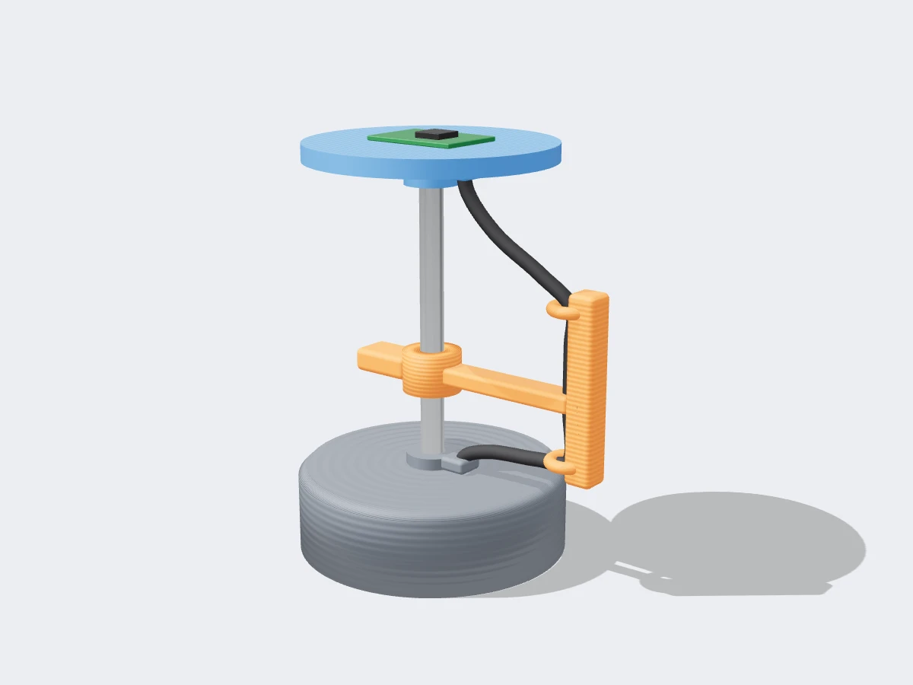
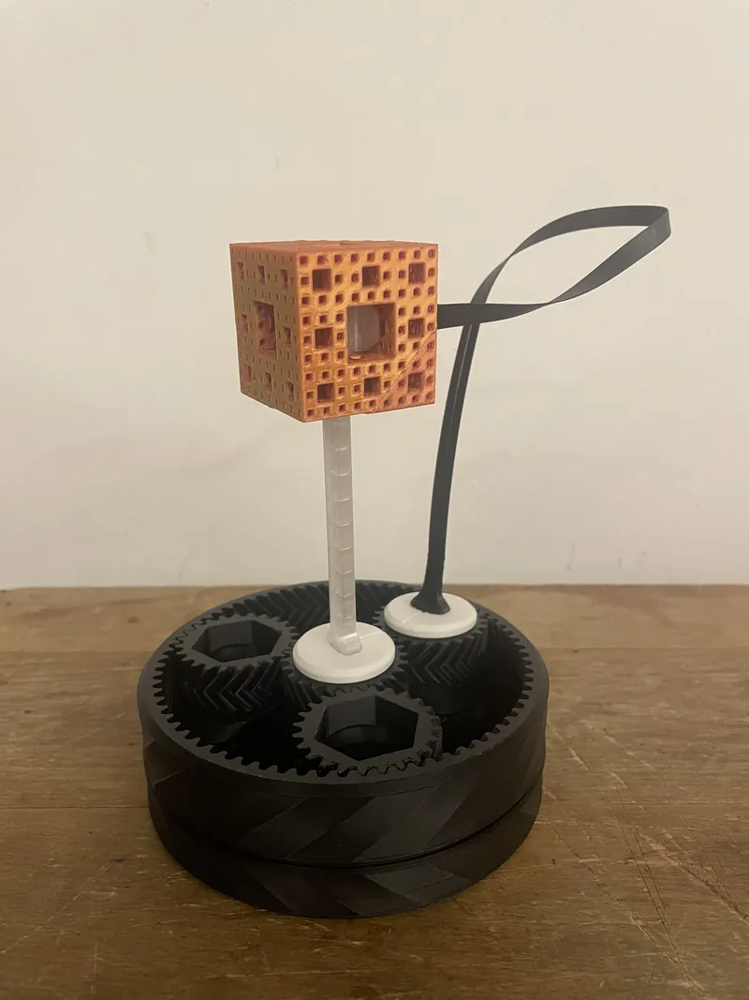

<figure class="eoc-pic eoc-pic-main"><picture><source media="(prefers-reduced-motion: reduce)" srcset="../media/drawn/anti-twister-mechanism.svg"></picture><figcaption><strong>Animation.</strong> Diagram drawn for the encyclopaedia from the research notes. ⚑ Needs confirming: a drawing can simplify or get details wrong; a real photo or a better diagram is welcome.</figcaption></figure>
<figure class="eoc-pic"><figcaption><strong>Render.</strong> A 3D model made for the encyclopaedia, not a photo: a real photo is also shown. ⚑ Needs confirming: a model can simplify or get details wrong.</figcaption></figure>
<figure class="eoc-pic"><figcaption><strong>How it works.</strong> <a href="https://www.printables.com/model/1128267-4pi-spin-12-symmetry-demonstrator-anti-twister-mec">4pi Spin-½ Symmetry Demonstrator Anti-Twister Mechanism</a> by Elequant, <a href="https://creativecommons.org/licenses/by/4.0/">CC BY 4.0</a>, from Printables.</figcaption></figure>

An anti-twister passes a continuous cable or tube from a fixed base to a part that keeps spinning, by swinging the cable's loop round the axis at exactly half the part's speed, so the cable only bends and never builds up twist, and no slip ring or rotating seal is needed.

**In plain words:** A cable that loops up, over and down onto a spinning turntable, while an arm carries the loop round at exactly half the turntable's speed, so the turntable can spin for ever without the cable winding up or twisting, and without any sliding contacts. **Proper term:** Anti-twister mechanism (antitwister, twist-free cable feed).

**Also called:** anti-twister, antitwister mechanism (Wikipedia); anti-twist mechanism (Holroyd 2022, 'The spinor [linkage](../glossary.md#linkage)'; YouTube 'LEGO anti-twist mechanism'); one-omega/two-omega (1-omega, 2-omega) principle, umbilicus or umbilical drive (blood-processing centrifuges; Fenwal patent US9545637); sealless or seal-less centrifuge, flow-through centrifuge without rotating seals (IBM/COBE patent US4439178; Ito, Suaudeau and Bowman, Science 1975); flying leads and de-twist mechanism (tubing in planetary countercurrent-chromatography centrifuges; Wikipedia, Countercurrent chromatography); skip-rope or jump-rope approach ⚑ [uncertain: seen only in a search-result snippet of a blood-centrifuge patent]; Dirac's belt trick, plate trick, string trick, Balinese cup trick (the demonstration behind it; Wikipedia, Plate trick); spinor linkage (a hinged-arm version turned by a handle; Holroyd 2022); 4-pi (720 degree) spin-1/2 demonstrator (Printables model 1128267).

## How it works

The cable comes out of the base along the axis, runs up, outwards and over the top in a loop, and comes back down onto the axis on top of the spinning part (Wikipedia; US3586413). A carrier swings this loop round the axis at exactly half the spinning part's speed, in the same direction (Wikipedia: 'the plane of this cable is rotated at exactly half the rate of the disk so the cable experiences no net twisting'). The cable is constantly bent back and forth but is not twisted about its own length: 'For every 720 rotation of the platform ... the conductors will complete 360 of rotation without becoming twisted' (US3586413). It works because of a property of 3D rotations shown by Dirac's belt trick: a twist made by one full turn cannot be undone, but the twist from two full turns can be, by passing the belt round the object (Wikipedia, Plate trick).

## Parts

A small assembly that acts as one unit: a fixed base, the spinning platform (rotor), a carrier arm or cage that guides the cable loop round the axis, a 2:1 drive linking carrier and platform (a ring gear, [idler](../glossary.md#idler) and transfer gears in Adams' 1971 patent US3586413; a two-layer planetary gear set in Printables model 1128267), bearings, the flexible cable, wire bundle or tube, and clamps at each end. A purely linkage version (Holroyd's spinor linkage) uses 14 hinged rigid bodies and a hook-shaped control shaft instead of gears.

## Everyday examples

- Blood-separating (apheresis) centrifuges, which spin a sealed bag or chamber fed by a tube bundle swung round at half speed (US9545637; US4439178; Ito, Suaudeau and Bowman, Science 1975)
- Planetary centrifuges for countercurrent chromatography, whose 'flying leads' carry liquid to the spinning coils (Wikipedia, Countercurrent chromatography)
- Dirac's belt trick: turn a belt buckle round twice and the belt can be untwisted without turning it back (Wikipedia, Plate trick)
- The plate trick and the Balinese candle dance, where a hand holding a plate or candle turns twice and the arm ends up untwisted (Wikipedia, Plate trick)

## When to use it

Use an anti-twister when a part must keep spinning the same way and you want a continuous cable or tube to it, with no sliding contacts and no rotating seals: low-noise power or signals for small electronics (Wikipedia: brushes introduce 'unacceptable levels of noise'), sealed or sterile liquid paths (blood processing; US9545637), equipment working under high g in a centrifuge that needs electrical measurements (US3586413), or a striking science demonstration or kinetic sculpture (Printables 1128267; Holroyd). It also suits links that can't easily go through a slip ring, such as a tube carrying liquid alongside wires (US3586413 lists hydraulic, pneumatic and optical uses).

## When not to use it

If the part only turns part of a revolution or a few turns back and forth, a simple service loop, a clock-spring spiral cable or a rotary cable carrier is simpler (see Cable through a hinge and Slip ring and rotary union; igus Twisterband turns through 3,000 degrees). If you need to reach or see the spinning part from a fixed side at all times, the swinging loop gets in the way (Holroyd 2022); use a slip ring, rotary union or a wireless link instead. Holroyd notes that 'the practical applications of such anti-twist mechanisms seem limited'. For low-cost, low-current hobby projects a bought capsule slip ring is smaller and easier. Very high speeds heat and [fatigue](../glossary.md#fatigue) the flexing cable (US4439178). A clockspring is 'a flat multicore cable wound in a spiral shape' inside a drum, which winds and unwinds as the part turns, as behind a car's steering wheel (Wikipedia 'Clockspring'); a car's clockspring typically gives about five full turns from one end stop to the other and must be fitted at the middle of its travel, or the ribbon stretches and breaks at full lock (YouCanic).

## Details

- **What it does (jobs):**
  - seal it, or pass cables or fluid through: carries power, signals or fluid to a part that keeps spinning, with no sliding contacts and no rotating seal
  - let it move (turn, slide or bend): lets the platform turn endlessly in one direction while still connected
- **Movement:** rotate: continuous, unlimited turns of the platform; the carrier turns at half that speed in the same direction about the same axis (Wikipedia; US3586413; US9545637)
- **Directions it can move (degrees of freedom):** 1: only the platform's rotation is free; the carrier is geared (or linked) to it, so its motion is not independent (Holroyd: the spinor linkage 'has one degree of freedom, and the motion is generated by simply turning a handle')
- **Special behaviour:**
  - none: its clever trick, endless rotation with a continuous cable that never builds up twist, isn't one of the listed behaviours; inside, it relies on a fixed 2:1 speed ratio between platform and carrier (US3586413)
- **How it holds:**
  - not a holding joint (it moves or passes on motion): it carries cables or tubes across a turning joint
  - shape (the parts interlock; [form-fit](../glossary.md#form-fit--force-fit--material-bond)): the gears that keep the exact 2:1 ratio mesh by shape, so the timing can't slip (US3586413; Printables 1128267)
- **Input and output:** Input: rotation of the platform (or of the drive ring) -> output: the cable carrier turning at exactly half the platform speed, same direction, same axis (in line). Ratio fixed at 2:1 (US3586413: gears 'chosen to provide relative rotational velocities of the rotating platform and the rotating support of two-to-one'; US9545637: umbilicus midsection at 'one-omega', chamber at 'two-omega'). Efficiency: not found ⚑ [uncertain]; flexing the cable adds drag and heat (US4439178: 'The lumen tube 3 itself heats up due to [flexure](../glossary.md#flexure) friction'). Back-drivable: yes, it is an ordinary gear train, so either part can drive the other ⚑ [uncertain].
- **Power:** passive (no power needed): the mechanism itself needs no power; the spinning part is usually driven by a motor (US3586413 uses one motor for both). If the motor stops, the cable simply stays connected; nothing releases
- **Load:** light: it carries cables or tubes, not mechanical loads. The spinning platform must run on its own bearing (in US3586413 the platform and rotating support each have their own bearings). The weak point is the cable itself, which is bent on every turn: continuous bending makes most cables 'corkscrew', a major reason conductors break (igus, Basics of Cable Carriers).
- **Play and precision:** The ratio must be exactly 2:1 (Wikipedia: 'exactly half the rate'); a drive that can slip, such as a friction belt, would let twist build up turn after turn ⚑ [uncertain: inferred from the principle]. Gear [backlash](../glossary.md#backlash) only shifts the loop slightly and does not add up ⚑ [uncertain]. The cable loop is not precisely located: in a fast centrifuge part of the tube takes its shape from centrifugal force (US4439178). The cable must leave and arrive exactly on the axis of rotation (US3586413 routes it up a tubular channel along the axis).
- **Taking it apart:** removable: the cable or tube is clamped at each end and guided by the carrier, so it can be unclamped and replaced; in blood centrifuges the tube set (umbilicus) is changed between uses (US9545637 describes the umbilicus as part of a fluid processing assembly) ⚑ [uncertain]
- **How often it can be reused:** many times
- **Sealing:** none: the mechanism itself doesn't seal anything, but because the tube runs unbroken from base to rotor, a liquid path stays closed with no rotating seal to leak ('The sealed, sterile integrity of the fluid processing assembly may thus be maintained without the need for rotating seals', US9545637; Ito et al. 1975: 'eliminates complications arising from rotating seals')
- **Adjustable:** no: the 2:1 ratio is fixed by the gears; at most the loop length and clamp positions can be set during assembly ⚑ [uncertain]
- **Access needed:** end of a tube or shaft: the cable enters along the axis from below and lands on the axis on top of the spinning part, and the carrier sweeps round the outside, so the whole space round the rotor must stay clear. Holroyd notes 'it is impossible to access the spinning object continuously from any fixed direction: the arm always gets in the way', and that Adams' device 'seems to suffer from the same difficulty'.
- **Materials:** Flexible cable, wire bundle or plastic tubing (blood centrifuges use a multi-lumen plastic tube with reinforcing sleeves; US4439178); carrier-friendly cables with abrasion-resistant, slick jackets and conductors laid to resist corkscrewing (igus, Basics of Cable Carriers); metal or plastic gears and ball bearings. Printed demonstrator: drive, cube and bases in PLA, the clear axle in PETG and the flexible band in ABS (Printables 1128267). LEGO Technic parts for the spinor linkage and LEGO anti-twist demos (Holroyd 2022; YouTube aeh5040).
- **Heat, cold, water and wear:** The cable fatigues from constant bending and may 'corkscrew' and break its conductors (igus, Basics of Cable Carriers). A flexing tube heats up from flexure friction (US4439178), and bearing surfaces on the tube heat up from friction too (US9545637). Printed PLA parts start to give at about 60 degrees C and PETG at about 80 degrees C (CNC Kitchen). Dust and wear affect it less than a slip ring because nothing slides electrically ⚑ [uncertain].

## Making it

- **Ways to make or get it:**
  - 3D print (FDM): [print-in-place](../glossary.md#print-in-place) planetary drive, carrier arm, bases and cable guides (Printables 1128267)
  - off-the-shelf part: gears (spur, ring or planetary sets), ball bearings or a turntable bearing, high-flex cable or tubing; no ready-made anti-twister unit was found
  - LEGO Technic: anti-twist and spinor-linkage demonstrators (Holroyd 2022; YouTube 'LEGO anti-twist mechanism')
  - CNC: machined gears, shafts and frames for full-size machines ⚑ [uncertain]
- **Printing it in one piece (print in place):** partly: the two-layer planetary gear drive of Printables model 1128267 prints in place and is broken loose after printing, but the cube, axle, bases and band are separate parts that snap on
- **Tools:** Screwdriver or hex keys to fit gears, bearings and cable clamps; soldering iron or crimp tool for the cable ends ⚑ [uncertain]. The printed demonstrator snaps together: 'The bases, axle, and band clip in with a snap fit' (Printables 1128267); its print-in-place gears are freed with a blunt butter knife.
- **Difficulty:** moderate: the 2:1 gearing is simple and prints well (a planetary set or two gear pairs), but choosing a cable that survives endless bending, keeping the loop clear of everything as it sweeps round, and balancing the carrier for higher speeds take care ⚑ [uncertain on balancing]

### 3D printing tips

1) Get the ratio exactly 2:1 with gears, not friction: the Printables demonstrator uses a planetary gear set and mounts the band's base on one of the planets, so it 'must complete one full circle around the shaft for every two rotations of the cube, while maintaining its orientation' (Printables 1128267). 2) Print-in-place gears: 0.2 mm layer height, no supports, top-surface ironing, 0.2 mm [clearances](../glossary.md#clearance); break the planet, sun and ring gears loose after printing 'so you can feel them slightly wiggle' (Printables 1128267). 3) Snap-fit parts that are flexed (axle, bases, band) are better in PETG or ABS than PLA; the designer printed the band in ABS and the clear axle in PETG (Printables 1128267). 4) Route the cable up the centre of the axis and down onto the centre of the rotor (US3586413), and clamp (strain-relieve) it at both ends so the bending happens in the free loop, not at the solder joints (igus: 'always strain relieve cables at the moving end and, whenever possible, at both ends'). 5) Keep the loop's bend radius generous: igus's rule for moving cables in carriers is at least 8 to 10 times the outer diameter of the largest cable (igus, Basics of Cable Carriers). 6) Use fine-stranded, flexible cable (e.g. silicone-insulated multi-strand wire) rather than solid-core wire ⚑ [uncertain]. 7) Leave a clear sweep zone round the rotor, since the carrier and loop pass every side (Holroyd). 8) PLA parts near motors soften from about 60 degrees C (CNC Kitchen).

### Buying one (off-the-shelf parts)

Search for: 'planetary gear set', 'ring gear', 'spur gear 2:1', 'GT2 pulley' pairs with a timing belt for a toothed 2:1 drive ⚑ [uncertain], 'turntable bearing' or 'lazy Susan bearing', 'slewing ring', 'ball bearing', 'high flex cable', 'continuous flex cable', 'drag chain cable', 'robot cable', 'silicone wire' ⚑ [uncertain], 'silicone tubing'. Limited-rotation alternatives: 'Twisterband' (igus (brand); a compact carrier that 'can turn through 3,000 degrees', igus Basics of Cable Carriers), 'clock spring' or 'spiral cable'. Endless-rotation alternative with contacts: 'capsule slip ring', 'rotary union'.

## Rules of thumb

- The cable carrier must turn at exactly half the speed of the spinning part, in the same direction (Wikipedia, Anti-twister mechanism; US3586413 'two-to-one'; US9545637 'one-omega' and 'two-omega').
- The cable returns to its starting state only every two turns of the platform (720 degrees), not every turn (US3586413; Wikipedia, Plate trick; Printables 1128267: 'Only after these two full rotations, does the system return to where it started').
- Moving-cable bend radius: at least 8 to 10 times the outer diameter of the largest cable, and a larger radius lasts longer (igus, Basics of Cable Carriers; a cable-carrier rule, applied here to the swinging loop).
- Strain-relieve cables at the moving end and, whenever possible, at both ends; hydraulic hoses only at the moving end (igus, Basics of Cable Carriers).
- A flexing tube heats up from flexure friction; reinforcing sleeves at the ends spread the bending and the heat 'so as to avoid weakened hot spots' (US4439178).
- Plan for the swinging arm to block any fixed line of sight or access to the spinning part (Holroyd 2022).

## Common failures

1) Wrong or slipping ratio: any drive that isn't exactly 2:1 lets twist build up every turn ⚑ [uncertain: inferred from the principle]; use gears or a toothed belt. 2) Cable fatigue: conductors break from repeated bending and corkscrewing; use flexible, carrier-rated cable, a large bend radius and strain relief at both ends (igus, Basics of Cable Carriers). 3) Heating and wear of the flexing tube where it runs in its support bearing, leading to leaks (US4439178; US9545637). 4) The loop hitting the rotor, frame or nearby objects as it sweeps round (Holroyd). 5) Printed demo: print-in-place gears fused together until broken loose, and PLA snap fits cracking (Printables 1128267).

## Safety

The carrier arm and cable loop sweep round the rotor, making entanglement and pinch points; guard the whole sweep zone ⚑ [uncertain: general machine-safety practice]. A cable that fatigues can expose its conductors, so avoid mains voltage in a DIY loop or protect it with a fuse and enclosure ⚑ [uncertain]. In fluid systems, wear where the tube runs in its bearing can cut into the tube and cause 'leakage of the fluid through the umbilicus' (US9545637).

## Related

- Slip ring and rotary union: also allow endless rotation, but through sliding brushes or rotating seals, which wear and add electrical noise or leak (Wikipedia, Anti-twister mechanism; Slip ring)
- Cable through a hinge: a service loop or a clockspring (spiral flat cable) also needs no moving contacts, but allows only part of a turn or a few turns (a car's clockspring about five from end to end, YouCanic)
- Cable carrier (drag chain), including rotary carriers such as igus Twisterband (brand): guide cables through a limited rotation (up to 3,000 degrees) rather than endless turns (igus, Basics of Cable Carriers)
- Multi-turn rotation limiter: stops a shaft after a set number of turns, so a plain cable loop isn't over-twisted
- Planetary gear set: the usual way to get the exact 2:1 carrier speed (Printables 1128267)
- Spinor linkage: a chain of hinged links driven by an internal shaft that does the same job without a separate flexible cable (Holroyd 2022)
- Flexible drive shaft: a rotating cable that carries turning motion, rather than a cable that must not twist
- Gimbal: lets a part point in any direction with nested rings, not continuous spin with a cable
- Flat flexible cable and latching connector: thin flat cable made for repeated flexing; wound into a spiral drum it becomes a clockspring (Wikipedia 'Clockspring')

## Make it yourself

- [4pi Spin-1/2 Symmetry Demonstrator Anti-Twister Mechanism (Elequant, Printables; URL from search results, details read through the Printables API)](https://www.printables.com/model/1128267-4pi-spin-12-symmetry-demonstrator-anti-twister-mec): Printable demonstrator: a print-in-place two-layer planetary gear drive spins a cube twice for each orbit of a flexible band, which never tangles; 0.2 mm layers and 0.2 mm tolerances *(licence: CC BY)*
- [The spinor linkage: a mechanical implementation of the plate trick (A. E. Holroyd, arXiv 2107.01681; Journal of Mathematics and the Arts 2022)](https://arxiv.org/abs/2107.01681): Paper with an appendix giving 'full instructions for constructing a working model of the spinor linkage from LEGO parts', including the parts list; also discusses anti-twist mechanisms *(licence: arXiv non-exclusive distribution licence (link and cite only))*

## Pictures, videos and models

- [File:Belt Trick.gif (Wikimedia Commons, Jason Hise)](https://commons.wikimedia.org/wiki/File:Belt_Trick.gif): Animation of a cube spinning continuously while tethered by several belts that never twist or tangle, the principle of the anti-twister *(licence: CC0 1.0 (public domain dedication))*
- [LEGO anti-twist mechanism (YouTube, aeh5040; title confirmed through YouTube oEmbed, video not watched; linked from Wikipedia)](https://www.youtube.com/watch?v=1x_oQv_qj_U): A working LEGO anti-twister *(licence: link only (standard YouTube licence))*
- [Spinor Linkage (YouTube, aeh5040 / A. E. Holroyd; title confirmed through YouTube oEmbed, video not watched)](https://www.youtube.com/watch?v=oRPCoEq05Zk): A hinged-arm linkage that lets a cube spin endlessly while tethered, turned by a handle *(licence: link only (standard YouTube licence))*
- [Do you know the anti-twister mechanism? (YouTube, MindYourDecisions; title confirmed through YouTube oEmbed, video not watched)](https://www.youtube.com/watch?v=ulrcyZpA0rE): Explainer video on the anti-twister mechanism *(licence: link only (standard YouTube licence))*
- [US3586413A, Apparatus for providing energy communication between a moving and a stationary terminal (Dale A. Adams, 1971; Google Patents)](https://patents.google.com/patent/US3586413A/en): Patent drawings of the geared anti-twister: base, half-speed rotating support, 2:1 gearing and the cable path over the platform *(licence: US patent (public domain text and drawings))*

## Needs confirming

⚑ marks something nobody has confirmed yet: a fact the research could not confirm from a source, a finder value that is a best guess, or an open point from the research notes. Corrections are welcome (see `research/needs-confirming.md`).

- ⚑ 17 sentences on this page marked [uncertain].
- ⚑ Finder value `tools` = soldering iron, crimper, hand tools (source uncertain): `tools_needed` is marked ⚑ [uncertain] here: "…ngs and cable clamps; soldering iron or crimp tool for the cable ends ⚑ [uncertain]. The printed demonstrator sn…"
- ⚑ Research note: *Anti-twister mechanism*: `materials` is in the entry's `uncertain` list but has no `[uncertain]` marker, so the default report shows it in full. Check its materials list before publishing.
- ⚑ Research note: **For a later pass:** *Slip ring and rotary union* (135) and *Genderless connector* (286) are tagged with the electrical family, but their `load` doesn't start with the fixed electrical lead-in. *Anti-twister mechanism* (291) still lists `materials` in `uncertain` without a marker (noted earlier). The underwriter's knot in *Cable gland and strain relief* (134) is described without tying steps, under the mains rule.
- ⚑ Research note: *Anti-twister mechanism* lists `materials` as unverified without a marker (see above).

## Sources

- <https://en.wikipedia.org/wiki/Anti-twister_mechanism>
- <https://en.wikipedia.org/wiki/Plate_trick>
- <https://en.wikipedia.org/wiki/Countercurrent_chromatography>
- <https://commons.wikimedia.org/wiki/File:Belt_Trick.gif>
- <https://patents.google.com/patent/US3586413A/en>
- <https://patents.google.com/patent/US9545637B2/en>
- <https://patents.google.com/patent/US4439178A/en>
- <https://arxiv.org/abs/2107.01681>
- <https://arxiv.org/pdf/2107.01681>
- <https://eutils.ncbi.nlm.nih.gov/entrez/eutils/efetch.fcgi?db=pubmed&id=10805426,663998,1220011&rettype=abstract&retmode=text>
- <https://www.igus.com/contentData/Product_Files/Download/pdf/Basics_of_Cable_Carriers.pdf>
- <https://www.cnckitchen.com/blog/comparing-pla-petg-amp-asa-feat-prusament>
- <https://www.youtube.com/watch?v=1x_oQv_qj_U>
- <https://www.youtube.com/watch?v=oRPCoEq05Zk>
- <https://www.youtube.com/watch?v=ulrcyZpA0rE>
- <https://api.printables.com/graphql/>
- <https://www.printables.com/model/1128267-4pi-spin-12-symmetry-demonstrator-anti-twister-mec>
- <https://en.wikipedia.org/wiki/Clockspring>
- <https://www.youcanic.com/properly-set-a-new-clock-spring/>
