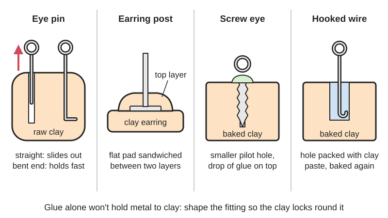

<figure class="eoc-pic eoc-pic-main"><figcaption>Diagram drawn for the encyclopaedia from the research notes. ⚑ Needs confirming: a drawing can simplify or get details wrong; a real photo or a better diagram is welcome.</figcaption></figure>

Metal fittings for hanging or wearing a clay piece (eye pins, screw eyes, bails, earring posts, button shanks, pin backs) are trapped inside polymer clay before or between bakes, so the baked clay holds them by shape, because glue on its own does not hold metal to polymer clay reliably.

**In plain words:** Setting a little metal loop, pin, earring post or hanger into soft polymer clay before it is baked (with a bent end, a dab of liquid clay, or a second layer of clay pressed over its flat base) so the hardened clay grips it and it can't pull out. **Proper term:** Baked-in findings (embedded jewellery findings in polymer clay).

**Also called:** embedding findings / embedded hardware; embedding earring posts, embedded post backs (Blue Bottle Tree); baked-in eye pin, baked-in bail; eye pin, head pin, screw eye, screw eye pin (the findings; Beads and Beading); glue-on bail, pendant bail, earring post with pad, post back, pin back, barrette back, button back or shank (findings named by Blue Bottle Tree); physical bond (as opposed to an adhesive bond; Blue Bottle Tree); post embedder (tools sold for embedding earring posts) ⚑ [uncertain]; gem seat, setting crystals in clay (Blue Bottle Tree).

## How it works

Glue holds poorly between rigid metal and slightly flexible polymer clay; Blue Bottle Tree says 'Glue will not be reliable for this bond over time', and Sculpey says clay 'cannot be bonded to metal or other non-porous surfaces' and should be wrapped round it instead (Sculpey FAQ). So the finding is shaped so the clay can lock round it: a straight eye pin pushed into raw clay soon falls out, but one with a bent end, or one dipped in liquid clay first, stays in (Beads and Beading; Sculpey blog). A flat-padded post, bail or button back is laid on baked or raw clay and covered with a second layer of clay, so the pad is sandwiched inside the piece; after baking 'The only way for them to come off would be to destroy the earring' (Blue Bottle Tree). For baked pieces, a hooked wire is set in a drilled hole filled with clay paste and baked again (Polymer Clay Journey), or a screw eye is twisted into an undersized [pilot hole](../glossary.md#pilot-hole) and locked with a drop of superglue (Beads and Beading).

## Parts

A few parts: the polymer clay piece, the metal finding (eye pin, head pin, screw eye, bail, earring post with a flat pad, button back, pin back or wire), and usually something to lock it in: a bent or hooked end, a dip of liquid clay, a second layer of clay pressed over the pad, a paste of clay and liquid clay in a drilled hole, or a drop of glue on a screw eye.

## Everyday examples

- polymer clay stud earrings with the post hidden under a layer of clay on the back
- a clay charm on a bracelet or phone strap hanging from a screw eye or eye pin
- handmade clay buttons with a metal shank on the back (Blue Bottle Tree)
- clay fridge magnets with a magnet glued into the back after baking (supermagnete)

## When to use it

Whenever metal has to be attached to polymer clay for wear: earrings, pendants, charms, brooches and hair clips, buttons, ornaments and fridge magnets. Embedding is the most durable choice when the piece must last for years or be sold, because 'all the other methods can fail' (Blue Bottle Tree, earring posts). Use a screw eye when a piece is too big to drill through or the wrong shape for a bail, and when the charm will twist a lot (Beads and Beading). Set gems and crystals the same way, then glue them back into their seat.

## When not to use it

When the finding can't take the heat: standard neodymium magnets (glue them on after baking, use a high-temperature grade, or use the Magnet joint), plastic parts and plastic 'crystals' (they melt), amber, opals and pearls (Blue Bottle Tree, crystals). When the piece is already finished and can't be rebaked: use gel superglue on a textured, alcohol-wiped surface and accept it may fail in a few years (Blue Bottle Tree), or UV resin over the post (which works but needs a respirator). Not for hardware that must come off again. For screw eyes in wood see Eye bolts, screw eyes and hooks; for nuts and magnets in prints see Mid-print embedding.

## Details

- **What it does (jobs):**
  - join and hold: fixes hanging loops, earring posts, pin backs and button shanks to clay jewellery, charms and buttons
- **Movement:** none (the finding is fixed); the loop it provides lets a jump ring, cord or ear wire swing freely
- **Directions it can move (degrees of freedom):** 0 between finding and clay; whatever hangs from the loop can swing and turn
- **Special behaviour:**
  - none: no lock, release or spring action; it is a permanent fitting
- **How it holds:**
  - shape (the parts interlock; [form-fit](../glossary.md#form-fit--force-fit--material-bond)): the clay surrounds a bent end, hook, flat pad or screw thread, so the finding cannot pull out without breaking the clay
  - material bond (glue, solvent or melting): a dip of liquid clay, or a paste of clay and liquid clay, [cures](../glossary.md#cure) round the finding; a drop of superglue locks a screw eye
  - friction or clamping (force-fit): a screw eye's thread biting into an undersized pilot hole in baked clay
- **Input and output:** not applicable
- **Power:** passive (no power needed)
- **Load:** light: jewellery, charms, buttons and decorations. Strongest when the finding is covered by clay (a sandwiched pad or a hooked end), which holds until the clay itself breaks (Blue Bottle Tree, earring posts); weakest for a straight pin pushed into raw clay, which works loose with the twisting a charm gets (Beads and Beading). A screw eye resists twisting better than an eye pin: 'they don't get bent open with all the twisting that a charm does on a bracelet' (Beads and Beading). No strength figures found ⚑ [uncertain]
- **Play and precision:** not applicable
- **Taking it apart:** permanent: an embedded finding comes out only by breaking the clay; a screw eye set with glue is semi-permanent
- **How often it can be reused:** once
- **Sealing:** none
- **Adjustable:** no once baked; a wire post can be cut to length and sanded after baking (Polymer Clay Journey)
- **Access needed:** one side only (blind): the finding goes in from the edge or back of the piece and nothing needs to reach through
- **Materials:** Clay: polymer clay (PVC, oven-baked) is the main material; the same trap-it-while-soft idea is used with epoxy putty and air-dry clay ⚑ [uncertain]. Findings: metal ones of any common jewellery metal (plated base metal, sterling silver wire, e.g. 21 gauge; Polymer Clay Journey), because metal takes the baking heat; glass crystals and stones can also be baked in, but plastic 'crystals' melt and amber, opals, pearls and some soft stones should never be baked (Blue Bottle Tree, crystals). Magnets: standard neodymium magnets are damaged by the bake, so glue them on afterwards or use a high-temperature grade (see rules_of_thumb). Wood and stone bases hold moisture and should be dried in the oven first (Sculpey blog, armature). Resin and superglue should not be baked (Blue Bottle Tree, earring posts)
- **Heat, cold, water and wear:** Properly baked polymer clay is strong, durable and waterproof and survives washing machines (Blue Bottle Tree, buttons), so an embedded finding lasts as long as the clay. Glued findings tend to fail over time: rigid glues go [brittle](../glossary.md#brittle--ductile) and let go when the clay flexes or is dropped (Blue Bottle Tree, flexible glue). Magnets lose strength permanently above their maximum operating temperature (80 °C for standard N grades, depending on shape; K&J Magnetics). Underbaked clay lets posts pull out (Blue Bottle Tree, earring posts).

## Making it

- **Ways to make or get it:**
  - hand work in polymer clay with a home oven
  - off-the-shelf part: jewellery findings (eye pins, screw eyes, bails, earring posts, button backs, pin backs)
- **Printing it in one piece (print in place):** no for clay; the same idea in 3D printing is pausing a print to drop in a nut or magnet and printing over it (see Mid-print embedding)
- **Tools:** round-nose and flat-nose pliers and wire cutters to bend and trim pins and wire; a pin vice or small drill for pilot holes and holes in baked clay (Beads and Beading; Polymer Clay Journey); liquid polymer clay; a pasta machine or roller for the covering layer and small circle cutters (Blue Bottle Tree, buttons); an oven with an oven thermometer (Sculpey FAQ); gel superglue for screw eyes and gems; card stock to prop a post level while baking (Polymer Clay Journey)
- **Difficulty:** easy to moderate: bending an eye pin or covering a post pad is easy; drilling straight pilot holes and getting a second clay layer on without air bubbles takes practice

### 3D printing tips

Not applicable to the clay itself, but the same principle carries over to prints: hardware trapped by material laid over it holds by shape, which is why makers pause a print to embed nuts, magnets and wire loops (see Mid-print embedding). For printed jewellery, design a hole or slot for a post or loop and glue it, or print a pocket and trap the finding with a later layer ⚑ [uncertain]. Printed clay cutters are widely shared for making earring blanks to embed posts in (see make_it_yourself). A PLA print should not be baked with polymer clay ⚑ [uncertain].

### Buying one (off-the-shelf parts)

Eye pins, head pins, screw eyes (screw eye pins, about 5/16 in long with a 1/8 in loop are typical charm sizes; Beads and Beading), glue-on bails, pendant bails, earring posts with flat pads ('post backs') and earnuts, ear wires, jump rings, button backs or shanks (e.g. 10 mm; Blue Bottle Tree, buttons), pin backs and barrette backs, sterling or plated wire for custom posts (21 gauge; Polymer Clay Journey), point-backed crystals, rivolis and Hotfix crystals (Blue Bottle Tree, crystals), liquid polymer clay, gel superglue, high-temperature neodymium magnets (SH or AH grade; K&J Magnetics) or ferrite magnets

## Rules of thumb

- Bend the end of an eye pin before pushing it into unbaked clay, or it will fall out (Beads and Beading); or dip the end in liquid clay, 'preferably translucent', before inserting (Sculpey blog, liquid clay)
- Screw eyes: drill a pilot hole smaller than the outside diameter of the threads; 'If the hole is too big, the screw will just fall out'; lock it with a drop of superglue (Beads and Beading, 2016); drilling the pilot hole first stops the charm cracking (Beads and Beading, 2008)
- Wire post in a baked piece: drill a hole about 1/8 to 3/16 in deep, large enough that the wire need not be forced (a tight fit can crack the clay while baking), bend a small hook on the wire end so it can't pull out, fill the hole with a paste of clay and liquid clay, prop it level with card stock and bake again (Polymer Clay Journey, 2022)
- Earring posts, bails and button backs: cover the pad with a second layer of clay and blend it in; this needs two bakes and is 'the only sure way' (Blue Bottle Tree, earring posts). For buttons: a 4-playing-card-thick sheet under the button back, a 1 to 2-card-thick top layer with a 3/16 in (4 mm) hole for the shank, press out air, and bake at least 45 minutes (Blue Bottle Tree, buttons)
- A puddle of bakeable paste over a post must extend past the metal pad onto the clay, or it does nothing (Blue Bottle Tree, earring posts)
- Crystals: push point-backed crystals into raw clay, bake, pop them out and glue them back into their perfectly shaped seat with a dab of gel superglue (Blue Bottle Tree, crystals)
- Magnets: polymer clay cures at about 129 to 135 °C (Wikipedia 'Polymer clay'), but a standard N42 disc magnet 1/2 in x 1/8 in has a maximum operating temperature of 80 °C and kept only about 60% of its strength after 100 °C, while a magnet as tall as it is wide showed no loss until over 140 °C; high-temperature grades are rated N42SH 150 °C and N35AH 220 °C (K&J Magnetics). supermagnete says magnets glued on before baking 'will be demagnetised', expects about 20% loss even at a 100 °C bake, and glues them on after baking. The two figures differ because loss depends on the magnet's shape and grade

## Common failures

1) Eye pin pops out of a charm: bend or hook the end, dip it in liquid clay, or use a screw eye (Sculpey blog; Beads and Beading). 2) Glued post or bail falls off after months: glue to polymer clay often fails, especially rigid glues; embed instead (Blue Bottle Tree). 3) Screw eye falls out: the pilot hole was too big (Beads and Beading). 4) Clay cracks round the finding: the hole was too small or the wire was forced (Polymer Clay Journey), no pilot hole was drilled for a screw eye (Beads and Beading), or air was trapped (Sculpey blog). 5) Post pulls the clay off with it: the clay was underbaked (Blue Bottle Tree). 6) Bakeable paste puddled only on the metal pad does nothing (Blue Bottle Tree). 7) Wire post sags while baking: prop it with card stock (Polymer Clay Journey). 8) Magnet weak after baking: it was baked in; glue it on afterwards (supermagnete). 9) Crystals fall out of a worn piece: pop them out after baking and glue them back (Blue Bottle Tree, crystals).

## Safety

Bake at the packet temperature with an oven thermometer and ventilation; burnt polymer clay can release hydrogen chloride (Wikipedia 'Polymer clay'; Sculpey FAQ). Don't bake superglue (it weakens, with 'really minor' toxic breakdown) and don't bake resin, 'not even UV resin'; resin is highly allergenic, so wear a respirator when using it (Blue Bottle Tree, earring posts). Air bubbles trapped round hardware or between clay layers expand in the oven and 'will probably crack or puff' the piece (Sculpey blog, armature); press covering layers down to remove air bubbles (Blue Bottle Tree, buttons), working from the middle outward (Sculpey blog, armature). Too tight a hole or a forced wire can crack the clay during baking (Polymer Clay Journey). Neodymium magnets lose strength above about 80 °C while polymer clay cures at about 130 °C (K&J Magnetics; supermagnete). Small magnets and small findings are a swallowing hazard for young children (see Magnet joint). Wear eye protection when clipping wire, since cut ends fly ⚑ [uncertain]. Polymer clay jewellery is not for food use (Wikipedia 'Polymer clay').

## Related

- Mid-print embedding ([captive nuts](../glossary.md#captive-nut), magnets and bearings): the same trap-it-while-soft idea in 3D printing
- Eye bolts, screw eyes and hooks: screw eyes and hooks in wood and walls
- Magnet joint: magnets in pockets, glued in after baking for clay pieces
- Liquid-clay bond: the liquid clay used to dip pins and to make clay paste for filling holes
- Cyanoacrylate (superglue): gel superglue locks screw eyes and gems into baked clay
- UV-curing adhesive (incl. resin used as glue): UV resin poured over earring posts, an alternative that cannot be rebaked
- Sew-on part (sewing holes, loops and slots on a rigid part): clay buttons with holes instead of a shank
- Wire and foil armature: a larger wire skeleton baked inside a clay figure
- Pinned glue joint: a wire or toothpick across a clay joint rather than a fitting for hanging

## Make it yourself

- [Elegant Shapes Polymer Earring Clay Cutter (Printables) (URL from Printables API, page not opened)](https://www.printables.com/model/833092-elegant-shapes-polymer-earring-clay-cutter): Printable cutters for polymer clay earring blanks, into which posts or eye pins can then be embedded; found through the Printables public API *(licence: CC BY-NC)*

## Pictures, videos and models

- [Securing Polymer Clay Earring Post Backs – What's the best way? (The Blue Bottle Tree)](https://thebluebottletree.com/securing-polymer-clay-earring-post-backs-whats-the-best-way/): Photos and an embedded video comparing glued, resin-covered, Bake-and-Bond and embedded earring posts *(licence: link only (embedded YouTube video))*
- [Embedding metal posts in polymer clay hoop earrings (Polymer Clay Journey, Phyllis Cahill, 2022)](https://polymerclayjourney.com/2022/03/07/embedding-metal-posts-in-polymer-clay-hoop-earrings/): Step-by-step photos of drilling a baked hoop, setting a hooked wire post in clay paste, propping it and baking again *(licence: link only)*
- [Screw Eye Findings For Polymer Clay Pendants (Beads and Beading, 2016)](https://www.beadsandbeading.com/blog/?p=20255): Photos of screw eyes being set into pilot holes in polymer clay charms and locked with glue *(licence: link only)*
- [How to Make Polymer Clay Buttons (The Blue Bottle Tree)](https://thebluebottletree.com/make-polymer-clay-buttons/): Photos of shank-backed buttons made by covering metal button backs with a second, holed layer of clay *(licence: link only)*
- [Temperature and Neodymium Magnets (K&J Magnetics)](https://kjmagnetics.com/blog/temperature-and-neodymium-magnets): BH-curve diagrams explaining why magnets lose strength when heated and how shape and grade change the safe temperature *(licence: link only)*

## Needs confirming

⚑ marks something nobody has confirmed yet: a fact the research could not confirm from a source, a finder value that is a best guess, or an open point from the research notes. Corrections are welcome (see `research/needs-confirming.md`).

- ⚑ 6 sentences on this page marked [uncertain].
- ⚑ Research note: *Baked-in findings* (430): magnet heat loss: about 20% at a 100 °C bake (supermagnete) versus a thin N42 disc keeping about 60% after 100 °C (K&J Magnetics); shape and grade differ.

## Sources

- <https://thebluebottletree.com/best-glue-for-polymer-clay/>
- <https://thebluebottletree.com/securing-polymer-clay-earring-post-backs-whats-the-best-way/>
- <https://thebluebottletree.com/polymer-clay-needs-flexible-glue/>
- <https://thebluebottletree.com/make-polymer-clay-buttons/>
- <https://thebluebottletree.com/can-you-bake-crystals-in-clay/>
- <https://www.sculpey.com/blogs/blog/the-diversity-of-liquid-polymer-clay>
- <https://blog.sculpey.com/creating-armature-that-supports-your-sculpts>
- <https://www.sculpey.com/pages/faqs-1>
- <https://www.beadsandbeading.com/blog/?p=20255>
- <https://www.beadsandbeading.com/blog/charm-jewelry-findings-for-hanging-miniature-polymer-clay-sculptures/285/>
- <https://polymerclayjourney.com/2022/03/07/embedding-metal-posts-in-polymer-clay-hoop-earrings/>
- <https://www.supermagnete.se/eng/Magnet-applications/Magnets-made-of-oven-hardening-modelling-clay>
- <https://kjmagnetics.com/blog/temperature-and-neodymium-magnets>
- <https://en.wikipedia.org/wiki/Polymer_clay>
- <https://api.printables.com/graphql/>
