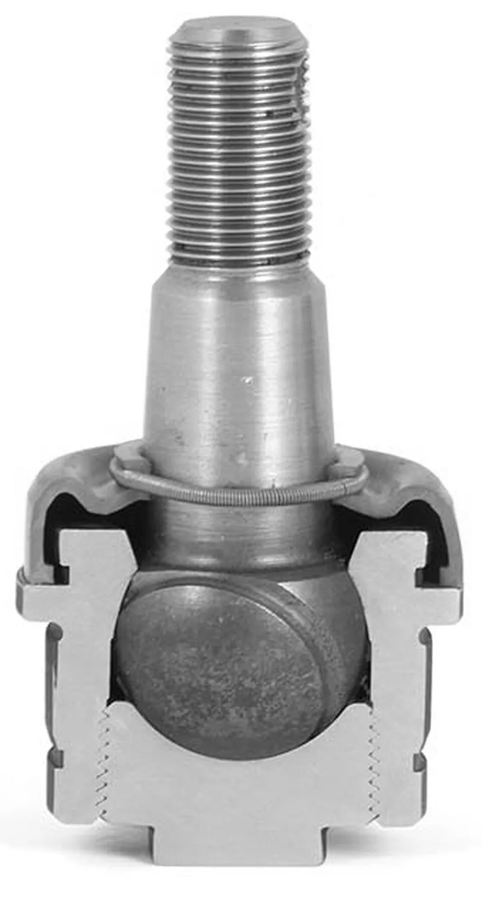
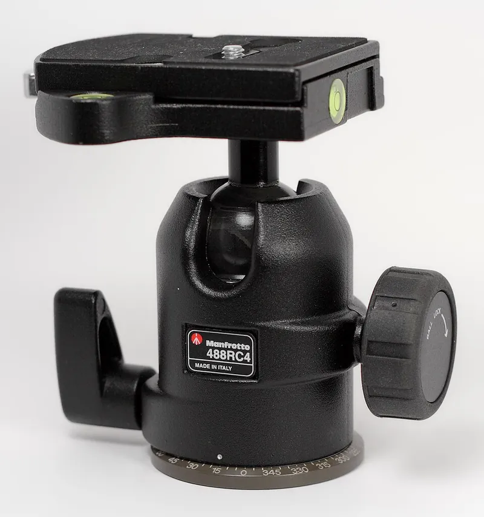

<figure class="eoc-pic eoc-pic-main"><picture><source media="(prefers-reduced-motion: reduce)" srcset="../media/drawn/ball-and-socket-joint.svg"></picture><figcaption><strong>Animation.</strong> Diagram drawn for the encyclopaedia from the research notes. ⚑ Needs confirming: a drawing can simplify or get details wrong; a real photo or a better diagram is welcome.</figcaption></figure>
<figure class="eoc-pic"><figcaption><strong>Cross-section.</strong> <a href="https://commons.wikimedia.org/wiki/File:KugelgelenkSchnitt.jpg">KugelgelenkSchnitt</a> by S.Wetzel (Maschinenelemente, Maschinen und Geräte), <a href="https://creativecommons.org/licenses/by-sa/4.0">CC BY-SA 4.0</a>, from Wikimedia Commons.</figcaption></figure>
<figure class="eoc-pic"><figcaption><strong>Photo.</strong> <a href="https://commons.wikimedia.org/wiki/File:Manfrotto_488_RC4.jpg">Manfrotto 488 RC4</a> by Nebrot, <a href="https://creativecommons.org/licenses/by-sa/3.0">CC BY-SA 3.0</a>, from Wikimedia Commons.</figcaption></figure>

A ball on one part sits in a matching cup (socket) on the other so it can turn about any axis through the ball's centre but can't pull out; friction holds it at an angle, and a knob, nut or clamp can squeeze the cup to lock it.

**In plain words:** A ball held inside a cup so the part on the ball can swivel and tilt any way you like, like a camera tripod head or a car phone mount; often a knob or ring squeezes the cup to lock it. **Proper term:** Ball-and-socket joint (spherical joint); lockable version: ball head.

**Also called:** ball joint; spherical joint / spherical pair (S pair) (kinematics term); ball head / ballhead (camera tripod head); lockable ball joint / snap-fit ball joint with locking nut (maker terms); friction ball joint / friction spherical joint (Reell lists spherical joints among its friction products); swivel mount / ball swivel; ball-and-socket mount or double-socket arm ('RAM mount', RAM Mounts (brand)); tow ball and coupling (trailer hitch); Kugelgelenk (German), rotule (French); universal ball joint (maker name on model sites, though a true universal joint is a different mechanism); pyramid adaptor / pyramid adapter (a screw-locked tilt joint from artificial legs; Ottobock (brand) patented it in 1969).

## How it works

The ball's centre stays fixed inside the cup, so the attached part can swing in any direction and spin, but can't move sideways or pull out (a spherical joint: three turning freedoms, no sliding; Wikipedia 'Kinematic pair'). The socket's lip curls past the ball's widest point (an [undercut](../glossary.md#undercut)), so the ball either snaps in by bending the socket's slotted fingers or is trapped by a cap or nut. How firmly it holds an angle depends on how hard the cup presses on the ball: a light press gives a stiff 'friction joint' that holds light things in any position; tightening a knob or nut presses harder and locks it (a ball head's bearing cup 'distorts a bit with pressure, exerting more friction at higher pressures', Lensrentals). The tilt is limited by the neck hitting the rim of the cup, so an ordinary spherical joint can't turn through more than 180° (Thang, 2700 Animated Mechanical Mechanisms, Part 3, p. 172). A flat, screw-locked cousin is the pyramid alignment adaptor used between the modules of artificial legs: a short pyramid-shaped [boss](../glossary.md#boss) (the 'male pyramid') on one part sits in a matching socket (the 'female pyramid' or receiver) on the other, which carries four [set screws](../glossary.md#set-screw); before the screws are tightened the joint can be turned a full circle and tilted a few degrees, and tightening the four screws locks that alignment (Blatchford 938373 and 938050 instructions; College Park 4-hole pyramid receiver instructions). Wikipedia ('Ottobock') says the adaptor 'allows static corrections as well as the exchange of the modules'. It is described here only as an idea for non-medical maker builds.

## Parts

A few parts. Basic: a ball on a neck or stud, and a socket whose rim wraps past the ball's widest point. Snap-in versions have a socket split by slots into springy fingers (US4607976, Covestro p. 5). Lockable versions add a clamp: a knob screw pushing a friction pad or cone-shaped compression ring against the ball (tripod ball heads; Lensrentals teardown); a threaded union nut or collar that squeezes the slotted socket fingers (printed lockable ball joints); or two half-cups pulled together by one bolt and knob to grip two balls at once, with a spring pushing them apart when loosened (double-socket arm).

## Everyday examples

- A camera tripod ball head with a locking knob (Wikipedia 'Tripod head')
- Your hip and shoulder (Wikipedia 'Ball-and-socket joint')
- A trailer tow ball and coupling (Wikipedia 'Tow hitch') and a car's suspension ball joints (Wikipedia 'Ball joint')
- Car and bike phone or GPS mounts with a rubber ball and a clamping arm (Mountguys), and doll or action-figure joints (Wikipedia 'Ball joint')

## When to use it

Use a ball-and-socket joint when something must be aimed in any direction from one point: cameras, lights, phones, sensors, fans, mirrors and webcams; levelling feet that must sit flat on an uneven floor; poseable figures and models. Use a friction ball joint when light parts should stay where posed, and a lockable one (knob, union nut or double-socket arm) when the device is heavier or must not drift. It is also the joint to choose when two parts need to line up by themselves despite angle errors (self-aligning). The pyramid-adaptor idea suits a compact tilt joint between two modules, such as robot legs or sensor mounts, that is set once with screws and then locked, where full rotation and a few degrees of tilt are enough.

## When not to use it

Avoid it when you need movement about one axis only, since a ball lets the part flop sideways too (use an ordinary hinge or pivot); when you need to repeat exact angles (use a [detent](../glossary.md#detent), indexing plunger or a geared pan-tilt head; ball heads are poor at precise alignment, Wikipedia 'Tripod head'); when twisting must be passed through the joint (use a universal joint or a pin spherical joint); when tilt beyond about 90° each way is needed (use a universal joint or a gimbal); and for heavy loads that must be locked on a small printed ball (use a bought metal ball head or a larger ball).

## Details

- **What it does (jobs):**
  - let it move (turn, slide or bend): swivel and tilt in any direction
  - lock, and release by hand: lockable versions clamp the ball with a knob, nut or lever
  - join and hold: a snap-in ball holds two parts together while still letting them swivel
- **Movement:** rotate in any direction (multiple axes through one point): spin all the way round the neck, and tilt within a cone set by the neck and the socket rim, e.g. about 25-30° either side of centre for a printed universal ball joint (DieZopfe, Printables); an ordinary spherical joint can't exceed 180° of tilt (Thang, Part 3, p. 172)
- **Directions it can move (degrees of freedom):** 3: rotation about three axes through the ball's centre, no sliding (Wikipedia 'Kinematic pair'; Wikipedia 'Ball joint': free rotation in two planes while preventing translation, plus spin). When locked: 0. Versions with a pin in a groove allow only 2 (Thang, 'Pin spherical joint', Part 3, p. 173)
- **Special behaviour:**
  - self-aligning or self-centring: it takes up angle errors between two parts, which is why suspension and [linkage](../glossary.md#linkage) ends use ball joints and bearings use spherical seats (DuPont design guide p. 45: self-aligning bearings)
  - hand-release only (locks under load, releases when a person operates it): lockable versions hold firm until you turn the knob or nut (tripod ball heads; printed lockable ball joints)
  - quick-release: snap-in balls can be pushed in and pulled out by hand, and double-socket arms release both balls with one knob (Mountguys)
- **How it holds:**
  - shape (the parts interlock; [form-fit](../glossary.md#form-fit--force-fit--material-bond)): the socket wraps past the ball's widest point, so the ball can't pull out
  - friction or clamping (force-fit): the angle is held only by friction between ball and cup; tightening a clamp raises the friction
  - spring force (a spring or springy part presses it in place): springy socket fingers, rubber-coated balls or a spring in the clamp keep a light grip
  - magnetic: some joints hold a steel ball in a seat with a magnet, e.g. the surgical holding-arm joint in US6350076B1
- **Input and output:** not applicable (it passes pushes and pulls through the ball but cannot pass on twisting, because the ball spins freely in the cup; for linkages see 'Rod end and ball link')
- **Power:** passive (no power needed). Powered versions exist: a pneumatic balloon that presses on the ball to lock it has zero [stiffness](../glossary.md#stiffness) (goes floppy) when the air is released (Guo et al. 2022, Polymers); a magnet-locked surgical joint uses a permanent magnet or an electromagnet (US6350076B1)
- **Load:** light to heavy depending on build. Printed friction joints hold tens to hundreds of grams (e.g. 50-100 g depending on pose for 'The Perfect 3D-Printed Ball Joint'); tow balls carry tonnes (2 in ball with 3,500 lb typical capacity; Wikipedia 'Tow hitch'). Strongest pushing the ball into the cup, weaker pulling it out (only the lip holds it), and weakest resisting a turning force on the locked angle, which is held only by friction.
- **Play and precision:** none to small when locked; a loose snap-in joint can wobble. Not good at returning to an exact angle, since it has no fixed positions; ball heads are 'lacking in terms of precise movements', making exact alignment hard (Wikipedia 'Tripod head'). It tolerates [misalignment](../glossary.md#misalignment) by design (it is the self-aligning joint).
- **Taking it apart:** removable, or tool-free quick release for snap-in balls and double-socket arms (loosen the knob and the spring pushes the cups apart; Mountguys)
- **How often it can be reused:** many times: tripod heads and mounts are adjusted and locked repeatedly; snap-in plastic sockets loosen after many snap-in cycles because the fingers wear and relax ⚑ [uncertain]
- **Sealing:** none: the joint itself is open. Car ball joints add a rubber boot that keeps dirt out and grease in (Wikipedia 'Ball joint'); spherical pipe joints use a gasket to seal (Thang, 'Pipe movable connection 1', Part 3, p. 166)
- **Adjustable:** yes: the angle can be set in any direction at any time. Friction is adjustable on lockable types: basic ball heads have one tension control; better ones add a separate drag (friction) control and an independent panning base (Wikipedia 'Tripod head'). Printed types: tighten the union nut or bolt, or print a different socket size.
- **Access needed:** not applicable: it is a joint between two parts rather than a fastener through a panel; snap-in versions are pushed together from one side, lockable ones need a hand on the knob or nut
- **Materials:** Steel (car suspension ball joints, tow balls; Wikipedia); aluminium bodies with a firm, low-friction plastic bearing cup (tripod ball heads; Lensrentals); acetal (Delrin) sockets with nylon balls, which wear little even when dry (DuPont design guide p. 45); rubber-coated balls (RAM-style mounts; Mountguys); PA12 nylon (SLS printed, Guo et al. 2022); printed PLA, PETG and TPU 95A (Printables models); polycarbonate or Ultem for surgical arms (US6730020).
- **Heat, cold, water and wear:** Printed PLA joints soften from about 60 °C and PETG from about 80 °C under load (CNC Kitchen), so avoid PLA in a hot car; PLA [creeps](../glossary.md#creep) under a constant squeeze, so friction joints loosen (thrinter; DuPont [stress relaxation](../glossary.md#stress-relaxation), p. 23). Dirt and water get into open joints: car ball joints use a rubber boot and grease (Wikipedia 'Ball joint'). Ball heads need no internal [lubrication](../glossary.md#lubrication) (Lensrentals), and grease on a friction joint would reduce its holding power ⚑ [uncertain]. Vibration can slowly shift a friction-held joint; longer arms and smaller balls make this worse (Mountguys).

## Making it

- **Ways to make or get it:**
  - 3D print (FDM): snap-in, [print-in-place](../glossary.md#print-in-place) and lockable ball joints (many Printables designs)
  - 3D print (SLS/MJF nylon): print-in-place ball joints with about 0.5 mm [clearance](../glossary.md#clearance) (Guo et al. 2022)
  - 3D print (resin): small posable joints; use a gap of about 0.2 mm for small features and up to 0.4 mm for larger ones (Formlabs, for SLA interlocking parts) ⚑ [uncertain] (not a ball-joint-specific figure)
  - off-the-shelf part: tripod ball heads, ball-and-socket mounts, ball studs and sockets, levelling feet with swivel balls
  - CNC / lathe: metal balls and sockets ⚑ [uncertain]
  - injection moulding: snap-in plastic ball sockets, e.g. headlamp adjusters (US4607976)
- **Printing it in one piece (print in place):** yes: many ball joints print already assembled, e.g. '92mm Fan Mount with Lockable Ball Joint (Print in Place)' (the ball comes loose with a light twist and a printed nut locks it), 'Articulated Ball Joint Foot for M6 Rod – Print in Place', and SLS-printed PA12 joints with 0.5 mm clearance (Guo et al. 2022). Many others are printed as separate ball and socket and snapped together.
- **Tools:** none for snap-in joints and knob-locked heads; a spanner, screwdriver or hex key for joints locked by a nut or screw; a press or ball-joint puller for car suspension ball joints
- **Difficulty:** easy: prints well as a snap-in or print-in-place joint, and lockable printed designs with a threaded ring are common; moderate to make one that locks firmly under a heavy load, where a bought metal ball head or mount is better

### 3D printing tips

1) Pick the build: a snap-in joint (socket with slots so its fingers flex), a print-in-place joint (ball printed inside the cup with a gap), or a lockable joint (a threaded ring or nut squeezes a slotted socket onto the ball). Chris (Aero)Engineering Design's 'Lockable Ball Joint' uses a coupling nut on an M10 thread, and its designer says the chunkier design is stronger and should survive more cycles than designs with a slotted socket; HD_Creator's 'Generic lockable ball joint' uses a 12 mm ball, and an 18 mm (150%) version for a stronger lock (Printables). 2) Clearance: start at about 0.3 mm for moving parts (Prusa); SLS nylon joints used 0.5 mm (Guo et al. 2022). Printers differ, so print a test: Rob C's [tolerance](../glossary.md#tolerance) ring has 12 mm pockets with balls from 12.0 mm down to 10.9 mm in 0.1 mm steps (Printables). 3) To hold a pose without a lock, make the fit slightly tight or add a flexible material: Foggiest Idea's joints print the ball in TPU 95A, which has the right friction and 'doesn't wear like PLA does', using octagonal sockets that forgive print errors and printing balls solid (Printables). Daniel Vitanza-style 'light' and 'hard' versions of the same part are a good way to tune friction. 4) Orientation: print the ball with its axis vertical so it is round; threads for the locking nut print best standing up with fine layers (0.08-0.1 mm for small threads), 3-4 [perimeters](../glossary.md#perimeters) and at least 30% [infill](../glossary.md#infill) (Chris (Aero)Engineering Design). Printed threads can make large squeezing forces, so don't over-tighten; one maker cracked a PLA socket by tightening a lock ring with two wrenches (Hackaday 2018). 5) Make the neck thin and the socket rim low enough for the tilt you need; the tilt is limited by the neck hitting the rim (Thang, Part 3, p. 172). 6) Size the undercut (how much of the ball the socket lip wraps past) so the socket's strain stays safe: for an unslotted ring socket the allowed undercut is about the allowed strain times the diameter, and twice that if ball and socket flex equally (Covestro snap-fit guide, p. 20); a slotted socket is sized like [cantilever](../glossary.md#cantilever) snap arms (Covestro p. 5). 7) Materials: PETG is tougher and works better than PLA for snap-in joints ('The Perfect 3D-Printed Ball Joint'); PLA creeps, so a PLA joint held squeezed slowly loosens (thrinter), and PLA softens at about 60 °C (CNC Kitchen), so don't use it for a car phone mount in the sun. 8) For heavier devices use a real bolt and nut as the clamp: Anachronist's customisable 'Dual ball-joint mount (aka RAM mount)' uses an M6 hex bolt and nut, at least 5 perimeters and 40% cubic infill, and keeps the arm short so it doesn't flex (Printables).

### Buying one (off-the-shelf parts)

Search for: 'ball head' (tripod), 'mini ball head' (1/4-20 thread), 'ball joint mount', 'ball-and-socket mount' and 'double socket arm' (1 in 'B-size', 1.5 in 'C-size' and 2.25 in 'D-size' balls in the RAM-style system; Mountguys), 'ball stud' and 'ball socket' (snap-in plastic, e.g. for gas struts and headlamp adjusters), 'swivel levelling foot' / 'levelling mount', 'spherical bearing' or 'rod end' (for linkages), 'tow ball' (50 mm ISO or 2 in). Makers of friction spherical joints: Reell (brand); ball heads: Manfrotto and many others (brands).

## Rules of thumb

- A ball-and-socket (spherical) joint has 3 rotational [degrees of freedom](../glossary.md#degrees-of-freedom) and no sliding (Wikipedia 'Kinematic pair').
- An ordinary spherical joint cannot turn through more than 180°; for bigger angles use a universal (Hooke's) joint (Thang, 2700 Animated Mechanical Mechanisms, Part 3, p. 172).
- Allowed undercut for a ring-shaped (annular) snap socket = allowed strain x diameter; if both parts flex equally the undercut can be twice as large (Covestro 'Snap-Fit Joints for Plastics', p. 20). A socket split by slots is dimensioned as cantilever snap arms (Covestro p. 5).
- Start with about 0.3 mm clearance for moving printed parts (Prusa); SLS nylon print-in-place ball joints used at least 0.5 mm (Guo et al. 2022).
- Bigger balls hold more: for heavier devices 'go bigger. The penalty for oversizing is small' (Mountguys); HD_Creator scaled a 12 mm lockable joint to 18 mm for a stronger lock (Printables).
- Keep arms between ball joints short: 'Short arms are best when stability matters most' (Mountguys).
- A ball head's bearing cup is a firm plastic that grips harder the harder it is pressed; most ball-head failures (about 90% in Lensrentals' repair experience) are stripped friction-knob threads or a bent push rod, not the ball (Lensrentals).
- Acetal (Delrin) socket with a nylon ball gives low wear even completely dry (DuPont design guide, p. 45).
- Pyramid alignment adaptors (prosthetics product data, quoted only to show the idea's range): Blatchford's child-size mini-pyramid tube adaptor gives '360° rotation' and '±5° angular' adjustment (938373), while its full-size female pyramid adaptor gives 360° rotation and '±7° tilt from vertical' (938050); both lock with four pyramid set screws (Blatchford instructions for use), and College Park's 4-hole pyramid receivers use four M8 set screws.

## Common failures

The joint won't hold its angle because the friction is too low, the socket has worn or relaxed, or the load is too heavy for the ball size (fix: tighten the lock, use a bigger ball or a shorter arm; Mountguys). The ball pops out because the socket lip is too shallow or the fingers have relaxed (make a deeper undercut or add a locking ring). The socket cracks on assembly or when locking because the undercut or clamping force is too large, or [layer lines](../glossary.md#layer-lines) split (Covestro; Hackaday 2018). Knob threads strip or the push rod bends in ball heads (Lensrentals). Print-in-place joints fuse because the gap is too small (use a test ring; Rob C, Printables). Car ball joints wear and click or clunk (Wikipedia 'Ball joint').

## Safety

A locked ball head or mount can let go suddenly if the knob is loosened with a heavy camera or device on it, so hold the device while unlocking ⚑ [uncertain]. In cars a failed suspension ball joint lets the wheel angle go free and can cause loss of control (Wikipedia 'Ball joint'); a trailer coupling must be fully latched on the tow ball. Snapping balls into tight sockets pinches fingers, and overtightening printed lock rings can crack the socket (Hackaday 2018). Small printed balls and sockets from toys are a choking hazard for young children ⚑ [uncertain]. The pyramid adaptor comes from prosthetics and is described here only for non-medical maker builds: never make, modify or repair parts for an artificial limb or anything worn on the body; those are medical devices, and the makers' instructions reserve fitting for a qualified practitioner (Blatchford).

## Related

- Posable segmented arm (ball chain, modular hose): many small ball-and-socket joints in a row
- Rod end and ball link: a ball joint on the end of a push rod, for linkages
- Universal joint (Hooke's joint) and gimbal: tilt in two directions and pass on twisting, with a larger angle range
- Pan-tilt head and clevis joint with thumbscrew: separate axes that can be set precisely one at a time
- Friction hinge: the same stay-where-you-leave-it friction, but about one axis
- Spherical plain bearing / self-aligning bearing: a ball-and-socket used to let a shaft or link self-align
- Magnet joint: a steel ball held in a seat by a magnet, which lets go instead of breaking
- Levelling foot: the swivel pad under a levelling foot is a small ball-and-socket joint that lets the pad lie flat on an uneven floor
- Locking adjustment screws: opposing screws that set a tilt or height and then lock it, as the four set screws of a pyramid alignment adaptor do

## Make it yourself

- [Lockable Ball Joint (Chris (Aero)Engineering Design, Printables) (appeared in search results as its /comments page)](https://www.printables.com/model/368218-lockable-ball-joint): A printable ball joint locked by a coupling nut on an M10 thread, with STEP files to adapt; no supports. Read through the Printables public API. *(licence: CC BY-NC-SA)*
- [Generic lockable ball joint (HD_Creator, Printables)](https://www.printables.com/model/370429-generic-lockable-ball-joint): A slim lockable ball joint with a 12 mm ball (and an 18 mm version) on a printable M10 thread that fits standard M10 nuts; has add-ons such as a GoPro mount and a mini tripod. Read through the Printables public API. *(licence: CC BY)*
- [92mm Fan Mount with Lockable Ball Joint (Print in Place) (TimeOut@Home, Printables) (URL from Printables API, page not opened)](https://www.printables.com/model/1197779-92mm-fan-mount-with-lockable-ball-joint-print-in-p): A print-in-place ball joint with a threaded locking nut, used to aim a PC fan; no supports; PLA at 0.2 mm layers *(licence: CC BY-NC-SA)*
- [Print in place ball joint tolerance test piece, 12mm pockets, 0.1mm undersize balls (Rob C, Printables) (URL from Printables API, page not opened)](https://www.printables.com/model/1656213-pint-in-place-ball-joint-tolerance-test-piece-12mm): A test ring with twelve 12 mm pockets and balls from 12.0 to 10.9 mm, to find the clearance your printer needs for print-in-place ball joints *(licence: CC BY-NC-SA)*
- [Dual ball-joint mount (aka RAM mount) (Anachronist, Printables) (URL from Printables API, page not opened)](https://www.printables.com/model/807048-dual-ball-joint-mount-aka-ram-mount): Customisable OpenSCAD double-socket arm that clamps two balls of different sizes with an M6 bolt and finger-tightened knob *(licence: CC BY-NC)*
- [TPU Ball Joint/Hinge Swivel Joint (Foggiest Idea, Printables) (URL from Printables API, page not opened)](https://www.printables.com/model/523542-tpu-ball-jointhinge-swivel-joint): Friction joints printed solid in TPU 95A that hold a pose without wearing loose, with octagonal socket cutters to add to your own models *(licence: CC BY)*
- [Open Source Universal Ball Joint (to reuse!) (DieZopfe, Printables) (URL from Printables API, page not opened)](https://www.printables.com/model/164844-open-source-universal-ball-joint-to-reuse): STEP and Fusion 360 source of a ball-and-socket connection with about 25-30° tilt and 360° spin, to reuse in designs *(licence: CC BY-SA)*

## Pictures, videos and models

- [KugelgelenkSchnitt.jpg (S. Wetzel, Wikimedia Commons)](https://commons.wikimedia.org/wiki/File:KugelgelenkSchnitt.jpg): A ball joint cut in half, showing the ball on a threaded, cone-shaped stud inside its socket *(licence: CC BY-SA 4.0)*
- [Ball joint cross section (Silverxxx, Wikimedia Commons)](https://commons.wikimedia.org/wiki/File:Ball_joint_cross_section_(from_English_Wikipedia_to_be_used_in_other_languages).jpg): A car-style ball joint and a cross-section of one *(licence: public domain)*
- [Manfrotto 488 RC4.jpg (Nebrot, Wikimedia Commons)](https://commons.wikimedia.org/wiki/File:Manfrotto_488_RC4.jpg): Photo of a camera tripod ball head with its ball-lock knob and panning-lock lever *(licence: CC BY-SA 3.0 or GFDL 1.2+ (dual licence))*
- [How a Ballhead Works (Roger Cicala, Lensrentals blog, 2013)](https://www.lensrentals.com/blog/2013/04/how-a-ballhead-works/): Teardown photos of a tripod ball head: the ball, plastic bearing cup, cone-shaped compression ring and knob push rods *(licence: link only)*
- [Sphere joint having undivided outer part 3 (YouTube, Nguyen Duc Thang, thang010146)](https://www.youtube.com/watch?v=4xufc30z-xo): CAD animation of a slotted ball whose four 'wings' squeeze in to snap into a one-piece socket, then a cone-ended screw spreads them so the ball can't come out (Thang, 2700 Animated Mechanical Mechanisms, Part 3, p. 172; title confirmed via YouTube oEmbed) *(licence: link only (standard YouTube licence))*

## Needs confirming

⚑ marks something nobody has confirmed yet: a fact the research could not confirm from a source, a finder value that is a best guess, or an open point from the research notes. Corrections are welcome (see `research/needs-confirming.md`).

- ⚑ 6 sentences on this page marked [uncertain].
- ⚑ Research note: *Ball-and-socket joint* (65): the pyramid alignment adaptor's tilt differs by size: ±5° for Blatchford's child-size mini adaptor (938373) and ±7° for its full-size one (938050), both recorded. Its exact geometry ('an inverted four-sided pyramid' pressed by four set screws) is only in patents that couldn't be read, so the entry says 'a pyramid-shaped boss in a socket with four set screws'.

## Sources

- <https://en.wikipedia.org/wiki/Tripod_head>
- <https://en.wikipedia.org/wiki/Ball_joint>
- <https://en.wikipedia.org/wiki/Kinematic_pair>
- <https://en.wikipedia.org/wiki/Ball-and-socket_joint>
- <https://en.wikipedia.org/wiki/Tow_hitch>
- <https://commons.wikimedia.org/wiki/Category:Spherical_joints>
- <https://commons.wikimedia.org/wiki/File:KugelgelenkSchnitt.jpg>
- <https://commons.wikimedia.org/wiki/File:Ball_joint_cross_section_(from_English_Wikipedia_to_be_used_in_other_languages).jpg>
- <https://commons.wikimedia.org/wiki/File:Manfrotto_488_RC4.jpg>
- <https://www.lensrentals.com/blog/2013/04/how-a-ballhead-works/>
- <https://www.mountguys.com/ram-mounts-guide/>
- <https://reell.com/resources/friction-hinge-basics>
- <https://pmc.ncbi.nlm.nih.gov/articles/PMC9460521/>
- <https://solutions.covestro.com/-/media/covestro/solution-center/brands/downloads/imported/1557218421.pdf>
- <https://www.distrupol.com/General_Design_Principles_for_Engineering_Polymers.pdf>
- <https://patents.google.com/patent/US4607976>
- <https://patents.google.com/patent/US6350076B1/en>
- <https://patents.google.com/patent/US6730020>
- <https://hackaday.com/2018/02/08/printed-lockable-ball-and-socket-helping-hands-plus/>
- <https://help.prusa3d.com/article/modeling-with-3d-printing-in-mind_164135>
- <https://formlabs.com/blog/how-to-3d-print-interlocking-joints/>
- <https://www.cnckitchen.com/blog/comparing-pla-petg-amp-asa-feat-prusament>
- <http://thrinter.com/creep-abs-pla-petg-alloy-910/>
- <https://www.youtube.com/watch?v=4xufc30z-xo>
- <https://www.youtube.com/watch?v=gWzPxNvG0Dw>
- <https://www.youtube.com/watch?v=KfGUpfkucNM>
- <https://www.youtube.com/watch?v=95bZU6ylEzw>
- <https://www.youtube.com/watch?v=kztZu3uTyvM>
- <https://www.youtube.com/watch?v=DwrlPPTBrPA>
- <https://api.printables.com/graphql/>
- <https://www.printables.com/model/368218-lockable-ball-joint/comments>
- <https://www.printables.com/model/370429-generic-lockable-ball-joint>
- <https://www.printables.com/model/789688-adjustablelockable-ball-joint-phone-holder-for-pru>
- <https://www.blatchfordmobility.com/media/ir1ilehd/938373pk2-iss1.pdf>
- <https://www.blatchfordmobility.com/media/iiupykot/938050pk3-iss1.pdf>
- <https://www.college-park.com/media/wysiwyg/pdf/instructions/components/CPI-INS-4HPR.pdf>
- <https://en.wikipedia.org/wiki/Ottobock>
