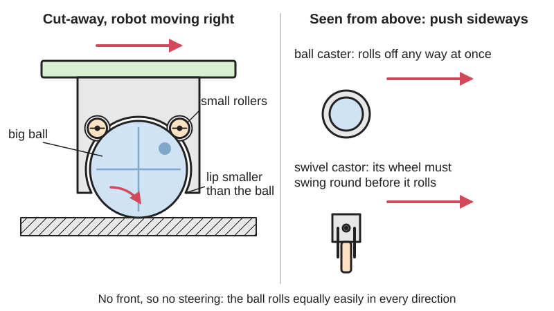
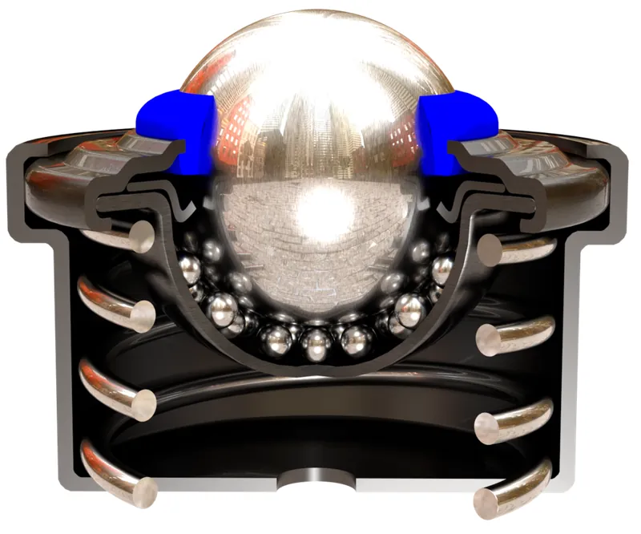
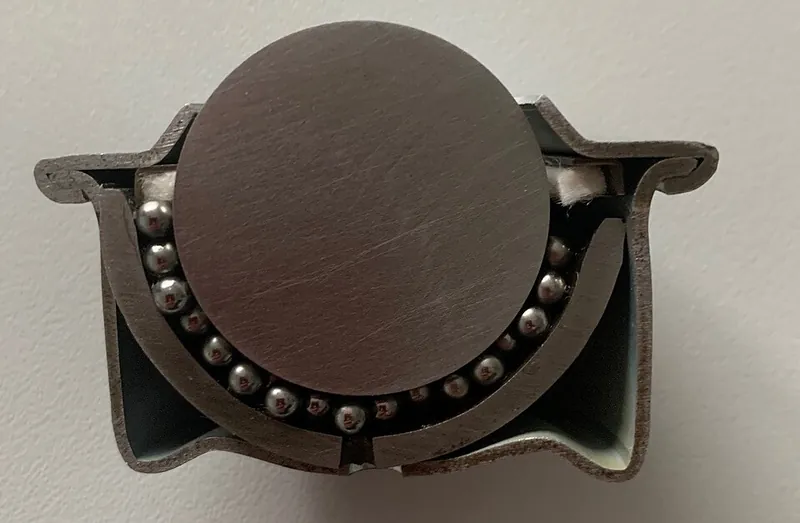
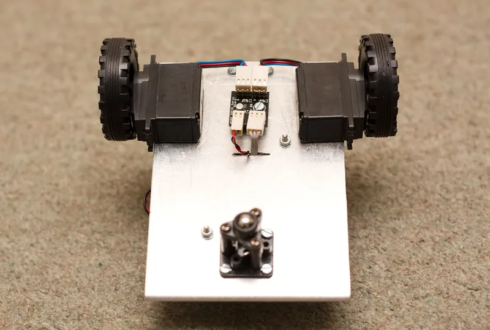

<figure class="eoc-pic eoc-pic-main"><picture><source media="(prefers-reduced-motion: reduce)" srcset="../media/drawn/ball-caster.svg"></picture><figcaption><strong>Animation.</strong> Diagram drawn for the encyclopaedia from the research notes. ⚑ Needs confirming: a drawing can simplify or get details wrong; a real photo or a better diagram is welcome.</figcaption></figure>
<figure class="eoc-pic"><figcaption><strong>Cross-section.</strong> <a href="https://commons.wikimedia.org/wiki/File:BallTransferUnitCrossSection.png">BallTransferUnitCrossSection</a> by Slashme, <a href="https://creativecommons.org/licenses/by-sa/4.0">CC BY-SA 4.0</a>, from Wikimedia Commons.</figcaption></figure>
<figure class="eoc-pic"><figcaption><strong>Cross-section.</strong> <a href="https://commons.wikimedia.org/wiki/File:Schulz-www.Kugelrollen.de-im-Schnitt.jpg">Schulz-www.Kugelrollen.de-im-Schnitt</a> by Schulz-Stanztechnik.de, <a href="https://creativecommons.org/licenses/by-sa/4.0">CC BY-SA 4.0</a>, from Wikimedia Commons.</figcaption></figure>
<figure class="eoc-pic"><figcaption><strong>How it works.</strong> <a href="https://www.flickr.com/photos/7320302@N07/3057606500">Robot 2</a> by Adam Greig, <a href="https://creativecommons.org/licenses/by-sa/2.0/">CC BY-SA 2.0</a>, from Flickr via Openverse.</figcaption></figure>

A large ball held in a cup on small bearing balls or rollers, giving a support point that rolls equally easily in every direction, used as a small robot's third wheel or, ball-up, as the rolling surface of transfer tables and conveyors.

**In plain words:** A ball held loosely in a little cup on smaller balls or rollers, so whatever rests on it can roll off in any direction straight away; used ball-down as the 'third wheel' under a small robot, or ball-up in a table that heavy boxes or metal sheets slide across. **Proper term:** Ball caster (ball transfer unit).

**Also called:** ball transfer unit (BTU), ball transfer, load-carrying ball transfer unit; ball caster / ball castor, caster ball, roller ball (robotics); spherical wheel (Wikipedia 'Caster'); marble caster (printed or robot-vacuum versions); ball transfer table (many units set into a table top); spring-loaded ball transfer unit (cushions shock loads); Kugelrolle (German).

## How it works

The big load ball is trapped in a cup by a lip a little smaller than the ball, so it sticks out on one side but can't fall out. Inside, it rests on many small balls, three small rollers or a slippery plastic seat, which let it spin about any axis with little friction. Because a ball has no 'front', the load can set off in any direction at once, unlike a swivel castor, whose wheel must first swing round to line up (casters 'recognise a trail', Wikipedia). Ball-up, many units set into a table carry boxes or sheets; ball-down, a single unit is the point that a two-wheeled robot drags along, without steering it.

## Parts

A few parts that act as one unit: a housing (cup) with a flange, threaded stud or press-in body; one large load ball; many small bearing balls, three rollers or pins, or just a smooth plastic seat (a friction bearing); a lip or snap-on cap that keeps the ball in; and often a felt or polymer seal, a drain hole, a spring (spring-loaded units) or spacers to set the height. Example: 'ABS base, ABS cap, 1 in acetal ball, 3 rollers' (Pololu).

## Everyday examples

- a computer trackball, which works on the same principle (Wikipedia 'Ball transfer unit')
- the ball tables at airports and in factories that luggage and parts are pushed across (Wikipedia)
- the steel-ball caster at the back of small two-wheeled educational robots, such as LEGO Education kits (Printables 79912; Pololu)
- the marble caster at the front of some robot vacuum cleaners (Printables 1407063, a replacement part) ⚑ [uncertain: only the model title seen]

## When to use it

As the third (or fourth) support point of a small robot steered by two driven wheels (differential drive), where a swivel castor would resist or steer the robot while it swings round; on smooth, hard floors and table tops. Ball-up, in tables and conveyor junctions where flat-bottomed boxes, trays or metal sheets must be pushed in any direction or turned by hand, such as on machines for machining, bending or stamping sheet metal (HPC). As low-friction feet under a light turntable or sliding fixture ⚑ [uncertain: general practice].

## When not to use it

On carpet, gravel, grass, rough or dirty floors, or over thresholds: a small ball sinks, jams or catches; use a swivel castor with a larger wheel. For heavy carts rolling ball-down: use castors rated for the load. When the load must be locked in place: a ball caster has no brake, so use a locking castor or levelling feet. For soft, uneven or easily marked loads on a table, or for loads with gaps underneath that could tip in, use roller conveyors, belts or an air caster. Above 2 m/s (Elesa-Ganter). For guided straight-line motion, use a linear slide or bearing instead.

## Details

- **What it does (jobs):**
  - let it move (turn, slide or bend): lets a robot, cart or load roll in any direction, or turn on the spot
- **Movement:** multiple: the ball turns freely about any axis without limit, so the supported part can roll in any direction across a floor or table and also turn on the spot
- **Directions it can move (degrees of freedom):** 3 between ball and cup (it can spin about any axis); for a load resting on it on a flat surface, 3 (move forwards and backwards, move sideways, and turn on the spot).
- **Special behaviour:**
  - none: it simply rolls. Unlike a swivel castor it never has to swing round first, so it 'will not override your drive motors and steer your robot off course' (Pololu). Spring-loaded industrial units also cushion shock loads and share the load on uneven goods (igus).
- **How it holds:** not a holding joint (it moves or passes on motion); the ball is kept in its cup by shape ([form-fit](../glossary.md#form-fit--force-fit--material-bond)): a lip or snap-on cap smaller than the ball
- **Input and output:** not applicable: it supports a load rather than passing motion on (for reference, Elesa-Ganter quotes a friction value of roughly 0.005 at 1 m/s for industrial units)
- **Power:** passive (no power needed)
- **Load:** Light to heavy. Robot casters are light: Pololu's 1 in caster with rollers suits differential-drive robots 'weighing up to around ten pounds' (about 4.5 kg), and its smaller casters are 'not intended to bear more than a few pounds'. Industrial ball transfer units carry much more, with solid (machined) housings for the highest loads and for knocks (Elesa-Ganter; HPC) ⚑ [uncertain: no per-unit kg ratings checked on an opened page]. Strong straight down onto the ball; weak against side impacts and dropped loads unless the housing is machined or spring-loaded (HPC; igus). Ball-down use 'is restricted by load-bearing limitations and the type of floor' (Wikipedia).
- **Play and precision:** Small play: the ball needs a little [clearance](../glossary.md#clearance) in its cup to roll (one printed design added 'a extra gap for less friction', Printables 205888). It does not locate anything precisely. It rolls over small bumps but can catch on edges, carpet and gaps much smaller than the ball ⚑ [uncertain: no figure opened]. In a ball transfer table, assume only three units carry the load at any moment, because of unevenness and [tolerances](../glossary.md#tolerance) (Elesa-Ganter).
- **Taking it apart:** removable: screwed on through a flange or stud, dropped into a hole and held with a retaining ring, or pushed into a drilled hole (Elesa-Ganter; Pololu); snap-together robot casters can be opened to clean the ball
- **How often it can be reused:** many times
- **Sealing:** none for small robot casters (open cup); dust-resistant for many industrial units, where felt rings keep dirt out of the housing (Elesa-Ganter) and a polymer seal ring and drain hole are common (Wikipedia figure caption)
- **Adjustable:** no, apart from height: robot casters come with spacers (Pololu 3/4 in caster: 0.88 in high, about 1.1 in with spacers; the Tamiya kit builds to 25 or 35 mm)
- **Access needed:** one side only (blind) for most: flange, stud and push-in types fit from one side of the chassis or table top
- **Materials:** Load balls of carbon steel, stainless steel, POM (acetal), nylon or other plastics, or, in printed versions, glass marbles, steel bearing balls, airsoft BBs or ping-pong balls. Housings of pressed steel sheet (light loads, low cost), machined steel (heavy loads or collisions) (HPC), ABS or other plastics (robot casters), or printed PETG or PLA. Plastic load balls and plastic friction bearings are rated to 60 °C, steel balls with a felt seal to 100 °C (Elesa-Ganter). The goods rolled across them should be hard enough not to be marked by the balls (HPC).
- **Heat, cold, water and wear:** Heat: plastic balls and plastic bearings to 60 °C, steel balls with felt seals to 100 °C (Elesa-Ganter); printed PLA cups soften well below that ⚑ [uncertain: no figure opened]. Dirt: hair, fluff and grit get into open cups and stop the ball rolling; felt rings and seals help on industrial units (Elesa-Ganter). Water: units with a drain hole let washing water out (Wikipedia figure caption); [lubrication](../glossary.md#lubrication) protects steel balls against corrosion (Elesa-Ganter). Floors: soft or rough floors limit ball-down use (Wikipedia). Plastic housings wear with use, which loosens the ball ⚑ [uncertain: seen only in a search-result review].

## Making it

- **Ways to make or get it:**
  - off-the-shelf part (most common: robot ball casters and industrial ball transfer units)
  - 3D print (FDM): a cup or two-part housing around a bought ball, marble, BB or ping-pong ball
  - CNC: machined steel housings for heavy-duty units
  - woodwork: a table top drilled to take drop-in ball transfer units (a ball transfer table)
- **Printing it in one piece (print in place):** partly: a cup can be printed around a bought ball by pausing the print and dropping the ball (or small bearing balls) in, as other printed bearings do with a pause at a set height (Printables 1368981 does this with 6 mm airsoft BBs); most printed ball casters are a printed cup plus a ball pushed past a snap lip or held in by a cap
- **Tools:** a screwdriver or nut spanner for flange or stud mounting (robot casters use #2 to #4 or M2 to M3 screws); a drill for push-in or drop-in units; none to snap a plastic housing together
- **Difficulty:** easy: buy one and screw it on, or print a cup for a steel ball, marble or ping-pong ball; moderate to make a printed one that rolls smoothly under more than a light robot

### 3D printing tips

Choose the ball first and design the cup around its measured size: a LEGO-compatible caster is sized for a 16.1 mm marble, and the designer notes 5/8 in (15.9 mm) balls are a bit loose (Printables 79912). Leave a small running gap; one parametric OpenSCAD design (12.7 mm ball, 19 mm total height, mounting holes 25 mm apart) added extra clearance specifically to cut friction (Printables 205888). Don't let the ball rub on a large printed surface: rest it on three small rollers, dowel pins or tiny ball bearings, as Pololu's casters do (three plastic rollers, or three 3x7x3 mm ball bearings on dowel pins), or on many small balls (a printed ball transfer unit for an IKEA LACK table uses about 200 balls of 2.5 mm and recommends smoothing the main ball, Printables 183631). Keep the ball in with a lip slightly smaller than the ball or a cap that snaps on, like Pololu's two-part housing. Match the caster's height to the drive wheels so the robot sits level, with spacers to fine-tune (Pololu and Tamiya kits include spacers). Print the cup where dimensions matter most: one maker printed a ping-pong-ball caster in PETG with supports 'for better dimensional [accuracy](../glossary.md#repeatability--accuracy)' (Printables 1323795). Keep printed casters light-duty: even moulded ABS casters stop rolling well beyond a few pounds because of friction between ball and housing (Pololu). Printing the cup opening upwards so the seat is smooth and round is general practice ⚑ [uncertain: not from an opened page].

### Buying one (off-the-shelf parts)

Search terms: 'ball transfer unit' (flange-mounted, stud-mounted, press-in or drop-in with retaining ring, with felt seal), 'spring-loaded ball transfer unit', 'ball transfer table', 'ball caster' or 'robot ball caster' (Pololu ball casters, 3/8 in to 1 in, plastic or metal ball, brand; Tamiya 70144 ball caster kit, brand), 'push-in plastic roller ball', 'polymer ball transfer unit' (igus, brand), 'ball transfer units' in conveyor-component catalogues (Elesa-Ganter, brand), loose 'bearing balls' or 'steel balls', 'retaining ring'.

## Rules of thumb

- Rate each unit for one third of the load, because the load usually rests on only three units at a time owing to unevenness and tolerances (Elesa-Ganter technical instructions, https://www.elesa-ganter.com/siteassets/technical_annex/Ball_Transfer_Units_Technical.pdf; HPC also says divide the weight by 3, https://shop.hpceurope.com/docTech/an/techBillesPorteuses%2Epdf).
- Spacing in a ball transfer table: sources differ. Elesa-Ganter: maximum spacing = smallest edge length of the load / 2.5, so the load cannot tip into the gaps (less if the load's underside is uneven). HPC: spacing = shortest dimension / 3.5, so that at least three units touch the load along its shortest side (sources as above).
- Speed and friction: maximum conveying speed 2 m/s; larger units can heat up from friction at 1 m/s under load; friction value roughly 0.005 at 1 m/s, reducible by lubrication, which also protects against corrosion (Elesa-Ganter, as above).
- Temperature: plastic load balls or plastic friction bearings up to 60 °C; steel or stainless balls with a felt seal up to 100 °C; without a felt seal higher, but with reduced load capacity (Elesa-Ganter, as above).
- Ratings apply only to ball-up (upright) mounting (Elesa-Ganter); ball-down use is limited by load and by the type of floor (Wikipedia 'Ball transfer unit', https://en.wikipedia.org/wiki/Ball_transfer_unit).
- Robot casters: a 1 in plastic-ball caster with rollers suits differential-drive robots up to around ten pounds (Pololu, https://www.pololu.com/product/2691); 3/4 in Pololu casters are 'not intended to bear more than a few pounds', because friction between ball and housing stops them rolling (https://www.pololu.com/product/954).
- Use machined housings for heavy loads or where loads may hit the units, and consider the hardness of the goods so the balls don't mark them (HPC, as above); spring-loaded units absorb impact loads (igus, https://blog.igus.eu/?p=21466).

## Common failures

(1) The robot drags or won't turn because the caster is overloaded and the ball rubs on its housing (Pololu: friction stops it rolling above a few pounds); choose a larger caster with rollers or bearings. (2) A drive wheel lifts or the robot rocks because the caster is the wrong height; fix with spacers (Pololu, Tamiya). (3) The ball jams with hair, fluff or grit; clean it, or use a sealed unit. (4) It stalls on carpet, rugs or door thresholds (Wikipedia: limited by floor type). (5) On tables, a load tips into gaps or units are overloaded because they are spaced too widely or rated for the whole load instead of a third (Elesa-Ganter). (6) Units damaged by dropped loads (HPC; igus). (7) Goods marked by the balls (HPC). (8) A printed cup too tight (ball won't turn) or too loose (ball rattles or falls out); print a test and adjust the gap (Printables 205888, 79912). (9) Units overheating when run fast under load (Elesa-Ganter).

## Safety

Loads on a ball transfer table move very easily: they can roll off the edge or tip into the gaps between units if the units are spaced too far apart (Elesa-Ganter spacing rule). Dropped or knocked loads can damage standard units; use machined or spring-loaded units for shock loads (HPC; igus). Fingers can be trapped between a heavy load and the balls or table edge ⚑ [uncertain: general caution]. A robot or cart on ball casters has no brake and can roll away on a slope ⚑ [uncertain]. Loose small balls (bearing balls, airsoft BBs, marbles) are a choking hazard for small children ⚑ [uncertain: general caution].

## Related

- Castor (swivel castor, fixed castor, locking castor): a wheel that has to swing round to follow the direction of travel; better on rough floors and for heavy carts, and can be braked
- Omni wheel and mecanum wheel: driven wheels with small rollers round the rim that can also move sideways (Wikipedia 'Ball transfer unit', see also)
- Air bearing and air caster: floats a heavy load on a film of air instead of rolling it on balls
- Plain pivot and rolling bearing: a wheel or shaft turning about one fixed axis
- Turntable bearing (lazy Susan): lets a platform turn about one axis only
- Ball-and-socket joint: the same ball-in-cup shape, but used to hold an angle rather than to roll
- Levelling foot: a fixed, adjustable foot for something that must not move

## Make it yourself

- [BallCaster.stl (Wikimedia Commons, by Rafa Couto, from the Escornabot educational robot)](https://commons.wikimedia.org/wiki/File:BallCaster.stl): Printable ball caster model for a small educational robot *(licence: CC BY-SA 4.0)*
- [Ball Caster V2 (Printables 205888; URL from Printables API, page not opened)](https://www.printables.com/model/205888-ball-caster-v2): Parametric OpenSCAD ball caster, set for a 12.7 mm (1/2 in) ball and 19 mm height, with an extra gap for less friction and an optional base *(licence: CC BY (Creative Commons Attribution))*
- [IKEA LACK - Ball transfer units (Printables 183631; URL from Printables API, page not opened)](https://www.printables.com/model/183631-ikea-lack-ball-transfer-units): Printed ball-up transfer units in which the main ball rides on about 200 small 2.5 mm balls *(licence: Creative Commons Public Domain (as listed on Printables))*
- [Lego EV3 Caster ball (Printables 79912; URL from Printables API, page not opened)](https://www.printables.com/model/79912-lego-ev3-caster-ball): LEGO-compatible caster housing for a 16.1 mm marble or glass ball, replacing the steel-ball caster in LEGO Education kits *(licence: CC BY (Creative Commons Attribution))*
- [LEGO ping pong ball caster wheel (Printables 1323795; URL from Printables API, page not opened)](https://www.printables.com/model/1323795-lego-ping-pong-ball-caster-wheel): LEGO-compatible caster that uses a ping-pong ball as the rolling ball, printed in PETG *(licence: CC BY-SA (Creative Commons Attribution-ShareAlike))*

## Pictures, videos and models

- [BallTransferUnitCrossSection.png (Wikimedia Commons, by Slashme)](https://commons.wikimedia.org/wiki/File:BallTransferUnitCrossSection.png): Rendered cut-away of a ball transfer unit: the large load ball resting on a bed of small balls inside the housing *(licence: CC BY-SA 4.0 (reuse with credit))*
- [Ball transfer unit (Wikipedia)](https://en.wikipedia.org/wiki/Ball_transfer_unit): Rendered view and cross-section of a spring-loaded unit with seal ring and drain hole; ball-up and ball-down uses and why casters were replaced *(licence: CC BY-SA 4.0 (text); images per file)*
- [Pololu Ball Caster with 1 in Plastic Ball and Plastic Rollers (Pololu)](https://www.pololu.com/product/2691): Assembly photos, a dimension drawing and a size comparison of robot ball casters from 3/8 in to 1 in *(licence: link only (supplier page))*
- [Ball Transfer Units: Technical Instructions (Elesa-Ganter PDF)](https://www.elesa-ganter.com/siteassets/technical_annex/Ball_Transfer_Units_Technical.pdf): Exploded drawings of unit types and mountings, diagrams of spacing and arrangement in a transfer table, and a temperature versus load chart *(licence: link only (manufacturer document))*
- [Plastic Ball Caster.jpg (Wikimedia Commons, by oomlout)](https://commons.wikimedia.org/wiki/File:Plastic_Ball_Caster.jpg): Photo of a small plastic ball caster *(licence: CC BY-SA 2.0 (reuse with credit))*

## Needs confirming

⚑ marks something nobody has confirmed yet: a fact the research could not confirm from a source, a finder value that is a best guess, or an open point from the research notes. Corrections are welcome (see `research/needs-confirming.md`).

- ⚑ 10 sentences on this page marked [uncertain].
- ⚑ Finder value `made_of` = 3D prints, plastic sheet, tube or moulded parts, wood, metal, glass or mirror (best guess): proposed from the words in the research text (R37); not yet checked
- ⚑ Research note: *Ball caster*: maximum spacing of ball transfer units under a table differs (Ganter: smallest edge length divided by 2.5; HPC: shortest dimension divided by 3.5); both recorded.

## Sources

- <https://en.wikipedia.org/wiki/Ball_transfer_unit>
- <https://en.wikipedia.org/wiki/Caster>
- <https://www.pololu.com/product/2691>
- <https://www.pololu.com/product/2692>
- <https://www.pololu.com/product/954>
- <https://www.pololu.com/product/955>
- <https://www.pololu.com/product/174>
- <https://www.pololu.com/product/66>
- <https://www.elesa-ganter.com/siteassets/technical_annex/Ball_Transfer_Units_Technical.pdf>
- <https://shop.hpceurope.com/docTech/an/techBillesPorteuses%2Epdf>
- <https://blog.igus.eu/?p=21466>
- <https://commons.wikimedia.org/wiki/File:BallTransferUnitCrossSection.png>
- <https://commons.wikimedia.org/wiki/File:Plastic_Ball_Caster.jpg>
- <https://commons.wikimedia.org/wiki/File:BallCaster.stl>
- <https://api.printables.com/graphql/>
