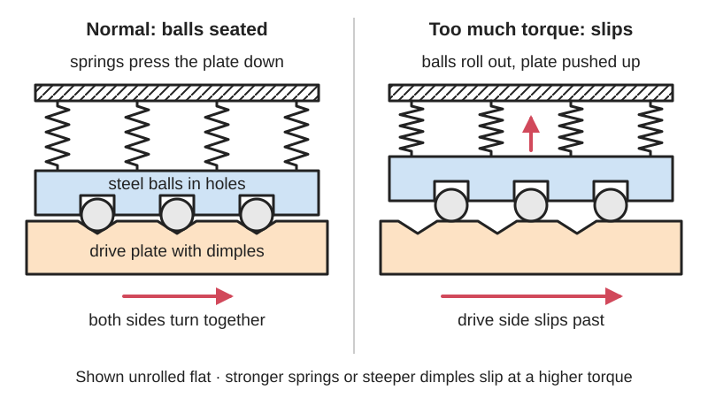

*Diagram drawn for the encyclopaedia from the research notes. ⚑ Needs confirming: a drawing can simplify or get details wrong; a real photo or a better diagram is welcome.*

Spring-loaded steel balls sitting in dimples between two plates pass on the drive until the [torque](../glossary.md#torque) gets too high, then roll out of their dimples so the drive side spins free (or clicks round) instead of breaking the gears, motor or workpiece.

**In plain words:** A shaft connector where spring-pressed steel balls sit in little dimples and carry the drive; if something jams, the balls pop out of their dimples and the drive lets go instead of breaking. **Proper term:** Ball-detent torque limiter (ball-detent overload clutch, ball-detent safety coupling).

**Also called:** ball [detent](../glossary.md#detent) torque limiter; ball-type torque limiter / ball torque limiter; overload clutch; safety clutch; safety coupling (when combined with a flexible shaft coupling); mechanical torque limiter; roller detent torque limiter (version with rollers instead of balls); drill clutch / torque clutch / clutch collar (on cordless drill-drivers); torque-limiting sprocket or pulley hub (when it carries a sprocket, gear or pulley).

## How it works

Balls sit partly in holes in one part and partly in shallow dimples in the other, and springs press the two parts together so the balls stay seated. When turning, the sloped sides of the dimples push on the balls, and part of that force tries to push the pressure ring back against the springs. Below the set torque the springs win and the whole thing turns as one solid piece with no play. Above it, the balls roll up and out of their dimples, the ring moves back a little (which can trip a switch to stop the motor) and the torque passed on drops to almost nothing. Depending on the design, the balls drop into the next dimple and reset by themselves (multi-position), can only drop back in at one position per turn so timing is kept (single-position), or the springs flip over centre and stay apart until someone resets them by hand (full disengagement).

## Parts

A small assembly that acts as one unit: a hub, a drive flange or plate with detents (dimples or cone-shaped pockets), hardened steel balls (or rollers) held in a cage or holes, springs (usually disc springs, also called Belleville washers, or coil springs), a pressure (actuation) ring, an adjusting nut or ring to set the torque, a support bearing, and often a switch plate that a sensor can watch.

## Everyday examples

- the numbered clutch collar on a cordless drill-driver, which slips and [ratchets](../glossary.md#ratchet) when the screw is tight enough
- manual torque screwdrivers in which steel balls roll between indented plates pressed by a spring
- servo axes on machine tools, robots, woodworking and packaging machines, where it protects against crashes and jams

## When to use it

When a motor or gearbox could jam or crash and you want the drive to let go cleanly, quickly and repeatably, then carry on after the jam is cleared. Examples: robot arms and joints, CNC and 3D-printer axes, conveyors, packaging and printing lines, winders and spool drives. Use it when you need no [backlash](../glossary.md#backlash) while running (positioning systems), when you want a switch to shut the motor off after a trip, or when timing must be kept after a reset (single-position type).

## When not to use it

Not for continuous controlled slipping, such as keeping tension on a spool or a slip-to-hold function: use a friction slip clutch or a magnetic ([hysteresis](../glossary.md#hysteresis)) clutch, which slip smoothly and steadily. Not for very high torques at low cost where occasional replacement is acceptable: a [shear](../glossary.md#peel-vs-shear) pin is simpler. Not where the limiter would have to carry large side loads or [misalignment](../glossary.md#misalignment) by itself. For a hand-turned cap or knob, a simpler ramp-tooth (clicking) limiter is enough. It is not a safety guard for people, because it protects the machine, not fingers.

## Details

- **What it does (jobs):**
  - slip or let go when overloaded: disconnects the drive within milliseconds when a jam or crash overloads it
  - join and hold: below the limit it couples two shafts, or a gear, sprocket or pulley to a shaft, solidly and with no backlash
- **Movement:** rotate: turns continuously with its shaft; on overload the two halves turn relative to each other, and the pressure ring slides a few millimetres along the shaft
- **Directions it can move (degrees of freedom):** 0 between input and output while engaged: they turn as one piece. After tripping, 1: the halves can turn freely relative to each other, and the pressure ring moves axially, tied to that disengagement.
- **Special behaviour:**
  - torque-limiting (slips or clicks at a set force/torque): the spring [preload](../glossary.md#preload) sets the torque at which the balls leave their dimples
  - [fail-safe](../glossary.md#fail-safe--fail-secure) or breakaway: acts as a mechanical fuse that disconnects in about 3-5 ms, faster than electronic current limiting can react
  - indexing (clicks into set positions): multi-position types re-engage at the next dimple; single-position (synchronous) types re-engage at only one position per turn so machine timing is kept; full-disengagement types stay apart after tripping until pushed back in by hand
- **How it holds:** shape (the balls interlock with the dimples; [form-fit](../glossary.md#form-fit--force-fit--material-bond)), held in place by spring force (disc springs or coil springs press the balls into the dimples)
- **Input and output:** Continuous rotation -> the same rotation at 1:1 until the trip torque, then the torque passed on drops to near zero. Works the same in both directions (a drill clutch limits torque equally both ways). Backlash-free while engaged in industrial designs; efficiency close to 100% while engaged ⚑ [uncertain: no figure published]. In line ([coaxial](../glossary.md#coaxial)), or a gear, sprocket or pulley mounted on the limiter hub. Back-drivable: yes, below the trip torque it is a solid coupling, so the output can drive the input.
- **Power:** passive (no power needed). Many industrial units carry a switch plate that a proximity sensor or limit switch reads to cut the motor power after a trip; the limiter itself needs no power.
- **Load:** light to heavy: from the clutch in a cordless drill to large industrial units on machine tools, packaging lines and conveyors ⚑ [uncertain: exact largest ratings not verified]. Strong in twist up to the trip torque in both directions; needs the manufacturer's radial-load and misalignment limits kept, so side loads from belts or misaligned shafts should be carried by bearings.
- **Play and precision:** none to very small play: industrial designs transmit torque backlash-free. Trip [accuracy](../glossary.md#repeatability--accuracy) is about ±5% (versus about ±20% for shear pins), with ±5-10% quoted for repeated trips. Single-position types return to exactly the same angle after reset. Tolerates little misalignment on its own, so pair it with a flexible coupling (a 'safety coupling') or support bearings.
- **Taking it apart:** removable: mounts on a shaft with keyways, [set screws](../glossary.md#set-screw) or clamping hubs and can be taken off and refitted
- **How often it can be reused:** effectively unlimited: it resets after each overload (automatically, or by hand for full-disengagement types), unlike a shear pin, as long as it is not left ratcheting for long
- **Sealing:** none as a seal; industrial units are greased for life and are designed to keep dirt away from the balls ⚑ [uncertain how well sealed each type is]
- **Adjustable:** yes: the trip torque is set by compressing the springs, turning an adjusting nut or ring on industrial units (within a marked range) or the numbered collar on a drill; changing the number or rate of springs changes the range
- **Access needed:** end of a tube or shaft: it slides onto a shaft end, or sits between two shaft ends as a coupling
- **Materials:** Hardened steel balls (e.g. 52100 chrome steel), hardened steel detent plates, steel disc springs, steel or aluminium housings; drill clutches use steel balls in a plastic or metal gearbox housing ⚑ [uncertain which parts are plastic]. DIY/printed versions use PETG, ABS or nylon bodies with real steel balls (e.g. 6 mm bearing balls) and metal coil springs.
- **Heat, cold, water and wear:** Heat: spring force falls as springs warm. Music-wire springs lose about 3% of their rate per 100 °C (secondary source), and disc springs can take a set over time, lowering the trip torque. Printed bodies: PLA softens above about 60 °C and PETG is fine below about 80 °C (Prusa). Dirt and grit in the balls and dimples change the trip torque and speed up wear, so industrial units are greased for life ⚑ [uncertain: sealing level varies]. Vibration can make lightly set detents skip. High speed: repeated re-engagement above about 2500 rpm can damage balls and detents, so re-engage at low speed.

## Making it

- **Ways to make or get it:**
  - 3D print (FDM): body and detent plates, with bought steel balls and metal springs, for light duty
  - CNC: hardened steel detent plates and hubs for durable units
  - off-the-shelf part: industrial ball-detent torque limiters and torque-limiting sprocket hubs
- **Printing it in one piece (print in place):** no: the steel balls and metal springs must be added and the torque set during assembly, so the parts are printed separately and assembled
- **Tools:** hex keys or spanners to mount on the shaft; a spanner (pin) wrench to turn the adjusting ring on industrial units; none to adjust a drill clutch (turn the collar). Printed versions: screwdriver and the hardware for the springs
- **Difficulty:** moderate: steel balls and springs are cheap and a printed body works for light loads (small robots, printer mechanisms, spool drives), but plastic dimples wear and dent with repeated trips and the trip torque has to be calibrated; buy an industrial unit for real machine protection

### 3D printing tips

Use real steel balls. A printable ball-detent demonstrator (Printables 1063083) is built for a 6 mm ball bearing, and its author warns that a printed ball will not detent as smoothly. Use metal springs, because plastic springs held under constant load relax (DuPont design guide). Detent shape: a common starting point for detents is a 90° cone-shaped seat about 25-30% of the ball diameter deep. The [holding force](../glossary.md#holding-force) follows spring force x tan(half the seat angle + friction angle), so a shallower seat or a weaker spring trips at lower torque (secondary source). Put the balls in holes spaced round a circle in one printed plate, with the dimples in the facing plate, and spring the pressure plate along the shaft with an adjusting nut so you can tune the trip torque. Printed holes usually come out undersize, so test-fit the balls ⚑ [uncertain: no measured [clearance](../glossary.md#clearance)]. Choose the reset style: equally spaced dimples reset themselves but click round until the jam clears, which wears plastic fast; an irregular spacing re-engages once per turn and keeps position timing, useful for a robot joint. Material: PETG (fine below about 80 °C) or nylon rather than PLA, which softens above about 60 °C and is [brittle](../glossary.md#brittle--ductile). Hardened balls will dent plastic seats under high spring force ⚑ [uncertain: no test data], so keep the torque low or press in metal seats (washers, bushings) where the balls run ⚑ [uncertain]. Calibrate with a weight on an arm (torque = weight force x arm length) and re-check after some trips. If a motor drives it, add a microswitch that the pressure plate presses when it lifts, to cut power after a trip ⚑ [uncertain: DIY adaptation of the industrial sensor plate].

### Buying one (off-the-shelf parts)

Ball-detent torque limiters in single-position (synchronous), multi-position, load-holding and full-disengagement (free-wheeling) versions; torque-limiter couplings combined with flexible (elastomer spider or bellows) couplings, sold as 'safety couplings'; torque-limiting sprocket, gear or pulley hubs (listed as 'chain and belt torque limiters' in supplier catalogues); spring plungers and ball plungers; hardened chrome-steel balls; disc springs (Belleville washers); proximity sensors or limit switches for trip detection. Supplier vocabulary: 'torque limiter', 'overload clutch', 'safety coupling', 'ball detent torque limiter' (e.g. McMaster-Carr 'Torque Limiters').

## Rules of thumb

- Set the trip torque above normal running torque with a service factor: trip torque = service factor x running torque, with about 1.25 for normal duty and 1.5 for heavy shock loads (https://www.motioncontroltips.com/three-torque-limiter-options-compared-and-trip-torque-explained/).
- Pick a unit whose adjustment range runs from the operating torque up to about 2-3 times that value, and set it below the torque at which damage could occur (R+W, https://blog.rw-america.com/blog/bid/261935/Basic-Application-of-Ball-Detent-Torque-Limiters).
- Expect about ±5% trip accuracy, against about ±20% for shear pins (R+W, same page); ±5-10% for repeated trips is also quoted (https://www.motioncontroltips.com/three-torque-limiter-options-compared-and-trip-torque-explained/).
- On high-speed shafts (about 2500 rpm or more), use a full-disengagement type, because repeated re-engagement attempts can damage the balls and detents, and re-engage only at low speed. One such unit re-engages every 60° (six positions) (Nexen installation manual L-21219-F-0719, pages 4-5, https://www.nexengroup.com/media/gated_content/LitPDF/21219.pdf).
- Multi-position types keep tripping ('ratcheting') until the overload is removed, which wears the plates and detents; use the axially moving switch plate and a sensor to stop the drive (https://www.motioncontroltips.com/how-do-ball-detent-torque-limiters-work-and-when-are-they-used/; Nexen manual page 4).
- Mechanical units disconnect in about 3-5 ms, faster than electronic current limits can stop the stored energy of a rotating mass (R+W video tutorial summary, https://www.techbriefs.com/component/content/article/47046-video-tutorial-on-ball-detent-safety-couplings).
- Detent geometry (secondary source): release force = spring force x tan(alpha/2 + phi), where alpha is the included seat angle and phi is the friction angle. A 90° seat about 25-30% of the ball diameter deep is typical, and hardened 52100 balls (60-66 HRC) prevent denting (https://www.firgelliauto.com/blogs/mechanisms/detent).

## Common failures

(1) Wear of balls and detents from long ratcheting after a jam; add a sensor that stops the motor, or use a full-disengagement type. (2) Denting (brinelling) of seats with soft balls or seats, especially in printed plastic; use hardened balls and hard seats. (3) Springs lose force or take a set, so it trips early; check the setting and keep it away from heat. (4) Set too low, giving nuisance trips on start-up shock; use a service factor. Set too high, so it gives no protection; set it below the damage torque. (5) Dirt or dried grease makes the trip torque erratic. (6) Side loads or misalignment wear the internal bearing; add a flexible coupling or support bearings. (7) Re-engaging at high speed damages the detents.

## Safety

Self-resetting types re-engage as soon as the load drops, so switch off and lock out the motor before clearing a jam, or the machine may start moving again. Disc springs store energy: take units apart carefully (one maker requires installation by a qualified technician, and warns that dismantling voids the warranty). Full-disengagement types must be pushed back in by hand, at low speed only. A limiter protects the machine, not people, so keep guards in place. Small steel balls are a swallowing hazard for children.

## Related

- Ratchet-tooth (cam-over) torque limiter: sloped teeth instead of balls; simpler and cheaper, used in caps, knobs and hand drivers, but it keeps clicking and is less accurate
- Friction slip clutch: spring-pressed friction discs slip smoothly and can slip continuously, but wear, heat up when slipping and keep dragging instead of disconnecting
- Shear pin: a weak pin breaks at overload; very simple, but must be replaced and is less accurate (about ±20%)
- Pawl-and-spring and roller-detent torque limiters: a sprung [pawl](../glossary.md#pawl) or rollers leave notches instead of balls
- Ball detent (spring plunger) indexing: the same ball-in-dimple idea used to click into set positions, with lower spring force
- Magnetic torque limiter (synchronous magnetic coupling): magnets carry the drive through an air gap and slip with no contact or wear
- Compliant slip hub / servo saver: one-piece springy arms give way under shock, with no separate balls or springs
- Ball-ramp release: in one animated safety clutch, balls in cone-shaped holes push a disc to open a friction clutch at overload

## Make it yourself

- [Ball detent mechanism by Ragesh (Printables 1063083; details read via the Printables public API)](https://www.printables.com/model/1063083-ball-detent-mechanism): Printable six-position (60°) rotary ball detent in 4 printed parts, using a 6 mm steel ball, a spring and an M3 screw and nut. It shows the ball-in-dimple principle; with a stiffer spring and a drive shaft, the same layout behaves as a multi-position torque limiter ⚑ [uncertain: not tested as a limiter] *(licence: Creative Commons Attribution (CC BY))*

## Pictures, videos and models

- [Torque limiter with balls Make Ringspann.JPG (Wikimedia Commons, S.J. de Waard, 2013)](https://commons.wikimedia.org/wiki/File:Torque_limiter_with_balls_Make_Ringspann.JPG): Photo of an industrial ball-type torque limiter on display at Europort 2013 *(licence: CC BY-SA 3.0 and GFDL 1.2+ (reuse with credit))*
- [Ikea Fixa - torque limiter and motor (Wikimedia Commons, Raimond Spekking, 2024)](https://commons.wikimedia.org/wiki/File:Ikea_Fixa_-torque_limiter_and_motor-1227.jpg): A cordless drill's gearbox and motor taken out of the tool, with the numbered torque-limiter (clutch) collar; the inside of the clutch is not visible, so it is not confirmed that this model uses balls ⚑ [uncertain] *(licence: CC BY-SA 4.0 (reuse with credit))*
- [R+W ST Series Industrial Torque Limiters (R+W Coupling Technology, YouTube; title confirmed via YouTube oEmbed)](https://www.youtube.com/watch?v=VLEFE714iPQ): Manufacturer video of industrial ball-detent torque limiters *(licence: link only)*
- [Nexen Mechanical Torque Limiter installation, operation and maintenance manual (L-21219-F-0719)](https://www.nexengroup.com/media/gated_content/LitPDF/21219.pdf): Numbered cut-away drawing (balls, detents, disc springs, actuation ring, adjusting ring, proximity sensor) and engaged/disengaged diagrams for single-position, multi-position and full-disengagement types *(licence: link only)*
- [Ball detent torque limiters: How do they work and when are they used? (Motion Control Tips)](https://www.motioncontroltips.com/how-do-ball-detent-torque-limiters-work-and-when-are-they-used/): Plain explanation with product images of how balls, detents and disc springs work, and of multi-position vs single-position reset *(licence: link only)*

## Needs confirming

⚑ marks something nobody has confirmed yet: a fact the research could not confirm from a source, a finder value that is a best guess, or an open point from the research notes. Corrections are welcome (see `research/needs-confirming.md`).

- ⚑ 11 sentences on this page marked [uncertain].
- ⚑ Finder value `connects` = any solid parts (best guess): joins parts, but no specific kind of part found; set to any solid parts
- ⚑ Research note: *Ball-detent torque limiter* quotes Firgelli's detent formula (release force = spring force × tan(α/2 + φ)). The *Ball detent* entry found this conflicts with S&W Manufacturing's formula (side force = end force / tan(half the countersink angle)), which matches the physics. Re-check and replace with the S&W form.

## Sources

- <https://en.wikipedia.org/wiki/Torque_limiter>
- <https://en.wikipedia.org/wiki/Ball_detent>
- <https://en.wikipedia.org/wiki/Torque_screwdriver>
- <https://www.motioncontroltips.com/how-do-ball-detent-torque-limiters-work-and-when-are-they-used/>
- <https://www.motioncontroltips.com/three-torque-limiter-options-compared-and-trip-torque-explained/>
- <https://blog.rw-america.com/blog/bid/261935/Basic-Application-of-Ball-Detent-Torque-Limiters>
- <https://www.machinedesign.com/automation-iiot/article/21138651/preventing-torque-overloads-with-mechanical-limiters>
- <https://www.nexengroup.com/media/gated_content/LitPDF/21219.pdf>
- <https://www.techbriefs.com/component/content/article/47046-video-tutorial-on-ball-detent-safety-couplings>
- <https://www.firgelliauto.com/blogs/mechanisms/detent>
- <https://www.mcmaster.com/products/torque-limiters/>
- <https://commons.wikimedia.org/wiki/File:Torque_limiter_with_balls_Make_Ringspann.JPG>
- <https://commons.wikimedia.org/wiki/File:Ikea_Fixa_-torque_limiter_and_motor-1227.jpg>
- <https://www.youtube.com/watch?v=VLEFE714iPQ (verified via YouTube oEmbed)>
- <https://www.printables.com/model/1063083-ball-detent-mechanism (read via https://api.printables.com/graphql/)>
- <https://api.printables.com/graphql/>
- <https://cs448m.github.io/lectures/machines/doc/3.pdf>
- <https://www.distrupol.com/General_Design_Principles_for_Engineering_Polymers.pdf>
- <https://help.prusa3d.com/article/pla_2062>
- <https://help.prusa3d.com/article/petg_2059>
