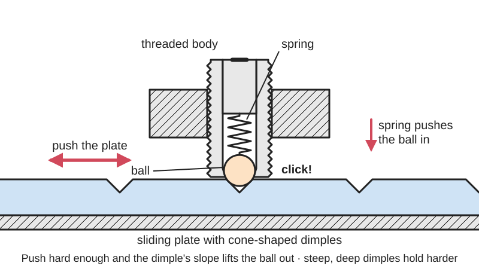
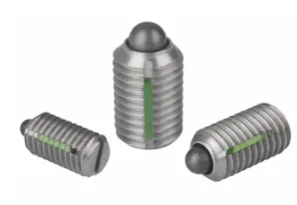

<figure class="eoc-pic eoc-pic-main"><picture><source media="(prefers-reduced-motion: reduce)" srcset="../media/drawn/ball-detent.svg"></picture><figcaption><strong>Animation.</strong> Diagram drawn for the encyclopaedia from the research notes. ⚑ Needs confirming: a drawing can simplify or get details wrong; a real photo or a better diagram is welcome.</figcaption></figure>
<figure class="eoc-pic"><figcaption><strong>Photo.</strong> <a href="https://commons.wikimedia.org/wiki/File:Federndes_Druckst%C3%BCck_2.tif">Federndes Druckstück 2</a> by HEINRICH KIPP WERK KG Heubergstraße 2 72172 Sulz am Neckar, <a href="https://creativecommons.org/licenses/by-sa/4.0">CC BY-SA 4.0</a>, from Wikimedia Commons.</figcaption></figure>

A spring presses a ball (or a roller) against the other part, so when a dimple, hole or groove lines up the ball drops in with a click and holds the part there, until a firm enough push forces the ball back into its hole so the part can move on.

**In plain words:** A little spring-pushed ball that drops into a dimple with a click and holds a part in place until you push or pull it hard enough to pop the ball out again. **Proper term:** Ball [detent](../glossary.md#detent) (spring plunger, ball plunger; on doors: ball catch, and its roller version, the roller catch).

**Also called:** spring plunger / ball plunger / ball-nose spring plunger; detent ball / index ball / spring-loaded ball; ball point [set screw](../glossary.md#set-screw) / ball-ended grub screw; press-fit (push-fit) ball plunger; federndes Druckstück (German trade term); ball catch / door ball catch / Bales catch; bullet catch (small round ball catch drilled into a door edge); double ball catch (two balls gripping a tongue on the door); roller catch / adjustable roller catch / double roller catch (rollers instead of balls); friction catch (roller catches that grip a tongue); click stop / detent position.

## How it works

The ball sits in a bore with a spring behind it, and the bore's lip lets only part of the ball stick out. When the moving part slides or turns so a dimple lines up with the ball, the spring pushes the ball part-way into it: you feel and hear a click, and the part is held there. Pushing the part sideways makes the sloped side of the dimple push the ball back into its bore against the spring; once the ball is fully in, the part moves freely until the next dimple. How hard you have to push depends on the spring force and on how steep the dimple's sides are: steep, deep dimples hold hard, shallow ones let go easily.

## Parts

A few parts, often sold as one unit: a body (a threaded or smooth sleeve), a ball or rounded nose, a small coil spring behind it, and a lip or crimp that keeps the ball from falling out; plus the dimples, holes, cone-shaped [countersinks](../glossary.md#counterbore--countersink) or grooves in the mating part. Door catches add a strike plate with a dip or tongue; roller catches use a spring-loaded roller or two sprung rollers that grip a tongue.

## Everyday examples

- the ball catch at the top of a closet or pantry door that holds it shut with a click
- the spring-loaded ball on a [ratchet](../glossary.md#ratchet) wrench's square drive that holds the socket on
- the click positions of a fan-speed or rotary switch knob, or the centre click of a balance knob
- the gear-selector detents inside a car gearbox, and the detent that keeps some folding knife blades closed

## When to use it

When a part should stop at set positions you can feel, and stay there against light knocks, but still move by hand without a button: rotary knobs and switches, adjustable arms, tilting stands, fold-out legs, slides, and tool-free accessory mounts. One maker's printed mitre-fence knob has 120 slots under it and a spring-loaded detent, giving positive stops every 0.5° (Hackaday). For cabinet and closet doors that should stay shut but open with a simple pull (ball, bullet and roller catches). In jigs and fixtures to push a part against a stop, or to hold a lever in place.

## When not to use it

Not where the part must be positively locked against a strong or steady load: use an indexing plunger (pull-knob pin) or a quick-release pin that must be pulled out first. Not as the only thing carrying weight or a heavy side load. Not where you need an overload clutch on a driven shaft: use a purpose-made ball-detent [torque](../glossary.md#torque) limiter. For a fully printed click with no loose parts, a compliant (springy-arm) detent is simpler. On doors that warp or move with humidity, a magnetic catch is more forgiving than a bullet catch.

## Details

- **What it does (jobs):**
  - click into set positions: gives a knob, slide, lever or hinge a set of positions you can feel and that hold
  - lock, and release by hand: door ball catches and roller catches hold a door shut until you pull it open
  - line parts up exactly: spring plungers push parts against stops or into a position in jigs and fixtures
- **Movement:** multiple: the ball moves in and out of its bore (slide, a small fraction of its diameter) while the part it holds keeps its own motion, which may be rotate (knobs, rotary switches, hinges, e.g. every 60° for six dimples) or slide (drawer, slide, selector rod, door closing)
- **Directions it can move (degrees of freedom):** The detent itself adds no new movement: the held part keeps its 1 (turning or sliding) but gets preferred positions. Inside, the ball has 1 (in and out of its bore) and can also roll.
- **Special behaviour:**
  - indexing (clicks into set positions): the part settles into each dimple with a click and stays there
  - self-aligning or self-centring: the sloped sides of the dimple pull the part into the centre of each position
  - torque-limiting (slips or clicks at a set force/torque): it lets go when pushed harder than the spring can resist, so it holds against light knocks but cannot jam; the same idea, with stronger springs, is the ball-detent torque limiter
  - quick-release: door ball catches and roller catches open with a firm pull and close with a push, with no handle or button to work
- **How it holds:** spring force (the spring presses the ball into the dimple) combined with shape (the ball sits in the dimple; a [form-fit](../glossary.md#form-fit--force-fit--material-bond) that can be overcome, because the dimple's sides are sloped)
- **Input and output:** not applicable (it holds positions rather than passing motion on; see the ball-detent torque limiter for the version that passes on turning)
- **Power:** passive (no power needed)
- **Load:** light (medium for heavy-force plungers): the [holding force](../glossary.md#holding-force) is limited by the spring. Available plungers range from about 0.125 lbf (light mini plungers) to about 200 lbf (heavy duty), and the push needed to move the part is roughly the spring force divided by tan(half the dimple's cone angle). Ball plungers don't do well with heavy loads, and spring plungers are not for heavy side loads. It resists movement across the ball's axis but gives way on purpose when pushed past its limit.
- **Play and precision:** small play: the ball self-centres in each dimple, so it returns to about the same place each time (about ±0.05-0.2 mm, or ±0.05-0.2°, is quoted by one engineering blog ⚑ [uncertain: secondary source]). It tolerates little sideways [misalignment](../glossary.md#misalignment) between ball and dimple; the ball needs a close but free fit in its bore. Door bullet catches are fussy and sensitive to doors [warping](../glossary.md#warping--shrinkage) with humidity; double-ball catches are more forgiving.
- **Taking it apart:** tool-free quick release for the held part (push or pull past the click); the plunger itself is removable (threaded) or semi-permanent (pressed, glued or staked in)
- **How often it can be reused:** effectively unlimited for steel plungers and brass or steel catches in normal use (the click happens every time the part moves); one engineering blog suggests plain ball detents are fine up to about 100,000 cycles and hardened pin detents for millions ⚑ [uncertain: secondary source]; many times for printed plastic seats, which wear faster
- **Sealing:** none
- **Adjustable:** Partly. Threaded plungers can be screwed in or out to change how far the ball sticks out and so how firmly it clicks, but the spring's end force can't be changed after fitting, so choose a light, standard or heavy version instead (Vlier). Door double-ball catches and many roller catches have a screw or slot to set the tension or how far the ball or roller sticks out.
- **Access needed:** one side only (blind): the plunger screws or presses into a hole from one side; the dimples are on the mating part
- **Materials:** Bodies in steel (zinc-plated or black-oxide), stainless steel or plastic; balls usually hardened chrome steel (often 52100, 60-66 HRC), stainless steel, silicon nitride for harsh conditions, or plastic noses (POM/Delrin, which is self-lubricating and won't mark the surface; nylon, below about 82 °C). Door ball and bullet catches use a spring-loaded steel ball (Fine Homebuilding); roller catches have smooth plastic rollers (Rockler). Dimples can be in metal, wood or plastic; printed parts use PETG, ABS/ASA or nylon with a real steel ball and metal spring.
- **Heat, cold, water and wear:** Heat: nylon plunger noses are limited to about 82 °C (JW Winco); springs lose some force as they warm (about 3% of rate per 100 °C, and ball-to-bore play grows so holding force can drop 10-15% from 20 to 80 °C, according to one engineering blog ⚑ [uncertain: secondary source]); printed PLA softens above about 60 °C and PETG is fine below about 80 °C (Prusa). Dirt and grit can jam the ball in its bore (Model Engineer forum). Vibration can make a lightly sprung detent skip positions. Corrosion: use stainless or plastic-nosed plungers in wet places. Plastic springs or printed spring arms relax over time (DuPont); PLA roller latches may lose tension (Printables 1707986).

## Making it

- **Ways to make or get it:**
  - off-the-shelf part: threaded and press-fit ball plungers and spring plungers, door ball catches and roller catches
  - 3D print (FDM): housings and dimpled parts, with a bought steel ball and metal spring; also replacement parts for door ball catches
  - CNC: drilled and tapped holes for plungers, and countersunk dimples in metal parts
  - woodwork: recessed ball and bullet catches in doors and cabinets
- **Printing it in one piece (print in place):** partly: the housing and the dimpled part can be printed, but the steel ball and metal spring are dropped in during a print pause or trapped afterwards with a set screw or cap. Fully printed clicking detents without a ball use a springy printed arm instead (see compliant detent).
- **Tools:** Threaded plungers: drill, tap and a screwdriver or hex key (slotted or hex drive), sometimes a thread-locking compound (many are sold with a locking patch already). Press-fit plungers: drill and a vice, press or mallet. Door ball catches: drill or chisel to recess them, and a flat screwdriver to adjust the tension on adjustable types. Printed detents: a steel ball, a spring, and a set screw, cap or print pause to trap them.
- **Difficulty:** easy: buy a ball plunger and screw it into a tapped or printed hole, or trap a steel ball and spring behind a set screw in a printed part; getting the click strength right takes a little trial and error

### 3D printing tips

Use a real steel ball: a printable six-position detent (Printables 1063083) is built for a 6 mm ball bearing, and its maker warns that a printed ball will not click as smoothly. Use a metal spring or a bought ball plunger: plastic springs under constant load relax and [creep](../glossary.md#creep) (DuPont design guide, p. 36). Bore: the ball needs a close but free fit (0.05-0.15 mm over the ball is quoted by one engineering blog for machined parts, so test-fit printed holes, which usually print undersize ⚑ [uncertain: no printed-clearance test found]); leave enough [clearance](../glossary.md#clearance) so grit can't jam the ball (Model Engineer forum). Keep the ball in: close the top of the bore to a lip smaller than the ball (print it, or stake or peen metal), or hold ball and spring in with a set screw; you can also drop them in during a print pause, with the pocket snug so they can't jump to the nozzle (Prusa). Dimples: a cone-shaped countersink works well; a 90° cone releases at about the spring force, and a shallower (wider-angle) cone releases more easily (S&W Manufacturing). A notch depth of roughly 25-30% of the ball diameter is a common starting point (Firgelli, secondary). For a hand-turned knob, about 5-15 N at the ball is suggested (Firgelli, secondary). Wear: a hardened ball will slowly wear or dent printed dimples ⚑ [uncertain: no test data]; use PETG, ABS/ASA or nylon rather than PLA, which is [brittle](../glossary.md#brittle--ductile) and softens above about 60 °C (Prusa). A printed roller latch maker recommends PETG or ABS/ASA because PLA may lose tension over time (Printables 1707986). Buying a threaded ball plunger and screwing it into a printed or heat-set threaded hole gives the most consistent click. A replacement door ball-catch retainer printed with thicker walls lasted a year of daily use (Printables 125991; slotted side up, 0.15-0.2 mm layers for the thread).

### Buying one (off-the-shelf parts)

Ball plungers and ball-nose spring plungers (threaded, slotted or hex drive, with or without thread-locking patch; stainless; light, standard and heavy end force); press-fit (push-fit) ball plungers; long-nose and hex-nose spring plungers; tight-hold ball plungers with an [O-ring](../glossary.md#o-ring); retractable (knob-grip, T-handle, L-handle) spring plungers, which are really index plungers; ball point set screws; small ready-made ball detents sold for gluing into 3D-printed parts (e.g. 6 x 7 mm stainless or 5 x 6 mm POM plungers for printed toy blasters); loose chrome-steel balls and compression springs; door ball catches, bullet catches and double ball catches with strike plates; adjustable roller catches and double roller catches. Supplier vocabulary: 'spring plunger', 'ball plunger', 'ball-nose spring plunger', 'press-fit spring plunger' (e.g. McMaster-Carr).

## Rules of thumb

- Push needed to move the part (side force) = end force / tan(half the countersink angle); use the middle of the plunger's initial and final end forces. Example: a plunger with 4 lb initial and 9 lb final end force in a 90° countersink needs about 6.5 lb to release. Shallower dimples (wider angle) release more easily (S&W Manufacturing, https://www.swmanufacturing.com/resources/design-guidelines-for-ball-plungers/). Friction adds to this (steel on steel about 0.15-0.20, more if dirty; https://www.firgelliauto.com/blogs/mechanisms/detent, secondary).
- For threaded plungers: countersink the hole 90° slightly larger than the thread, tap enough full threads for the plunger's length (bottom tap or tap right through), and don't over-tighten, because the body is hollow (S&W Manufacturing, same page).
- Initial end force is the force to start pushing the ball in; final end force is the force with the ball fully pushed in, and it is always higher (OneMonroe, https://monroeengineering.com/info-spring-plunger-terminology.php). Choose by the force at the working position, not the catalogue peak; standard plungers can't be adjusted after fitting (Vlier, https://www.vlier.com/blog/spring-loaded-devices-guide/).
- Available end forces run from about 0.125 lbf (light mini plungers) to about 200 lbf (heavy duty) (Vlier, same page).
- Ball plungers have a shallow ball that moves in and out easily but don't do well with heavy loads; spring plungers are not suitable for heavy side loads (JW Winco, https://www.jwwinco.com/en-us/technical/engineering-tips/selecting-spring-loaded-devices; OneMonroe).
- Nylon noses are limited to below about 82 °C; Delrin (POM) noses are self-lubricating and don't mark surfaces (JW Winco, same page).
- Starting geometry (secondary source): notch depth about 25-30% of the ball diameter with a 90° seat, and about 5-15 N at the ball for a hand-turned knob (https://www.firgelliauto.com/blogs/mechanisms/detent).
- Plastic springs under constant load creep and relax; use steel springs (DuPont General Design Principles, Module I, p. 36, https://www.distrupol.com/General_Design_Principles_for_Engineering_Polymers.pdf).

## Common failures

(1) Too weak a click, or it skips under vibration: use a stronger spring, a steeper or deeper dimple, or a heavy-force plunger. (2) Too stiff, or it needs two hands: use a lighter spring or a shallower (wider-angle) dimple. (3) Spring loses force (takes a set) over time: replace it; use steel springs, not plastic. (4) Dimples wear or dent, making the click mushy, especially in soft metals or printed plastic: use harder seats or a metal insert, or a plastic-nosed plunger on soft surfaces. (5) Ball jams from dirt or a too-tight printed bore: leave clearance and keep it clean. (6) Plunger unscrews and changes the setting: use one with a thread-locking patch or a lock nut. (7) Door catch won't hold or is hard to open because the strike has moved or the door has warped: re-adjust the tension or reposition the strike.

## Safety

None known beyond the usual: small steel balls and springs can fly out when a plunger is taken apart, and are a choking hazard for small children. A detent is not a lock, so don't rely on it to hold something that could fall or swing and hurt someone.

## Related

- Indexing plunger (pull-knob index pin): a spring-loaded pin that positively locks until you pull the knob; stronger, but must be operated by hand
- Compliant detent ([flexure](../glossary.md#flexure) click arm): a printed springy arm with a bump does the same job in one piece, with no ball or spring
- Detent hinge (click hinge): a hinge with built-in click positions, often using the same ball-and-dimple idea
- Ball-detent torque limiter: the same balls and dimples with stronger springs, used to pass on turning and let go when overloaded
- Quick-release pin (ball-lock pin): spring-backed balls hold a pin in a hole until a button releases them
- Spring button lock (snap button): a sprung button that pops into a hole in a tube and must be pressed to release
- Magnet joint (magnetic catch): holds a door shut by magnetic pull, with no moving parts to wear or adjust
- Push-push latch (touch latch): a door catch that opens and closes by pushing rather than pulling
- Ratchet and [pawl](../glossary.md#pawl): also clicks through positions, but only lets the part move one way

## Make it yourself

- [Ball detent mechanism by Ragesh (Printables 1063083; details read via the Printables public API)](https://www.printables.com/model/1063083-ball-detent-mechanism): Printable six-position (60°) rotary ball detent like the one in a fan-regulator switch: 4 printed parts, a 6 mm steel ball, a spring, an M3 screw and nut *(licence: CC BY)*
- [Door ball catch by Juliet_Lima_Zulu (Printables 125991; details read via the Printables public API)](https://www.printables.com/model/125991-door-ball-catch): Printed replacement for the threaded, tension-adjusting ball retainer of a door ball catch; reported to last a year of daily use on a pantry door *(licence: CC BY-SA)*
- [3D Printable Roller Latch / Friction Catch by Aziz Vicentini (Printables 1707986; details read via the Printables public API)](https://www.printables.com/model/1707986-3d-printable-roller-latch-friction-catch): Fully printable roller catch for cabinet doors and drawers, with single and double receivers; PETG or ABS/ASA recommended *(licence: CC BY-NC)*
- [Print-in-place Rotary Fidget Detent Knob by Y Ibrahim (Printables 274563; details read via the Printables public API)](https://www.printables.com/model/274563-print-in-place-rotary-fidget-detent-knob-with-dete): Print-in-place clicking knob in three detent strengths with no ball or spring (a compliant detent), useful to compare with a ball detent *(licence: CC BY-SA)*

## Pictures, videos and models

- [Federndes Druckstück 2.tif (Wikimedia Commons, Heinrich Kipp Werk KG, 2016)](https://commons.wikimedia.org/wiki/File:Federndes_Druckst%C3%BCck_2.tif): Picture of three spring plungers (federnde Druckstücke) *(licence: CC BY-SA 4.0 (reuse with credit))*
- [Schalthebelarretierung.tif (Wikimedia Commons, Heinrich Kipp Werk KG, 2016)](https://commons.wikimedia.org/wiki/File:Schalthebelarretierung.tif): Diagram of the working principle of a spring plunger holding (arresting) a lever in position *(licence: CC BY-SA 4.0 (reuse with credit))*
- [Spring-loaded Detents, alright! (This Old Tony, YouTube; title confirmed via YouTube oEmbed)](https://www.youtube.com/watch?v=pO5g5pJANEc): Workshop video about spring-loaded detents *(licence: link only)*
- [Ball and Detent (mech explanations, YouTube; title confirmed via YouTube oEmbed)](https://www.youtube.com/watch?v=reJnue4V7GA): Explainer video of the ball-and-detent mechanism *(licence: link only)*
- [What's the Difference: Cabinet Door-catch Mechanisms (Fine Homebuilding, 2007)](https://www.finehomebuilding.com/2007/10/05/whats-the-difference-cabinet-hardware): Photos and short comparisons of roller (friction) catches, magnetic catches, touch latches, bullet catches and double-ball catches *(licence: link only)*

## Needs confirming

⚑ marks something nobody has confirmed yet: a fact the research could not confirm from a source, a finder value that is a best guess, or an open point from the research notes. Corrections are welcome (see `research/needs-confirming.md`).

- ⚑ 5 sentences on this page marked [uncertain].
- ⚑ Research note: *Ball-detent torque limiter* quotes Firgelli's detent formula (release force = spring force × tan(α/2 + φ)). The *Ball detent* entry found this conflicts with S&W Manufacturing's formula (side force = end force / tan(half the countersink angle)), which matches the physics. Re-check and replace with the S&W form.

## Sources

- <https://en.wikipedia.org/wiki/Ball_detent>
- <https://en.wikipedia.org/wiki/Detent>
- <https://en.wikipedia.org/wiki/Spring_plunger>
- <https://www.swmanufacturing.com/resources/design-guidelines-for-ball-plungers/>
- <https://www.jwwinco.com/en-us/technical/engineering-tips/selecting-spring-loaded-devices>
- <https://www.vlier.com/blog/spring-loaded-devices-guide/>
- <https://monroeengineering.com/info-spring-plunger-terminology.php>
- <https://monroeengineering.com/info-plunger-ball-plungers-how-they-function-in-detent-applications.php>
- <https://www.mcmaster.com/products/spring-plungers/>
- <https://www.firgelliauto.com/blogs/mechanisms/detent>
- <https://www.model-engineer.co.uk/forums/topic/making-a-spring-loaded-detent-ball/>
- <https://outofdarts.com/products/ball-bearing-detent>
- <https://hackaday.com/tag/detent/>
- <https://www.finehomebuilding.com/2007/10/05/whats-the-difference-cabinet-hardware>
- <https://www.diydata.com/carpentry/catches/catches.php>
- <https://www.rockler.com/double-roller-catch-with-spring>
- <https://www.distrupol.com/General_Design_Principles_for_Engineering_Polymers.pdf>
- <https://help.prusa3d.com/article/insert-pause-or-custom-g-code-at-layer_120490>
- <https://help.prusa3d.com/article/pla_2062>
- <https://help.prusa3d.com/article/petg_2059>
- <https://commons.wikimedia.org/wiki/File:Federndes_Druckst%C3%BCck_2.tif>
- <https://commons.wikimedia.org/wiki/File:Schalthebelarretierung.tif>
- <https://www.youtube.com/watch?v=pO5g5pJANEc (verified via YouTube oEmbed)>
- <https://www.youtube.com/watch?v=reJnue4V7GA (verified via YouTube oEmbed)>
- <https://www.printables.com/model/1063083-ball-detent-mechanism (read via https://api.printables.com/graphql/)>
- <https://www.printables.com/model/125991-door-ball-catch (read via https://api.printables.com/graphql/)>
- <https://www.printables.com/model/1707986-3d-printable-roller-latch-friction-catch (read via https://api.printables.com/graphql/)>
- <https://www.printables.com/model/274563-print-in-place-rotary-fidget-detent-knob-with-dete (read via https://api.printables.com/graphql/)>
- <https://api.printables.com/graphql/>
