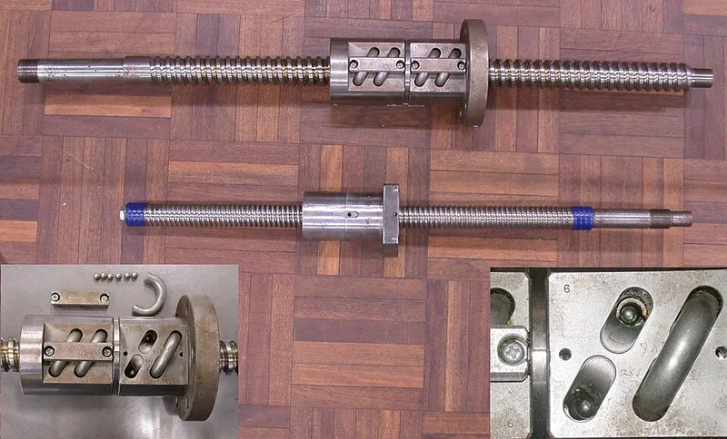

<figure class="eoc-pic eoc-pic-main"><figcaption><a href="https://commons.wikimedia.org/wiki/File:BallScrews-with-detail-insets.jpg">BallScrews-with-detail-insets</a> by No machine-readable author provided. Graibeard assumed (based on copyright claims)., <a href="http://creativecommons.org/licenses/by-sa/3.0/">CC BY-SA 3.0</a>, from Wikimedia Commons.</figcaption></figure>

Turning a grooved screw drives a nut along it in a straight line, and because hardened balls roll between the screw and nut instead of the threads sliding, it is about 90% efficient, fast, precise and long-lasting, but it will also run backwards if the load pushes on it.

**In plain words:** A threaded rod with a nut full of tiny steel balls rolling in the thread, so turning the rod slides the nut along very smoothly and with little effort; it runs so freely that pushing on the nut can spin the rod backwards. **Proper term:** Ball screw (ball screw and ball nut, recirculating ball screw).

**Also called:** ballscrew; ball screw and ball nut / ball nut; recirculating ball screw; ball screw drive / ball screw [actuator](../glossary.md#actuator) / ball screw linear module; rolled ball screw (cheaper, rolled thread) vs ground or precision ball screw; SFU1204, SFU1605 (common hobby CNC and 3D-printer sizes: 12 mm diameter with 4 mm lead, 16 mm diameter with 5 mm lead); ball screw kit with BK and BF end supports (hobby CNC); recirculating ball steering, worm and sector (the car steering-box version); husillo de bolas (Spanish).

## How it works

The screw and nut both have a matching rounded spiral groove, and a row of hardened balls fills the space between them, so when the screw turns the balls roll instead of the thread faces sliding (rolling contact, as in a ball bearing). The nut is held so it can't spin, so each turn of the screw moves it along by one lead. Balls that reach the end of the nut are picked up and carried back to the start through a return path, so they circulate endlessly (recirculating balls). Rolling friction is so low that a push on the nut can turn the screw ([back-driving](../glossary.md#back-driving)), and play is removed by preloading: two nut halves pushed or twisted apart, or balls that are a tight fit.

## Parts

A small assembly that acts as one unit: the screw shaft with a rounded (gothic-arch) groove, the ball nut, dozens of hardened steel balls, a ball-return path inside or on the nut (a return tube, small internal 'button' deflectors, or end caps), and usually wipers on the nut ends. Around it you need end-support bearings (e.g. a fixed BK block and a floating BF block), a motor coupling, and separate linear guides that carry the carriage and stop the nut from turning.

## Everyday examples

- CNC routers and milling machines, where ball screws move the table and spindle precisely
- Electric power steering in cars, where a ball screw turns a motor's rotation into the steering rack's sideways push (Wikipedia)
- The steering box of older cars and some off-roaders (recirculating ball steering, e.g. the Jeep Wrangler), a ball screw driving a toothed block (Wikipedia 'Recirculating ball')
- Upgraded 3D printer Z axes, e.g. an SFU1204 ball screw replacing a T8 lead screw (Printables model 488279 by EJ, read via the Printables API)

## When to use it

Use one when a motor must move something precisely, quickly and often in a straight line with little or no play: CNC machine axes, precise 3D printer Z axes, robot legs and arms, linear actuators, and machines that run back and forth all day. The low friction means a smaller motor, little heat and a long, predictable life, and a preloaded nut gives zero [backlash](../glossary.md#backlash) when the direction changes. It also suits jobs where back-driving is wanted, such as a robot joint that should give when pushed.

## When not to use it

Avoid it for hand-cranked machines or anything that must hold a load with the power off, because it back-drives (Wikipedia); use a fine-lead lead screw or a worm drive, or add a power-off brake or counterweight. Avoid it in dirty, dusty or wet places unless it has wipers and bellows. Don't let it take side loads; add linear guides. For long, fast travel it whips, so use a belt or rack and pinion. For cheap, light-duty jobs a T8 lead screw with an anti-backlash nut is usually enough. For very fine hand adjustment, use a differential screw or a [flexure](../glossary.md#flexure).

## Details

- **What it does (jobs):**
  - change the kind of motion: rotation into straight-line motion (and back again, because it back-drives)
  - change speed or turning force: a small motor [torque](../glossary.md#torque) makes a large, precise push along the screw
  - let it move (slide): drives a carriage or table along a straight line with little or no play (CNC axes, printer Z axes, robot actuators)
- **Movement:** rotate+slide: the screw turns (or, in rotating-nut designs, the nut turns) and the nut slides in a straight line; travel is limited by the threaded length of the screw
- **Directions it can move (degrees of freedom):** 1: the nut's position along the screw is locked to the screw's rotation (one lead per turn), so there is only one independent motion
- **Special behaviour:**
  - motion conversion (rotary to linear): turning the screw pushes or pulls the nut in a straight line; with a preloaded nut it does so with no play when the direction changes
  - none of the holding behaviours: it is NOT [self-locking](../glossary.md#self-locking). Because it is so efficient, a load on the nut can spin the screw backwards (back-drive), so on its own it will not hold a raised load when the motor lets go (Wikipedia 'Ball screw')
- **How it holds:**
  - shape ([form-fit](../glossary.md#form-fit--force-fit--material-bond)): the balls sit in the grooves of both screw and nut, so the nut can't move along without the screw turning
  - not a holding joint (it moves or passes on motion): with very low friction it back-drives, so holding a position needs a motor, brake or counterweight
- **Input and output:** Rotation -> straight-line motion, and straight-line force -> rotation when back-driven. Travel per turn = lead (e.g. SFU1605 = 5 mm per turn; SFU1204 = 4 mm per turn). Efficiency about 90%, versus 20-25% for an Acme lead screw of equal size (Wikipedia). Driving torque T = F x lead / (2 x pi x efficiency), and back-driving force F = 2 x pi x efficiency x T / lead (Wikipedia). Shaft arrangement: in line (the nut travels along the screw's axis). Back-drivable: yes, easily; this is the main difference from a fine lead screw.
- **Power:** passive (no power needed); almost always motor-driven. If power is lost, the screw can back-drive and let a vertical load, gantry or bed drop or drift, unless a spring-applied 'power-off' brake, a counterweight or a self-locking gearbox holds it (Wikipedia; linearmotiontips)
- **Load:** Medium to heavy along the screw's axis, both push and pull (aircraft control surfaces, car power steering and machine tools use them). Keep the peak [axial](../glossary.md#axial--radial) load below the static rating divided by 2, or by 5 with vibration or shock (THK). It cannot take sideways (radial) or bending (moment) loads on the nut; these must go into separate linear guides (Dings Motion; Rockford). Long, thin screws also whip at speed and can buckle in compression.
- **Play and precision:** Small to none. Cheap rolled ball screws have some play (axial [clearance](../glossary.md#clearance) up to 0.05 mm for 6-12 mm shafts and 0.1 mm for 14-28 mm shafts) and lead errors of +/-50 um (C7), +/-100 um (C8) or +/-210 um (C10) per 300 mm of travel (THK); ground precision grades C0-C5 are far better, and a preloaded nut has zero backlash (Wikipedia; THK). Very repeatable. Tolerates very little [misalignment](../glossary.md#misalignment): side loads and bending shorten life or seize the nut (Rockford), and the runout of cheap rolled screws causes visible Z wobble on 3D printers unless the nut mount can float sideways (Hackaday).
- **Taking it apart:** removable: the screw comes out of its end supports and motor coupling. Do not unscrew the ball nut off the end of the shaft unless it slides onto a mandrel (arbor or dummy shaft), or the balls fall out or can be ejected (Dings Motion; Matara)
- **How often it can be reused:** many times: the screw and nut can be removed and refitted repeatedly as a unit; the nut itself should stay on its shaft or on a mandrel
- **Sealing:** none: the screw and nut are open; wipers (brush or lip seals) on the nut ends keep grit out and grease in, and bellows or telescopic covers protect the exposed screw, which together make it roughly dust-resistant (Wikipedia; Rockford Ball Screw)
- **Adjustable:** yes: position is set anywhere along the travel by turning the screw (usually a stepper or servo motor). The play (backlash) is set by the [preload](../glossary.md#preload), usually fixed at the factory by a tight ball fit or a double nut; some double nuts are adjusted by rotating one nut against the other (Wikipedia)
- **Access needed:** end of a tube or shaft: the screw is fitted from its ends into the end-support bearings and motor coupling; the nut is best left on the screw (or slid from the shaft onto a mandrel)
- **Materials:** Screw and nut: steel, case-hardened then ground, or rolled and hardened; balls: hardened steel; the unloaded ball-return parts may be injection-moulded low-friction plastic; instrument screws are made of Invar so temperature changes the length less (Wikipedia). DIY printed versions: PLA screw and nut with 6 mm airsoft BBs (LoboCNC), 8 mm (5/16 in) steel balls (Odd Inventor), or 1/8 in Delrin balls (hackaday.io quadruped).
- **Heat, cold, water and wear:** Heat: maximum operating temperature typically below 80 C, or ball circulation suffers and hardened parts soften (Dings Motion); printed PLA ball screws soften above about 60 C (Prusa). Dirt: grit and chips wear the raceways and ruin [accuracy](../glossary.md#repeatability--accuracy), so use bellows, wipers or filtered positive air pressure (Wikipedia; Rockford). [Lubrication](../glossary.md#lubrication): running dry causes grinding, metal-to-metal wear; use a high-temperature grease where it runs hot, and avoid graphite lubricants because they are abrasive (Rockford). Temperature changes the length of a steel screw, which matters at micrometre precision (instrument screws are made of Invar; Wikipedia). Vibration and load: it holds nothing by itself, so a load can turn it whenever the motor is not holding.

## Making it

- **Ways to make or get it:**
  - off-the-shelf part (by far the most common: rolled C7-C10 hobby screws or ground C0-C5 precision screws, sold with nuts, housings and end supports)
  - 3D print (FDM): working demo and light-duty ball screws using airsoft BBs or steel balls, and printed mounts, nut holders, wobble decouplers and nut-retaining rods for metal ball screws
  - CNC (industrial only): screws are thread-rolled, or machined, case-hardened and ground, or hard-whirled (Wikipedia)
- **Printing it in one piece (print in place):** no: the screw, nut (or nut halves) and return tube are printed separately, and the balls are fed in through a loading port or placed by hand before closing the nut
- **Tools:** Hex keys and spanners for the end-support clamps, locknuts, nut housing and coupling; grease or oil for lubrication; a mandrel (arbor or dummy shaft) if the nut ever has to come off the screw (a printed retaining rod works for small SFU1204 nuts). Printed DIY ball screws: tweezers or a loading port for the balls, and tape.
- **Difficulty:** easy to fit if bought: cheap rolled ball screw kits (e.g. SFU1605 with nut housing, BK12/BF12 end supports and coupler) bolt onto a CNC or printer frame; moderate to print a working demo (needs a well-tuned printer and loose balls); hard to make an accurate metal one (precision grinding), so buy one

### 3D printing tips

1) Start from a proven design: LoboCNC's Ball Screw and Nut uses 28 x 6 mm airsoft BBs, prints in PLA without supports, and has a loading port in the side of the nut: hold the nut level in a vise, feed balls in while turning the screw slightly, then press in the plug. 2) Layers: 0.2 mm is fine for the nut, but a screw printed lying down (it has one side flattened to sit on the bed) is smoother at 0.15 or 0.1 mm; LoboCNC's clam-shell nut halves need 0.1 mm. 3) The ball path must be smooth: tune out [elephant's foot](../glossary.md#elephants-foot) and a poor first layer (a near-perfect first layer, ideally with mesh bed levelling), and scrub nibs out of the groove with a scrap of Scotch-Brite-type pad; keep superglue out of the ball path. 4) Add a stop so the nut can't run off the end, or 'you will have balls everywhere' (LoboCNC); his printed linear actuator uses a screw in a slot as the stop. 5) Expect modest force: LoboCNC's 150 mm [stroke](../glossary.md#stroke) actuator (6.5 mm [pitch](../glossary.md#pitch)) with a short NEMA 17 pushes about 10 kgf, and it is back-drivable. 6) A clam-shell design with three separate one-turn nuts keeps its balls when removed from the screw (LoboCNC's earlier version, 27 airsoft pellets). 7) Other ball sizes: 8 mm (5/16 in) steel balls with 6000 bearings (Odd Inventor's modular actuator), or 1/8 in Delrin balls with a 4.5 mm pitch, 12 mm pitch-diameter screw (a hackaday.io quadruped robot). 8) For metal ball screws, print the mounts: a nut-retaining rod (wrapped in painter's tape) that screws onto the shaft end so the nut can be moved off without losing balls, and a nut mount that lets the nut float sideways to stop wobble from a bent or rolled screw (Hackaday; Printables). 9) PLA softens above about 60 C (Prusa), so keep printed screws away from motors and heated beds.

### Buying one (off-the-shelf parts)

Rolled ball screws with flanged single nuts (search 'SFU1204' or 'SFU1605'; the digits are the diameter and lead in mm), sold cut to length with machined ends; ball nut housings (brackets that bolt the nut to the carriage); end supports: a BK block on the fixed side and a BF block on the floating side, e.g. BK12/BF12 for an SFU1605 (vxb kit listing); flexible shaft couplers; precision ground ball screws and preloaded double nuts; complete ball screw linear modules and actuators; spring-applied power-off brakes for vertical axes; bellows covers and brush or lip wiper seals; mandrels (arbors) for handling nuts; re-balling services if balls are lost (Matara).

## Rules of thumb

- Efficiency about 90% for a typical ball screw versus 20-25% for an Acme lead screw of equal size (Wikipedia 'Ball screw'). Driving torque T = F x lead / (2 x pi x efficiency): e.g. 1000 N on a 5 mm lead at 90% needs about 0.88 N·m (formula from Wikipedia).
- Assume it WILL back-drive: the same formula run backwards, F = 2 x pi x efficiency x T / lead, means any load on the nut becomes torque on the screw; vertical axes need a brake or counterweight (Wikipedia; linearmotiontips).
- [Fatigue](../glossary.md#fatigue) life L10 = (Ca / Fa)^3 x 10^6 revolutions, where Ca is the catalogue's basic dynamic load rating and Fa the axial load (THK A15-48): halving the load gives 8 times the life.
- Static safety factor fS = C0a / Fa max should be at least 2 without vibration or impact, and at least 5 with them (THK Table 21).
- Critical (whipping) speed: run below 80% of it; thinner and longer screws whip at lower speeds (Kuroda). End support factors: fixed-fixed 25.5, fixed-supported 17.7, supported-supported 11.5, fixed-free 3.9 (Steinmeyer), so a screw held at one end only whips at about one-sixth of the speed of one clamped at both ends. Critical speed can also be quoted with a safety factor of 0.5-0.8 (linearmotiontips).
- Nut speed limit (DN value) = screw diameter (mm) x rpm; typically 60,000 to 150,000 depending on the ball-return design (linearmotiontips).
- Accuracy grades run from C0 (best) to C10 (JIS B 1192 / ISO 3408). Rolled screws: travel error +/-50 um (C7), +/-100 um (C8) and +/-210 um (C10) per 300 mm (THK); hobby kits are commonly sold as C7 (e.g. vxb's SFU1605 kit).
- Rolled ball screw play (axial clearance) is up to 0.05 mm for 6-12 mm shafts and 0.1 mm for 14-28 mm shafts (THK); preload removes it where accurate positioning matters.
- Maximum operating temperature typically below 80 C (Dings Motion).
- Axial loads only: take side and bending loads on linear guides and align the screw to the guides, checking with a dial indicator or the motor current (Dings Motion; Rockford).
- Avoid long runs of short back-and-forth 'dithering' strokes; make an occasional full-length stroke so the balls and grease recirculate (Rockford).

## Common failures

1) Contamination: chips and dust scratch the raceways, raising friction, noise and play; use wipers and bellows (Rockford). 2) Too little lubrication: grinding wear and early failure (Rockford; Dings Motion). 3) Misalignment or side loads: uneven ball loading, binding and eventually a seized nut; align the screw with the guides and check with a dial indicator and the motor current (Rockford). 4) Short dithering strokes: dented raceways (brinelling) and grease starvation; add occasional long strokes (Rockford). 5) Overtravel: the nut runs past its end, dropping balls, breaking the return parts or denting the raceway; fit end stops or limit switches (Dings Motion). 6) Whipping and wobble: long thin screws vibrate at speed (Kuroda), and cheap rolled screws have runout that shows as Z wobble on printers; use better end supports, a lower speed, or a floating nut mount (Hackaday). 7) Lost balls after taking the nut off without a mandrel; some suppliers offer re-balling (Matara). 8) Printed versions: rough grooves from elephant's foot or nibs make the balls jam; tune the printer and smooth the ball path (LoboCNC).

## Safety

1) Falling loads: a vertical axis or lifted load can drop when power is lost, because the screw back-drives; fit a spring-applied power-off brake or a counterweight (linearmotiontips; Wikipedia). 2) Hand-cranked machines: a force on the tool can spin the handwheel and hurt the operator (Wikipedia). 3) Never unscrew the nut off the shaft without a mandrel: balls can fall out or be ejected and cause injury (Dings Motion; Matara). 4) Don't drop it or hit it: this can cause injury and internal damage (Dings Motion). 5) Motor-driven carriages move fast and push hard, so keep fingers clear of pinch points.

## Related

- Lead screw and nut: sliding threads; cheaper, quieter and (with a fine lead) self-locking, but only about 20-80% efficient, with more play and wear
- Threadless ball screw (rolling-ring drive): angled bearings on a smooth rod act as the nut; no play from preload, and it slips instead of jamming when overloaded
- Roller screw: threaded rollers instead of balls, for higher loads and [stiffness](../glossary.md#stiffness) (Wikipedia 'Ball screw' see also)
- Ball [spline](../glossary.md#spline): the same recirculating balls, but in straight grooves, so a hub slides along a shaft while passing on torque
- Rack and pinion: a gear on a toothed bar; faster and longer travel, but with more play and less force
- Belt drives (timing belt): cheap, fast and long travel with lower force and stiffness
- Differential screw: two slightly different threads for extremely fine hand adjustment
- Linear guides: carry the carriage and side loads that a ball screw must not take

## Make it yourself

- [Ball Screw and Nut (LoboCNC, Printables)](https://www.printables.com/model/507713-ball-screw-and-nut): Working recirculating ball screw demo: printed screw and nut with an internal return tube and 28 x 6 mm airsoft BBs loaded through a side port; no supports *(licence: CC BY-SA)*
- [Linear Actuator with 3D Printed Ball Screw (LoboCNC, Printables)](https://www.printables.com/model/509590-linear-actuator-with-3d-printed-ball-screw): 150 mm stroke NEMA 17 linear actuator built around a printed ball screw (6.5 mm pitch, 28 airsoft BBs); about 10 kgf with a short motor *(licence: CC BY-SA)*
- [Ball Screw and Nut, clam-shell version (LoboCNC, Printables) (URL from Printables API, page not opened)](https://www.printables.com/model/132289-ball-screw-and-nut): Ball screw with three one-turn clam-shell nuts and short jump-over returns, using 27 airsoft pellets; the balls stay in when the nut is removed *(licence: CC BY-SA)*
- [Modular Ball Screw Linear Actuator (Odd Inventor, Printables) (URL from Printables API, page not opened)](https://www.printables.com/model/350128-modular-ball-screw-linear-actuator): Extendable printed ball screw actuator using 8 mm (5/16 in) steel balls and 6000 bearings *(licence: CC BY)*
- [1204 Ball Screw Nut Retaining Rod (Randy Magnum, Printables) (URL from Printables API, page not opened)](https://www.printables.com/model/645953-1204-ball-screw-nut-retaining-rod): Printed mandrel that fits on the end of an SFU1204 screw so the nut can be screwed off onto it without losing its balls *(licence: CC BY-NC-SA)*

## Pictures, videos and models

- [Ball screw (Wikipedia)](https://en.wikipedia.org/wiki/Ball_screw): Article with a photo of two ball screws and close-ups of the ball nut and return tube, and explanations of ball return types, preload and accuracy grades *(licence: Text CC BY-SA 4.0; images per file on Commons)*
- [BallScrews-with-detail-insets.jpg (Wikimedia Commons, photo by Glenn McKechnie)](https://commons.wikimedia.org/wiki/File:BallScrews-with-detail-insets.jpg): Two ball screws, with insets of the ball nut: return tube removed showing loose balls, retainer bracket and tube, and a view into the nut cavity *(licence: GFDL 1.2+ / CC BY-SA 3.0, 2.5, 2.0, 1.0)*
- [Husillo bolas precargo.svg (Wikimedia Commons, by Heriberto Arribas Abato)](https://commons.wikimedia.org/wiki/File:Husillo_bolas_precargo.svg): Diagram of the ball contact points in a ball screw when play is removed with an internal preload *(licence: CC BY-SA 3.0)*
- [Category:Ball screws (Wikimedia Commons)](https://commons.wikimedia.org/wiki/Category:Ball_screws): 17 files: photos of ball nuts and return tubes, preload diagrams, and a gearbox-to-screw animation (GearBoxRotLinScrew.gif, CC BY 3.0 / GFDL) *(licence: Per file (Commons free licences))*
- [HUANGYAN920 Mechanical: interactive animations (entries 'BALL-SCREW' and 'RECIRC-SCREW')](https://huangyan920.github.io/Mechanical/): Browser animations of a ball screw and of a recirculating ball screw with its ball-return path *(licence: MIT)*

## Needs confirming

⚑ marks something nobody has confirmed yet: a fact the research could not confirm from a source, a finder value that is a best guess, or an open point from the research notes. Corrections are welcome (see `research/needs-confirming.md`).

Nothing is marked on this page.

## Sources

- <https://en.wikipedia.org/wiki/Ball_screw>
- <https://en.wikipedia.org/wiki/Recirculating_ball>
- <https://en.wikipedia.org/wiki/Linear_actuator>
- <https://commons.wikimedia.org/wiki/File:BallScrews-with-detail-insets.jpg>
- <https://commons.wikimedia.org/wiki/File:Husillo_bolas_precargo.svg>
- <https://commons.wikimedia.org/wiki/File:GearBoxRotLinScrew.gif>
- <https://commons.wikimedia.org/wiki/Category:Ball_screws>
- <https://tech.thk.com/en/products/pdf/en_a15_011.pdf>
- <https://tech.thk.com/en/products/pdf/en_a15_046.pdf>
- <https://www.thk.com/jp/en/products/ball_screw/selection/0010/>
- <https://www.dingsmotionusa.com/ball-screw-instructions-and-precautions>
- <https://matara.com/technical-articles/ball-nut-installation-on-a-ball-screw/>
- <https://www.linearmotiontips.com/whats-the-difference-between-ball-screw-critical-speed-and-characteristic-speed/>
- <https://www.linearmotiontips.com/what-is-back-driving-and-why-is-it-important/>
- <https://kurodaprecision.com/global/products/technical-information/bs/bs025.html>
- <https://www.steinmeyer.com/en/technology/speed-limits/critical-speed/>
- <https://rockfordballscrew.com/avoid-ball-screw-failure-through-proper-application-design-and-preventive-maintenance/>
- <https://vxb.com/products/sfu1605-1200mm-ball-screw-bk-bf-kit>
- <https://hackaday.com/2021/02/22/improving-cheap-ball-screws/>
- <https://hackaday.io/project/179454-quadruped-w3d-printed-recirculating-ball-screws>
- <https://help.prusa3d.com/article/pla_2062>
- <https://huangyan920.github.io/Mechanical/>
- <https://www.printables.com/model/507713-ball-screw-and-nut>
- <https://www.printables.com/model/509590-linear-actuator-with-3d-printed-ball-screw>
- <https://www.printables.com/model/132289-ball-screw-and-nut>
- <https://www.printables.com/model/350128-modular-ball-screw-linear-actuator>
- <https://www.printables.com/model/645953-1204-ball-screw-nut-retaining-rod>
- <https://api.printables.com/graphql/>
