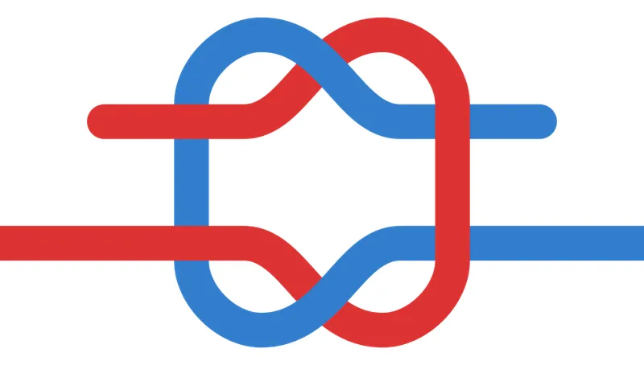
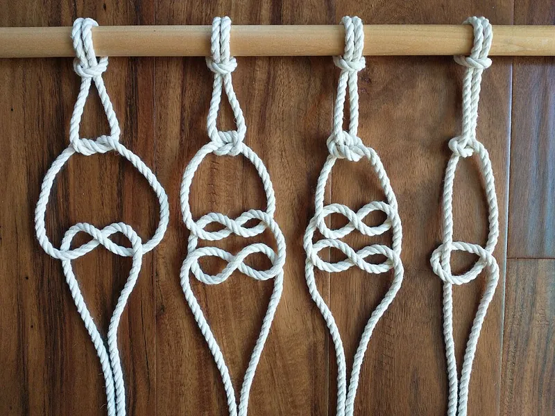
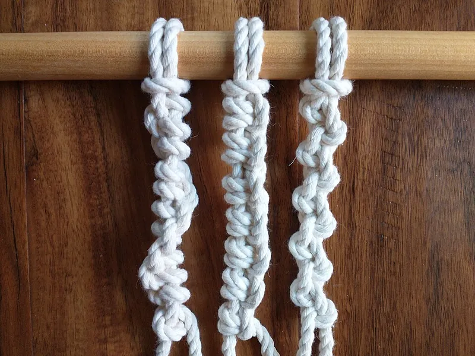

<figure class="eoc-pic eoc-pic-main"><figcaption><strong>Diagram.</strong> <a href="https://commons.wikimedia.org/wiki/File:Square_knot.svg">Square knot</a> by CountingPine, Public domain, from Wikimedia Commons.</figcaption></figure>
<figure class="eoc-pic"><figcaption><strong>How it works.</strong> <a href="https://commons.wikimedia.org/wiki/File:Macrame_Basic_Knots.jpg">Macrame Basic Knots</a> by Stilfehler, <a href="https://creativecommons.org/licenses/by-sa/4.0">CC BY-SA 4.0</a>, from Wikimedia Commons.</figcaption></figure>
<figure class="eoc-pic"><figcaption><strong>Photo.</strong> <a href="https://commons.wikimedia.org/wiki/File:Macrame_Knots_06.jpg">Macrame Knots 06</a> by Stilfehler, <a href="https://creativecommons.org/licenses/by-sa/4.0">CC BY-SA 4.0</a>, from Wikimedia Commons.</figcaption></figure>

Three knots built from the same single tuck: the overhand makes a lump in the end of a cord so it can't slip through a hole, the half hitch ties a cord round a post or ring, and the reef knot ties the two ends of one cord round a bundle, with a slipped version that becomes the shoelace bow; they are the baseline that better knots for each job are compared with.

**In plain words:** The simple knots most people half-know: a lump tied in the end of a string so it can't pull through a hole, a quick wrap of rope round a post, and the 'right over left, left over right' knot that ties a parcel or, made with loops, your shoelaces. **Proper term:** Basic knots: the overhand knot (stopper knot), the half hitch (hitch) and the reef or square knot (binding knot), with its slipped form, the shoelace bow.

**Also called:** overhand knot, thumb knot (ABOK #46; also #4, #514) (Wikipedia 'Overhand knot'); half knot: the same tuck tied with two ends round an object, the first half of a reef knot (ABOK #47) (Wikipedia 'Overhand knot'; Animated Knots 'Half Hitch'); half hitch, single hitch (ABOK #50) (Wikipedia 'Half hitch'; Animated Knots 'Half Hitch'); two half hitches, double half hitch (ABOK #1710); round turn and two half hitches (Wikipedia 'Two half-hitches'; Animated Knots); reef knot, square knot, Hercules knot, double knot (ABOK #1204 among the binding knots; Animated Knots cites ABOK #1402, p. 258) (Wikipedia 'Reef knot'; Animated Knots 'Square Knot'); shoelace knot, bow knot, bow: a reef knot with both ends slipped (ABOK #1212) (Wikipedia 'Shoelace knot'); granny knot, false knot, lubber's knot (ABOK #1206): the common mistake when tying a reef knot (Wikipedia 'Granny knot'); thief knot, bag knot (ABOK #1207): a reef look-alike with the ends on opposite sides (Wikipedia 'Thief knot'); surgeon's knot, double throw: a reef knot with an extra twist in the first half knot (Wikipedia 'Reef knot'; Animated Knots 'Square Knot'); double overhand knot: a bigger stopper (Animated Knots 'Overhand Knot').

## How it works

A knot holds by friction: where the cord bends round itself and crosses itself, a pull on the loaded part (standing part) squeezes the turns together so the free end can't slide out (Wikipedia 'Knot'); a simple analysis says a reef knot holds only if the cord's friction coefficient is above about 0.24 (Wikipedia 'Reef knot'). The overhand is a single tuck in one end that leaves a lump too big to pass through a hole (stopper); the half hitch is the same tuck made round a post and back round its own standing part; the half knot is the same move made with two ends round an object, and two half knots of opposite hand make a reef knot (Animated Knots 'Overhand Knot', 'Half Hitch'; Wikipedia 'Overhand knot'). Making the last tuck with a folded loop of cord (a bight) instead of the end gives a slipped knot that pulls undone with one tug on the free end, as in a shoelace bow (Wikipedia 'Knot', 'Shoelace knot').

## Parts

Single piece: just the cord, string, rope or tape itself (plus the post, ring or bundle it is tied round).

## Everyday examples

- Shoelaces tied in a bow, which is a reef knot with both ends slipped (Wikipedia 'Shoelace knot'; Animated Knots 'Shoelace Bow')
- String round a parcel or gift, and the two twisted corners of a bin bag tied together (Wikipedia 'Reef knot'; Animated Knots 'Square Knot')
- A knot in the end of a cord so it can't slip back out through a hole, or to stop a rope end unravelling (Wikipedia 'Overhand knot')
- A lead rope or line tied to a ring, bar or pole with two half hitches (Animated Knots 'Two Half Hitches': 'Used to secure an animal or an item to a ring, bar or pole')

## When to use it

Use these for light, non-critical jobs where nothing bad happens if the knot lets go, and where no tools or parts are wanted: the overhand as a quick stopper in a cord end or to stop a rope end unravelling (Wikipedia 'Overhand knot'); two half hitches, or better a round turn and two half hitches, to tie a line to a post, ring or rail (Animated Knots 'Half Hitch'); the reef knot to tie the two ends of one cord round a bundle, a bag neck, a sail cover or a parcel (Wikipedia 'Reef knot'; Animated Knots 'Square Knot'); and the slipped reef (bow) where you want one-pull release. They are handy for prototypes, tying cords onto printed parts and temporary bundling, and they are the starting point for learning better knots.

## When not to use it

Never use them for climbing, lifting, swings, hammocks, towing or anything that holds a person, without training and rated gear (Animated Knots 'Safety'). Never use the reef knot to join two ropes or cords, especially of different sizes: use a sheet bend or double fisherman's knot (Bends for joining two cords) (Wikipedia 'Reef knot'). Don't trust a single half hitch, or a reef knot that will be jiggled: the reef knot is 'insecure ... unstable when jiggled, and is not suitable for supporting weight' (Wikipedia 'Reef knot'). Instead: for a loop that won't slip, a bowline or figure-eight loop (Fixed loop knots); for a better stopper, a figure-eight or double overhand (Stopper knots and cord-end anchors); for tying to a post, a clove hitch or round turn and two half hitches (Hitches to a post, rail, ring or eye); to tension a line, a trucker's or taut-line hitch (Tensioning and adjustable hitches); for a firm binding, the constrictor knot (Binding knots and seizings); for full strength, a splice, which 'is capable of attaining a rope's full strength' (Rope splices; Wikipedia 'Rope splicing'); for frequent quick fastening, a cord lock, cleat or buckle.

## Details

- **What it does (jobs):**
  - join and hold: ties a cord round a bundle, onto a post, rail or ring, or stops it slipping out through a hole
  - lock, and release by hand: all three untie by hand with no tools, and the slipped reef knot (shoelace bow) undoes with one pull
- **Movement:** none: a correctly tied knot keeps the cord parts still relative to each other, and slipping counts as failure (Wikipedia 'Knot'); the cord on either side stays flexible.
- **Directions it can move (degrees of freedom):** 0 at the knot itself; the cords either side can bend freely.
- **Special behaviour:**
  - quick-release: slipped knots, such as the shoelace bow (a doubly slipped reef knot), come undone with one pull on the free end; the bow 'has the stability of the reef knot but is significantly easier to untie' (Wikipedia 'Shoelace knot')
  - none for the plain overhand and half hitch: they simply hold by friction (Wikipedia 'Knot')
- **How it holds:**
  - friction or clamping ([force-fit](../glossary.md#form-fit--force-fit--material-bond)): turns of cord squeezed against each other and against the object (Wikipedia 'Knot'; 'Reef knot', Physical analysis)
  - shape (the parts interlock; form-fit): a stopper knot is a 'fixed thicker point' that can't pass through a narrow hole (Wikipedia 'Stopper knot')
- **Input and output:** not applicable
- **Power:** passive (no power needed)
- **Load:** Light. A knot weakens the cord it is tied in, and knotted rope 'almost always fails at the knot or close to it' (Wikipedia 'Knot'). Sources give different figures, side by side: common knots keep 40-80% of the rope's strength (Wikipedia 'Knot'); 'a knot typically reduces the strength by 20-40%' (Wikipedia 'Rope splicing'); assume even new rope gives 'no more than 50% of its rated breaking strength' because of knots, kinks and imperfections (Animated Knots 'Safety'); rope tests cited by Petrulis and Petrulyte range from 80-90% for an anchor bend down to 43-47% for a square (reef) knot, and in their own flax-yarn tests the square knot kept 37-49% and the overhand 56-74% of the breaking force (Fibres & Textiles in Eastern Europe, 2012); Wikipedia's overhand-knot infobox lists 50% (no source given). Direction matters: the reef knot is for binding round an object and spills if used to join two ropes; a single half hitch is 'insecure on its own' (Wikipedia 'Reef knot', 'Half hitch'). Never for holding people.
- **Play and precision:** not applicable
- **Taking it apart:** removable: all three untie by hand; the slipped forms are tool-free quick release. The overhand is 'very secure, to the point of jamming badly' and may have to be picked apart or cut once loaded (Wikipedia 'Overhand knot').
- **How often it can be reused:** effectively unlimited: the same cord can be tied and untied many times; a hard-jammed knot or a worn, chafed cord is the limit ⚑ [uncertain].
- **Sealing:** none
- **Adjustable:** no: to change the tension or position, untie and re-tie; knots that can be slid to adjust tension are in Tensioning and adjustable hitches.
- **Access needed:** not applicable: you need only a free end (or a bight) of the cord, and room to pass it round the post, ring or bundle.
- **Materials:** Any cord, string, twine, shoelace, rope or flat tape, natural (cotton, hemp, sisal) or synthetic (nylon, polyester, polypropylene, high-modulus polyethylene such as Dyneema (brand)) (Wikipedia 'Rope'). Small cotton string has enough internal friction to stay tied easily, while stiff, thick kernmantle rope is hard to tie and may be slick enough to come apart once tied (Wikipedia 'Knot', Difficulty); synthetic ropes have a disadvantage in 'slipperiness' (Wikipedia 'Rope'). The reef knot doesn't hold if the two ends differ in size, [stiffness](../glossary.md#stiffness) or smoothness (ABOK quoted in Wikipedia 'Reef knot'). Flat webbing must be tied flat, without twists (Wikipedia 'Knot', Material).
- **Heat, cold, water and wear:** Repeated pulling and slackening, flapping or vibration shake knots loose: 'Many knots can loosen with prolonged intermittent strain' (Animated Knots 'Safety'), and slipping is worse when a knot is 'repeatedly strained and let slack' or struck against hard objects (Wikipedia 'Knot'). Water: nylon 'absorbs water and is 10-15% weaker when wet', while polyester is not affected (Wikipedia 'Rope'). Sunlight: polypropylene has 'limited resistance to ultraviolet light, friction, and heat', and some synthetics are damaged by UV (Wikipedia 'Rope'). Rot: natural-fibre cords rot more readily than synthetics (Wikipedia 'Rope'). Heat: synthetic cords melt, which is how their ends are sealed (Wikipedia 'Rope').

## Making it

- **Ways to make or get it:**
  - off-the-shelf part: cord, string or rope, tied by hand
  - 3D print (FDM): printed parts that a cord is knotted to or through (holes, slots, posts), and knot-practice boards (see make_it_yourself)
- **Printing it in one piece (print in place):** no: knots are tied in cord; only the parts they are tied to, or practice boards, are printed.
- **Tools:** none. A pointed tool such as a fid can help loosen a jammed knot, and a knife or hot cutter is used to cut and seal synthetic cord (Wikipedia 'Knot', Tools).
- **Difficulty:** easy: no tools or parts; the real risks are tying a granny instead of a reef knot and using these knots for the wrong job.

### 3D printing tips

Knots aren't printed, but cords are often knotted onto prints. 1) For a stopper behind a hole, make the hole only a little bigger than the cord so the overhand lump can't pull through; if it does, tie a double overhand, which makes a bigger stopper (Animated Knots 'Overhand Knot') ⚑ [uncertain for the hole sizing]. The overhand is 'one of the few stopper knots that can be tied tightly up against an object' (Animated Knots). 2) Round off the edges of holes, slots and posts where a loaded cord bends, so it doesn't chafe or cut through ⚑ [uncertain]. 3) Tie hitches round a solid post or bar on the part rather than a thin printed loop, which can snap along its [layer lines](../glossary.md#layer-lines) ⚑ [uncertain]. 4) Use a printed knot-practice board to learn these and the better knots that replace them (Printables 619893). 5) Seal or whip the cut end of synthetic cord so it doesn't fray, but note the warning that hard melted ends can cut hands (Geoffrey Budworth, quoted in Wikipedia 'Rope'); see Rope-end finishing.

### Buying one (off-the-shelf parts)

Cord, paracord, twine, shoelaces and rope, bought by fibre, diameter and breaking strength; cleats, rings, eyes and posts to tie to; cord locks, cord ends and buckles as no-knot alternatives. Choose rope by its breaking strength divided by a design factor of 5:1 to 12:1 (Cordage Institute guideline quoted by Animated Knots 'Safety').

## Rules of thumb

- Reef knot: tie 'right over left; left over right' (or the reverse); both free ends must come out on the same side. Two half knots of the same hand make a weak granny knot, and ends on opposite sides make an even weaker thief knot (Wikipedia 'Reef knot'). In a correct reef knot each loop passes completely over, or completely under, the neck of the other (Wikipedia 'Granny knot').
- Shoelace check: a reef-based bow sits straight, with the loops lying across the shoe; a bow lying along the shoe from heel to toe is a granny and comes loose more easily; fix it by reversing your starting knot (Ian's Shoelace Site 'Granny Knot'; Wikipedia 'Shoelace knot').
- Never use a reef knot to join two ropes (as a bend): 'under no circumstances should it ever be tied as a bend' (ABOK, quoted in Wikipedia 'Reef knot'); Animated Knots quotes ABOK p. 258: 'There have probably been more lives lost as a result of using a Square Knot as a bend ... than from the failure of any other half dozen knots combined', and adds 'Never use it for critical loads'. Use a sheet bend or double fisherman's knot instead (Wikipedia 'Reef knot').
- Half hitches: one is insecure; always add a second (two half hitches), and better still take a round turn round the post first (round turn and two half hitches), which is more secure and lets you hold the load while tying (Wikipedia 'Half hitch'; Animated Knots 'Half Hitch').
- Knot strength, side by side: 40-80% of rope strength kept (Wikipedia 'Knot'); 20-40% lost (Wikipedia 'Rope splicing'); no more than 50% of rated strength assumed (Animated Knots 'Safety'); square knot 43-47% in rope tests and 37-49% in flax yarn, overhand 56-74% in flax yarn (Petrulis and Petrulyte 2012).
- Design factor: rope breaking strength 5 to 12 times the load (Cordage Institute CI 1401-15, quoted by Animated Knots 'Safety'), with 12:1 for live or critical loads; working load limits use up to 15:1 for critical uses (Wikipedia 'Knot').
- Leave a long tail, and dress (neaten) and tighten the knot before loading, to stop it slipping when first loaded (Wikipedia 'Knot', Slipping).
- For a binding that won't slip while you tie the second half, add an extra twist to the first half knot (surgeon's knot); two surgeon's half knots make a secure binding and, tied as a bow, a secure shoelace bow (Animated Knots 'Square Knot', 'Shoelace Bow').
- Rigging angle: a rope that can lift a weight may fail when the same weight hangs from the middle of a near-horizontal rope, and a falling or jerked load can be many times its weight (Animated Knots 'Safety').

## Common failures

Slipping: the load drags the cord back through the knot until the end pulls out, worse under repeated loading and slackening; prevent it by leaving a long tail, dressing and tightening the knot, adding half hitches or a stopper, or choosing a more secure knot (Wikipedia 'Knot'). Capsizing (spilling): pulling one end of a reef knot outward turns it into a loose hitch that slides off, which is why it fails as a bend (Wikipedia 'Knot', 'Reef knot'; Animated Knots shows even a stack of square knots capsizing). Jamming: the overhand jams 'badly' under load and may need cutting (Wikipedia 'Overhand knot'). Wrong knot: a granny or thief knot instead of a reef; the granny 'can slip when heavily loaded' and also jams, and the thief 'unties itself' when pulled (Wikipedia 'Granny knot', 'Thief knot'). Breaking at the knot well below the rope's rated strength (Wikipedia 'Knot'). Shoelaces coming undone because the bow is really a granny (Ian's Shoelace Site 'Granny Knot'; Wikipedia 'Shoelace knot'). A reef knot slipping because its two ends differ in thickness or stiffness (ABOK via Wikipedia 'Reef knot').

## Safety

Knots are not for climbing, lifting or holding people without training and rated gear, and a home-made knot, splice or seam must never hold a person: 'Wrongly handled, gripped, or tied, rope can kill, maim, or burn' (Animated Knots 'Safety'). The reef knot used to join two ropes has caused many deaths; Ashley wrote that more lives were lost that way than through 'any other half dozen knots combined' (ABOK p. 258 via Animated Knots; Wikipedia 'Reef knot'). Never stand in a loop or bight of rope that may suddenly tighten, and don't wrap rope round your hand or fingers for grip (Animated Knots 'Safety'). Don't try to hold a heavily loaded rope in bare hands; take two or more turns round a post, winch or cleat (Animated Knots 'Safety'). Melted synthetic rope ends can be hard and sharp enough to cut a hand (Budworth, quoted in Wikipedia 'Rope').

## Related

- Stopper knots and cord-end anchors: the figure-eight, double overhand and Ashley stopper are better stoppers than the plain overhand
- Hitches to a post, rail, ring or eye: the clove hitch and round turn and two half hitches build on the half hitch
- Bends for joining two cords: the sheet bend, double fisherman's knot and water knot do the job the reef knot must never do
- Fixed loop knots: the bowline, figure-eight loop and alpine butterfly make loops that don't tighten or slip
- Tensioning and adjustable hitches: the trucker's hitch, taut-line hitch and Prusik tighten and hold a line
- Binding knots and seizings: the constrictor knot binds far more securely than the reef knot
- Rope splices: interwoven strands that keep nearly all of the rope's strength
- Rope-end finishing: whipping and heat-sealing stop fraying better than an overhand in the end
- Pole lashings: square, diagonal and tripod lashings, started and finished with hitches
- Cord lock (spring toggle), Cam cleat and Clam cleat: hardware that grips a cord without any knot

## Make it yourself

- [Knotenbrett / knot board (Bens, Printables) (URL from Printables API, page not opened)](https://www.printables.com/model/619893-knotenbrett-knot-board): Printed board for practising knots, as used on sailing courses; the name can be added as a gift *(licence: Creative Commons Attribution-ShareAlike)*
- [Segelknoten - Übungsbrett / Sailing knots - practice board (Chris K, Printables) (URL from Printables API, page not opened)](https://www.printables.com/model/1049426-segelknoten-ubungsbrett-sailing-knots-practice-boa): Printed practice board with a ring, cleat, bollard and rail to tie hitches and other knots onto *(licence: Standard Digital File License (Printables))*

## Pictures, videos and models

- [Half Hitch Knot (Animated Knots by Grog)](https://www.animatedknots.com/half-hitch-knot): Step-by-step animation and video showing that the overhand knot, the half hitch and the half knot are the same move used three ways, then two half hitches *(licence: link only)*
- [Square Knot (Animated Knots by Grog)](https://www.animatedknots.com/square-knot): Step-by-step animation of the square (reef) knot, with frames for the granny, surgeon's and thief knots, and photos of a stack of square knots capsizing *(licence: link only)*
- [Square knot.svg (Wikimedia Commons, by CountingPine)](https://commons.wikimedia.org/wiki/File:Square_knot.svg): Clear diagram of a reef (square) knot *(licence: Public domain)*
- [Capsizereefknot111.jpg (Wikimedia Commons, by HighHat)](https://commons.wikimedia.org/wiki/File:Capsizereefknot111.jpg): Photo of a reef knot capsizing (spilling) when one free end is pulled outward *(licence: Public domain)*
- [Overhandknot.jpg (Wikimedia Commons, by Malcolm Morley)](https://commons.wikimedia.org/wiki/File:Overhandknot.jpg): Diagram of a half hitch round an object and an overhand knot used as a stopper in the end *(licence: Public domain)*

## Needs confirming

⚑ marks something nobody has confirmed yet: a fact the research could not confirm from a source, a finder value that is a best guess, or an open point from the research notes. Corrections are welcome (see `research/needs-confirming.md`).

- ⚑ 4 sentences on this page marked [uncertain].
- ⚑ Finder value `usual_process` = by hand (tied or wrapped) (best guess): first-listed process was "off-the-shelf part: cord, string or rope"; knots family, so set to by hand (tied or wrapped)
- ⚑ Research note: *Basic knots*: knot strength recorded side by side (Wikipedia *Knot* 40-80% kept; *Rope splicing* a 20-40% loss; Animated Knots 'no more than 50%'; Petrulis & Petrulyte 2012: square knot 37-49% in flax yarn, 43-47% in cited rope tests; Wikipedia's overhand infobox 50%, unsourced). The reef knot has two ABOK numbers (#1204 and #1402); both are in `aliases`.

## Sources

- <https://en.wikipedia.org/wiki/Knot>
- <https://en.wikipedia.org/wiki/Overhand_knot>
- <https://en.wikipedia.org/wiki/Half_hitch>
- <https://en.wikipedia.org/wiki/Two_half-hitches>
- <https://en.wikipedia.org/wiki/Reef_knot>
- <https://en.wikipedia.org/wiki/Granny_knot>
- <https://en.wikipedia.org/wiki/Thief_knot>
- <https://en.wikipedia.org/wiki/Shoelace_knot>
- <https://en.wikipedia.org/wiki/Stopper_knot>
- <https://en.wikipedia.org/wiki/The_Ashley_Book_of_Knots>
- <https://en.wikipedia.org/wiki/Rope_splicing>
- <https://en.wikipedia.org/wiki/Rope>
- <https://en.wikipedia.org/wiki/List_of_knots>
- <https://www.animatedknots.com/square-knot>
- <https://www.animatedknots.com/half-hitch-knot>
- <https://www.animatedknots.com/overhand-knot>
- <https://www.animatedknots.com/shoelace-bow-knot>
- <https://www.animatedknots.com/two-half-hitches-knot>
- <https://www.animatedknots.com/safety>
- <https://epubl.ktu.edu/object/elaba:3229387/3229387.pdf>
- <https://www.fieggen.com/shoelace/grannyknot.htm>
- <https://commons.wikimedia.org/wiki/File:Square_knot.svg>
- <https://commons.wikimedia.org/wiki/File:Capsizereefknot111.jpg>
- <https://commons.wikimedia.org/wiki/File:Overhandknot.jpg>
- <https://commons.wikimedia.org/wiki/File:Granny_knot.svg>
- <https://api.printables.com/graphql/>
