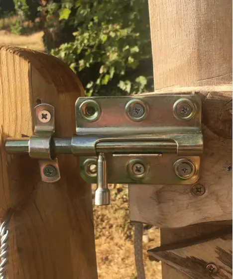

<figure class="eoc-pic eoc-pic-main"><picture><source media="(prefers-reduced-motion: reduce)" srcset="../media/basic-latches.still.webp"></picture><figcaption><strong>Animation.</strong> <a href="https://commons.wikimedia.org/wiki/File:%C3%96ffnen_eines_Riegels.gif">Öffnen eines Riegels</a> by Joho345, <a href="https://creativecommons.org/licenses/by-sa/4.0">CC BY-SA 4.0</a>, from Wikimedia Commons.</figcaption></figure>

A latch holds a door, gate or lid shut by pushing a bolt or hook on one part into a catch on the other, and lets it open again as soon as a person pulls the bolt back or lifts the hook.

**In plain words:** The everyday catches that keep a door, gate or lid shut: a sloped, spring-loaded tongue that clicks into the frame by itself when you push the door closed and is pulled back when you turn the handle; a bar that you slide by hand into a loop on the frame; and a hook that you swing into a screw-in ring. **Proper term:** Latch (catch): spring latch (latch bolt), slide bolt (barrel bolt, tower bolt) and hook-and-eye latch (cabin hook).

**Also called:** catch; sneck (Northern England and Scotland; Wikipedia); latch bolt or latchbolt, spring bolt (the sloped, spring-loaded bolt of a door lockset; Wikipedia, Lockset); passage set, passage function (a knob or lever latch with no lock: 'latch bolt operated by handle from either side at all times'; Wikipedia, Lockset); cylindrical (bored) latch or mortise latch (how a lockset's latch is fitted into the door; Wikipedia, Lockset); deadlatch or deadlocking latch bolt (a latch bolt with a guard bolt so it can't be slipped back with a card; Wikipedia, Latch); night latch or spring bolt lock (a keyed spring latch fitted on the surface of the door; Wikipedia); slam latch (a rugged spring latch that catches when the door is slammed; Wikipedia); spring-loaded bolt latch, spring shoot bolt (industrial gate versions; Kirmell); slide bolt, sliding bolt, barrel bolt, tower bolt (UK), straight bolt, draw bolt, crossbar; necked bolt or cranked bolt (offset bolt for a door that is not flush with its frame; Suffolk Latch Company, RS); flush bolt (set into the edge or face of the door, usually on the fixed leaf of double doors; Suffolk Latch Company, RS); aldrop (a draw bolt with a slot in its handle so it can be padlocked; Wikipedia); lift-and-drop barrel slide-bolt latch (the knob drops into a notch; McMaster-Carr); keeper, staple, strike, strike plate, catch plate (the part on the frame that the bolt or hook enters; Wikipedia); hook and eye, gate hook and eye, swinging-hook latch (McMaster-Carr), cabin hook (Wikipedia), screen-door hook; safety hook and eye (a hook with a spring keeper; gatelatchusa), tight-hold swinging-hook latch (McMaster-Carr); thumb latch, Suffolk latch, Norfolk latch (a thumb lever lifts a bar out of its catch; Wikipedia); gravity latch ⚑ [uncertain]; hook-and-eye closure (the small sewn garment fastener, e.g. on bras; Wikipedia) - same idea at clothing scale.

## How it works

All three hold by shape: a bar or hook fixed to the door goes into a hole, loop or pocket on the frame, so the door can't swing until the bar or hook is pulled back out (Wikipedia, Latch). In a spring latch the bolt has one sloped face and one square face; as the door closes, the slope rides over the lip of the strike plate and pushes the bolt in against its spring, then the spring shoots it into the strike hole once the door is shut, and only turning the handle, which pulls the bolt back through the lockset, lets the door open again (Wikipedia, Latch and Lockset). A slide bolt has no spring: you push it by its knob into a keeper, and on lift-and-drop types the knob drops into a notch so the bolt can't [creep](../glossary.md#creep) back (McMaster-Carr). A hook and eye is a hook pivoting on one part that you swing into an eye on the other; it stays in by the shape of its curve, and the safety version adds a spring that must be pressed before the hook can come out (gatelatchusa; McMaster-Carr).

## Parts

A few parts. Spring latch: a bolt with one sloped face, a spring, a case, a spindle or lever that the handle turns to pull the bolt back, and a strike plate on the frame. Slide bolt: a bolt, the barrel or plate it slides in, a knob, and a keeper (staple) on the frame. Hook and eye: a hook that swings on a screw eye or plate, and an eye or staple on the other part; the safety version adds a spring keeper.

## Everyday examples

- The sloped tongue that clicks shut when you push an ordinary room door closed (latch bolt of a passage set; Wikipedia, Lockset)
- A barrel or tower bolt on a shed door or garden gate (Suffolk Latch Company; RS)
- A hook and eye on a screen door, window sash or pet gate (gatelatchusa)
- A cabin hook holding a door open against a wall, as on ships (Wikipedia, Latch)

## When to use it

Use a spring latch when a door or lid should catch by itself every time it is pushed shut and open with one turn of a handle, such as room doors, gates that must never be left unlatched, and boxes and enclosures that should click closed. Use a slide bolt for a firm, simple manual hold that you set on purpose, such as sheds, gates, the fixed leaf of double doors, or a bolt on the inside of a door; it is cheap, strong for its size and easy to fit on one face. Use a hook and eye for light, quick, low-cost holding, such as keeping a screen door or light gate shut, or holding a door open against a wall (a cabin hook). All three are the simplest starting point before choosing a more special latch. At clothing scale the hook and eye is sewn on rather than screwed: a small bent-wire hook catches a wire eye, and a single one is often sewn just above the zip of a skirt, dress or trousers to 'finish' it and take stress off the zip (Wikipedia 'Hook-and-eye closure').

## When not to use it

Not for security: a latch is not a lock (Wikipedia), so use a deadbolt or a keyed lock (see Pin-tumbler lock). Not for pulling a lid down tight against a seal: use a draw ([over-centre](../glossary.md#over-centre)) latch or a toggle clamp. Not on a chest or box a child could climb into, where a self-latching lid can trap them (CPSC); use a lid stay and a catch that opens from inside, or no latch at all. A hook and eye is a poor choice where vibration can shake it loose (use a tight-hold or spring hook; McMaster-Carr) or where a gate must stay closed around small children (pool gates must be self-closing and self-latching with the release out of reach; CPSC). For cabinet doors that should simply stay shut, a magnetic catch or ball catch is simpler; for a handle-free look, use a push-push latch; for remote or electric release, use a [solenoid](../glossary.md#solenoid) latch.

## Details

- **What it does (jobs):**
  - lock, and release by hand: holds a door, gate or lid shut until a person turns the handle, slides the bolt back or lifts the hook
  - join and hold: keeps a door and its frame, or a lid and its box, together against pushes, wind and rattling
- **Movement:** multiple: the spring-latch bolt and the slide bolt slide in a straight line (a standard door latch bolt sticks out 1/2 in, about 13 mm; Schlage), while the hook of a hook and eye swings on its pivot. Once latched, the door itself can't move (none).
- **Directions it can move (degrees of freedom):** 0 between door and frame once latched: the hinges allow only swinging, and the bolt blocks that. The moving part of each latch has 1: the bolt slides in and out, or the hook turns on its eye. The bolt needs some room in its strike or keeper, so a latched door can still rattle a little.
- **Special behaviour:**
  - one-way (moves freely one way, locks the other): the spring latch's sloped face lets the door push past the strike as it closes, but the square face stops it opening, so it latches itself when you shut the door (Wikipedia, Latch and Lockset). Slide bolts and hooks do not do this; you have to close them by hand
  - hand-release only (locks under load, releases when a person operates it): pushing or pulling on the door does not open any of the three; only turning the handle, sliding the bolt back or lifting the hook does
  - quick-release: all three open by hand in a moment, with no tools
  - self-aligning or self-centring: only in special versions, e.g. self-aligning slide-bolt latches whose strikes have angled ends to cope with a misaligned door (McMaster-Carr)
- **How it holds:**
  - shape (the parts interlock; [form-fit](../glossary.md#form-fit--force-fit--material-bond)): the bolt or hook sits in a hole, loop or pocket, so the door can't swing
  - spring force (a spring or springy part presses it in place): a spring keeps the latch bolt pushed out, and the spring keeper of a safety hook stops the hook lifting out. Plain slide bolts and hooks stay put only by gravity, friction or a notch
- **Input and output:** not applicable: a latch holds a door shut rather than passing motion on. (Inside a lockset the handle's turn is changed into the bolt's pull-back, but that is part of the latch, not something it drives.)
- **Power:** passive (no power needed). Electrically released versions are separate entries (solenoid latch and electric strike, servo or motorised latch).
- **Load:** Light to medium. Fairly strong against the door being pushed or pulled open, because the bolt is loaded sideways (in [shear](../glossary.md#peel-vs-shear)) across the gap between door and frame; the weak points are usually the screws pulling out of the wood or a thin keeper bending (Kirmell lists poor alignment, weak fixing points, worn springs, corrosion, overloading and repeated impact as causes of failure). A hook and eye is light duty only (gatelatchusa lists screen doors, window sashes and child or pet gates). None of them is a lock: an ordinary latch bolt can be pushed back with a thin card unless it is a deadlocking latch (Wikipedia, Latch).
- **Play and precision:** Noticeable play: the bolt has to fit loosely in its strike or keeper so it drops in easily, so a latched door can rattle a little unless a weatherstrip or door closer takes up the slack ⚑ [uncertain]. It tolerates small [misalignment](../glossary.md#misalignment), because the sloped bolt of a spring latch finds its way into the strike and self-aligning slide bolts have angled strike ends (McMaster-Carr), but a door that sags or a frame that moves soon stops it catching (Kirmell: poor alignment). Not used for locating parts precisely.
- **Taking it apart:** tool-free quick release: the latch itself opens and closes by hand; the hardware is removable with a screwdriver
- **How often it can be reused:** effectively unlimited: latches are made to be opened and shut many thousands of times; a Grade 1 bored lock or latch must pass one million opening and closing cycles with a 10 lb [axial](../glossary.md#axial--radial) load (ANSI/BHMA A156.2-2022 summary). Springs and printed parts wear out sooner (Kirmell: worn springs)
- **Sealing:** none: a latch holds a door shut but does not seal it; any sealing comes from a separate weatherstrip or gasket
- **Adjustable:** Only slightly: the strike plate or keeper can be moved, or its hole filed, to line up with the bolt; extended-lip strikes are available (Schlage); necked (cranked) bolts cope with a door that is not level with its frame (Suffolk Latch Company). The tightness of a hook and eye is set by how far the eye is screwed in ⚑ [uncertain]. Otherwise no.
- **Access needed:** one side only (blind) for surface-mounted slide bolts and hook-and-eye latches, which screw onto the inside face of the door and frame; both sides for a knob or lever spring latch, which needs a hole bored through the door for the handles and spindle (Wikipedia, Lockset).
- **Materials:** Bought latches: zinc-plated or galvanised steel, stainless steel, brass and zinc castings (Kirmell: zinc-plated or stainless; gatelatchusa: stainless steel, solid brass, and brass with a type 304 stainless spring; RS: brass resists corrosion but is weaker, steel is strong and weather-resistant). Printed latches: PLA, PETG, ABS or ASA with a metal spring, a rubber band or a printed spring (Printables 236902, 1663963, 1510729). Fits wood, metal, printed and laser-cut parts; the screws need solid material to bite into.
- **Heat, cold, water and wear:** Plain steel rusts outdoors: choose zinc-plated, galvanised or stainless steel, or brass (Kirmell; RS), and use a bolt outside only if it is rated for exterior use (Suffolk Latch Company); corrosion and worn springs are common causes of failure (Kirmell). Printed latches: PLA starts to soften at about 60 °C and PETG at about 80 °C (CNC Kitchen), so a PLA latch on a sunny gate or in a hot car can sag; rubber-band springs go [brittle](../glossary.md#brittle--ductile) and need replacing (Printables 236902); plastic springs kept under constant load creep and lose force (Hubs). Vibration can shake a plain hook out of its eye; tight-hold hooks have a bushing in the eye to stop this (McMaster-Carr).

## Making it

- **Ways to make or get it:**
  - off-the-shelf part: door latches and passage sets, night latches, slam latches, slide bolts, barrel and tower bolts, flush bolts, spring shoot bolts, hook-and-eye and safety hook latches, thumb latches
  - 3D print (FDM): printed slide bolts, spring latches with printed or metal springs, and latches built into boxes and enclosures (Printables 934602, 1663963, 1510729)
  - woodwork: wooden crossbars, turn buttons and thumb latches on gates and cupboards (Wikipedia: crossbar, Suffolk latch)
  - laser cut: flat bolts, keepers and hooks from plywood or acrylic ⚑ [uncertain]
  - sheet metal: bent keepers, staples and hooks ⚑ [uncertain]
- **Printing it in one piece (print in place):** partly: some spring slide-bolt latches print in place as one working assembly with a printed spring, 'a single assembly that automatically latches' (Printables 1663963), and a parametric latch prints in place apart from its separate locking arm (Printables 967712); most printed latches are separate parts with an added metal spring or rubber band (Printables 236902).
- **Tools:** To fit: a screwdriver and drill for surface-mounted slide bolts and hook-and-eye latches; for a knob or lever latch, a hole saw (to bore through the door) plus a chisel for the latch plate, or a mortise cut into the door edge for a mortise lock (Wikipedia, Lockset). To use: none.
- **Difficulty:** easy: a hook and eye or a slide bolt screws on in minutes, and many printable slide bolts and spring latches print in one piece or need only one spring (Printables 1663963, 236902); moderate for a knob or lever latch in a real door, which needs accurate boring and chiselling.

### 3D printing tips

1) Choose the spring. One designer offers three versions: a metal spring (very reliable, no maintenance), a rubber band (smooth and strong, but it goes brittle and must be replaced) and a printed spring (no extra parts, but less smooth and less strong) (Printables 236902). A universal printable spring latch uses a printed spring 1.2 mm thick, printed in the direction that gives the best layer strength, with side heads that lock it into its housing (Printables 1510729). 2) Printed springs: use enough [perimeters](../glossary.md#perimeters) that the flexing arms are solid (Printables 146100); avoid springy arms built up vertically (Z), where layer bonding makes them weak, and add a [fillet](../glossary.md#chamfer--fillet) at the root at least half the arm's thickness (Hubs). Plastics creep under constant load (Hubs), so design the spring to be relaxed when the latch is shut, not held bent all the time. 3) [Clearance](../glossary.md#clearance): at least 0.3 mm between parts that must move (Prusa); 0.5 mm is Hubs' figure for FDM snap parts. If a printed spring feels loose, one design offers a frame with half the clearance (Printables 146100). 4) Orientation: follow the tested orientation in the designer's project files; a popular barrel bolt needs supports and the bolt must be cleaned up with a deburring tool, sandpaper or a knife (Printables 934602). Lay bolts flat so the layers run along the bolt rather than across it ⚑ [uncertain]. 5) Gravity: sliding bolts mounted vertically tend to open by themselves (Printables 236902); add a spring, a 'locked open' notch (Printables 934602) or a lift-and-drop knob that falls into a notch (McMaster-Carr). 6) Material: for outdoor use, PETG, ABS or high-temperature PLA (Printables 1663963); PLA starts to give at about 60 °C and PETG at about 80 °C (CNC Kitchen). 7) Size it to the screws: one design scales the whole latch with the wood screw size, small for 3 mm screws, x1.15 for 3.5 mm and x1.3 for 4 mm (Printables 236902); a tested barrel-bolt family runs from 50 mm long with an 8.9 mm bolt to 100 mm long with an 18 mm bolt (Printables 934602). 8) Fixing: sink screw heads flush so they don't catch the moving parts, and glue a printed latch to a printed part with a strong glue (Printables 146100).

### Buying one (off-the-shelf parts)

Search for: 'passage lever set' or 'passage knob' (a latch with no lock), 'latchbolt' in 2-3/8 in (60 mm) or 2-3/4 in (70 mm) backset, 'strike plate' or 'ANSI curved lip strike', 'extended lip strike' (Schlage), 'deadlatch' or 'deadlocking latch', 'night latch', 'slam latch'; 'spring-loaded slide-bolt latch', 'lift-and-drop barrel slide-bolt latch', 'padlockable slide-bolt latch', 'self-aligning slide-bolt latch', 'long-reach slide-bolt latch', 'foot-operated slide-bolt latch' (McMaster-Carr); 'tower bolt', 'barrel bolt', 'necked bolt' or 'cranked bolt', 'flush bolt', 'spring shoot bolt' or 'heavy-duty shoot bolt' (Kirmell); 'swinging-hook latch', 'tight-hold swinging-hook latch' (a bushing in the eye resists vibration), 'spring tight-hold swinging-hook latch' (McMaster-Carr), 'safety hook and eye' (2, 2-1/2 and 3 in), 'hook and eye' (1 to 12 in hooks; gatelatchusa), 'cabin hook', 'screw eye', 'Suffolk latch' or 'Norfolk latch' (thumb latches).

## Rules of thumb

- Door latch bolt throw (how far it sticks out): 1/2 in (13 mm) standard; 3/4 in throw for pairs of doors (Schlage ND Series specification).
- Fire doors must have an active latch bolt; the minimum throw is set by the door's listing and is typically 1/2 to 3/4 in (I Dig Hardware, Allegion).
- Backset (door edge to the centre of the handle): 2-3/4 in (70 mm) standard on Schlage's commercial ND lock, with 2-3/8, 3-3/4 and 5 in options (Schlage).
- Grade 1 bored locks and latches are cycle-tested one million times with a 10 lb axial load (ANSI/BHMA A156.2-2022 summary, BHMA).
- Pool gates: self-closing and self-latching, opening away from the pool; if the latch release is less than 54 in (1.37 m) above the bottom of the gate, put it on the pool side at least 3 in below the top, with no opening bigger than 1/2 in within 18 in of it (CPSC Safety Barrier Guidelines for Residential Pools).
- Door bolts: 4-inch bolts suit typical internal doors, 6-inch bolts larger and heavier doors; use a bolt outdoors only if it is sold as suitable for exterior use (Suffolk Latch Company).
- Printed latches: at least 0.3 mm clearance between moving parts (Prusa Knowledge Base); for springy arms, a root fillet at least 0.5 x the arm thickness and a width of at least 5 mm (Hubs snap-fit guide).

## Common failures

The door sags or the frame moves, so the bolt no longer lines up with the strike and the door won't catch (Kirmell: poor alignment); fix it by moving the strike or tightening the hinges. Screws pull out of soft wood or thin panels (Kirmell: weak fixing points); use longer screws or fix into solid timber. Springs wear, rust or break (Kirmell), and slamming damages the latch over time (Kirmell: repeated impact). Slide bolts mounted vertically slide open by themselves (Printables 236902); use a lift-and-drop or spring-loaded bolt. Plain hooks jiggle out of their eyes with vibration (McMaster-Carr). An ordinary latch bolt can be slipped back with a card (Wikipedia; a deadlatch prevents this). Printed latches: spring arms snap at sharp inside corners (Hubs), [print-in-place](../glossary.md#print-in-place) parts fuse if the clearance is too small, and PLA sags in the heat (CNC Kitchen).

## Safety

Lids that latch themselves can trap children: CPSC has reports of 34 deaths since 1996 of children who climbed into storage and toy chests that latched shut, and it advises disabling or removing automatic latches on such chests. Gates to pools must be self-closing and self-latching, with the release out of a small child's reach (CPSC). Watch for pinch points where the door meets the frame and around the knob of a slide bolt. A latch is not a lock, so don't rely on it for security.

## Related

- Draw latch (over-centre latch): hooks over a catch and pulls a lid down tight, as on toolboxes and cases
- Rotary latch (claw latch): a rotating jaw grabs a striker bar; stronger and harder to shake open, as in car doors
- Cam latch (quarter-turn cam lock): a knob or key turns a flat arm behind the frame instead of sliding a bolt
- Push-push latch: push once to latch and again to release; no handle needed
- Magnet joint (magnetic catch): holds a cabinet door by magnetism with no moving parts, but more weakly
- Compliant one-piece latch ([flexure](../glossary.md#flexure) latch): the spring is built into one bending printed part
- Pin-tumbler lock: adds a key so the bolt can't be pulled back by just anyone; a deadbolt has no slope and can't be pushed back
- Solenoid latch (electric strike): an electrically released spring latch
- Spring-gate hook (carabiner, snap hook): a hook with its own spring gate, like a safety hook and eye in one piece
- Indexing plunger (pull-knob index pin): a spring-loaded pin, like a spring shoot bolt, used to lock parts at set positions
- Tool-free fasteners (hitch pin and R-clip): a pin pushed through holes and clipped, used as a simple removable bolt
- Eye bolts, screw eyes and hooks: the screw eyes and screw hooks a hook-and-eye latch is made from, used on their own as fixed anchor points for ropes and hanging things
- Sew-on part: how small hooks, eyes and other hardware are sewn onto fabric, as with the garment hook and eye

## Make it yourself

- [Spring Loaded Slide Bolt Latch (3D Printing World, Printables) (URL from Printables API, page not opened)](https://www.printables.com/model/1663963-spring-loaded-slide-bolt-latch): A spring-loaded slide-bolt catch that prints in place as one assembly and latches itself when the door closes; tested in PLA and PETG *(licence: Standard Digital File License (Printables))*
- [Spring latch sliding door bolt lock: rubber band, metal spring, 3D printed spring (Meister Edel, Printables) (URL from Printables API, page not opened)](https://www.printables.com/model/236902-spring-latch-sliding-door-bolt-lock-rubber-band-me): A sliding door bolt that stays shut in any position, in three sizes and three spring versions (rubber band, metal spring, printed spring) *(licence: CC BY-NC-SA)*
- [Barrel Gate Bolt | Sliding Latch Lock | Multiple Sizes (moWerk, Printables) (URL from Printables API, page not opened)](https://www.printables.com/model/934602-barrel-gate-bolt-sliding-latch-lock-multiple-sizes): A printed barrel bolt in six tested sizes (50 to 100 mm long) with a 'locked open' position and threaded handle *(licence: CC BY-SA)*
- [Universal 3D-Printable Spring Latch Mechanism (No Supports, Fully Modular) (Iker Libano, Printables) (URL from Printables API, page not opened)](https://www.printables.com/model/1510729-universal-3d-printable-spring-latch-mechanism-no-s): A click-to-close, press-to-open latch with a 1.2 mm printed spring and a housing you merge into your own CAD model *(licence: CC0 (Creative Commons Public Domain))*
- [Spring Latch (3D Printy, Printables) (URL from Printables API, page not opened)](https://www.printables.com/model/146100-spring-latch): A simple printed spring latch with tight and loose spring options and a tighter-clearance frame, to use alone or remix into models *(licence: CC BY)*
- [Parametric Latch (Layered Restraints, Printables) (URL from Printables API, page not opened)](https://www.printables.com/model/967712-parametric-latch): A Fusion 360 parametric latch printed on its side; the print-in-place version works with a separately printed locking arm *(licence: CC0 (Creative Commons Public Domain))*

## Pictures, videos and models

- [File:Öffnen eines Riegels.gif (Wikimedia Commons)](https://commons.wikimedia.org/wiki/File:%C3%96ffnen_eines_Riegels.gif): Animation of opening a captured draw-bolt (slide bolt) latch *(licence: CC BY-SA 4.0 (Joho345))*
- [File:Spring latch.jpg (Wikimedia Commons)](https://commons.wikimedia.org/wiki/File:Spring_latch.jpg): Door latch bolts with the crescent-shaped bar from the knob that pulls the sloped bolt back; one version with a lock, one without *(licence: CC BY-SA 4.0 (Numbersinstitute))*
- [File:Bolt lock.jpg (Wikimedia Commons)](https://commons.wikimedia.org/wiki/File:Bolt_lock.jpg): Photo of a slide bolt (Commons description: Russian 'shpingalet', a slide bolt), filed in the Commons category 'Door bolts' *(licence: CC BY 2.0 (Dave & Lynne Slater))*
- [File:Red latch.JPG (Wikimedia Commons)](https://commons.wikimedia.org/wiki/File:Red_latch.JPG): A cabin hook: a hooked bar that swings into an eye to hold a door *(licence: CC BY 2.5 (Moralist))*
- [How does a Door Handle work? (Jared Owen, YouTube; title confirmed through YouTube oEmbed, video not watched)](https://www.youtube.com/watch?v=WX8NG0275R4): 3D animation of the inside of a door handle and its spring latch: handle, rose, latch and locking mechanism *(licence: link only (standard YouTube licence))*

## Needs confirming

⚑ marks something nobody has confirmed yet: a fact the research could not confirm from a source, a finder value that is a best guess, or an open point from the research notes. Corrections are welcome (see `research/needs-confirming.md`).

- ⚑ 6 sentences on this page marked [uncertain].
- ⚑ Finder value `clicks` = clicks (best guess): one-way or indexing, but neither clicking nor silent named; defaulted to clicks

## Sources

- <https://en.wikipedia.org/wiki/Latch>
- <https://en.wikipedia.org/wiki/Lockset>
- <https://en.wikipedia.org/wiki/Glossary_of_locksmithing_terms>
- <https://en.wikipedia.org/wiki/Hook-and-eye_closure>
- <https://en.wikipedia.org/wiki/Revolute_joint>
- <https://commons.wikimedia.org/wiki/File:%C3%96ffnen_eines_Riegels.gif>
- <https://commons.wikimedia.org/wiki/File:Spring_latch.jpg>
- <https://commons.wikimedia.org/wiki/File:Bolt_lock.jpg>
- <https://commons.wikimedia.org/wiki/File:Red_latch.JPG>
- <https://commons.wikimedia.org/wiki/File:Door_hook.jpg>
- <https://commons.wikimedia.org/wiki/File:Latches_Suffolk_Norfolk.svg>
- <https://commons.wikimedia.org/wiki/File:Gate_latch_mechanism,_simple.JPG>
- <https://commons.wikimedia.org/wiki/File:Mortise-lock.jpg>
- <https://buildershardware.com/ANSI-BHMA-Standards/Hardware-Highlights/A1562-2022-Locks-and-Latches>
- <https://commercial.schlage.com/en/products/mechanical-locks/nd-series-grade-1-cylindrical-locks.html>
- <https://idighardware.com/2025/10/fire-door-latching-2/>
- <https://www.poolsafely.gov/wp-content/uploads/2016/04/Safety-Barrier-Guidelines-for-Residential-Pools.pdf>
- <https://www.cpsc.gov/Newsroom/News-Releases/2014/CPSC-Warns-Consumers-of-the-Deadly-Dangers-of-Storage-and-Toy-Chests>
- <https://www.kirmell.co.uk/choosing-the-right-spring-latch-for-gates-machine-guards-and-industrial-enclosures/>
- <https://www.suffolklatchcompany.com/blogs/news/how-to-choose-the-right-door-bolt>
- <https://uk.rs-online.com/web/content/discovery/ideas-and-advice/door-bolts-guide>
- <https://gatelatchusa.com/hook-and-eyes.html>
- <https://www.mcmaster.com/products/slide-bolts/>
- <https://www.mcmaster.com/products/hook-and-eye-latches/>
- <https://www.mcmaster.com/products/gate-latches/>
- <https://www.youtube.com/watch?v=WX8NG0275R4>
- <https://help.prusa3d.com/article/modeling-with-3d-printing-in-mind_164135>
- <https://www.hubs.com/knowledge-base/how-design-snap-fit-joints-3d-printing/>
- <https://www.cnckitchen.com/blog/comparing-pla-petg-amp-asa-feat-prusament>
- <https://api.printables.com/graphql/>
