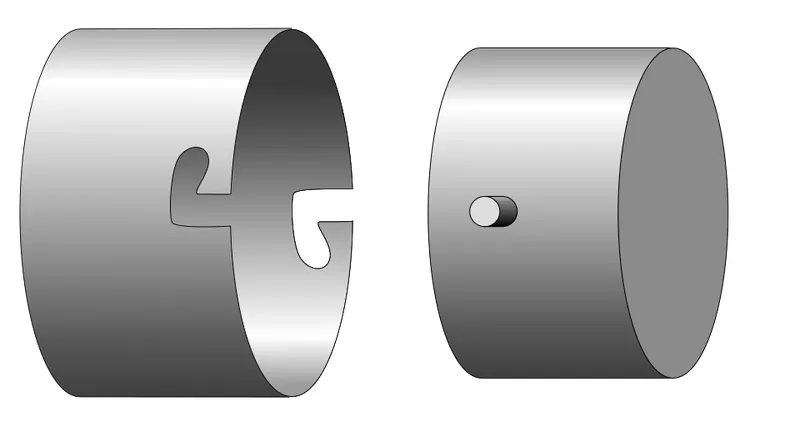

*Picture: [Bayonet-mount-01.svg](https://commons.wikimedia.org/wiki/File:Bayonet-mount-01.svg) by Iainf 04:22, 8 July 2006 (UTC), [CC BY 2.5](https://creativecommons.org/licenses/by/2.5), from Wikimedia Commons.*

Two round parts that join end to end: push the pins or tabs on one part into notches in the other, twist a short way (typically a quarter turn or less) so they slide under ledges, and a spring or springy bump holds them locked until you push and twist back.

**In plain words:** Push the two round parts together, give a short twist, and pins or tabs slide under little ledges and lock; push and twist back to take it apart. **Proper term:** Bayonet mount (bayonet joint, bayonet coupling).

**Also called:** bayonet joint / bayonet coupling / bayonet connector / bayonet catch; bayonet fitting / bayonet cap (BC) for light bulbs, e.g. B22d, BA15d, BA15s, GU10; twist-lock / twist-and-lock / twist'n'click (3D-printing slang for a printed bayonet lid); push-and-twist lock / push-and-turn joint; L-slot and pin joint (pins in L-shaped slots); bayonet lens mount (camera lenses, using flat tabs or flanges instead of pins); BNC connector (Bayonet Neill-Concelman, a bayonet-locking coax connector); twist-on lid (pressure cookers); quarter-turn mount / quarter-turn adapter (bike-computer and GPS handlebar mounts, e.g. Garmin (brand)-type).

## How it works

Each pin or tab lines up with an entry notch and slides straight in until it reaches the bottom of the slot. Twisting then carries the pin sideways along the short arm of the L, under a ledge, so the parts can no longer be pulled apart. A spring (or a squashed gasket) pushes the parts apart slightly, which drops the pin into a small hook at the end of the slot (the serif) or against a [detent](../glossary.md#detent), so it cannot twist back by itself. To separate, you push the parts together against the spring, twist back the other way, and pull apart. A flat version is the quarter-turn mount on bike computers (Garmin (brand)-type): you 'align the tabs on the back' of the device with the notches in the handlebar mount, then 'press down slightly and turn' it clockwise 'until it locks into place'; Garmin calls the mount's part the 'quarter-turn adapter', and a lever adapter can replace it, so the device drops in and a lever snaps closed to lock it (Garmin Out-Front Mount instructions).

## Parts

A few parts: a male part with 1-4 [radial](../glossary.md#axial--radial) pins, lugs or flat tabs (bayonet lugs); a female part with matching notches and L-shaped or J-shaped slots or ledges; and usually something springy that pushes the parts apart so the pins sit in a small locking notch (a coil spring in a lamp holder, a leaf spring or spring-loaded locking pin in a lens mount, a gasket, [O-ring](../glossary.md#o-ring) or printed flexing bump in lids).

## Everyday examples

- a camera lens clicking onto an interchangeable-lens camera
- a push-and-twist (B22 bayonet cap) light bulb in UK, Irish, Australian and Indian lamps, and BA15 bulbs in car lights
- a BNC cable connector on an oscilloscope or video equipment
- a twist-on pressure cooker lid

## When to use it

When two round parts meet end to end and need to be joined and separated often and quickly, without tools: container lids, tube, pole and hose couplings, lens and accessory mounts, quick-change tool heads, lamp and connector fittings. Good when the parts must always end up in the same rotational position, when a screw thread would take too many turns or might cross-thread, and when the joint sees vibration (with a spring in the lock it resists shaking loose better than a push fit or a plain screw).

## When not to use it

Not for large pulling loads in plastic, because only a few small lugs carry the load: use a full screw thread or an interrupted thread (more contact area), or bolts. Not when you need to clamp to an adjustable tightness (use a screw thread or a cam clamp). Not for flat panels (use quarter-turn fasteners or latches). Not for pressure vessels unless it has a proper safety interlock. Without a spring, gasket or detent it will rattle and can work loose; add one or choose a snap fit.

## Details

- **What it does (jobs):**
  - join and hold: holds two round parts end to end (lens to camera, bulb to lamp holder, lid to container)
  - lock, and release by hand: push-and-twist on, push-and-twist off, no tools
  - line parts up exactly: the lugs set the rotational position, and uneven lug spacing or one odd-sized tab lets it fit only one way round
  - seal it, or pass cables or fluid through: with a gasket or O-ring squeezed by the lugs it can seal (pressure cooker lids, bayonet hose fittings, connectors)
- **Movement:** rotate+slide: a short straight push, then a twist, typically about 30° (pressure cooker lids) to 90° (BNC connectors), then a small spring-back into the locking notch
- **Directions it can move (degrees of freedom):** 0 when locked (the pins are trapped in the notches, held there by the spring). While fitting, the pins follow the L-shaped path, so the joint has one guided movement at a time: first sliding in, then twisting.
- **Special behaviour:**
  - quick-release (joins and comes apart in one short push-and-twist, much faster than a screw thread and it cannot cross-thread)
  - self-aligning or self-centring (the lugs and slots bring the parts to the same rotational position every time, which is why camera lenses use bayonets to line up their mechanical and electrical contacts)
  - hand-release only (versions with a spring-loaded locking pin or button, such as camera lens mounts, only unlock when you press the button while twisting back)
- **How it holds:** shape (the pins or tabs sit under ledges, so the parts interlock; [form-fit](../glossary.md#form-fit--force-fit--material-bond)), with spring force (a spring, gasket or springy bump pushes the pin into the locking notch so it cannot twist back)
- **Input and output:** not applicable
- **Power:** passive (no power needed)
- **Load:** light to medium in plastic, medium to heavy in metal. Strong against pulling apart (the lugs carry the pull in [shear](../glossary.md#peel-vs-shear) and bending) and against side loads when the engaged length is long; weak against being twisted back, which is resisted only by the spring and locking notch or button.
- **Play and precision:** small play when a spring or gasket [preloads](../glossary.md#preload) the joint (without preload the pins rattle in the slots); very repeatable rotational position, which is why camera lenses use it; little [tolerance](../glossary.md#tolerance) for [misalignment](../glossary.md#misalignment) while fitting, because each pin must first line up with its entry notch (chamfered notch mouths help).
- **Taking it apart:** tool-free quick release: push and twist back, then pull apart
- **How often it can be reused:** many times: lens mounts, lamp holders and BNC connectors are made for frequent connecting and disconnecting; printed plastic lugs and springy bumps wear or relax faster ⚑ [uncertain: no cycle figure found]
- **Sealing:** none on its own (the entry notches leave gaps); with a gasket or O-ring squeezed by the lugs it can be watertight, or even airtight or pressure-tight, as on twist-on pressure cooker lids
- **Adjustable:** no: the locked position is fixed by the slots
- **Access needed:** end of a tube or shaft: the two parts meet end to end along a common axis, so you need to reach the end, not the inside
- **Materials:** Metal (brass, steel, aluminium) for lens mounts, lamp caps and connectors; plastics (PP, ABS, nylon, acetal) for lids, appliance bowls and hose fittings. For 3D printing, PETG, ABS/ASA or nylon suit the lugs and any springy detent better than [brittle](../glossary.md#brittle--ductile) PLA. Joins round parts of almost any material.
- **Heat, cold, water and wear:** Metal bayonets handle heat and vibration well; the spring preload is what stops them shaking loose (Wikipedia). Printed PLA softens above about 60 °C and is not suited to outdoor or technical use; PETG is fine for most indoor and outdoor use below about 80 °C (Prusa). Printed springy detents that stay bent all the time lose their force; design them so they only flex while locking (Hubs). Grit or dried food in the slots makes it stiff or stops it locking fully.

## Making it

- **Ways to make or get it:**
  - 3D print (FDM): the most common maker version (container lids, tube and pole couplings, accessory mounts)
  - 3D print (resin): smaller, finer bayonets with tighter [clearances](../glossary.md#clearance)
  - CNC: turned parts with milled L-slots for metal couplings
  - off-the-shelf part: bayonet lamp holders and bulbs, BNC and other bayonet connectors, lens-mount adapters, bayonet hose and dust-extraction fittings
  - sheet metal: lamp caps and cheap lamp holders are pressed from sheet ⚑ [uncertain: not confirmed on an opened page]
- **Printing it in one piece (print in place):** no: the male and female halves are printed separately and twisted together ⚑ [uncertain: no [print-in-place](../glossary.md#print-in-place) bayonet was found]
- **Tools:** none to use. Making: a 3D printer, or a lathe and mill (or a slotting file) for metal parts; off-the-shelf bayonet parts (lamp holders, connectors) are fitted with ordinary tools.
- **Difficulty:** easy: two printed parts and parametric generators exist; getting a snug fit with a satisfying click usually takes one or two test prints to tune the clearance

### 3D printing tips

Orientation: print both halves with the joint's axis vertical, so the round surfaces come out round and the lugs are built from many full layers; axial pull then bends the lugs along the extruded lines rather than peeling layers apart ⚑ [uncertain: reasoning from layer strength, not a tested source]. Give radial lugs and ledges a 45° [chamfer](../glossary.md#chamfer--fillet) underneath so they print without supports. Clearance: Formlabs suggests about 0.5 mm for FDM interlocking joints and about 0.2 mm (up to 0.4 mm for larger parts) for resin; the bayonet-lock-scad OpenSCAD library uses a 0.2 mm allowance in its example. Print a short test ring first and adjust the clearance until the twist is smooth but not loose. Geometry: the twist angle must be smaller than the gap between neighbouring lugs (less than 360° divided by the number of lugs for evenly spaced lugs); three lugs centre the parts well; space them unevenly (as a BA15d lamp cap does) if the part must only fit one way round. Locking: add something springy, such as a small flexing bump or arm that clicks into a notch at the end of the twist, a printed spring, or an O-ring or gasket that is squashed when the lugs ride down a slight ramp, otherwise the joint rattles and can twist loose. Keep flexing features out of the Z direction, give their roots a fillet of at least half their thickness, and use tough plastics (PETG, ABS, nylon) rather than PLA (Hubs). Add a solid end stop so the twist cannot overshoot, and chamfer the entry notches so the pins find them easily. Keep the lugs clear of the first few layers or chamfer the bottom edge, because squashed first layers ([elephant's foot](../glossary.md#elephants-foot)) can bind the joint ⚑ [uncertain].

### Buying one (off-the-shelf parts)

Bayonet lamp holders and bulbs (B22d / BC, BA15d, BA15s, GU10); BNC, C and ST (fibre-optic) bayonet connectors and other bayonet circular connectors; camera lens-mount adapters and bayonet lens hoods; bayonet dust-extraction and hose fittings; bayonet quick-connect couplings. Search terms: 'bayonet mount', 'bayonet coupling', 'bayonet connector', 'bayonet lamp holder', 'twist lock coupling'.

## Rules of thumb

- The twist (sweep) angle must be smaller than the smallest gap between neighbouring pins, i.e. under 360°/number of pins for even spacing; an uneven pin pattern keys the joint to one locked position, as a BA15d lamp cap's two offset pins do (bayonet-lock-scad README, https://raw.githubusercontent.com/CameronBrooks11/bayonet-lock-scad/main/README.md).
- Camera lens bayonets usually have three or four tabs, often with one a different size so the lens fits only one way; a spring-loaded pin locks it after a small twist (Wikipedia, https://en.wikipedia.org/wiki/Lens_mount).
- A spring pushes the pin into the small hook (serif) at the end of the L-slot to lock it; to release, push the parts together and twist the other way (Wikipedia, https://en.wikipedia.org/wiki/Bayonet_mount).
- BNC connectors use two lugs in slots and lock with a quarter turn of the coupling nut (Wikipedia, https://en.wikipedia.org/wiki/BNC_connector).
- Twist-on pressure cooker lids lock by twisting about 30° so slots in the lid engage flanges on the pot (Wikipedia, https://en.wikipedia.org/wiki/Pressure_cooking).
- Printed interlocking joints: about 0.5 mm clearance for FDM; about 0.2 mm for small resin parts, up to 0.4 mm for larger ones (Formlabs, https://formlabs.com/blog/how-to-3d-print-interlocking-joints/).
- Springy locking features: don't build them standing up in Z, fillet the root at 0.5 times the thickness or more, allow about 0.5 mm FDM clearance, and use PETG, ABS or nylon rather than PLA (Hubs, https://www.hubs.com/knowledge-base/how-design-snap-fit-joints-3d-printing/).
- Screw-in lens mounts are the threaded alternative on small cameras. The S-mount (M12 lens) uses an M12 x 0.5 thread and has no flange, so there is no fixed lens-to-sensor distance and the lens must be screwed in or out to focus (Wikipedia, https://en.wikipedia.org/wiki/S-mount_(CCTV_lens)). The C-mount uses a 1-32 UN 2A thread (1 in across, 32 threads per inch) with a flange focal distance of 17.526 mm; the CS-mount has the same thread but 12.526 mm, so a 5 mm spacer ring lets a C-mount lens work on a CS-mount camera (Wikipedia, https://en.wikipedia.org/wiki/C_mount).

## Common failures

(1) Lugs snap or shear off, especially small printed ones: make them thicker and chamfered, print with the axis vertical, and use more lugs. (2) Rattles or twists loose because there is no spring preload or the detent has relaxed: add an O-ring, gasket or springy bump. (3) Only partly twisted, so the lugs sit on the edge of the ledge: add a positive end stop and a click so you can feel when it is locked. (4) Too tight or won't go in on printed parts: over-extrusion or elephant's foot; tune the clearance with a test print. (5) Fits in the wrong orientation: key it with unevenly spaced or different-sized lugs. (6) Worn, rounded lugs or ledges after many cycles, giving play.

## Safety

Pressure cookers: never force a twist-on lid open while there is pressure inside; modern cookers have an interlock that blocks this (Wikipedia, Pressure cooking). Light bulbs: switch off and let the bulb cool before pushing and twisting it out. Otherwise none known.

## Related

- Interrupted-screw lock (breech lock): threads with sections cut away, so much more of the circumference carries load; stronger, and the twist also pulls the parts together
- Quarter-turn fastener (Dzus-type): a small stud that locks a flat panel with a quarter turn, rather than joining two round parts end to end
- Push-and-turn child-resistant cap: also needs a push while turning, but it is a screw cap with a slipping clutch
- Ordinary screw thread: clamps to any tightness and carries more load, but needs many turns and can cross-thread
- Breech-lock ring lens mount (e.g. early Canon FD): a turning collar locks the lens so the lens itself doesn't rotate
- Snap fit: clicks together with a push only, but is often harder to undo
- Hang-on mounts (keyhole slot): a head slides into a slot and drops down, a flat-panel cousin of the L-slot
- Threaded lens mounts (S-mount, C-mount, CS-mount): screw-in lens mounts on webcams, CCTV and machine-vision cameras; slower to change than a bayonet, but small, cheap and focused simply by screwing the lens in or out (Wikipedia)

## Make it yourself

- [bayonet-lock-scad by Cameron Brooks (OpenSCAD library; repository https://github.com/CameronBrooks11/bayonet-lock-scad, README read)](https://raw.githubusercontent.com/CameronBrooks11/bayonet-lock-scad/main/README.md): Parametric OpenSCAD bayonet connector that makes both halves, with any number of pins, pins pointing in or out, clockwise or anticlockwise twist, adjustable clearance (allowance) and keyed uneven pin spacing; a rewrite of xavierasx's Thingiverse bayonet library *(licence: MIT (original Thingiverse library CC BY))*
- [T-Lock Bayonet Joint by scottvader (YouMagine)](https://youmagine.com/designs/t-lock-bayonet-joint): Printable male and female parts with a double row of T-shaped features that lock with a quick twist 'like the bayonet mount on a camera lens'; PLA or ABS *(licence: CC BY-SA)*
- [Container sets with bayonet lock by DrJones (Printables 1168046; details read via the Printables public API) (URL from Printables API, page not opened)](https://www.printables.com/model/1168046-container-sets-with-bayonet-lock): Nesting sets of round containers whose lids use a bayonet lock with springy elements for a click, so only a short twist is needed *(licence: CC BY-SA)*
- [Twist-lock connector by aiannazzone (Printables 193397; details read via the Printables public API) (URL from Printables API, page not opened)](https://www.printables.com/model/193397-twist-lock-connector): Modular male and female twist-lock ends to add to your own models, with and without a positive stop; STEP and STL files *(licence: CC BY)*

## Pictures, videos and models

- [Bayonet-mount-01.svg (Wikimedia Commons, Iainf, 2006)](https://commons.wikimedia.org/wiki/File:Bayonet-mount-01.svg): Diagram of a bayonet mount before insertion: pins on the male part lined up with the L-shaped slots *(licence: CC BY 2.5 (reuse with credit))*
- [Bayonet-mount-02.svg (Wikimedia Commons, Iainf, 2006)](https://commons.wikimedia.org/wiki/File:Bayonet-mount-02.svg): The same bayonet mount after insertion and twisting, with the pins locked in the slots *(licence: CC BY 2.5 (reuse with credit))*
- [Bayonet lightbulb and socket (Wikimedia Commons, Jnestorius, 2009)](https://commons.wikimedia.org/wiki/File:Bayonet_lightbulb_and_socket.jpg): Photo of a bayonet-cap light bulb next to its lamp holder, showing the two pins and the L-slots *(licence: CC BY-SA 3.0 or GFDL 1.2+ (reuse with credit))*
- [Bayonet joint, movement 245 (507 Mechanical Movements, Henry T. Brown, 1868; 507movements.com)](https://507movements.com/mm_245.html): Historic drawing and an animated version of a bayonet joint: a part turned in an L-shaped slot and withdrawn *(licence: book public domain; website animation link only)*
- [How to Design a 3D Printed Twist Lock Lid in Fusion 360 (Send to Print, YouTube; title confirmed via YouTube oEmbed)](https://www.youtube.com/watch?v=C6kF1huqRMU): Video tutorial modelling a printable twist-lock (bayonet) lid *(licence: link only)*

## Needs confirming

⚑ marks something nobody has confirmed yet: a fact the research could not confirm from a source, a finder value that is a best guess, or an open point from the research notes. Corrections are welcome (see `research/needs-confirming.md`).

- ⚑ 5 sentences on this page marked [uncertain].

## Sources

- <https://en.wikipedia.org/wiki/Bayonet_mount>
- <https://en.wikipedia.org/wiki/Lens_mount>
- <https://en.wikipedia.org/wiki/BNC_connector>
- <https://en.wikipedia.org/wiki/Pressure_cooking>
- <https://en.wikipedia.org/wiki/Canon_FD_lens_mount>
- <https://en.wikipedia.org/wiki/Breech-lock>
- <https://507movements.com/mm_245.html>
- <https://commons.wikimedia.org/wiki/File:Bayonet-mount-01.svg>
- <https://commons.wikimedia.org/wiki/File:Bayonet-mount-02.svg>
- <https://commons.wikimedia.org/wiki/File:Bayonet_lightbulb_and_socket.jpg>
- <https://raw.githubusercontent.com/CameronBrooks11/bayonet-lock-scad/main/README.md>
- <https://raw.githubusercontent.com/CameronBrooks11/bayonet-lock-scad/main/LICENSE>
- <https://youmagine.com/designs/t-lock-bayonet-joint>
- <https://formlabs.com/blog/how-to-3d-print-interlocking-joints/>
- <https://www.hubs.com/knowledge-base/how-design-snap-fit-joints-3d-printing/>
- <https://help.prusa3d.com/article/pla_2062>
- <https://help.prusa3d.com/article/petg_2059>
- <https://www.youtube.com/watch?v=C6kF1huqRMU (verified via YouTube oEmbed)>
- <https://www.printables.com/model/1168046-container-sets-with-bayonet-lock (read via https://api.printables.com/graphql/)>
- <https://www.printables.com/model/193397-twist-lock-connector (read via https://api.printables.com/graphql/)>
- <https://api.printables.com/graphql/>
- <https://www.adorama.com/col/productManuals/GP0101334000.pdf>
- <https://en.wikipedia.org/wiki/S-mount_(CCTV_lens)>
- <https://en.wikipedia.org/wiki/C_mount>
