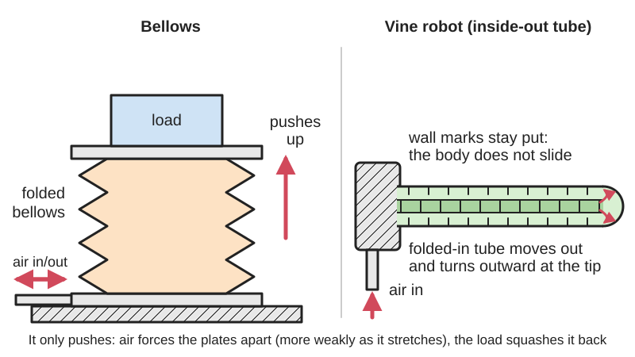
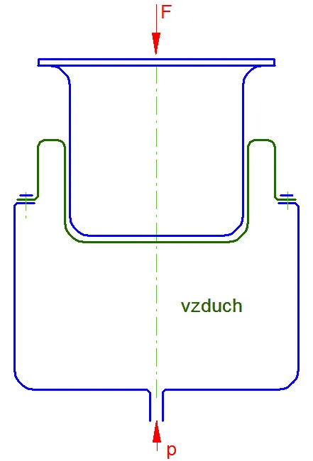
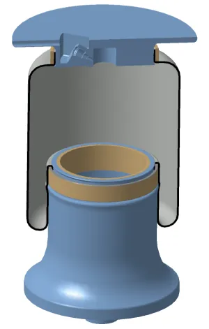
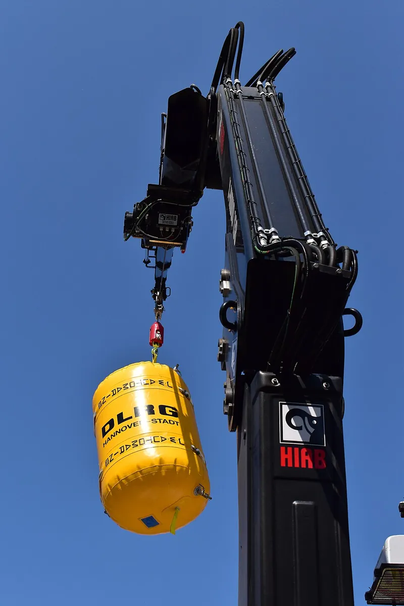

<figure class="eoc-pic eoc-pic-main"><picture><source media="(prefers-reduced-motion: reduce)" srcset="../media/drawn/bellows-and-inflatable-actuators.svg"></picture><figcaption><strong>Animation.</strong> Diagram drawn for the encyclopaedia from the research notes. ⚑ Needs confirming: a drawing can simplify or get details wrong; a real photo or a better diagram is welcome.</figcaption></figure>
<figure class="eoc-pic"><figcaption><strong>Diagram.</strong> <a href="https://commons.wikimedia.org/wiki/File:Axi%C3%A1ln%C3%AD_pneumatick%C3%BD_m%C4%9Bch.jpg">Axiální pneumatický měch</a> by Jjvcela, <a href="https://creativecommons.org/licenses/by-sa/3.0">CC BY-SA 3.0</a>, from Wikimedia Commons.</figcaption></figure>
<figure class="eoc-pic"><figcaption><strong>Cross-section.</strong> <a href="https://commons.wikimedia.org/wiki/File:Lufe_schnitt.png">Lufe schnitt</a> by Jan Müller, <a href="http://creativecommons.org/licenses/by-sa/3.0/">CC BY-SA 3.0</a>, from Wikimedia Commons.</figcaption></figure>
<figure class="eoc-pic"><figcaption><strong>Photo.</strong> <a href="https://commons.wikimedia.org/wiki/File:2023-06-04_DLRG_Hebesack_01.jpg">2023-06-04 DLRG Hebesack 01</a> by Bärbel Miemietz, <a href="https://creativecommons.org/licenses/by-sa/4.0">CC BY-SA 4.0</a>, from Wikimedia Commons.</figcaption></figure>

A flexible, airtight chamber (folded bellows, cushion or bag) between two end plates that pushes the plates apart when filled with air under pressure, or pulls them together under vacuum, giving a straight, single-acting push with no piston, rod or sliding seals (Firestone Airstroke design guide; Wikipedia 'Air suspension').

**In plain words:** A sealed, squashable chamber, folded like an accordion or shaped like a cushion or balloon, that grows taller and pushes when you pump air into it, or shrinks when you suck the air out. It gives a straight push with no piston and no sliding seal; flat versions lift cars, and printed ones can be made from flexible TPU filament. **Proper term:** Bellows [actuator](../glossary.md#actuator) and inflatable actuator (air spring, air bag, lifting bag).

**Also called:** air spring, air bellows, air bag (the correct term for vehicle suspension 'air bags' is air spring; Wikipedia); convoluted air spring (single, double or triple convolution); rolling-lobe or reversible-sleeve air spring; air actuator, bellows actuator, bellows cylinder, pneumatic bellows; Airstroke actuator and Airmount isolator (Firestone brands); air suspension bellows; air ride (vehicles); lifting bag, lift bag (diving), air lifting bag, rescue air bag, high-pressure lifting bag or lifting cushion; soft bellows actuator, inflatable actuator, soft pneumatic actuator (extending type); vacuum bellows actuator (works by sucking the air out); pouch motor (heat-sealed flat film pouches); Kresling bellows, origami bellows (twisting fold pattern); everting vine robot, soft growing robot, vinebot (covered here: an inside-out tube that grows from its tip); Luftfeder, Rollbalg (German), měch (Czech).

## How it works

Air pressure inside the sealed chamber pushes on its end plates; the force is the pressure times the chamber's 'effective area', and because a bellows bulges and unfolds, that area shrinks as it extends, so the push is strongest when it is squashed low and fades as it grows (Firestone guide p. 12). It only pushes: something else (gravity, a spring, a second bellows) must squash it back, and it must be held in line by guides because it 'follows the path of least resistance' (Firestone guide p. 15). Suck the air out instead and the folds collapse, so a printed bellows contracts and can grip (Scientific Reports 2024). An everting vine robot is a tube folded inside itself like an inside-out sock; air pressure turns the tip right-side-out, so new material comes out at the tip and the robot grows while the rest of its body stays still (Robohub/Stanford 2017).

## Parts

A few parts: a flexible bellows or bladder (rubber with fabric plies, printed TPU, or heat-sealed plastic film); two end closures or bead plates crimped or clamped to it; an air inlet fitting; often an internal rubber bumper; plus outside stops, guides and a return spring or weight; and an air supply with a valve, [regulator](../glossary.md#regulator) and relief valve (Firestone guide pp. 5-7, 15-16). Printed versions are one TPU piece with a fitting (Scientific Reports 2024). A vine robot is a long tube of thin plastic film, a sealed base chamber and an air supply, often with a spool to store and reel in the tube (Frontiers 2020).

## Everyday examples

- Air suspension on buses, lorries, trailers and trains: rubber air springs between axle and body, pumped up by a compressor (Wikipedia 'Air suspension')
- Rescue air bags that firefighters slide under a crashed car and inflate to lift it (NC OSFM; Wikipedia 'Lifting bag')
- Divers' lift bags that float heavy objects up from the seabed (Wikipedia 'Lifting bag')
- The folded bellows of a fireplace bellows or an old folding camera: the same accordion shape, used to blow air or keep out light rather than to push (Wikipedia 'Bellows')

## When to use it

Use a bellows or air bag when you want a straight push or lift from compressed air without a piston, rod or sliding seals: it has no breakaway friction, so it responds smoothly, keeps working in dirt and grit that would ruin cylinder seals, needs no [lubrication](../glossary.md#lubrication), can push through an arc and tolerates side loads and [misalignment](../glossary.md#misalignment), and starts from a very low collapsed height (Firestone guide p. 3). Flat cushions lift very heavy loads through short distances from a thin gap (NC OSFM). As an air spring it gives soft, adjustable suspension or vibration isolation (Wikipedia 'Air suspension'; Firestone). For makers, a printed TPU bellows makes a cheap, safe, soft gripper or pusher, especially when driven by vacuum (Scientific Reports 2024); a vine robot can grow through rubble, under a door gap 10% of its diameter, or route a cable through a ceiling space (Robohub/Stanford 2017).

## When not to use it

Avoid it when you need a long [stroke](../glossary.md#stroke) compared with its size, a pulling force with positive pressure (use a pneumatic artificial muscle, or a cylinder), steady force over the whole stroke, or exact positioning: its force falls as it extends and air is springy (Firestone guide pp. 12, 14); use an air cylinder or a lead screw with a motor instead. Don't rely on it to hold a load up for long or where failure would hurt someone without a mechanical lock or cribbing (Firestone guide p. 16; NC OSFM). Avoid printed bellows for sustained positive pressure (Scientific Reports 2024), and anywhere sharp edges, hot metal or petroleum fluids could reach the rubber (Firestone guide p. 14; NC OSFM).

## Details

- **What it does (jobs):**
  - change the kind of motion: turns air pressure into a straight push or lift (or, under vacuum, a pull) with no piston, rod or sliding seal (Firestone guide p. 3; Scientific Reports 2024)
  - hold or release using power: holds a load up, or grips, while the air pressure (or vacuum) is kept on, and lets go when it is vented (Firestone guide; Scientific Reports 2024)
  - store energy: as an air spring it is a cushion of trapped air that carries a vehicle or isolates a machine from vibration, with a ride height set by the pressure (Wikipedia 'Air suspension'; Firestone Airmount isolators)
- **Movement:** flex: the chamber grows and shrinks along its axis. Firestone rubber actuators stroke up to 355 mm and can also swing through an arc of up to 30 degrees without a clevis; a printed Kresling (origami) bellows contracted 75% of its length under vacuum, twisting as it went (Firestone guide p. 3; Frontiers 2024)
- **Directions it can move (degrees of freedom):** 1 intended (the end plates move apart and together), but the chamber is soft sideways: it tolerates tilting up to 30 degrees and about 25 mm sideways offset per convolution, and will buckle sideways unless guided (Firestone guide pp. 15-16). A vine robot grows in length and can be steered left or right by inflating its sides unevenly (Robohub/Stanford 2017)
- **Special behaviour:**
  - motion conversion: air pressure becomes a straight push (or, under vacuum, a pull) (Firestone; Scientific Reports 2024)
  - self-aligning or self-centring (within limits): it strokes through an arc and accepts side loads and misalignment that would bend the rod or wear the seals of an ordinary cylinder (Firestone guide p. 3)
  - tensioning (as an air spring): the pressure sets the load it carries and its springiness, and air springs keep a vehicle level as the load changes (Wikipedia 'Air suspension')
  - not [fail-safe](../glossary.md#fail-safe--fail-secure) on its own: if the air is lost it collapses and the load drops, so Firestone recommends mechanical lock-outs and rescue crews keep cribbing under the load (Firestone guide p. 16; NC OSFM)
- **How it holds:**
  - suction or air pressure: the force comes from the air pressure (or vacuum) acting on the chamber's area; the rubber itself carries no load (Firestone guide p. 5)
  - powered hold: it holds only while pressurised; a closed valve can trap the air, but air slowly seeps through rubber (Firestone guide pp. 7, 25)
- **Input and output:** Air pressure (or vacuum) -> straight push (or pull). Force = pressure x effective area, and the area falls as the bellows extends: a Firestone #22 at 5 bar pushes 28.75 kN at 110 mm height but only 18.75 kN at 230 mm (Firestone guide p. 12). Range: industrial air actuators 58-950 mm across, up to 450 kN and 355 mm stroke at up to 7 bar (12 bar for high-strength types) (Firestone guide pp. 3, 14); rescue lifting cushions at about 135 psi (about 9 bar) lift up to about 75 tons through about 20 in (NC OSFM); a printed TPU bellows was modelled at -10 to -40 kPa of vacuum and endurance-tested at -15 kPa (Scientific Reports 2024); a linear heat-sealed pouch motor reached 28% stroke and 100 N (Niiyama et al. 2015, MIT DSpace). Rough efficiency: ⚑ [uncertain: no figure found]. Arrangement: in line (pushes along its own axis). Back-drivable: yes, pushing on it squashes the air like a spring; it can't pull unless run under vacuum (Firestone; Scientific Reports 2024).
- **Power:** powered: needs compressed air (or a vacuum source for vacuum bellows; Firestone air springs can also be filled with water or water-glycol for stiff, accurate positioning) (Firestone guide p. 14; Scientific Reports 2024). When power is lost: if the air vents, it collapses and anything it holds up drops; if a valve traps the air it keeps its last state for a while, but air slowly seeps through rubber (a Firestone #116 loses about 2 bar a year, from 7 to 5 bar) (Firestone guide pp. 16, 25)
- **Load:** light to heavy, in one direction only (push, or pull under vacuum): printed TPU bellows give gripping forces of a few to tens of newtons ⚑ [uncertain: from paper figures summarised, exact range not checked]; rubber air actuators up to 450 kN (Firestone); rescue lifting cushions up to about 75 tons (NC OSFM). Weak against side loads and tipping: guide it; its lifting capacity falls as it extends (Firestone guide pp. 12, 15; NC OSFM)
- **Play and precision:** noticeable: air is squashy, so position under changing load is springy unless the chamber is filled with liquid (Firestone guide p. 14); it tolerates misalignment well (25 mm offset per convolution and up to 30 degrees tilt for Firestone convoluted actuators; guide p. 16). Printed TPU actuators don't always return fully to their starting shape (a printed TPU finger kept a 4.76 degree bend at zero pressure; Frontiers 2021)
- **Taking it apart:** removable: industrial units bolt on by their end plates and connect with an air fitting; printed and film actuators push onto a fitting or barb (Firestone guide pp. 6-7; Scientific Reports 2024)
- **How often it can be reused:** many times: it can be fitted and removed freely. Working life varies: rubber air springs come from truck and bus suspensions built for millions of kilometres (Firestone guide p. 3); a printed TPU bellows lasted 129,325 cycles under vacuum but had 'bad durability' under positive pressure (Scientific Reports 2024); thin LDPE vine robots [fatigue](../glossary.md#fatigue) after a moderate number of eversions (Frontiers 2020)
- **Sealing:** airtight or pressure: the rubber or plastic wall is the seal, and the bead of a rubber bellows seals itself against its end plate, so no [O-rings](../glossary.md#o-ring) or sealants are needed (Firestone guide p. 10); printed walls must be thick and dense enough to have no pinholes (Scientific Reports 2024; Frontiers 2024)
- **Adjustable:** yes: the pressure sets the force, height and springiness; stops fix the ends of the stroke; stacking two actuators adds stroke but not force and the middle plate must be guided (Firestone guide pp. 15-16; Wikipedia 'Air suspension')
- **Access needed:** both sides: it sits between two surfaces and pushes them apart, so both end plates must be fixed, and one needs the air line
- **Materials:** Rubber-fabric bellows: inner rubber liner, two (or four) plies of fabric-reinforced rubber and an outer rubber cover, in natural rubber, neoprene or epichlorohydrin; metal end closures (Firestone guide pp. 5, 14). Rescue cushions: neoprene reinforced with steel wire or Kevlar (NC OSFM). Vehicle air springs: textile-reinforced rubber (Wikipedia). Printed: flexible TPU such as NinjaFlex (brand) or 95A TPU, at least 1 mm thick (Scientific Reports 2024; Frontiers 2024; Printables 246679). Film and fabric: LDPE, TPU film, TPU-coated or silicone-infused ripstop nylon, latex or silicone for vine robots and pouches (Frontiers 2020; Niiyama et al. 2015). Avoid petroleum oils with natural rubber (Firestone guide p. 14)
- **Heat, cold, water and wear:** Temperature: Firestone's natural rubber air springs -53 to 57 C, neoprene -37 to 74 C, epichlorohydrin -17 to 107 C (Firestone guide p. 14); rescue bags must be kept below 220 F (about 104 C) (NC OSFM). Chemicals: petroleum-based oils (most hydraulic oils) are not recommended inside rubber air springs; shield them from hot metal, sand, acids and petroleum fluids; store them dark and dry (Firestone guide p. 14). Air loss over time: air permeates through rubber, about 2 bar a year in one example (Firestone guide p. 25). Printed TPU: humidity causes micro-gaps and leaks, so keep the filament dry (Scientific Reports 2024); TPU parts may slowly take a set and not fully return (Frontiers 2021). Film: LDPE vine robots fatigue with repeated eversion, and TPU-coated fabrics can delaminate at stress points and leak (Frontiers 2020).

## Making it

- **Ways to make or get it:**
  - 3D print (FDM): one-piece TPU bellows actuators and Kresling bellows, either directly, in vase mode, or with peel-away PLA layers between the folds (Scientific Reports 2024; Frontiers 2024; Hackaday 2025; Printables 246679)
  - off-the-shelf part: rubber air springs and air actuators, vehicle air suspension bags, rescue lifting bags, underwater lift bags (Firestone; Wikipedia; NC OSFM)
  - hand-made from plastic film or coated fabric: heat-sealed or taped tubes and pouches for vine robots and pouch motors (Frontiers 2020; Niiyama et al. 2015)
- **Printing it in one piece (print in place):** yes: a TPU bellows prints as one airtight working piece that only needs an air fitting pushed or screwed into its inlet (Scientific Reports 2024; Frontiers 2024); the TPU-plus-PLA method also needs the PLA layers peeled out afterwards (Hackaday 2025)
- **Tools:** spanners or a screwdriver for end-plate bolts and fittings; thread-seal tape; an air source with a pressure regulator, gauge and relief valve (tyre-style tank valves and an air chuck can fill sealed air springs; Firestone guide p. 7); for film actuators a heat sealer or iron and tape (Frontiers 2020); for printed ones only the printer and a push-in or barbed fitting
- **Difficulty:** moderate: a film pouch or vine robot can be heat-sealed or taped in minutes (Frontiers 2020; Niiyama et al. 2015), but printing an airtight TPU bellows needs slow, tuned printing with dry filament, and a dual or independent-extruder printer for the TPU-plus-PLA method (Scientific Reports 2024; Hackaday 2025); heavy-duty units are bought ready-made

### 3D printing tips

1) Wall thickness: keep each fold wall thicker than 1 mm to stop air leaking (Scientific Reports 2024); another group found 1 mm the thinnest wall that printed without pinholes more than 75% of the time (Frontiers 2024). 2) Fold angle: keep the fold (corrugation) angle above 35 degrees so the [overhangs](../glossary.md#overhang--bridging) print (Scientific Reports 2024); vase-mode bellows need fold angles under 45 degrees from vertical (Printables 246679). 3) Settings from the Scientific Reports team (NinjaFlex on a Prusa MK3): print slowly, especially the first layer; use a steel sheet rather than PEI and heat the bed back up to remove the part; drop the nozzle to 220 C for overhangs; turn on ironing to close gaps in the top; adjust the nozzle temperature to [cure](../glossary.md#cure) micro-gaps; keep the filament in a drying box. 4) Vase mode: a single 0.8 mm wall in 95A TPU at 0.1 mm layers with a brim makes a collapsible bellows on an ordinary printer (Printables 246679). 5) TPU plus PLA: printing flat folds with PLA layers between them, then peeling the PLA out, gives a bellows that prints flat, but needs two independent extruders; feeding TPU through a Bambu AMS made the prints [brittle](../glossary.md#brittle--ductile) (Hackaday 2025; Functional Print Friday video). 6) Prefer vacuum: printed TPU bellows lasted over 120,000 cycles under vacuum but wore out quickly under positive pressure (Scientific Reports 2024), and Kresling bellows printed in TPU hold vacuum well (Frontiers 2024). 7) If you do pressurise, keep it low and regulated (one TPU printed gripper team capped its tests at 150 kPa for safety; Frontiers 2021), add a relief valve, and never use a printed part to store pressure. 8) TPU brands behave differently; test a small piece first (Hackaday 2025).

### Buying one (off-the-shelf parts)

Air springs: single, double and triple convoluted air springs, rolling-lobe (reversible sleeve) air springs, air actuators and air isolators (e.g. Firestone Airstroke and Airmount, brands), bead plates and bead rings, internal rubber bumpers, tank valves (Firestone guide). Vehicle air suspension air springs (Wikipedia). Rescue lifting bags in high-, medium- and low-pressure types, with cribbing (NC OSFM). Underwater lift bags, open (parachute) or closed with an over-pressure valve, and dump valves (Wikipedia 'Lifting bag'). For DIY: flexible TPU filament (NinjaFlex, brand; 95A TPU), LDPE lay-flat tubing or TPU-coated ripstop nylon (vine robots), push-to-connect fittings, small air or vacuum pumps, pressure regulator, pressure relief valve, [solenoid](../glossary.md#solenoid) valve (Frontiers 2020; Scientific Reports 2024)

## Rules of thumb

- Pressure: about 7 bar maximum for two-ply rubber air springs and 12 bar for high-strength ones, with at least a three-times safety factor between working pressure and burst pressure; burst pressure falls as a convoluted bellows extends (Firestone guide p. 14)
- Always fit stops both ways: a down-stop at or just above the minimum height so the bellows doesn't bottom out at its pinch point, and an up-stop (chain, cable or metal stop) so it can't over-extend and blow its bead out of the crimp (Firestone guide p. 15)
- It is single-acting: plan a return force (gravity, a spring or a second bellows), and guide it, because it follows the path of least resistance (Firestone guide p. 15)
- Misalignment: about 25 mm sideways offset per convolution and up to 30 degrees of tilt; stacked actuators add stroke but not force and need the middle plate guided (Firestone guide pp. 15-16)
- Force falls as height rises: pressure times effective area, and the area shrinks as it extends (Firestone guide p. 12); a rescue air bag's lifting capacity likewise drops as it lifts higher (NC OSFM)
- Printed TPU bellows: walls over 1 mm, fold angles over 35 degrees (Scientific Reports 2024); 1 mm is about the thinnest reliable leak-free wall (Frontiers 2024)
- Rescue air bags: crib the load continuously, never work under a load held only by air bags, never stack more than two bags, keep them off sharp objects and away from heat over 220 F (NC OSFM)
- Underwater lift bags: each litre of air lifts about 1 kg; choose a bag only slightly bigger than needed to avoid a runaway ascent (Wikipedia 'Lifting bag')
- Air leaks slowly through rubber: check the pressure of sealed air springs periodically (about 2 bar lost per year in Firestone's example) (Firestone guide p. 25)

## Common failures

1) Bursting from over-pressure or over-extension, or the bead blowing out of its crimp when there is no up-stop (Firestone guide pp. 14-15). 2) Wear from repeatedly bottoming out at the pinch point when there is no down-stop (Firestone guide p. 15). 3) Puncture or abrasion from rubbing on nearby parts or sharp objects: leave [clearance](../glossary.md#clearance) round the maximum diameter (Firestone guide p. 16; NC OSFM). 4) Buckling or bowing sideways because it isn't guided (Firestone guide p. 15). 5) Pinhole leaks in printed walls that are too thin or printed with damp filament (Scientific Reports 2024; Frontiers 2024). 6) Printed bellows cracking quickly under positive pressure (Scientific Reports 2024). 7) Slow pressure loss through the rubber (Firestone guide p. 25). 8) Load shifting or toppling during a lift because it was inflated too fast or not cribbed (NC OSFM). 9) Film vine robots fatiguing, or coated fabric delaminating and leaking at stress points (Frontiers 2020).

## Safety

Over-inflation bursts it: Firestone warns never to inflate an air spring when it is unrestricted (not held between its mountings) or beyond the recommended pressure, because it 'may burst causing property damage or severe personal injury' (Firestone guide p. 14). HSE warns that vessels containing compressed air 'even at comparatively low pressure, can explode violently once their integrity is lost' (HSE HSG39 para 2), so feed any bellows through a regulator and a pressure relief valve, keep faces and hands clear while testing, and never use a 3D-printed part to store pressure. The load drops if the air is lost: never work under a load held up only by air bags; crib it as it rises, and use mechanical lock-outs on lifts (NC OSFM; Firestone guide p. 16). Never stack more than two rescue bags, and keep bags off sharp objects (NC OSFM). Underwater lift bags can run away to the surface uncontrolled, and divers can be entangled (Wikipedia 'Lifting bag'). Keep fingers out from between the plates, which close hard as it collapses ⚑ [uncertain: general advice, not from a cited source]. Vacuum-driven versions avoid the bursting hazard.

## Related

- Bellows boot (gaiter, way cover): the same folded shape used passively as a dust cover, not pumped up
- Air or hydraulic cylinder: a piston in a tube; longer stroke, steady force and double-acting, but with sliding seals and breakaway friction (Firestone guide p. 3)
- Pneumatic artificial muscle (McKibben muscle): a braided tube that gets shorter and pulls when pumped up, instead of pushing
- Soft pneumatic bending actuator: a soft finger that curls when pumped up, using a stiff layer on one side
- Vacuum-driven artificial muscle: a skeleton in a bag that contracts when the air is sucked out; like a vacuum bellows, it avoids bursting hazards
- Gas spring: a sealed strut of pressurised gas with a piston and rod; self-contained, so no air supply
- Syringe hydraulics and hydraulic jacks: lift with liquid pressure and a piston rather than an inflated bag
- Origami mechanisms: folded structures; the Kresling bellows is an origami pattern used as an actuator
- Diaphragm pump and squeeze bulb: a bellows or bulb used the other way round, to pump air
- Heat-sealed seam: how the TPU film, LDPE tube or coated fabric of pouch motors and vine robots is joined airtight with a heat sealer or iron (Frontiers 2020; Niiyama et al. 2015)

## Make it yourself

- [Camera Bellows - Collapsible & Customizable - TPU Vase Mode - F3d Files included (Kiwi Tinkerer, Printables)](https://www.printables.com/model/246679-camera-bellows-collapsible-customizable-tpu-vase-m (URL from Printables API, page not opened)): Parametric Fusion 360 bellows generator that prints a collapsible bellows in vase mode (0.8 mm wall, 95A TPU, 0.1 mm layers); made as a light-tight camera bellows, so it needs end caps and an air fitting to try as an actuator *(licence: CC BY)*
- [TPU Bellows Test for Multi Tool Printers (Darak, Printables)](https://www.printables.com/model/1381129-tpu-bellows-test-for-multi-tool-printers (URL from Printables API, page not opened)): Test print of a TPU bellows with PLA interface layers for multi-tool printers, following the Functional Print Friday method; slicer settings in the photos *(licence: CC BY-NC)*
- [An empirical model of soft bellows actuator (Scientific Reports, 2024)](https://www.nature.com/articles/s41598-024-79084-w): Open-access paper giving the design parameters, PrusaSlicer settings and an empirical force model for a one-piece NinjaFlex bellows actuator, and two- and three-bellows vacuum grippers built from it *(licence: CC BY-NC-ND 4.0 (article))*
- [Design, Modeling, Control, and Application of Everting Vine Robots (Frontiers in Robotics and AI, 2020)](https://www.frontiersin.org/journals/robotics-and-ai/articles/10.3389/frobt.2020.548266/full): Review explaining how to make a vine robot (seal one end of a plastic tube and push that end back inside), which films and fabrics to use, and how to steer and retract it; points to build instructions on the vinerobots.org website (not opened this session) *(licence: CC BY 4.0 (article))*

## Pictures, videos and models

- [Axiální pneumatický měch (Jjvcela; Wikimedia Commons)](https://commons.wikimedia.org/wiki/File:Axi%C3%A1ln%C3%AD_pneumatick%C3%BD_m%C4%9Bch.jpg): Photo of an axial (convoluted) pneumatic bellows, the industrial air spring or air actuator *(licence: CC BY-SA 3.0)*
- [Lufe schnitt (Jan Müller; Wikimedia Commons)](https://commons.wikimedia.org/wiki/File:Lufe_schnitt.png): Cut-away drawing of a rolling-lobe air spring showing the cover plate, rubber bellows, rolling piston and clamping rings *(licence: CC BY-SA 3.0)*
- [2023-06-04 DLRG Hebesack 01 (Bärbel Miemietz; Wikimedia Commons)](https://commons.wikimedia.org/wiki/File:2023-06-04_DLRG_Hebesack_01.jpg): Photo of a rescue organisation's lifting bag on display *(licence: CC BY-SA 4.0)*
- [Stanford researchers develop vine-like, growing robot (Stanford, YouTube)](https://www.youtube.com/watch?v=oRjFFgAZQnk): Video of the everting vine robot growing from its tip through obstacles (title and channel confirmed via YouTube oEmbed; video not watched) *(licence: link only)*
- [3D Printed TPU Bellows with PLA Interface Layers - Prints Flat! (Functional Print Friday, YouTube)](https://www.youtube.com/watch?v=UFrWfnwD3aU): Printing TPU bellows flat with peel-away PLA layers between the folds (title and channel confirmed via YouTube oEmbed; video not watched; summarised by Hackaday 2025) *(licence: link only)*

## Needs confirming

⚑ marks something nobody has confirmed yet: a fact the research could not confirm from a source, a finder value that is a best guess, or an open point from the research notes. Corrections are welcome (see `research/needs-confirming.md`).

- ⚑ 3 sentences on this page marked [uncertain].
- ⚑ Finder value `power_source` = compressed air, liquid, suction (best guess): `power` names several power sources, and not all may apply
- ⚑ Finder value `power_loss` = lets go (best guess): versions differ: lets go, keeps its last state
- ⚑ Finder value `made_of` = 3D prints, plastic sheet, tube or moulded parts, metal, carbon fibre or composites, fabric, leather or cord (best guess): proposed from the words in the research text (R37); not yet checked

## Sources

- <https://www.firestoneairide.com/content/dam/fsip/pdfs/airstroke/Actuators-and-Isolators-Metric-Design-Guide.pdf>
- <https://en.wikipedia.org/wiki/Air_suspension>
- <https://en.wikipedia.org/wiki/Lifting_bag>
- <https://en.wikipedia.org/wiki/Bellows>
- <https://www.ncdoi.com/osfm/rpd/pt/documents/quickdrills/rescue/basic/basic%20rescue%20equipment%20-%20air%20bags.pdf>
- <https://www.nature.com/articles/s41598-024-79084-w>
- <https://www.frontiersin.org/journals/robotics-and-ai/articles/10.3389/frobt.2024.1396082/full>
- <https://www.frontiersin.org/journals/robotics-and-ai/articles/10.3389/frobt.2021.799230/full>
- <https://www.frontiersin.org/journals/robotics-and-ai/articles/10.3389/frobt.2020.548266/full>
- <https://robohub.org/stanford-researchers-develop-a-new-type-of-soft-growing-robot/>
- <https://hackaday.com/2025/05/08/3d-printed-tpu-bellows-with-pla-interface-layers/>
- <https://dspace.mit.edu/entities/publication/99faf708-0640-43aa-aa39-57472996abfc>
- <https://www.hse.gov.uk/pubns/priced/hsg39.pdf>
- <https://api.printables.com/graphql/ (models 246679, 1381129)>
- <https://commons.wikimedia.org/wiki/File:Axi%C3%A1ln%C3%AD_pneumatick%C3%BD_m%C4%9Bch.jpg>
- <https://commons.wikimedia.org/wiki/File:Lufe_schnitt.png>
- <https://commons.wikimedia.org/wiki/File:2023-06-04_DLRG_Hebesack_01.jpg>
- <https://www.youtube.com/watch?v=oRjFFgAZQnk>
- <https://www.youtube.com/watch?v=UFrWfnwD3aU>
