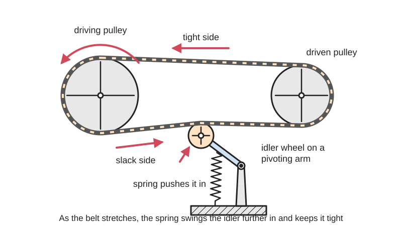
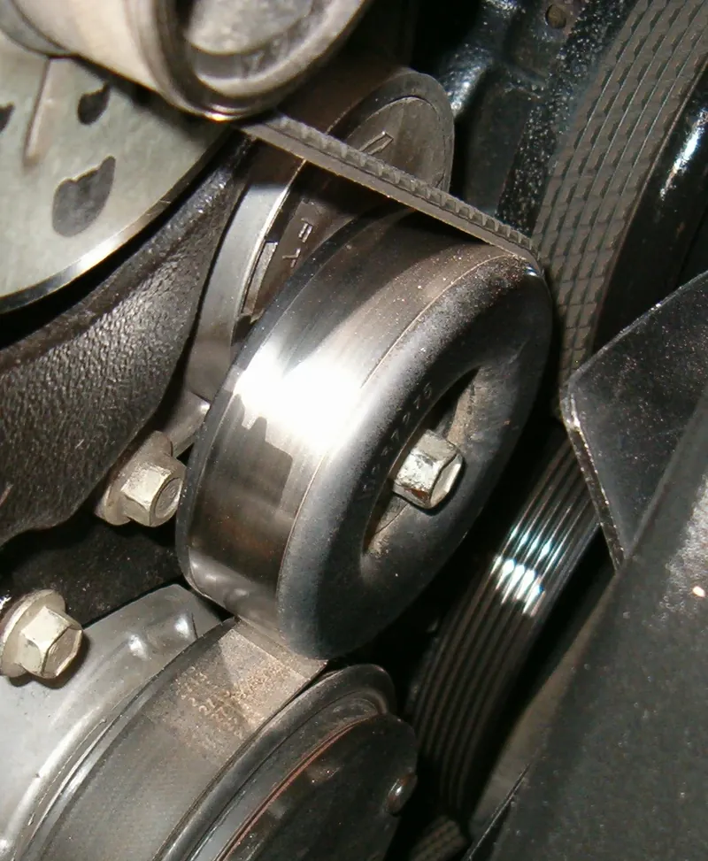
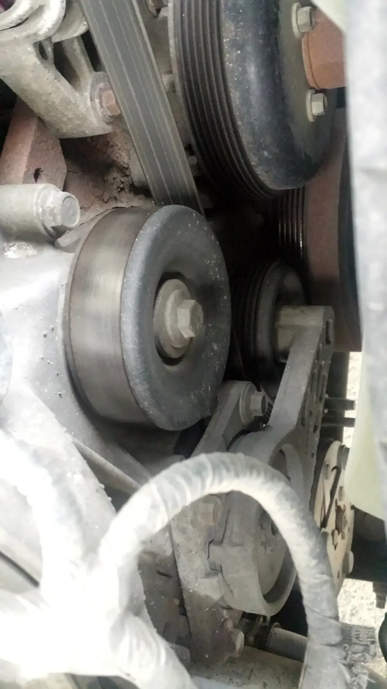

<figure class="eoc-pic eoc-pic-main"><picture><source media="(prefers-reduced-motion: reduce)" srcset="../media/drawn/belt-tensioner.svg"></picture><figcaption><strong>Animation.</strong> Diagram drawn for the encyclopaedia from the research notes. ⚑ Needs confirming: a drawing can simplify or get details wrong; a real photo or a better diagram is welcome.</figcaption></figure>
<figure class="eoc-pic"><figcaption><strong>Photo.</strong> <a href="https://commons.wikimedia.org/wiki/File:Kettenspanner_f%C3%BCr_Singlespeed-R%C3%A4der.jpg">Kettenspanner für Singlespeed-Räder</a> by Kab/http://du-und-dein-fahrrad.de, Public domain, from Wikimedia Commons.</figcaption></figure>
<figure class="eoc-pic"><figcaption><strong>Photo.</strong> <a href="https://commons.wikimedia.org/wiki/File:Belt_tensioner_(15973554259).jpg">Belt tensioner (15973554259)</a> by dave_7 from Lethbridge, Canada, <a href="https://creativecommons.org/licenses/by/2.0">CC BY 2.0</a>, from Wikimedia Commons.</figcaption></figure>

A free-spinning pulley, sprocket or plastic shoe pushed against the slack side of a belt or chain by a spring (or set by a screw) so the drive stays snug as the belt or chain stretches and wears.

**In plain words:** A little wheel on a springy arm (or on a sliding bracket) that presses on the side of a belt or chain to keep it tight as it stretches. **Proper term:** Belt tensioner (spring-loaded [idler](../glossary.md#idler); automatic tensioner).

**Also called:** belt tensioner / chain tensioner; idler pulley / idler sprocket / idler wheel (a pulley that carries no load); tensioner pulley / tensioner arm; jockey pulley / jockey wheel; belt tightener / tightening pulley (older name); automatic tensioner / auto-tensioner / spring-actuated idler; rotary tensioner (spring acts through a pivoting arm) and linear tensioner (idler on a spring-loaded plunger); inside idler / backside (outside) idler (named by which face of the belt it presses); singlespeed chain tensioner (bicycles); take-up idler (conveyors) ⚑ [uncertain]; Kettenspanner (German, chain tensioner).

## How it works

A belt or chain only grips and runs quietly if it is kept tight, but it stretches in use. The tensioner's wheel runs on the belt's slack (unloaded) side and a spring keeps pushing it in, so as the belt gets longer the arm simply moves further and the tension stays roughly the same, with no need to move the motor or shafts. Because the idler only rolls with the belt, it passes on no power. A screw-set (fixed) idler works the same way, but you push it in by hand, lock it, and re-adjust it later as the belt stretches.

## Parts

A small assembly that acts as one unit: an idler pulley, sprocket or plastic wear shoe on a ball bearing; an arm that pivots on a bolt or bushing (rotary type) or a plunger or slide (linear type); a spring (coil, [torsion](../glossary.md#torsion) or compression) or an adjusting screw; and a base or bracket bolted to the frame. Car engine tensioners also have a damper; manual versions have slots and clamp bolts instead of a spring.

## Everyday examples

- the spring-loaded arm and pulley pressing on a car engine's serpentine belt
- a single-speed or internal-gear bicycle's chain tensioner (and a rear derailleur, which is also a spring-loaded chain tensioner)
- a belt sander's spring-loaded idler drum that keeps the sanding belt tight
- spring or screw belt tensioners on 3D printers

## When to use it

When the shaft positions cannot be moved to tighten a belt or chain (fixed motor mounts, vertical bicycle dropouts, several accessories on one engine belt), when the belt or chain will stretch or wear and you want tension kept up automatically, to damp whip on long spans, to route a belt around an obstruction or increase wrap on a small pulley, or to make fitting a new belt easy. Spring tensioners suit one-direction power drives (engines, fans, pumps, conveyors, bike [freewheels](../glossary.md#freewheel)); screw-set idlers suit drives that need a fixed, stiff tension.

## When not to use it

Not on drives that reverse, brake through the belt or are back-pedalled (fixed-gear bikes, coaster brakes, reversing machines): the spring gives way when the belt on its side goes tight, so use adjustable centres (sliding motor mount, horizontal dropouts, eccentric bottom bracket) or a locked (screw-set) idler instead. Not for precise toothed-belt positioning drives (CNC, 3D printers) where [stiffness](../glossary.md#stiffness) matters: use a rigidly mounted idler or adjustable centres. Avoid an idler altogether if the shaft centres can be adjusted, because idlers add bending and shorten belt life; avoid backside idlers on V-belts where possible, because reverse bending is especially bad for them (Bestorq).

## Details

- **What it does (jobs):**
  - tighten and hold tension: keeps a belt or chain snug as it stretches, wears and warms up
  - let it move (turn, slide or bend): the idler spins with the belt, and the arm swings or slides to follow the slack
- **Movement:** multiple: the idler rotates continuously with the belt; the arm pivots (rotary tensioner) or slides (linear tensioner) through a short range as the belt stretches
- **Directions it can move (degrees of freedom):** 2: the idler spins on its bearing (1) and the spring-loaded arm swings or slides to take up slack (1). A screw-set idler has only the spin (1) once its bracket is clamped.
- **Special behaviour:**
  - tensioning (takes up slack and holds): the spring keeps pushing the idler into the belt, so tension is kept up automatically as the belt stretches; screw-set versions hold a tension you set by hand
- **How it holds:** spring force (a spring presses the idler against the belt); screw-set versions hold by friction or clamping (bolts clamp the bracket in its slot). Otherwise it is not a holding joint: it passes on motion.
- **Input and output:** Not a transmission: the idler turns freely with the belt and passes on no power. It keeps the belt gripping the working pulleys; slack V-belts slip, which can cut drive efficiency by as much as 10% (Machine Design). Shaft arrangement: the idler axle is parallel to the drive shafts. Back-drivable: yes; a spring-loaded arm gives way if the belt on its side goes tight (for example when a drive reverses, brakes or is back-pedalled), which is why spring tensioners are not used on reversing drives.
- **Power:** passive (no power needed): a spring or weight does the work. Some engine timing drives use hydraulic tensioners instead (Wikipedia 'Tensioner').
- **Load:** light to heavy depending on size: light for 3D-printer GT2 belts, medium for bicycle chains and small machines, heavy for car serpentine belts and industrial drives. Strong in the direction it pushes (into the slack span); weak against a load that pushes it back out, because only the spring resists: if its side of the belt becomes the tight side the spring force may be 'inadequate to maintain proper tension' (Machine Design).
- **Play and precision:** Noticeable springiness: the spring lets the idler move, so the belt span is less stiff and its tension varies a little with load. Fine for passing on power, but it can let a toothed-belt positioning drive shift or skip; Gates advises that on synchronous drives 'All idlers should be rigidly mounted in place to minimize movement or [deflection](../glossary.md#deflection)'. Flat idlers let a belt wander slightly sideways (Bestorq), and a chain tensioner must line up with the chain line.
- **Taking it apart:** removable: bolted to the frame or engine; to change a belt you swing the arm back against its spring or slacken its bolts
- **How often it can be reused:** many times: the tensioner can be released and reset at every belt change, but its spring, pivot bushing and bearing wear out, so car tensioners are often replaced along with the belt
- **Sealing:** none (bought idler pulleys usually have sealed ball bearings, but the tensioner does not seal anything)
- **Adjustable:** yes: spring-loaded versions adjust themselves as the belt stretches, and some let you set the spring's [preload](../glossary.md#preload) with a screw; screw-set idlers are moved along a slot or pivoted and then clamped (Gates' adjustable idler brackets can do both)
- **Access needed:** one side only (blind): usually bolted to one face of a frame, bracket or engine; you need room to reach the arm to release it when fitting a belt
- **Materials:** Arms and brackets: steel, cast iron or aluminium; idler pulleys: steel, aluminium or plastic (nylon or acetal) running on ball bearings; chain tensioners may use a sprocket or a low-friction polymer wear shoe (Machine Design); springs: steel coil or torsion springs. 3D-printed arms and brackets: ASA, ABS, PETG or nylon, not PLA near motors or heated chambers, used with a bought bearing or GT2 idler.
- **Heat, cold, water and wear:** Heat: springs lose tension over time when exposed to heat (Brake & Front End). Rust, corrosion, dirt or mud can jam the pivot so the arm cannot follow the belt; road salt is a common cause (Brake & Front End). Debris packed into toothed-belt pulleys causes bad tooth engagement, so shield synchronous drives in dirty places (Gates GT3 manual). Temperature changes: install timing-belt tensioners with the engine and tensioner at the same room temperature, as tension set hot or cold will be wrong (Litens installation procedure). 3D-printed arms [creep](../glossary.md#creep) under constant spring load, especially PLA near heat; use ASA, ABS, nylon or PETG and thick walls (Printables 1066464, 1702885).

## Making it

- **Ways to make or get it:**
  - off-the-shelf part (idler pulleys, idler sprockets, automatic tensioners, bicycle chain tensioners, adjustable idler brackets)
  - 3D print (FDM): arms, brackets and sliders, with a bought bearing or idler pulley, a pivot bolt and a spring
  - sheet metal or CNC: brackets and arms
  - laser cut (brackets and arms in plywood or acrylic for light drives) ⚑ [uncertain]
- **Printing it in one piece (print in place):** no: printed arms or brackets are assembled with a bought ball bearing or idler pulley, a pivot bolt and a spring (or an adjusting screw)
- **Tools:** spanners, sockets or Allen keys to mount it and to swing or lock the arm; for screw-set idlers, a way to measure belt tension (Gates suggests the force-deflection method or a sonic tension meter). Bicycle tensioners fit the derailleur hanger with an Allen key.
- **Difficulty:** easy to moderate: easy with a bought idler pulley or bearing and a spring on a printed or sheet-metal arm; moderate to get the spring force, alignment and placement (slack side) right; car and industrial automatic tensioners should be bought

### 3D printing tips

Buy the rolling part: use a toothed idler (e.g. a GT2 20-tooth idler) or bearing-based pulley inside the belt and a smooth, flat, uncrowned idler on the belt's back (Gates GT3 manual). Size it: a flat idler on the back of the belt should be at least 1.5 times the small pulley's diameter and at least the belt's minimum (e.g. 0.3 in for MXL, 0.6 in for 3M, 0.8 in for XL belts); an inside idler should be about the size of the smallest pulley (Bestorq). Place it on the slack side, preferably inside the belt, giving nearly equal wrap on both pulleys (Machine Design, Bestorq). Material: 3D-printer tensioner designers say 'DO NOT PRINT OUT OF PLA' and use ASA, ABS, nylon or PETG, especially near a hot motor or heated chamber, and one recommends at least 2 mm walls or 100% [infill](../glossary.md#infill) to reduce creep (Printables 1066464 and 1702885). Pivot: make the pivot hole a close fit on a shoulder bolt; one designer tightened his after the first version was sloppy (Printables 437104). Springs: salvage a rear-derailleur spring for a bike chain tensioner (Printables 437104) or reuse a printer's stock springs in a screw-adjustable holder (Printables 1066464, 1702885). A spring-loaded belt on a fast printer is softer than a locked one; one engineer who locked his spring tensioners with a screw raised the axes' resonance frequencies by a few hertz. Take care when removing stock spring tensioners: 'things can go flying fast and far'.

### Buying one (off-the-shelf parts)

Search terms: 'idler pulley' (flat, flanged or V-groove), 'GT2 idler pulley 20T 3 mm or 5 mm bore' (toothed or smooth), 'idler sprocket', 'belt tensioner', 'automatic belt tensioner' or 'serpentine belt tensioner' (car), 'spring-loaded tensioner arm', 'rotary tensioner' and 'linear chain tensioner' (with polymer shoe), 'singlespeed chain tensioner' (bicycle; fits the derailleur hanger), 'adjustable idler bracket' (Gates, brand), 'torsion spring', 'belt tension meter' (force-deflection or sonic). Idler pulleys usually have sealed deep-groove ball bearings (e.g. 6304-6310 on Gates industrial idlers; 623 or 625 sizes on small printer idlers ⚑ [uncertain]).

## Rules of thumb

- Put the tensioner on the slack (unloaded) side, on the inside of a belt, placed so both pulleys get nearly equal wrap; on a chain, put the idler outside the loop on the slack side, midway between the sprockets (Machine Design, 'Belt and chain tensioners', https://www.machinedesign.com/archive/article/21828669/belt-and-chain-tensioners).
- Order of preference for idler position: inside slack side, outside slack side, inside tight side, outside tight side; the matching service-factor add-ons are 0.0, 0.1, 0.1 and 0.2 (Bestorq 'Idlers', https://www.bestorq.com/wp-content/uploads/Idlers.pdf).
- Never use a spring-loaded tensioner on a reversing drive, because the slack side becomes the tight side (Machine Design; Bestorq). On bicycles, chain tensioners 'must not be used with fixed gears or coaster brakes' (Sheldon Brown, https://www.sheldonbrown.com/no-derailers.html).
- Automatic tensioners are 'not recommended for use on synchronous belts unless the drive is intended strictly for motion transfer' (Machine Design); Gates says idlers on synchronous drives should be on the slack side and 'rigidly mounted' (Gates PowerGrip GT3 Drive Design Manual, section 12 'Use of Idlers').
- A flat idler on the back of the belt: at least 1.5 x the small pulley's diameter, placed close to the small pulley to increase its wrap; minimum flat outside idler diameters include MXL 0.3 in, XL 0.8 in, 3M 0.6 in, 5M 1.1 in, 8M 2.9 in and A-section V-belt 4.3 in. An inside idler should be the diameter of the smallest pulley and should not be flanged (Bestorq).
- Gates minimum idler sizes for 5M PowerGrip GT3: inside grooved 14 grooves, inside flat 2.50 in OD, backside 1.25 in OD; for XL timing belts: 12 grooves, 2.50 in and 1.00 in OD (Gates PowerGrip GT3 Drive Design Manual, idler size table, https://www.gatesaustralia.com.au/~/media/files/gates-au/industrial/catalogues/powergrip-gt3-design-manual-us-january-2014.pdf).
- Flat idler width: a flanged one about 15% wider than the pulley face, an unflanged one at least 25% wider; flange height at least 25% of belt thickness (Bestorq).
- Chains: slack should not exceed 4% of the span (under 2% for heavy loads or frequent starts and stops); a span of more than 50 chain [pitches](../glossary.md#pitch) typically needs a tensioner; an idler sprocket should have at least three teeth engaged (Machine Design).
- Adjustable shaft centres are usually preferred over idlers, because every idler adds a bending cycle that shortens belt life (Bestorq; Gates: use idlers only when 'functionally necessary').

## Common failures

(1) A weak or broken spring lets the belt slip, glaze and squeal; replace the spring or tensioner. (2) A worn pivot bushing lets the arm rock, causing belt flutter, noise and [misalignment](../glossary.md#misalignment). (3) Worn idler bearings make the pulley wobble or growl, and a worn pulley bushing causes vibration and noise; if the bushing seizes it may snap the belt (all Brake & Front End). (4) The tensioner is on the tight side, or the drive reverses, so the spring is overpowered and the belt jumps teeth or the chain falls off; move it to the slack side or use a locked idler. (5) An idler that is too small, or a backside idler on a V-belt, shortens belt life through extra or reverse bending; follow minimum diameters. (6) A misaligned or crowned idler lets the belt walk off; align it and use flat, uncrowned backside idlers. (7) A printed arm cracks or creeps; print thicker, denser and in a heat-resistant plastic.

## Safety

Belts meeting pulleys and chains meeting sprockets form in-running nip points that can pull in fingers, hair or clothing; guard them (OSHA 29 CFR 1910.212 lists 'ingoing nip points' among hazards that need guarding). The spring stores energy: when removing or releasing a tensioner, hold the arm with a tool, because parts can 'go flying fast and far' (Printables 1066464). Never turn a drive by hand with fingers near the belt and idler. If the worn bushing in a car tensioner pulley seizes it may snap the belt, and a car whose single serpentine belt breaks instantly loses several critical functions at once (Brake & Front End; Wikipedia 'Serpentine belt').

## Related

- Belt drives (timing, round and V-belt): the drives a tensioner serves
- Eccentric adjuster: tensions a belt or chain by turning an off-centre bushing and clamping it; set once, not automatic
- Slotted adjustment with a jacking screw: moves a working pulley along slots to set the tension instead of adding an idler (horizontal dropouts do the same on bicycles); preferred where possible
- Hydraulic tensioner: an oil-damped plunger used on engine timing chains and belts
- Rear derailleur: a spring-loaded chain tensioner that also shifts the chain between sprockets
- Belt-tightener clutch: an idler pressed in by a lever to engage a slack belt drive and released to stop it (507 Mechanical Movements no. 5)
- Constant-force spring (spring-return reel): another way to keep a steady pull on a cord or tape
- Turnbuckle: tensions a rod, wire or cable by screwing, with no rolling idler

## Make it yourself

- [Bicycle chain tensioner (Printables 437104; URL from Printables API, page not opened)](https://www.printables.com/model/437104-bicycle-chain-tensioner): Printed spring-loaded single-pulley chain tensioner using the frame bosses, M5 bolts, a shoulder pivot bolt and a spring salvaged from a rear derailleur *(licence: CC BY-NC-SA (Creative Commons Attribution-NonCommercial-ShareAlike))*
- [Qidi Q2 belt tensioner - spring loaded (Printables 1702885; URL from Printables API, page not opened)](https://www.printables.com/model/1702885-qidi-q2-belt-tensioner-spring-loaded): Printed holder that reuses a 3D printer's stock tensioner springs and adds an M3 screw for fine, repeatable tension setting; notes on ABS/ASA and creep *(licence: CC BY-NC-SA (Creative Commons Attribution-NonCommercial-ShareAlike))*
- [Qidi Plus4 adjustable spring belt tensioner assembly (Printables 1066464; URL from Printables API, page not opened)](https://www.printables.com/model/1066464-qidi-plus4-adjustable-spring-belt-tensioner-assemb): Screw-adjustable spring belt tensioner for a 3D printer, giving up to 20 mm of spring compression; printed upright at 0.2 mm in ASA (not PLA) *(licence: CC BY-NC-SA (Creative Commons Attribution-NonCommercial-ShareAlike))*

## Pictures, videos and models

- [507 Mechanical Movements, 5, Pulleys with Tightening Mechanism](https://507movements.com/mm_005.html): Animated drawing of a belt drive with a movable tightening pulley that takes up slack so the belt drives, or lets it go slack so it does not *(licence: book public domain; website animation link only)*
- [Tensioner.jpg (Wikimedia Commons, photo by Una Smith, 2007)](https://commons.wikimedia.org/wiki/File:Tensioner.jpg): Automatic tensioner pressing on the serpentine belt of a 7.4 L car engine *(licence: GFDL or CC BY 3.0 (dual licence; reuse with credit))*
- [Kettenspanner fuer Singlespeed-Raeder.jpg (Wikimedia Commons, by Kab / du-und-dein-fahrrad.de, 2011)](https://commons.wikimedia.org/wiki/File:Kettenspanner_f%C3%BCr_Singlespeed-R%C3%A4der.jpg): Chain tensioner for a bicycle without derailleur gears *(licence: Public domain)*
- [Belt tensioner 1 (Nguyen Duc Thang, thang010146, YouTube; title confirmed via YouTube oEmbed)](https://www.youtube.com/watch?v=-2bxol03MO8): CAD animation of a belt tensioning mechanism *(licence: link only)*
- [Idlers (Bestorq, one-page design sheet)](https://www.bestorq.com/wp-content/uploads/Idlers.pdf): Diagrams of inside slack-side, inside tight-side and flat outside idler positions, with a table of minimum idler diameters *(licence: link only)*

## Needs confirming

⚑ marks something nobody has confirmed yet: a fact the research could not confirm from a source, a finder value that is a best guess, or an open point from the research notes. Corrections are welcome (see `research/needs-confirming.md`).

- ⚑ 3 sentences on this page marked [uncertain].
- ⚑ Research note: *Belt tensioner* (128): the mounting scope search also suggested tagging it with the adjusters family; the plan didn't, so it is left for the owner.

## Sources

- <https://en.wikipedia.org/wiki/Tensioner>
- <https://en.wikipedia.org/wiki/Serpentine_belt>
- <https://en.wikipedia.org/wiki/Idler-wheel>
- <https://www.machinedesign.com/archive/article/21828669/belt-and-chain-tensioners>
- <https://www.bestorq.com/wp-content/uploads/Idlers.pdf>
- <https://dpk3n3gg92jwt.cloudfront.net/domains/gates.pt/pdf/pa_idlers.pdf>
- <https://www.gatesaustralia.com.au/~/media/files/gates-au/industrial/catalogues/powergrip-gt3-design-manual-us-january-2014.pdf>
- <https://www.sheldonbrown.com/no-derailers.html>
- <https://www.sheldonbrown.com/gloss_ch.html>
- <https://www.brakeandfrontend.com/tech-tip-inspect-the-spring-loaded-automatic-belt-tensioner-when-replacing-serpentine-belt/>
- <https://www.myturbodiesel.com/d2/images/pdf/litens-pd-tb.pdf>
- <https://www.osha.gov/laws-regs/regulations/standardnumber/1910/1910.212>
- <https://507movements.com/mm_005.html>
- <https://commons.wikimedia.org/wiki/Category:Belt_tensioners>
- <https://commons.wikimedia.org/wiki/Category:Tensioners>
- <https://commons.wikimedia.org/wiki/File:Tensioner.jpg>
- <https://commons.wikimedia.org/wiki/File:Kettenspanner_f%C3%BCr_Singlespeed-R%C3%A4der.jpg>
- <https://commons.wikimedia.org/wiki/File:Tendeur_courroie_alternateur_automobile.jpg>
- <https://api.printables.com/graphql/>
- <https://www.youtube.com/watch?v=-2bxol03MO8 (verified via YouTube oEmbed)>
