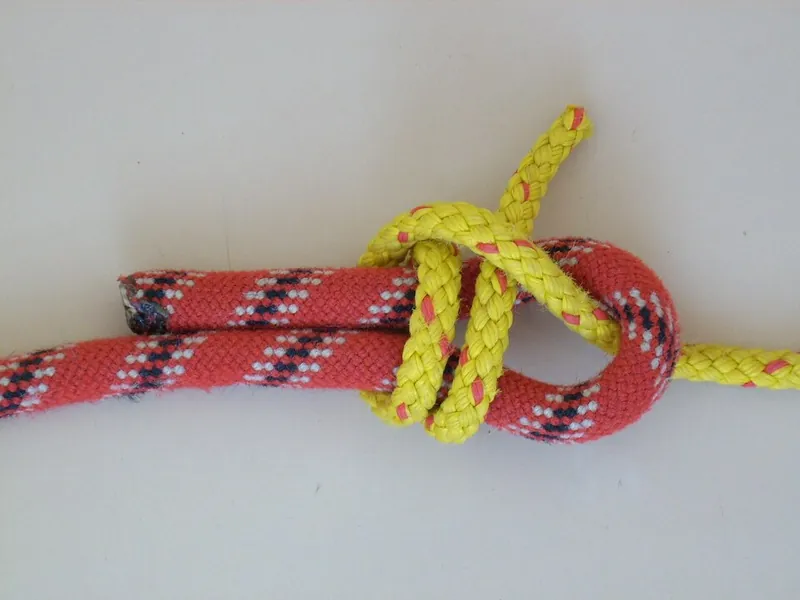

<figure class="eoc-pic eoc-pic-main"><figcaption><a href="https://commons.wikimedia.org/wiki/File:Doppelter_Schotstek.jpg">Doppelter Schotstek</a> by Markus Bärlocher, Public domain, from Wikimedia Commons.</figcaption></figure>

Knots that join two cords end to end, or close one cord into a ring: the sheet bend for cords of different thickness, the double fisherman's for a compact, very secure join, the water knot for flat tape, and the Zeppelin bend when it must still untie after a heavy pull.

**In plain words:** A knot that ties the ends of two ropes, cords, strings or flat straps together so they work as one longer line, even a thick cord to a thin one, or that ties the two ends of one cord together to close it into a ring. **Proper term:** Bends (end-to-end joining knots): the sheet bend and double sheet bend, the double fisherman's knot (grapevine bend), the water knot (tape knot) for webbing, and the Zeppelin bend.

**Also called:** bend: the general name for any knot that joins two lines (Animated Knots 'Terminology'; Wikipedia 'Bend (knot)'); sheet bend, weaver's knot, weaver's hitch (ABOK #1431; weaver's knot #485 per Animated Knots; Wikipedia also lists #1, #66 and #2) (Animated Knots 'Sheet Bend'; Wikipedia 'Sheet bend'); double sheet bend: the smaller cord taken twice round the bight (ABOK #1434, also #488) (Wikipedia 'Sheet bend'); becket hitch: the same knot tied to a rope handle or eye (a becket) instead of another rope (Animated Knots 'Sheet Bend'); netting knot or mesh knot: the sheet bend as tied with a netting needle in net making (Wikipedia 'Sheet bend', 'Net (device)'); double fisherman's knot, double fisherman's bend, grapevine bend (ABOK #294; Wikipedia also lists #1415, #498); triple fisherman's knot for slippery fibres (Animated Knots; Wikipedia 'Fisherman's knot'); fisherman's knot (single), angler's knot, waterman's knot, Englishman's knot, true lover's knot (ABOK #293, #1414) (Wikipedia 'Fisherman's knot'); water knot, tape knot, ring bend, grass knot, overhand follow-through (ABOK #296; Wikipedia also lists #1412, #343) (Animated Knots 'Water Knot'; Wikipedia 'Water knot'); Zeppelin bend, Rosendahl bend (not in the 1944 ABOK) (Wikipedia 'Zeppelin bend'); alpine butterfly bend, butterfly bend: the bend version of the alpine butterfly loop (ABOK #1053) (Animated Knots); figure-eight bend, Flemish bend, rewoven figure 8 bend (ABOK #1411) (Animated Knots 'Figure 8 Bend'); carrick bend (ABOK #1439), used for hawsers, heavy rope and nets (Animated Knots 'Carrick Bend'); Hunter's bend or rigger's bend (#1425A) and Ashley bend (ABOK #1452): similar interlocked-overhand bends that tend to jam (Animated Knots); offset overhand bend, flat overhand bend, 'European death knot' (EDK), offset water knot, thumb knot (ABOK #1410) (Animated Knots 'Flat Overhand Bend'; Wikipedia 'Offset overhand bend'); blood knot (ABOK #295) and Albright knot: fishing-line bends (Animated Knots; Wikipedia 'Bend (knot)').

## How it works

Pulling on the two long parts (standing parts) squeezes each cord end in the grip of the other, so the ends can't slide out. In the sheet bend the thicker cord is folded into a U (bight) and the thinner one passes through it, round behind both legs and tucks under itself (Animated Knots 'Sheet Bend'); it has the same structure as a bowline (Wikipedia 'Sheet bend'). The double fisherman's is 'two strangle knots (like double overhand knots) each tied round the other standing end', which slide together and lock (Animated Knots 'Double Fisherman's Bend'). The water knot is an overhand knot tied in one strap and retraced in the reverse direction by the other (Animated Knots 'Water Knot'). The Zeppelin bend is 'two symmetrically interlinked overhand knots', which makes it 'stable, secure, and highly resistant to jamming' (Wikipedia 'Zeppelin bend').

## Parts

Single piece: the two cord ends (or both ends of one cord) and nothing else. A backup knot is often tied in each loose end (tail) for extra security.

## Everyday examples

- Retying a broken shoelace or string (the Hunter's bend was first made public by a man who had used it for years on broken shoelaces) (Animated Knots 'Hunter's Bend')
- A fishing net or a garden or sports net, whose meshes are tied with sheet bends (Wikipedia 'Sheet bend', 'Net (device)')
- A loop of cord closed with a double fisherman's knot, as climbers use for a Prusik loop (Animated Knots 'Prusik Knot')
- A necklace cord tied with a fisherman's knot whose two halves slide to adjust the length (Wikipedia 'Fisherman's knot')

## When to use it

When two pieces of cord, rope or tape must become one longer line, or one cord must be closed into a ring, and no splicing or sewing is wanted. Use the sheet bend for quick, everyday joins and above all for cords of different thickness or [stiffness](../glossary.md#stiffness), such as a thin line to a thick rope, and for net making; the double sheet bend when the sizes are very different. Use the double fisherman's for a compact, very secure join that you don't need to untie, such as closing a cord loop or joining two lengths of similar cord. Use the water knot to join or close flat webbing and tape. Use the Zeppelin bend (or alpine butterfly bend) when you want a secure join that unties easily after a hard pull (Animated Knots; Wikipedia).

## When not to use it

Never for climbing, abseiling, rescue, swings or anything that holds a person without training and a rated system. Never use the reef knot, granny knot or thief knot to join two cords (see Basic knots). Don't use a double fisherman's where you'll want to untie it, or where the join must pull over rocks or edges without snagging, e.g. canyoning (Wikipedia 'Fisherman's knot'): use a Zeppelin bend. Don't use the figure-eight bend with cords of very different size (Animated Knots). Don't trust a single sheet bend in slippery or stiff rope or on a line that flaps slack (Wikipedia 'Sheet bend'): double it or choose another bend. Avoid the Hunter's and Ashley bends in rope because they jam (Animated Knots). For full strength or a permanent join, splice instead (Rope splices) or sew webbing (Load-bearing stitch patterns for straps and webbing); for steel cable use a crimped sleeve (Wire-rope terminations).

## Details

- **What it does (jobs):**
  - join and hold: joins two cords, ropes, threads or straps end to end, or closes one cord into a loop (for example a Prusik loop or a sling)
  - lock, and release by hand: the sheet bend, Zeppelin bend, alpine butterfly bend and carrick bend untie by hand after loading; the double fisherman's and water knot jam and are best treated as semi-permanent
- **Movement:** none: once set, the knot should not move; the cords either side stay flexible.
- **Directions it can move (degrees of freedom):** 0 at the knot itself.
- **Special behaviour:**
  - none: bends simply hold by friction; the useful differences between them are whether they jam, how they cope with cords of different size, and how they resist shaking loose (Wikipedia 'Knot', Jamming; Animated Knots 'Bend Knots')
- **How it holds:**
  - friction or clamping ([force-fit](../glossary.md#form-fit--force-fit--material-bond)): turns of each cord grip the other and tighten as the standing parts are pulled (Wikipedia 'Knot'; Wikipedia 'Fisherman's knot', Properties)
- **Input and output:** not applicable
- **Power:** passive (no power needed)
- **Load:** Medium, limited by the weaker cord: a bend keeps only part of the cord's strength, and sources differ, side by side. Sheet bend 48-58% (Wikipedia 'Sheet bend' infobox); in one study of 8 bends in equal climbing rope it 'pulled apart with less than half the tension that other knots withstood', yet Ashley judged it 'quite secure enough for ordinary purposes' (Wikipedia 'Sheet bend', Security). Double fisherman's 79% (1987, nylon), 79% (2008, nylon), 80% (2014, polyester); figure-eight bend 81%, 57%, 66% (CMC Rescue tests in 12.5 mm rope, McKently, ITRS 2014). Water knot 64% in 1-inch tubular nylon webbing (CMC 1987 test, McKently 2014; CMC 'Water Knot' page). Alpine butterfly bend: 'some quoted breaking strains are as low as 53% to 58%' (Animated Knots). For planning, assume 50% (CMC 2023 recommendation; Animated Knots 'Safety'). Direction: bends are made for an end-to-end pull; a knot that snags or is pulled sideways can roll (capsize): the offset overhand bend becomes increasingly likely to capsize above about 4 kN (Wikipedia 'Offset overhand bend'), and a snag can 'catch the outer strap and flip it loose' in a water knot (Animated Knots). Never for holding people without training and a rated system.
- **Play and precision:** not applicable: it doesn't locate parts. Expect the knot to settle and the tails to [creep](../glossary.md#creep) a little when first loaded, so set it hard and leave long tails (Wikipedia 'Water knot').
- **Taking it apart:** removable to semi-permanent, depending on the bend. Removable: the Zeppelin bend 'can be untied even after being heavily loaded but not, however, while still under load' (Animated Knots); the sheet bend is valued for its 'non-jamming properties' (Wikipedia 'Sheet bend'); the alpine butterfly bend and carrick bend untie easily (Animated Knots). Semi-permanent: the double fisherman's 'can lock up so tightly that it is effectively welded' (Animated Knots) and all fisherman's variants 'jam when tightened' (Wikipedia 'Fisherman's knot'); the water knot is 'Difficult to untie' (Wikipedia 'Water knot'); Hunter's and Ashley bends jammed so tight in tests 'would have had to be cut' (Animated Knots).
- **How often it can be reused:** many times for non-jamming bends (sheet bend, Zeppelin); once or a few times for jamming bends such as the double fisherman's, which may end up being cut out ⚑ [uncertain].
- **Sealing:** none
- **Adjustable:** no: a bend fixes the join; to change the length, untie and re-tie. One exception: a necklace cord closed with a fisherman's knot whose two strangle knots are left apart can be slid to adjust its length (Wikipedia 'Fisherman's knot').
- **Access needed:** not applicable: no panel access is involved, but you need both free ends with no load on them; a bend can't really be tied while the ropes are under tension (Animated Knots 'Sheet Bend'; Wikipedia 'Zeppelin bend').
- **Materials:** Rope, cord, string, yarn, netting twine, fishing line and flat webbing or tape. Different thickness or stiffness: the sheet bend 'is practical for joining lines of different diameter or rigidity' (Wikipedia 'Sheet bend'), with the thicker cord forming the bight, and the double sheet bend 'When the ropes are markedly different in size' (Animated Knots); the figure-eight bend 'should not be used with ropes that differ much in size' for critical loads (Animated Knots); for fishing lines of different type or size, the Albright knot (Animated Knots). Flat webbing and leather: the water knot (Wikipedia 'Water knot'). Slippery fibres (HMPE such as Dyneema (brand) or Spectra (brand), aramid such as Kevlar (brand)): the fisherman's knot 'can slip or come undone' in HMPE or nylon monofilament, so use a triple fisherman's (Wikipedia 'Fisherman's knot'; Animated Knots); the Zeppelin bend was found 'exceptionally secure and shake-resistant in all materials' (Animated Knots, citing Roo). Yarn for knitting: the Ashley and Hunter's bends, whose jamming is an advantage there (Animated Knots).
- **Heat, cold, water and wear:** Shaking and slack: the sheet bend, like the bowline, 'has a tendency to work loose when not under load' (Wikipedia 'Sheet bend'), while the Zeppelin bend 'is also resistant to the effects of slack shaking and cyclic loading' (Wikipedia 'Zeppelin bend'). Repeated loading: the water knot's outer tail can creep back into the knot at low forces (Wikipedia 'Water knot'), and 'Cyclical loading of a Water Knot can cause the outer strap to work loose' (Animated Knots). Wet and ice: nylon 'absorbs water and is 10-15% weaker when wet' (Wikipedia 'Rope'); some authors are cautious about the flat overhand bend in wet or icy rope (Animated Knots). Slippery fibres: HMPE and nylon monofilament make fisherman's knots slip (Wikipedia 'Fisherman's knot'). Sunlight: some synthetic cords are damaged more easily by UV (Wikipedia 'Rope').

## Making it

- **Ways to make or get it:**
  - off-the-shelf part: cord, rope, webbing or twine, tied by hand
  - 3D print (FDM): netting needles (shuttles), mesh gauges and knot practice boards (see make_it_yourself)
- **Printing it in one piece (print in place):** no: bends are tied in cord; only tools such as netting needles are printed.
- **Tools:** none for rope and cord. For net making, a netting needle (shuttle) that carries the twine and a gauge that sets the mesh size (Wikipedia 'Net (device)'). A fid can help loosen a jammed knot (Wikipedia 'Knot', Tools); fishing-line bends are lubricated before pulling tight (Animated Knots 'Albright Knot').
- **Difficulty:** easy: no tools; the risks are tying a look-alike wrongly (the interlinked-overhand bends are easily confused) and choosing a bend that doesn't suit the cords.

### 3D printing tips

Bends themselves aren't printed, but net making uses two simple printable tools: a netting needle (shuttle) that holds the twine so it can be passed through each mesh, and a gauge, often 'a smooth stick', that keeps the meshes the same size (Wikipedia 'Net (device)'). 1) Print a netting needle flat on its side; it may need sanding smooth (one designer suggests sanding under water) so it doesn't snag twine (Printables 1144418, designer's note). 2) Size the needle to the job: one 280 mm PLA shuttle holds about 20 m of 3 mm paracord and can be scaled in the slicer, or thickened by scaling its height for stiffness (Printables 176836, designer's note). 3) Make the gauge a smooth flat strip or rod whose width sets the mesh size; nets often start and finish with a half-size gauge so the edges come out smooth (Wikipedia 'Net (device)') ⚑ [uncertain for printed gauges]. 4) When cords are joined to make a lanyard or loop for a printed part, put the bend in free cord, away from holes and edges, so it can tighten fully and be inspected ⚑ [uncertain].

### Buying one (off-the-shelf parts)

Cord, paracord, accessory cord (5 or 6 mm for Prusik loops, Animated Knots 'Prusik Knot'), rope, tubular webbing, netting twine and fishing line; netting needles and mesh gauges for net making and mending. Alternatives that join without a knot: a short splice (Rope splices) keeps nearly the full strength; factory-sewn webbing slings and rated cord loops; for steel cable, crimped sleeves (Wire-rope terminations).

## Rules of thumb

- Choose by the cords: different sizes, sheet bend (ABOK #1431) with the thicker cord as the bight, or the double sheet bend when they are markedly different; similar ropes and a compact, very secure join, double fisherman's (ABOK #294); flat webbing, water knot (ABOK #296); must untie after a heavy load, Zeppelin bend or alpine butterfly bend (Animated Knots 'Sheet Bend', 'Double Fisherman's Bend', 'Water Knot', 'Zeppelin Bend').
- Sheet bend check: both tails should come out on the same side of the knot; 'The alternative version - with the tails on opposite sides - is less reliable' (Animated Knots 'Sheet Bend'). Wikipedia notes that tests on the matching left-hand bowline found little strength difference, so the gap may be small (Wikipedia 'Sheet bend').
- Leave long tails, side by side: every Animated Knots bend page warns 'For critical loads the ends must be left much longer' than in its animation; water knot ends at least 7.5 cm (3 in), and the knot set with full body weight (Wikipedia 'Water knot'); flat overhand bend 'about half a meter (18 - 24 in)' (Animated Knots) against 'never less than 200mm in offset knots' (Wikipedia 'Offset overhand bend'). In one test a 3 in tail of a water knot in 9/16 in (14.3 mm) tubular webbing crept back into the knot in just over 800 cycles of 250 lb (113 kg) (Wikipedia 'Water knot').
- Back up critical bends: for the figure-eight bend and the water knot, tie each tail in a double overhand stopper round the other standing part (Animated Knots 'Figure 8 Bend'; Wikipedia 'Water knot').
- Slippery fibres: for Spectra, Dyneema or Kevlar/Technora use a triple fisherman's (Animated Knots); with HMPE or aramid cores, fisherman's knots can fail at high loads (generally above 15 kN) by the sheath separating and the core slipping through (Wikipedia 'Fisherman's knot').
- Closing a cord into a loop: the double (or triple) fisherman's is 'the way to join two ends of a line to form a Prusik Loop'; rough starting lengths for a pair of Prusik loops are 1.5 m and 1.83 m of 5-6 mm cord (Animated Knots 'Double Fisherman's Bend', 'Prusik Knot'). Webbing slings are closed with a water knot (Wikipedia 'Water knot').
- Fishing line: blood knot with at least five and up to seven turns each side for lines of similar size; Albright knot with about 10 wraps for lines of different size or type; lubricate before pulling tight (Animated Knots 'Blood Knot', 'Albright Knot').
- Net making: tie the first row to a headrope, then work each later row with sheet bends round a gauge using a netting needle; first and last rows are often made on a half-size gauge (Wikipedia 'Net (device)'). Animated Knots shows the sheet bend and the carrick bend used at net junctions.
- Never use the reef (square) knot as a bend: Ashley wrote that used that way it 'is probably responsible for more deaths and injuries than have been caused by the failure of all other knots combined' (quoted in Wikipedia 'Bend (knot)'). See Basic knots.
- Strength for planning: assume about 50% of the weaker cord's rated strength (CMC 2023; Animated Knots 'Safety'); measured values run from about 48% (sheet bend) to about 80% (double fisherman's) (Wikipedia 'Sheet bend'; McKently 2014).

## Common failures

Using the wrong knot: a reef, granny or thief knot as a bend capsizes and spills (Wikipedia 'Bend (knot)'). Sheet bend tied with the tails on opposite sides, or a single sheet bend in cords of very different size, slipping (Animated Knots). Shaking loose when slack (sheet bend) (Wikipedia). Tail creep in water knots under repeated loading, and the outer strap flipped loose by a snag; prevent it with long tails, backup overhand knots, and by placing the knot so the outer strap isn't caught (Wikipedia 'Water knot'; Animated Knots). Mis-tied look-alikes: the Zeppelin, Hunter's, Ashley and alpine butterfly bends all use interlocked overhand knots, so 'Similarity ... invites confusion - and mistakes', and a wrongly threaded butterfly bend becomes an 'Evil Impostor' (Animated Knots). Rolling (capsizing) of offset overhand and especially flat figure-eight bends at high load (Animated Knots; Wikipedia 'Offset overhand bend'). Jamming so hard the knot must be cut (double fisherman's, Hunter's, Ashley) (Animated Knots). Tails cut too short. Breaking at the knot well below the cord's rated strength (Wikipedia 'Knot').

## Safety

A home-made bend must never hold a person: for anything that holds a person, use a rated system and get training. The reef knot used as a bend has killed many people (Ashley, quoted in Wikipedia 'Bend (knot)'). Several deaths have been linked to water knots in webbing pulling loose when snagged (Walter Siebert and Pit Schubert, cited in Wikipedia 'Water knot'), and the flat figure-eight bend 'can roll at quite a low tension and several deaths have been reported' (Animated Knots 'Flat Overhand Bend'). Of the double fisherman's, Animated Knots says: 'If you tie it and your life depends on it, inspect it carefully. If someone else ties it, inspect it extremely carefully.' Use a design factor of 12:1 for live or critical loads (Animated Knots 'Safety').

## Related

- Basic knots (overhand knot, half hitch, reef knot): the reef knot is a binding knot and must never be used as a bend
- Fixed loop knots (bowline, figure-eight loop, alpine butterfly): every bend has matching loop knots; two linked bowlines can also join two ropes, and the alpine butterfly bend is tied like the loop
- Rope splices (eye splice, short splice, braided-rope splice): the short splice joins two ropes permanently at nearly full strength
- Tensioning and adjustable hitches (trucker's hitch, taut-line hitch, Prusik): the Prusik needs a cord loop closed with a double fisherman's
- Hitches to a post, rail, ring or eye: the becket hitch is the sheet bend tied to an eye instead of a rope
- Stopper knots and cord-end anchors: the double overhand used as a backup in a bend's tails
- Load-bearing stitch patterns for straps and webbing (bar tack, box-X stitch): sewing is the stronger, permanent way to join webbing
- Wire-rope terminations (wire-rope clip, thimble, crimped sleeve): how steel cable is joined instead of knotting
- Binding knots and seizings: a seizing can lash a bend's tails down

## Make it yourself

- [Netting Needle or Shuttle (Donvit0, Printables) (URL from Printables API, page not opened)](https://www.printables.com/model/1316498-netting-needle-or-shuttle): A basic 1/2 in x 6 in netting needle for making and mending nets, in thin and thick versions *(licence: Creative Commons Public Domain)*
- [Netting needle (Síťovací jehla) (Pavel Brych, Printables) (URL from Printables API, page not opened)](https://www.printables.com/model/1144418-netting-needle-sitovaci-jehla): Netting needle printed flat on its side, sanded smooth for tying nets *(licence: Creative Commons Attribution-ShareAlike)*
- [NET NEEDLE - NET SHUTTLE (Peter H, Printables) (URL from Printables API, page not opened)](https://www.printables.com/model/176836-net-needle-net-shuttle): Scalable 280 mm net shuttle; the designer says it holds about 20 m of 3 mm paracord *(licence: Creative Commons Attribution-NonCommercial-ShareAlike)*

## Pictures, videos and models

- [Sheet Bend (Animated Knots by Grog)](https://www.animatedknots.com/sheet-bend-knot): Step-by-step animation and video of the sheet bend joining a thick and a thin rope, with photos of the double sheet bend, the weaver's knot and nets made with sheet and carrick bends *(licence: link only)*
- [Double Fisherman's Bend (Animated Knots by Grog)](https://www.animatedknots.com/double-fishermans-bend-knot): Animation of the double fisherman's (grapevine) bend, with photos of the triple fisherman's and a Prusik loop *(licence: link only)*
- [Water Knot (Animated Knots by Grog)](https://www.animatedknots.com/water-knot): Animation of the water knot joining two pieces of webbing, with warnings about cyclic loading and snagging *(licence: link only)*
- [Doppelter Schotstek.jpg (Wikimedia Commons, by Markus Bärlocher)](https://commons.wikimedia.org/wiki/File:Doppelter_Schotstek.jpg): Photo of a double sheet bend joining two ropes *(licence: Public domain)*
- [Netmaking.png (Wikimedia Commons, from Lexikon der gesamten Technik, 1904)](https://commons.wikimedia.org/wiki/File:Netmaking.png): Labelled drawing of net making: a sheet bend being tied with a netting shuttle round a spacer (gauge) below the head rope *(licence: Public domain)*

## Needs confirming

⚑ marks something nobody has confirmed yet: a fact the research could not confirm from a source, a finder value that is a best guess, or an open point from the research notes. Corrections are welcome (see `research/needs-confirming.md`).

- ⚑ 3 sentences on this page marked [uncertain].
- ⚑ Finder value `usual_process` = by hand (tied or wrapped) (best guess): first-listed process was "off-the-shelf part: cord, rope, webbing "; knots family, so set to by hand (tied or wrapped)

## Sources

- <https://www.animatedknots.com/sheet-bend-knot>
- <https://www.animatedknots.com/bend-knots>
- <https://www.animatedknots.com/double-fishermans-bend-knot>
- <https://www.animatedknots.com/water-knot>
- <https://www.animatedknots.com/zeppelin-bend-knot>
- <https://www.animatedknots.com/alpine-butterfly-bend-knot>
- <https://www.animatedknots.com/carrick-bend-knot>
- <https://www.animatedknots.com/figure-8-bend-knot>
- <https://www.animatedknots.com/hunters-bend-knot>
- <https://www.animatedknots.com/ashley-bend-knot>
- <https://www.animatedknots.com/flat-overhand-bend-knot>
- <https://www.animatedknots.com/blood-knot>
- <https://www.animatedknots.com/albright-knot>
- <https://www.animatedknots.com/prusik-knot>
- <https://www.animatedknots.com/bowline-knot>
- <https://www.animatedknots.com/safety>
- <https://www.animatedknots.com/terminology>
- <https://en.wikipedia.org/wiki/Sheet_bend>
- <https://en.wikipedia.org/wiki/Fisherman%27s_knot>
- <https://en.wikipedia.org/wiki/Water_knot>
- <https://en.wikipedia.org/wiki/Zeppelin_bend>
- <https://en.wikipedia.org/wiki/Bend_(knot)>
- <https://en.wikipedia.org/wiki/Offset_overhand_bend>
- <https://en.wikipedia.org/wiki/Net_(device)>
- <https://en.wikipedia.org/wiki/Knot>
- <https://en.wikipedia.org/wiki/Rope>
- <https://en.wikipedia.org/wiki/The_Ashley_Book_of_Knots>
- <https://verticalsection.caves.org/nh/59/Rescue%20Knot%20Efficiency%20Revisited.pdf>
- <https://www.cmcpro.com/evaluating-knot-efficiency-in-11-mm-ropes/>
- <https://www.cmcpro.com/water-knot/>
- <https://rocorescue.com/wp-content/uploads/2025/02/Rescue-Knot-Efficiency-2023.pdf>
- <https://commons.wikimedia.org/wiki/File:Doppelter_Schotstek.jpg>
- <https://commons.wikimedia.org/wiki/File:Netmaking.png>
- <https://commons.wikimedia.org/wiki/File:ZeppelinBend.jpg>
- <https://commons.wikimedia.org/wiki/File:Water-knot-webbing-tight-ABOK-296.jpg>
- <https://commons.wikimedia.org/wiki/File:N%C5%93ud_de_p%C3%AAcheur_double_serr%C3%A9.jpg>
- <https://api.printables.com/graphql/>
