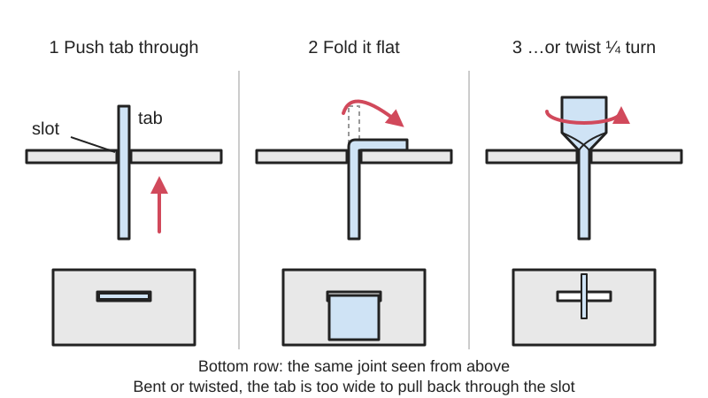

<figure class="eoc-pic eoc-pic-main"><figcaption>Diagram drawn for the encyclopaedia from the research notes. ⚑ Needs confirming: a drawing can simplify or get details wrong; a real photo or a better diagram is welcome.</figcaption></figure>

A tab on one sheet-metal part passes through a slot in the other and is then folded over or twisted about a quarter turn, so the parts line themselves up and are locked together with no screws, rivets, glue or heat.

**In plain words:** A little metal tongue on one piece of sheet metal is pushed through a slot in another piece, then folded flat or twisted with pliers so it can't slide back out, like the tabs holding a tin toy or a metal model kit together. **Proper term:** Bent-tab or twist-tab joint (tab-and-slot joint locked by folding or twisting the tab; with a lanced tab when the tab is cut and raised from the middle of the sheet).

**Also called:** bent tab, folded tab, fold-over tab (SendCutSend 'How to Join Laser Cut Parts Without Fasteners'); twist tab, twisted tab, twist-lock tab, twist-prong mounting (twist-lock can capacitors) (Nuts & Volts; Metal Earth instructions); tab staking, center tab staking (Kawamura, Trans. JSME C, 1988); lanced tab, lance-and-form tab (a tab cut on three sides and bent up out of the sheet by a punch) (Wikipedia 'Blanking and piercing'; Wilson Tool); slot and tab construction, tab-and-slot assembly (tinplate toys and toy trains) (Wikipedia 'Tin toy'; Trains.com); tabs and holes, twist and fold tabs (metal model kits such as Metal Earth (brand)); 'claw' fold: several tabs folded towards each other (Metal Model Mania).

## How it works

The tab is a snug fit in the slot, so pushing it through lines the two parts up (as in any tab-and-slot joint). The part of the tab that sticks out on the far side is then folded flat against the sheet or twisted about 90 degrees, which makes it too wide or the wrong shape to come back through the slot, so the parts are locked (SendCutSend; Metal Earth). Twisting also draws the two parts tightly together, making a firm joint (Metal Model Mania). The joint stays shut because [ductile](../glossary.md#brittle--ductile) metal stays where it is bent instead of springing back (Machine Design).

## Parts

A few features rather than parts: a long tab (tongue) on the edge of one sheet, or a tab cut and raised from the middle of the sheet (lanced tab), plus a matching slot in the other sheet. Optional extras: small holes or cuts across the bend line to make folding easier (SendCutSend), and a solder joint on one tab when it must also carry an electrical earth (Nuts & Volts).

## Everyday examples

- Old tin toys and tinplate toy trains, whose printed metal parts are held together by small tabs pushed through slots and folded or twisted (Wikipedia 'Tin toy'; Trains.com)
- Metal model kits such as Metal Earth (brand), built entirely with tabs that are twisted or folded with pliers (Metal Earth help page)
- Twist-lock ('twist-prong') can capacitors in old valve radios and guitar amplifiers, whose tabs go through slots in a mounting wafer and are twisted or folded (Nuts & Volts)
- Sheet-metal brackets and covers inside computers and appliances ⚑ [uncertain]

## When to use it

Use it to join thin sheet metal (below about 2 mm) cheaply and quickly with no screws, rivets, welding or glue: small enclosures, brackets, stacks of plates, metal models and toys (SendCutSend; Machine Design). It suits parts that are laser-cut or stamped, since the tabs and slots come free with the cut and also line the parts up. Long tabs can clamp a thicker non-metal part, such as an acrylic window, to a metal frame (SendCutSend). It is good for parts that will be assembled once and rarely or never taken apart.

## When not to use it

Avoid it when the parts must be taken apart often (use screws, a T-slot joint, hooks or a key-and-tab joint instead) (SendCutSend; Metal Earth), for thick or springy sheet that won't stay bent (use a plain tab and slot with welding, rivets or bolts) (SendCutSend; Machine Design), for high or vibrating loads, especially pushing along the fold direction (use rivets, clinching, welding or bolts) (SendCutSend), and when the joint must seal. It doesn't work in brittle materials such as acrylic or most 3D prints; use a snap fit, heat staking or a screw there ⚑ [uncertain].

## Details

- **What it does (jobs):**
  - join and hold: joins thin sheet-metal parts at right angles, face to face, or in a stack (SendCutSend)
  - line parts up exactly: the tab and slot place the parts before the tab is locked (SendCutSend)
  - tighten and hold tension: twisting the tab pulls the parts together (Metal Model Mania); long bent tabs can clamp a thicker part such as acrylic against metal (SendCutSend)
- **Movement:** none: once the tab is folded or twisted the parts don't move.
- **Directions it can move (degrees of freedom):** 0: the slot stops sideways and twisting movement and the bent or twisted tab stops the tab pulling back out.
- **Special behaviour:**
  - self-aligning or self-centring: the tab only fits one slot in one position, so parts go together without measuring or jigs (SendCutSend)
  - tensioning (takes up slack and holds): only for the twisted version, where the twist draws the two parts together into 'the tightest, strongest joint possible' (Metal Model Mania)
  - none of the other listed behaviours
- **How it holds:**
  - shape (the parts interlock; [form-fit](../glossary.md#form-fit--force-fit--material-bond)): the folded or twisted tab can no longer pass back through the slot
  - friction or clamping (force-fit): a twisted or tightly folded tab also clamps the sheets together (Metal Model Mania; SendCutSend)
- **Input and output:** not applicable
- **Power:** passive (no power needed)
- **Load:** Light to medium. Stronger when pulled at right angles to the folded tabs; weaker when pushed along the direction the tab is folded, where the tab can bend back and slip out of the slot. Angled tabs folded in opposite directions, more tabs, or tabs folded towards each other (the 'claw') make it stronger (SendCutSend; Metal Model Mania). Tests on lap joints with a centre tab showed that the fold direction decides how it breaks: a tab folded against the load unbends at its root, while one folded with the load bends the thin strip of sheet beside the slot; wider tabs or more tabs raise the strength (Kawamura 1988). Machine Design calls folded tabs 'moderately strong' joints.
- **Play and precision:** Small play before locking, set by the slot [clearance](../glossary.md#clearance); a twisted tab pulls the parts tight and removes most of it (Metal Model Mania). A folded tab can leave slight play ⚑ [uncertain]. Location is as repeatable as the laser-cut or stamped slot. Almost no [tolerance](../glossary.md#tolerance) for [misalignment](../glossary.md#misalignment), since the tab must enter the slot.
- **Taking it apart:** semi-permanent (can be undone but may damage parts): tabs can be straightened and pulled out, but they are fragile and may break (Trains.com restoration guide: 'They break off easily, but most will withstand one disassembly without serious damage'). SendCutSend calls the bent-tab joint 'permanent or semi-permanent'.
- **How often it can be reused:** once to a few times: Metal Earth warns that folding a piece back and forth along a fold line more than 2 times will weaken or break it; a toy-train restorer says most tabs survive one disassembly (Metal Earth help page; Trains.com).
- **Sealing:** none: the slot and tab leave small gaps.
- **Adjustable:** no: position is fixed by the slot. A twisted tab can be twisted a little further to tighten a loose joint, at the risk of breaking it ⚑ [uncertain].
- **Access needed:** both sides: you push the tab in from one side and must reach the far side to fold or twist it.
- **Materials:** Thin, ductile sheet metal: soft (mild) steel, aluminium, copper and brass (Machine Design); SendCutSend lists thin 2024 and 5052 aluminium as easiest to bend, plus cold-rolled steel, stainless steel, brass and copper. Also tinplate (tin toys) and etched steel sheet (metal model kits). The metal must stay bent rather than spring back (Machine Design). Card and paper use the same idea with folded tabs ⚑ [uncertain]. Not suited to brittle materials (acrylic, cast metal, most printed plastics) ⚑ [uncertain].
- **Heat, cold, water and wear:** All-metal joints cope with heat, cold and sunlight. Repeated bending work-hardens the tab and makes it brittle, so tabs that have been bent back and forth crack easily (Metal Earth; Trains.com). Vibration or repeated loads along the fold direction can bend a tab back until it slips out (SendCutSend). Bending can crack paint, printing or plating on the tab and let rust start there ⚑ [uncertain].

## Making it

- **Ways to make or get it:**
  - sheet metal: laser-cut or stamped thin sheet, tabs folded or twisted by hand after cutting (SendCutSend: this bending is done after delivery, not with standard CNC press-brake tooling)
  - laser cut: thin aluminium, steel, brass and copper sheet from online cutting services (SendCutSend)
  - off-the-shelf part: metal model kits and some electronic parts (twist-lock can capacitors) come with the tabs ready to twist (Metal Earth; Nuts & Volts)
- **Printing it in one piece (print in place):** no: the tab must be bent or twisted after assembly, and the joint is made in sheet metal, not printed.
- **Tools:** Fingers for thin aluminium; flat-nose or needle-nose pliers or strong tweezers to fold and twist tabs (SendCutSend; Metal Earth; Metal Model Mania); a small screwdriver or blade to push a tab flat (Metal Model Mania). Factories use punch-press lance-and-form tools to make lanced tabs (Wilson Tool) and machines to twist them ⚑ [uncertain].
- **Difficulty:** easy: if you can get thin sheet metal laser-cut (or cut it with snips), the joint needs only pliers; the main skill is bending each tab once, cleanly, without working it back and forth (SendCutSend; Metal Earth).

### 3D printing tips

Not applicable for the joint itself: it relies on metal that bends once and stays bent (Machine Design), whereas printed plastic tabs tend to spring back or crack along [layer lines](../glossary.md#layer-lines) when bent ⚑ [uncertain]. In a printed part use a snap fit, heat staking (a melted plastic rivet) or a screw instead ⚑ [uncertain]. A 3D printer can still help: a fully printed bending tool for fine sheet metal, intended for building metal model kits, is on Thingiverse and Printables (blecheimer, CC BY-NC-SA 4.0; printed at 0.2 mm layers, three walls, 20% [infill](../glossary.md#infill)).

### Buying one (off-the-shelf parts)

Usually none: the tabs and slots are cut into the parts. Helpers: flat-nose and needle-nose pliers and tweezers (Metal Earth help page; Metal Model Mania), and special tab-twisting tools sold for metal model kits ⚑ [uncertain]; laser-cut thin aluminium or steel from services such as SendCutSend; phenolic mounting wafers (mounting plates) for twist-lock (twist-prong) can capacitors (RF Parts listing; Nuts & Volts). Industrial versions are made with punch-press 'lance and form' tools (Wilson Tool).

## Rules of thumb

- Plain tab-and-slot joints suit sheet 0.080 in (2 mm) or thicker; in thinner sheet use bent tabs instead. Make the tab long enough to fold over after it leaves the slot; small holes at the two ends of the tab's bend line, or small cuts across it, make folding easier, but removing too much can make the tab break (SendCutSend 'How to Join Laser Cut Parts Without Fasteners').
- Bent tabs are stronger across the fold than along it; set tabs at an angle and fold them in opposite directions for more strength; two tabs can share one slot if folded in opposite directions (SendCutSend).
- Twist a tab 90 degrees where the tab is hidden, fold it 90 degrees where it shows; don't fold a piece back and forth along one fold line more than 2 times or it will weaken or break (Metal Earth instructions and help page).
- Don't fold neighbouring tabs the same way: fold them towards each other (the 'claw'); twist rather than fold whenever possible, and always twist the same way (e.g. clockwise) so you know which way to untwist (Metal Model Mania 'How to Bend Metal Earth Tabs').
- Bend lines should run at right angles to the rolling direction of the sheet, or at least 45 degrees from it; keep the stamping burr on the inside of the bend; make the final bend in the same direction as the first bend. The page gives the tab thickness range as '0.12 and 0.8 in.', which looks like a typo for about 0.012-0.080 in ⚑ [uncertain] (Machine Design 'Methods for Fastening Sheet Metal Without Fasteners', 2015).
- When reassembling old tinplate, bend tabs only as far as needed and stress them a different way than before: re-fold tabs that were twisted, and twist tabs that were folded; don't bend them a full 90 degrees or the opposite way (Trains.com 'Do it yourself locomotive restoration', Ray L. Plummer).
- Formed (bent) tabs on sheet-metal parts should be longer than 4 x the sheet thickness for easy forming; any sheet-metal tab should be at least 2 x thickness or 3.175 mm wide and no longer than 5 x its width (Protolabs 'How to Design Sheet Metal Notches, Tabs, and Slots').
- Punch-press 90-degree lance-and-form tabs: height at least 1.5 x sheet thickness; width 1.5 x thickness in mild steel and aluminium, 2 x in stainless; narrower than 0.070 in (1.78 mm) may tear (Wilson Tool 'Design Basics of Lance & Forms').
- In lap joints held by a centre tab, wider tabs or more tabs spread the load and raise joint strength; if the tab is folded in the same direction as the load, the strip of sheet beside the slot (the 'bridge') needs to be wider than the tab (Kawamura, Trans. JSME C 54(506), 1988).

## Common failures

Tab snaps at its root because it was bent too far, bent back and forth, or cut too narrow; bend once and gently, and leave spare tabs for later repairs (Metal Earth; Trains.com). Joint pulls apart when load acts along the fold direction and bends the tab back; fold tabs in opposite directions or towards each other, or twist instead (SendCutSend; Metal Model Mania). Tab tears out or the strip of sheet next to the slot bends when the tab is too narrow or the slot too close to the edge (Kawamura 1988). Tab springs back and the joint is loose when the metal is too hard or thick (Machine Design). A twisted tab is hard to undo if you assembled the wrong piece, so check before twisting (Metal Model Mania).

## Safety

Cut sheet-metal edges, burrs and tab tips can be sharp; round the outsides of tabs and hooks where possible and take care when handling (SendCutSend recommends rounding hooks to avoid sharp edges). Snapped-off tab ends are small sharp pieces ⚑ [uncertain]. Metal model kits have small sharp parts, so keep them away from small children ⚑ [uncertain].

## Related

- Tab-and-slot joint (self-fixturing sheet joint): the same tab and slot without bending, held by friction, glue, welding or the rest of the box
- Hooks and key-and-tab joints: tabs that hook or are wedged through a slot, so they can come apart without bending anything (SendCutSend)
- Clinching (press joining without rivets): a press forms the two sheets into an interlocking button, with no tab needed
- Blind rivets and pop rivets: stronger and more reliable sheet-metal joints, but need a hole, a rivet and a rivet gun
- Spring-steel push-on fasteners (speed nuts, U-nuts): clip-on metal parts for joining sheet with a screw
- Split pin (cotter pin) and paper fastener (brad): a separate part whose legs are pushed through a hole and bent back, the same locking idea
- Heat staking (melted plastic rivet): the plastic-part equivalent, where a post through a hole is melted over instead of bent
- Ordinary screw joint (bolt and nut): the baseline, easy to undo and reuse many times
- Spot weld: joins overlapping sheet metal at small points with electrode pressure and a short burst of current instead of a bent tab; a low-cost spot welder is also used to repair broken tin-toy tabs (Robothut video in links)

## Make it yourself

- [Fully Printed Bending Tool For Fine Sheet Metals (e.g. Etched Parts) (blecheimer, Thingiverse)](https://www.thingiverse.com/thing:4601820): A printable, all-plastic bending tool for small thin sheet-metal parts; the designer says it can be used for building metal model kits *(licence: CC BY-NC-SA 4.0 (stated in the Printables copy of the model))*
- [Fully Printed Bending Tool For Fine Sheet Metals (e.g. Etched Parts) (blecheimer, Printables) (URL from Printables API, page not opened)](https://www.printables.com/model/236096-fully-printed-bending-tool-for-fine-sheet-metals-e): Same model on Printables, read through the Printables public API: printed at 0.2 mm layers, three walls, 20% cuboid infill; candle wax on the thread helps *(licence: Creative Commons Attribution-NonCommercial-ShareAlike)*

## Pictures, videos and models

- [How to Join Laser Cut Parts Without Fasteners (SendCutSend)](https://sendcutsend.com/blog/how-to-join-laser-cut-parts-without-fasteners/): Illustrations of bent tabs before and after folding, angled tabs folded in opposite directions, tabs clamping a stack or an acrylic panel, and a perforated tab that is easier to bend *(licence: link only)*
- [How to Bend Metal Earth Tabs So Your Models are Extra Strong (Metal Model Mania, Phil Morgan, 2019)](https://www.metalmodelmania.com/2019/01/10/bend-metal-earth-tabs/): Close-up photos of twisted tabs and of folded tabs arranged in the 'claw' pattern, with tool advice *(licence: link only)*
- [Metal Earth help and tips (Metal Earth (brand))](https://www.metalearth.com/help): Explains the instruction symbols for tabs to fold 90 degrees or twist 90 degrees, and the pliers used *(licence: link only)*
- [Metal Earth - Starter Tips and Tricks (YouTube, animateorange)](https://www.youtube.com/watch?v=NFyqSEom-MQ): Video of building a tab-and-slot metal model kit (title and channel checked via YouTube oEmbed; not watched) *(licence: link only (standard YouTube licence))*
- [Repair broken metal tabs on your vintage tin toys with a low-cost spot welder! No Glue, no solder. (YouTube, Robothut)](https://www.youtube.com/watch?v=C0-GQxCs6Is): Video about repairing the fragile tabs that hold vintage tin toys together (title and channel checked via YouTube oEmbed; not watched) *(licence: link only (standard YouTube licence))*

## Needs confirming

⚑ marks something nobody has confirmed yet: a fact the research could not confirm from a source, a finder value that is a best guess, or an open point from the research notes. Corrections are welcome (see `research/needs-confirming.md`).

- ⚑ 14 sentences on this page marked [uncertain].
- ⚑ Finder value `tools` = hand tools (source uncertain): `tools_needed` is marked ⚑ [uncertain] here: "…rm tools to make lanced tabs (Wilson Tool) and machines to twist them ⚑ [uncertain].…"

## Sources

- <https://sendcutsend.com/blog/how-to-join-laser-cut-parts-without-fasteners/>
- <https://www.machinedesign.com/mechanical-motion-systems/media-gallery/21831054/methods-for-fastening-sheet-metal-without-fasteners>
- <https://www.jstage.jst.go.jp/article/kikaic1979/54/506/54_506_2358/_article>
- <https://www.protolabs.com/resources/blog/designing-sheet-metal-notches-and-tabs/>
- <https://wilsontool.com/en-us/resources/design-basics-of-lance-forms>
- <https://en.wikipedia.org/wiki/Blanking_and_piercing>
- <https://en.wikipedia.org/wiki/Tin_toy>
- <https://www.trains.com/ctt/how-to/restoration-repair/do-it-yourself-locomotive-restoration/>
- <https://www.metalearth.com/help>
- <https://www.metalmodelmania.com/2019/01/10/bend-metal-earth-tabs/>
- <https://www.nutsvolts.com/magazine/article/finding-the-outside-foil-lead>
- <https://www.rfparts.com/capacitors/capacitors-electrolytic/capacitors-twistmount.html>
- <https://www.thingiverse.com/thing:4601820>
- <https://api.printables.com/graphql/>
- <https://www.youtube.com/watch?v=NFyqSEom-MQ>
- <https://www.youtube.com/watch?v=C0-GQxCs6Is>
