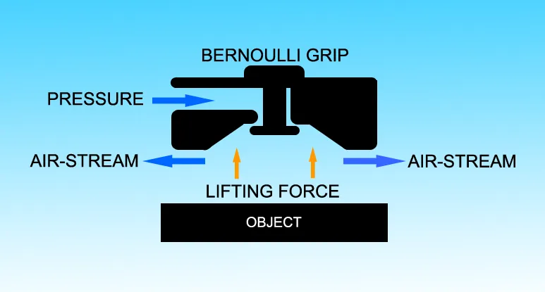

<figure class="eoc-pic eoc-pic-main"><figcaption><strong>Diagram.</strong> <a href="https://commons.wikimedia.org/wiki/File:Bernoulli_Gripper.png">Bernoulli Gripper</a> by Larryisgood, <a href="https://creativecommons.org/licenses/by-sa/3.0">CC BY-SA 3.0</a>, from Wikimedia Commons.</figcaption></figure>

A Bernoulli gripper blows a fast, thin sheet of air outwards between its face and a flat part, which lowers the air pressure in the gap so the still air underneath pushes the part up and holds it on an air cushion, letting robots lift fragile wafers, glass, film or fabric almost without touching them.

**In plain words:** A round pad that blows compressed air out sideways from its middle, so a thin flat thing such as a silicon wafer, a sheet of glass, a film or a piece of fabric is pulled up towards it and floats on a thin cushion of air, hardly touching the pad. **Proper term:** Bernoulli gripper (non-contact air-flow gripper; Bernoulli jet gripping device).

**Also called:** Bernoulli grip (Wikipedia); non-contact gripper, contactless gripper or low-contact gripper; air-cushion gripper; floating suction cup (SBS) (Schmalz (brand) product name); jet gripping device (JGD) or air-jet gripper (Mykhailyshyn et al. 2022); cylindrical-nozzle Bernoulli gripper and ejection (annular-gap) Bernoulli gripper (the two main designs); vortex or cyclone non-contact gripper (a swirling-air variant, e.g. SMC XT661 'Cyclone Type' (brand)); Bernoulli wafer gripper / Bernoulli end effector; Bernoulli levitator (the spool-and-card classroom demonstration).

## How it works

Compressed air enters the middle of the pad, is turned sideways and rushes out through the narrow gap between the pad face and the part. Fast-moving air has a lower pressure (Bernoulli's principle), and the sharp turn from straight to outward-spreading flow makes a zone of very low pressure round the outlet, so the higher pressure of the still air below pushes the part up towards the pad (Wikipedia 'Bernoulli grip'; Festo OGGB). Further away the jet pushes the part off, but as the gap shrinks the suction wins; the lifting force peaks when the gap is only about 0.1-0.3 mm in the cylindrical-nozzle type, and the escaping air keeps a cushion so the part need not touch (Mykhailyshyn et al. 2022). Because the air gives almost no sideways grip, small spacers, friction pads or guides stop the part sliding, and turning the air off lets it go (SMC XT661; Festo OGGB).

## Parts

A small assembly that acts as one unit: (1) a gripper body with a central compressed-air inlet; (2) a nozzle, a very thin ring-shaped slit or, in vortex types, angled nozzles that make the air swirl; (3) a flat or slightly shaped face; (4) spacers, bumpers or friction pads that set the gap and stop the part sliding (Festo uses a POM ring and POM or nitrile-rubber knobs); (5) side guides or end stops for the part; (6) the air supply: a compressor, filter, pressure [regulator](../glossary.md#regulator) and on/off valve, sometimes with a pressure or flow sensor to check a part is there (Festo OGGB catalogue; SMC XT661 catalogue).

## Everyday examples

- The 'Bernoulli levitator' trick: blow down through a cotton reel and an index card underneath is held up instead of blown away (Exploratorium Science Snack)
- Factory robots moving solar cells, silicon wafers and thin glass without scratching them (Festo; Wikipedia 'Bernoulli grip')
- The 1980s Iomega Bernoulli disk drive, where the airflow round a spinning floppy disk held it a tiny distance from the read head by the same effect (Hackaday)
- Wall-climbing robots that cling to walls with supersonic air jets without touching them (Hackaday, 2011)

## When to use it

Use it to pick up thin, flat, fragile or sensitive parts that must not be scratched, marked, bent or contaminated: wafers, solar cells, thin glass, films, foils, circuit boards, textiles and leather, and porous or air-permeable sheets that a vacuum cup cannot seal on (Festo OGGB; Wikipedia 'Bernoulli grip'; EE3D). It is also good for separating the top sheet from a stack of thin or porous material (Festo), for sterile or clean-room handling because nothing touches the surface (Wikipedia), and where a part is warm or [brittle](../glossary.md#brittle--ductile) (Mykhailyshyn et al. 2022 list hot and brittle parts as a jet-gripper strength).

## When not to use it

Avoid it for heavy parts, parts with large holes, strongly curved or bumpy shapes, parts smaller than the pad, or where the part must not slide sideways during fast moves: its lift is small, it gives almost no sideways grip and it needs guides (SMC XT661; Festo OGGB). It also needs a compressor and uses a lot of air and makes noise. Use a vacuum (suction) gripper for a much stronger, sealed grip on smooth parts, a granular jamming or soft-finger gripper for odd shapes, a magnet for steel, or mechanical fingers for heavy or rough parts.

## Details

- **What it does (jobs):**
  - hold or release using power: it holds only while compressed air is flowing and lets go when the air is switched off
  - join and hold: temporarily picks up, carries and places thin, flat, fragile parts on a robot arm or transfer machine
- **Movement:** none: it holds the part still under the pad (floating a fraction of a millimetre away); the robot or slide that carries it does the moving
- **Directions it can move (degrees of freedom):** 0 when the part rests against friction pads or side guides; without them the air holds the part only up and down, and it can still slide in two directions and spin in its own plane (3 free), because 'a non-contact gripper does not produce a restraining force that prevents horizontal movement of the workpiece' (SMC XT661)
- **Special behaviour:**
  - quick-release: it lets go as soon as the air is switched off, with no seal or suction to break
  - none of the locking behaviours: nothing locks; holding lasts only as long as the air flows
- **How it holds:**
  - suction or air pressure: the surrounding air pushes the part towards the low-pressure zone made by the fast outflow
  - friction or clamping ([force-fit](../glossary.md#form-fit--force-fit--material-bond)): sideways hold comes only from friction pads, knobs or guides that the part rests against (Festo's nitrile-rubber knobs raise the lateral force from 1 N to 12-15 N)
  - powered hold: it needs a continuous flow of compressed air
- **Input and output:** not applicable: it is a holding device, not a motion converter. For sizing, compressed air in -> lifting force out: a Festo OGGB uses about 110 l/min at its nominal 1 bar and holds 6-10 N (Festo OGGB catalogue); an SMC Bernoulli-type pad of 100 mm diameter uses 156 L/min (ANR) at 0.4 MPa for 7.8 N, while the swirling cyclone type of the same size uses 258 L/min for 44 N (SMC XT661 catalogue).
- **Power:** powered (needs a steady supply of compressed air: Festo OGGB works from 0 to 6 bar with 1 bar nominal; SMC's pads are rated for 0.01-0.4 or 0.5 MPa depending on type (SMC XT661); a maker's printed version needed a constant 7-40 psi, about 0.5-2.8 bar (EE3D, Thingiverse)). If the air supply is lost the part is released and falls, because the low pressure exists only while air is flowing (Festo OGGB functional principle) ⚑ [uncertain: no source gives how quickly it drops].
- **Load:** Light: from a few grams to a few kilograms per pad. Festo OGGB holds 6-10 N (about 0.6-1 kg) per gripper at 1 bar; Schmalz floating suction cups SBS (10-120 mm) hold 1.4-104 N; SMC's largest cyclone type lifts 44 N. The cylindrical-nozzle type suits parts up to about 1 kg and the ejection (annular-slit) type up to about 10 kg (Mykhailyshyn et al. 2022). Strong only in the direction that pulls the part onto the pad; very weak sideways (Festo standard lateral force 1 N, 12-15 N with rubber knobs) and no resistance to twisting or sliding unless pads or guides are fitted.
- **Play and precision:** Up and down it holds the part at a small, steady gap: SMC measured a vibration of only +/-0.01 mm on a 125 mm, 0.25 mm thick solar cell at 0.1 MPa with its Bernoulli type. Sideways it gives almost no location at all, so repeatable positioning depends entirely on guides, stops or friction pads (SMC XT661). It tolerates some texture and warp; vortex types are less sensitive to the gap and suit uneven parts better (Mykhailyshyn et al. 2022). Lifting is lost if the part has holes covering more than about 1% of the pad area or is smaller than the pad (SMC XT661).
- **Taking it apart:** tool-free quick release: switching the air off releases the part, and the gripper itself bolts to the robot with ordinary screws
- **How often it can be reused:** effectively unlimited: picking and placing causes almost no wear because the part barely touches the pad; only the spacers or friction knobs wear, and Festo's rubber knobs 'can be replaced if they become worn' (Festo OGGB)
- **Sealing:** none: it deliberately has no seal; the air escapes all round the edge of the pad
- **Adjustable:** yes: the supply pressure sets the lifting force and gap, the height of the spacers or bumpers sets the working distance, guides with adjustment bolts set the distance between pad and part (SMC XT661), and several pads can be spaced out to balance a large sheet
- **Access needed:** one side only (blind): it picks the part up by its top face alone, so the underside and edges are never touched
- **Materials:** Parts it handles: silicon wafers and solar cells, thin glass, films and foils, circuit boards, flexible and air-permeable sheets, porous materials, textiles and leather, and sliced food in research (Festo OGGB; Wikipedia 'Bernoulli grip'; Mykhailyshyn et al. 2022). EE3D says it is favoured over vacuum for porous and even perforated sheets 'whereas vacuums would fail', and Festo lists porous and air-permeable materials among its uses, but SMC says parts whose holes add up to more than about 1% of the suction area may not lift, so test first. Poor for: parts smaller than the pad, strongly curved or bumpy surfaces, heavy parts. Gripper bodies: anodised aluminium with POM spacers and nitrile-rubber knobs (Festo), resin or aluminium bodies (SMC); maker versions are 3D printed with neoprene or rubber bumpers (EE3D, Thingiverse).
- **Heat, cold, water and wear:** Temperature: Festo OGGB is rated 0-60 C for both the air and the surroundings, and SMC pads -5 to 40 C or 60 C depending on type, with no freezing; 3D-printed bodies are limited by their plastic (PLA softens above about 60 C, Prusa). Air quality: needs clean, dry, unlubricated air (Festo OGGB: 'operation with lubricated medium not possible'). Flexible materials: soft sheets such as food can vibrate against the pad, block it or be blown away, which needs an anti-vibration grid (Wikipedia 'Bernoulli grip'); thin parts vibrate if the pressure is too high (SMC). Drying: the fast airflow dried and vibrated soft tissue in a surgical prototype (Ertürk and Erzincanlı 2020). Wind and acceleration: large flat sheets catch the air when moved, so slow down or add a wind cover (SMC XT661). Nothing [creeps](../glossary.md#creep) or weakens over time apart from wear of the spacers.

## Making it

- **Ways to make or get it:**
  - 3D print (FDM): maker grippers with a threaded port for an air-gun nozzle (EE3D, Thingiverse) and a mouth-blown teaching model (Printables 882372)
  - 3D print (resin): may give the smoother faces and finer, more even air gaps the nozzle needs ⚑ [uncertain]
  - CNC: industrial bodies are machined, anodised aluminium (Festo OGGB)
  - off-the-shelf part: complete Bernoulli and cyclone pads (Festo OGGB, Schmalz SBS, SMC XT661 and ZNC (brands)), plus regulators, valves and fittings
- **Printing it in one piece (print in place):** partly: the nozzle body can be printed in one piece with its threaded air port, but the rubber bumpers or friction pads and the air fitting are added afterwards (EE3D, Thingiverse)
- **Tools:** None to grip and release (a valve does it). To fit: screwdriver or hex key for the mounting screws (Festo mounts via a female thread; SMC's thin pad is glued on with adhesive kept clear of the air port), a spanner and push-in fitting for the air connection, a pressure regulator and filter for clean, oil-free air (Festo OGGB; SMC XT661).
- **Difficulty:** moderate: a printed nozzle body on a shop air line will lift paper, card, film or thin sheet (EE3D; Printables 882372), but it needs a steady, regulated compressed-air supply that uses a lot of air, carefully set bumpers and side guides, and the lift is small and easily lost

### 3D printing tips

1) Make the pad smaller than the part you want to lift: if the pad is bigger than the part, no low-pressure zone forms and nothing lifts (SMC XT661). 2) Fit three or more small bumpers or friction pads that stand just proud of the face: research designs use pads protruding a little over 0.15-0.2 mm (Mykhailyshyn et al. 2022), and EE3D advises 'the less the bumpers protrude the better'; neoprene or rubber bumpers set the working gap (EE3D). 3) Add side guides or stops, because the air gives almost no sideways grip (SMC XT661; Festo lateral force 1 N). 4) Start at low pressure and raise it slowly: EE3D's printed gripper needed a constant 7-40 psi depending on the part's weight and gap, and SMC warns that too much pressure can bend or shake thin parts. 5) For a threaded air-gun nozzle, EE3D found 1/2 inch nozzles commonly use 20 threads per inch and 3/8 inch nozzles 24 threads per inch, and offered both. 6) Feed it clean, dry, oil-free air through a filter and regulator: Festo states lubricated air cannot be used. 7) Print the air passages with thick, solid walls so they do not leak through gaps between layers, and treat the printed body as a nozzle only, never as a tank for stored compressed air ⚑ [uncertain: general FDM experience, not from a gripper source]. 8) For a no-compressor demonstration, print a model you can blow through with your mouth (Printables 882372) or try a thread spool and an index card (Exploratorium).

### Buying one (off-the-shelf parts)

Bernoulli gripper or Bernoulli pad (e.g. Festo OGGB-60/100/140 (brand), with standard POM spacers or the '-Q' nitrile-rubber knobs for higher lateral force); floating suction cup (Schmalz SBS, SBS-ESD, SBS Thin (brand)); non-contact gripper, Bernoulli type or cyclone type (SMC XT661 and ZNC (brand)); guides with urethane bumper pads; compressed-air filter, pressure regulator, [solenoid](../glossary.md#solenoid) valve, push-in fittings and tubing; pressure or flow sensor on a multi-port pad to detect the part (SMC XT661); a small air compressor or workshop air line with an air-gun nozzle (EE3D).

## Rules of thumb

- Size it with a safety factor of at least 2 (lifting force divided by 2 must still exceed the part's weight), and more for fast moves, sudden stops or large flat sheets that catch the air (SMC XT661).
- The lifting force is greatest at a very small gap, about 0.1-0.3 mm for a cylindrical-nozzle gripper, and friction pads that stand more than about 0.2 mm (cylindrical type) or 0.15 mm (annular-slit type) proud of the face stop sideways sliding (Mykhailyshyn et al. 2022).
- Cylindrical-nozzle grippers suit flat parts up to about 1 kg; ejection grippers with a ring-shaped slit suit parts up to about 10 kg (Mykhailyshyn et al. 2022).
- Holes or pores: lifting may fail if the holes add up to more than about 1% of the suction area (SMC XT661).
- The pad must be smaller than the part; mount it level (horizontal), and if it is tilted or vertical, add guides and keep the safety factor at 2 or more (SMC XT661).
- Expect high air use: about 110 l/min at 1 bar for 6-10 N (Festo OGGB) or 156 L/min (ANR) at 0.4 MPa for 7.8 N (SMC Bernoulli type, 100 mm); the swirling cyclone type gives much more lift for its air (258 L/min for 44 N at 100 mm, SMC), and Li et al. found a vortex gripper needed less air than an ejection gripper for the same lift (reported in Mykhailyshyn et al. 2022).
- Do not use more pressure than needed with thin parts: it can deform, damage or vibrate them (SMC XT661).
- For thin, delicate films, cover the workpiece completely with the gripper (Festo OGGB note).
- A Festo OGGB is rated for 0-60 C air and surroundings and makes about 65 dB(A) of noise at 1 bar (Festo OGGB catalogue).

## Common failures

1) The part slides off sideways or spins during a move: fit friction pads, side guides or stops and slow the moves (SMC XT661; Festo lateral force only 1 N with standard spacers). 2) Thin, flexible films, food or fabric flutter, block the nozzle or are blown away: lower the pressure, cover the whole part, or add an anti-vibration grid (Wikipedia 'Bernoulli grip'; Festo note; SMC). 3) Nothing lifts: the pad is bigger than the part, the part has too many holes (over about 1% of the area), or the gap is too large (SMC XT661). 4) Thin parts bend, crack or vibrate: the pressure is higher than needed (SMC XT661). 5) The part tilts: mount the pad over the part's balance point, and space several pads evenly on big sheets (SMC XT661). 6) The part drops when other tools on the same compressor draw air: use a regulator and a part-present sensor (SMC multi-port with pressure or flow sensor). 7) Worn spacers let the part touch or shift: replace the rubber knobs (Festo).

## Safety

It drops the part as soon as the air stops (compressor fault, hose off, pressure dip), so never carry glass or other dangerous loads over people, and use a safety factor of 2 or more (SMC XT661) ⚑ [uncertain: drop on air loss inferred from the working principle]. Compressed air hazards (UK HSE HSG39): air can enter the body through the mouth, ears or anus 'causing severe and often fatal injuries', can penetrate the skin at high pressure, and particles carried in an air jet can damage the eyes, so never point the gripper or air line at anyone and wear eye protection; damaged hoses can rupture and 'whip' dangerously. Noise: about 65 dB(A) for a Festo OGGB at 1 bar, more at higher pressure. Do not use a 3D-printed part to store compressed air. Broken thin glass or wafers leave sharp edges. The electroadhesive alternative listed under related runs at 500 V to 5 kV DC: coat the electrodes with a proper high-voltage insulator, because soldermask 'does not withstand high voltage very well', never feed it directly from mains (the README says 'Please do not use direct mains voltage'), and treat the pad and its supply as an electric-shock hazard (Jana-Marie 'electrostatic-adhesion-plate' README; Hackaday 2019).

## Related

- Vacuum (suction) gripper: a sealed cup sucks the part on; much stronger and grips sideways by friction, but must touch and seal, so it fails on porous parts and can mark delicate surfaces
- Suction cup: the passive, hand-pressed version of a sealed cup, with no air supply
- [Venturi](../glossary.md#venturi) vacuum generator: also uses a fast air jet, but to suck air out of a sealed cup; Mykhailyshyn et al. (2022) class grippers with a Coanda nozzle as vacuum grippers, not Bernoulli grippers
- Vortex (cyclone) non-contact gripper: a variant covered in this entry that swirls the air; more lift for its air use and less sensitive to the gap, so better for uneven parts, while the [radial](../glossary.md#axial--radial) Bernoulli type keeps the part steadier and turns it less (SMC XT661; Mykhailyshyn et al. 2022)
- Combined Bernoulli and vacuum gripper: uses Bernoulli pads to draw the part in from further away and a vacuum cup for the main grip (Mykhailyshyn et al. 2022)
- Air bearing and air caster: use the same thin film of escaping air to float a part along with almost no friction, rather than to hold it
- Granular jamming gripper and soft fingers: grip odd shapes by contact rather than flat sheets without contact
- Electroadhesive gripper (electroadhesion): another way to hold thin sheets with an attracting force, electrically instead of with air; uses include holding paper on plotters and electrostatic grippers (Wikipedia 'Electroadhesion'). A maker version is a circuit board carrying an array of electrodes at 500 V to 5 kV DC, made from a low AC voltage by a voltage multiplier on the back of the board (Jana-Marie 'electrostatic-adhesion-plate' README). Figures disagree: Hackaday (2019) reported a sheet of paper held with 5 mN of [shear](../glossary.md#peel-vs-shear) at 3 kV, while the README lists 9 N of shear for a 100 x 100 mm board at 1.4 kV uncoated. It needs no compressor but works at high voltage: see safety_notes

## Make it yourself

- [Bernoulli Gripper by EE3D (Thingiverse)](https://www.thingiverse.com/thing:2644114): Printable Bernoulli gripper bodies threaded to screw onto a 1/2 inch or 3/8 inch air-gun nozzle, with rubber bumpers setting the gap; runs at 7-40 psi *(licence: CC BY-NC-SA 4.0)*
- [Bernoulli gripper (Bernoulliho chapač) by gruber (Printables model 882372; read through the Printables API, page not opened)](https://www.printables.com/model/882372-bernoulli-gripper-bernoulliho-chapac): A school project (Czech) for a quickly printed Bernoulli gripper that works when you simply blow into a tube, to demonstrate static and dynamic pressure *(licence: CC BY-NC-SA)*
- [Bernoulli Gripper (Bernoulliho chapač) by gruber (URL from Printables API, page not opened)](https://www.printables.com/model/878480-bernoulli-gripper-bernoulliho-chapac): A second, simpler printable Bernoulli gripper teaching model by the same author *(licence: CC BY-NC-SA)*
- [Bernoulli Levitator (Exploratorium Science Snack)](https://www.exploratorium.edu/snacks/bernoulli-levitator): A no-printer demonstration: an index card held up under a thread spool by blowing, or a paper plate held up under a box by a hair dryer, with a pushpin to stop it drifting sideways *(licence: CC BY-NC-SA 4.0)*

## Pictures, videos and models

- [Bernoulli Gripper.png (Wikimedia Commons; Larryisgood)](https://commons.wikimedia.org/wiki/File:Bernoulli_Gripper.png): Diagram of air flowing out of a Bernoulli gripper and the lifting force it creates on a part *(licence: CC BY-SA 3.0)*
- [Ejection Bernoulli.png (Wikimedia Commons; Roman211911)](https://commons.wikimedia.org/wiki/File:Ejection_Bernoulli.png): Cross-section of the ejection Bernoulli gripper: body, conical insert, ring-shaped nozzle and part (a companion file, File:Cylindrical_Bernoulli.png, shows the cylindrical-nozzle type with its friction elements) *(licence: CC BY-SA 4.0)*
- [Jet gripper air-flow.jpg (Wikimedia Commons; Roman211911)](https://commons.wikimedia.org/wiki/File:Jet_gripper_air-flow.jpg): Photo of smoke showing the airflow round a modified Bernoulli gripper for textiles, with an anti-vibration grid *(licence: CC BY-SA 4.0)*
- [Festo Bernoulli Gripper OGGB (Ralph W Earl Company Inc., YouTube; title confirmed through YouTube oEmbed, video not watched)](https://www.youtube.com/watch?v=phSlc8B4kFo): Video of an industrial Bernoulli gripper picking up thin parts *(licence: link only)*
- [Robotic adhesion with supersonic air jets (BotJunkie, YouTube; title confirmed through YouTube oEmbed, video not watched; embedded in Hackaday's 2011 article)](https://www.youtube.com/watch?v=eEcDS1Vhp3o): Video of a wall-climbing robot held to surfaces by non-contact Bernoulli-type air-jet grippers *(licence: link only)*

## Needs confirming

⚑ marks something nobody has confirmed yet: a fact the research could not confirm from a source, a finder value that is a best guess, or an open point from the research notes. Corrections are welcome (see `research/needs-confirming.md`).

- ⚑ 4 sentences on this page marked [uncertain].
- ⚑ Finder value `power_source` = compressed air (source uncertain): `power` is marked ⚑ [uncertain] here: "…re exists only while air is flowing (Festo OGGB functional principle) ⚑ [uncertain: no source gives how quickly…"
- ⚑ Finder value `power_loss` = not applicable (best guess): uses power, but `power` does not say what happens when it is lost
- ⚑ Research note: *Vacuum gripper* (109) and *Bernoulli gripper* (277): electroadhesion figures recorded side by side (Hackaday 2019: a sheet of paper held with 5 mN of shear at 3 kV; the open-source board's README, 100 × 100 mm at 1.4 kV: 9 N uncoated, 4 N with a PlastiDip coat, 2.5 N with Kapton). Not in the files: the README's 90 mN/cm² is far below Wikipedia's claimed 0.5-1.5 N/cm²; check before publishing.
- ⚑ Research note: *Bernoulli gripper*: porous sheets (EE3D: grips them where vacuum fails; SMC: lift may fail if holes add up to more than about 1% of the pad area). Both are given.

## Sources

- <https://en.wikipedia.org/wiki/Bernoulli_grip>
- <https://commons.wikimedia.org/wiki/File:Bernoulli_Gripper.png>
- <https://commons.wikimedia.org/wiki/File:Cylindrical_Bernoulli.png>
- <https://commons.wikimedia.org/wiki/File:Ejection_Bernoulli.png>
- <https://commons.wikimedia.org/wiki/File:Jet_gripper_air-flow.jpg>
- <https://ftp.festo.com/public/pneumatic/SOFTWARE_SERVICE/Documentation/2013/EN/OGGB_EN.PDF>
- <https://www.schmalz.com/en/products/automation-743270/vacuum-grippers-746238/bernoulli-grippers-746239>
- <https://content.smcetech.com/pdf/XT661_EU.pdf>
- <https://doi.org/10.3846/transport.2022.17110>
- <https://journals.vilniustech.lt/index.php/Transport/article/download/17110/11276>
- <https://pmc.ncbi.nlm.nih.gov/articles/PMC7716955/>
- <https://www.exploratorium.edu/snacks/bernoulli-levitator>
- <https://hackaday.com/2011/05/26/wall-climbing-robot-uses-supersonic-grippers/>
- <https://hackaday.com/tag/bernoulli/>
- <https://www.thingiverse.com/thing:2644114>
- <https://api.printables.com/graphql/>
- <https://www.hse.gov.uk/pubns/priced/hsg39.pdf>
- <https://help.prusa3d.com/article/pla_2062>
- <https://www.youtube.com/watch?v=phSlc8B4kFo>
- <https://www.youtube.com/watch?v=eEcDS1Vhp3o>
- <https://github.com/Jana-Marie/electrostatic-adhesion-plate>
- <https://hackaday.com/2019/03/09/look-ma-no-glue-electrostatic-adhesion-as-if-by-magic/>
- <https://en.wikipedia.org/wiki/Electroadhesion>
