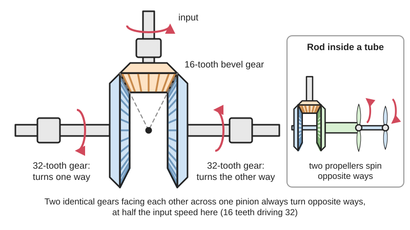

<figure class="eoc-pic eoc-pic-main"><picture><source media="(prefers-reduced-motion: reduce)" srcset="../media/drawn/bevel-splitter-and-counter-rotating-drive.svg"></picture><figcaption><strong>Animation.</strong> Diagram drawn for the encyclopaedia from the research notes. ⚑ Needs confirming: a drawing can simplify or get details wrong; a real photo or a better diagram is welcome.</figcaption></figure>

A driving bevel gear meshes with two bevel gears that face each other across it, so one input turns two outputs on one line in opposite directions; nesting one output shaft inside the other turns two rotors on the same axis against each other, and a dog clutch that picks one of the two gears turns the same set into a forward-and-reverse switch.

**In plain words:** One cone-shaped gear squeezed between two others that face each other, so turning one shaft makes two shafts on the same line spin in opposite directions; put one output shaft inside the other and you get two propellers, blades or discs spinning against each other on one axis. **Proper term:** Bevel splitter (three-way bevel gearbox, T-type bevel gearbox) and contra-rotating [coaxial](../glossary.md#coaxial) drive.

**Also called:** T-gearbox / T-type bevel gearbox / T-shaped bevel gearbox (one input, two outputs; ZIMM); three-way bevel gearbox / 3-way right-angle gearbox / bevel gear splitter; [counter-rotating](../glossary.md#counter-rotating) gearbox / counterrotation gearbox (e.g. 'Rotary cutter with counterrotation gearbox', US patent 5450714); contra-rotating drive / coaxial contra-rotating shafts / coaxial counter-rotating drive; contra-rotating propellers (CRP), coaxial rotors (helicopters) (Wikipedia); bevel reverser / reversing bevel gears with a double clutch (507 Mechanical Movements no. 53); concentric shafts / nested shafts / shaft in a tube (inner shaft and outer tube or barrel); contra-rotating hub (single-shaft input with planetary gearing; Hackaday.io project 6711); coax copter / coaxial RC helicopter (two motors, the electric alternative); Kegelradgetriebe mit zwei Abtrieben (German, bevel gearbox with two outputs) ⚑ [uncertain].

## How it works

Each pair of bevel gears that mesh turns in opposite senses (KHK Gear Technical Reference), so when the input pinion turns, the gear on one side of it is pushed round one way and the gear on the opposite side is pushed round the other way: 'the gears on the horizontal shaft are loose, and are driven in opposite directions by the third gear' (507 Mechanical Movements no. 53). If the two facing gears are on separate stub shafts, you get two outputs on one line spinning opposite ways; if one gear drives a solid inner shaft and the other drives a tube around it, 'the upper driven gear and lower driven gear ... rotate in opposite directions along the same axis' (US 5450714), giving coaxial counter-rotation. If instead the two gears sit loose on one shaft and a dog clutch slides on a key between them, locking one gear or the other to the shaft makes it turn one way or the other (507 no. 53). A T-type gearbox with one gear fixed on a through output shaft drives both ends of that shaft together, and turning such a gearbox round 180 degrees reverses its output (ZIMM).

## Parts

A small assembly: an input shaft with a bevel pinion; two facing output bevel gears (normally identical, so the two outputs turn at the same speed); either two separate output shafts on one line, one through shaft with the two gears loose on it and a sliding dog clutch between them, or an inner shaft running through an outer tube; bearings for every shaft, thrust bearings or washers to stop the gears pushing apart, and a housing that holds all three gears so their cone tips meet at one point. A bought T-type bevel gearbox puts the pinion and gears in a sealed housing with one input and two outputs.

## Everyday examples

- A hand-cranked egg beater: one drive wheel with gear faces on both sides turns two pinions, so the two beaters 'rotate in opposite directions' (US patent 4193697)
- Coaxial toy and RC helicopters with two rotors on one mast turning opposite ways (Wikipedia 'Coaxial-rotor aircraft')
- Rotary mowers and cutters with two counter-rotating blades on one axis (US patent 5450714) and the Dyson CR01 washing machine's contra-rotating drums (Wikipedia 'Contra-rotating')
- Kinetic sculptures with two patterned discs spinning against each other from one hand [crank](../glossary.md#crank) (Printables 'Kinetic sculpture contra rotating discs')

## When to use it

Use a bevel splitter when one motor or crank must turn two things in opposite directions: two outputs on one line (a pair of rollers, a toy with two arms spinning opposite ways, a mechanism that needs mirror-image motion on both sides), or two rotors on one axis whose twisting forces should cancel (contra-rotating propellers, coaxial helicopter rotors, counter-rotating cutting blades, kinetic sculptures with moire discs). Use a T-type bevel gearbox to tee a long drive shaft off to two sides, e.g. driving screw jacks or lead screws at several points from one motor. Use the two loose bevel gears with a dog clutch between them when you need a simple forward, neutral and reverse switch on a shaft driven one way only.

## When not to use it

If the two outputs must be free to turn at different speeds (wheels on a turning vehicle, two outputs that meet different loads), use a differential, which uses the same gears but leaves the outputs free. If the two outputs should turn the same way, use a through shaft in a T-gearbox, a line shaft, or a belt or chain. For two counter-rotating rotors in a light electric model, two motors on concentric shafts are simpler than a gearbox (ArduPilot CoaxCopter), though they need a controller that balances them. For an in-line input (engine shaft pointing along the propeller axis), a planetary contra-rotating hub is more compact (Hackaday.io 6711). For heavy loads at high speed, buy a gearbox rather than printing one.

## Details

- **What it does (jobs):**
  - change speed or turning force: passes rotation round a right angle into two outputs, with a speed change set by the tooth counts (bought T-gearboxes come in about 1:1 to 3:1; ZIMM)
  - change the kind of motion: one rotation in, two equal and opposite rotations out on one line or on one axis; with a dog clutch, one direction in and a chosen direction out (forward, reverse or neutral)
- **Movement:** rotate: continuous rotation in, continuous rotation out at two outputs that turn in opposite directions (or, in a T-gearbox with a through shaft, both ends of one shaft turning together); unlimited range. The 507 no. 74 variant with a part-toothed (mutilated) input gear gives intermittent rotation in opposite directions
- **Directions it can move (degrees of freedom):** 1: the input and both outputs are geared together, so turning any one fixes the other two (unlike a differential, which looks similar but lets the two outputs turn at different speeds, giving 2); with a dog clutch in neutral the output shaft is free
- **Special behaviour:**
  - motion conversion (e.g. rotary to linear): one rotation becomes two equal and opposite rotations, on one line or on one axis (coaxial contra-rotation)
  - none of the other listed behaviours; a dog clutch added between the two gears makes it a shiftable reverser (507 Mechanical Movements no. 53), and a part-toothed input gives stop-and-go motion (507 no. 74)
- **How it holds:**
  - not a holding joint (it moves or passes on motion): interlocking teeth pass the drive from the input gear to both outputs; gears are fixed to their shafts by keys, pins, [set screws](../glossary.md#set-screw) or clamp hubs
- **Input and output:** Continuous rotation -> two continuous rotations in opposite directions (two outputs on one line, or nested on one axis). Ratio from input to each output = output gear teeth / input pinion teeth; with two identical output gears both outputs turn at the same speed. Bought T-type bevel gearboxes: one input shaft and two output shafts (ZIMM ZK 'T type'), ratios 1:1 to 3:1 (ZIMM). Efficiency per bevel mesh about 98-99% (KHK Gear Technical Reference, intersecting-axis gears 98.0-99.0%); the input pinion takes part in two meshes, so total loss is roughly that of one mesh per output. Shafts: intersecting (input at 90 degrees to the two outputs, outputs in line). Back-drivable: yes, bevel gears are efficient and can be driven from either output, and an output can drive the other output backwards through the input ⚑ [uncertain] (follows from the high efficiency, not stated by a source). Planetary contra-rotating hubs take a single in-line input shaft instead (Hackaday.io 6711; Wikipedia 'Contra-rotating propellers': power is 'transferred ... via a planetary gear or spur gear transmission').
- **Power:** passive (no power needed). The electric alternative, two motors on concentric shafts each driving one rotor, needs power; if one motor stops, the [torques](../glossary.md#torque) no longer cancel and the craft spins (ArduPilot CoaxCopter steers by speeding one motor up and slowing the other down).
- **Load:** Light to medium for hobby builds (toys, kinetic sculptures, RC contra-rotating hubs); heavy in industry (bought T-gearboxes, rotary cutter gearboxes, aircraft contra-rotating propeller gearboxes up to 15,000 shaft hp for the NK-12; Wikipedia 'Contra-rotating propellers'). Weak points: the input pinion carries the load of both outputs; bevel gears push apart along their shafts (thrust), and in a nested drive the inner shaft's thrust must be taken by a bearing against the tube or housing; long nested shafts can whip. Strong in twist; the outputs' twisting reactions cancel each other on the frame, which is why contra-rotation is used (Wikipedia 'Contra-rotating propellers': the torque 'effectively cancels out').
- **Play and precision:** Small [backlash](../glossary.md#backlash) in each of the two meshes; between the two outputs the play adds up (backlash accumulates through gear stages; KHK). Little [tolerance](../glossary.md#tolerance) for [misalignment](../glossary.md#misalignment): the cone tips (apexes) of all three gears must meet at one point (BOSL2 docs: 'The apexes of the [pitch](../glossary.md#pitch) cones must coincide'), and the two output gears must sit at the same distance from the input. In spiral bevel meshes the thrust can pull gears together, and any [axial](../glossary.md#axial--radial) play in the bearings can leave the mesh with no backlash (KHK, spiral bevel forces). Nested shafts need a close, straight fit with bearings or bushings at both ends of the tube.
- **Taking it apart:** removable: gears come off their shafts by undoing keys, pins, set screws or clamp hubs; bought gearboxes bolt in and couple to shafts with ordinary couplings
- **How often it can be reused:** many times: the limit is tooth and bearing wear, not taking it apart
- **Sealing:** none for an open gear set; bought bevel gearboxes are sealed housings with shaft seals and [O-rings](../glossary.md#o-ring) that keep oil in (ZIMM)
- **Adjustable:** Yes, when assembling: backlash and tooth contact are set by shimming each bevel gear along its shaft; with a dog clutch, direction (forward, reverse, neutral) can be changed in use, ideally when stopped or slow because dog clutches engage with a shock (Wikipedia 'Dog clutch'). A T-gearbox's output direction can be reversed by mounting it the other way round (ZIMM: '180 degree rotation to change the direction of rotation').
- **Access needed:** end of a tube or shaft: gears, bearings and the outer tube slide on from shaft ends; a bought gearbox couples to shaft ends
- **Materials:** Gears: steel, sintered metal, nylon or acetal (bought); PLA, PETG or nylon for printed light-duty sets. Shafts: steel rod, with a steel, brass or aluminium tube as the outer shaft, or printed tubes for toys (the Mcchat kinetic sculpture prints its nested axles). Housings: aluminium or cast iron (ZIMM uses EN-GJL-250 cast iron or EN AW-6082 aluminium), printed or plywood frames for models. Suits metal, wood and rigid plastic frames that can hold three shafts accurately; poor in card, foam or clay frames, which cannot hold the cone tips together.
- **Heat, cold, water and wear:** PLA gears soften with heat (about 60 C) and [creep](../glossary.md#creep) under constant load ⚑ [uncertain] (general printing guidance, not re-checked in this session); nylon gears change size with humidity. Fast-spinning printed discs or propellers can crack and fly apart ⚑ [uncertain] (general experience). Open gears pick up dust; sealed bought gearboxes keep oil in and dirt out (ZIMM). Vibration loosens set screws, letting gears walk apart along their shafts; fix them with keys, pins or thread-locker. Contra-rotating propellers are noisier than single ones (Wikipedia 'Contra-rotating propellers').

## Making it

- **Ways to make or get it:**
  - off-the-shelf part: T-type bevel gearboxes (one input, two outputs), mitre and bevel gears, metal tube and rod for nested shafts, contra-rotating gearboxes for ultralight aircraft and RC models
  - 3D print (FDM): bevel gears, housings, nested axles and discs for kinetic sculptures and toys
  - CNC: turning the inner shaft and outer tube, boring the housing
  - woodwork: frames for toys and sculptures; historic mill gearing used wooden bevel wheels
- **Printing it in one piece (print in place):** no: the gears, shafts and housing are printed and assembled separately (e.g. the Mcchat kinetic sculpture is assembled from printed gears, axles, spacers and two M3 screws)
- **Tools:** Hex keys or screwdrivers for set screws and housing bolts; shims or thrust washers to set the gear positions and backlash; grease. A bought T-gearbox needs only couplings and mounting bolts.
- **Difficulty:** moderate: printed or bought bevel gears are easy to get, but three gears must meet at one point and a nested drive needs a straight inner shaft running in a tube with bearings; buying a T-type gearbox makes the one-input-two-output version easy

### 3D printing tips

1) Generate the gears as a matched pair: BOSL2 bevel_gear() needs both tooth counts and the shaft angle, because bevel gears only work in designed pairs, and meshing gears 'must be of opposite handedness'; for a splitter make the two output gears the same part and the input its mate. 2) Place all three so their cone tips meet at one point (BOSL2: 'The apexes of the pitch cones must coincide'); model the whole three-gear set in CAD before printing. 3) Choose tooth counts with no common factor between input and outputs for even wear (BOSL2). 4) Straight or zerol (spiral angle 0) teeth are easiest to print; spiral bevels run quieter but their thrust direction changes with direction of rotation (KHK). 5) Give every gear a shoulder, collar or thrust washer: bevel gears push along their shafts (KHK), and in a nested drive the inner and outer gears push in opposite directions. 6) Nested shafts: run a steel rod inside a tube or a printed sleeve with at least two bearings or bushings far apart, and leave about 0.3 mm [clearance](../glossary.md#clearance) between printed parts that must turn freely (Prusa knowledge base); the Mcchat model pushes the long contra-rotating axle through the hole in the short axle gear and checks that 'both output shafts ... are rotating in opposite directions' before screwing the back on. 7) Key the discs or propellers to their shafts (the Mcchat model uses output shafts with keyways). 8) Print gears flat on their back face with teeth up, at least 35% [infill](../glossary.md#infill) and several walls ⚑ [uncertain] (common practice for printed gears). 9) Balance anything spinning fast (discs, propellers) and keep printed propellers for low speeds ⚑ [uncertain] (general practice).

### Buying one (off-the-shelf parts)

T-type bevel gearbox (right-angle gearbox with two output shafts, also sold as 3-way or T-shaped gearbox; solid or hollow output shaft versions; ZIMM KSZ-H, KST, ZK series as examples of the type); mitre gears and bevel gear pairs (straight, spiral; set-screw or keyed bores); dog clutch (claw clutch) and shift fork, or a splined or keyed sliding sleeve; precision steel rod with matching tube (telescoping tube sizes), flanged ball bearings and needle bearings for nested shafts; thrust washers and thrust bearings; shaft collars; contra-rotating gearboxes for ultralight aircraft engines (e.g. Coax-P (brand), per Wikipedia) and RC aircraft; coaxial counter-rotating motor pairs and coaxial helicopter kits for the electric version.

## Rules of thumb

- Every external bevel or spur mesh reverses direction (KHK Gear Technical Reference p. 7), so the two gears facing each other across one pinion always turn opposite ways (507 Mechanical Movements no. 53).
- Speed of each output = input speed x (input teeth / output teeth); make the two output gears identical for equal and opposite speeds (KHK, speed ratio i = z2/z1).
- Bevel gears must be designed in mated pairs at the chosen shaft angle, with the same tooth size and pressure angle (almost always 20 degrees) and opposite handedness; their cone tips must coincide (BOSL2 gears.scad documentation).
- Efficiency of intersecting-axis (bevel) gears: 98.0-99.0% per mesh (KHK Gear Technical Reference, table 1.1).
- T-type bevel gearbox = one input shaft, two output shafts; L type = one input, one output to the left or right; hollow output shafts save space (ZIMM ZK types). Turning a symmetrical bevel gearbox round 180 degrees reverses its output (ZIMM).
- A dog clutch sliding on a key (feather) between two loose bevel gears selects forward or reverse (507 no. 53); dog clutches never slip but engage with a shock, so they are 'best used when sudden starting action is acceptable and the inertia of the system is small' (Wikipedia 'Dog clutch').
- Contra-rotating propellers cancel each other's torque and showed efficiency gains of about 8% (tractor) to 16% (pusher), but can be up to 30 dB louder in some directions; more spacing between the two propellers, fewer blades or a smaller rear propeller reduce the noise (Wikipedia 'Contra-rotating propellers').
- Coaxial rotors on concentric shafts turning opposite ways remove the need for a tail rotor; yaw is steered by making one rotor's torque larger than the other's (Wikipedia 'Coaxial-rotor aircraft'); a two-motor coax copter does this by speeding one motor up and slowing the other (ArduPilot docs).

## Common failures

1) Gears skip or click because they push apart under load: stiffen the frame, add thrust washers or collars, and mount gears close to bearings (KHK). 2) Noisy, rough running from cone tips that do not meet at one point or output gears at different distances from the input: model the set together and shim each gear (BOSL2; KHK). 3) Gears that were not designed as mated pairs, or spiral gears of the wrong hand, do not mesh (BOSL2). 4) The inner shaft binds in the tube because it is bent, too tight or unsupported at one end: use a straight steel rod and two well-spaced bearings or bushings ⚑ [uncertain] (general practice). 5) The two outputs creep apart in angle under load because of backlash in both meshes (KHK: backlash adds up through stages); [preload](../glossary.md#preload) or choose better gears if the phase matters. 6) Set screws loosen and gears or discs slip on their shafts: use keyed shafts (as in the Mcchat model), D-flats or pins. 7) Dog clutch teeth chip if shifted at speed (Wikipedia 'Dog clutch'). 8) Contra-rotating propellers that are too close together are noisy (Wikipedia 'Contra-rotating propellers').

## Safety

Two sets of blades, propellers or discs turning against each other cut and pinch: the gap between them is a scissor, and anything caught is pulled in from both sides; guard them with a cage or shroud, and keep hands, hair and loose clothing away. Never put hands under a running counter-rotating cutter (the patent's rotary cutter shreds vegetation). Gear meshes are in-running nips; OSHA 1910.219(f) requires gears to be guarded by a complete enclosure or a guard extending above the mesh point, and the same is good practice at home. Printed propellers or discs can break at speed and throw pieces; run them slowly at first and stand out of their plane. RC coaxial helicopters and coax copters can spin hard if one motor fails or is wired the wrong way; test with the rotors off. Dog clutches engage with a jolt (Wikipedia 'Dog clutch'); shift them stopped or slow.

## Related

- Bevel gears (incl. mitre and crown gears): a single bevel pair turning a corner; this entry uses three bevel gears
- Differential (bevel gear differential): the same gears in a cage, but the outputs are free to turn at different speeds
- Planetary gear set: the basis of in-line contra-rotating propeller hubs and gearboxes
- Dog clutch (claw clutch): slides between the two loose bevel gears to choose forward or reverse
- Line shaft and power take-off: one shaft driving several outputs, usually all the same way
- Linked lead screws: T-type bevel gearboxes along one shaft drive several screw jacks in step
- Spur gear pair and gear train: a central gear driving gears on each side also gives outputs turning opposite to it, but on parallel shafts
- Intermittent gear (mutilated gear): with a part-toothed input the splitter gives stop-and-go opposite motions (507 no. 74)
- Several motors driving one load: two motors on concentric shafts are the electric alternative for coaxial rotors

## Make it yourself

- [Kinetic sculpture contra rotating discs by Mcchat (URL from Printables API, page not opened)](https://www.printables.com/model/120260-kinetic-sculpture-contra-rotating-discs): Hand-cranked printable sculpture: spur gears drive an angled (bevel) gear that turns a short outer axle and a long inner axle in opposite directions, each carrying a patterned disc; needs two 3x10 mm screws *(licence: CC BY)*
- [No. 7 Pulley transmission (507 Mechanical Movements) by Marcos Cerro (URL from Printables API, page not opened)](https://www.printables.com/model/1344878-no-7-pulley-transmission-507-mechanical-movements): Printable model of 507 no. 7: a hollow shaft and an inner shaft each carrying a bevel gear, so shifting the belt engages, disengages or reverses the upright shaft *(licence: CC BY-NC)*
- [BOSL2 gears.scad (OpenSCAD library source): bevel_gear()](https://raw.githubusercontent.com/BelfrySCAD/BOSL2/master/gears.scad): Parametric generator for matched straight, zerol and spiral bevel gears at any shaft angle; use it to make the input pinion and two identical output gears *(licence: BSD 2-Clause)*

## Pictures, videos and models

- [507 Mechanical Movements no. 53: bevel gears with double clutch](https://507movements.com/mm_053.html): Animated vertical shaft driving two loose bevel gears in opposite directions, with a sliding double clutch choosing which one drives the horizontal shaft *(licence: Book public domain; website animation link only)*
- [507 Mechanical Movements no. 7: pulley transmission with bevel gears on nested shafts](https://507movements.com/mm_007.html): A belt shifted onto pulleys fast on a hollow shaft or on the shaft inside it, driving two bevel gears to run an upright shaft either way *(licence: Book public domain; website animation link only)*
- [507 Mechanical Movements no. 74: mutilated bevel gear](https://507movements.com/mm_074.html): A part-toothed bevel gear giving intermittent rotation in opposite directions to two bevel gears *(licence: Book public domain; website animation link only)*
- [Ka-32-coaxial.gif (FOX 52), Wikimedia Commons](https://commons.wikimedia.org/wiki/File:Ka-32-coaxial.gif): A Kamov Ka-32 helicopter with coaxial contra-rotating rotors (used in Wikipedia 'Contra-rotating') *(licence: CC BY-SA 4.0)*
- [Single-feed contra-rotating propeller hub (Hackaday.io project 6711)](https://hackaday.io/project/6711-single-feed-contra-rotating-propeller-hub): Pictures and a SolidWorks animation of an RC-size hub that splits one shaft into two contra-rotating propellers with modified planetary gearing *(licence: link only)*

## Needs confirming

⚑ marks something nobody has confirmed yet: a fact the research could not confirm from a source, a finder value that is a best guess, or an open point from the research notes. Corrections are welcome (see `research/needs-confirming.md`).

- ⚑ 7 sentences on this page marked [uncertain].
- ⚑ Finder value `connects` = shaft (best guess): worked out from its name, but joining parts is not one of its two main jobs
- ⚑ Research note: *Bevel splitter and counter-rotating drive* (450): whether it can be driven backwards is [uncertain].

## Sources

- <https://507movements.com/mm_053.html>
- <https://507movements.com/mm_007.html>
- <https://507movements.com/mm_074.html>
- <https://patents.google.com/patent/US5450714>
- <https://patents.google.com/patent/US4193697>
- <https://zimm.com/wiki/what-is-a-bevel-gearbox-and-where-is-it-used/>
- <https://zimm.com/zk-bevel-gearboxes-types-and-versions/>
- <https://hackaday.io/project/6711-single-feed-contra-rotating-propeller-hub>
- <https://en.wikipedia.org/wiki/Contra-rotating_propellers>
- <https://en.wikipedia.org/wiki/Contra-rotating>
- <https://en.wikipedia.org/wiki/Coaxial-rotor_aircraft>
- <https://en.wikipedia.org/wiki/Dog_clutch>
- <https://ardupilot.org/copter/docs/singlecopter-and-coaxcopter.html>
- <https://khkgears.us/media/izojpong/gear_guide1.pdf>
- <https://raw.githubusercontent.com/BelfrySCAD/BOSL2/master/gears.scad>
- <https://help.prusa3d.com/article/modeling-with-3d-printing-in-mind_164135>
- <https://www.osha.gov/laws-regs/regulations/standardnumber/1910/1910.219>
- <https://commons.wikimedia.org/wiki/File:Ka-32-coaxial.gif>
- <https://api.printables.com/graphql/>
