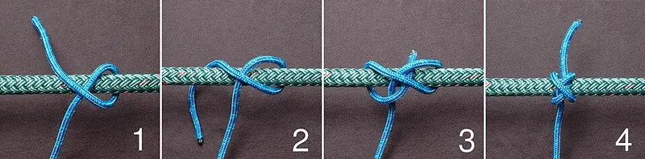

<figure class="eoc-pic eoc-pic-main"><figcaption><strong>How it works.</strong> <a href="https://commons.wikimedia.org/wiki/File:Constrictor-ABOK-1249.jpg">Constrictor-ABOK-1249</a> by David J. Fred, <a href="https://creativecommons.org/licenses/by-sa/2.5">CC BY-SA 2.5</a>, from Wikimedia Commons.</figcaption></figure>

A group of knots and wrappings that squeeze round something to hold it together: the constrictor knot grips a bundle, bag neck or hose so hard it may have to be cut off, a seizing binds two ropes side by side with many turns of small twine, and cable lacing ties wire bundles into a neat loom with a row of locked stitches.

**In plain words:** Knots and wrappings of string pulled so tight round a bundle, the neck of a bag, a hose, or two ropes lying side by side that they squeeze everything together and won't slip, like a hose clip made of string. **Proper term:** Binding knots and seizings: the constrictor knot (with the double constrictor), seizings, and cable lacing of wire bundles.

**Also called:** constrictor knot (ABOK #1249; Animated Knots cites ABOK #1188, p. 216), historically 'gunner's knot' (Wikipedia 'Constrictor knot'; Animated Knots); double constrictor knot (ABOK #1252), slipped constrictor knot (ABOK #1250) and cross constrictor knot (Wikipedia 'Constrictor knot'); strangle knot (ABOK #1239): a close relative with the ends coming out at the edges; each half of a double fisherman's knot (Wikipedia 'Strangle knot'); miller's knot, sack knot, bag knot (ABOK #1241-#1244): easier binding knots for the neck of a sack (Wikipedia 'Miller's knot'; Animated Knots); boa knot: a modern binding knot (Peter Collingwood, 1996) that holds even when the bundle is cut off close to it (Wikipedia 'Boa knot'); transom knot (ABOK #1182, #1255): a light binding for two sticks crossing at a right angle, e.g. kite spars (Wikipedia 'Transom knot'); seizing, round seizing, throat seizing, flat seizing, racking seizing (racked turns) (Wikipedia 'Seizing'; ropeworks.biz; Encyclopaedia Britannica 1910 via ClipArt ETC); cable lacing, harness lacing, lacing cord, lacing tape, running lockstitch, 'cableman's knot', marline hitching (ABOK #3115) (Wikipedia 'Cable lacing'; Bureau of Naval Weapons 1962); spot tie, string tie: a single tie of lacing tape, a clove hitch topped by a square (reef) knot (NASA-STD-8739.4A; AeroElectric Connection); box stitch, Chicago stitch and Kansas City stitch: telephone-exchange styles for lacing cables to a rack (Wikipedia 'Cable lacing').

## How it works

A constrictor knot is a turn round the object with an overhand knot trapped under a riding turn (a turn that crosses over it); pulling the ends tightens the overhand, and the riding turn presses down on it so it can't work loose (Wikipedia 'Constrictor knot'). It needs a curved surface for the riding turn to grip the knot underneath, so it 'fails when tied against a flat surface' (Animated Knots). A seizing uses string or small cord to 'produce friction and leverage to immobilize larger ropes': a layer of tight wrapping turns round both ropes, a layer of riding turns in the grooves between them, then frapping turns between the ropes that cinch the wraps together (Wikipedia 'Seizing'; ropeworks.biz). Cable lacing runs one cord along a wire bundle, wrapping it at short intervals, with each wrap locked by a lockstitch so it can't slacken; stand-alone spot ties do the same job one at a time (Wikipedia 'Cable lacing'; NASA-STD-8739.4A §9.2).

## Parts

Single piece: a length of twine, small cord or flat lacing tape, plus the bundle, rope or hose it is tied round. A seizing is many turns of one piece of twine; cable lacing is one long piece of lacing tape (or many short spot ties).

## Everyday examples

- Tying the neck of a sack or bin bag tightly shut (Animated Knots; Wikipedia 'Miller's knot')
- A string tie used as an emergency hose clamp, e.g. on a split radiator hose (Animated Knots; AeroElectric Connection)
- Neatly laced wire bundles in old telephone exchanges, vintage radios and spacecraft (Wikipedia 'Cable lacing')
- The eye at the end of a sailing boat's stay held by round seizings, and a quick binding on a fraying rope end before it is whipped (Wikipedia 'Seizing'; Animated Knots)

## When to use it

Use a constrictor when you want a fast, very firm binding with nothing but string: closing a bag or sack, tying a bundle of sticks, canes or tubes, holding rope strands together while splicing or before whipping, holding parts together while glue sets, or as a temporary hose clamp or cable tie (Animated Knots; Wikipedia 'Constrictor knot'). Use a double constrictor for slippery or waxed twine. Use a seizing to bind two ropes, or two parts of one rope, side by side, for example to hold an eye in a rope's end without a splice; it is less bulky than a knot and doesn't bend or damage the rope's fibres (ropeworks.biz; Wikipedia 'Seizing'). Use cable lacing or spot ties to bundle wires in robots, printers, cars and electronics where you want a slim, flexible loom with no sharp cut ends; it 'does not create obstructions along the length of the cable' the way cable ties do (Wikipedia 'Cable lacing'; AeroElectric Connection).

## When not to use it

Not for heavy or critical loads: seizings slip as a loaded rope stretches thinner (Wikipedia 'Seizing'); use a splice or rated hardware. Never for holding a person. Not on flat or square-edged surfaces (Animated Knots), and not where you'll need to undo it often: use a miller's knot, which 'is suitable for most applications, and is easier to tie and untie' (Wikipedia 'Miller's knot'), a slipped constrictor, a cord lock, or a reusable hook-and-loop cable tie. Not as a lasting hose clamp on anything under pressure: fit a worm-drive or spring hose clamp. Not to join two ropes end to end (use a bend), to make a loop (use a fixed loop knot), to finish a rope end for good (use whipping or heat-sealing), or to build frames from poles (use pole lashings; the transom knot is only a light-duty one, Wikipedia 'Transom knot'). On soft or delicate items it can crush or mark them (Wikipedia). For flight or mains equipment, follow the wiring standard that applies; this entry gives no mains wiring steps, and mains work must follow the law where you live.

## Details

- **What it does (jobs):**
  - join and hold: binds a bundle of sticks, wires or rope strands, closes a bag neck, holds a hose on a pipe or holds parts together while glue sets
  - tighten and hold tension: it is pulled up hard round the object and keeps squeezing
- **Movement:** none: a good binding holds everything still; slipping along the object counts as failure.
- **Directions it can move (degrees of freedom):** 0 at the binding: the bound parts can't slide or turn against each other, though the bundle as a whole can still bend.
- **Special behaviour:**
  - [self-locking](../glossary.md#self-locking) (holds under load, won't back-drive): in a constrictor the riding turn clamps the overhand knot, so it won't loosen by itself and is 'difficult or impossible to untie once tightened' (Wikipedia 'Constrictor knot'); each lockstitch in cable lacing locks its own turn (Bureau of Naval Weapons 1962: the 'cableman's knot ... is self locking')
  - tensioning (takes up slack and holds): the knot or wrap is pulled up tight and holds that squeeze
  - quick-release only in the slipped form: a slipped constrictor or miller's knot pulls undone with its loop, though a slipped constrictor 'can still be very difficult to release' when worked tight (Wikipedia 'Constrictor knot'; Animated Knots 'Miller's Knot')
- **How it holds:**
  - friction or clamping ([force-fit](../glossary.md#form-fit--force-fit--material-bond)): turns of cord squeeze the bundle, and friction between the turns and the object holds it (Wikipedia 'Seizing'; 'Constrictor knot')
- **Input and output:** not applicable
- **Power:** passive (no power needed)
- **Load:** Electrical: not a conductor (lacing only bundles and supports wires and carries no current). Mechanical load: light. A binding is strong at squeezing round the object, which is why a constrictor 'has been used as a temporary hose clamp' and can hold parts for gluing (Animated Knots), but seizings 'are not recommended for heavy loads for critical use as strain reduces the diameter of the main rope and can permit slippage even with proper construction' (Wikipedia 'Seizing'). The constrictor is 'extremely secure when tied tightly around convex objects' but fails on flat surfaces (Wikipedia; Animated Knots). Weak along the object if it is smooth or tapered and the binding can slide off the end (Wikipedia: use a boa knot when the object is cut close). No tested strength figures for binding knots or seizings were found ⚑ [uncertain]. Never use them to hold a person.
- **Play and precision:** not applicable
- **Taking it apart:** semi-permanent (can be undone but may damage parts): a tight constrictor usually has to be cut, by cutting the riding turn, and 'the underlying wraps will protect the bound object from being damaged by the knife' if you don't cut too deep (Wikipedia 'Constrictor knot'; Animated Knots). Seizings 'semi-permanently bind' and are cut away when no longer needed, leaving the rope undamaged (Wikipedia 'Seizing'; ropeworks.biz). Spot ties, plastic straps and lacing used only to hold wires temporarily are removed before a braid is applied (NASA-STD-8739.4A §9.4.5).
- **How often it can be reused:** once: the cord is normally cut off; slipped forms and loosely tied miller's knots can be untied and retied a few times.
- **Sealing:** none: it squeezes but doesn't seal; as a temporary hose clamp it can only slow a leak, so fit a proper hose clamp.
- **Adjustable:** no: once pulled tight a constrictor or seizing can't be eased or tightened; untie or cut it and tie a new one. Cable lacing can have wires added only by cutting and relacing, though spot ties can be added (Wikipedia 'Cable lacing' shows a Chicago stitch with cables added).
- **Access needed:** end of a tube or shaft: the twisting and folding methods tie the constrictor in the bight and drop it over a free end (Wikipedia; Animated Knots); without a free end you need room to pass the cord right round the object and tie it with the end (Animated Knots 'Rope End Method').
- **Materials:** Cord: twine and other small cord, because 'the binding force is concentrated over a smaller area' (Wikipedia 'Constrictor knot'); seizing twine about 1/8 to 1/12 of the rope's diameter (ropeworks.biz). Lacing: traditionally waxed linen cord; modern flat lacing tapes in nylon, polyester, PTFE (Teflon), fibreglass and Nomex with coatings that help knots hold (Wikipedia 'Cable lacing'); flat ribbon is preferred to round cord 'to reduce the possibility of cutting into wire insulation' (Bureau of Naval Weapons 1962); waxed polyester flat lace has 'excellent longevity' under a car or aircraft engine cowl, where nylon cable ties suffer from ozone, hydrocarbons and embrittlement (AeroElectric Connection). Slippery or waxed twine calls for the double constrictor (Wikipedia). Objects: works best on round or convex things such as rope, hose, tubing, stick bundles, bag necks and wire bundles; poor on flat or square-edged objects unless the knot sits over a corner (Wikipedia; Animated Knots). Soft items can be damaged or disfigured (Wikipedia).
- **Heat, cold, water and wear:** Slippery cord: synthetic and waxed twines slip more, so use the double constrictor (Wikipedia 'Constrictor knot'). Rope under strain gets thinner, so seizings can slip (Wikipedia 'Seizing'). Over time and heat, wire insulation can [creep](../glossary.md#creep): AeroElectric has seen PTFE-insulated bundles 'tied so tightly that the insulation cold-flowed and allowed wires to short together'. Engine-bay conditions: nylon cable ties suffer from ozone, hydrocarbons and embrittlement as they lose plasticiser, while polyester flat lace lasts well (AeroElectric Connection). Heat: nylon braid ends can be sealed with a hot knife (NASA-STD-8739.4A §9.3.10), which also means synthetic cords melt near hot parts. Vibration: lockstitched lacing and constrictors don't shake loose the way half hitches can (Bureau of Naval Weapons 1962; Wikipedia).

## Making it

- **Ways to make or get it:**
  - off-the-shelf part: twine, whipping or seizing twine, waxed lacing tape, tied by hand
  - 3D print (FDM): printed helpers such as lacing-tape spools, wire harness jigs and tool handles, and printed parts with round [bosses](../glossary.md#boss) or grooves for a binding to sit in
- **Printing it in one piece (print in place):** no: the knot is tied in cord; only helpers and the parts it is tied round can be printed.
- **Tools:** None for the knot itself. A sharp knife to cut it off; two rods or spikes as handles (tied on with marlinespike hitches) to pull it really tight 'without injuring the hands' (Wikipedia 'Constrictor knot'); a pick or marlinspike to loosen a jammed one. For telephone-style lacing stitches, a cable sewing needle (Wikipedia 'Cable lacing'); for long harnesses, a harness forming board with pegs or springs to hold the wires (Bureau of Naval Weapons 1962).
- **Difficulty:** easy to moderate: easy for the constrictor and spot ties (one knot, no tools); moderate for neat seizings and long runs of cable lacing, which take practice to keep even and tight.

### 3D printing tips

Bindings are tied, not printed, but they are handy on printed parts. 1) Give the binding a round surface: a constrictor 'fails when tied against a flat surface' (Animated Knots), so add a round boss, or on a square part arrange the knot so its overhand sits over a corner with the riding turn on top (Wikipedia 'Constrictor knot'). 2) A shallow groove round the boss stops the binding sliding off the end ⚑ [uncertain]. 3) To hold printed parts while glue sets, pass the cord round them and tie a constrictor with the end (Animated Knots 'Rope End Method'); put a scrap of card or cloth under it on thin or soft prints, because it 'can damage or disfigure items it is tied around' (Wikipedia); the padding is general advice ⚑ [uncertain]. 4) For wiring looms on printers and robots, lay the wires out on a jig first, as the US Navy did on pegboards and spring boards (Bureau of Naval Weapons 1962); printed harness jigs exist (Printables 1141118). 5) A printed lacing-tape spool holds the tape in your palm while you lace, with a small end that fits a drill chuck for fast winding and a cone end to help tie knots as you go (Printables 973050). 6) Don't lace so tight that the tape digs into soft printed cable clips or wire insulation: tight enough to stop slipping 'but should not cut into the insulation' (Bureau of Naval Weapons 1962).

### Buying one (off-the-shelf parts)

Search catalogues for: 'waxed lacing tape' or 'flat braided lacing tape' (nylon, polyester, Nomex, PTFE or fibreglass; Wikipedia 'Cable lacing'), 'lacing cord' (round cord sizes #4 to #12 by bundle size; Bureau of Naval Weapons 1962), 'whipping twine' and 'seizing twine', 'cable sewing needle' or 'cable lacing needle' (Wikipedia names Jonard (brand) needles), 'fid' and 'marlinspike', and a 'harness board'. Alternatives sold for the same jobs: cable ties, hook-and-loop cable ties, and worm-drive or spring hose clamps.

## Rules of thumb

- Constrictor: tie it on a curved (convex) surface; it 'fails when tied against a flat surface' (Animated Knots). On a square object, put the overhand part over a corner with the riding turn on top, or finish with an extra overhand knot where there are gaps under it (Wikipedia 'Constrictor knot').
- Use the double constrictor for very slippery twine, especially waxed; 'Adding more than one extra riding turn does not add to its security' (Wikipedia 'Constrictor knot').
- To remove a jammed constrictor, cut the riding turn on top of the other turns, which protect the rope or object under the blade (Wikipedia 'Constrictor knot'; Animated Knots).
- Constrictor whipping: a series of constrictors tied from the end of a rope back towards the standing part makes a temporary whipping that Animated Knots' contributor found 'virtually indestructible' (Animated Knots 'Rope End Method').
- Seizing (from a hobbyist rope-work site): twine 1/8 to 1/12 of the rope's diameter, about 3 ft of twine per inch of rope diameter; wrap a width equal to the rope's diameter; lay riding turns in the grooves 'not so tight as to separate the wrapping turns'; finish with frapping turns between the ropes and a square knot; use 3 to 4 seizings to hold an eye, with racked turns at the first one where the strain is greatest (ropeworks.biz).
- Cable lacing spacing, side by side: NASA allows at most 19.1 mm between ties on bundles up to 6.4 mm across, 38.1 mm up to 12.7 mm, 50.8 mm up to 25.4 mm and 76.2 mm on larger bundles, with a tie immediately before and after every breakout (NASA-STD-8739.4A Table 9-1, §9.2.8); the 1962 Navy manual puts lock stitches at 'approximately 1/2-inch intervals' (Bureau of Naval Weapons); AeroElectric suggests running ties 'at 1 to 2 inch intervals' for hobby aircraft wiring (AeroElectric Connection).
- Spot ties: a clove hitch followed by a square knot, 'or other non-slip knots', with the ends trimmed (NASA-STD-8739.4A §9.2.2, §9.2.5); a surgeon's knot is an acceptable substitute for the square knot (Wikipedia 'Cable lacing', citing NASA). AeroElectric uses a 12 in or longer piece and trims the ends to 1/4-1/2 in.
- For continuous lacing, cut cord about two and a half times the harness length, start with a wrap of about twelve turns locked by a lock stitch, and always pass the cord over the loop, 'never under', so each stitch locks (Bureau of Naval Weapons 1962). Use lockstitches (marline hitching, based on overhand knots); 'A series of half-hitches, while visually similar, is not recommended' (Wikipedia 'Cable lacing').
- How tight: lacing 'should be sufficiently tight to minimize slippage but should not cut into the insulation' (Bureau of Naval Weapons 1962); NASA's rule for cable straps is tight enough not to slide, but not so tight 'as to cause noticeable indentation or distortion of the wires' (NASA-STD-8739.4A §9.6.4).

## Common failures

Slipping off or loosening on a flat or tapered surface: tie it on a round part or over a corner (Animated Knots; Wikipedia). Jamming so it can't be untied: expected with a tight constrictor; cut the riding turn (Wikipedia; Animated Knots), or tie the slipped form or a miller's knot if it must come off. Capsizing: some bag knots, such as miller's knot (2) (ABOK #1242), which 'sometimes capsizes' (Animated Knots). Sliding off a short bundle cut close to the knot: use a boa knot (Wikipedia 'Boa knot'). Crushing or marking a soft bag or item: keep the wraps together and don't over-tighten (Wikipedia). A seizing slipping under heavy strain (Wikipedia 'Seizing'), or riding turns pulled so tight they separate the wrapping turns (ropeworks.biz). Lacing that loosens because half hitches were used instead of lockstitches (Wikipedia 'Cable lacing'). Lacing so tight it cuts or cold-flows the insulation (Bureau of Naval Weapons 1962; AeroElectric Connection). NASA's list of lacing defects: improperly laced ties, wrong material, bundle 'damaged or deformed by tie', 'Loose ties', 'Ends not trimmed' and 'Incorrect spacing of ties for bundle size' (NASA-STD-8739.4A).

## Safety

Seizings and binding knots are not for heavy or critical loads (Wikipedia 'Seizing'), and a home-made knot, seizing or lacing must never hold a person. Pulling a constrictor really tight with bare hands can cut them: use two rods as handles (Wikipedia 'Constrictor knot'). When cutting a jammed binding, cut the riding turn carefully and not too deep, with the blade moving away from your hands (general knife safety) ⚑ [uncertain]. Never tie a constrictor or any binding round a finger, wrist, limb, neck or any living thing: it jams and may be impossible to undo without cutting. Medical note: the constrictor has been studied as a surgical ligature (Wikipedia, citing Taylor and Grogono 2014); that use is out of scope here, and nothing in this entry is guidance for use on or in people. Electrical: lacing pulled too tight can damage insulation and short wires (AeroElectric Connection), and starting stitches 'shall not place stress on wire terminations' (NASA-STD-8739.4A §9.2.4). Trimmed cable-tie ends can be sharp, which string ties avoid (AeroElectric Connection).

## Related

- Hose clamp (worm-drive clamp, ear clamp, spring hose clamp): the hardware version, for any hose that must stay tight under pressure
- Linear [ratchet](../glossary.md#ratchet) (cable-tie ratchet): cable ties do the bundling job in seconds but leave a hard lump and sharp ends
- Hook-and-loop fastener: reusable cable wraps for bundles that change often
- Basic knots (overhand knot, half hitch, reef knot): the reef knot is also a binding knot, but far less secure than the constrictor
- Rope-end finishing (whipping, heat-sealing, back splice, aglet): whipping binds a rope end for good, where a constrictor is a quick temporary binding
- Rope splices (eye splice, short splice, braided-rope splice): a splice keeps nearly all of a rope's strength where a seized eye is only for light loads
- Pole lashings (square, diagonal, [shear](../glossary.md#peel-vs-shear) and tripod lashings): wrap and frap poles into frames; the transom knot is a light version
- Hitches to a post, rail, ring or eye (clove hitch): the clove hitch is the base of the spot tie and close cousin of the constrictor
- Lacing (cord through rows of holes or eyelets): a different lacing, which pulls two edges together through holes
- Cable [gland](../glossary.md#gland) and strain relief: takes the pull off wires where they enter a box, which lacing must not do
- Spring clip clamp (clothes-peg clip, spring clamp): a quicker way to hold small parts while glue sets

## Make it yourself

- [Cable Lacing Spool (4o66, Printables) (URL from Printables API, page not opened)](https://www.printables.com/model/973050-cable-lacing-spool): A palm-sized printed spool for flat waxed lacing tape, with a small end that fits a drill chuck for winding and a cone end to help tie knots as you lace *(licence: Creative Commons Attribution-ShareAlike)*
- [Wire Harness Jig (zimo, Printables) (URL from Printables API, page not opened)](https://www.printables.com/model/1141118-wire-harness-jig): A printed tool for twisting wires evenly into a harness before tying or lacing it *(licence: Creative Commons Attribution)*
- [Marlin spike / lacing needle combo (funkysod, Printables) (URL from Printables API, page not opened)](https://www.printables.com/model/826627-marlin-spike-lacing-needle-combo): A printed handle for a home-made steel marlinspike and lacing needle, the tools used to open and tighten seizings and lacing *(licence: Creative Commons Attribution-NonCommercial)*

## Pictures, videos and models

- [Constrictor Knot (Twisting Method) (Animated Knots by Grog)](https://www.animatedknots.com/constrictor-knot-twisting-method): Step-by-step animation and video of tying the constrictor knot in the bight and dropping it over an end, with notes on uses, release and its failure on flat surfaces *(licence: link only)*
- [Constrictor-ABOK-1249.jpg (Wikimedia Commons, by David J. Fred)](https://commons.wikimedia.org/wiki/File:Constrictor-ABOK-1249.jpg): Four photographed steps in tying a constrictor knot round a post (ABOK #1249) *(licence: CC BY-SA 2.5)*
- [Forestay-Eye-Round-seizings-Bulls-eye.jpg (Wikimedia Commons, by David J. Fred)](https://commons.wikimedia.org/wiki/File:Forestay-Eye-Round-seizings-Bulls-eye.jpg): The eye at the end of a forestay held by three round seizings *(licence: CC BY-SA 2.5)*
- [Cable lacing close-up 2.jpg (Wikimedia Commons, by impulselabs via Flickr)](https://commons.wikimedia.org/wiki/File:Cable_lacing_close-up_2.jpg): A wiring harness laced with waxed cord in a series of running lockstitches *(licence: CC BY-SA 2.0)*
- [Cable-lacing-nasa-style-spot-ties.jpg (Wikimedia Commons, by David J. Fred)](https://commons.wikimedia.org/wiki/File:Cable-lacing-nasa-style-spot-ties.jpg): NASA-style spot ties in Nomex lacing tape: a clove hitch round the bundle topped by a reef knot *(licence: CC BY-SA 2.5)*

## Needs confirming

⚑ marks something nobody has confirmed yet: a fact the research could not confirm from a source, a finder value that is a best guess, or an open point from the research notes. Corrections are welcome (see `research/needs-confirming.md`).

- ⚑ 4 sentences on this page marked [uncertain].
- ⚑ Finder value `usual_process` = sewing or leatherwork (best guess): first-listed process was "off-the-shelf part: twine, whipping or s"; knots family, so set to sewing or leatherwork
- ⚑ Research note: *Binding knots and seizings*: the constrictor's ABOK number differs (#1249 Wikipedia, #1188 on p. 216 per Animated Knots), both recorded; cable-lacing tie spacing differs between NASA-STD-8739.4A Table 9-1, the 1962 US Navy lacing manual and AeroElectric, recorded side by side; twine-size and turn rules for seizings come from ropeworks.biz, a hobbyist site, and are labelled so. **Convention to decide:** the entry is tagged with the electrical family but carries no current, so its `load` starts 'Electrical: not a conductor'; none of the fixed electrical lead-ins fits such entries.

## Sources

- <https://en.wikipedia.org/wiki/Constrictor_knot>
- <https://en.wikipedia.org/wiki/Seizing>
- <https://en.wikipedia.org/wiki/Cable_lacing>
- <https://en.wikipedia.org/wiki/Strangle_knot>
- <https://en.wikipedia.org/wiki/Miller%27s_knot>
- <https://en.wikipedia.org/wiki/Boa_knot>
- <https://en.wikipedia.org/wiki/Transom_knot>
- <https://www.animatedknots.com/constrictor-knot-twisting-method>
- <https://www.animatedknots.com/constrictor-knot-rope-end-method>
- <https://www.animatedknots.com/millers-knot>
- <https://nepp.nasa.gov/files/27631/nstd87394a.pdf>
- <https://www.dairiki.org/hammond/cable-lacing-howto/>
- <http://www.aeroelectric.com/articles/cable_lace/cable_lace.html>
- <https://ropeworks.biz/archive/seizing.html>
- <https://etc.usf.edu/clipart/58400/58442/58442_rack-seizing.htm>
- <https://commons.wikimedia.org/wiki/File:Constrictor-ABOK-1249.jpg>
- <https://commons.wikimedia.org/wiki/File:Double-Constrictor-ABOK-1252.jpg>
- <https://commons.wikimedia.org/wiki/File:Forestay-Eye-Round-seizings-Bulls-eye.jpg>
- <https://commons.wikimedia.org/wiki/File:Cable_lacing_close-up_2.jpg>
- <https://commons.wikimedia.org/wiki/File:Cable-lacing-nasa-style-spot-ties.jpg>
- <https://api.printables.com/graphql/>
