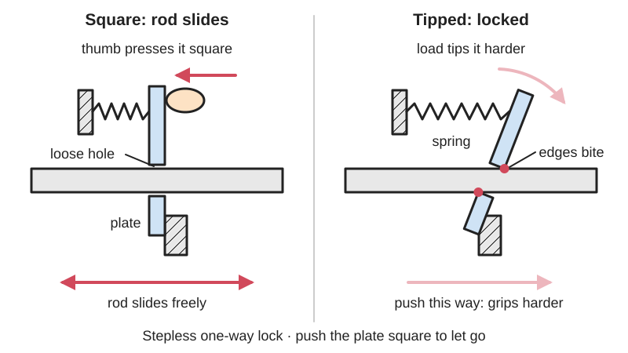
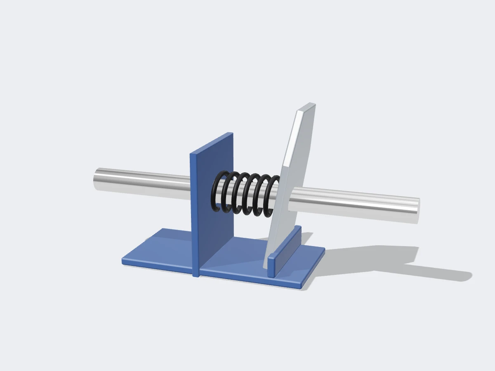

<figure class="eoc-pic eoc-pic-main"><picture><source media="(prefers-reduced-motion: reduce)" srcset="../media/drawn/binding-plate-lock.svg"></picture><figcaption><strong>Animation.</strong> Diagram drawn for the encyclopaedia from the research notes. ⚑ Needs confirming: a drawing can simplify or get details wrong; a real photo or a better diagram is welcome.</figcaption></figure>
<figure class="eoc-pic"><figcaption><strong>Render.</strong> A 3D model made for the encyclopaedia, not a photo: a stand-in until a good real photo is found. ⚑ Needs confirming: a model can simplify or get details wrong; a real photo is welcome.</figcaption></figure>

A flat plate with a slightly oversized hole that slides freely along a rod while it sits square, but tips a few degrees and wedges the edges of its hole against the rod when pushed the other way, giving a stepless one-way lock that you release by pushing the plate square again.

**In plain words:** A plate with a hole that slides along a rod or bar one way, but tips slightly and bites into it when pushed back, like the plates inside a caulking gun or a one-handed bar clamp. **Proper term:** Binding-plate lock (tilting friction plate; canted-plate linear clutch).

**Also called:** tilting friction plate; canted plate / canting plate; jam plate; friction plate or lock plate (caulking guns); drive plate or gripping plate (the plate the trigger tips to push the rod); release plate or holding plate (the plate that stops the rod sliding back); clutch plates (pipe clamps and bar clamps); driving lever and braking lever (patent terms in one-handed bar clamps); feeding plate and holding plate (patent terms in caulking guns); binding washer; smooth-rod or friction-drive caulking gun mechanism; Quick-Grip (brand) one-handed bar clamp mechanism; sticky drawer effect (the same jamming, used on purpose).

## How it works

When the plate sits square to the rod, the hole is a loose fit and the rod slides through. A spring tips the plate slightly, so opposite edges of the hole touch opposite sides of the rod. If the rod is pushed the locking way, friction at those two edges tries to tip the plate further, which squeezes the edges harder, so the grip grows with the load, just as a cocked drawer sticks harder the more you push it. Pushed the other way, the rod drags the plate back toward square and it slides. Whether it locks depends on friction against proportions: a tipped part binds when the friction coefficient is at least its engagement length divided by its width (Kalsi Seals Handbook, ch. D21), so a thin plate on a thick rod binds easily. In caulking guns and one-handed clamps the trigger tips a second plate so it grabs the rod and pushes it forward a little on each squeeze, while the holding plate stops it sliding back (US 2,530,359; US 4,081,112; US 4,926,722).

## Parts

A few parts: a smooth rod or flat bar; one or more steel plates with a hole a little bigger than the rod; a small spring that keeps the plate tipped; a housing or edge the plate leans on; and a release lever or thumb plate that pushes it square. Drive versions (caulking gun, one-handed bar clamp) add a second plate that a trigger tips and pushes forward.

## Everyday examples

- Caulking gun: the trigger plate grabs and pushes the rod, and the thumb-release plate at the back stops it sliding back
- One-handed trigger bar clamp: squeeze to walk the jaw along the bar; a braking plate holds it until you press the release lever
- Pipe clamp: a stack of clutch plates on the sliding tail stop grips the pipe
- Sliding-jaw F-style bar clamp: the jaw itself cocks slightly on the bar and holds by friction at the edges of its bar hole (Firgelli mechanism page)
- Hunter's climbing tree stand, which uses the sticky drawer effect on purpose to lock onto the tree (Kalsi, ch. D21, footnote)

## When to use it

When a rod, bar or pipe must hold at any point (not just at notches) against a push in one direction and release instantly by hand: clamps, pushers and feeders, adjustable stops and props, telescoping supports under light to medium loads, and simple trigger-driven straight-line drives. It works with cheap, rough parts; a steel washer on a steel rod will do.

## When not to use it

Avoid it when the rod is plastic, oily, or slick-coated, because it slips: use a toothed linear [ratchet](../glossary.md#ratchet) instead. Avoid it for loads that must never drop, such as anything over people, unless it is a rated product: friction locks slip when surfaces are contaminated or edges wear, so use a positive lock (pin, toothed ratchet or screw). Avoid it where you need to hold both directions: use a clamp collar or [set screw](../glossary.md#set-screw). Avoid it where you need exact, repeatable positions: use indexing holes or a [detent](../glossary.md#detent).

## Details

- **What it does (jobs):**
  - stop it moving back (one-way): the rod or bar slides one way and is held against pushing back
  - lock, and release by hand: press the release plate and it goes square and lets go
  - tighten and hold tension: clamps and caulking guns use it to push and keep pushing
  - change the kind of motion: in trigger tools, squeezing the handle becomes a step-by-step straight push along the rod
- **Movement:** slide: straight along the rod or bar; free and stepless (no notches) one way, locked the other way until released
- **Directions it can move (degrees of freedom):** 1: the plate and rod move only along the rod's length (the rod could also turn in the hole, but that is not used); under load the lock removes that freedom in one direction
- **Special behaviour:**
  - one-way (moves freely one way, locks the other): the tipped plate slides one way and bites the other
  - [self-locking](../glossary.md#self-locking) (holds under load, won't back-drive): the harder the load pushes, the harder the plate's edges bite
  - hand-release only (locks under load, releases when a person operates it): pressing the release plate square frees the rod, as with a caulking gun's thumb plate or a bar clamp's release lever
  - quick-release: one press and the rod or jaw slides freely for fast repositioning
  - tensioning (takes up slack and holds): it pushes clamp jaws or a caulk plunger and keeps the pressure on
  - stepless holding: unlike a toothed ratchet it can hold at any point along the rod
- **How it holds:**
  - friction or clamping ([force-fit](../glossary.md#form-fit--force-fit--material-bond)): the edges of the hole grip the rod by friction, wedged tighter by the load
  - spring force (a springy part presses it in place): a small spring keeps the plate tipped so it is ready to bite
- **Input and output:** Holding version: not a motion converter; it simply stops the rod moving back (back-drivable: no, unless the rod is oily, the plate edges are worn, or the plate is held square). Drive version (caulking gun, one-handed bar clamp): repeated trigger squeezes (back-and-forth swing) -> a step-by-step straight push of the rod. Smooth-rod caulking guns with a friction plate give a thrust ratio of about 10:1 or more; older notched ratchet-rod guns about 5:1 (Sashco). The rod runs along the gun or clamp, parallel to the push. Back-drivable: no while the holding plate is engaged.
- **Power:** passive (no power needed)
- **Load:** Medium to heavy along the rod in the locking direction when hard steel plates bite a steel rod, bar or pipe (bar clamps, pipe clamps, caulking guns); zero in the free direction by design. Weak against twisting and sideways loads on the plate. The [holding force](../glossary.md#holding-force) depends on the rod surface: slick galvanized pipe, oily or glue-covered bars and worn plate edges slip (Sawmill Creek forum threads).
- **Play and precision:** Small: the rod [creeps](../glossary.md#creep) back a little while the plate tips from square to biting ⚑ [uncertain: amount not verified], then holds at any point along the rod (stepless, unlike a ratchet's tooth steps). This, plus the rod's springiness, is why caulk keeps oozing after you let go; drip-free guns deliberately let the rod retract a few millimetres when you press the release (Caulk Manufacturing). It tolerates a loose, rough fit: the hole only has to be loose enough for the plate to tip.
- **Taking it apart:** tool-free quick release: press the release plate or lever and the rod slides out
- **How often it can be reused:** many times: it lets go and re-grips thousands of times, but the sharp edges of the hole slowly wear round until it starts to slip ⚑ [uncertain: no cycle count verified]
- **Sealing:** none: nothing makes it seal
- **Adjustable:** yes: stepless, so it holds at any point along the rod; the hold position is set simply by where you stop
- **Access needed:** end of a tube or shaft: the plate is threaded onto the rod or bar from one end
- **Materials:** Plates: hard steel, stamped from sheet, with a sharp sheared edge on one side of the hole that should face the direction it must bite (pipe-clamp and bar-clamp clutch plates, Sawmill Creek). Rods and bars: steel; black iron pipe grips better than galvanized pipe (Sawmill Creek). Housings and triggers: steel, cast metal or plastic. For makers: a steel washer or cut steel plate on a steel rod; plastic plates or plastic rods wear and slip ⚑ [uncertain].
- **Heat, cold, water and wear:** Anything that lowers friction can stop it locking: oil, grease, glue or sealant on the rod (Kalsi: the threshold must be checked with the lubricant present; Caulk Manufacturing on sealant residue on caulk-gun rods). New galvanized coatings are slick and slip until scored (Sawmill Creek). Rust and dirt change the grip and can stop it releasing smoothly. Steel plates and rods are unaffected by normal heat and cold; printed plastic housings may creep under a constant clamping load ⚑ [uncertain]. Strong vibration may let the rod creep in small steps ⚑ [uncertain].

## Making it

- **Ways to make or get it:**
  - off-the-shelf part: salvage plates from caulking guns, pipe clamps or bar clamps, or buy replacement clutch plates
  - sheet metal: drill or punch a hole in steel plate, or use a steel washer
  - CNC or laser cut: steel plates with an accurate hole
  - 3D print (FDM): the housing, trigger, release lever and spring seats, not the biting plate
  - woodwork: frames and jaws for home-made clamps
- **Printing it in one piece (print in place):** no: the biting plate and the rod should be steel and a spring is needed; only the housing and levers are printed
- **Tools:** none to use or release; taking a tool apart to reverse or replace plates usually needs only a screwdriver or pliers ⚑ [uncertain]
- **Difficulty:** moderate: the idea is simple and works with a drilled steel plate or washer, a spring and a steel rod, but the biting parts should be metal, because a printed plastic plate or rod will wear and slip

### 3D printing tips

Print the frame, trigger and release lever, but keep the biting plate and the rod metal (a steel washer or cut steel plate on a ground steel rod or flat bar). Make the plate's hole slightly bigger than the rod so it can tip a few degrees: too loose and it tips too far before biting, too tight and it may not release ⚑ [uncertain: no verified [clearance](../glossary.md#clearance) figure]. Keep the plate thin compared with the rod: a tipped part binds when the friction coefficient is at least engagement length divided by width (Kalsi), so, for example, a 2 mm plate on a 10 mm rod needs a friction coefficient of only about 0.2 to lock ⚑ [uncertain: worked example is an application of Kalsi's rule, not a tested design]. Put the sharp, sheared edge of the hole on the side that should bite (Sawmill Creek). Add a small compression spring to hold the plate tipped and a lever or button that pushes it square to release. Print the housing so the plate's reaction force presses into solid walls rather than pulling layers apart (FFF prints are stronger in one direction than another, Prusa), with thick walls or solid [infill](../glossary.md#infill) around the edge the plate leans on. Keep grease and oil off the rod: lubricant lowers friction and can stop it locking (Kalsi says to design with the lubricant that will be present).

### Buying one (off-the-shelf parts)

Smooth-rod (friction-drive) caulking gun; one-handed trigger bar clamp, e.g. Quick-Grip (brand); pipe-clamp fixtures for black iron pipe (they hold with clutch plates); replacement 'clutch plates' for pipe and bar clamps; steel flat washers and fender washers; small compression springs; ground steel rod ('drill rod') or cold-rolled steel flat bar.

## Rules of thumb

- Binding threshold: a tipped part binds if the friction coefficient is equal to or greater than engagement length divided by engagement width, e.g. 0.8 in / 4.0 in = 0.2 (Kalsi Seals Handbook, ch. D21 'Sticky drawer effect'). A binding plate is deliberately made far thinner than this ratio needs, so it always locks.
- The opposite rule for parts that must slide: keep length/diameter above 1, with 1.6:1 'very good' and 3:1 'awesome'; below 1, slides jam (Slocum, FUNdaMENTALS of Design, Topic 3, p. 3-8). A binding plate deliberately breaks this rule.
- Plate square to the bar = slides; plate held at an angle that is 'transverse but not perpendicular' to the bar = binds (Sorensen and Gatzemeyer, US 4,926,722, quick-action bar clamp).
- Caulking gun grips 'cramp the plunger shaft ... when canted relative to it, and ... release it when perpendicular to it' (Chang, US 4,081,112).
- Fit clutch plates so the sharp edge of the hole bites into the pipe; reversing or re-sharpening worn plates can restore grip (Sawmill Creek forum threads).
- Use black iron pipe rather than galvanized for pipe clamps; the galvanized coating is slick and slips (Sawmill Creek forum).
- Caulking guns: smooth rod with friction plate about 10:1 thrust ratio or more; notched ratchet rod about 5:1 (Sashco).

## Common failures

Slipping: plate edges worn round, plates fitted backwards, weak spring, slick or galvanized bar, oily or glue-covered rod; fixes are to reverse, file or replace the plates so a sharp edge faces the load, fit a stronger spring, roughen or clean the bar, or switch to black pipe (Sawmill Creek). Rod won't retract or release smoothly: sealant or glue residue on the rod, or a burred rod (Caulk Manufacturing). Never locks: plate too thick for the rod or hole too tight to tip, so engagement length divided by width is higher than the friction coefficient (Kalsi). Rod marking: the biting edge scores the rod, so don't use it on finished surfaces.

## Safety

Pinch points between clamp jaws and at the trigger. A clamp or caulk gun stores force, so releasing it under load can make the jaw or rod jump. If the plate slips (oily rod, worn edges) the load moves suddenly; never rely on a home-made friction lock to hold a person or a heavy load overhead. Stamped plates can have sharp edges when you take a tool apart.

## Related

- Linear ratchet (cable-tie ratchet): holds in fixed tooth steps with a positive, non-slipping lock instead of friction
- Cam cleat and rope cam: a toothed or smooth cam wedges a rope instead of a plate wedging a rod
- Wrap-spring clutch: the turning version of a self-tightening friction grip
- Roller clutch and [sprag](../glossary.md#sprag) clutch: turning one-way locks that wedge rollers or sprags instead of tipping a plate
- Shaft collar or set screw: holds a rod in both directions but must be loosened with a tool to move
- Screw clamp: slower, but holds in both directions and can be set to a known force
- [Collet](../glossary.md#collet) or split-cone lock (telescoping poles): clamps all round by screwing a nut, holds both ways

## Pictures, videos and models

- [US4926722A: Quick-action bar clamp (Sorensen and Gatzemeyer, 1990)](https://patents.google.com/patent/US4926722A/en): Patent drawings of a one-handed bar clamp with a trigger-tipped driving lever and a canted, spring-loaded braking lever on the slide bar *(licence: patent document; link only)*
- [US2530359A: Operating mechanism for plungers of caulking guns (Peterson, 1950)](https://patents.google.com/patent/US2530359A/en): Drawings of a caulking gun's feeding plates and spring-loaded holding plate that bind on the plunger rod, with the finger release *(licence: patent document; link only)*
- [Kalsi Seals Handbook, Chapter D21: Sticky drawer effect](https://www.kalsi.com/handbook/D21_Sticky_drawer_effect.pdf): Diagrams of engagement length versus width and of tipped parts binding at opposite corners (Figs. 1 and 3) *(licence: © Kalsi Engineering; link only)*
- [Slocum, FUNdaMENTALS of Design, Topic 3 (p. 3-8, Saint-Venant's principle: bearings)](http://pergatory.mit.edu/resources/FUNdaMENTALs%20Book%20pdf/FUNdaMENTALs%20Topic%203.PDF): Sketches of slides that are stable, marginally stable, or jam, depending on their length-to-width ratio *(licence: © Alexander Slocum, free to read; link only)*
- [Learn all about a caulk gun - Fundamentals of Painting - Trades Training Video Series (TEACH Construction Community Education)](https://www.youtube.com/watch?v=SSKu5k4xVPI): Parts and operation of a caulk gun ⚑ [uncertain: title and channel verified through YouTube's oEmbed data; the video itself was not viewed] *(licence: YouTube standard licence; link only)*

## Needs confirming

⚑ marks something nobody has confirmed yet: a fact the research could not confirm from a source, a finder value that is a best guess, or an open point from the research notes. Corrections are welcome (see `research/needs-confirming.md`).

- ⚑ 9 sentences on this page marked [uncertain].
- ⚑ Finder value `tools` = none, hand tools (source uncertain): `tools_needed` is marked ⚑ [uncertain] here: "…reverse or replace plates usually needs only a screwdriver or pliers ⚑ [uncertain]…"

## Sources

- <https://patents.google.com/patent/US4926722A/en>
- <https://patents.google.com/patent/US2530359A/en>
- <https://patents.google.com/patent/US4081112A/en>
- <https://www.kalsi.com/handbook/D21_Sticky_drawer_effect.pdf>
- <http://pergatory.mit.edu/resources/FUNdaMENTALs%20Book%20pdf/FUNdaMENTALs%20Topic%203.PDF>
- <https://sawmillcreek.org/archive/index.php/t-91141.html>
- <https://sawmillcreek.org/archive/index.php/t-286520.html>
- <https://www.sashco.com/3-key-features-of-the-best-caulking-gun/>
- <https://caulkmfg.com/articles/drip-free-caulk-gun-manual-causes-fixes>
- <https://www.firgelliauto.com/blogs/mechanisms/bar-clamp>
- <https://en.wikipedia.org/wiki/Clamp_(tool)>
- <https://en.wikipedia.org/wiki/Caulking_gun>
- <https://help.prusa3d.com/article/modeling-with-3d-printing-in-mind_164135>
- <https://www.youtube.com/watch?v=SSKu5k4xVPI>
- <https://www.youtube.com/oembed?url=https://www.youtube.com/watch?v=SSKu5k4xVPI&format=json>
