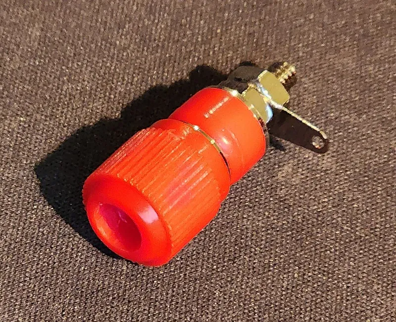
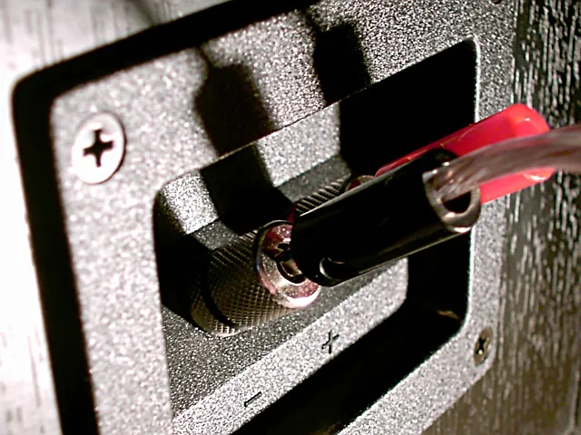
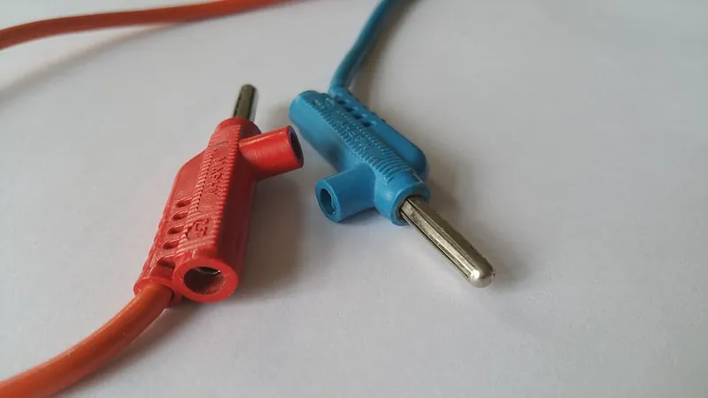

<figure class="eoc-pic eoc-pic-main"><figcaption><strong>Photo.</strong> <a href="https://commons.wikimedia.org/wiki/File:BindingPostRed.jpg">BindingPostRed</a> by Nap fu xoxo, <a href="https://creativecommons.org/licenses/by-sa/4.0">CC BY-SA 4.0</a>, from Wikimedia Commons.</figcaption></figure>
<figure class="eoc-pic"><figcaption><strong>How it works.</strong> <a href="https://commons.wikimedia.org/wiki/File:Banana_plugs_speaker.jpg">Banana plugs speaker</a> by The original uploader was Kallemax at English Wikipedia., Public domain, from Wikimedia Commons.</figcaption></figure>
<figure class="eoc-pic"><figcaption><strong>Photo.</strong> <a href="https://commons.wikimedia.org/wiki/File:Double-stackable_banana_plugs.jpg">Double-stackable banana plugs</a> by User:Ishimvlad, <a href="https://creativecommons.org/licenses/by-sa/4.0">CC BY-SA 4.0</a>, from Wikimedia Commons.</figcaption></figure>

A binding post is a threaded metal post with a screw-down insulated cap that clamps a bare wire, spade or pin, and also takes a springy banana plug pushed into its end, so test leads and wires can be connected and removed by hand in seconds; crocodile clips and test hooks do the same job by gripping any bare wire, lead or terminal with a spring.

**In plain words:** The coloured screw-down knobs on a power supply, meter or speaker that you clamp a wire under or push a plug into, the springy 'banana' plug on the end of a test lead that pushes into them, and the spring-loaded toothed clip (crocodile clip) that grabs any bare wire or terminal for a quick test. **Proper term:** Binding post and banana plug (test-lead connector, crocodile clip).

**Also called:** binding post / five-way binding post / universal binding post (Wikipedia 'Binding post'); banana plug (male) and banana jack or banana socket (female); 4 mm plug or 4 mm connector, especially in Europe; 2 mm banana plug (miniature) (Wikipedia 'Banana connector'); stackable or stacking banana plug (a plug with a socket in its back for another plug) (Wikipedia 'Banana connector'; Cal Test 'Banana Plugs 101'); double banana plug / dual banana plug (two plugs on 3/4 in, 19.05 mm centres) (Wikipedia 'Banana connector'); shrouded, sheathed, sleeved or safety banana plug; retractable-sheath banana plug; safety banana jack (Cal Test 'Banana Plugs 101'; Wikipedia 'Banana connector'); test lead / patch cord / test prod (Wikipedia 'Test probe'; Pomona catalogue); crocodile clip / alligator clip / croc clip (Wikipedia 'Crocodile clip'); test hook / seizer probe / IC hook or IC clip / grabber test clip (Wikipedia 'Test probe'; SparkFun 'Connector Basics'; Pomona catalogue); Kelvin clip (a crocodile clip with its two jaws insulated from each other, for four-wire measurement) (Wikipedia 'Crocodile clip'); automotive clip / battery clamp / jump-lead clamp; jump leads, jumper cables or booster cables (Wikipedia 'Crocodile clip', 'Jump start (vehicle)'); Pee-Wee and Mini-Gator (Mueller Electric, brands of crocodile clip) (Wikipedia 'Crocodile clip'); speaker terminal (binding posts on loudspeakers and amplifiers) (Wikipedia 'Binding post'); pin tip plug and pin tip jack (2 mm pin with no spring; related) (Wikipedia 'Banana connector'); wander plug (older British split-pin plug; does not mate reliably with banana sockets) (Wikipedia 'Banana connector'); Fahnestock clip (an older springy-tab wire clip that binding posts largely replaced) (Wikipedia 'Fahnestock clip').

## How it works

Screwing down the binding post's cap squeezes a bare wire, spade terminal or pin against the post (or inside its cross-hole), so friction and clamping force hold it and make the electrical contact (Wikipedia 'Binding post'). A banana plug's bulging springs are slightly bigger than the 4 mm hole, so when pushed in they press outwards against the socket wall, which both makes good contact and stops the plug falling out, yet it pulls out by hand (Wikipedia 'Banana connector'). A crocodile clip's spring forces its tapered, toothed jaws together so they bite onto a wire or terminal; squeezing the handles opens it (Wikipedia 'Crocodile clip'). Shrouded (safety) plugs and sockets add an insulating sleeve so no live metal can be touched while plugged in (Wikipedia 'Banana connector').

## Parts

A few parts. Binding post: threaded metal post with a cross-hole and a 4 mm socket in its tip, insulated captive thumb nut (cap), insulating washers or mounting base, lock washer and hex nut that fix it through a panel (Pomona model 3750 data sheet). Banana plug: a 4 mm or 2 mm metal pin with one or more lengthwise springs that bulge outwards, a body where the wire is screwed, soldered or crimped, and an insulating sleeve or shroud (Wikipedia 'Banana connector'). Crocodile clip: two serrated metal jaws on a pivot, a spring, a wire screw or crimp, and often a plastic boot (Wikipedia 'Crocodile clip').

## Everyday examples

- the red and black screw terminals on the back of a hi-fi speaker or amplifier, often with banana plugs pushed into them (Wikipedia 'Binding post')
- the coloured output terminals on a bench power supply, and the plugs on multimeter test leads (Wikipedia 'Banana connector')
- crocodile-clip leads used to wire up a bulb and battery in a school science lesson (Wikipedia 'Crocodile clip')
- the big clamps on car jump leads (Wikipedia 'Jump start (vehicle)')

## When to use it

When a connection needs to be made and unmade often, by hand, without tools: hooking a project up to a bench power supply or meter, swapping test leads, wiring a temporary test rig, or giving a home-made power box or battery pack universal outputs. Binding posts suit panels and enclosures because one post takes a banana plug, a crocodile clip, a spade terminal or a bare wire (Wikipedia 'Binding post'); stackable plugs let several leads share one point (Cal Test). Use crocodile clips and test hooks to grab a component lead, bare wire or terminal for a moment; test hooks and IC clips are small enough to grab one pin without touching its neighbours (SparkFun 'Connector Basics'). Speaker cables use banana plugs so they can be swapped quickly (Wikipedia 'Banana connector').

## When not to use it

Not for permanent wiring inside a project, or anything that is moved, shaken or pulled: plugs and clips come off easily, so use a Screw terminal, Crimp terminals or a Standard plug-and-socket connector instead. Not for dangerous voltages with ordinary binding posts or unshrouded plugs; use shrouded safety sockets and plugs with leads rated for the job (Wikipedia 'Binding post'; Cal Test), and leave mains measurement to people trained for it. Not for currents above the clip or plug rating (often 10-15 A): use a High-current battery plug, ring terminals on studs or proper battery clamps. Not for small signal or high-frequency connections where the leads pick up noise; signal generators now often outrun binding posts (Wikipedia 'Binding post' photo caption), so use [coaxial](../glossary.md#coaxial) plugs (BNC) instead. Not where clips could slip onto neighbouring parts: crocodile clips are bulky and easily short to nearby bare metal (SparkFun 'Connector Basics'); use a test hook or a soldered test wire.

## Details

- **What it does (jobs):**
  - join and hold: makes a temporary, hand-operated electrical connection between a wire or test lead and a device, or between two test leads
- **Movement:** none in use; a banana plug can turn freely in its socket and a crocodile clip's jaws open about 7-19 mm on a pivot (Mueller BU-60 and BU-65 data sheets)
- **Directions it can move (degrees of freedom):** 0 once a wire is clamped under the cap; a banana plug in its socket keeps 1 (it can still turn about its own axis without losing contact, because pin and socket are both round)
- **Special behaviour:**
  - quick-release: banana plugs pull straight out and crocodile clips open by squeezing, with no tools; a stacking plug lets another plug share the same point (Cal Test 'Banana Plugs 101')
  - self-aligning or self-centring: the springy banana pin centres itself in the round socket and takes up its small [clearance](../glossary.md#clearance) (Wikipedia 'Banana connector')
- **How it holds:** friction or clamping ([force-fit](../glossary.md#form-fit--force-fit--material-bond)): the screwed cap clamps the wire or spade; spring force (a spring or springy part presses it in place): the banana plug's springs press outwards in the socket and the crocodile clip's spring closes its jaws
- **Input and output:** not applicable
- **Power:** passive (no power needed): it only carries the current of the circuit it connects
- **Load:** Electrical: up to about 30 A (a typical panel binding post is rated 15 A (Pomona 3750); quality banana plugs and cables are 'typically rated for 30 V at 15 A' (Wikipedia 'Banana connector'), with some heavy 4 mm plugs claiming 36-50 A (Gough Lui); a common crocodile clip is rated 10 A and a fully insulated one 30 A (Mueller BU-60, BU-65); the exception is the large copper battery clamps on jump leads, which carry hundreds of amperes (Wikipedia 'Crocodile clip')); extra-low voltage only for ordinary binding posts and unshrouded plugs, which are 'not suitable to be used for carrying dangerous voltages' (Wikipedia 'Binding post'); shrouded safety plugs and leads carry measurement-category ratings up to 1000 V, but this entry does not cover mains measurement. Mechanical: light; a banana plug or crocodile clip pulls off with a firm tug or a snagged lead, and clips have 'a reasonably poor grip that can be easily compromised' (SparkFun 'Connector Basics'); a wire clamped under a tightened cap holds much better in a pull.
- **Play and precision:** not applicable as a locator; the plug's springs take up the small clearance between a 3.90 mm compressed plug and a 4.00 mm socket (Cal Test 'Banana Plugs 101'), so it sits snugly with no noticeable play but can turn
- **Taking it apart:** tool-free quick release for banana plugs, crocodile clips and test hooks; removable by hand (unscrew the cap) for bare wires and spades; the post itself is fixed into the panel with a nut
- **How often it can be reused:** many times: posts, plugs and clips are made for repeated connection; plug springs, clip springs and cheap plating wear with use ⚑ [uncertain: no cycle figure found on an opened page]
- **Sealing:** none: open metal contacts
- **Adjustable:** no; the cap is simply tightened by hand onto the wire
- **Access needed:** one side only (blind) to connect leads, from the front of the panel; both sides of the panel to mount the post (nut and washer on the back) (Pomona 3750 data sheet)
- **Materials:** Posts: brass, gold- or tin-plated, or gold-plated tellurium copper for low thermal voltage in precision work; caps and bases in polycarbonate; nickel-plated brass nut and steel lock washer (Pomona 3750/3760/3770 data sheet). Banana plugs: copper-alloy contact springs (Cal Test) in an insulating plastic body; loudspeaker plugs often have bare metal bodies (Wikipedia 'Banana connector'). Crocodile clips: nickel-plated steel or solid copper jaws with a music-wire spring (Mueller BU-60, BU-60CHS); boots of PVC, shells of glass-filled nylon (Mueller BU-652); early clips were zinc-coated steel, changed to nickel plating because zinc soiled easily (Wikipedia 'Crocodile clip'). Fahnestock clips: phosphor bronze or spring steel, usually nickel-plated (Wikipedia 'Fahnestock clip'). Joins copper wire, spade and pin terminals and component leads.
- **Heat, cold, water and wear:** A typical binding post works up to 115 °C (Pomona 3750 data sheet). Plated contacts are better than bare ones: early zinc-coated steel clips soiled easily and were changed to nickel plating (Wikipedia 'Crocodile clip'); dirty, oxidised or loose clips add resistance and give wrong readings ⚑ [uncertain: from a search summary, not an opened page]. Vibration shakes banana plugs and crocodile clips loose. Banana plug springs and clip springs can lose some grip after much use or after being forced into the wrong size of socket (Wikipedia warns that forcing banana plugs into wander-plug sockets is insecure and that spreading a wander plug's tip often breaks it) ⚑ [uncertain: no figure for spring wear].

## Making it

- **Ways to make or get it:**
  - off-the-shelf part (binding posts, banana plugs and jacks, test leads, crocodile clips, test hooks, jump leads)
  - 3D print (FDM): front panels, enclosures, adapters, plug covers, lead holders and organisers that hold bought metal posts and plugs
  - laser cut: flat front panels drilled or cut for binding posts ⚑ [uncertain: general practice, not from an opened page]
- **Printing it in one piece (print in place):** no: the metal post, plug springs and clip are bought parts; printed parts are panels, adapters, covers and holders that the metal parts are fitted into
- **Tools:** none to connect and disconnect; a small screwdriver, soldering iron or crimp tool to fit a wire into a banana plug or clip; a spanner or nut driver and a drilled panel to mount a binding post
- **Difficulty:** easy: buy posts, plugs and clip leads; mounting a post only needs a drilled hole in a panel, and fitting a screw-type banana plug onto a wire needs only a screwdriver

### 3D printing tips

Print the panel or enclosure and fit bought metal posts: a typical binding post clamps through a panel 1.77-6.35 mm (0.070-0.250 in) thick with a nut on the back (Pomona 3750 data sheet), so make the printed wall at least that thick around the hole and add a flat washer so the nut doesn't dig into the plastic ⚑ [uncertain: washer advice is general practice]. Space pairs of posts or jacks on 19.05 mm (3/4 in) centres so double banana plugs and adapters fit (Wikipedia 'Banana connector'; Cal Test). For printed parts that a 4 mm plug pushes into, size the hole to the plug's springs, not to 4 mm: a printed banana-plug cover uses a 4.3 mm hole that 'should fit most connectors', with 4.1 mm and 4.5 mm versions for tight or loose prints and an editable SCAD file (Printables 87079). Simple banana-jack-to-breadboard adapters print with no supports in about 30 minutes (Printables 95349). Keep cross-holes in neighbouring posts pointing different ways so wires pushed in from opposite sides can't touch (Wikipedia 'Binding post'). Choose a heat-tolerant plastic (PETG or ASA rather than PLA) if the posts carry several amps, since contacts warm up ⚑ [uncertain: no test found]; one maker printed a cigarette-lighter-to-binding-post adapter in PLA with no supports and fixed the parts with CA glue (Printables 768315). Printed parts give no safety insulation rating: use them only on extra-low-voltage circuits.

### Buying one (off-the-shelf parts)

Search terms: 'binding post' or '5-way binding post' (gold- or tin-plated, single or double, with mounting base or shorting link; 'spring-loaded binding post' and 'top-loading binding post' for quick wire attachment, as in the Pomona catalogue), '4mm banana socket' or 'banana jack' (panel), '4mm safety socket' or 'shrouded banana jack', '4mm banana plug' (screw, solder or crimp termination; 'stackable banana plug'), '2mm banana plug', 'shrouded banana plug' or 'safety banana plug', 'double banana plug' or 'dual banana plug', 'banana to crocodile clip test lead', 'test lead set', 'crocodile clip' or 'alligator clip' (with insulating boot; 'insulated safety alligator clip' that mounts on a 4 mm plug), 'test hook', 'grabber test clip' or 'IC test clip', 'Kelvin clip', 'jump leads' or 'booster cables', 'Fahnestock clip'. Supplier categories to browse: Pomona's 'Banana Plugs, Jacks and Hardware', 'Alligator Test Clips' and 'Grabber Test Clips'.

## Rules of thumb

- 4 mm banana jacks are 4.00 ± 0.05 mm across, a plug's springs compress to 3.90 ± 0.05 mm, and the standard spacing between two jacks is 19.05 mm (0.75 in) (Cal Test 'Banana Plugs 101', https://assets.testequity.com/te1/Documents/pdf/caltest/HowDoBananaPlugsWork.pdf; spacing also Wikipedia, https://en.wikipedia.org/wiki/Banana_connector).
- An unsheathed (exposed-contact) banana plug is 'not recommended for handheld use above 30 VAC / 60 VDC' under IEC 61010-031; sheathed (shrouded) plugs are recommended for all CAT III and IV use, retractable-sheath plugs for CAT II (Cal Test, https://assets.testequity.com/te1/Documents/pdf/caltest/HowDoBananaPlugsWork.pdf).
- A lead set is only as safe as its weakest part: 'The measurement category of a combination of probe, lead and or accessory is the lower of their respective category ratings' (Cal Test, https://assets.testequity.com/te1/Documents/pdf/caltest/HowDoBananaPlugsWork.pdf).
- A typical binding post: 15 A, up to 115 °C, and for CE compliance 'not intended for hand-held use at voltage above 33 Vrms/70 Vdc' (Pomona model 3750/3760/3770 data sheet, https://assets.rs-online.com/v1698942361/Datasheets/a981ed7dbcb7403ec0b1ef9cc2e05d9b.pdf).
- Quality banana plugs and cables are 'typically rated for 30 V at 15 A'; unsheathed banana connectors are not usually rated for mains voltage (Wikipedia, https://en.wikipedia.org/wiki/Banana_connector).
- A five-way binding post takes bare wire up to 10 AWG through its cross-hole and spade terminals with a 1/4 in throat (Wikipedia, https://en.wikipedia.org/wiki/Binding_post).
- Crocodile clip ratings vary widely: a common 58 mm clip is rated 10 A with a 7.9 mm jaw opening (Mueller BU-60, https://www.farnell.com/datasheets/3677775.pdf); a safety clip that mounts on a 4 mm plug is 20 A, 300 V CAT II (Mueller BU-652, https://assets.testequity.com/te1/Documents/pdf/muellerelectric/Mueller-Electric_BU-652-0_Datasheet.pdf); a fully insulated clip is 30 A, 1000 V CAT II with a 19 mm jaw (Mueller BU-65, https://static.rapidonline.com/pdf/05-4711_v1.pdf). Check the rating printed on your own clip leads; cheap ones may be lower ⚑ [uncertain: no test of cheap leads found].
- Small laboratory crocodile clips are about 15-40 mm long (Wikipedia, https://en.wikipedia.org/wiki/Crocodile_clip).

## Common failures

(1) Intermittent or high-resistance contact from loose, dirty or worn clips and plugs, giving wrong meter readings or voltage drop under load; replace worn leads ⚑ [uncertain]. (2) A clip slipping off or onto the wrong pin: clips have a poor grip that is easily compromised (SparkFun); use a test hook or IC clip on small pins. (3) A stray wire strand or a crocodile clip [bridging](../glossary.md#overhang--bridging) two terminals and shorting the supply or amplifier output; twist strands neatly, use booted clips and keep red and black apart (SparkFun; Wikipedia 'Binding post') ⚑ [uncertain: the speaker-strand advice comes from a search summary]. (4) A plug only partly inserted, or a 20 mm plug in a socket meant for 15 mm plugs, leaving live metal exposed (Wikipedia 'Banana connector'). (5) A shrouded plug that won't fit an old unshrouded socket: a sheathed plug only fits a safety socket, though an unsheathed plug fits a safety socket (Wikipedia 'Banana connector'; Cal Test). (6) Overheating when a lead or clip carries more than its rating, e.g. a 10 A clip on a motor or charger. (7) A binding post turning in its panel hole when the cap is tightened; tighten the back nut firmly ⚑ [uncertain]. (8) Mixing up red and black and connecting a supply backwards; red usually means positive and black negative, green earth (Wikipedia 'Binding post').

## Safety

VOLTAGE: 'Even so-called isolated binding posts are typically not sufficiently isolated to protect users from coming into contact with their metal parts carrying voltage', so they are 'not suitable to be used for carrying dangerous voltages' (Wikipedia 'Binding post'); an exposed or half-inserted banana plug, a plug stacked through a cross-hole, or a [set screw](../glossary.md#set-screw) on the plug body can all leave live metal exposed (Wikipedia 'Banana connector'). Keep ordinary posts, plugs and clips to extra-low voltage; the Pomona post is 'not intended for hand-held use at voltage above 33 Vrms/70 Vdc' (data sheet) and unsheathed plugs not above 30 V AC / 60 V DC hand-held (Cal Test, IEC 61010-031). Where higher voltages are possible use shrouded (sheathed) plugs in safety sockets; IEC 61010 now requires this design on multimeter test leads (Wikipedia 'Banana connector'). Many bench supplies now fit only shrouded sockets because some outputs may exceed safe extra-low voltage (SELV) or supply high current; a home-made adapter back to bare wire removes that protection and has no safety rating (Gough Lui). Mains: this entry gives no mains instructions; mains work must follow local law (in England, Part P of the Building Regulations, Approved Document P). WALL SOCKETS: in most European countries a mains socket will physically accept banana plugs and US double banana plugs, a shock risk (Wikipedia 'Banana connector'); never plug a test lead into a wall socket; EU amplifiers and speakers with banana sockets are said to ship with removable plastic plugs in them for this reason ⚑ [uncertain: marked 'citation needed' on Wikipedia]. SHORTS: crocodile clips 'easily cause shorts to nearby bare metal' (SparkFun); use booted clips. Old binding posts with lined-up cross-holes let wires pushed in from opposite sides touch (Wikipedia 'Binding post'). A short across a battery or power supply can make leads and clips very hot. Test leads with too low a current rating can overheat and melt their insulation ⚑ [uncertain: from a search summary of a Fluke guide that could not be opened]. JUMP LEADS: a car battery can give off hydrogen; connect the last clamp to bare metal away from the battery so any spark happens away from the gas, and remove the leads in reverse order; never jump-start a frozen battery, which may explode (Wikipedia 'Jump start (vehicle)'); about 442 people in the US were injured by exploding batteries while jump-starting in 1994 (NHTSA, quoted in Wikipedia). PINCH: large battery clamps have strong springs.

## Related

- Screw terminal (terminal block, barrier strip, connector strip): for wires that stay put; needs a screwdriver and doesn't take plugs
- Spring-clamp wire connector (lever connector, push-in wire connector): tool-free like a binding post but for joining wires to each other, not for test leads
- Crimp terminals (ring, fork and spade terminals, blade quick-disconnect): a spade terminal on a wire end slides under a binding post's cap for a firmer connection
- Standard plug-and-socket connector (USB, barrel jack, audio jack, RJ45): multi-pin or keyed connectors for finished devices; BNC coaxial plugs replace banana plugs for signals
- High-current battery plug (bullet connector, polarised battery connector): for currents above what banana plugs and clips handle, and for battery packs that must not be plugged in backwards
- Battery holder and battery contacts (spring battery contact, coin-cell holder): spring contacts for cells; crocodile clips are often clipped onto cells for a quick test
- Pogo pin (spring-loaded contact pin): a spring contact for test fixtures that press onto pads, instead of clipping on
- Magnetic connector (magnetic pogo connector, magnetic breakaway power connector): a tool-free plug that breaks away safely when pulled
- Wire-to-board plug connectors (pin header and crimp housing): crocodile-clip-to-pin jumper leads connect test equipment to these headers
- Fahnestock clip: an older springy-tab clip for bare wire, still found on school kits, largely supplanted by binding posts (Wikipedia 'Fahnestock clip')
- Chicago screw (binding screw, sex bolt): the non-electrical screw-and-barrel fastener that shares the 'binding post' name

## Make it yourself

- [Banana jack adapter for breadboards (Printables 95349; URL from Printables API, page not opened)](https://www.printables.com/model/95349-banana-jack-adapter-for-breadboards): Printed adapter that lets up to four banana plugs connect along each side of a standard breadboard; prints with no supports in about 30 minutes *(licence: CC BY (Creative Commons Attribution))*
- [Cover for banana plug (Printables 87079; URL from Printables API, page not opened)](https://www.printables.com/model/87079-cover-for-banana-plug): Insulating cap for a banana plug pin, with or without a loop, in 4.1, 4.3 and 4.5 mm hole sizes plus an editable SCAD file; a quick tolerance test for 4 mm plugs *(licence: CC BY (Creative Commons Attribution))*
- [Updated 4mm Lab cable organizer | Banana Jack | Customizable (Printables 42135; URL from Printables API, page not opened)](https://www.printables.com/model/42135-updated-4mm-lab-cable-organizer-banana-jack-custom): Customisable OpenSCAD holder that 4 mm banana leads plug into for storage *(licence: CC BY (Creative Commons Attribution))*
- [Cigarette Lighter to Binding Post (Banana Plug) (Printables 768315; URL from Printables API, page not opened)](https://www.printables.com/model/768315-cigarette-lighter-to-binding-post-banana-plug): Printed box that turns a 12 V car socket plug into a pair of binding posts for a hobby charger; printed in PLA, no supports, STEP file included *(licence: CC BY (Creative Commons Attribution))*
- [Project: Banana to Terminal Block Breakout (or Where Are My Binding Posts?!) (Gough's Tech Zone, 2022)](https://goughlui.com/2022/10/02/project-banana-to-terminal-block-breakout-or-where-are-my-binding-posts/): A maker's small PCB that plugs into four shrouded banana sockets on 19 mm spacing and breaks them out to screw terminals, with the parts list and a safety warning *(licence: link only)*

## Pictures, videos and models

- [BindingPostRed.jpg (Wikimedia Commons, by Nap fu xoxo)](https://commons.wikimedia.org/wiki/File:BindingPostRed.jpg): A red five-way binding post with its screw-down cap and the 4 mm socket in its tip *(licence: CC BY-SA 4.0 (reuse with credit))*
- [Double-stackable banana plugs.jpg (Wikimedia Commons, by Ishimvlad)](https://commons.wikimedia.org/wiki/File:Double-stackable_banana_plugs.jpg): Red and blue 4 mm stackable banana plugs with sockets in their backs, branching in two directions *(licence: CC BY-SA 4.0 (reuse with credit))*
- [Three alligator clips.JPG (Wikimedia Commons, by Atlant)](https://commons.wikimedia.org/wiki/File:Three_alligator_clips.JPG): A bare standard crocodile clip, a miniature clip in a plastic boot and a large multi-function clip *(licence: CC BY 2.5 (reuse with credit))*
- [Hameg Power Supplies.jpg (Wikimedia Commons, by Theoprakt)](https://commons.wikimedia.org/wiki/File:Hameg_Power_Supplies.jpg): Two bench power supplies: the top one with screw-type banana jacks, the bottom one with shrouded safety banana jacks *(licence: Public domain)*
- [Banana Plugs 101: How Do Banana Plugs Work (Cal Test Electronics, PDF)](https://assets.testequity.com/te1/Documents/pdf/caltest/HowDoBananaPlugsWork.pdf): Dimension drawing of 4 mm plugs and jacks, measurement categories, and pictures of plain, stacking, shrouded and retractable-sheath plugs *(licence: link only)*

## Needs confirming

⚑ marks something nobody has confirmed yet: a fact the research could not confirm from a source, a finder value that is a best guess, or an open point from the research notes. Corrections are welcome (see `research/needs-confirming.md`).

- ⚑ 12 sentences on this page marked [uncertain].
- ⚑ Finder value `load_max` = light (best guess): electrical entry whose mechanical load has no light/medium/heavy band; set to light
- ⚑ Finder value `wire_use` = to a board or terminal (best guess): carried over from the finder's old rule on entry names (R33), for "What are you connecting?" under "Connect wires or power"
- ⚑ Finder value `plugs_in` = yes (best guess): carried over from the finder's old rule on entry names (R33), for "Will you unplug it often?" under "Connect wires or power > A wire to a board, terminal or device"
- ⚑ Research note: *Binding post and banana plug*: Wikipedia's claim that EU amplifiers ship with plastic plugs in their banana sockets is 'citation needed' there, so it is marked [uncertain].

## Sources

- <https://en.wikipedia.org/wiki/Binding_post>
- <https://en.wikipedia.org/wiki/Banana_connector>
- <https://en.wikipedia.org/wiki/Crocodile_clip>
- <https://en.wikipedia.org/wiki/Fahnestock_clip>
- <https://en.wikipedia.org/wiki/Test_probe>
- <https://en.wikipedia.org/wiki/Jumper_cable>
- <https://en.wikipedia.org/wiki/Jump_start_(vehicle)>
- <https://assets.testequity.com/te1/Documents/pdf/caltest/HowDoBananaPlugsWork.pdf>
- <https://assets.rs-online.com/v1698942361/Datasheets/a981ed7dbcb7403ec0b1ef9cc2e05d9b.pdf>
- <https://www.pomonaelectronics.com/products/banana-plugs-jacks-and-hardware/binding-posts>
- <https://www.farnell.com/datasheets/3677775.pdf>
- <https://assets.rs-online.com/v1699541512/Datasheets/cf5ba4e7bb40b3937e85c648ed30456f.pdf>
- <https://assets.testequity.com/te1/Documents/pdf/muellerelectric/Mueller-Electric_BU-652-0_Datasheet.pdf>
- <https://static.rapidonline.com/pdf/05-4711_v1.pdf>
- <https://learn.sparkfun.com/tutorials/connector-basics/all>
- <https://goughlui.com/2022/10/02/project-banana-to-terminal-block-breakout-or-where-are-my-binding-posts/>
- <https://assets.publishing.service.gov.uk/government/uploads/system/uploads/attachment_data/file/441872/BR_PDF_AD_P_2013.pdf>
- <https://commons.wikimedia.org/wiki/File:BindingPostRed.jpg>
- <https://commons.wikimedia.org/wiki/File:Double-stackable_banana_plugs.jpg>
- <https://commons.wikimedia.org/wiki/File:Three_alligator_clips.JPG>
- <https://commons.wikimedia.org/wiki/File:Hameg_Power_Supplies.jpg>
- <https://commons.wikimedia.org/wiki/File:Jumper_cable_sequence.svg>
- <https://api.printables.com/graphql/>
