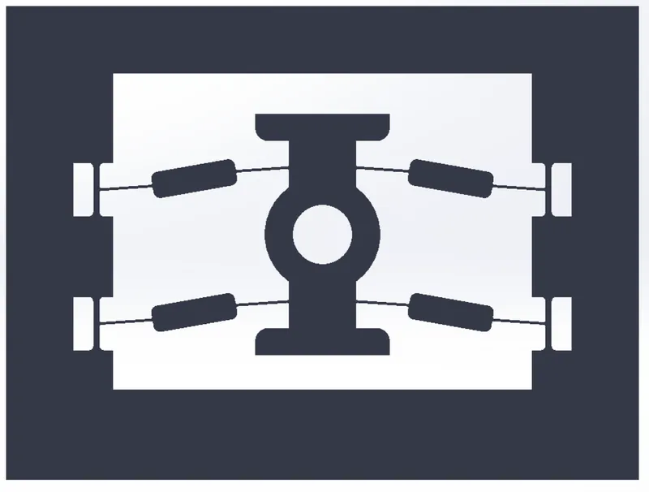

<figure class="eoc-pic eoc-pic-main"><figcaption><a href="https://commons.wikimedia.org/wiki/File:Bistable_compliant_switch_mechanism.png">Bistable compliant switch mechanism</a> by BYU CMR, <a href="https://creativecommons.org/licenses/by-sa/4.0">CC BY-SA 4.0</a>, from Wikimedia Commons.</figcaption></figure>

A part that bends instead of using hinges and has two resting shapes, so pushing it past a tipping point makes it snap quickly into the other shape and stay there with no latch, spring or power holding it.

**In plain words:** A one-piece springy part that happily rests in either of two positions and snaps from one to the other when pushed past a middle point, like a snap hair clip, a snap bracelet or a light switch that clicks on and off. **Proper term:** [Bistable](../glossary.md#bistable) [compliant mechanism](../glossary.md#compliant-mechanism) (snap-through mechanism).

**Also called:** bistable mechanism; snap-through mechanism or snap-through switch; snap-action [flexure](../glossary.md#flexure) or snap-action mechanism; bistable switch; bistable hinge, snap hinge or butterfly hinge (flip-top bottle caps); bistable clip or clasp; curved-beam bistable mechanism or double curved beam (engineering literature); buckled-beam bistable mechanism; von Mises truss (the classic two-bar snap-through model); tape spring or bistable strip (snap bracelet, tape measure style); snap dome or click dome (dome-shaped version); multistable mechanism (versions with more than two stable positions); hair clip mechanism (HCM, robotics research term); slap bracelet or snap bracelet (everyday name for the strip version).

## How it works

Bending the part stores energy in it like a spring. The shape is chosen so the stored energy first rises as you push it, peaks at a middle (unstable) point, and then falls again to a second low point, so after the peak the part pushes itself the rest of the way and snaps into its second shape, where it rests with no force needed (Chi et al. 2022, 'ball on a hill' picture from BYU CMR). For a pre-curved beam this works only if the beam's curve is tall enough compared with its thickness and the beam is stopped from twisting sideways as it flips, which is why designs often use two beams joined at the middle (Qiu, Lang and Slocum 2004). Pushing back past the tipping point snaps it back, so it acts like a switch with two positions.

## Parts

Single piece in its simplest form (a pre-curved beam, a pair of beams joined at the middle, a curved strip or a dome, or links joined by thin flexible hinges). Some designs add a separate spring, magnets, pins or a housing, but the snapping comes from the flexing parts themselves.

## Everyday examples

- Snap hair clips (Chi et al. 2022)
- Snap (slap) bracelets, made of layered bistable steel bands (Wikipedia, Slap bracelet)
- Flip-top shampoo and ketchup bottle caps with snap hinges (Chi et al. 2022; US patent 4982866)
- Light switches and popper jumping toys (BYU CMR; Chi et al. 2022)

## When to use it

Use a bistable compliant mechanism when you want something to stay in one of two positions without a latch or power: an on/off switch or toggle, a clip or clasp that snaps open and shut, a lid or hinge that stays open or closed, a gripper that snaps shut on contact, or a valve or relay that only uses power to change state. It is ideal for 3D printing because it can be one piece with no assembly, no [backlash](../glossary.md#backlash) and nothing to lubricate (BYU CMR), and its fast snap gives a clear click and a burst of force (Chi et al. 2022).

## When not to use it

Avoid it for heavy loads or where it must hold against forces larger than its snap force (use a latch or an [over-centre](../glossary.md#over-centre) toggle clamp). Avoid printed plastic flexures for parts that must switch many thousands of times in PLA (use a pinned spring toggle, a metal spring or PP/nylon) and for parts held in the bent state in heat for long periods, where [creep](../glossary.md#creep) weakens the snap. Where you need many set positions, use a [detent](../glossary.md#detent) or [ratchet](../glossary.md#ratchet); where you need a firm adjustable clamp, use a cam lever or toggle clamp; for a push-once-to-latch, push-again-to-release action, use a push-push latch.

## Details

- **What it does (jobs):**
  - click into set positions: two (or more) positions that it snaps into and holds
  - store energy: holds strain energy and releases it quickly in the snap
  - let it move (turn, slide or bend): moves by bending, with no pins or sliding surfaces
  - join and hold: bistable clips and clasps hold cables, hair or lids closed
  - lock, and release by hand: a clip or lid stays shut or open until pushed past its tipping point
- **Movement:** flex: the part bends to move a point along a line (snap-through beams and switches) or to swing a lid or arm (bistable hinges, e.g. up to 180 degrees on BYU's bistable-to-monostable hinge); the snap itself is fast, taking only several to tens of milliseconds (Chi et al. 2022)
- **Directions it can move (degrees of freedom):** 1: it moves along one path between its two stable shapes; the flexures are designed to be stiff in the other directions
- **Special behaviour:**
  - over-centre (snaps past a point and stays): once pushed past the unstable middle point, it snaps to the second position and stays there with no latch (Chi et al. 2022)
  - indexing (clicks into set positions): two stable positions, or more in multistable designs made by chaining bistable units (Chi et al. 2022)
  - quick-release: bistable clips and cable clips open and close with a push of the fingers (Cableclips, Printables)
- **How it holds:**
  - spring force (a spring or springy part presses it in place): each stable position is a low point in the stored spring energy of the flexing part itself
  - shape (the parts interlock; [form-fit](../glossary.md#form-fit--force-fit--material-bond)): clips and hinges also use their closed shape to wrap around or cover what they hold
- **Input and output:** not applicable as a transmission. It acts as a threshold or trigger: a small push that exceeds the snap-through force -> a fast, larger jump to the other position, which can give an amplified output force during the snap (Chi et al. 2022). Not back-drivable in the usual sense: a load smaller than the snap-through force leaves it where it is; a larger one flips it.
- **Power:** passive (no power needed). When combined with an [actuator](../glossary.md#actuator) (motor, magnet, shape-memory wire, air pressure) power is needed only to switch it, because it can apply a contact force without continued power (Qiu et al. 2004); if power is lost it keeps its last state
- **Load:** light: it holds only against forces smaller than its snap-through force, and printed versions are small plastic flexures. Strongest along its snapping direction up to that force; weak against sideways loads, which can twist the flexing beams so they no longer snap cleanly (Qiu et al. 2004)
- **Play and precision:** Play: none, because there are no pin joints; compliant mechanisms reduce or remove backlash (BYU CMR, Printables). [Repeatability](../glossary.md#repeatability--accuracy): each stable position is set by the part's shape, so it returns to much the same place every time while the material stays springy; plastic creep or [fatigue](../glossary.md#fatigue) shifts the positions and weakens the snap over time ⚑ [uncertain]. [Misalignment](../glossary.md#misalignment): off-axis pushes can twist the beams instead of snapping them (Qiu et al. 2004)
- **Taking it apart:** tool-free quick release: as a clip or clasp it opens and closes by hand; as a switch or hinge it is built into the part itself (one piece), so there is nothing to take apart
- **How often it can be reused:** many times with a tough, springy material (polypropylene, PETG, nylon, spring steel); only a few tens of cycles with [brittle](../glossary.md#brittle--ductile) PLA flexures, e.g. about 40 to 50 cycles for early all-flexure versions of one printed switch (Gamma4D, Printables) and about 25 cycles for a single-strand FDM [living hinge](../glossary.md#living-hinge) (Hubs)
- **Sealing:** none
- **Adjustable:** no: the snap force and the two positions are set by the geometry (beam thickness, curve height, hinge angle, material); changing them means reprinting. Some research designs tune or switch off bistability with magnets or added parts (BYU bistable-to-monostable magnetic hinge; Chi et al. 2022)
- **Access needed:** not applicable
- **Materials:** Polypropylene is the best choice for moulded or milled flexing hinges (revpart; BYU recommends milled polypropylene sheet for its bistable switch). For FDM printing: PETG, ASA or ABS (Cableclips; PLA 'is not elastic enough'), nylon (Hubs), TPU for flexible dome and auxetic versions (PLA 'too brittle', Printables 604690). Metal versions use thin spring or stainless steel (slap bracelets use steel bands about 0.15 mm thick; Wikipedia) and robotics 'hair clip' mechanisms use PETG sheet about 0.38 to 0.76 mm thick, carbon fibre or steel (arXiv 2311.03212). Silicon for microscopic (MEMS) versions (Qiu et al. 2004)
- **Heat, cold, water and wear:** Plastic flexures fatigue at their [stress concentrations](../glossary.md#stress-concentration) under repeated flexing (Wikipedia, Compliant mechanism) and plastic springs slowly deform (creep) under steady strain (Hackaday); PLA is the worst common filament for this (Hackaday; Cableclips). Heat speeds up creep and softens plastics, so avoid hot cars and sunny windows for PLA versions ⚑ [uncertain]. Energy is partly lost in each flex, which adds [damping](../glossary.md#damping) (Wikipedia, Compliant mechanism). Steel versions resist creep but can rust or crack through the covering (Wikipedia, Slap bracelet).

## Making it

- **Ways to make or get it:**
  - 3D print (FDM): one-piece switches, clips, hinges and fidget toys
  - 3D print (resin): possible with tough or flexible resins ⚑ [uncertain]
  - CNC: milled polypropylene sheet (BYU recommends this for its bistable switch)
  - laser cut: flat flexure patterns in polypropylene or acrylic sheet ⚑ [uncertain]
  - sheet metal: snap domes and bistable steel strips (snap bracelets)
  - off-the-shelf part: snap domes or click domes for switches ⚑ [uncertain]
- **Printing it in one piece (print in place):** yes: most designs print as one working piece (BYU bistable mechanism and switch, Cableclips); a few use short pieces of filament as pins, e.g. Gamma4D's hinged switch
- **Tools:** none
- **Difficulty:** moderate: it prints in one piece with no assembly, but getting a crisp snap that lasts needs the right material, print orientation and beam thickness, usually found by printing a few test versions

### 3D printing tips

Choose a tough, springy plastic: Cableclips are tested in PETG, ASA and ABS, and PLA is not recommended because it is not elastic enough (Printables 328519); PLA flexures can wear out in tens of cycles, whereas a pinned-hinge version of the same switch passed 110,000 cycles in PLA (Gamma4D, Printables 488317). BYU notes that the fatigue and flex properties of your filament decide how many cycles a printed bistable switch lasts (Printables 581016). Orient the part so the flexing beams lie flat on the bed with layers running along their length, so bending does not pull layers apart; Hubs advises building the hinge so its width, not its length, is stacked layer by layer, and making FDM flexures 0.4 to 0.6 mm thick with at least two layers (Hubs). Print orientation of the springy parts is critical and a wrong orientation won't work (Hackaday, snap action mechanism). Use the slicer settings the designer gives, because wall count and line width set the flexure thickness (Cableclips). Give pre-curved snap beams a curve height well over 2.3 times their thickness and stop them twisting, e.g. with two beams joined at the middle (see rules of thumb). Round the corners where flexures meet thick parts, since flexure roots concentrate stress and fail by fatigue (Wikipedia, Compliant mechanism). Plastic springs creep under constant strain (Hackaday, 3D-printed springs), so a printed bistable part may snap more weakly after being stored in its bent state for a long time ⚑ [uncertain]. Hubs suggests annealing living hinges in boiling water and flexing them while warm to extend life (Hubs).

### Buying one (off-the-shelf parts)

Mostly made, not bought. Related off-the-shelf items: 'snap dome' or 'metal dome' (tactile switch domes), 'snap-action switch' or 'microswitch' (a small spring snap-through mechanism in a housing), 'bistable spring' or 'tape spring', 'flip-top cap' or 'snap hinge cap' (moulded bottle closures with bistable hinges) ⚑ [uncertain].

## Rules of thumb

- Pre-curved beam: with Q = curve (apex) height / thickness, Q below 1.23 bends smoothly, 1.23 to 2.31 snaps but springs back (monostable), and above 2.31 it is bistable (Chi et al. 2022, Advanced Materials, citing Qiu et al.)
- A single curved beam also needs its twisting (second) buckling mode blocked, e.g. by guiding the centre in a slot or, better, by joining two parallel curved beams at their centres; a gap of five beam thicknesses between the beams worked (Qiu, Lang and Slocum 2004)
- [Linkage](../glossary.md#linkage) with flexible hinges (von Mises truss): it becomes bistable when the links' incline angle is larger than a critical angle arccos(L1/L) (Chi et al. 2022)
- Link-and-spring version: bistable when the rigid link length is greater than the spring's initial length (Chi et al. 2022)
- Curved strips and plates (snap bracelet, tape measure): bistable when width x square root of (curvature / thickness) is much greater than 1, i.e. wide, thin, strongly curved strips (Chi et al. 2022)
- FDM living hinges 0.4 to 0.6 mm thick with at least two layers; SLS 0.3 to 0.8 mm; FDM single-strand hinges last about 25 cycles and SLS 30 to 50 before failure (Hubs)
- Moulded polypropylene living hinges 0.007 to 0.015 in (about 0.18 to 0.38 mm) thick, in homopolymer PP, flexed a few times straight out of the mould; butterfly and three-section bistable hinges give the flip action of dispensing caps (revpart)

## Common failures

Won't stay in the second position (it snaps and springs back), because the curve is too shallow for its thickness or the beam twists instead of snapping; fix by increasing curve height over thickness or joining two beams at the middle (Qiu et al. 2004; Chi et al. 2022). Cracks at the roots of flexures from fatigue, especially in PLA (Wikipedia, Compliant mechanism; Gamma4D; Hubs). Layers splitting when the part was printed in the wrong orientation (Hackaday snap action mechanism). Snap getting weak or 'sloppy' with heavy use or after long storage in one state, from wear and creep (Hackaday; Firgelli ⚑ [uncertain]).

## Safety

The snap releases stored energy suddenly, so a large or stiff one can pinch fingers or flick small parts ⚑ [uncertain]. Metal strip versions can break or poke through their covering and cut, which led to school bans and recalls of cheap slap bracelets (Wikipedia, Slap bracelet).

## Related

- Over-centre linkage and spring toggle: the rigid-link version with pin joints and a separate spring; more durable in PLA but more parts
- Living hinge: a single thin flexing hinge with no stable positions of its own; add a snap geometry to make it bistable
- Push-push latch: also has two states, but switches with the same push each time using a heart-shaped track
- Click-pen mechanism: a rotating-cam indexer that alternates between two states on each push
- [Cantilever](../glossary.md#cantilever) snap fit: a springy hook that snaps into a catch to join parts, rather than switching a part between two resting shapes
- Tape-spring hinge: a curved metal strip that folds flat and snaps back straight, used for deployable structures
- Ball detent: a spring-loaded ball that clicks into several set positions
- Constant-force and negative-stiffness mechanisms: use the same buckling physics to flatten or reverse a spring's force curve

## Make it yourself

- [Bistable Compliant Switch (BYU CMR, Printables)](https://www.printables.com/model/581016-bistable-compliant-switch): One-piece bistable switch based on a four-bar linkage with living hinges, with a short lesson on bistability; print in PLA or ABS or mill from 1/4 inch polypropylene sheet. Read through the Printables public API *(licence: CC BY-NC)*
- [Cableclips - Bistable Compliant Mechanism (Bodo, Printables)](https://www.printables.com/model/328519-cableclips-bistable-compliant-mechanism): Reusable snap-open cable clips in nine sizes (8.5 to 30 mm); tested in PETG, ASA and ABS; PLA not recommended. Read through the Printables public API *(licence: CC BY-NC-ND)*
- [Hinged Bistable switch (Gamma4D, Printables)](https://www.printables.com/model/488317-hinged-bistable-switch): Bistable switch toy; the author reports early flexure versions lasted 40 to 50 cycles in PLA while this pinned-hinge version runs over 110,000 cycles. Read through the Printables public API *(licence: CC BY)*
- [Bistable Auxetic Structure (Parametric with OpenSCAD) (ahaque, Printables)](https://www.printables.com/model/604690-bistable-auxetic-structure-parametric-with-opensca): Parametric OpenSCAD sheet that expands into a dome and locks; print in TPU (PLA too brittle). Read through the Printables public API *(licence: CC BY)*
- [Bistable Square Hinge - compliant mechanism (Charles Mangin, Printables)](https://www.printables.com/model/1712914-bistable-square-hinge-compliant-mechanism): Origami-inspired flat-printed folding square stable in several orientations; base should be two layers thick or PLA cracks. Read through the Printables public API *(licence: CC BY-SA)*

## Pictures, videos and models

- [Bistable compliant switch mechanism.png (Wikimedia Commons)](https://commons.wikimedia.org/wiki/File:Bistable_compliant_switch_mechanism.png): Image of BYU's one-piece bistable compliant switch, used on the Wikipedia article Compliant mechanism *(licence: CC BY-SA 4.0 (BYU CMR))*
- [Bistable Compliant Mechanism (BYU CMR, Printables)](https://www.printables.com/model/581013-bistable-compliant-mechanism): Animated GIF of a one-piece printed bistable mechanism snapping between its two positions, with references to BYU papers *(licence: CC BY-NC-SA (model page read via the Printables public API))*
- [Simple Snap Action Mechanism Is 100% 3D Printed (Hackaday)](https://hackaday.com/2022/06/10/simple-snap-action-mechanism-is-100-3d-printed/): Article and pictures of a fully printed snap-action slide with two curved leaf springs, stressing print orientation *(licence: link only)*
- [Bistable and Multistable Actuators for Soft Robots: Structures, Materials, and Functionalities (Chi et al., Advanced Materials 2022)](https://d-nb.info/1254133046/34): Open-access review with diagrams of curved beams, curved plates, domes and flexure linkages, force-displacement and energy curves, and photos of everyday bistable objects (hair clips, tape measures, bottle caps) *(licence: Creative Commons Attribution (CC BY; open access))*
- [Why Machines That Bend Are Better (Veritasium, YouTube)](https://www.youtube.com/watch?v=97t7Xj_iBv0): Video on compliant mechanisms (title and channel confirmed via YouTube oEmbed; content not viewed, so whether bistable examples are shown is ⚑ [uncertain]) *(licence: link only)*

## Needs confirming

⚑ marks something nobody has confirmed yet: a fact the research could not confirm from a source, a finder value that is a best guess, or an open point from the research notes. Corrections are welcome (see `research/needs-confirming.md`).

- ⚑ 10 sentences on this page marked [uncertain].
- ⚑ Finder value `connects` = lid, door or cover (best guess): worked out from its name, but joining parts is not one of its two main jobs
- ⚑ Finder value `clicks` = clicks (best guess): one-way or indexing, but neither clicking nor silent named; defaulted to clicks

## Sources

- <https://bdml.stanford.edu/twiki/pub/Main/PerchingPapers/bistable_beams.pdf>
- <https://d-nb.info/1254133046/34>
- <https://commons.wikimedia.org/wiki/File:Bistable_compliant_switch_mechanism.png>
- <https://en.wikipedia.org/wiki/Compliant_mechanism>
- <https://en.wikipedia.org/wiki/Slap_bracelet>
- <https://www.hubs.com/knowledge-base/how-design-living-hinges-3d-printing/>
- <https://revpart.com/living-hinge-design-guide/>
- <https://patents.google.com/patent/US4982866A/en>
- <https://arxiv.org/pdf/2311.03212>
- <https://hackaday.com/2022/06/10/simple-snap-action-mechanism-is-100-3d-printed/>
- <https://hackaday.com/2026/04/27/the-challenges-of-3d-printing-reliable-springs/>
- <https://www.firgelliauto.com/blogs/mechanisms/bistable-buckled-beam-mechanism>
- <https://www.printables.com/model/581013-bistable-compliant-mechanism>
- <https://www.printables.com/model/581016-bistable-compliant-switch>
- <https://www.printables.com/model/581020-bistable-to-monostable-magnetic-hinge>
- <https://www.printables.com/model/328519-cableclips-bistable-compliant-mechanism>
- <https://www.printables.com/model/488317-hinged-bistable-switch>
- <https://www.printables.com/model/604690-bistable-auxetic-structure-parametric-with-opensca>
- <https://www.printables.com/model/1712914-bistable-square-hinge-compliant-mechanism>
- <https://api.printables.com/graphql/>
- <https://www.youtube.com/watch?v=97t7Xj_iBv0>
