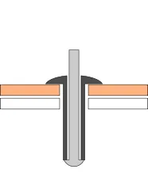
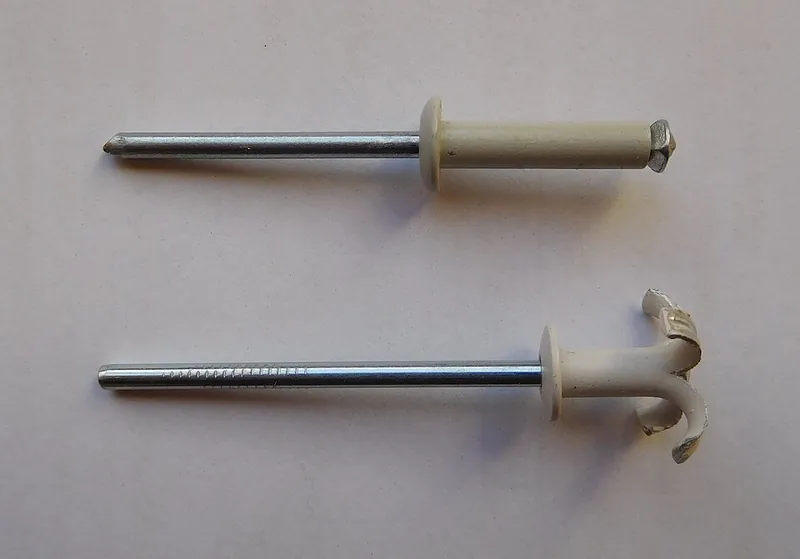
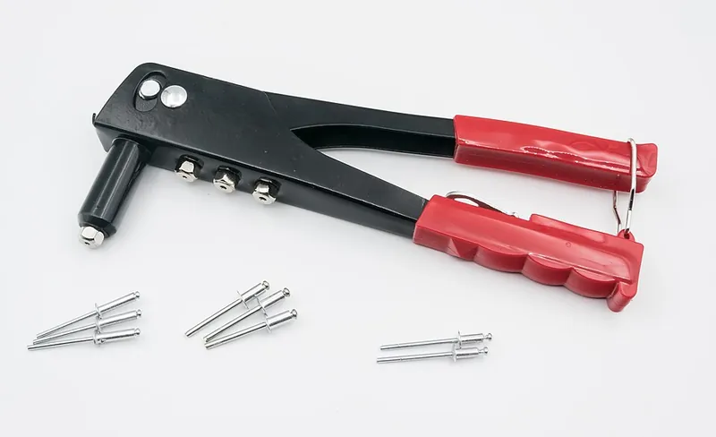

<figure class="eoc-pic eoc-pic-main"><picture><source media="(prefers-reduced-motion: reduce)" srcset="../media/blind-rivet.still.webp"></picture><figcaption><strong>Animation.</strong> <a href="https://commons.wikimedia.org/wiki/File:Popnagel.gif">Popnagel</a> by Heedless, <a href="https://creativecommons.org/licenses/by-sa/4.0">CC BY-SA 4.0</a>, from Wikimedia Commons.</figcaption></figure>
<figure class="eoc-pic"><figcaption><strong>How it works.</strong> <a href="https://commons.wikimedia.org/wiki/File:Blind_rivets_before_and_after_strain.jpg">Blind rivets before and after strain</a> by Cjp24, <a href="https://creativecommons.org/licenses/by-sa/4.0">CC BY-SA 4.0</a>, from Wikimedia Commons.</figcaption></figure>
<figure class="eoc-pic"><figcaption><strong>Photo.</strong> <a href="https://commons.wikimedia.org/wiki/File:2023_Nitownica.jpg">2023 Nitownica</a> by Jacek Halicki, <a href="https://creativecommons.org/licenses/by-sa/4.0">CC BY-SA 4.0</a>, from Wikimedia Commons.</figcaption></figure>

A hollow rivet with a pulling pin (mandrel) through it that you fit from one side: a hand tool pulls the pin until the far end of the rivet swells into a second head behind the parts and the pin snaps off, clamping sheets or panels together permanently.

**In plain words:** A little metal tube with a nail through it that you push into a drilled hole and squeeze with a hand tool from the front; the far end swells into a lump behind the sheets, the nail snaps off, and the sheets stay clamped for good, even though you never reached the back. **Proper term:** Blind rivet (break-mandrel or break-stem blind rivet).

**Also called:** pop rivet; POP rivet ('POP' is the brand name of the original maker, now owned by Stanley Engineered Fastening, so 'POP' is a brand) (Wikipedia 'Rivet'); break-stem rivet; break mandrel blind rivet; 'open end blind rivet with break pull mandrel and protruding head' (the formal name in ISO 15977; 'Break Stem Open' in the POP catalogue); popnagel (Dutch), Blindniet (German), nit zrywalny (Polish): names used on Wikimedia Commons 'Category:Blind rivets'; closed-end rivet; sealed or sealing blind rivet (McMaster-Carr 'Sealing Blind Rivets'; POP 'Closed End'); multi-grip rivet; wide-grip-range rivet (POP 'MGR'; McMaster-Carr 'Wide-Thickness-Range'); [peel](../glossary.md#peel-vs-shear) rivet; tri-fold rivet (TriFold); T-rivet; Oscar rivet (split-body rivets that open into petals or legs) (Wikipedia 'Rivet'; POP catalogue); 'Tri-Grip' and 'T-Lok' are trade names used in Hanson Rivet's guide; large-flange rivet; countersunk rivet; flush-setting rivet; grooved rivet (for wood); structural blind rivet (internally or externally locked mandrel) (POP catalogue; Wikipedia 'Rivet'); drive rivet (hammer-driven blind rivet) and friction-lock rivet, e.g. the 'Cherry' friction-lock rivet used on aircraft (Cherry is a brand) (Wikipedia 'Rivet'; FAA AC 43.13-1B); Olympic rivet: a shaved-flush version used to repair Airstream trailers (Wikipedia 'Rivet'); beginner search terms: rivet gun rivets, hand riveter rivets, one-sided rivet, rivet for sheet metal.

## How it works

You drill a hole through all the parts, put the mandrel into the tool's nose and push the rivet body into the hole until its head sits against the front sheet (POP catalogue p.7; Hanson D13). Squeezing the tool grips the mandrel and pulls its ball-shaped head back into the tube: this swells the tube to fill the hole and bulges the far end into a second head (blind head) wider than the hole, squeezing the sheets together between the two heads (Wikipedia 'Rivet'; Assembly Magazine). When the pull reaches a set force, the mandrel snaps at its weakened neck, so every rivet is set with about the same clamping force; the loose stem is thrown away (POP catalogue p.14; Assembly Magazine: blind rivets 'cannot be under-torqued, over-torqued or set loose'). In an ordinary open-end rivet the mandrel head may stay inside the rivet or fall out later; in a closed-end or structural rivet it is locked in (Wikipedia 'Rivet').

## Parts

A few parts sold as one unit: a hollow rivet body (a short tube with a head, or flange, at one end) and a nail-like pin (mandrel) running through it, with a weakened neck just under the mandrel's head that is meant to break (Wikipedia 'Rivet'; Commons 'Blind rivet notches'). You also need a setting tool (hand riveter or rivet gun) with a nosepiece to suit the rivet size (POP catalogue p.80). Peel, tri-fold and Oscar types have a body slit into petals or legs; closed-end types have the far end of the body sealed round the mandrel head (Wikipedia 'Rivet'; POP catalogue p.8).

## Everyday examples

- Aluminium rain gutters: end caps, joins and downspout outlets fixed with pop rivets (This Old House 'How to Install Rain Gutters')
- Plywood flight cases and road cases for music and stage gear, which are 'almost universally' blind-riveted (Wikipedia 'Rivet')
- Number plates: the Commons photo 'Blind rivets before and after strain' shows the type used to fix French number plates (Wikimedia Commons)
- Truck bodies, aluminium trailers and caravans such as Airstreams (structural and Olympic blind rivets, Wikipedia 'Rivet')

## When to use it

Use a blind rivet when you need a quick, cheap, permanent joint in thin material and can only reach one side: sheet-metal boxes and brackets, ducting and gutters, fixing panels to box-section tube, plywood cases, kit aircraft and trailers, or a printed or plastic part to a metal sheet (Wikipedia 'Rivet'; This Old House; TWI). It is quick to fit, usually lighter than a bolt and nut (TWI: 'dependent on rivet material'), and can't be over- or under-tightened (Assembly Magazine). Choose closed-end rivets for wet places, multi-grip rivets when thicknesses vary, peel, tri-fold or large-flange rivets for plastics, fibreglass and wood, and structural rivets for vibration and higher loads (POP catalogue pp.8-9; Wikipedia 'Rivet').

## When not to use it

If the parts must come apart again, use a screw and nut, a rivet nut (blind threaded fixing) or a quarter-turn fastener instead, since a blind rivet has to be drilled out (TWI). If you can reach both sides and need the strongest joint, a solid rivet or bolt holds better; the FAA says blind rivets are 'usually not used when driven rivets can be installed' (FAA AC 43.13-1B). Don't use ordinary open-end rivets where the joint must be watertight or pressure-tight (use closed-end rivets plus sealant) or in heavily stressed or safety-critical places (FAA AC 43.13-1B). In soft or [brittle](../glossary.md#brittle--ductile) plastic, including PLA prints, a standard rivet can crack the part: use heat staking, a [heat-set insert](../glossary.md#heat-set-insert) and screw, or a push-in plastic rivet, or at least a large-flange or peel rivet with a washer (V1 Engineering forum; Hanson D13). For high-volume sheet-metal parts with a press, clinching joins sheets without any extra part.

## Details

- **What it does (jobs):**
  - join and hold: permanently fastens sheet metal, plastic panels, plywood, fibreglass, fabric or leather to each other or to tube and box section, from one side only (Wikipedia 'Rivet'; TWI)
  - seal it, or pass cables or fluid through: only the closed-end (sealed) type, which is made for 'water/pressure tight' joints (POP catalogue p.8); ordinary open-end rivets leave a small hole through the middle
- **Movement:** none: once set, the parts are clamped and cannot move. Exception: a rivet can be set with a small gap under its head so a part can turn on it as a simple pivot, using a 'pivot style' nosepiece on the tool (Hanson D13 'Pivot Fastening').
- **Directions it can move (degrees of freedom):** 0 for a normal joint: the sheets are clamped between the two heads and the swollen body fills the hole. 1 (turning about the rivet) if it is deliberately set as a loose pivot with a gap under the head (Hanson D13).
- **Special behaviour:**
  - none of the listed behaviours in use: it is a plain permanent fastener
  - Its own tricks: it is fitted and set entirely from one side (blind), and the mandrel's built-in weak neck snaps at a set pulling force, so the tool can't over- or under-tighten it; the clamping force is built into the rivet, a bit like a one-shot force limiter that only works while fitting (Assembly Magazine; POP catalogue p.14; ISO 15977 gives a maximum 'mandrel break load' for each size)
- **How it holds:**
  - shape (the parts interlock; [form-fit](../glossary.md#form-fit--force-fit--material-bond)): the factory head in front and the swollen blind head behind trap the sheets between them, and the swollen body fills the hole so the sheets can't slide (Wikipedia 'Rivet'; Assembly Magazine)
  - friction or clamping (force-fit): setting the rivet clamps the sheets together with a force set by the mandrel's break load, so friction between the sheets also carries load (POP catalogue p.14; Wikipedia 'Rivet')
- **Input and output:** not applicable
- **Power:** passive (no power needed). Pneumatic, pneumatic-hydraulic and battery rivet tools exist only to fit rivets faster; the set rivet needs no power (POP catalogue pp.72-81).
- **Load:** Light to medium per rivet, strongest in shear (sheets trying to slide past each other) and weaker in pull-apart (tension), and weakest when a thin or soft sheet can tear out or pull over the blind head. Typical rated loads for POP open-end rivets: 3.2 mm aluminium (AlMg 3.5) with steel mandrel about 800 N shear and 1,200 N tension; 4.0 mm about 1,330 N and 1,910 N; 4.8 mm about 2,020 N and 2,800 N; 3.2 mm all-steel about 1,150 N and 1,550 N (POP catalogue pp.22, 46). A POP 'HS' 6.4 mm rivet has 'the strength of an M6 Bolt' (POP catalogue p.9). ISO 15977 minimums for aluminium/steel rivets: 3.2 mm class L 500 N shear, 700 N tension; 4.8 mm class L 1,200 N shear, 1,700 N tension. These are the rivet's own strengths; the joint may be weaker if the sheet is thin or soft (Wikipedia 'Rivet': the tests 'determine the strength of the rivet, and not the strength of the assembly'). The FAA notes blind rivets typically lock less well than driven solid rivets (FAA AC 43.13-1B).
- **Play and precision:** No play when the hole is the right size, because the body swells to fill the hole (Wikipedia 'Rivet'); multi-grip rivets give 'rattle free' joints 'even in irregular holes' (POP catalogue p.8). Position is only as accurate as the drilled holes. It tolerates small [misalignment](../glossary.md#misalignment): ISO 15977 allows the front (access-side) part to have a larger hole to help line parts up, at some loss of strength, and peel rivets work in oversized or elongated holes (ISO 15977 clause 3.3; Assembly Magazine). Too big a hole lets the rivet swell between the sheets, bulging or separating them (Assembly Magazine). Each rivet length only works over a set range of total thickness (grip range) (POP catalogue p.15).
- **Taking it apart:** permanent: it can only be removed by drilling off the head and punching out the rest, which usually leaves the hole slightly enlarged if done carelessly; TWI lists 'difficult to remove once placed' as a disadvantage (TWI; This Old House 'How to Remove Rivets').
- **How often it can be reused:** once: each rivet is used one time and destroyed when removed; the drilled hole can take a new rivet of the same size if it wasn't enlarged, or of the next size up (This Old House; ISO 15977 hole sizes).
- **Sealing:** none for an ordinary open-end rivet: there is a hole through its middle, and the FAA says blind rivets 'shall not be used in fluid-tight areas' on aircraft (FAA AC 43.13-1B par. 4-57f). watertight for closed-end (sealed) rivets, 'ideal for applications that need to be water/pressure tight' (POP catalogue p.8), and for sealing blind rivets with a plastic seal under the head (McMaster-Carr). On gutters, This Old House seals the rivets from the inside with siliconized caulk to make the joint watertight.
- **Adjustable:** no: position and clamping force are fixed when the mandrel snaps; to change anything you drill it out and fit a new rivet (This Old House).
- **Access needed:** one side only (blind): the rivet is inserted and set from the front (Wikipedia 'Rivet'). You still need room behind for the rivet's tail and blind head (backside [clearance](../glossary.md#clearance), Assembly Magazine) and room in front for the tool's nose; in deep channels use a long nosepiece or rivet from the other side (Hanson D13).
- **Materials:** Rivet bodies: aluminium alloys (AlMg 2.5, 3.5 and 5 percent magnesium, and soft 99.5 percent aluminium for 'extremely soft and/or brittle materials'), steel, stainless steel, nickel-copper alloy (Monel), and copper; mandrels usually steel, stainless or aluminium (POP catalogue p.10; Wikipedia 'Rivet'). Plastic (nylon-type) blind rivets also exist but 'tend to dry out and get brittle' (McMaster-Carr 'Plastic Blind Rivets'; Assembly Magazine). Joins sheet metal (steel, aluminium), plastics, wood and leather (TWI), fabric (e.g. costume parts, Printables 'Spikes - four millimeter pop rivet attachment'), cardboard with a washer (Printables '1/8 in pop rivet washer'), fibreglass (GFRP), laminates and rubber (POP 'Peel' rivet, p.8). Match the rivet to the parts: 'the rivet selected should have the same physical and mechanical properties as the components to be joined' (POP catalogue p.10). For soft, brittle or 3D-printed plastics choose soft-set aluminium, large-flange, peel or tri-fold types (Hanson D13; POP catalogue).
- **Heat, cold, water and wear:** Heat: rivets lose strength as they warm; from the POP catalogue's curves, a common AlMg 3.5 aluminium rivet keeps roughly 90 percent of its rated strength at 100 °C and about two thirds at 200 °C, soft 99.5 percent aluminium falls to about half by about 165 °C, while steel keeps about 70 percent at 400 °C (POP catalogue p.11) ⚑ [uncertain: values read by eye from graphs]. Nickel-copper (Monel) rivets are 'suitable for extremely hostile and high temperature environments' (POP catalogue p.10). Water and corrosion: open-end rivets let water through the middle; closed-end types are sealed (POP catalogue p.8); mixing metals causes [galvanic corrosion](../glossary.md#galvanic-corrosion) 'where two dissimilar metals are in contact in the presence of an electrolyte', e.g. aluminium rivets in copper are not recommended (POP catalogue p.14); for salt water McMaster-Carr offers 316 stainless rivets. Vibration: the leftover mandrel head in a standard open rivet 'could shake loose', which doesn't reduce strength but can rattle; closed-end rivets avoid this (Assembly Magazine); friction-lock aircraft rivets are 'very sensitive to vibrations' (FAA AC 43.13-1B), whereas locked-mandrel structural rivets are made for vibration (Wikipedia 'Rivet'). Plastic rivets can dry out and get brittle (Assembly Magazine). In 3D-printed or soft plastic parts the clamp may relax as the plastic [creeps](../glossary.md#creep), loosening the joint ⚑ [uncertain: no test found; forum users report pop rivets loosening over time (V1 Engineering forum)].

## Making it

- **Ways to make or get it:**
  - off-the-shelf part: rivets are bought, not made
  - sheet metal: the classic use, e.g. aluminium or steel enclosures, ducting, gutters and downspouts (This Old House), truck bodies (Wikipedia 'Rivet') and homebuilt aircraft (Wikipedia 'Rivet', Zenith Aircraft)
  - woodwork and CNC-cut sheet: plywood road cases are almost always blind-riveted (Wikipedia 'Rivet'); grooved rivets suit wood and blind holes (POP catalogue p.9)
  - laser cut: acrylic and other cut plastic sheet can be riveted, but drill slowly and don't use a tight hole or the brittle sheet splits (DIY Doctor, Perspex); use large-flange or peel rivets (Hanson D13)
  - 3D print (FDM): possible for fixing a printed part to sheet or tube, with care (see making tips); makers report cracking in PLA (V1 Engineering forum)
  - textiles and leather: joins leather (TWI) and fabric, e.g. costume parts (Printables 'Spikes - four millimeter pop rivet attachment')
- **Printing it in one piece (print in place):** no: metal blind rivets can't be printed; they are fitted to printed parts afterwards through a drilled or printed hole.
- **Tools:** To fit: a drill and bit of the right clearance size (e.g. 3.3-3.4 mm for a 3.2 mm rivet, ISO 15977), a deburring tool because the hole 'should be burr free' (POP catalogue p.15), and a riveting tool with the right nosepiece. A hand plier riveter sets about 2.4-4.8 mm rivets; lazy-tong and long-handled lever riveters reach 6.4 mm and make steel and stainless rivets easier (POP catalogue p.80, POPSet PS15, PS25, PS40 capacity charts). Pneumatic or battery tools suit large numbers (POP catalogue pp.72-79). Temporary sheet fasteners (Cleco-type pins) or clamps help hold parts in line while drilling. Drive rivets need only a hammer (Wikipedia 'Rivet'). To remove: a centre punch, a drill bit the same size as the rivet, and a pin punch or pliers (This Old House).
- **Difficulty:** easy: a hand riveter and a drill are cheap and quick to learn; the main skills are drilling the right hole size, deburring it and choosing the rivet length (grip range) to suit the total thickness (POP catalogue p.15; Design World).

### 3D printing tips

1) When to use it: a blind rivet is good for fixing a printed part to sheet metal, tube or a boat or kayak hull that you can't reach behind (e.g. a PETG T-slot bracket fixed to a sit-on kayak with 3/16 in x 1 in marine pop rivets, Printables 'Kayak T-slot mounting'). For printed-to-printed joints, heat staking, filament rivets, screws or heat-set inserts are usually kinder to the plastic. 2) Expect high clamping force: the tool pulls until the mandrel snaps, and ISO 15977 allows mandrel break loads up to 3,500 N for a 3.2 mm aluminium rivet and 5,000 N for 4 mm, so you can't set it gently. Makers on the V1 Engineering forum warn that pop rivets 'need quite a bit of force to get it to expand and they tend to crack the parent material', and one who used them in PLA said the negatives 'are true'; it only worked where a surrounding tube held the cracked PLA together. 3) Spread the load: put the rivet's factory head on the plastic side and let the blind head form against the metal; a large-flange head has twice the bearing area of a dome head (Assembly Magazine). If the blind head must form against the plastic, fit a backup washer behind it (Hanson D13 'Hard to Soft Materials' diagram; Albany County Fasteners video 'How To Install Backup Rivet Washers VS Large Flange Rivets'); you can print wide washers too (Printables '1/8" pop rivet washer', PLA, for soft material). 4) Choose a rivet made for soft materials: soft-set aluminium, large-flange, tri-fold or peel rivets (Hanson D13 'Riveting Plastic Material'; POP 'Peel' and 'LSR' rivets for 'vulnerable, friable' materials), and prefer aluminium over steel or stainless in plastic ⚑ [uncertain: inferred from their lower setting loads, not tested in prints]. 5) Make the plastic round the hole solid (100 percent [infill](../glossary.md#infill) or extra [perimeters](../glossary.md#perimeters)) so the clamp squeezes solid plastic, not infill, and keep holes at least 2 rivet diameters from edges (Hanson D13) ⚑ [uncertain: solid-infill advice is general printing practice]. 6) Hole size: aim for the rivet's clearance size (3.3-3.4 mm for 3.2 mm, 4.1-4.2 mm for 4 mm, 4.9-5.0 mm for 4.8 mm, ISO 15977). Printed holes usually come out undersize, so print slightly small and drill to size; a tight hole in brittle plastic splits as the body swells (DIY Doctor) ⚑ [uncertain: undersize printed holes is general FDM experience]. 7) Grip range: add the printed wall to the sheet thickness and pick a rivet whose grip range covers the total, ideally mid-range (POP catalogue p.15; Design World). 8) Material: PETG for outdoor parts (the kayak bracket designer chose it for UV resistance); PLA may creep under the constant clamp so the joint can loosen over time ⚑ [uncertain: forum users report pop rivets loosening, but no creep test of riveted prints was found]. 9) Removal: drilling out a rivet in plastic often makes it spin and melt the hole (V1 Engineering forum); centre-punch the mandrel, use a sharp bit the same size as the rivet at low speed (This Old House), or design the part so it can be sacrificed.

### Buying one (off-the-shelf parts)

Search for 'blind rivet', 'pop rivet' or 'open end blind rivet' by diameter and grip range, e.g. 3.2 mm (1/8 in), 4.0 mm (5/32 in), 4.8 mm (3/16 in) (Wikipedia 'Rivet'); ISO 15977 (aluminium body, steel mandrel) is the international standard for the common type. Body material: aluminium, steel (zinc-plated), 18-8 or 316 stainless, copper, nickel-copper (Monel). Head styles: dome (button) head, large-flange (large-diameter) head, countersunk (flush-mount) (POP catalogue p.12; McMaster-Carr). Special types: closed-end or sealing blind rivets; multi-grip (wide-thickness-range) rivets; peel, tri-fold or 'blind rivets for soft materials' (four legs or bulb shape, for plastic and fibreglass); grooved 'blind rivets for wood'; structural blind rivets; flush-both-sides and domed-both-sides rivets; miniature rivets for electronics; plastic blind rivets; colour-painted rivets (McMaster-Carr 'Blind Rivets' categories; POP catalogue pp.8-9). Accessories: 'rivet backup washers' (steel or aluminium, e.g. 1/8 in or 3/16 in ID) for soft or thin material; 'hand riveter' or 'rivet gun' (plier type, lazy-tong, lever), pneumatic or battery riveters; spare nosepieces and jaws; 'rivet hole locators' and rivet spacing fans for marking out; 'Cleco' temporary sheet fasteners for holding parts while drilling (McMaster-Carr related categories; POP catalogue pp.72-81).

## Rules of thumb

- Drill a clearance hole about 0.1-0.2 mm bigger than the rivet: 3.3-3.4 mm for 3.2 mm, 4.1-4.2 mm for 4 mm, 4.9-5.0 mm for 4.8 mm (ISO 15977 Table 2; the POP catalogue gives the same, e.g. p.22). Wikipedia puts it as a hole 'ideally 4-6 thousandths of an inch larger'. Not following the table 'may result in assembly difficulties and/or reduction in the shear and tensile loads' (ISO 15977).
- Deburr the hole: POP says the hole 'should be burr free' (POP catalogue p.15); burrs are a listed cause of pull-through (Design World).
- Choose the rivet length by grip range, the total thickness of everything being joined, not by the rivet's length; e.g. a 3.2 mm POP aluminium rivet with a 6.0 mm body grips 1.6-3.2 mm, and an 8.0 mm body grips 3.2-4.8 mm (POP catalogue p.22). Below the minimum grip you get a 'high mandrel break' (stub sticking out); above the maximum the mandrel head can pull through (Design World).
- Edge distance: keep the rivet centre at least 2 rivet diameters from the edge 'to avoid material fracture' (Hanson D13; FAA AC 43.13-1B par. 4-57c(1) for single rows).
- Spacing ([pitch](../glossary.md#pitch)): at least 3 rivet diameters centre to centre for a single row (FAA AC 43.13-1B par. 4-57c(1)).
- The rivet's own strength goes up quickly with size: ISO 15977 minimums for aluminium/steel class L are 500 N shear and 700 N tension at 3.2 mm, 850 N and 1,200 N at 4 mm, and 1,200 N and 1,700 N at 4.8 mm (ISO 15977 Table 3). Steel rivets are stronger than aluminium, e.g. POP 3.2 mm steel 1,150 N shear versus 800 N for aluminium (POP catalogue pp.22, 46).
- The setting pull is big: maximum mandrel break loads are 3,500 N (3.2 mm), 5,000 N (4 mm) and 6,500 N (4.8 mm) for aluminium/steel rivets (ISO 15977 Table 3), so soft or brittle parts need a large flange, a washer or a peel-type rivet.
- For soft to hard joints, put the rivet's head (ideally a large flange) on the soft side, or add a washer under the blind head on the soft side (Hanson D13 diagram). A dome head is about twice the body diameter; a large flange has twice the bearing area of a dome head (Assembly Magazine).
- Match metals to avoid corrosion: an aluminium rivet in copper is 'Not Recommended' and aluminium rivets touching steel or stainless corrode faster; stainless rivets are unaffected in the chart (POP catalogue p.14 metal contact chart). Generally 'the rivet selected should have the same physical and mechanical properties as the components to be joined' (POP catalogue p.10).
- Avoid riveting across an unsupported gap or hollow section: it can collapse, dimple or buckle; rivet where the parts are backed up (Hanson D13 'Gap Fastening').
- Don't use ordinary blind rivets for critical, highly stressed or fluid-tight joints; the FAA bars them from aircraft control surfaces, hinges, wing and landing-gear fittings and fluid-tight areas (FAA AC 43.13-1B par. 4-57f).

## Common failures

1) High mandrel break (stub left sticking out): material too thin or soft, total thickness below the rivet's minimum grip, wrong-size or badly drilled hole, or tool not held square; check grip range and hole size (Design World). 2) Pull-through (the mandrel head pops out, leaving a weak rivet): rivet too short for the thickness, hole oversize, not round or burred, or a gap between the sheets; use the right grip range and a deburred clearance hole (Design World; Assembly Magazine). 3) Sheets bulge apart or the joint is loose: hole too big, so the rivet swells between the sheets instead of behind them (Assembly Magazine), or the parts weren't clamped together while setting. 4) Cracked or split parts: brittle plastic or acrylic, a tight hole, or rivets too close to the edge; drill the correct size, keep at least 2 diameters from edges, use peel, soft-set or large-flange rivets or a washer (DIY Doctor; Hanson D13; V1 Engineering forum). 5) Crushed or dimpled hollow sections: riveting across an unsupported gap (Hanson D13). 6) Rattling rivet: the loose mandrel head in an open-end rivet shakes loose under vibration; use closed-end or locked-mandrel rivets (Assembly Magazine). 7) Corrosion round the rivet: dissimilar metals, e.g. aluminium rivets in copper or steel; match materials or use stainless rivets (POP catalogue p.14). 8) Mandrel won't break: tool too weak for the rivet (e.g. a small plier tool on large steel rivets) or worn jaws; use a lever or lazy-tong tool for big rivets (POP catalogue p.80) ⚑ [uncertain: tool-capacity cause inferred from the capacity charts]. 9) Removal goes wrong: the rivet spins while drilling and the hole grows or, in plastic, melts; centre-punch, use a bit the same size as the rivet at low speed, then punch out the rest (This Old House; V1 Engineering forum).

## Safety

Wear safety glasses when setting rivets: 'Safety glasses should be worn at all times' (Howmet Marson V-4 riveting tool sheet), and Harbor Freight's riveter manual says to wear safety goggles and heavy work gloves. The snapped mandrels can be ejected from the back of the tool (the V-4 has a 'Safety Cap ... to catch ejected mandrels'), and drilling rivets out throws metal shavings (This Old House). Hand riveters' 'scissor-like action may cause pinch injury', and loose rivets and snapped mandrels are small pieces that are a choking hazard for children, so collect and bin them (Harbor Freight manual). A 'high mandrel break' leaves 'a portion that sticks out of the rivet' (Design World), which can be sharp ⚑ [uncertain], and TWI lists rivets 'Protruding from the sheet metal surface, potentially creating a hazard' as a disadvantage. Because you can't see behind the panel, check for wires, pipes or fuel lines before drilling ⚑ [uncertain: general advice]. Don't rely on ordinary blind rivets in safety-critical or heavily loaded joints (FAA AC 43.13-1B).

## Related

- Blind threaded fixings (rivet nut, well nut): set the same way from one side, but leave a screw thread so parts can be unscrewed later
- Clinching (press joining without rivets): joins sheets permanently with no extra part, but needs a punch and die press and access to both sides
- Self-clinching fastener (press-in nut or stud): a permanent nut or stud pressed into sheet metal; needs a press and both sides
- Temporary sheet fastener (Cleco-type spring pin): holds sheets in line through the rivet holes while drilling, then is swapped for rivets
- Push-in plastic rivet (fir-tree clip, push rivet): a plastic pin pushed in by hand with no tool; weaker, often removable, used for car trim
- Heat staking (melted plastic rivet): a plastic post on a 3D print melted over into a rivet head; better for printed-to-printed joints
- Ordinary screw joint (bolt and nut, machine screw): removable and stronger, but needs access to both sides
- Self-tapping screw into plastic (thread-forming screw): also fitted from one side and removable, but can loosen or strip in thin sheet
- Folded seam (hem, lock seam, Pittsburgh lock) and Tab-and-slot joint: fastener-free sheet-metal joints along edges
- Spring-steel push-on fasteners (push nut, speed nut, U-nut): clip-on nuts for thin panels, removable
- Solid rivet and semi-tubular rivet (not separate entries): hammered or squeezed with access to both sides; solid rivets are stronger and used where they can be reached (Wikipedia 'Rivet'; FAA AC 43.13-1B)
- Leather and textile rivets: double-cap, tubular and split rivets set through leather, webbing and fabric with access to both sides; metal-sheet rivets stay in this entry
- Cardboard screws and rivets: plastic snap-together rivets and coarse plastic screws for cardboard, pressed in by hand and reusable

## Make it yourself

- [1/8" pop rivet washer (Dennis Judd, Printables) (URL from Printables API, page not opened)](https://www.printables.com/model/443823-18-pop-rivet-washer): A printed PLA backup washer about the size of a nickel for 1/8 in steel pop rivets, to spread the pressure in soft material such as cardboard sign boards. Read through the Printables public API. *(licence: CC BY (Creative Commons Attribution))*
- [Kayak T-slot mounting (Evan 'Taco' Bell, Printables)](https://www.printables.com/model/1153765-kayak-t-slot-mounting): A PETG T-slot accessory bracket riveted to the side of a sit-on kayak with 3/16 x 1 in marine pop rivets; an example of fixing a print to a hull you can't reach behind. Details read through the Printables public API; the URL appeared in search results. *(licence: CC0 / public domain (Creative Commons Public Domain))*
- [Pop rivet cable ties (Punkgeek, Printables) (URL from Printables API, page not opened)](https://www.printables.com/model/13876-pop-rivet-cable-ties): Printed cable-tie mounts designed to be fixed with a 1/8 in pop rivet, used in a Sonex homebuilt aircraft (the designer says 'Assume they can fail'). Read through the Printables public API. *(licence: CC BY-NC (Creative Commons Attribution-NonCommercial))*
- [Filament Pop Rivets 6mm dia. x 3mm length (Make it Reality, Printables) (URL from Printables API, page not opened)](https://www.printables.com/model/919864-filament-pop-rivets-6mm-dia-x-3mm-length): An all-printed rivet (PETG) that pops into a 6 mm or 1/4 in hole and is locked by pushing a short piece of 1.75 mm filament into it, a printable cousin of the pop rivet; comes in horizontal and vertical print orientations to test strength. Read through the Printables public API. *(licence: CC BY (Creative Commons Attribution))*

## Pictures, videos and models

- [Popnagel.gif (Heedless, Wikimedia Commons, 2016)](https://commons.wikimedia.org/wiki/File:Popnagel.gif): Animation of a pop rivet being set: the mandrel is pulled and the rivet's far end swells behind the sheets (used in Wikipedia 'Rivet'; the mandrel's weakened neck is not shown) *(licence: CC BY-SA 4.0)*
- [Blind rivets before and after strain.jpg (Cjp24, Wikimedia Commons, 2017)](https://commons.wikimedia.org/wiki/File:Blind_rivets_before_and_after_strain.jpg): Photo of a blind rivet before use and after being pulled with a riveting plier, just before the mandrel breaks; the type used to fix French number plates *(licence: CC BY-SA 4.0)*
- [Pop rivet gun.jpeg (Kcida10, Wikimedia Commons)](https://commons.wikimedia.org/wiki/File:Pop_rivet_gun.jpeg): A hand pop-rivet gun with a rivet loaded in its nose *(licence: CC0 (public domain dedication))*
- [Blind Rivets: How they work! / Design Guidelines, page D13 (Hanson Rivet & Supply Co.)](https://www.hansonrivet.com/wp-content/uploads/pdf/D13-BLIND-DESIGN-GUIDELINES.pdf): Three-step cross-section of a blind rivet being set, plus diagrams of good and bad practice: edge distance (2D), plastic materials (soft-set, large flange, tri-grip), hard-to-soft joints with a washer, gap fastening, pivot fastening and channels *(licence: link only (all rights reserved))*
- [What is a Pop Rivet? | Design Squad (Design Squad, YouTube)](https://www.youtube.com/watch?v=9aoXmzdSf_I): Short animation showing how a pop rivet clamps two pieces of material together (title and channel checked via YouTube oEmbed; not watched) *(licence: link only (standard YouTube licence))*

## Needs confirming

⚑ marks something nobody has confirmed yet: a fact the research could not confirm from a source, a finder value that is a best guess, or an open point from the research notes. Corrections are welcome (see `research/needs-confirming.md`).

- ⚑ 9 sentences on this page marked [uncertain].

## Sources

- <https://en.wikipedia.org/wiki/Rivet>
- <https://commons.wikimedia.org/wiki/Category:Blind_rivets>
- <https://commons.wikimedia.org/wiki/File:Popnagel.gif>
- <https://commons.wikimedia.org/wiki/File:Blind_rivets_before_and_after_strain.jpg>
- <https://commons.wikimedia.org/wiki/File:Pop_rivet_gun.jpeg>
- <https://commons.wikimedia.org/wiki/File:Blindnieten.JPG>
- <https://commons.wikimedia.org/wiki/File:Blind_rivet_notches.jpg>
- <https://commons.wikimedia.org/wiki/File:1990s_standard_open_end_blind_rivets_showing_different_angles.jpg>
- <https://commons.wikimedia.org/wiki/File:OscarRivet.jpg>
- <https://www.carona-reuter.com/downloads/2011/emhart_tucker/POP_GB.pdf>
- <https://cdn.standards.iteh.ai/samples/29619/49f14fd35d504f5eb7f34d3fa5cff250/ISO-15977-2002.pdf>
- <https://www.hansonrivet.com/rivets/blind-rivet-design-guide/>
- <https://www.hansonrivet.com/wp-content/uploads/pdf/D13-BLIND-DESIGN-GUIDELINES.pdf>
- <https://data.ntsb.gov/Docket/Document/docBLOB?ID=40266557&FileExtension=.PDF&FileName=Excerpt+from+Advisory+Circular+%28AC%29+43.13-1B+Change+1+dated+September+27%2C+2001.-Master.PDF>
- <https://www.assemblymag.com/articles/84047-assembly-handbook-blind-riveting>
- <https://www.designworldonline.com/what-are-the-typical-riveting-faults-and-how-can-they-be-avoided/>
- <https://www.twi-global.com/technical-knowledge/faqs/pop-rivet>
- <https://americas.bossard.com/products/sd62bs-by-pop.html>
- <https://www.mcmaster.com/products/blind-rivets/>
- <https://www.thisoldhouse.com/tools/22219098/how-to-remove-rivets>
- <https://www.thisoldhouse.com/gutters/how-to-install-rain-gutters>
- <https://www.diydoctor.org.uk/projects/Poprivets.htm>
- <https://forum.v1e.com/t/pop-rivets/39578>
- <https://manuals.harborfreight.com/manuals/94000-94999/94100-792363941006.pdf>
- <https://www.hfsindustrial.com/us/pub/media/resources/images/image/h/o/howmet-v-4-instruction-sheet.pdf>
- <https://www.youtube.com/watch?v=9aoXmzdSf_I>
- <https://www.youtube.com/watch?v=_nbMCYGIxq8>
- <https://www.youtube.com/watch?v=WlZwaN68HJE>
- <https://api.printables.com/graphql/ (models 443823, 1153765, 13876, 919864, 547516)>
