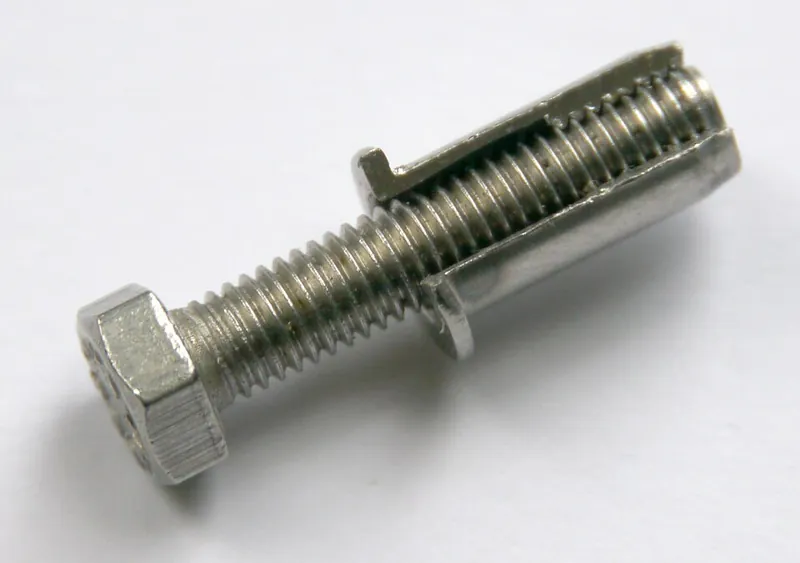
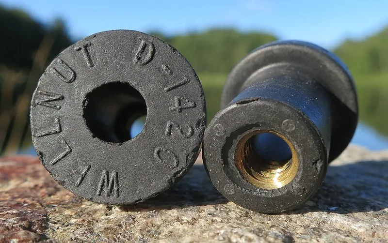
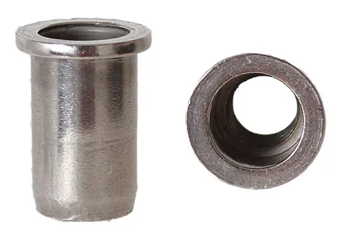

<figure class="eoc-pic eoc-pic-main"><figcaption><strong>Cross-section.</strong> <a href="https://commons.wikimedia.org/wiki/File:Blindklinkmoer_opengewerkt_met_bout.jpg">Blindklinkmoer opengewerkt met bout</a> by Erik Wannee, <a href="https://creativecommons.org/licenses/by-sa/4.0">CC BY-SA 4.0</a>, from Wikimedia Commons.</figcaption></figure>
<figure class="eoc-pic"><figcaption><strong>Photo.</strong> <a href="https://commons.wikimedia.org/wiki/File:1990s_Molly_well_nuts_D1420_with_threaded_brass_insert_by_Emhart_Teknik_AB_Oerebro_Sweden.jpg">1990s Molly well nuts D1420 with threaded brass insert by Emhart Teknik AB Oerebro Sweden</a> by R. Henrik Nilsson, <a href="https://creativecommons.org/licenses/by/4.0">CC BY 4.0</a>, from Wikimedia Commons.</figcaption></figure>
<figure class="eoc-pic"><figcaption><strong>Photo.</strong> <a href="https://commons.wikimedia.org/wiki/File:Blindnietmutter.jpg">Blindnietmutter</a> by PeterScha, <a href="https://creativecommons.org/licenses/by-sa/4.0">CC BY-SA 4.0</a>, from Wikimedia Commons.</figcaption></figure>

A threaded insert that you push into a drilled hole from one side and then squeeze (rivet nut) or tighten a screw into (well nut), so its body swells into a collar behind the sheet or tube wall and gives you a strong thread where no nut could be held behind.

**In plain words:** A threaded metal tube or rubber plug you push into a hole from the front, which bulges out behind the sheet when you squeeze or tighten it, so a thin panel or tube wall gets a strong screw thread even though you can't reach the back. **Proper term:** Blind threaded insert: blind rivet nut (rivet nut) and rubber well nut (rubber-insert nut).

**Also called:** rivet nut; blind rivet nut; rivnut; nutsert (Wikipedia 'Rivet nut'); 'RIVNUT' is a registered trade name (brand), first made by BF Goodrich (Wikipedia 'Rivet nut'; Böllhoff RIVNUT catalogue); nut-sert, nut-cert (maker spellings, JC's Printables knob model); Rivkle (brand, Böllhoff); plus nut; plusnut; slotted-body rivet nut; pre-bulbed rivet nut; split rivet nut ('PLUSNUT' is a brand, Böllhoff; RivetLab); hex-body rivet nut; knurled rivet nut; closed-end rivet nut; countersunk (flush) rivet nut; twist-resistant rivet nut (McMaster-Carr category names); rivet stud (rivstud): the same idea with a threaded stud sticking out instead of a threaded hole (Böllhoff RIVNUT catalogue); well nut; wellnut; rubber nut; rubber-insert nut; rubber-coated rivet nut; expanding nut (Wikipedia 'Well nut'; McMaster-Carr; HR Fastener); Rawlnut or Rawl nut (brand; the usual UK name for a well nut, Wikipedia 'Well nut'); blind nut; blind threaded insert; one-sided nut; threaded insert for thin sheet.

## How it works

Rivet nut: you screw it onto the threaded rod (mandrel) of a setting tool, push it into the hole, and the tool pulls the threaded end back towards the head; the thin plain part of the body buckles outward into a ring or bulge behind the sheet, riveting itself in place, and the tool is then unscrewed, leaving a thread (Böllhoff RIVNUT catalogue p.4; Wikipedia 'Rivet nut'). A slotted plus nut splits into four 'petals' that spread over a wide area behind soft or thin material (Böllhoff PLUSNUT data sheet). Well nut: you push the rubber sleeve through the hole and tighten a screw into the embedded nut; the flange's friction stops it turning, and as the nut is drawn towards you the rubber squashes into a thick lip behind the panel, clamping the panel and sealing the hole (Wikipedia 'Well nut'). In a blind hole in solid material the squashed rubber instead presses outward on the hole walls and anchors by friction (Wikipedia 'Well nut').

## Parts

Rivet nut: a single piece (a short metal tube with a flange or head at the front, a thin plain section in the middle that collapses, and a threaded section at the far end), fitted with a separate setting tool (Wikipedia 'Rivet nut'; Böllhoff). Plus nut: one piece with the plain section slit into four strips (Böllhoff). Well nut: a few parts moulded as one unit: a flanged rubber (neoprene or EPDM) sleeve with a brass or stainless nut embedded in the far end, used with your own screw (Wikipedia 'Well nut'; Rivet Nut USA).

## Everyday examples

- The rubber well nuts that hold a motorcycle windscreen or fairing panels, and accessory mounts on sit-on-top kayaks without access inside the hull (Kalafatis's Printables 'Wellnuts'; Spring Creek)
- Rivet nuts in a car, van or trailer body for roof racks, panels and fittings, and in the tubular frames of furniture and equipment (Böllhoff 'tubular materials') ⚑ [uncertain: vehicle examples from general knowledge, not an opened source]
- Aircraft inspection covers and static dischargers screwed into rivet nuts in the skin (Wikipedia 'Rivet nut')

## When to use it

Use a blind threaded fixing when you need a proper screw thread in something too thin to tap, and you can't reach the back to hold a nut: sheet-metal enclosures, car and van panels, box-section tube frames, plastic tanks and hollow mouldings, and composite or fibreglass panels (Wikipedia 'Rivet nut'; Böllhoff). A rivet nut is a good replacement for a welded-on nut because it doesn't distort the panel, burn the paint or give off welding fumes, and it can go in after painting (Wikipedia 'Rivet nut'; Böllhoff). Choose a well nut when you also want a watertight seal, vibration and noise [damping](../glossary.md#damping), electrical isolation between metals, or the option to remove it later: boats, kayaks, fairings, water tanks, glass and [brittle](../glossary.md#brittle--ductile) panels (Wikipedia 'Well nut'; Rivet Nut USA; RivetLab).

## When not to use it

If you can reach both sides, an ordinary bolt and nut is simpler and stronger (see 'Ordinary screw joint'). For thick plastic or 3D prints, a [heat-set insert](../glossary.md#heat-set-insert), press-fit insert or [captive nut](../glossary.md#captive-nut) pocket is usually easier than a crimped rivet nut (see those entries). For a permanent join of two sheets with no thread needed, use a blind (pop) rivet. For high-volume sheet-metal parts where both sides are reachable, self-clinching (press-in) nuts sit flush and are cheaper per part. Don't use a well nut for structural or high-torque joints, because it is 'not particularly strong' and the rubber lets the joint move (Wikipedia 'Well nut'; RivetLab); use a rivet nut or through-bolt. Don't use a standard round rivet nut in soft plastic or thin soft aluminium if it will see high screw [torque](../glossary.md#torque): it can spin or crater the sheet; use a plus nut or hex-body type (Eugene Fasteners; Böllhoff).

## Details

- **What it does (jobs):**
  - join and hold: gives thin sheet, plastic panels, tube walls and hollow sections a load-bearing screw thread that can be reached from one side only, and can also rivet two sheets together at the same time (Böllhoff RIVNUT catalogue p.4)
  - seal it, or pass cables or fluid through: a well nut seals the bolt hole against water and air, and closed-end or foam-sealed rivet nuts keep water and dirt out of the thread (Wikipedia 'Well nut'; Böllhoff RIVNUT catalogue pp.8, 22-23)
  - slow it, stop it or keep its speed steady: the rubber of a well nut damps vibration and noise, e.g. from a shaking motor (Wikipedia 'Well nut'; McMaster-Carr 'Rubber-Coated Rivet Nuts')
- **Movement:** none: once set, the insert stays fixed in the hole (a well nut's rubber lets the attached part rock very slightly, which is what damps vibration)
- **Directions it can move (degrees of freedom):** 0: once set, the insert cannot move in the hole. Before setting it can turn and slide in the hole, which is why the hole size and anti-turn features matter.
- **Special behaviour:**
  - none of the listed behaviours for an ordinary rivet nut: it is simply a permanent nut fitted from one side
  - self-aligning or self-centring (well nut only, in a loose sense): the rubber lets the fixed part sit slightly out of line and isolates it from vibration ⚑ [uncertain: described only as vibration isolation by the sources, not as alignment]
  - Its own tricks: it installs blind (from one side), it can rivet sheets together and act as a nut at once, and a well nut is also a gasket and an electrical insulator (Böllhoff; Wikipedia 'Well nut'; McMaster-Carr)
- **How it holds:**
  - shape (the parts interlock; [form-fit](../glossary.md#form-fit--force-fit--material-bond)): the collapsed bulge, ring or 'petals' behind the sheet and the head in front trap the sheet between them, like a rivet (Böllhoff RIVNUT catalogue; Böllhoff PLUSNUT data sheet); hex bodies in hex holes and keyed heads stop it turning (Böllhoff)
  - friction or clamping (force-fit): knurls and the clamping of the sheet stop a round rivet nut spinning; a well nut's squashed rubber clamps the panel and, in a blind hole, grips the hole walls by friction (Eugene Fasteners; Wikipedia 'Well nut')
  - spring force (a springy part presses it in place): the compressed rubber of a well nut keeps pressing on the panel ⚑ [uncertain: inferred from how it works; not stated in these words by a source]
- **Input and output:** not applicable
- **Power:** passive (no power needed); pneumatic or battery setting tools are only used to install rivet nuts faster (Böllhoff RIVNUT catalogue pp.24-27)
- **Load:** Rivet nut: medium to heavy for its size. Böllhoff's figures for an M6 steel RIVNUT in steel plate are about 7.7 kN ultimate tension (pull-out along the screw), 4.4 kN ultimate [shear](../glossary.md#peel-vs-shear) and more than 21 kN thread strength; an M6 aluminium one in 2024-T4 aluminium is about 4.1 kN tension and 2.6 kN shear (Böllhoff RIVNUT catalogue p.31, averages). It is weakest in twisting: a round one can spin in its hole if the hole is oversize or the material soft (Eugene Fasteners). In thin sheet and plastics a slotted plus nut holds much more: e.g. 5.40 kN versus 2.13 kN for a standard rivet nut in 0.76 mm steel, and 3.22 kN versus 1.25 kN in 4.69 mm blow-moulded plastic (Böllhoff PLUSNUT data sheet; thread size not stated). Well nut: light; Wikipedia says well nuts 'are not particularly strong', and RivetLab says they have weaker pull-out and torque strength than rivet nuts and are not for structural use.
- **Play and precision:** Rivet nut: no play once set; position depends on drilling the hole accurately, and a tilted tool or a burr on the back of the hole leaves a tilted flange (Eugene Fasteners). [Tolerance](../glossary.md#tolerance) to sheet thickness is limited to the part's grip range, so different lengths are sold for different thicknesses (Böllhoff). Slotted plus nuts and 'oversize grip range' types cope with the widest range of thicknesses and less perfect holes (Böllhoff; Eugene Fasteners). Well nut: small but noticeable give, because the attached part sits on rubber; it tolerates a wide range of thicknesses (e.g. 0.4-4.0 mm grip for one size, Swordfish).
- **Taking it apart:** Rivet nut: permanent; the screw can be removed and refitted, but the insert itself has to be drilled out, and a spun or failed one is drilled out and replaced, going up a size if the hole is damaged (Eugene Fasteners 'Troubleshooting Rivet Nut Failures'). Well nut: removable; loosen the screw and pull it out (RivetLab; Rivet Nut USA), though Spring Creek notes that once screwed up it expands beyond the 1/2 in hole 'and will not be able to come out' until loosened.
- **How often it can be reused:** Rivet nut: once for the insert itself, but its metal thread takes the screw effectively unlimited times (Zortrax and JC's Printables knob use rivet nuts in prints for exactly this reason ⚑ [uncertain: Zortrax page could not be opened; JC only says it was used as an insert]). Well nut: a few times to many times; RivetLab calls it reusable, and HR Fastener advises replacing it if the rubber sleeve is damaged.
- **Sealing:** Rivet nut: none for an open-end type (water can pass through the thread); closed-end types 'seal the threads' and versions with a pre-applied PVC foam head seal 'against dust, water, air and non-petroleum based liquids' (Böllhoff RIVNUT catalogue pp.8, 23). Well nut: watertight, and described as airtight or gas-proof, because the squashed rubber lip presses round the hole and under the flange (Wikipedia 'Well nut'; Rivet Nut USA; RivetLab).
- **Adjustable:** no for position: it is fixed in its hole. A well nut's clamping force (how hard it squeezes the panel and seal) is set by how far the screw is tightened; stop when you feel resistance (RivetLab).
- **Access needed:** one side only (blind): both types are inserted and set entirely from the front of the panel or tube (Wikipedia 'Rivet nut'; Wikipedia 'Well nut'); the back only needs a little clear space for the body and bulge (McMaster-Carr sells 'Tight-Space Rivet Nuts' for limited backside [clearance](../glossary.md#clearance)).
- **Materials:** Rivet nuts are made of steel, stainless steel, aluminium and brass, with alloy-steel high-strength versions (Böllhoff RIVNUT catalogue pp.5-6). They install in steel, aluminium, plastics, composites and fibreglass, in flat sheet and in tubes (Wikipedia 'Rivet nut'; Böllhoff), in material as thin as 0.5 mm (0.020 in) (Böllhoff p.4). Slotted plus nuts suit soft and brittle plastics (rotomoulded, blow-moulded, pultruded, SMC, vinyl extrusions) and thin sheet (Böllhoff PLUSNUT data sheet). Choose aluminium rivet nuts for aluminium panels and stainless for stainless or marine use to avoid rust and galvanic corrosion (Eugene Fasteners). Well nuts: a neoprene (chloroprene) or EPDM rubber body with a brass or stainless steel nut (Wikipedia 'Well nut'; Rivet Nut USA); used in metal, plastic, composite, glass, plywood and tube (McMaster-Carr; RivetLab). 3D prints: rivet nuts can be pressed or heat-set into printed parts as ordinary inserts (Hackaday comment; JC's Printables knob in PCTG), and flexible TPU or TPE can be printed into home-made well nuts (Kalafatis; ParametricFab).
- **Heat, cold, water and wear:** Rivet nuts: zinc-plated steel ones rust in marine environments, and stainless rivet nuts in aluminium panels can cause galvanic corrosion; match the material to the panel (Eugene Fasteners). Open-end rivet nuts let water through the thread: use closed-end or foam-sealed types on wet or sealed panels (Böllhoff). Well nuts: rated about -30 °C to +80 °C for neoprene with brass inserts (Swordfish); the rubber can age, crack or relax over the years, especially in sun and heat, so the clamp and seal may need re-tightening or the well nut replacing ⚑ [uncertain: no source gives ageing data; HR Fastener only advises replacing a damaged sleeve]. Well nuts resist vibration and don't corrode, since the brass insert is sealed in rubber (Wikipedia; RivetLab).

## Making it

- **Ways to make or get it:**
  - off-the-shelf part: rivet nuts, plus nuts, rivet studs and well nuts are bought and fitted; they are not made at home
  - sheet metal: the main use, adding threads to thin steel or aluminium sheet, van and car bodies, enclosures and aircraft skins (Wikipedia 'Rivet nut'; Böllhoff)
  - tube and extrusion: square, round and rectangular steel or aluminium tube walls (Böllhoff 'tubular materials')
  - 3D print (FDM): rivet nuts used as pressed-in or heat-set inserts in printed parts; well nuts to fix printed parts to thin panels; printed TPU or TPE well nuts with an embedded nut (Hackaday; JC; Kalafatis; ParametricFab)
  - woodwork: well nuts in plywood, and in blind holes in solid material (RivetLab; Wikipedia 'Well nut')
  - laser cut: rivet nuts and well nuts in cut plastic or composite panels ⚑ [uncertain: no specific source; follows from the materials list]
- **Printing it in one piece (print in place):** partly: a home-made well nut can be printed in flexible TPU or TPE, but it needs a metal nut added (Kalafatis's design uses the M4, M5 and M6 embedded nuts 'popular in 3D printing'; ParametricFab's uses an M5 nut on the back). Metal rivet nuts can't be printed; they are fitted to printed parts afterwards.
- **Tools:** A drill with the exact bit size from the data sheet, a deburring tool (Eugene Fasteners). Rivet nut: a setting tool fitted with the right mandrel and nose piece for the thread size: hand tools (lever or wrench type), pneumatic, pneumatic-hydraulic or battery tools (Böllhoff RIVNUT catalogue pp.24-29; Eugene Fasteners). Some types (pre-bulbed plus nuts, 'easy-install' rivet nuts) can be set by turning a screw with a simple torque hand tool or ordinary screw driver tool (Böllhoff PLUSNUT data sheet; McMaster-Carr 'Easy-Install Rivet Nuts ... Install with nothing more than a screw'); makers also set them with a bolt, nut and washer (Smoking Steel Garage video 'Install Rivnuts Without The Tool') ⚑ [uncertain: video not watched]. Well nut: only a screwdriver or hex key, sometimes a rubber mallet to seat it (Wikipedia; RivetLab; Spring Creek).
- **Difficulty:** easy to moderate: well nuts are easy (drill a hole, push in, tighten a screw). Rivet nuts are moderate: a hand setting tool is cheap, but you must drill the exact hole size, deburr it and pick the right grip length, or the insert spins or pulls out (Eugene Fasteners).

### 3D printing tips

1) Two ways to use a rivet nut in a print: (a) as an ordinary insert: press it into a close-fitting hole so its knurls or [splines](../glossary.md#spline) bite (a Hackaday reader: 'I always press fit rivet nuts into a print ... The splines bite into the plastic and almost never spin'), or heat it in with a soldering iron like a heat-set insert (JC set one in PCTG at 330 °C and notes 'It is not compressed'); (b) as a true blind nut through a thin printed wall, where the bulge forms inside a hollow part. For (b), design the wall thickness to fall inside the rivet nut's grip range (for example 0.75-2.00 mm for the shortest M6 flat-head RIVNUT, Böllhoff) and use the data-sheet hole size (8.50-8.60 mm for that M6). 2) Printed plastic is soft and can crack: prefer a slotted plus nut, which Böllhoff designed for plastics with 'minimal [radial](../glossary.md#axial--radial) stresses in the setting process to avoid the risk of breakage on soft or fragile materials', or a hex-body rivet nut in a printed hex hole so it can't spin (Böllhoff; Eugene Fasteners recommends hex bodies for soft materials) ⚑ [uncertain: no published test of crimped rivet nuts in FDM walls was found]. 3) Make the area round the hole solid (extra [perimeters](../glossary.md#perimeters) or 100% [infill](../glossary.md#infill)) so the setting force and the bulge bear on solid plastic, not infill ⚑ [uncertain: general printing advice]. 4) Squeeze gently: over-setting crushes soft material and can strip the insert's own thread (Eugene Fasteners); a hand tool gives better feel than a pneumatic one ⚑ [uncertain]. 5) To fix a printed part to a thin panel you can only reach from the front (a car panel, kayak hull, pegboard), use a well nut through the panel and a screw through the printed part; the rubber also stops vibration cracking the print ⚑ [uncertain: vibration benefit for prints inferred from the well nut's damping]. 6) Printed well nuts: print in soft flexible filament (Kalafatis uses 83A TPE) with a hexagonal pocket for a standard nut; ParametricFab's TPU windscreen well nut 'should probably only be used temporarily', so treat printed versions as light-duty. 7) For fixing into a 3D-printer's aluminium extrusion slot rather than a hole, see the printed 'push rivet nut' for 15 mm extrusions (famichu, printed in ABS or PC with an M2 self-tapping screw) and the 'Aluminium-extrusion connectors' entry.

### Buying one (off-the-shelf parts)

Search for: 'rivet nut' / 'blind rivet nut' / 'rivnut' / 'nutsert' (flat head, reduced or thin head, countersunk; round, knurled, hex or half-hex body; open end or closed end), 'plus nut' / 'slotted rivet nut' / 'pre-bulbed rivet nut' for plastics and thin sheet, 'rivet stud' (external thread), 'rivet nut tool' or 'rivet nut setting tool' (hand lever, wrench type, pneumatic-hydraulic, cordless) with mandrels for M3-M12 or #4-40 to 1/2-13 (Böllhoff RIVNUT catalogue; McMaster-Carr categories 'Rivet Nuts', 'Twist-Resistant Rivet Nuts', 'Closed-End Twist-Resistant Rivet Nuts', 'Flush-Profile Rivet Nuts', 'Rivet Nuts For Plastic and Composites', 'Easy-Install Rivet Nuts', 'Tight-Space Rivet Nuts'). For well nuts: 'well nut', 'rubber well nut', 'rubber-insert nut', 'rubber-coated rivet nut' (McMaster-Carr), 'neoprene well nut' or 'EPDM well nut' with brass insert, sizes about #6-32 to 3/8-16 and M3 to M10 (Rivet Nut USA; McMaster-Carr). Specialised versions: rivet nuts with a pre-applied foam seal under the head, anti-vibration rubber rivet nuts with a moulded-in washer, and rivet nuts with a thread-locking feature (Böllhoff pp.22-23).

## Rules of thumb

- Pick the rivet nut length (grip range) to suit the sheet thickness: each part only works over a band of thicknesses, e.g. Böllhoff's M6 flat-head round-body RIVNUT comes in 0.75-2.00, 2.00-3.50, 3.50-5.00 and 5.00-6.50 mm grips, identified by marks on the head (Böllhoff RIVNUT catalogue p.7). Too short and the body can't reach the back; too long and it can't collapse tight (Eugene Fasteners).
- Drill the exact hole size on the data sheet, e.g. 8.50-8.60 mm for an M6 round-body RIVNUT, 9 mm for an M6 RIVKLE and 8.80-8.93 mm for an M6 plus nut (Böllhoff RIVNUT catalogue pp.7, 12, 14); even 0.005 in (0.13 mm) oversize can let the knurls fail to grip so it spins (Eugene Fasteners).
- Deburr the back of the hole after drilling: a burr stops the body collapsing properly and tilts the flange (Eugene Fasteners).
- Rivet nuts work in material as thin as 0.5 mm (0.020 in) (Böllhoff RIVNUT catalogue p.4), but thin aluminium panels of about 1 mm (0.040 in) and below can 'crater' if set too hard (Eugene Fasteners).
- Don't tighten the screw beyond the rivet nut's rated torque, which equals its maximum setting load; e.g. about 130 lb-in (14.7 N·m) for a 1/4-20 steel RIVNUT and 60 lb-in (6.8 N·m) for aluminium, or the screw breaks or the insert keeps collapsing until the thread strips (Böllhoff RIVNUT catalogue p.32).
- For soft or slippery materials and high screw torque, use a hex-body rivet nut in a hex hole, a knurled or keyed one, or a closed-end twist-resistant type (Böllhoff RIVNUT catalogue pp.10-11, 23; Eugene Fasteners; McMaster-Carr).
- For plastics, fibreglass and thin sheet use a slotted plus nut: in Böllhoff's tests it held about 2.5 times more than a standard rivet nut in 0.76 mm steel (5.40 vs 2.13 kN) and 7 times more in 3.04 mm rotomoulded plastic (0.7 vs 0.1 kN) (Böllhoff PLUSNUT data sheet).
- Outdoors or at sea use 18-8 or 316 stainless rivet nuts, and avoid stainless in aluminium where galvanic corrosion is a risk (Eugene Fasteners).
- Well nuts: drill the hole the well nut is sized for (e.g. 1/2 in for Spring Creek's kayak well nuts), tighten until you feel resistance and stop, and don't use them where the joint is structural (RivetLab; Spring Creek).
- Well nuts have a working temperature of about -30 °C to +80 °C for neoprene with brass inserts (Swordfish product data).

## Common failures

1) Rivet nut spins when the screw is tightened or loosened: hole oversize, material too soft for the knurls, or not set hard enough; drill it out and fit a new one in a correct hole, going up a size if needed, or use a hex-body, knurled or plus-nut type (Eugene Fasteners). 2) Pulls out under load: wrong grip range for the thickness, thin aluminium cratered by over-setting, or load too high (Eugene Fasteners); use a plus nut to spread the load. 3) Stripped or damaged thread: over-setting crushes the threaded section, or the screw is cross-threaded or bottoms out in a closed-end nut (Eugene Fasteners; Böllhoff p.32). 4) Won't go in or won't set: hole undersize, low air pressure, worn or short mandrel (Eugene Fasteners). 5) Tilted flange or marked paint: tool not held square, or a burr on the back of the hole (Eugene Fasteners). 6) Corrosion: wrong material for the environment (Eugene Fasteners). 7) Well nut spins with the screw or pulls through: hole too big or rubber over-squeezed; tighten only until resistance is felt (RivetLab). 8) Well nut leaks or loosens after years: rubber aged or damaged; replace it (HR Fastener) ⚑ [uncertain: ageing]. 9) Printed well nut tears or [creeps](../glossary.md#creep): flexible printed plastic is weaker than moulded rubber; ParametricFab suggests printed ones only as a temporary fix.

## Safety

Drilling sheet metal leaves sharp burrs and swarf: wear eye protection and deburr the hole (Eugene Fasteners) ⚑ [uncertain: eye protection is general advice]. Because you can't see behind the panel, check what is behind it (wiring, fuel or brake lines, a fuel tank or a kayak's hull) before drilling, and choose screw lengths that won't reach it ⚑ [uncertain: general advice]. Keep fingers clear of the jaws of lever-type setting tools ⚑ [uncertain: general advice]. A well nut is an electrical insulator, so it will not earth (ground) whatever is screwed to it (McMaster-Carr: shields threads from 'accidental electrical contact'). Don't rely on well nuts for anything safety-critical (RivetLab: not for structural use).

## Related

- Blind rivet (pop rivet): also set from one side by pulling a mandrel, but joins sheets permanently and leaves no thread
- Internal tube anchors (star nut, expansion plug): fitted into the open end of a tube rather than through a hole in its wall; a rubber expansion plug is a close cousin of the well nut
- Self-clinching fastener (press-in nut or stud): a nut pressed permanently into sheet metal, but it needs access to both sides and a press
- Heat-set threaded insert: the usual way to add a metal thread to a 3D print when the plastic is thick enough; melted in rather than crimped
- Press-fit and expanding inserts (tap-in insert): threaded inserts pushed or expanded into a hole in thick plastic or wood, not bulging behind a thin sheet
- Spring-steel push-on fasteners (push nut, speed nut, U-nut): a clip-on nut that grips the edge of a panel; needs edge access, not a hole in the middle
- Captive nut pocket (nut trap) and mid-print embedding: ordinary nuts trapped inside a 3D print instead of an insert
- Aluminium-extrusion connectors (T-slot nuts and brackets): drop-in nuts for the slots of aluminium extrusion, the extrusion's own blind fixing
- Temporary sheet fastener (Cleco-type spring pin): also fitted from one side, but only holds sheets temporarily while drilling or riveting
- Gasket and [O-ring](../glossary.md#o-ring) seal entries: for sealing without a thread; a well nut is effectively a gasket and a nut in one
- Hollow-wall anchors: toggles, molly bolts and self-drilling plasterboard anchors use the same blind idea in plasterboard walls; Wikipedia compares the well nut to a molly bolt
- Wall plug: a plastic sleeve that swells in a drilled hole in brick or concrete as a screw goes in; for solid walls, where a rivet nut or well nut has no hollow space behind to bulge into

## Make it yourself

- [Wellnuts (Apostolos Kalafatis, Printables) (URL from Printables API, page not opened)](https://www.printables.com/model/1174824-wellnuts): Printable M4, M5 and M6 rubber-style well nuts for motorcycle fairings and windscreens, printed in 83A TPE with a standard nut embedded. Read through the Printables public API. *(licence: CC BY-SA (Creative Commons Attribution-ShareAlike))*
- [Windshield Well Nut 2008+ klr650 (ParametricFab, Printables) (URL from Printables API, page not opened)](https://www.printables.com/model/264580-windshield-well-nut-2008-klr650): TPU well nut with an M5 nut on the back, for a motorcycle windscreen; the designer says printed ones 'should probably only be used temporarily'. Read through the Printables public API. *(licence: CC BY (Creative Commons Attribution))*
- [Well nut for 1/4" pegboard (KG3DPrinting, Printables) (URL from Printables API, page not opened)](https://www.printables.com/model/161882-well-nut-for-14-pegboard): A printed anchor that works like a well nut in plastic pegboard holes, sized for a #6 wood screw, with a STEP file to change the dimensions. Read through the Printables public API. *(licence: CC BY (Creative Commons Attribution))*
- [6mm Knob using Rivet-Nut Insert (JC, Printables) (URL from Printables API, page not opened)](https://www.printables.com/model/1373120-6mm-knob-using-rivet-nut-insert): A printed PCTG clamp knob with a McMaster-Carr rivet nut melted in with a soldering iron at 330 °C as a thread insert (not crimped). Read through the Printables public API. *(licence: CC BY (Creative Commons Attribution))*

## Pictures, videos and models

- [Blindklinkmoer opengewerkt met bout.jpg (Erik Wannee, Wikimedia Commons)](https://commons.wikimedia.org/wiki/File:Blindklinkmoer_opengewerkt_met_bout.jpg): A rivet nut cut open with an M5 bolt inside, showing the thin collapsing section and the thread *(licence: CC BY-SA 4.0)*
- [Well nut.jpg (Lithopsian, Wikimedia Commons, 2017)](https://commons.wikimedia.org/wiki/File:Well_nut.jpg): Three 15 mm well nuts, showing the captive nut, the rubber cylinder and flange, and a hex bolt *(licence: CC BY-SA 4.0)*
- [Blindnietmutter.jpg (PeterScha, Wikimedia Commons)](https://commons.wikimedia.org/wiki/File:Blindnietmutter.jpg): Photo of an M8 stainless steel (V2A) blind rivet nut *(licence: CC BY-SA 4.0)*
- [Operation of hand riveting tool for blind rivet nuts (YatoTeam, YouTube)](https://www.youtube.com/watch?v=ykvbCXs7slU): Video of setting blind rivet nuts with a hand lever tool (title and channel checked via YouTube oEmbed; not watched) *(licence: link only (standard YouTube licence))*
- [These threaded inserts aren't made for 3D prints (but work amazingly well) (Made with Layers, Thomas Sanladerer, YouTube)](https://www.youtube.com/watch?v=lYXTiJo_FQQ): Video testing alternative threaded inserts, including rivnuts, in 3D prints (summarised by Hackaday, 15 April 2024; title and channel checked via YouTube oEmbed; not watched) *(licence: link only (standard YouTube licence))*

## Needs confirming

⚑ marks something nobody has confirmed yet: a fact the research could not confirm from a source, a finder value that is a best guess, or an open point from the research notes. Corrections are welcome (see `research/needs-confirming.md`).

- ⚑ 15 sentences on this page marked [uncertain].
- ⚑ Finder value `tools` = drill and tap, hand tools (source uncertain): `tools_needed` is marked ⚑ [uncertain] here: "…asher (Smoking Steel Garage video 'Install Rivnuts Without The Tool') ⚑ [uncertain: video not watched]. Well nut…"
- ⚑ Finder value `made_of` = 3D prints, plastic sheet, tube or moulded parts, wood, metal, carbon fibre or composites, glass or mirror (best guess): proposed from the words in the research text (R37); not yet checked

## Sources

- <https://en.wikipedia.org/wiki/Rivet_nut>
- <https://en.wikipedia.org/wiki/Well_nut>
- <https://www.rivetnutusa.com/wp-content/uploads/2018/11/RIVNUT-TheOriginalRivnut.pdf>
- <https://www.rivetnutusa.com/wp-content/uploads/2019/01/Engineering-Data-Specifications-and-Mechanical-Properties-Information_Bollhoff-Plusnut.pdf>
- <https://www.eugenefast.com/home/page/resources/how-to-install-rivet-nuts>
- <https://www.eugenefast.com/home/page/resources/troubleshooting-rivet-nut-failures>
- <https://www.mcmaster.com/products/rivet-nuts/>
- <https://www.mcmaster.com/products/well-nuts/>
- <https://rivetlab.com/blogs/news/well-nuts-a-hidden-gem>
- <https://rivetlab.com/products/m3-well-nuts-rubber-in-rnm3250>
- <https://www.rivetnutusa.com/specialty-fasteners/other-fasteners/well-nut-fasteners/>
- <https://hrfastener.com/well-nuts-benefits-and-how-to-use/>
- <https://www.swordfish-tools.com/product-page/rubber-well-nuts-sae-metric-thread>
- <https://www.springcreek.com/product/paddle-sports/stabilizer-float-package-accessories-replacement-parts/well-nuts-rubber-expandable-nuts/>
- <https://hackaday.com/2024/04/15/alternate-threaded-inserts-for-3d-prints/>
- <https://commons.wikimedia.org/wiki/Category:Rivet_nuts>
- <https://commons.wikimedia.org/wiki/File:Blindklinkmoer_opengewerkt_met_bout.jpg>
- <https://commons.wikimedia.org/wiki/File:Well_nut.jpg>
- <https://commons.wikimedia.org/wiki/File:Blindnietmutter.jpg>
- <https://www.youtube.com/watch?v=ykvbCXs7slU>
- <https://www.youtube.com/watch?v=FJ4gF2tXRBE>
- <https://www.youtube.com/watch?v=lYXTiJo_FQQ>
- <https://api.printables.com/graphql/ (models 1174824, 264580, 161882, 1373120, 126459)>
