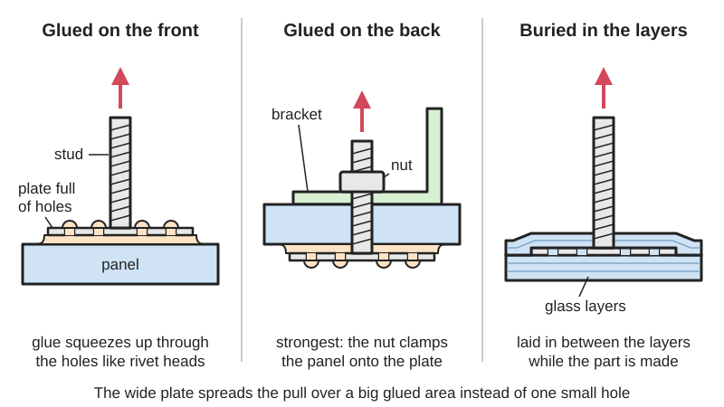

<figure class="eoc-pic eoc-pic-main"><figcaption>Diagram drawn for the encyclopaedia from the research notes. ⚑ Needs confirming: a drawing can simplify or get details wrong; a real photo or a better diagram is welcome.</figcaption></figure>

A threaded stud, nut or collar welded to a broad perforated base plate that is glued to a surface or laminated into a composite, giving a strong threaded mounting point with no hole drilled through the part.

**In plain words:** A bolt, nut or threaded socket fixed to a wide, thin metal or plastic plate full of holes, which you glue onto a surface (or bury in fibreglass as it is made) so you get a screw thread to bolt things onto without drilling a hole through the part. **Proper term:** Bonding fastener (adhesive-bonded stud, nut or collar; glue-on stud).

**Also called:** glue-on stud, glue-on fastener (Practical Sailor 'Glue-on Fasteners'); adhesive-bonded fastener, adhesively bonded stud (Click Bond FAQ; Carr Lane 'Adhesively Bonded Fasteners' flyer); bonded stud, bonded nut, bonded nutplate; rivetless nutplate (Click Bond FAQ; Kitplanes 'ClickBond Fasteners Streamline Construction'); embedding fastener, surface-bonding fastener, perforated-head fastener (Easy Composites; bigHead TDS); threaded collar fastener, blind or sighted threaded collar (Easy Composites); bigHead (brand; 'their name being synonymous with ... big head fasteners', Easy Composites); Weld Mount (brand), Click Bond (brand), Sea-Lect glue-on studs (brand) (Practical Sailor; Carr Lane; Kitplanes); adhesive screw, glue-on mounting adapter, tesa Power.Kit (brand) for bathroom fittings (tesa).

## How it works

Instead of putting a hole through the part, the load is passed into it through a wide area of glue: the base plate is many times wider than the thread, so a pull on the stud is spread over the whole bonded area instead of a small hole (Easy Composites: laminates 'are vulnerable to point-loading'; a bonding fastener spreads the load 'over a wider area'). The holes in the base let adhesive or resin flow through and set on both sides, locking the plate in like a rivet head (Easy Composites). It can be surface-bonded after the part is made, or embedded (co-processed) as the fibreglass or plastic part is laid up or moulded (Bossard; bigHead guidance). For the most strength, the plate is glued to the back face with the stud poking through a small hole, so the nut clamps the panel against the plate (Easy Composites).

## Parts

A few parts: the fastener itself (a threaded stud or a threaded collar or nut, welded to a thin, wide, perforated base plate called the head), the adhesive or laminating resin, and often a holding fixture (rubber plug, tape or clamp) used while it [cures](../glossary.md#cure) (Easy Composites; Click Bond FAQ; Carr Lane). Home-made versions are a bolt or threaded rod epoxied into a block of G10 fibreglass sheet (Practical Sailor).

## Everyday examples

- drill-free shower baskets and towel rails glued to bathroom tiles with screw adapters (tesa Power.Kit)
- electrical boxes, pumps and solar-panel mounts glued to the inside of a fibreglass boat hull or hard top (Practical Sailor)
- cowling and fairing nutplates glued inside homebuilt aircraft (Kitplanes)
- threaded studs bonded to the back of carbon-fibre car body panels so no fixing shows on the outside (bigHead guidance)

## When to use it

When you need a threaded mounting point but drilling is bad or impossible: on fibreglass and carbon laminates (drilling cuts fibres and they can't be tapped), on cored hulls and decks where a hole would let water into the core, where you can't reach the back to fit a nut, where a hole would show on the visible face, and on tiles or glass you don't want to drill (Easy Composites; Practical Sailor; tesa). Also a quick way to add many small mounting points for cables, conduit and light equipment.

## When not to use it

Not for loads that hold people, rigging, lifting or overhead loads unless the maker rates it for that use; Practical Sailor doesn't recommend glue-on studs for rigging loads or equipment subject to high impact. Not on surfaces that may [peel](../glossary.md#peel-vs-shear) (paint, wallpaper, loose plaster, flaky gelcoat) or on PE, PP or PTFE (tesa). Not where it is permanently wet or submerged, for household adhesive kits (tesa). For high loads, through-bolt with a backing plate, and in a cored panel use a Potted insert. In solid wood or a thick print, a Heat-set or Screw-in threaded insert is simpler.

## Details

- **What it does (jobs):**
  - join and hold: adds a threaded point to bolt equipment, brackets, covers or panels onto
  - glue or bond: the base plate is held on by adhesive (surface bonding) or by the laminate's resin (embedding)
- **Movement:** none
- **Directions it can move (degrees of freedom):** 0: once cured the stud is fixed to the surface. Floating nutplate versions let the nut slide a little to line up with the bolt (Carr Lane).
- **Special behaviour:**
  - none: a fixed threaded mounting point; floating nutplates are self-aligning for bolt [misalignment](../glossary.md#misalignment) (Carr Lane)
- **How it holds:**
  - [material bond](../glossary.md#form-fit--force-fit--material-bond) (glue, solvent or melting): adhesive or laminating resin bonds the base plate to the surface
  - shape (the parts interlock; form-fit): adhesive that flows through the perforations and sets locks the plate mechanically as well (Easy Composites)
- **Input and output:** not applicable
- **Power:** passive (no power needed)
- **Load:** Light to medium (heavy only for industrial products used to their ratings). Strong in shear and tension when bonded to a sound surface; weak in peel, so side loads that lever the plate up are worst ⚑ [uncertain: general adhesive rule, see Glued joint design entry]. Maker's figures: Weld Mount-type 2 in base studs (5/16 and 3/8 in) about 1,200 lb tensile and 1,500 lb shear, smaller 1 1/4 in base studs 500 lb tensile and 650 lb shear (Carr Lane flyer); a bigHead M5 stud on a 20 mm head is limited to 5.6 kN at the weld and 6.1 Nm tightening [torque](../glossary.md#torque) (bigHead SM1-B20 TDS). These ratings are for the fastener; the real limit is usually the surface it is glued to: paint, gelcoat or a weak skin fails first (tesa: coated, painted or sealed surfaces reduce load capacity). Practical Sailor doesn't recommend glue-on studs 'for rigging loads or equipment subject to high impact'.
- **Play and precision:** No play once cured. Placement [accuracy](../glossary.md#repeatability--accuracy) depends on holding it still while the adhesive sets: plain bonded bases 'tend to slide around as though on skates' without tape or clamps (Practical Sailor); high-viscosity 'no-slide' adhesives or the maker's fixtures prevent this (Carr Lane; Click Bond FAQ). [Clearance](../glossary.md#clearance) holes in the part bolted on should be smaller than the fastener's shoulder (ideally 80-90% of its diameter) so the clamp load bears on the shoulder (bigHead guidance).
- **Taking it apart:** permanent for the bonded base (practically: removing an epoxied stud 'will tear out a chunk of the bulkhead', Practical Sailor; some acrylic-bonded studs can be peeled off after heating to about 350 °F, with care not to overheat a composite, Kitplanes); the nut or screw on the thread stays removable. tesa Power.Kit adapters are made to be twisted off with pliers and the adhesive scraped away (tesa).
- **How often it can be reused:** once for the bond; the nut or bolt on it many times
- **Sealing:** watertight at the mounting point: there is no hole through the skin, so nothing can leak in, which is the reason for using it on cored boat hulls (Practical Sailor). The 'through' version (stud passing through a hole) needs the hole sealed like any other.
- **Adjustable:** Only while wet: with the equipment held in position and the studs hanging from its mounting holes, the studs can be glued in place for perfect alignment (Practical Sailor 'Alignment Tip'). Once cured, position is fixed.
- **Access needed:** one side only (blind): it is glued to one face with no need to reach the back, which is its main advantage (Practical Sailor: when 'the other side is either inaccessible or exposed'). The strongest 'through' version needs the back face (Easy Composites).
- **Materials:** Fastener: usually 304 or 316 stainless steel (Carr Lane; Easy Composites). Suits: fibreglass (GRP) and carbon laminates, metals (aluminium, stainless, galvanised steel), engineering plastics and composites (Easy Composites; Carr Lane); tile, stone, glass, concrete, metal, wood and many plastics for household adapter kits (tesa). Embedding needs material about 3 mm thick or more round the head (bigHead SM1-B20 TDS). Adhesives: methacrylate (MMA) structural adhesives (Easy Composites VM100, Weld Mount AT-8040), two-part epoxy thickened to mayonnaise consistency (Practical Sailor), or the maker's own adhesive. Poor: polyethylene (PE), polypropylene (PP) and PTFE, loose or painted plaster, wallpaper, fabrics, and painted or sealed coatings (tesa); gelcoat or paint that could peel off the laminate ⚑ [uncertain: forum advice seen in search results to grind to bare fibreglass, page not opened].
- **Heat, cold, water and wear:** Temperature: depends on the adhesive; a household SMP adhesive is rated -40 to +100 °C once cured and must be applied between +5 and +40 °C (tesa); an acrylic-bonded aircraft fastener softens enough to peel off at about 350 °F (Kitplanes). Water: tesa's kit is moisture-resistant but not for permanent immersion, running water or steam rooms (tesa); epoxy- or methacrylate-bonded marine studs are used inside boats (Practical Sailor). [Creep](../glossary.md#creep): if the parts clamped by the nut are plastic or polymer composite, they can creep and the clamp loosens over time, so test the assembly (bigHead guidance). UV and long-term ageing ⚑ [uncertain: no figure found].

## Making it

- **Ways to make or get it:**
  - off-the-shelf part (bonding studs, nuts and collars; adhesive kits)
  - woodwork or composites [lay-up](../glossary.md#lay-up) (embedding in fibreglass, or a home-made G10 block with threaded rod)
  - 3D print (FDM) for home-made bases or covers holding a glued-in nut
- **Printing it in one piece (print in place):** no: the threaded metal part is bought; a printed base with a [captive nut](../glossary.md#captive-nut) can be printed with a pause to drop the nut in, but it is then glued on as a separate part
- **Tools:** Abrasive (sandpaper or Scotch-Brite) and solvent for surface preparation; the adhesive (two-part epoxy, a methacrylate in a cartridge gun with mixing nozzle, or a supplied one-part adhesive); tape, clamps or the maker's fixture to hold it still while it cures; a spanner for the nut (Carr Lane; Practical Sailor; Click Bond FAQ; tesa).
- **Difficulty:** easy: glue it on and wait; the skill is in surface preparation, choosing the adhesive, and holding it still while it cures.

### 3D printing tips

A printed base can stand in for the metal plate on light loads: one maker prints a phone-to-tripod adapter with a 1/4-20 nut glued into the base, then sticks it on with 3M tape (Printables 531033). Make the base wide and flat, give the nut a hex pocket so it can't spin, and treat the print's own layer strength and the glue's grip on PLA or PETG as the weak links ⚑ [uncertain: no test data found]. For a stronger result glue a metal bonding stud to the part instead, using an adhesive that suits both materials. Printed covers can hide glue-on studs (Printables 55589, made for tesa Power.Kit adapters; printed upside down in PETG).

### Buying one (off-the-shelf parts)

- perforated-head threaded studs, blind and sighted threaded collars (bigHead (brand), e.g. stud on a 20 mm round head, M4-M10) (Easy Composites; bigHead SM1-B20 TDS)
- adhesively bonded studs, floating nut plates and lanyard (cable-tie) mounts (Weld Mount (brand), sold by Carr Lane) (Carr Lane flyer)
- adhesive-bonded nutplates, studs, standoffs and mounts with installation fixtures (Click Bond (brand)) (Click Bond FAQ)
- glue-on studs 1/4-20 for marine use (Sea-Lect (brand)) (Practical Sailor)
- structural adhesives: methacrylate (e.g. Easy Composites VM100, Weld Mount AT-8040 no-slide), two-part epoxy with colloidal silica or other thickener (Easy Composites; Carr Lane; Practical Sailor)
- household drill-free adapter kits with one-part SMP adhesive (tesa Power.Kit (brand)) (tesa)
- G10 / FR4 fibreglass sheet offcuts and stainless threaded rod for home-made bonded studs (Practical Sailor)

## Rules of thumb

- Prepare the surface: clean off grease, sand or scuff, and solvent-wipe both the base and the surface (Carr Lane step 1; Practical Sailor; Click Bond FAQ). Degrease threaded rod before bonding it, because thread-cutting oil remains (Practical Sailor).
- Epoxy method: thicken epoxy to mayonnaise consistency (stiffer on vertical surfaces) and press the stud into the mound until adhesive comes out round the edge and through all the holes; on vertical faces hold it with tape or a 4 in square of glass cloth laminated over it (Practical Sailor).
- Methacrylate method: a large drop in the centre of the base, push down to squeeze it out, turn slowly clockwise while pushing until it won't turn; handling strength in about 12 minutes, functional cure in 45 minutes, 75% of final strength in 45 minutes (Carr Lane / Weld Mount flyer).
- Hold it still and under light pressure while it cures: that sets the right glue-line thickness and position (Click Bond FAQ).
- Strongest arrangement: bond the plate to the back face with the stud through a small hole, so the nut clamps the panel (Easy Composites); keep the clearance hole smaller than the stud's shoulder (80-90% of shoulder diameter) and avoid gaps between the parts, or tightening pulls the fastener off (bigHead 'Fastening and assembly guidance').
- Don't over-tighten: follow the maker's maximum torque (e.g. 6.1 Nm for an M5 bigHead SM1-B20 stud) (bigHead SM1-B20 TDS).
- Household adapters: the surface must be flat with gaps under the adapter no more than 1 mm; cure 12 hours at about 23 °C and 50% humidity before loading (tesa).

## Common failures

- Stud pulls off with paint, gelcoat or a surface coating attached: bonded to a weak coating; bond to a sound, clean, scuffed substrate (tesa; Carr Lane).
- Stud slides out of position before cure: thin epoxy with no holes to grip; use thicker mix, perforated bases, a no-slide adhesive, or tape and clamps (Practical Sailor; Carr Lane).
- Bond fails while tightening the nut: gap between the parts or clearance hole bigger than the shoulder, so the nut pulls the head off; fit a washer, close the gap, or use a smaller hole (bigHead 'Fastening and assembly guidance').
- Weak bond from contamination: oil on threaded rod or a dirty base; degrease and solvent-wipe (Practical Sailor).
- Loaded too soon: wait for the adhesive's cure time (e.g. 12 hours for tesa's kit; 45 minutes functional for a fast methacrylate) (tesa; Carr Lane).
- Over-tightened: twisting the welded head off; keep to the maker's torque (bigHead SM1-B20 TDS).

## Safety

Only as strong as the surface it is glued to: a strong stud on paint, a sealed or water-repellent coating, or a thin skin can pull the surface off with it (tesa: coated, painted or sealed surfaces reduce load capacity, and the insulating layer on hydrophobic tiles cannot be removed chemically). Don't hang people, harnesses, rigging, or heavy overhead items from a glued-on stud unless the maker's ratings and a proof test say it can take it (Practical Sailor; bigHead TDS disclaimers: always test). Epoxy skin allergy: wear gloves and avoid skin contact (WEST SYSTEM 'Health effects from overexposure to epoxy'). Methacrylate adhesives have a strong smell and are often flammable; ventilate and read the safety data sheet ⚑ [uncertain: not stated on an opened page]. tesa warns its cured adhesive can give hazardous dust if sanded or scraped ⚑ [uncertain: seen in a search summary, not on the opened page].

## Related

- Potted insert (sandwich-panel insert, hard point): makes a threaded point inside a cored panel by drilling and filling; a bonding fastener avoids the hole
- Self-clinching fastener (press-in nut or stud): pressed permanently into sheet metal, needs a punched hole
- Blind threaded fixings (rivet nut, well nut): need a hole but only one-side access
- Double-sided foam tape (acrylic foam PSA): a quick, removable way to stick light mounts without threads or glue mixing
- Structural acrylic and LSE adhesives: the methacrylate glues often used to bond these fasteners
- Two-part epoxy: the common home choice for gluing on studs
- Threaded rod and studs: the home-made version uses threaded rod bonded into a G10 block (Practical Sailor)
- Fillet-and-tape joint: laminating a square of glass over a stud on a vertical face uses the same wet lay-up

## Make it yourself

- [iPhone Tripod Mount using 3M tape and 1/4-20 nut glued in (Printables) (URL from Printables API, page not opened)](https://www.printables.com/model/531033-iphone-tripod-mount-using-3m-tape-and-14-20-nut-gl): A printed base with a 1/4-20 nut glued in, stuck to the back of a phone with 3M tape: a light-duty home-made bonded-base nut. Read through the Printables public API. *(licence: CC BY (Creative Commons Attribution))*
- [Ikea Fintorp cover and spacer for installation using tesa Power.Kit (glue on studs) (Printables) (URL from Printables API, page not opened)](https://www.printables.com/model/55589-ikea-fintorp-cover-and-spacer-for-installation-usi): Customisable FreeCAD covers and spacers that hide glue-on stud adapters and support a kitchen rail against the wall; printed upside down in PETG. Read through the Printables public API. *(licence: CC BY-NC-SA (Creative Commons Attribution-NonCommercial-ShareAlike))*

## Pictures, videos and models

- [bigHead Threaded Stud Round Base; M5, M6, M8, M10 (Easy Composites)](https://www.easycomposites.co.uk/bighead-threaded-stud-fastener): Photos of a stainless stud welded to a perforated round base, with an explanation of embedding versus surface bonding and links to the datasheet and assembly guide *(licence: link only)*
- [bigHead Core range fastening and assembly guidance (PDF, bigHead via Easy Composites)](https://media.easycomposites.co.uk/datasheets/bigHead_Core_range_fastening_and_assembly_guidance.pdf): Diagrams of bonded and embedded installations, correct and incorrect clearance holes and gaps, and how tightening can pull a fastener off *(licence: link only)*
- [Adhesively Bonded Fasteners flyer (Carr Lane, Weld Mount system, PDF)](https://www.carrlane.com/Portals/0/PDFs/Print%20Fliers/CLM-Adhesive%20Bonded%20Fastener%20Flyer-v3-PM-0.125-BLEED.pdf): Seven-step photo sequence of bonding a stud with a cartridge adhesive, and tables of stud, nut plate and lanyard mount sizes with strengths *(licence: link only)*
- [FAQ | How do adhesive-bonded fasteners work? (Click Bond)](https://www.clickbond.com/frequently-asked-questions-detail/how-does-it-work-/): Picture and explanation of the surface prep, bond, fixture, cure and fixture-removal steps *(licence: link only)*
- [Glue-on Fasteners (Practical Sailor)](https://www.practical-sailor.com/issues/37_79/features/Glue-on-Fasteners_12235-1.html): Photos of marine glue-on studs, home-made G10 studs for a solar-panel mount, and alignment tips *(licence: link only)*

## Needs confirming

⚑ marks something nobody has confirmed yet: a fact the research could not confirm from a source, a finder value that is a best guess, or an open point from the research notes. Corrections are welcome (see `research/needs-confirming.md`).

- ⚑ 6 sentences on this page marked [uncertain].
- ⚑ Finder value `glue_traits` =  (best guess): no glue traits found
- ⚑ Finder value `bonds_well` = wood, metal, glass or ceramic, stone or concrete (source uncertain): `materials` is marked ⚑ [uncertain] here: "…ed coatings (tesa); gelcoat or paint that could peel off the laminate ⚑ [uncertain: forum advice seen in search…"
- ⚑ Finder value `bonds_poorly` = slippery plastics (PE or PP), paper or card, fabric or leather (source uncertain): `materials` is marked ⚑ [uncertain] here: "…ed coatings (tesa); gelcoat or paint that could peel off the laminate ⚑ [uncertain: forum advice seen in search…"

## Sources

- <https://www.easycomposites.co.uk/bighead-threaded-stud-fastener>
- <https://media.easycomposites.co.uk/datasheets/bigHead_Core_range_fastening_and_assembly_guidance.pdf>
- <https://media.easycomposites.co.uk/datasheets/bigHead_Threaded%20Stud%20Round%20-M5%20Only-%20SM1_B20_TDS.pdf>
- <https://www.bossard.com/ch-de/produktloesungen/produktanwendungen/bighead>
- <https://www.practical-sailor.com/issues/37_79/features/Glue-on-Fasteners_12235-1.html>
- <https://www.carrlane.com/Portals/0/PDFs/Print%20Fliers/CLM-Adhesive%20Bonded%20Fastener%20Flyer-v3-PM-0.125-BLEED.pdf>
- <https://www.clickbond.com/frequently-asked-questions-detail/how-does-it-work-/>
- <https://www.clickbond.com/frequently-asked-questions-detail/why-click-bond-/>
- <https://www.kitplanes.com/?p=51696>
- <https://www.tesa.com/sk-sk/spotrebitel/kupelnove-doplnky/technologia-power-kit>
- <https://www.westsystem.com/safety/health-effects-from-overexposure-to-epoxy/>
- <https://api.printables.com/graphql/>
