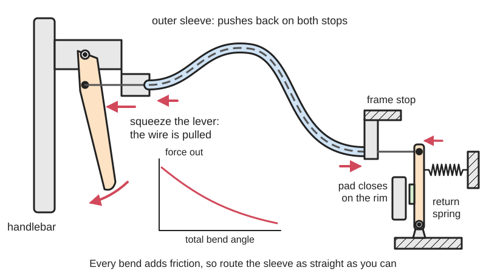
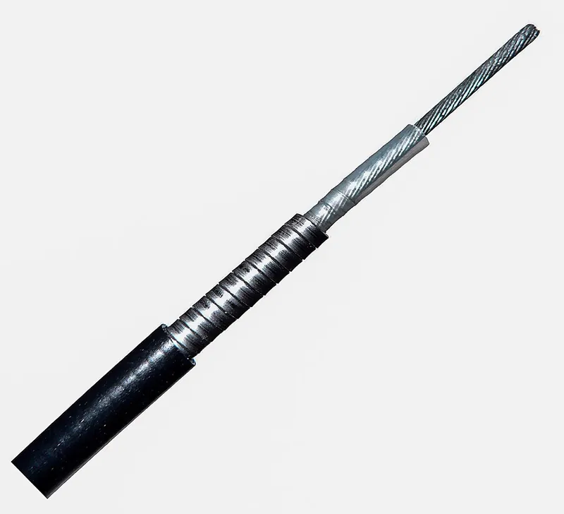
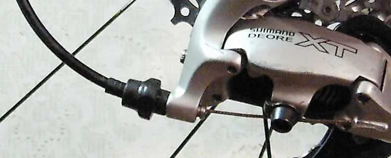
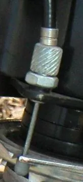

<figure class="eoc-pic eoc-pic-main"><picture><source media="(prefers-reduced-motion: reduce)" srcset="../media/drawn/bowden-cable.svg"></picture><figcaption><strong>Animation.</strong> Diagram drawn for the encyclopaedia from the research notes. ⚑ Needs confirming: a drawing can simplify or get details wrong; a real photo or a better diagram is welcome.</figcaption></figure>
<figure class="eoc-pic"><figcaption><strong>Cross-section.</strong> <a href="https://commons.wikimedia.org/wiki/File:Bowden.jpg">Bowden</a> by Baran Ivo, <a href="http://creativecommons.org/licenses/by-sa/3.0/">CC BY-SA 3.0</a>, from Wikimedia Commons.</figcaption></figure>
<figure class="eoc-pic"><figcaption><strong>How it works.</strong> <a href="https://commons.wikimedia.org/wiki/File:Bowden_cable.JPG">Bowden cable</a> by Cropped by AndrewDressel at en.wikipedia, original file was created by C. Corleis (Kuddel), <a href="https://creativecommons.org/licenses/by-sa/3.0">CC BY-SA 3.0</a>, from Wikimedia Commons.</figcaption></figure>
<figure class="eoc-pic"><figcaption><strong>Photo.</strong> <a href="https://commons.wikimedia.org/wiki/File:Bowden_cable_with_barrel_adjuster.jpg">Bowden cable with barrel adjuster</a> by AndrewDressel (talk), <a href="https://creativecommons.org/licenses/by-sa/3.0">CC BY-SA 3.0</a>, from Wikimedia Commons.</figcaption></figure>

An inner wire sliding inside a flexible outer sleeve that is fixed at both ends carries a pull (and, in push-pull versions, a push) from a lever or motor to a distant part along any curving route, as in bike brakes, car throttles and 3D-printer Bowden extruders.

**In plain words:** A wire that slides inside a bendy tube, so pulling (or pushing) the wire at one end moves something at the other end, even around corners, like a bike brake cable. **Proper term:** Bowden cable (cable-and-conduit or cable-and-sheath transmission); push-pull control cable when it can also push.

**Also called:** control cable / mechanical control cable; bike brake cable, gear (shifter or derailleur) cable; throttle cable, clutch cable, choke cable, handbrake cable; push-pull cable, push-pull control (the stiffer kind that pushes as well as pulls); cable and housing, cable and outer, cable and conduit, cable and sheath; inner wire and outer casing (bike trade terms); Bowden tube / PTFE tube (3D printers, where the filament itself is the inner 'wire'); Bowden extruder (3D printers); tendon sheath drive (robotics).

## How it works

Both ends of the outer sleeve are held in fixed stops. When you pull the inner wire at one end, the sleeve is squeezed along its length while the wire slides inside it, so the far end of the wire moves by the same amount, whichever way the sleeve bends between. Because the sleeve carries the reaction force, the parts between the two ends can move freely, for example a handlebar that steers. A plain Bowden cable can only pull, so a spring pulls it back (a bike brake caliper opens by spring force); a push-pull cable has a stiffer core held so snugly by the sleeve that it cannot buckle, so it can push too. Every bend adds friction that grows exponentially with the total bend angle, which is why cables are routed as straight as possible.

## Parts

A few parts: the inner wire (stranded steel for pull, often solid for push), the outer sleeve (housing or conduit) with a low-friction liner, end caps (ferrules) on the sleeve, fixed stops at each end that the sleeve pushes against, a nipple or clamp fixing the wire at each end, and often a barrel adjuster to take up slack. Pull-only versions also need a return spring at the far end.

## Everyday examples

- Bicycle brake and gear cables
- Motorcycle clutch and throttle cables, car handbrake (emergency brake) and latch-release cables
- Lawn-mower throttle and stop (dead man's) controls
- 3D printers with a Bowden extruder, where the motor pushes filament through a PTFE tube to the moving print head (Prusa MINI)

## When to use it

Use a Bowden cable when you need to work something at a distance or around moving parts without [linkages](../glossary.md#linkage): a hand lever working a brake or latch, a servo in a robot's body moving a finger, eyelid or ear in an animatronic head, a remote release, or taking the weight of a motor off a moving part (as a Bowden extruder takes the extruder motor off a 3D printer's print head). It is cheap, light, easy to route through tight spaces, and lets the motor sit away from the moving part, which is why it is used in wearable robots and exoskeletons (Frontiers).

## When not to use it

Avoid it for precise positioning or fast, stiff control, because friction, lag and [backlash](../glossary.md#backlash) make the output lag the input (Stanford CS235 notes; Frontiers); use a rigid linkage, pushrod, belt or direct-drive motor. Avoid long routes with many bends, where most of the force is lost to friction; use pulleys or a shorter path. For continuous rotation at a distance use a flexible shaft instead; for strong pushing use a rigid pushrod or a proper push-pull cable. On 3D printers, prefer a direct-drive extruder for very flexible filaments such as TPU ⚑ [uncertain]. Where a failed cable would be dangerous, consider hydraulic lines.

## Details

- **What it does (jobs):**
  - change the kind of motion: carries a straight pull or push along a bent route to a distant place, changing where and in which direction the motion arrives rather than its type
  - lock, and release by hand: used as a remote release for latches and locks, such as car latch releases (Wikipedia)
  - slow it, stop it or keep its speed steady: the link that works bike and car handbrakes and lawn-mower stop controls (Wikipedia)
- **Movement:** slide: the inner wire slides a short distance inside the sleeve (a few millimetres, e.g. 2.9 or 4.5 mm per gear shift on bikes, up to a few centimetres ⚑ [uncertain]), while the whole cable can flex to follow moving parts
- **Directions it can move (degrees of freedom):** 1: the inner wire can only slide along the sleeve; the sleeve's own bending is not a controlled motion
- **Special behaviour:**
  - tensioning (takes up slack and holds): a barrel adjuster, a hollow screw at the sleeve's end stop, lengthens the sleeve to take up slack in the wire; turning it out tightens the cable (Wikipedia)
  - none of the other listed behaviours: it simply carries a push or pull
- **How it holds:**
  - not a holding joint (it moves or passes on motion): it transmits a pull or push
  - shape (the parts interlock; [form-fit](../glossary.md#form-fit--force-fit--material-bond)): the wire's end nipple sits in a slot in the lever, and the sleeve's ferrules seat in the cable stops
  - friction or clamping (force-fit): the far end of the wire is usually clamped under a pinch bolt
- **Input and output:** Straight pull (or push) -> straight pull (or push) at a distant place, travel ratio 1:1 apart from lag and stretch. Efficiency for a 2 m push-pull cable: about 95% when straight, falling to about 85% with 180 degrees of total bending and about 40% with 720 degrees (Frontiers, Grosu et al. 2018); in a gait-orthosis test stand the push-pull cables were 64-76% efficient. Force out = force in / e^(friction coefficient x total bend angle) (Frontiers; Hackaday). No shafts: the ends can be at any angle and position. Back-drivable: yes; pulling on the far end pulls the lever. A pull-only Bowden cable only transmits pull, so the far end needs a return spring (Hackaday's bike-brake example) or a second cable.
- **Power:** passive (no power needed); it can be worked by hand or by a motor or servo at one end. If a motor-driven cable loses power, it stays where it is unless a return spring pulls it back
- **Load:** Light to medium: strong in pull along the wire (bike brake wires are 1.5-1.6 mm steel), weak in push unless it is a push-pull cable with a stiff core and snug sleeve. The sleeve must be held at both ends because it carries the full reaction force in compression. Loads that bend the cable sharply or twist it do not transmit well, and friction rises quickly with every bend.
- **Play and precision:** Noticeable: the sleeve compresses slightly and settles in its end caps, and there is a lag in push-pull systems because force must first build up to overcome friction and take up backlash before the output moves (Stanford CS235 notes); friction also causes [stick-slip](../glossary.md#stick-slip) (Frontiers). Indexed bike shifting works only with compressionless (lengthwise-wire) housing, which does not change length as it bends (Sheldon Brown). [Misalignment](../glossary.md#misalignment) is easily tolerated: that is the point of the flexible sleeve, but tight bends add friction and wear.
- **Taking it apart:** removable: the wire is unclamped at the far end and slid out; the sleeve lifts out of its stops
- **How often it can be reused:** many times for the sleeve and end stops; a few times for the inner wire, because a cut, frayed or end-capped wire end is hard to thread back through the sleeve and is usually replaced
- **Sealing:** none: typical bike and DIY cables are open at the ends, so water can get in and even freeze in cold weather (Wikipedia); industrial push-pull controls add end seals against dirt and corrosion, which makes them dust-resistant (Frontiers, Grosu et al. 2018)
- **Adjustable:** Yes: slack is taken up with a barrel adjuster at a cable stop or lever, or by re-clamping the wire at the pinch bolt (Wikipedia)
- **Access needed:** both sides: each end of the sleeve has to be fixed in a stop, and the wire fixed at both ends, so both ends must be reachable, though nothing in between needs to be
- **Materials:** Inner wire: stranded steel (stainless or galvanised) for pull; solid wire for push (lawn mowers, chokes, aircraft push-pull controls) (Wikipedia); nitinol has been suggested for its super-elasticity (Stanford CS235 notes); synthetic ropes are used in robotic Bowden systems (Sandia). Sleeve: a close-wound steel helix (brake housing), lengthwise steel wires (compressionless shift housing), or a braided mix, with a plastic liner and plastic outer jacket (Wikipedia; Park Tool). DIY: PTFE tube with braided stainless wire (e.g. 2 mm PTFE tube with 0.8 mm cable, or 4 mm PTFE tube with a bike brake wire). In 3D printers the sleeve is a PTFE tube, about 1.9-2.0 mm bore for 1.75 mm filament (Capricorn).
- **Heat, cold, water and wear:** Water and cold: water in the sleeve can freeze and stop the cable in cold climates, and unlined housings need light oil (Wikipedia). Rust: in wet use a little oil helps as rust prevention (Sheldon Brown). Heat: PTFE tubing starts giving off fumes as it gets hot; the tube's maker lists 170-200 C as completely safe, off-gassing becoming a concern around 225-250 C, about 270 C as the practical maximum for sustained printing, and deformation above about 340 C (Capricorn safety page). Wear: fraying at sharp bends and at barrel adjusters (Wikipedia).

## Making it

- **Ways to make or get it:**
  - off-the-shelf part (bike cables and housing, push-pull control cables, PTFE tube, push-in fittings)
  - 3D print (FDM): levers, cable stops, sleeve anchors, servo mounts, wire clamps
- **Printing it in one piece (print in place):** no: the cable is bought and threaded through printed or bought end fittings after printing
- **Tools:** A proper cable and housing cutter (dedicated shear-type cutters for compressionless housing); a pick or awl to reopen the squashed liner after cutting; a hex key or spanner for the pinch bolt; pliers to crimp end caps (or solder to stop fraying) (Park Tool; Sheldon Brown). For 3D-printer PTFE tubes: a square-cut tube cutter ⚑ [uncertain]; push-in fittings need no tools.
- **Difficulty:** easy: buy bike brake or gear cables and housing (or PTFE tube and braided wire), and print levers, cable stops and anchors; the only trick is fixing both ends of the sleeve firmly and keeping bends gentle

### 3D printing tips

1) Print firm end stops for the sleeve: the sleeve pushes hard on its stop every time the wire is pulled, so give the stop a pocket that the ferrule seats into and enough wall around it; Park Tool notes ferrules stop the housing deforming or digging into stops, which matters even more in plastic. 2) ⚑ [uncertain] Orient printed stops and levers so the pulling load squeezes the layers together rather than peeling them apart, and use generous [fillets](../glossary.md#chamfer--fillet) where the lever pivot and cable slot meet. 3) Clamp PTFE-tube sleeves with a screw, washer and nut (johnbbb's servo mount uses an M3 screw, washer and nut in a clamping lid) or thread in a PC4-M6 push-in fitting, which has a 4 mm opening and an M6 x 1.0 thread (Capricorn). 4) Attach the wire to a servo horn with an RC pushrod connector (johnbbb) or a pinch screw; route it so the wire leaves the stop in a straight line. 5) Keep the route short and the bends wide: friction grows exponentially with the total bend angle, so a 2 m push-pull cable drops from about 95% to 40% efficiency between straight and 720 degrees of total bending (Frontiers); use free-turning pulleys instead of extra sleeve bends where you can, because pulleys add no capstan friction (Hackaday). 6) Make any wheel or pulley the wire wraps around large; Sheldon Brown says a pulley big enough not to [fatigue](../glossary.md#fatigue) bike cable is at least a couple of inches across. 7) Size small DIY cables to match: Tioh uses 2 mm PTFE tube with a 1 mm bore and 0.8 mm braided stainless cable for puppet eyelids and ears. 8) For pull-only cables, print in a return spring or add one at the far end.

### Buying one (off-the-shelf parts)

Bicycle brake cable (inner wire about 1.5-1.6 mm) and 5 mm brake housing (spiral wound); shift (derailleur) cable (about 1.1-1.3 mm) and 4 or 5 mm compressionless shift housing (Bike Gremlin; Park Tool); ferrules (end caps) for housing; crimp end caps for wire ends; barrel adjusters; cable stops; pinch-bolt cable anchors; industrial push-pull control cables (solid core, sealed ends, threaded rod ends); throttle and choke cables for small engines; PTFE Bowden tube (4 mm outside, 1.9-2.0 mm bore for 1.75 mm filament; 6.35 mm outside, 3.2 mm bore for 2.85 mm filament) and PC4-M6 or PC4-M10 push-in (pneumatic) fittings (Capricorn); RC pushrod connectors and braided stainless 'nylon-coated' cable for models.

## Rules of thumb

- Friction: force out = force in / e^(friction coefficient x total bend angle), where the total bend angle adds up every bend along the sleeve (Frontiers, Grosu et al. 2018; Hackaday 'Cable Mechanism Maths'); keep push-pull cables as straight as possible, as manufacturers advise (Frontiers).
- Measured push-pull cable efficiency (2 m): about 95% straight, about 85% at 180 degrees total bend, about 40% at 720 degrees (Frontiers, Grosu et al. 2018).
- Make unavoidable bends as wide as possible, and housings as short as they can be without tight bends (Sheldon Brown 'Cable installation'); housing that is too short will kink and bind (Park Tool).
- Use compressionless (lengthwise-wire) housing only for shifting; it can burst under brake loads. Use spiral-wound brake housing for brakes (Park Tool; Sheldon Brown; Bike Gremlin).
- Bike sizes: shift wire about 1.1-1.3 mm, brake wire about 1.5-1.6 mm; shift housing 4 or 5 mm, brake housing 5 mm outside diameter (Bike Gremlin).
- Sharp bends make the wire fray; on folding bikes cables can be bent to a radius as small as 4 cm at the hinge, a known fatigue spot (Wikipedia 'Bowden cable').
- 3D printers: for 1.75 mm filament use PTFE tube with a 1.9 mm (plus or minus 0.05 mm) or 2.0 mm bore (Capricorn); a Bowden extruder needs longer retraction than a direct drive, e.g. 3.2 mm by default on the Prusa MINI against at most 2 mm on the direct-drive MK3/MK4 (Prusa Knowledge Base).

## Common failures

1) High friction or binding from too many or too tight bends, or housing cut too short so it kinks; fix by rerouting with wide, gentle curves (Park Tool; Sheldon Brown). 2) A crushed liner or collapsed end coil after cutting the housing; reopen it with an awl (Park Tool; Sheldon Brown). 3) Frayed or broken wire at sharp bends, barrel adjusters and folding hinges (Wikipedia). 4) Spongy feel and lost travel as the housing compresses and settles into its ferrules; use ferrules at every end and re-adjust after bedding in (Wikipedia; Sheldon Brown). 5) Sluggish or frozen cable from water and rust (Wikipedia). 6) Housing digging into a printed stop and cracking it; seat a ferrule in a strong pocket (Park Tool). 7) Printers: a gap between the tube end and the nozzle or a tube slipping in its fitting causes stringing, blobs or clogs, and debris inside the tube blocks the filament, so inspect it (Prusa Knowledge Base) ⚑ [uncertain].

## Safety

Never use compressionless shift housing for brakes: it can burst and cause a sudden, complete loss of braking (Sheldon Brown; Park Tool; Bike Gremlin). A frayed wire's loose strands can prick fingers (Sheldon Brown). PTFE Bowden tubes and liners in hot ends give off harmful fumes at high temperatures, dangerous to pet birds from about 275 C (and there is evidence of harm even around 202 C), so ventilate and keep birds away (Capricorn safety page). Levers and cable anchors can pinch fingers.

## Related

- Push-pull control cable: the heavy-duty version with a solid, armoured core that pushes as well as pulls
- Flexible shaft: a similar sheathed cable that carries rotation instead of a straight pull (covered with push-pull cables in Stanford CS235 lecture 8)
- Rigid pushrod or linkage: stiffer and more precise, but can't go round corners
- Capstan cable drive and tendon drives over pulleys: open cables running over free-turning pulleys, with much less friction than a sleeve
- Hydraulic line (hydraulic brakes): carries force through fluid, with less friction over long routes
- Belt drive: carries continuous rotation around pulleys rather than a short pull
- Pull-tab and slider mechanism: the paper version in pop-up books, a card strip pulled along a slot to move a picture at a distance
- Cable splitter: a junction that joins one Bowden cable to two (one lever, two brakes) or two to one

## Make it yourself

- [Bowden Cable Servo Control for Robotics (johnbbb, Printables)](https://www.printables.com/model/285648-bowden-cable-servo-control-for-robotics (URL from Printables API, page not opened)): Printed enclosure for a standard servo that anchors a 4 mm PTFE tube and pulls a bike brake cable fixed to the servo horn, for animatronics and robotics *(licence: CC BY-NC)*
- [Bowden cable controls (Tioh, Printables)](https://www.printables.com/model/328383-bowden-cable-controls (URL from Printables API, page not opened)): Hand controller parts for home-made Bowden cables (2 mm PTFE tube, 1 mm bore, with 0.8 mm braided stainless cable) that work eyelids, eyebrows, ears and eyes on 3D-printed puppet heads *(licence: CC BY-NC-SA)*
- [Animatronic lever for Bowden cable (Tioh, Printables)](https://www.printables.com/model/95964-animatronic-lever-for-bowden-cable (URL from Printables API, page not opened)): Printed hand levers built like a simple bicycle brake lever, for puppet animatronics *(licence: CC BY-NC)*

## Pictures, videos and models

- [Bowden.jpg (Wikimedia Commons, by Baran Ivo)](https://commons.wikimedia.org/wiki/File:Bowden.jpg): Cut-away photo of a Bowden cable: plastic outer coating, steel structure, inner low-friction sleeve and inner cable *(licence: CC BY-SA 3.0 or GFDL 1.2+)*
- [Bowden cable with barrel adjuster.jpg (Wikimedia Commons, by AndrewDressel)](https://commons.wikimedia.org/wiki/File:Bowden_cable_with_barrel_adjuster.jpg): Photo of a bicycle Bowden cable with a barrel adjuster *(licence: CC BY-SA 3.0 or GFDL 1.2+)*
- [Evaluation and Analysis of Push-Pull Cable Actuation System Used for Powered Orthoses (Grosu et al., Frontiers in Robotics and AI, 2018)](https://www.frontiersin.org/journals/robotics-and-ai/articles/10.3389/frobt.2018.00105/full): Figure 1: structure of a push-pull control cable; Figure 2: how bend angles add up; Figure 3: efficiency against bend angle *(licence: CC BY)*
- [Cable Mechanism Maths: Designing Against The Capstan Equation (Hackaday, Sonya Vasquez)](https://hackaday.com/2021/01/26/cable-mechanism-maths-designing-against-the-capstan-equation/): Animations and diagrams of a cable running through bent conduits and how friction adds up *(licence: link only)*
- [CS235: Applied Robot Design, Lecture 8 - Push-Pull Cable/Sheath, Universal Joints, and Flexible Shafts (Stanford, YouTube)](https://www.youtube.com/watch?v=UPgnfYLZzqE): University lecture demonstrating push-pull cables and sheaths in robots *(licence: link only (standard YouTube licence))*

## Needs confirming

⚑ marks something nobody has confirmed yet: a fact the research could not confirm from a source, a finder value that is a best guess, or an open point from the research notes. Corrections are welcome (see `research/needs-confirming.md`).

- ⚑ 5 sentences on this page marked [uncertain].
- ⚑ Finder value `tools` = crimper, sewing or leather tools, hand tools (source uncertain): `tools_needed` is marked ⚑ [uncertain] here: "…; Sheldon Brown). For 3D-printer PTFE tubes: a square-cut tube cutter ⚑ [uncertain]; push-in fittings need no to…"

## Sources

- <https://en.wikipedia.org/wiki/Bowden_cable>
- <https://www.frontiersin.org/journals/robotics-and-ai/articles/10.3389/frobt.2018.00105/full>
- <https://pmc.ncbi.nlm.nih.gov/articles/PMC7805680/>
- <https://hackaday.com/2021/01/26/cable-mechanism-maths-designing-against-the-capstan-equation/>
- <https://www.rahulsrajan.com/applied-robotic-stanford-cs235-1c45e3>
- <https://www.youtube.com/watch?v=UPgnfYLZzqE>
- <https://www.sheldonbrown.com/cables.html>
- <https://sheldonbrown.com/cable-installation.html>
- <https://www.parktool.com/en-us/blog/repair-help/cutting-and-sizing-cable-housing>
- <https://bike.bikegremlin.com/8548/cable-housing-standards/>
- <https://www.osti.gov/servlets/purl/1340266>
- <https://help.prusa3d.com/glossary/extruder-ptfe-tube-bowden-tube_141953>
- <https://help.prusa3d.com/article/stringing-and-oozing_1805>
- <https://www.captubes.com/choose.html>
- <https://www.captubes.com/fittings.html>
- <https://www.captubes.com/safety.html>
- <https://commons.wikimedia.org/wiki/File:Bowden.jpg>
- <https://commons.wikimedia.org/wiki/File:Bowden_cable_with_barrel_adjuster.jpg>
- <https://api.printables.com/graphql/>
