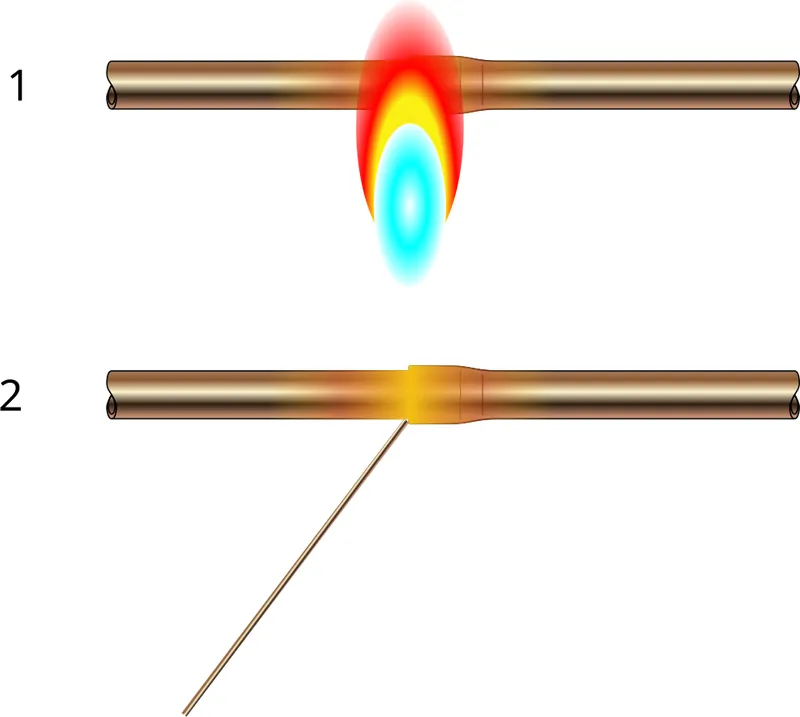
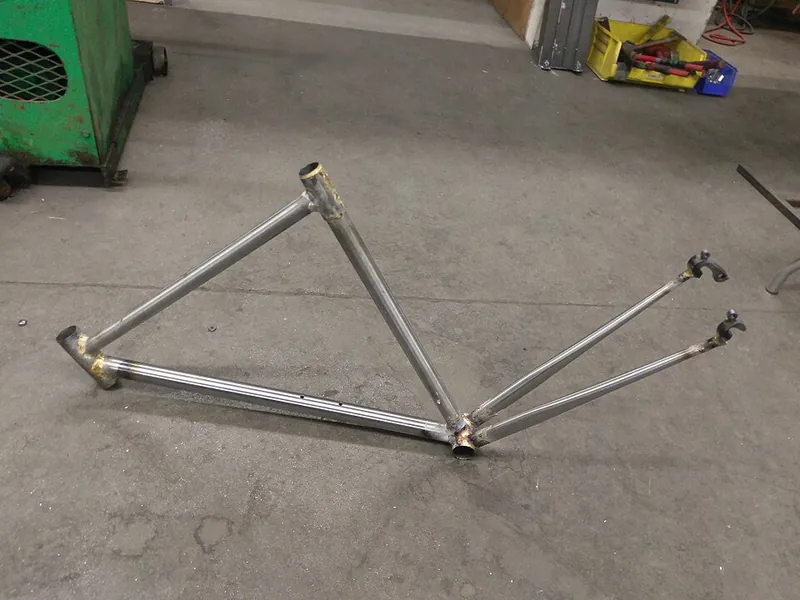
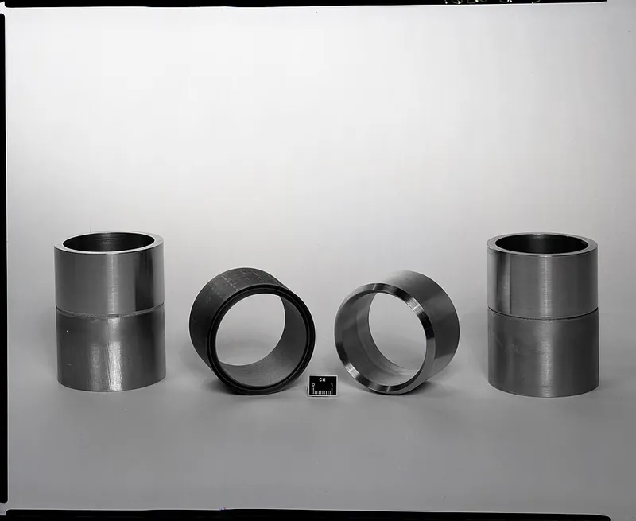

<figure class="eoc-pic eoc-pic-main"><figcaption><strong>Diagram.</strong> <a href="https://commons.wikimedia.org/wiki/File:Principe_brasage_fort_cuivre.svg">Principe brasage fort cuivre</a> by Cdang, <a href="https://creativecommons.org/licenses/by-sa/3.0">CC BY-SA 3.0</a>, from Wikimedia Commons.</figcaption></figure>
<figure class="eoc-pic"><figcaption><strong>How it works.</strong> <a href="https://commons.wikimedia.org/wiki/File:Partially-completed_steel_bicycle_frame.jpg">Partially-completed steel bicycle frame</a> by 4300streetcar, <a href="https://creativecommons.org/licenses/by/4.0">CC BY 4.0</a>, from Wikimedia Commons.</figcaption></figure>
<figure class="eoc-pic"><figcaption><strong>Photo.</strong> <a href="https://commons.wikimedia.org/wiki/File:BRAZED_TRANSITION_JOINTS_-_1_UNBRAZED_ASSEMBLY_-_2_BRAZED_PIPE_JOINTS_-_NARA_-_17443723.jpg">BRAZED TRANSITION JOINTS - 1 UNBRAZED ASSEMBLY - 2 BRAZED PIPE JOINTS - NARA - 17443723</a> by Unknown authorUnknown author or not provided, Public domain, from Wikimedia Commons.</figcaption></figure>

Brazing heats close-fitting metal parts above about 450 °C, usually to a dull red heat, so that a brass, copper-phosphorus or silver alloy melts, wets both surfaces and is drawn by capillary action into the gap, giving a strong, leak-tight joint that also joins different metals, while the parts themselves never melt.

**In plain words:** Joining metal parts by heating them red-hot with a torch and melting a brass or silver alloy into the close-fitting gap between them, so that it is sucked in, sets and makes a strong, leak-proof joint without melting the parts themselves. **Proper term:** Brazed joint (brazing; silver brazing, also called silver soldering or hard soldering; braze welding).

**Also called:** brazing, braze, brazed joint (Wikipedia 'Brazing'); silver brazing = hard soldering = silver soldering; the Copper Development Association calls 'hard solders' and 'silver solders' 'confusing terms' that 'should be avoided' (Wikipedia 'Brazing'; CDA Copper Tube Handbook p. 42); torch brazing, induction brazing, furnace brazing, dip brazing, resistance brazing, vacuum brazing (Wikipedia 'Brazing'); braze welding = [fillet](../glossary.md#chamfer--fillet) brazing: a bronze or brass rod builds a fillet bead with no capillary action (Wikipedia 'Brazing'; Wikimedia Commons file description); spelter: an old trade name for brass brazing alloys (NBS Circular 492); BCuP (copper-phosphorus and silver-copper-phosphorus) alloys, self-fluxing on copper; Sil-Fos (brand) (CDA Copper Tube Handbook; Lucas-Milhaupt); BAg silver brazing alloys, e.g. BAg-7 (a cadmium-free substitute for BAg-1); Easy-Flo (brand), Silver-flo (brand) (CDA Table 14.12; Lucas-Milhaupt; Model Engineer forum); easy, medium and hard (and extra-easy, extra-hard) silver solder: jewellers' grades named by melting temperature, not by strength (Wikipedia 'Soldering'); 'aluminium welding rods', 'aluminium brazing rods' or 'low-temperature aluminium repair rods', e.g. Durafix, HTS-2000, Alumaloy (brands): zinc-aluminium alloys melting at about 388 °C, so really a solder and 'not properly a weld' (Wikipedia 'Soldering'; Practical Sailor; Welding Tips and Tricks); 'cast iron welding': usually a brazing operation with a nickel-rich filler rod (Wikipedia 'Brazing'); pin brazing (silver brazing pins for cable lugs on rails) (Wikipedia 'Brazing').

## How it works

Brazing works like soldering but hotter: the filler melts above 450 °C, the parts are heated until they themselves melt the filler, and the molten alloy wets the clean surfaces and is drawn into the narrow gap between close-fitting parts by capillary action, then sets as it cools (Wikipedia 'Brazing'; HSE EIS31). Flux (traditionally borax) dissolves oxide, keeps air off the hot metal and turns clear and liquid when the joint is nearly hot enough, so it doubles as a temperature indicator (Wikipedia 'Flux (metallurgy)'; CDA). Because the parts never melt, brazing can join different metals, causes less distortion than welding and leaves a neat joint (Wikipedia 'Brazing'). The strength comes from a thin, even film over a large overlap: a lap at least three times as long as the thinner part is thick can be as strong as the parts (CDA, quoting AWS). In braze welding a bronze or brass rod is melted on to build up a fillet over the joint instead, without capillary flow (Wikipedia 'Brazing').

## Parts

Single piece once made: the parts plus a thin layer (or, in braze welding, a fillet) of filler metal. Making it needs a small set of equipment: a torch (an air-fuel propane or propylene torch for small work, an oxy-fuel torch for larger parts, CDA), filler metal as rod, wire, strip or paste, a flux to match it, fire bricks to build a small hearth, abrasive cloth or a wire brush, tongs or pliers, and hot water or a brush to remove flux afterwards.

## Everyday examples

- the copper pipes of fridges, freezers and air conditioners, where brazing is 'preferred, and often required' (CDA Copper Tube Handbook)
- carbide-tipped circular saw blades, whose hard tips are brazed onto the steel blade (Wikipedia 'Brazing')
- lugged and fillet-brazed steel bicycle frames (Wikimedia Commons photo of a fillet-brazed frame)
- brass musical instruments, whose keywork and braces are usually brazed, and silver and gold jewellery (Wikipedia 'Soldering')

## When to use it

When a joint must be strong, leak-tight and stand heat and vibration better than soft solder: copper refrigeration, air-conditioning and heating pipes, model steam boilers and pipework, steel and stainless tube frames, brackets and small machine parts, joints between different metals (brass to steel, copper to steel, carbide to steel), thin parts that would warp or burn through if welded, and repairs to cast iron by braze welding (Wikipedia 'Brazing'; CDA). Copper systems running continuously above 121 °C should be brazed rather than soldered (CDA). A small propane torch, fire bricks and silver solder are enough for small copper, brass and steel parts at home.

## When not to use it

When a soft-soldered joint is enough and nearby parts (plastic, rubber seals, electronics, valves) can't take red heat: soft solder or a mechanical fitting is safer (Soldered metal joint, Compression fitting entries). For maximum strength in heavy steel structures: weld instead (Wikipedia 'Brazing'). For parts that must come apart: bolts, unions or threaded fittings. For aluminium, torch brazing is difficult and large sections can't be heated enough with propane; small repairs with zinc-aluminium rods are possible, but TIG welding, rivets or epoxy are often better (Practical Sailor). Never braze fuel tanks or containers that have held fuel (Practical Sailor declines to suggest it 'for both safety and integrity reasons'). Avoid red heat on hardened, heat-treated or work-hardened parts whose strength you need, because it softens them (CDA notes this for copper tube). Never use cadmium-bearing fillers (HSE EIS31).

## Details

- **What it does (jobs):**
  - join and hold: strong permanent joints in steel, copper, brass and other metals, including joints between different metals (e.g. carbide tips to steel)
  - seal it, or pass cables or fluid through: leak-tight joints in copper refrigeration, air-conditioning and plumbing pipe, and in tanks and fittings
- **Movement:** none
- **Directions it can move (degrees of freedom):** 0: the parts become one rigid piece.
- **Special behaviour:**
  - none: a plain permanent joint. (Jewellers use the different melting grades on purpose, making the first joints with hard silver solder and later ones with easier, lower-melting grades so earlier joints don't come apart, Wikipedia 'Soldering')
- **How it holds:** [material bond](../glossary.md#form-fit--force-fit--material-bond) (glue, solvent or melting): the molten filler wets and alloys with the surfaces of the parts (Wikipedia 'Brazing')
- **Input and output:** not applicable
- **Power:** passive (no power needed) once made; making it needs a gas torch (or an induction heater or furnace)
- **Load:** Heavy for its size. Brazed joints 'will withstand vibration, tensile and torsional loading' (HSE EIS31), and when the overlap is at least three times the thickness of the thinner part with a good fillet, the joint 'will meet or exceed' the strength of the tube and fitting (CDA, quoting the American Welding Society). The joint is usually less strong than the base metal but stronger than the filler alone (Wikipedia 'Brazing'), and weaker than a weld. Butt joints have 'limited tensile strength'; lap joints turn the load into [shear](../glossary.md#peel-vs-shear) and are much stronger (Lucas-Milhaupt). In a filler-metal maker's own test the strongest stainless-steel butt joint with a silver filler reached 135,000 psi (930.8 MPa) at a 0.0015 in (0.038 mm) gap (Lucas-Milhaupt). Braze welding cannot withstand high stresses or high temperatures as well as fusion welding (Wikipedia 'Brazing').
- **Play and precision:** No play. Distortion is lower than welding because the parts are not melted and are heated more evenly, so close [tolerances](../glossary.md#tolerance) can be held (Wikipedia 'Brazing'). But the whole joint area goes to red heat, which softens (anneals) copper and other work-hardened metal near the joint (CDA), and parts must be clamped so they stay in line and keep an even gap while the filler sets (CDA; Practical Sailor). The gap must be small and even: typically 0.03-0.08 mm (Wikipedia 'Brazing'), 'typically just a slip fit' (Lucas-Milhaupt).
- **Taking it apart:** permanent: in practice it can only be undone by reheating the whole joint to red heat or by cutting; reheating softens and oxidises the parts
- **How often it can be reused:** once
- **Sealing:** airtight or pressure: brazed joints 'are normally leakproof' (HSE EIS31), and brazing is 'preferred, and often required' for refrigeration and air-conditioning pipes (CDA); a continuous fillet all round the joint shows that it is filled (CDA)
- **Adjustable:** no: once the filler sets, the position is fixed
- **Access needed:** one side only (blind) for feeding the filler, which is drawn through the joint towards the heat, but you need to heat the joint evenly all round, so the torch must reach all sides of a tube or fitting (CDA)
- **Materials:** Joins the same or different metals: steel and cast iron (brass filler, braze welding, nickel rods for cast iron), stainless steel, copper, brass, bronze and nickel alloys (silver fillers), copper to copper (copper-phosphorus fillers), silver and gold (jewellery), and carbide, ceramic or cermet tips to steel tools (Wikipedia 'Brazing'). Fillers: brass (Cu-Zn) for steel and cast iron but not for copper, cupronickel or stainless where its corrosion resistance is inadequate; Cu-P for copper and its alloys only, because phosphorus forms [brittle](../glossary.md#brittle--ductile) phosphides with iron and nickel; Ag-Cu-Zn silver alloys for most metals and dissimilar pairs; Al-Si for aluminium (Wikipedia 'Brazing'; CDA). Aluminium is hard to braze with a torch; the zinc-aluminium 'aluminium welding' rods are really a solder (Wikipedia 'Soldering'). Silver brazing can cause stress cracking in copper-nickel (Wikipedia 'Brazing'). Not for plastics, painted, galvanised or plated metal until cleaned back.
- **Heat, cold, water and wear:** Heat: brazed joints 'maintain integrity at both sub-zero and elevated temperatures' (HSE EIS31), but every brazed joint weakens as it nears the filler's melting point (Wikipedia 'Soldering'); brazed copper tube is rated for service up to 350 °F (177 °C), the temperature of saturated steam at 120 psi (CDA); braze-welded joints lose strength at high temperature (Wikipedia 'Brazing'). Corrosion: galvanic corrosion between filler and base metal or between two different base metals must be considered; copper-rich fillers can stress-crack in ammonia, and brass fillers resist corrosion poorly on copper, silicon bronze, cupronickel and stainless (Wikipedia 'Brazing'); flux left in the joint causes corrosion (Wikipedia 'Brazing'). Zinc-aluminium rod repairs corrode rapidly in seawater (Practical Sailor). Ordinary copper brazed with a hydrogen-rich (reducing) flame can suffer hydrogen embrittlement and later fail without warning; oxygen-free copper does not (Wikipedia 'Brazing').

## Making it

- **Ways to make or get it:**
  - sheet metal: steel, copper and brass sheet and tube fabrication, bicycle frames, model steam boilers and jewellery
  - CNC: machine parts to a close slip fit (about 0.025-0.127 mm [clearance](../glossary.md#clearance), Lucas-Milhaupt) so the filler can be drawn in
  - off-the-shelf part: copper solder or braze fittings for pipe, bicycle frame lugs, brazing alloys and fluxes; or have a shop braze it
- **Printing it in one piece (print in place):** no: brazing joins metal at red heat; 3D-printed parts can't be anywhere near it
- **Tools:** A torch: propane or propylene (sold as 'MAPP') air-fuel torches handle small silver-soldered parts, while larger work, brass rods and braze welding need more heat, usually oxy-acetylene or oxy-propane (CDA; Wikipedia 'Brazing'; Practical Sailor); fire bricks to build a hearth that reflects heat back onto the job (Model Engineer forum); filler rod or wire and the matching brazing flux; abrasive cloth, wire brush or file to clean; clamps, steel wire or a jig to hold parts still; pliers or tongs; a pot of hot water or a brush to remove flux; safety glasses or shaded goggles, leather gloves, a fire extinguisher, and fume extraction (Wikipedia 'Soldering'; HSE EIS31).
- **Difficulty:** moderate: small silver-soldered joints in copper, brass and steel are possible at home with a propane torch and a hearth of fire bricks, but getting enough heat is the usual problem ('Copper EATS heat like nothing else', Model Engineer forum); large parts, brass rods and braze welding need oxy-fuel equipment and practice

### 3D printing tips

not applicable: plastic parts melt or burn long before brazing temperature (fillers melt above 450 °C, HSE EIS31), so jigs and supports must be steel wire, steel clamps or fire brick. Printed items are only useful away from the heat, e.g. a colour-coded case for keeping different filler rods apart (Printables 1854379) or a stand that stops a propane canister tipping over (Printables 12436). Plastic parts are joined by Melted plastic weld or Friction-welded plastic instead.

### Buying one (off-the-shelf parts)

Search terms: 'silver solder' or 'silver brazing alloy' (cadmium-free; e.g. 55% silver, or AWS BAg-7, CDA), 'easy / medium / hard silver solder' (jewellery), 'copper phosphorus brazing rod' or 'BCuP-2' / 'BCuP-5' (15% silver) for flux-free copper-to-copper joints, 'brass brazing rod' or 'flux-coated bronze rod' for braze welding steel, 'nickel cast iron rod', 'brazing flux' (borax-based, AWS A5.31 type FB3-A or FB3-C for copper, CDA), 'stainless steel brazing flux', 'aluminium brazing rod' (zinc-aluminium), 'propane torch' or 'propylene / MAPP torch', 'oxy-propane' or 'oxy-acetylene brazing kit', 'fire bricks' or 'brazing hearth', 'soldering tweezers', 'pickle' or 'flux remover', 'induction heater' (production brazing). Check the data sheet for cadmium content before buying.

## Rules of thumb

- Gap: 0.03-0.08 mm (0.0012-0.0031 in) is recommended for the best capillary action and strength, though some operations use about 0.6 mm (Wikipedia, https://en.wikipedia.org/wiki/Brazing); a filler maker gives 0.001-0.005 in (0.025-0.127 mm), 'typically just a slip fit', ideally 0.002-0.005 in with paste flux (Lucas-Milhaupt, https://blog.lucasmilhaupt.com/en-us/about/blog/designing-braze-joints and https://blog.lucasmilhaupt.com/en-us/about/blog/joint-clearance-and-joint-strength). The two sources overlap but differ at the wide end.
- Overlap: make lap joints at least three times as long as the thinner part is thick (Lucas-Milhaupt, https://blog.lucasmilhaupt.com/en-us/about/blog/designing-braze-joints); with that overlap and a well-formed fillet, a brazed copper tube joint meets or exceeds the strength of the tube and fitting (CDA Copper Tube Handbook p. 42, quoting AWS, https://copper.org/wp-content/uploads/2026/04/copper_tube_handbook.pdf). Avoid butt joints, sharp corners and blind holes that trap flux (Lucas-Milhaupt).
- Temperatures: brazing means a filler melting above 450 °C (840 °F) (Wikipedia 'Soldering'; HSE EIS31, https://www.hse.gov.uk/pubns/eis31.pdf); copper-tube brazing fillers melt at 1100-1500 °F (593-816 °C) (CDA p. 42); silver solders melt at about 630-780 °C, which is red heat (Model Engineer forum, https://www.model-engineer.co.uk/forums/topic/first-attempt-at-silver-soldering/); jewellers' extra-easy (56% silver) melts at 618 °C and extra-hard (80% silver) at 740 °C (Wikipedia, https://en.wikipedia.org/wiki/Soldering).
- Flux: borax or a 75:25 borax-boric acid mix suits ordinary silver and brass brazing; soft-soldering (chloride) fluxes 'will not remain on the work at brazing temperatures' (NBS Circular 492, https://archive.org/details/circularofbureau492mebs). Brazing and soldering fluxes 'cannot be used interchangeably' (CDA p. 42). Heat until the flux on the fitting goes quiet and then 'liquid and transparent' before adding filler (CDA p. 43).
- Copper-phosphorus (BCuP) fillers need no flux on copper to copper ('When joining copper tube to a wrought fitting using BCuP filler, no flux is required', CDA Figure 14.7), but never use them on steel or nickel alloys, where phosphorus forms brittle phosphides (Wikipedia 'Brazing').
- Let the work melt the filler: 'Keep the flame away from the filler metal itself as it is fed into the joint' (CDA p. 43); if filler balls up there is oxide or too little heat, and if it runs over the outside one part is too hot and the other too cold (CDA p. 44). Build fire bricks round the back of the joint to reflect heat and lift the work off the brick so the brick doesn't soak up the heat (Model Engineer forum).
- Afterwards: let it cool naturally, then remove all flux residue with warm water, because hardened flux can 'temporarily' hold pressure and hide a bad joint (CDA p. 44). Brazing anneals copper tube, so use the annealed (lower) pressure ratings (CDA p. 16, https://copper.org/wp-content/uploads/2026/04/copper_tube_handbook.pdf).
- Zinc-aluminium 'aluminium welding' rods work at about 720-750 °F (382-399 °C) with propane or MAPP; heat the metal, not the rod, scratch the rod on the hot surface to break the oxide, and clamp the parts still for the few minutes the filler takes to set; repairs corrode fast in seawater, so use them for freshwater and dry parts only (Practical Sailor, https://www.practical-sailor.com/boat-maintenance/brazing-repairs/; Welding Tips and Tricks, https://www.weldingtipsandtricks.com/aluminum-brazing-rods.html).
- Hot work: move combustibles at least 35 ft (10.7 m) away or cover them, and keep a fire watch for at least half an hour afterwards (OSHA 29 CFR 1910.252, which covers welding, cutting and brazing, https://www.osha.gov/laws-regs/regulations/standardnumber/1910/1910.252).

## Common failures

(1) Not enough heat: the filler won't melt or won't flow; copper and large parts soak up heat, so use a big enough torch and fire bricks (Model Engineer forum). (2) Wrong flux: soft-soldering (plumbing) flux is 'useless' for silver solder (Model Engineer forum; NBS Circular 492). (3) Filler balls up: oxidised surfaces or too little heat; filler runs over the outside instead of in: one part overheated and the other underheated; parts oxidise during heating: too little flux (CDA p. 44). (4) Wrong gap: too tight and flux and filler can't get in, too wide and capillary action fails and strength falls towards that of the filler alone (Lucas-Milhaupt). (5) Flux trapped in blind holes or sharp corners (Lucas-Milhaupt), or left on the joint, causing corrosion or masking leaks (CDA; Wikipedia 'Brazing'). (6) Cast fittings cracked by overheating (CDA). (7) Cracking: stress cracking of copper-nickel during silver brazing (Wikipedia 'Brazing'; Commons photo of a cracked CuNi plate), brittle phosphides from phosphorus fillers on steel or nickel (Wikipedia 'Brazing'), or hydrogen embrittlement of ordinary copper (Wikipedia 'Brazing'). (8) Parts moved while the filler was setting (Practical Sailor). (9) Aluminium parts too big to bring up to temperature with a propane torch (Practical Sailor).

## Safety

CADMIUM: older silver solders contained 16-25% cadmium; heated above 320 °C it gives cadmium oxide fume that damages the lungs and can cause irreversible kidney damage (cadmium stays in the kidneys for 10-40 years), and very high exposure can kill; cadmium is now banned in most European brazing and soldering fillers, so use cadmium-free alloys and be careful reheating old joints, which may contain it (HSE EIS31). Check the filler's data sheet: BAg-7 and BAg-34 are cadmium-free substitutes for BAg-1 and BAg-2 (CDA Table 14.12). FLUX FUMES: brazing fluxes often contain fluorides and other toxic chemicals (Wikipedia 'Flux (metallurgy)'); avoid breathing fumes from fluxes containing bifluoride salts (NBS Circular 492), and use extraction or work outdoors; the torch flame scatters fume, so an extracted booth works better than a hood (HSE EIS31). EYES: wear shaded goggles against the bright light of white-hot work (Wikipedia 'Soldering'). FIRE AND BURNS: brazing is hot work: clear or cover combustibles for 35 ft (10.7 m), don't heat pipes touching combustible walls closely enough to ignite them by conduction, keep an extinguisher ready and watch for at least half an hour afterwards for smouldering fires (OSHA 29 CFR 1910.252). The parts stay hot enough to burn long after they stop glowing; let them cool naturally and handle with pliers. Never braze containers that held fuel (Practical Sailor). For oxy-fuel cylinders and flashback arrestors, see Welded metal joint.

## Related

- Soldered metal joint (soft soldering, sweat-soldered copper pipe): the same capillary method below 450 °C with an iron or small torch; easier and gentler, but much weaker and only for low service temperatures
- Welded metal joint (fusion welding): melts the parts themselves; strongest, but more distortion, and it needs the same or compatible metals
- Spot weld (resistance spot welding): joins overlapping sheet with no filler
- Flare fitting and Compression fitting: flame-free, removable joints for copper and steel tube
- Parallel pipe thread with a sealing washer (pipe union): removable joint often brazed or soldered onto copper pipe
- Blind rivet (pop rivet) and Ordinary screw joint: cold, removable or one-sided alternatives for joining different metals
- Two-part epoxy and Epoxy putty: cold 'metal repair' alternatives for parts that can't be heated; much weaker
- Heat staking, Melted plastic weld: the plastic equivalents of heat joining

## Make it yourself

- [Welding/Brazing Filler Rod Case Divider (Printables 1854379; URL from Printables API, page not opened)](https://www.printables.com/model/1854379-weldingbrazing-filler-rod-case-divider): A printed 4-bin divider with colour-coded inserts for a filler-rod tube, to keep different brazing rods (e.g. copper-phosphorus and silver rods) from getting mixed up; for storage only, away from the torch *(licence: CC BY (Creative Commons Attribution))*
- [Propane Torch Holder (Printables 12436; URL from Printables API, page not opened)](https://www.printables.com/model/12436-propane-torch-holder): A simple printed stand for 14 oz (400 g) propane canisters so the torch can't tip over when set down; keep it clear of the flame *(licence: CC BY-NC (Creative Commons Attribution-NonCommercial))*

## Pictures, videos and models

- [Principe brasage fort cuivre.svg (Wikimedia Commons, by Cdang)](https://commons.wikimedia.org/wiki/File:Principe_brasage_fort_cuivre.svg): Diagram of copper brazing: flame heating of the parts and the filler melting where it touches the hot parts and running into the joint *(licence: CC BY-SA 3.0 (reuse with credit))*
- [Brazing welding tee joint.svg (Wikimedia Commons, by Interiot, traced by Stannered)](https://commons.wikimedia.org/wiki/File:Brazing_welding_tee_joint.svg): Cross-section of a braze-welded (fillet-brazed) tee joint, with the filler bead reinforcing the joint *(licence: CC BY-SA 3.0 (reuse with credit))*
- [Partially-completed steel bicycle frame.jpg (Wikimedia Commons, by 4300streetcar)](https://commons.wikimedia.org/wiki/File:Partially-completed_steel_bicycle_frame.jpg): A partly built fillet-brazed steel bicycle frame at a makerspace, showing smooth brazed fillets at the tube joints *(licence: CC BY 4.0 (reuse with credit))*
- [Crack in CuNi metal due to silver brazing.jpg (Wikimedia Commons, by Janke)](https://commons.wikimedia.org/wiki/File:Crack_in_CuNi_metal_due_to_silver_brazing.jpg): A crack in a 90-10 copper-nickel plate caused by stresses during silver brazing: a typical failure *(licence: CC BY-SA 3.0 (reuse with credit))*
- [How-To: Braze Copper Tube (Copper Development Association, YouTube; title confirmed via YouTube oEmbed)](https://www.youtube.com/watch?v=07ODV2Bdqow): Video demonstration of heating, fluxing and feeding filler into a brazed copper tube joint *(licence: link only)*

## Needs confirming

⚑ marks something nobody has confirmed yet: a fact the research could not confirm from a source, a finder value that is a best guess, or an open point from the research notes. Corrections are welcome (see `research/needs-confirming.md`).

- ⚑ Research note: *Brazed joint*: the joint gap differs at the wide end (Wikipedia 0.03-0.08 mm; Lucas-Milhaupt 0.001-0.005 in), both recorded; no real printable brazing models exist, so `make_it_yourself` has only a rod-case divider and a torch stand.

## Sources

- <https://en.wikipedia.org/wiki/Brazing>
- <https://en.wikipedia.org/wiki/Soldering>
- <https://en.wikipedia.org/wiki/Flux_(metallurgy)>
- <https://copper.org/wp-content/uploads/2026/04/copper_tube_handbook.pdf>
- <https://www.hse.gov.uk/pubns/eis31.pdf>
- <https://archive.org/details/circularofbureau492mebs>
- <https://archive.org/download/circularofbureau492mebs/circularofbureau492mebs_djvu.txt>
- <https://blog.lucasmilhaupt.com/en-us/about/blog/joint-clearance-and-joint-strength>
- <https://blog.lucasmilhaupt.com/en-us/about/blog/designing-braze-joints>
- <https://www.practical-sailor.com/boat-maintenance/brazing-repairs/>
- <https://www.weldingtipsandtricks.com/aluminum-brazing-rods.html>
- <https://www.model-engineer.co.uk/forums/topic/first-attempt-at-silver-soldering/>
- <https://www.osha.gov/laws-regs/regulations/standardnumber/1910/1910.252>
- <https://www.youtube.com/watch?v=07ODV2Bdqow>
- <https://commons.wikimedia.org/wiki/File:Principe_brasage_fort_cuivre.svg>
- <https://commons.wikimedia.org/wiki/File:Brazing_welding_tee_joint.svg>
- <https://commons.wikimedia.org/wiki/File:Partially-completed_steel_bicycle_frame.jpg>
- <https://commons.wikimedia.org/wiki/File:Crack_in_CuNi_metal_due_to_silver_brazing.jpg>
- <https://commons.wikimedia.org/wiki/Category:Brazing>
- <https://api.printables.com/graphql/>
