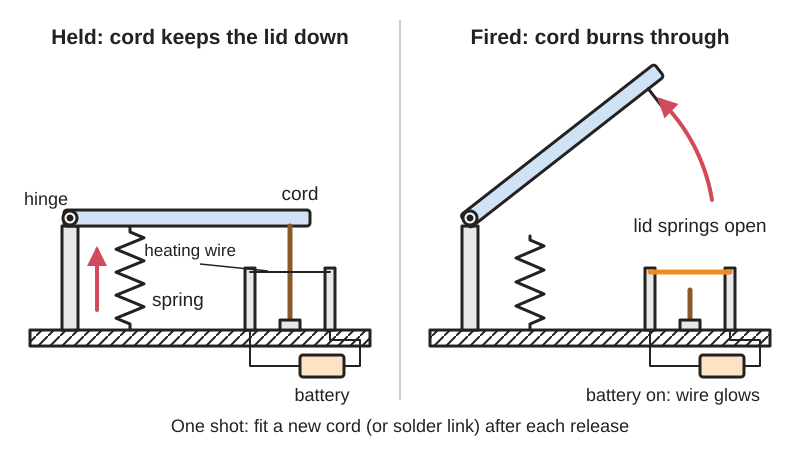
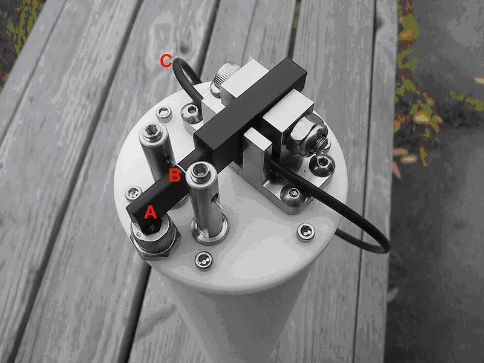

<figure class="eoc-pic eoc-pic-main"><figcaption>Diagram drawn for the encyclopaedia from the research notes. ⚑ Needs confirming: a drawing can simplify or get details wrong; a real photo or a better diagram is welcome.</figcaption></figure>
<figure class="eoc-pic"><figcaption><strong>How it works.</strong> <a href="https://commons.wikimedia.org/wiki/File:Fusible_Link_Release_Mechanism_ARC1.jpg">Fusible Link Release Mechanism ARC1</a> by Desertstar, <a href="https://creativecommons.org/licenses/by/3.0">CC BY 3.0</a>, from Wikimedia Commons.</figcaption></figure>

A one-time release in which a cord or soldered link holds a spring-loaded or hanging part until heat cuts or melts it, either on command (a current through a nichrome wire burns through the cord) or automatically in a fire (the link's low-melting solder lets go).

**In plain words:** A string, wire or soldered metal link that holds something shut until heat destroys it: an electric current makes a thin wire red-hot so it burns through the string, or a fire melts the solder in the link, and the part springs free, once only. **Proper term:** Burn-wire release (hot-wire cutter, thermal knife) and fusible-link release (heat-responsive link): one-shot thermal release devices.

**Also called:** burn wire / burnwire / nichrome burn wire release mechanism; thermal knife / thermal cutter / hot-wire cutter; hot-wire cutdown / balloon cutdown / cut-down mechanism (high-altitude ballooning); fuse wire mechanism (spacecraft; e.g. NEA fuse wire mechanism, 41st Aerospace Mechanisms Symposium); flash wire (a nichrome link vaporised by a capacitor dump, DesertStar ARC-1; Hardy 2022); fusible link / heat-responsive link / fire link / damper link / fire-door link; drop-off / timed release / drop-off unit (wildlife collars, e.g. OpenDrop, SensorDrop); electrolytic burnwire / corrosive link / galvanic link (ocean releases that dissolve a wire by electrolysis rather than heat, Hardy 2022); thermal fuse / thermal cutoff (the electrical cousin: a one-shot link that opens a circuit); fusible plug (boilers; Wikipedia, Wood's metal).

## How it works

The part to be released is held back, usually against a spring or its own weight, by a strong cord or by a two-piece link soldered together. To release it, heat breaks the holder. In a burn wire, current through a nichrome wire pressed against the cord makes it glow (over 750 °C in NRL tests) and it melts or burns through the cord in a few seconds; springs keep pushing the wire into the cord until it parts (Thurn et al. 2012). In a fusible link, heat from a fire melts the low-melting alloy at its rated temperature (for example 74 °C / 165 °F), the two metal pieces pull apart, and a spring closes a fire damper or door (Wikipedia, Fusible link; Fusible Links UK). The stored spring, gravity or buoyancy then does the work. The cord or link is used up and must be replaced.

## Parts

A few parts. Burn wire: a tie-down cord (e.g. Vectran or nylon), a short nichrome heater wire, springs that press the wire into the cord, a battery, a switch (MOSFET or relay) and a timer or trigger; the NRL CubeSat version adds two hard-anodised aluminium saddles on stainless dowel pins, compression springs, snap rings, ring terminals and screws (Thurn et al. 2012). Fusible link: 'two pieces of brass held together by ... a heat sensitive solder (a fusible alloy)' hooked between a spring-loaded door, damper or valve and its holder (Aire Technologies; Wikipedia, Fusible link).

## Everyday examples

- Fire sprinkler heads: 'each closed-head sprinkler is held closed by either a heat-sensitive glass bulb or a two-part metal link held together with a fusible alloy' (Wikipedia, Fire sprinkler)
- Fire doors, shutters and ventilation fire dampers held open by a fusible link that melts and lets a spring or closer shut them (Wikipedia, Fusible link; Aire Technologies)
- Thermal fuses inside coffee makers and hair dryers, one-shot links that cut the heater if a thermostat fails (Wikipedia, Thermal cutoff)
- Weather and high-altitude balloons and small satellites: a glowing nichrome wire cuts the payload free or releases folded antennas and solar panels (KI4MCW; Thurn et al. 2012)

## When to use it

Use a burn wire when something must be held firmly for a long time with no power and then released once, on command, with very little weight, cost or shock: satellite antennas and panels, balloon payload cutdowns, dropping a sensor or tag at a set time, releasing an anchor weight from an underwater instrument. NRL picked it because it runs on standard CubeSat power with simple electronics and is cheap enough for student projects (Thurn et al. 2012), and paraffin-latch designers note pyrotechnic releases 'deliver considerable shock' by comparison (Maus and Tibbitts). Use a fusible link when something must close or open automatically in a fire with no electricity, such as a damper, a fire door on a warehouse, or a self-closing safety cabinet.

## When not to use it

Not when you need to release and re-latch many times: use a servo release (a servo-triggered archery release makes a reusable balloon cutdown, Hackaday 2021), a [solenoid](../glossary.md#solenoid) latch, a shape-memory pin puller or a resettable paraffin latch (Maus and Tibbitts). Avoid it where a glowing wire is a fire risk, such as near dry grass or on an uncontrolled balloon, unless it is well enclosed (Bovine Aerospace: 'there is a potential fire hazard'). Not for exact timing: cut time varies from about 2 to 10 s with current, air and cord (Thurn; Bovine). For fire doors that people use, building codes now mostly require smoke-detector-released hold-opens, because 'smoke and toxic gases can pass through the door opening before the fusible link becomes hot enough to release the door' (I Dig Hardware, Lori Greene).

## Details

- **What it does (jobs):**
  - hold or release using power: it holds a part with no power at all, then lets it go when a pulse of current burns through the tie
  - join and hold: until it is fired it is a strong, light tie-down that holds deployables, payloads or doors against their springs
- **Movement:** none: it holds the parts still until it fires; afterwards the parts separate under their own spring force, weight or buoyancy
- **Directions it can move (degrees of freedom):** 0 while holding (the tie stops the part moving); after firing the parts are no longer joined
- **Special behaviour:**
  - quick-release: once the tie parts, the whole load is let go at once; a nichrome cutter takes 2.4-7.2 s to cut (Thurn et al. 2012) and a capacitor-fired 'flash wire' goes in 0.03 s (Hardy 2022)
  - [fail-safe](../glossary.md#fail-safe--fail-secure) or breakaway: fusible links close fire dampers and fire doors and open sprinkler heads automatically when heat melts them, with no power or control system (Wikipedia, Fusible link; Wikipedia, Fire sprinkler); the OpenDrop firmware also drops a wildlife sensor early if its battery voltage falls to a critical level (SensorDrop, 2023)
  - [self-locking](../glossary.md#self-locking) (holds under load, won't back-drive): it holds its load indefinitely with no power until fired, so a power failure never releases it by accident
- **How it holds:**
  - shape (the parts interlock; [form-fit](../glossary.md#form-fit--force-fit--material-bond)): a cord or tie loop physically restrains the part in tension
  - material bond (glue, solvent or melting): the two halves of a fusible link are joined by a low-melting solder, and melting that bond is what releases it
- **Input and output:** not applicable
- **Power:** powered (burn wire) or passive (fusible link). A burn wire needs a short burst of current to fire: 1.60 ± 0.05 A constant current, needing at least 0.9 W, for the NRL CubeSat cutter (Thurn et al. 2012); 1-3 A at about 3.6 V for about 5 s for the OpenDrop wildlife drop-off (SensorDrop, 2023); a 9 V battery for simple balloon cutters (Bovine Aerospace). If power is lost before firing it stays locked (keeps holding); after firing it stays released. A fusible link needs no power: heat from a fire triggers it.
- **Load:** Light to medium, in pull (tension) only, and often multiplied by a lever or hook: NRL tie-down cords broke at 300 N (200 denier Vectran) and 600 N (400 denier) (Thurn et al. 2012); wildlife drop-offs used 22.6 kg (50 lb) nylon line in the field and 68.2 kg (150 lb) line in tests (SensorDrop, 2023); fire-damper fusible links are rated for only 3-10 lb (1.4-4.5 kg) (Aire Technologies). Ocean landers put the release element behind 'a force multiplier, such as a lever or pelican hook', and an electrolytic burnwire can hold 'hundreds of pounds' (Hardy 2022).
- **Play and precision:** not applicable as a locating joint. Release timing varies by type: nichrome cutters 2.4-7.2 s (Thurn et al. 2012), a 9 V balloon cutter about 10 s (Bovine Aerospace), a flash wire 0.03 s after firing (Hardy 2022), an electrolytic ocean burnwire about 10 minutes (Hardy 2022). Cords can [creep](../glossary.md#creep) under long-term load; NRL chose Vectran for 'its low creep over time' (Thurn).
- **Taking it apart:** semi-permanent (can be undone but may damage parts): releasing destroys the cord or melts the link, which must then be replaced; the cord can be cut by hand to undo it on the bench
- **How often it can be reused:** once: each cord or link works only once ('Links cannot be reused after activation', Fusible Links UK); the nichrome heater itself can be reused, at least 50 and up to 80 times in NRL tests with a tightly controlled current (Thurn et al. 2012), so only the cord is renewed
- **Sealing:** none: the cutter is open and must be sheltered from wind, which cools the wire (KI4MCW); water getting into the electronics caused one wildlife unit to drop 6 days early (SensorDrop, 2023); fusible links must not be painted or coated, 'coatings can impede heat transfer' (Fusible Links UK)
- **Adjustable:** no, once fitted: the release temperature of a fusible link is fixed by its rating (common ratings 57-141 °C, Fusible Links UK); for a burn wire the cord tension and wire position are set at assembly, and the cord must be tight enough that the springs stay preloaded (Thurn et al. 2012)
- **Access needed:** one side only (blind): the cutter, battery and wiring sit on the fixed side and the cord simply loops over or through the part to be released; fusible links hook between the two parts
- **Materials:** Heater: nichrome (typically 80% nickel, 20% chromium; melts at about 1,400 °C; resistivity about 1.12 µΩ·m, Wikipedia), e.g. 30 AWG (0.010 in) Chromel C (Thurn); Wikipedia notes nichrome was used in the solar-panel deployment mechanism of the LightSail-A spacecraft. Ties: Vectran braid (strong, low creep, resists self-abrasion, Thurn), nylon monofilament or synthetic rope (SensorDrop; KI4MCW); UHMWPE lines such as Dyneema (brand) are also used on CubeSats ⚑ [uncertain: seen only in search summaries]. Mounts: hard-anodised aluminium to prevent shorting (Thurn), polycarbonate strip and brass spacers (SensorDrop). Fusible links: brass halves joined by a fusible alloy (Aire); low-melting alloys include Field's metal (62 °C, bismuth-indium-tin), Wood's metal (70 °C, contains lead and cadmium) and Rose's metal (98 °C) (Wikipedia, Fusible alloy).
- **Heat, cold, water and wear:** The NRL cutter worked from -50 °C to 70 °C in air and vacuum 'without any noticeable effect', because the wire heats to over 750 °C (Thurn et al. 2012). Cold weakens batteries, so balloon cutters use lithium cells (KI4MCW); wind cools the wire and slows the cut (KI4MCW). Water in the electronics can short them and fire the release early (SensorDrop, 2023). Fusible links must be rated for the room's normal maximum temperature (a 165 °F link for up to 100 °F ambient, Aire) and must not be painted, corroded or contaminated (Fusible Links UK). Cords under constant load can creep; Vectran was chosen for low creep (Thurn). Electrolytic burnwires rely on seawater; the capacitor-fired flash wire 'also operates in fresh water' (Hardy 2022).

## Making it

- **Ways to make or get it:**
  - off-the-shelf part: nichrome wire, fusible links, thermal fuses, cord and line
  - 3D print (FDM): housings and drop-off plates; SensorDrop's plate 'can be 3D printed and coated with finishing resin for water resistance ... or CNC-milled for greater strength' (SensorDrop, 2023)
  - CNC: small machined metal saddles or plates that hold the hot wire (NRL used hard-anodised 6061 aluminium, Thurn et al. 2012)
- **Printing it in one piece (print in place):** no: the heater wire, cord and electronics are added to separately printed or machined parts, and the cord is re-rigged after every firing
- **Tools:** a screwdriver to clamp the nichrome under screw heads with ring terminals (Thurn et al. 2012); scissors or a knife and knots or screws to re-rig the cord; heat-shrink tubing for balloon cutters (Bovine Aerospace); a multimeter to check heater resistance (0.4-0.9 Ω on the NRL design); a stereo microscope or magnifier to inspect the wire clamping on small units (Thurn); fusible links just hook on
- **Difficulty:** moderate: the parts are cheap and simple (nichrome wire, fishing line, a MOSFET or relay and a battery; the whole OpenDrop unit costs under about US$15 ⚑ [uncertain: from a search summary of the 2019 paper]), but a reliable cut needs the right current, a taut cord, fire-safe mounting and plenty of testing (Thurn et al. 2012; SensorDrop, 2023)

### 3D printing tips

(1) Keep the hot wire off the plastic: nichrome runs at over 750 °C (Thurn) and PLA 'gets soft and deforms at temperatures over 60 °C' (Prusa), so suspend the wire on metal parts; SensorDrop stretches its nichrome across a 2 mm polycarbonate strip on brass spacers, because touching the plate cools the wire and can stop it melting the line, and warns that contact with other parts 'can lead to open flames'. (2) Waterproof the print: SensorDrop coats printed plates with epoxy finishing resin, or machines them when more strength is needed. (3) Hold the cord tight against the wire: NRL uses compression springs to keep pushing the wire through the cord, and if the cord sags the springs lose [preload](../glossary.md#preload) and the wire can stall inside the cord (Thurn); balloon cutters 'work best with at least a modest amount of static tension' (KI4MCW). Design the printed cord path so the cord is taut and cannot slide off the wire. (4) Leave the wire a free length of 10-32 mm away from metal clamps, which act as heat sinks (Thurn). (5) Give the electrical leads slack and no snag points; the small spring force cannot overcome a snagged lead (Thurn). (6) Shelter the cut zone from wind (KI4MCW suggests a cut-down foam coffee cup). (7) Use a heat-tolerant print material near the cutter, e.g. ASA ('up to 93 °C', Prusa) rather than PLA ⚑ [uncertain: no test of printed housings found].

### Buying one (off-the-shelf parts)

Search terms: 'nichrome wire 30 AWG' or 'Chromel C wire' (resistance wire); 'Vectran braided cord'; 'nylon monofilament' / 'fishing line'; 'logic-level MOSFET' or 'reed relay' and a 'constant current driver'; 'lithium battery' (works better in cold, KI4MCW); 'ring terminal #0' and small screws (Thurn); 'fusible link 165°F' / 'fire damper fusible link' / 'fire door fusible link' (common ratings 57-141 °C; 3-10 lb load); 'thermal fuse' / 'thermal cutoff' (one-shot electrical version); 'Field's metal' (non-toxic low-melting alloy); for alternatives or force multipliers: 'pelican hook', 'three-ring release', 'pin puller', 'Frangibolt' (shape-memory release bolt, NASA SOA), 'archery release' (servo-triggered balloon cutdown, Hackaday).

## Rules of thumb

- NRL CubeSat cutter: 30 AWG nichrome in a V with 10-32 mm free length (0.4-0.9 Ω), 1.60 ± 0.05 A constant current (1.40 A was the minimum to cut in air; 1.90 A burned the wire out in vacuum), at least 0.9 W, cut in 2.4-7.2 s, with a 30 s power timer for about 10 times margin (Thurn et al. 2012, 41st Aerospace Mechanisms Symposium).
- Air needs more current than vacuum, because moving air carries heat away; size the current for the worst case you will test in (Thurn et al. 2012).
- A standard 9 V battery heats about 3 in (75 mm) of 30 gauge nichrome enough to melt nylon cord in about 10 s; switch it through a relay or a transistor that can take the current (Bovine Aerospace, 2013).
- Give the cutter its own battery, separate from the flight electronics, so voltage sag cannot upset them (KI4MCW).
- Choose line strength so that the lines together hold at least twice the load (for wildlife drop-offs, twice the animal's mean body weight) (SensorDrop, 2023).
- Fusible links: pick a rating well above the highest normal room temperature, e.g. 165 °F (74 °C) links for up to 100 °F (38 °C) ambient and 212 °F (100 °C) links for up to 150 °F (66 °C) ambient; damper links are rated for 3-10 lb (Aire Technologies). Sprinkler practice is similar: 'ordinary' 57-77 °C heads for ceilings up to 38 °C (Wikipedia, Fire sprinkler).
- Electrolytic (seawater) burnwires corrode with as little as 5 V DC (10-21 V in higher-power systems); allow about 10 minutes for the corrosion when predicting release (Hardy 2022).

## Common failures

Fails to cut: the cord sagged so the springs lost preload and the wire stalled in the cord, the nichrome was badly clamped under its screw, or a snagged lead held the wire back (Thurn et al. 2012); too little current or too much wind (KI4MCW); a weak or cold battery (KI4MCW; Bovine Aerospace suggests testing your battery on a length of wire first). Wire burns out: too much current, especially in vacuum where there is no air cooling (Thurn; failure near 1.9 A for 30 AWG). Short circuit: coils of nichrome wrapped too close together touch each other (KI4MCW). Early release: water ingress triggering a low-battery drop (SensorDrop), lines rubbed through by the environment or too few lines (SensorDrop), or a single-strand ocean burnwire work-hardening from side loads (Hardy 2022). Fusible link fails to release in time: painted or corroded link, or wrong rating (Fusible Links UK). Avoid by testing many firings on the bench, using a regulated current, keeping the cord taut, and using redundant cutters.

## Safety

Fire and burns: the wire glows red to orange and reaches over 750 °C (Thurn); if the nichrome touches other parts it 'can lead to open flames', so keep it fully enclosed (SensorDrop, 2023); balloon builders warn of 'a potential fire hazard' (Bovine Aerospace). High current: cutters draw amps, not milliamps (1-3 A for OpenDrop, SensorDrop 2023; one rocketry reefing cutter switches its nichrome through MOSFETs that 'can each sink up to 20 amps from a 1S LiPo battery', Matthew Morley), so fuse the battery and avoid shorts. The held part usually stores spring energy and jumps when released; keep hands and faces clear during tests. It is one-shot: if it fails to fire the part stays locked, so critical releases use two cutters in parallel (NRL fitted 'two, redundant burn wire release mechanisms' on its tether system, Thurn). Some fusible alloys are toxic: 'Wood's metal is toxic because it contains lead and cadmium' (Wikipedia); Field's metal is the non-toxic alternative. A fusible link on a fire door is not a substitute for a code-approved smoke release (I Dig Hardware).

## Related

- Thermal [actuators](../glossary.md#actuator) (bimetal strip, wax motor): also heat-driven, but they reset and can fire again
- Shape-memory-alloy wire latch and shape-memory release bolts (Frangibolt, listed by NASA's small-spacecraft survey): heat-triggered releases that can be reset on the ground
- Solenoid latch and servo or motorised latch: reusable electric releases; a servo-pulled archery release is a reusable balloon cutdown (Hackaday, 2021)
- Quick-release hooks (pelican hook, three-ring release): used with a burn wire as a force multiplier so a thin cord can hold a heavy load (Hardy 2022)
- Sear and trigger (trip release mechanism): the same idea of a small trigger releasing a large stored force
- Tamper-evident breakaway bridge (frangible link) and shear-pin coupling: one-shot links that break by force instead of heat
- Thermal fuse (thermal cutoff): an electrical one-shot link that opens a circuit when a pellet or fusible element melts (Wikipedia)
- Galvanic timed release and dissolvable links: ocean releases that let go after a set time as a metal link corrodes in seawater (Hardy 2022)
- Pyrotechnic cable cutter: an explosive charge cuts the cord in milliseconds, but gives shock and cannot be tested before use (Tibbitts 1988 lists these drawbacks for pyrotechnic initiators)
- Crimp terminals: ring terminals clamped under screws connect the nichrome heater wire in the NRL cutter (Thurn et al. 2012)
- Heat-shrink tubing: insulates the leads and joints of hobby balloon cutters (Bovine Aerospace)
- Soldered metal joint: a fusible link is two metal pieces soldered together with a low-melting alloy chosen to let go at a set temperature

## Make it yourself

- [OpenDrop, an open-source, low-cost drop-off unit for animal-borne devices (Wild-Spy; README read via raw.githubusercontent.com)](https://github.com/Wild-Spy/OpenDrop): Firmware, programming software, Gerber files for the timer PCB that fires a nichrome element, and CAD for a housing mould *(licence: GNU GPL v3.0)*
- [SensorDrop repository (README read via raw.githubusercontent.com)](https://github.com/KasimResearch/SensorDrop): Design files, schematics and parts lists for a nichrome-and-nylon-line release that drops a sensor from a wildlife collar; includes files for a 3D-printable or CNC-milled drop-off plate *(licence: GNU GPL v3.0 (stated in the SensorDrop paper))*
- [GPS Balloon Cutdown (Bovine Aerospace, 2013)](https://bovineaerospace.wordpress.com/2013/06/05/balloon-cutdown/): Build notes and circuit for an Arduino and GPS triggered nichrome cutdown that switches the wire through a reed relay *(licence: blog; link only)*
- [Thurn et al. 2012, 'A Nichrome Burn Wire Release Mechanism for CubeSats' (41st Aerospace Mechanisms Symposium proceedings, pp. 479-488)](https://ntrs.nasa.gov/api/citations/20130008824/downloads/20130008824.pdf): A full published design meant for student CubeSat teams: dimensions, parts list and costs (about US$166 each), constant-current circuit and test data *(licence: NTRS: public use permitted)*

## Pictures, videos and models

- [Fusible Link Release Mechanism ARC1.jpg (Wikimedia Commons), by Desertstar](https://commons.wikimedia.org/wiki/File:Fusible_Link_Release_Mechanism_ARC1.jpg): Close-up of the release in an ARC-1 underwater acoustic release: 'When fusible wire (B) burns, lever (A) can open freely, setting free anchor line attachment (C)' *(licence: CC BY 3.0)*
- [Satellite antenna deployment - Burn wire release mechanism (Fuzzy Droid)](https://www.youtube.com/watch?v=fXXgDV_GjAI): A burn wire cutting a tie so a folded satellite antenna springs open (title checked with YouTube oEmbed) *(licence: YouTube standard licence; link only)*
- [NMSS Nichrome Wire Study (NewMexico SpaceStudies)](https://www.youtube.com/watch?v=A_gthivH21c): Bench test of nichrome wire burning through line as a high-altitude balloon cut-down (title checked with YouTube oEmbed) *(licence: YouTube standard licence; link only)*
- [Proceedings of the 41st Aerospace Mechanisms Symposium (NASA NTRS), incl. Thurn et al., 'A Nichrome Burn Wire Release Mechanism for CubeSats', pp. 479-488](https://ntrs.nasa.gov/api/citations/20130008824/downloads/20130008824.pdf): Photos and CAD views of a spring-loaded nichrome burn wire release, stowed and deployed, and the wire glowing just after cutting a Vectran cord *(licence: NTRS: public use permitted)*
- [DIY CubeSat Build Part 3: Antenna Deployment Burn Circuit (Engineer Me This)](https://www.youtube.com/watch?v=Od7TsxxAIY4): Building and testing the burn circuit for a hobby CubeSat antenna release (title checked with YouTube oEmbed) *(licence: YouTube standard licence; link only)*

## Needs confirming

⚑ marks something nobody has confirmed yet: a fact the research could not confirm from a source, a finder value that is a best guess, or an open point from the research notes. Corrections are welcome (see `research/needs-confirming.md`).

- ⚑ 3 sentences on this page marked [uncertain].
- ⚑ Finder value `connects` = any solid parts (best guess): joins parts, but no specific kind of part found; set to any solid parts
- ⚑ Finder value `power_loss` = stays locked (best guess): versions differ: stays locked, keeps its last state

## Sources

- <https://ntrs.nasa.gov/api/citations/20130008824/downloads/20130008824.pdf (Proceedings of the 41st Aerospace Mechanisms Symposium, 2012; Thurn et al., pp. 479-488)>
- <https://ntrs.nasa.gov/api/citations/20130008824>
- <https://www.nasa.gov/wp-content/uploads/2025/02/6-soa-structures-2024.pdf (NASA State-of-the-Art of Small Spacecraft Technology, Structures, Materials and Mechanisms; lists burn wire, Frangibolts and thermal knife cutters)>
- <https://ntrs.nasa.gov/api/citations/19910015305/downloads/19910015305.pdf (Maus and Tibbitts, resettable paraffin latch; comparison with pyrotechnic devices)>
- <https://ntrs.nasa.gov/api/citations/19880012086/downloads/19880012086.pdf (Tibbitts 1988; drawbacks of pyrotechnic initiators)>
- <https://en.wikipedia.org/wiki/Fusible_link (read via the Wikipedia API)>
- <https://en.wikipedia.org/wiki/Thermal_cutoff (read via the Wikipedia API)>
- <https://en.wikipedia.org/wiki/Fusible_alloy>
- <https://en.wikipedia.org/wiki/Wood%27s_metal>
- <https://en.wikipedia.org/wiki/Nichrome>
- <https://en.wikipedia.org/wiki/Fire_sprinkler>
- <https://airetechnologies.com/products/fusible-links/>
- <https://www.fusible-links.co.uk/what-is-a-fusible-link>
- <https://idighardware.com/2013/04/decoded-fusible-links-and-smoke-actuated-hold-opens/>
- <https://sites.google.com/site/ki4mcw/Home/cutdown-mechanisms>
- <https://bovineaerospace.wordpress.com/2013/06/05/balloon-cutdown/>
- <https://hackaday.com/2021/03/27/archery-release-becomes-reusable-balloon-cutdown-mechanism/>
- <http://matthewmorley.com/projects/line-cutter/>
- <https://www.marinetechnologynews.com/news/lander-underwater-releases-623706 (Kevin Hardy, 'Lander Lab #4: Underwater Releases', 2022)>
- <https://eutils.ncbi.nlm.nih.gov/entrez/eutils/efetch.fcgi?db=pubmed&id=37408628&rettype=abstract&retmode=text (abstract of Rafiq et al. 2023, SensorDrop, Ecology and Evolution, doi:10.1002/ece3.10220)>
- <https://eutils.ncbi.nlm.nih.gov/entrez/eutils/efetch.fcgi?db=pmc&id=10318577&retmode=xml (full text of the SensorDrop paper, PMC10318577, CC BY 4.0)>
- <https://raw.githubusercontent.com/Wild-Spy/OpenDrop/master/README.md>
- <https://raw.githubusercontent.com/KasimResearch/SensorDrop/main/README.md>
- <https://help.prusa3d.com/article/pla_2062>
- <https://help.prusa3d.com/article/asa_1809>
- <https://commons.wikimedia.org/wiki/File:Fusible_Link_Release_Mechanism_ARC1.jpg>
- <https://www.youtube.com/watch?v=fXXgDV_GjAI (verified via YouTube oEmbed)>
- <https://www.youtube.com/watch?v=A_gthivH21c (verified via YouTube oEmbed)>
- <https://www.youtube.com/watch?v=Od7TsxxAIY4 (verified via YouTube oEmbed)>
