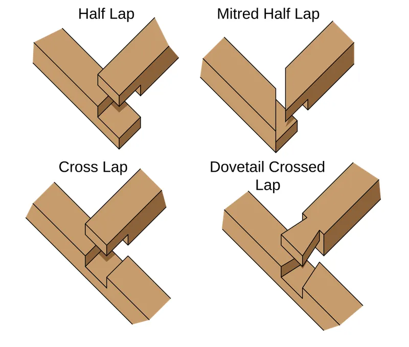
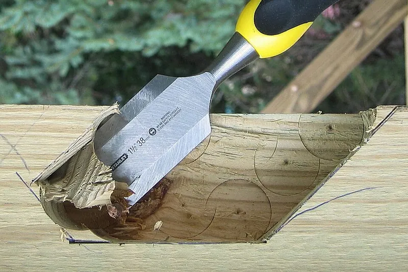
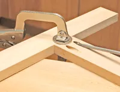

<figure class="eoc-pic eoc-pic-main"><figcaption><strong>Diagram.</strong> <a href="https://commons.wikimedia.org/wiki/File:Woodworking_lap_joints.svg">Woodworking lap joints</a> by Fred the Oyster, <a href="https://creativecommons.org/licenses/by-sa/4.0">CC BY-SA 4.0</a>, from Wikimedia Commons.</figcaption></figure>
<figure class="eoc-pic"><figcaption><strong>How it works.</strong> <a href="https://commons.wikimedia.org/wiki/File:Wood_chisel.JPG">Wood chisel</a> by Fishdecoy at English Wikipedia, Public domain, from Wikimedia Commons.</figcaption></figure>
<figure class="eoc-pic"><figcaption><strong>How it works.</strong> <a href="https://commons.wikimedia.org/wiki/File:Pocket-hole_joint_being_assembled.gif">Pocket-hole joint being assembled</a> by User:Derekbalsley, Public domain, from Wikimedia Commons.</figcaption></figure>

The simplest wood joints: one piece meets another end-on (butt joint) or overlaps it (lap joint), and screws, nails, angled pocket screws or glue hold them together; the baseline every other wood joint is compared with.

**In plain words:** Two pieces of wood simply pushed together, end against face or edge (butted), or laid over each other with half the thickness cut from each (lapped), and held with screws, nails, glue, or screws driven at an angle from a hidden pocket. **Proper term:** Butt joint and lap joint (including the screwed butt joint, the pocket-hole joint and the half-lap joint).

**Also called:** butt joint; T-butt, end-to-end butt, edge-to-edge butt and mitre butt (Wikipedia 'Butt joint'); rubbed joint or glue joint (an edge-to-edge butt joint that is only glued, used to widen boards; DT Online 'Butt Joint', 'Widening Joint'); nailed butt joint; skew-nailing or 'dovetailed' nails (nails driven at opposing angles; Wikipedia 'Butt joint'; DT Online); screwed butt joint; counterbored and plugged screw joint (Wikipedia 'Butt joint'); slot-screwed joint (DT Online 'Widening Joint'); Confirmat screw joint (a thick-shanked cabinet screw for particleboard butt joints; Wikipedia 'Butt joint'); pocket-hole joinery, pocket-screw joinery, pocket screw, screw pocket (Wikipedia 'Pocket-hole joinery'; DT Online); Kreg joint, Kreg jig (brand; Kreg Tool Company makes the best-known pocket-hole jigs and screws); lap joint, overlap joint, full lap, half lap, halving joint (Wikipedia 'Lap joint'; DT Online 'Halving Joint'); end lap, corner lap, pull lap, half-lap splice, cross lap, tee lap, middle lap, dovetail lap, mitred half lap (Wikipedia 'Lap joint'); T-lap, scarf lap (Family Handyman 'Half Lap Joints'); toe-nailing, toenailing or slant nailing: nails driven at a slant through the end or edge of one piece into the other (USDA Wood Handbook ch. 8).

## How it works

In a butt joint the parts only touch, so nothing about their shape stops them pulling apart or folding over; glue alone holds poorly because an end-grain face soaks up glue and bonds weakly (USDA Wood Handbook ch. 10), so screws, nails or pocket screws clamp the parts together and carry the load (Wikipedia 'Butt joint'). A pocket-hole joint drills a hole at about 15 degrees into the back of one part; the self-tapping screw runs out through its edge into the face or edge of the other part and its flat head pulls the joint tight like a built-in clamp (Kreg; Wikipedia 'Pocket-hole joinery'). In a half lap, half the thickness is cut away from each part so they overlap flush; the two wide cheeks give a large long-grain-to-long-grain glue area and the shoulders resist racking (diagonal distortion) (Wikipedia 'Lap joint').

## Parts

A few parts: two pieces of wood, plus the fasteners: glue; nails; wood screws (often counterbored and plugged, or with a washer); or pocket screws (self-tapping screws with a flat washer head) driven through an angled pocket drilled with a jig and a stepped drill bit (Wikipedia 'Butt joint', 'Pocket-hole joinery'; Kreg 'How pocket holes work'). A half lap needs no extra parts beyond glue, but is often also screwed or dowelled (Wikipedia 'Lap joint').

## Everyday examples

- Nailed butt joints in house wall framing and basic crates (Wikipedia 'Butt joint': platform framing)
- Kitchen cabinets and flat-pack carcases held with screws into the board edges (Wikipedia 'Butt joint': 'Modular kitchens make regular use of this fixing method')
- Picture frames with mitred half-lap corners, and Lincoln Logs-style log cabins with lap joints (Family Handyman)
- Workshop shelves, benches and pallet-wood projects built with pocket screws (woodgears.ca; Kreg)

## When to use it

Use a screwed or nailed butt joint for quick, cheap, rough or temporary work: building framing, workshop fixtures, crates, sawhorses and simple boxes (Wikipedia 'Butt joint'; woodgears.ca). Use pocket screws for face frames, cabinet carcases, table aprons and anything where you want fast assembly with no clamps and hidden screws, and where only one side can be reached (Wikipedia 'Pocket-hole joinery'). Use a glued half lap for strong, flat frames and grids (cabinet frames, door frames, stretchers), where its large long-grain glue area gives excellent [shear](../glossary.md#peel-vs-shear) strength (Wikipedia 'Lap joint'; Sawmill Creek summary of WOOD Magazine's torture test). Butt and lap joints are also the natural way to fasten 3D-printed or laser-cut parts together with screws or glue. Toe-nailing (slant nailing through the end or edge of one piece into the other) is a common way of joining wood framing; it 'requires greater skill in assembly than does ordinary end nailing but provides joints of greater strength and stability' (USDA Wood Handbook ch. 8).

## When not to use it

Don't rely on screwed or pocket-screw butt joints for chairs or other furniture whose joints take repeated bending: they open up before they break (woodgears.ca); use mortise and tenon or dowel joints instead. Don't use a glued-only end-grain butt joint for anything load-bearing (USDA Wood Handbook ch. 10); reinforce it with dowels, biscuits, a [spline](../glossary.md#spline) or screws, or switch to a lap, finger or scarf joint. Avoid pocket holes in stock thinner than about 1/2 in. (Wikipedia; Kreg) and where both faces are visible (Wikipedia). For boxes and drawers seen from outside, finger or dovetail joints look better and hold better. For flat-pack furniture that must come apart often, use knock-down cam-lock or cross-dowel fittings rather than screws into particleboard edges.

## Details

- **What it does (jobs):**
  - join and hold: joins frames, boxes, carcases (cabinet boxes), shelves and building frames (Wikipedia 'Butt joint', 'Lap joint')
  - glue or bond: half laps and edge-to-edge butt joints rely mainly on glue on long-grain faces (Wikipedia 'Lap joint'; DT Online 'Widening Joint')
- **Movement:** none: a rigid joint once screwed, nailed or glued
- **Directions it can move (degrees of freedom):** 0 once fastened or glued. Before fastening, a plain butt joint has nothing holding it in place at all; a half lap's shoulders stop sliding in one direction and the overlap stops it folding, but it can still lift straight off.
- **Special behaviour:**
  - none: it has no clever behaviour. Its main quirk is that screwed and pocket-screw joints bend and open up gradually before they break, instead of snapping like glued joints, which makes them tough but not stiff (Matthias Wandel, woodgears.ca 'Wood joint strength testing')
- **How it holds:**
  - friction or clamping ([force-fit](../glossary.md#form-fit--force-fit--material-bond)): screws, nails and pocket screws clamp the parts together; screw heads pulling into the wood are usually what gives way (woodgears.ca)
  - material bond (glue, solvent or melting): glue on the long-grain cheeks of a half lap or on edge-to-edge butt joints (Wikipedia 'Lap joint'; USDA Wood Handbook ch. 10)
  - shape (the parts interlock; form-fit): only partly, in the half lap, where the shoulders resist racking; a dovetail lap also resists pulling out (Wikipedia 'Lap joint')
- **Input and output:** not applicable
- **Power:** passive (no power needed)
- **Load:** Light to medium. Glued end-grain butt joints are the weakest: 'practically impossible' to make strong enough for ordinary service, reaching only about 25% of the wood's tensile strength even with special techniques (USDA Wood Handbook ch. 10); unglued rail-to-post butt joints broke at 35-50 lb with the load 15 cm out (woodgears.ca pocket-hole retest). Pocket-hole rail-to-post joints averaged 99 lb (unglued) and 111 lb (glued) versus 153 lb for two dowels and 202-236 lb for mortise and tenons, and began to open a visible gap at about 50 lb (woodgears.ca 'Testing pocket holes'). Screws into [end grain](../glossary.md#end-grain) with washers under the heads reached 210 lb (spruce) and 300 lb (maple) at 20 cm, but bent open long before (woodgears.ca). A glued half lap, with its long-grain cheeks, is among the strongest joints in shear, beating even the mortise and tenon in WOOD Magazine's 'Wood Joint Torture Test' (Wikipedia 'Lap joint'). Weak directions: butt joints in bending and pull-apart; half laps in twisting unless reinforced with dowels or fasteners (Wikipedia 'Lap joint').
- **Play and precision:** small play once tight. [Accuracy](../glossary.md#repeatability--accuracy) depends on cutting the ends square: 'it is important that the cuts are precise and square to prevent gaps' (Wikipedia 'Pocket-hole joinery'). Screwed and pocket-screw joints flex several degrees under heavy load before failing (woodgears.ca). A half lap locates the parts flush and square by its shoulders (Wikipedia 'Lap joint'). A pocket-hole joint needs only one hole drilled, so there is no need to line up holes in two parts as with dowels (Wikipedia 'Pocket-hole joinery').
- **Taking it apart:** removable for screwed and unglued pocket-hole joints (unscrew them); permanent once glued. Wikipedia notes that a broken pocket-hole joint 'likely can't be repaired' (Wikipedia 'Pocket-hole joinery', citing Popular Woodworking).
- **How often it can be reused:** a few times for screws in solid wood: re-driving a screw into the same hole loses some grip, and a stripped end-grain hole can be repaired by filling it with glue before re-inserting the screw, which then still unscrews (woodgears.ca); the number of cycles is ⚑ [uncertain]; self-tapping screws in 3D prints are a 'one-off method' not suited to repeated disassembly (Hubs); once for glued butt and lap joints
- **Sealing:** none: not designed to seal
- **Adjustable:** no, but exposed screws can be re-tightened if the joint opens; Wandel advises not covering pocket holes or screw heads for this reason (woodgears.ca)
- **Access needed:** one side only (blind) for pocket-hole joints, drilled and driven from the hidden back face of one part (Wikipedia 'Butt joint'); one side only for screwed or nailed butt joints, driven through the outer face of one part into the other (Wikipedia); both sides for glued half laps and edge joints, which need clamping across the joint
- **Materials:** Solid softwood and hardwood, plywood, MDF, particleboard and melamine board. Kreg recommends coarse-thread pocket screws for softwoods and sheet goods (pine, cedar, fir, spruce, poplar, plywood, particleboard, MDF, melamine) and fine-thread screws for hardwoods (oak, maple, cherry, birch, ash, walnut), because coarse threads can split dense wood (Kreg Screw Guide). Pocket holes need boards at least about 10-15 mm thick (Wikipedia 'Pocket-hole joinery'); Kreg's chart starts at 1/2 in. Particleboard edges hold ordinary screws poorly, so Confirmat screws are used (Wikipedia 'Butt joint'). Lap joints also join plastic and metal (Wikipedia 'Lap joint'), and printed plastic parts can be butted or lapped and screwed or glued (Prusa knowledge base; Hubs).
- **Heat, cold, water and wear:** Wood swells and shrinks with humidity, mostly across the grain (about twice as much tangentially as radially) and only 0.1-0.2% along it (USDA Wood Handbook ch. 4), so an end-to-edge (T) joint builds up large internal stresses as moisture changes and should be protected from changes in moisture content (USDA Wood Handbook ch. 10). Glue plus pocket screws helps stop gaps opening as the wood moves (Wikipedia 'Pocket-hole joinery'). Outdoors, use coated (Blue-Kote (brand)) or stainless pocket screws; zinc screws are for indoor use (Kreg Screw Guide), and a waterproof glue ⚑ [uncertain]. Screwed PLA prints soften at about 60 °C and PETG at about 80 °C (CNC Kitchen).

## Making it

- **Ways to make or get it:**
  - woodwork: the main method, by hand or with a mitre saw, table saw, router and pocket-hole jig (Wikipedia 'Butt joint', 'Lap joint', 'Pocket-hole joinery')
  - CNC: routers can cut square-ended parts and half-lap pockets; inside corners of pockets are rounded by the cutter, so square them with a chisel or add relief cuts ⚑ [uncertain]
  - laser cut: butt joints glued along the edge in acrylic or thin plywood; the laser-cut version of a cross lap is the cross-halving slot joint (see related)
  - 3D print (FDM): printed parts are often butted and screwed or glued; split large prints are glued with pegs for alignment (Prusa knowledge base 'Modeling with 3D printing in mind')
  - off-the-shelf part: wood screws, pocket screws (zinc, Blue-Kote (brand) or stainless for outdoors), pocket-hole plugs, corrugated fasteners, Confirmat screws (Kreg; DT Online; Wikipedia)
- **Printing it in one piece (print in place):** no: the two parts are printed separately and then screwed or glued together
- **Tools:** Saw to cut ends square (crosscut saw, circular saw with a straightedge, table saw, mitre saw or backsaw; Wikipedia 'Butt joint'); drill/driver, pilot drill, countersink or [counterbore](../glossary.md#counterbore--countersink) and plug cutter for screwed joints (Wikipedia); pocket-hole jig, stepped pocket-hole drill bit and a long square-drive bit for pocket screws (Kreg; Wikipedia 'Pocket-hole joinery'); marking gauge, marking knife, tenon saw and chisel, or a table saw with a dado stack or a router, for half laps (DT Online 'Halving Joint'; Family Handyman); wood glue and clamps for glued joints (pocket screws act as their own clamps; Wikipedia).
- **Difficulty:** easy: the simplest joints to make with basic tools; a pocket-hole jig makes the angled holes almost foolproof (Kreg; Wikipedia), and a half lap is 'a terrific skill for beginning woodworkers to master' (Family Handyman)

### 3D printing tips

1) Butt joints between printed parts: a plain glued butt joint only bonds the small contact face, so enlarge the contact area or use a lap. Prusa advises smooth, grease-free, lightly sanded faces and says a good glue seam can be 'stronger than the rest of the material', but suggests modelling in pegs 'for alignment and strength' (Prusa knowledge base). 2) Screwing printed parts together: the wall around a screw hole should be at least as thick as the screw diameter (e.g. 5 mm around an M5), or the part can bulge, delaminate or crack; self-tapping screws straight into plastic are a one-off fixing, so use [heat-set inserts](../glossary.md#heat-set-insert) or [captive nuts](../glossary.md#captive-nut) for parts you will take apart (Hubs 'How to assemble 3D printed parts with threaded fasteners'). Drilling the [pilot hole](../glossary.md#pilot-hole) to size after printing gives a more accurate hole than a printed one (Hubs). 3) Half laps in prints: print each half lying flat so the glue cheek is a flat top or bottom surface and the layers run along the part; layer bonds are the weak direction (PLA layer adhesion was about 55% of flat strength and PETG about 46% in CNC Kitchen's test; Prusa: 'Like wood, FFF prints are stronger in one direction than another'). 4) Fit: leave about 0.5 mm [clearance](../glossary.md#clearance) in an FDM lap or slot that must slide together (Hubs), or at least 0.3 mm for moving fits and about 0.2 mm printer accuracy (Prusa); glued laps can be closer. 5) Printed jigs: a printed pocket-hole jig works with the standard pocket-hole bit and screws; print the face you drill through on the bed, add extra [perimeters](../glossary.md#perimeters), and consider a metal sleeve (copper tube) in the guide hole for durability (Printables 'Pocket hole jig' by Henry; 'FDM-Optimized Pocket Hole Jig'). 6) Heat: PLA gives at about 60 °C and PETG at about 80 °C, so screwed PLA parts can [creep](../glossary.md#creep) loose in a hot car (CNC Kitchen).

### Buying one (off-the-shelf parts)

Pocket-hole screws (square-drive, washer or pan head, self-tapping point, unthreaded upper shank; coarse or fine thread; zinc for indoors, Blue-Kote (brand) coating for damp areas, stainless for wet outdoor use) and pocket-hole jigs and stepped drill bits (Kreg Screw Guide; Kreg 'How pocket holes work'); wood screws, counterbore bits and plug cutters (Wikipedia 'Butt joint'); screw cover caps for manufactured board (Wikipedia); Confirmat screws for particleboard (Wikipedia); corrugated fasteners (DT Online); flat washers under screw heads (woodgears.ca); nail plates and ties for reinforcing butt joints in construction (Wikipedia 'Butt joint': 'ties and plates'); dado blade sets for cutting half laps (Family Handyman).

## Rules of thumb

- Cutting a butt-jointed box to size: one member is shorter than the finished size by the thickness of the adjacent member; e.g. a 600 x 600 mm box in 19 mm board has two sides at 600 mm and two at 600 - 19 - 19 = 562 mm (Wikipedia 'Butt joint').
- Screws into end grain: use long screws, 'usually 3 times the thickness of the member' (Wikipedia 'Butt joint', unreferenced section); DT Online suggests screws twice the usual length and a thinner gauge for end grain, and angled ('dovetailed') nails for extra grip (DT Online 'Butt Joint').
- End-grain holding: screws in end grain hold erratically but, if splitting is avoided, average about 75% of their side-grain withdrawal load; lead (pilot) holes of about 70% of the thread root diameter suit softwoods and about 90% hardwoods (USDA Wood Handbook 2021, ch. 8 'Fastenings').
- Glue alone on end grain: end-grain butt joints reach only about 25% of the wood's tensile strength; end-to-edge (T) joints need interlocking shapes such as dowels, tenons or rabbets to carry appreciable load (USDA Wood Handbook ch. 10).
- Pocket holes: drilled at 'usually 15 degrees' (Wikipedia) and stopped about 1/4 in. from the edge (Wikipedia 'Butt joint'); screw into the face or edge of the mating board rather than its end grain (Wikipedia 'Pocket-hole joinery').
- Pocket-screw length by actual board thickness (Kreg chart): 1/2 in. -> 1 in. (3/4 in. with the Micro-Pocket guide); 5/8 in. -> 1 in.; 3/4 in. -> 1-1/4 in.; 7/8-1-1/8 in. -> 1-1/2 in.; 1-1/4-1-3/8 in. -> 2 in.; 1-1/2 in. -> 2-1/2 in. Measure the actual thickness, not the nominal lumber size (Kreg Screw Guide).
- Pocket-screw thread: coarse for softwoods, plywood, MDF and particleboard; fine for hardwoods, because coarse threads tear dense wood and split it (Kreg Screw Guide).
- Pocket-hole strength: about half a mortise and tenon and two-thirds of a two-dowel joint; joints start to open at about half their breaking load, and glue made no difference to the ultimate strength because the glue cracks before the screws reach full load; how deep the screws go into the second piece matters most (Matthias Wandel, woodgears.ca 'Testing pocket holes').
- Screwed joints: screw heads pulling into the wood, not the threads stripping, usually limit strength; flat-headed screws or washers help, and countersunk heads are worst. Avoid screw joints where furniture strength is critical, but they suit sawhorses, crates and scaffolding (woodgears.ca 'Wood joint strength testing').
- Half lap: remove half the thickness from each member (mark with a marking gauge) so the faces finish flush (Wikipedia 'Lap joint'; DT Online 'Halving Joint'); set the dado or blade height to exactly half the stock thickness using a test piece (Family Handyman).
- Half-lap variants: the mitred half lap is the weakest because of its reduced glue area; a dovetail lap resists withdrawal where tension could pull the joint apart (Wikipedia 'Lap joint'). A well-made lap, scarf or finger joint in end grain can reach up to 90% of the tensile strength of clear wood (USDA Wood Handbook ch. 10).
- Toe-nailing (slant nailing): toe-nailed joints are strongest when you use the largest nail that won't split the wood badly, start it about one-third of the nail's length from the end of the attached piece, drive it at about 30° to that piece, and bury the full shank without bruising the wood with hammer blows; lead holes of about 90% of the nail's shank diameter add a little holding power and reduce splitting (USDA FPL Wood Handbook, FPL-GTR-282, ch. 8, p. 8-5).
- Clinching (bending the point of a nail over where it comes through): in dry or green wood a clinched smooth-shank nail resists pulling out 45% to 170% better than an unclinched one when pulled soon after driving, and nails clinched across the grain hold about 20% more than ones clinched along it; clinching is mostly used for boxes and crates (USDA FPL Wood Handbook, FPL-GTR-282, ch. 8, pp. 8-5 to 8-6).

## Common failures

Glue-only end-grain butt joints letting go (USDA Wood Handbook ch. 10); add fasteners or change the joint. Screw heads pulling into the wood so the joint slowly opens (woodgears.ca); use flat-headed screws or washers, leave heads uncovered so they can be re-tightened. Pocket screws pulling out of the second piece when they are too short or the jig is set too shallow (woodgears.ca); follow the thickness chart (Kreg). Hardwood splitting around pocket holes or from coarse-thread screws (woodgears.ca maple test; Kreg); use fine-thread screws and pilot holes. Wood splitting near the ends when nailing or screwing without lead holes (USDA Wood Handbook ch. 8). Screws stripping in particleboard when over-tightened (USDA Wood Handbook ch. 8); use Confirmat screws or inserts. Gaps from ends cut out of square (Wikipedia 'Pocket-hole joinery'). Half laps twisting apart when not glued or pinned; reinforce with dowels or fasteners (Wikipedia 'Lap joint'). In 3D prints, thin walls around screws bulging or cracking (Hubs), and laps printed standing up splitting along [layer lines](../glossary.md#layer-lines) (Prusa; CNC Kitchen).

## Safety

Table saws (used for cutting ends square and for dado-cut half laps) can kick work back and cause amputations: use the guard, a push stick for small pieces, and keep hands out of the line of cut (OSHA table saw eTool). A pocket-hole bit or screw can split thin or hard stock suddenly; clamp the jig and work firmly ⚑ [uncertain]. Screw points left poking through the far face are a scratch hazard; Wandel's deeper-drilled pocket screws came out the other side (woodgears.ca). Otherwise none known.

## Related

- Dowel and biscuit joints: wooden pins or wafers added to a butt joint to align it and add glue area; dowel joints tested about 1.5 times as strong as pocket holes (woodgears.ca)
- Mortise and tenon: turns an end-grain butt joint into a long-grain glue joint; about twice as strong as pocket holes in Wandel's tests
- Cross-halving slot joint (egg-crate joint): the laser-cut and sheet-material version of the cross lap
- Finger joint (box joint) and dovetail joint: interlocking corner joints with much more glue area than a butt joint
- Tongue-and-groove joint: an edge-to-edge butt joint with a ridge and groove added for alignment
- Knock-down cam-lock and cross-dowel connectors: hardware for butt joints in flat-pack furniture that can be taken apart
- Glued joint design (butt, lap and scarf joints; peel vs shear): why lap and scarf joints glue far better than butt joints
- Heat-set threaded insert and captive nut pocket: better ways to screw 3D-printed parts together than self-tapping screws
- Wood screw: the usual fastener for screwed butt and lap joints, with advice on pilot and clearance holes
- Nails, brads and tacks: the quick fastener for nailed butt joints, including toe-nailing and clinching
- Metal brackets and plates: angle brackets, mending plates and joist hangers that reinforce a butt joint or carry its load

## Make it yourself

- [Pocket hole jig by Henry (Printables) (URL from Printables API, page not opened)](https://www.printables.com/model/96193-pocket-hole-jig): A printable pocket-hole jig that uses the standard Kreg (brand) stepped bit and screws; print in PC, PETG or PLA with extra perimeters. Read through the Printables public API. *(licence: CC Public Domain)*
- [FDM-Optimized Pocket Hole Jig by CATIAV5FTW (Printables) (URL from Printables API, page not opened)](https://www.printables.com/model/645779-fdm-optimized-pocket-hole-jig): A pocket-hole jig designed to print without supports, with the drilling face on the bed; copper tube can be added in the angled holes for durability. Read through the Printables public API. *(licence: CC BY)*
- [rohové přeplátování na kolmo - výuková pomůcka (corner half-lap teaching model) by STSUL.CZ (Printables) (URL from Printables API, page not opened)](https://www.printables.com/model/155831-rohove-preplatovani-na-kolmo-vyukova-pomucka): A printable corner half-lap joint made by a carpentry student at a Czech vocational school, for teaching technical drawing; print the two halves in different colours. Read through the Printables public API. *(licence: CC BY)*

## Pictures, videos and models

- [Woodworking lap joints.svg (Wikimedia Commons, by Fred the Oyster)](https://commons.wikimedia.org/wiki/File:Woodworking_lap_joints.svg): Drawing of four lap joints, left to right: half lap, mitred half lap, cross lap and dovetail lap (used on Wikipedia 'Lap joint') *(licence: CC BY-SA 4.0)*
- [Woodworking-joint-butt-pockethole.gif (Wikimedia Commons, by SilentC)](https://commons.wikimedia.org/wiki/File:Woodworking-joint-butt-pockethole.gif): Drawing of a butt joint held by pocket-hole screws driven at an angle from the back face *(licence: CC BY-SA 3.0)*
- [Pocket-hole joint being assembled.gif (Wikimedia Commons, uploaded by Derekbalsley)](https://commons.wikimedia.org/wiki/File:Pocket-hole_joint_being_assembled.gif): Animation of a pocket screw being driven through the angled pocket to pull two boards together (used on Wikipedia 'Pocket-hole joinery') *(licence: Marked public domain on Commons, but the file page says Kreg Tool Company is the author of the original image, so the licence claim is ⚑ [uncertain])*
- [Butt joint.png (Wikimedia Commons, by Jim Thomas / Jomegat)](https://commons.wikimedia.org/wiki/File:Butt_joint.png): Simple drawing of a plain butt joint (used on Wikipedia 'Butt joint') *(licence: CC BY-SA 3.0)*
- [Pocket holes vs. mortise and tenon joints (YouTube, MatthiasWandel)](https://www.youtube.com/watch?v=apsH8eBfjVA): Video of pocket-hole, dowel and mortise-and-tenon joints being broken on a home-made test rig with a bathroom scale (title checked via YouTube oEmbed; embedded on woodgears.ca) *(licence: link only (standard YouTube licence))*

## Needs confirming

⚑ marks something nobody has confirmed yet: a fact the research could not confirm from a source, a finder value that is a best guess, or an open point from the research notes. Corrections are welcome (see `research/needs-confirming.md`).

- ⚑ 5 sentences on this page marked [uncertain].
- ⚑ Research note: *Butt and lap wood joints* (271): the *Wood Handbook*'s 250-460% clinching gain for green wood that dries was left out ('does not justify the use of green lumber'). The 'rack nut' alias for the cage nut (173) has no source and was left out.

## Sources

- <https://en.wikipedia.org/wiki/Butt_joint>
- <https://en.wikipedia.org/wiki/Lap_joint>
- <https://en.wikipedia.org/wiki/Pocket-hole_joinery>
- <https://commons.wikimedia.org/wiki/File:Woodworking_lap_joints.svg>
- <https://commons.wikimedia.org/wiki/File:Woodworking-joint-butt-pockethole.gif>
- <https://commons.wikimedia.org/wiki/File:Pocket-hole_joint_being_assembled.gif>
- <https://commons.wikimedia.org/wiki/File:Butt_joint.png>
- <https://commons.wikimedia.org/wiki/File:Woodworking-joint-lap.svg>
- <https://woodgears.ca/joint_strength/>
- <https://woodgears.ca/joint_strength/pockethole.html>
- <https://woodgears.ca/joint_strength/shelf_brackets.html>
- <https://www.youtube.com/watch?v=apsH8eBfjVA>
- <https://learn.kregtool.com/learn/how-to-select-right-pocket-hole-screw/>
- <https://learn.kregtool.com/wp-content/uploads/2020/07/Kreg-Screw-Chart-SSC-2021-Correct-Screw-Copy.jpg>
- <https://learn.kregtool.com/learn/how-pocket-hole-joints-work/>
- <https://www.fpl.fs.usda.gov/documnts/fplgtr/fplgtr190/chapter_10.pdf>
- <https://www.fpl.fs.usda.gov/documnts/fplgtr/fplgtr190/chapter_04.pdf>
- <https://research.fs.usda.gov/treesearch/62253>
- <https://research.fs.usda.gov/download/treesearch/62253.pdf>
- <https://wiki.dtonline.org/index.php/Butt_Joint>
- <https://wiki.dtonline.org/index.php/Halving_Joint>
- <https://wiki.dtonline.org/index.php/Widening_Joint>
- <https://www.familyhandyman.com/article/half-lap-joint/>
- <https://sawmillcreek.org/threads/wood-mag-joint-torture-test.69259/>
- <https://help.prusa3d.com/article/modeling-with-3d-printing-in-mind_164135>
- <https://www.hubs.com/knowledge-base/how-assemble-3d-printed-parts-threaded-fasteners/>
- <https://www.hubs.com/knowledge-base/how-design-interlocking-joints-fastening-3d-printed-parts/>
- <https://www.cnckitchen.com/blog/comparing-pla-petg-amp-asa-feat-prusament>
- <https://www.osha.gov/etools/machine-guarding/saws/table>
- <https://api.printables.com/graphql/>
- <https://www.fpl.fs.usda.gov/documnts/fplgtr/fplgtr282/chapter_08_fpl_gtr282.pdf>
