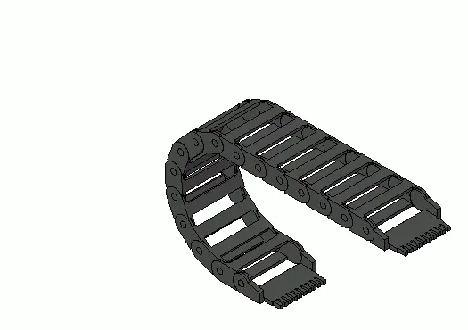

*Picture: [Cable drag chain unsupported 3D animated.gif](https://commons.wikimedia.org/wiki/File:Cable_drag_chain_unsupported_3D_animated.gif) by Silberwolf, [CC BY-SA 2.5](https://creativecommons.org/licenses/by-sa/2.5), from Wikimedia Commons.*

A cable carrier is a flexible chain of hinged, hollow links that bends only one way and not too tightly, carrying cables and hoses to a moving part of a machine so they are guided, protected and never over-bent or tangled.

**In plain words:** A chain of hollow plastic links, hinged together, that carries a bundle of cables or hoses and rolls along behind a moving part, so the cables always bend in a gentle curve and never tangle, kink or get caught. **Proper term:** Cable carrier (drag chain, energy chain).

**Also called:** drag chain, cable drag chain (Wikipedia 'Cable carrier'; maker usage on Printables); energy chain, e-chain (e-chain is a brand of igus) (Wikipedia; igus); cable chain (Wikipedia; Hackaday); cable track, CAT track, cable and hose carrier (names listed in 'Basics of Cable Carriers', Machine Design / igus, 2013); Energiekette, Schleppkette (German; Wikimedia Commons, Printables model titles); Kabelschlepp (brand; the company that brought steel cable carriers to market in the 1950s, per Wikipedia); enclosed cable carrier, tube-type or conduit-type carrier (fully closed versions) (Basics of Cable Carriers); multi-axis cable carrier, robot dress pack; triflex (brand, igus) (Basics of Cable Carriers); rotary cable carrier; twisterband (brand, igus) (Basics of Cable Carriers).

## How it works

Each link can swing only a limited angle against its neighbour, in one plane and usually in only one direction, because stop faces on the links butt together (Wikipedia 'Cable carrier'). One end is screwed to the fixed frame and the other to the moving carriage; as the carriage travels, the chain rolls over itself in a U-shaped loop that moves along with it, a bit like a caterpillar track, so the cables inside are only ever bent round that loop and never tighter than the chain's minimum bend radius (Basics of Cable Carriers; Hackaday reader comment: they 'enforce a minimum bend radius'). The upper run stays straight and self-supporting up to a certain length, after which it sags and must glide on the lower run or be supported (igus 'Unsupported applications'). The cables lie loosely inside with some free space and dividers so they can slide as the chain bends, and are clamped at the ends (strain relief) so they don't [creep](../glossary.md#creep) in and out (igus 'Filling rules'; Basics of Cable Carriers).

## Parts

A small assembly that acts as one unit: many identical links (two side plates joined by crossbars, or one-piece moulded links) that pivot on pins or round [bosses](../glossary.md#boss) of the next link; crossbars or lids that open so cables can be laid in; optional separators and shelves inside; two end links or mounting brackets (one fixed, one moving); and strain-relief clamps or cable-tie plates for the cables (Wikipedia 'Cable carrier'; Basics of Cable Carriers).

## Everyday examples

- The chain that carries the print-head cables and filament tube on many 3D printers, e.g. the one on the Bambu Lab X1 that makers copy for other models (Printables 'Bambu Lab P1P Cable Drag Chain Assembly')
- Hobby CNC routers and laser cutters, where chains carry the spindle and motor cables along each axis (Hackaday 2017 and 2022)
- Automatic car washes, where the moving brush gantry trails its hoses and cables (Wikipedia 'Cable carrier')
- Factory robots, machine tools, cranes and theatre stage machinery (Wikipedia 'Cable carrier')

## When to use it

Use a cable carrier whenever cables or hoses have to follow something that moves back and forth over and over, such as the axes of a 3D printer, CNC router, laser cutter, camera slider, linear robot or sliding door. It keeps the wiring tidy, stops it being snagged or crushed by moving parts, and above all stops it being bent too tightly again and again, which is what breaks wires (Wikipedia 'Cable carrier'; Hackaday 2017). Choose an enclosed type if chips, sawdust or hot debris fly around (Basics of Cable Carriers). Printing your own is worthwhile when you need an odd size or custom mounts, or can't wait for delivery (Hackaday 2022).

## When not to use it

For something that keeps turning round and round, use a slip ring or rotary union instead; a chain only follows limited travel (rotary chains and 'twisterband' style carriers manage a limited number of degrees, e.g. about 3,000°, per Basics of Cable Carriers). For a robot arm that twists and bends in 3D, use a multi-axis carrier or a dress pack. For a few light wires on a short axis, a cheaper option is a strip of tape-measure steel inside braided sleeving, which holds a U-shaped curl and stays sag-free (Hackaday 2017). For cables that don't move, cable ties or clips are enough. Hackaday readers point out that printing large chains can take as long as delivery and that moulded chains move more smoothly and last longer (Hackaday 2022).

## Details

- **What it does (jobs):**
  - seal it, or pass cables or fluid through: guides power, signal, air, oil or water lines, and PTFE filament tubes, to a part that moves
  - let it move (turn, slide or bend): its hinged links roll along with a sliding (or, in rotary versions, a turning) machine axis
- **Movement:** rotate: each link pivots through a small, limited angle on its neighbour, and only one way; together the links roll along with a sliding axis, so the moving end travels in a straight line (industrial travels can be more than a quarter mile, per Basics of Cable Carriers). Chains laid on their side with a reversed bend follow a turning or swivelling part instead (Wikimedia Commons 'Cable drag chain rotating 3D animated.gif').
- **Directions it can move (degrees of freedom):** 1 at each link (a hinge that turns a limited angle about its pin) and 1 for the chain as a whole: the moving end goes back and forth along one line (or round one axis for rotary types) while the chain stays in one plane. Multi-axis carriers made of ball-and-socket segments add twisting and 3D movement; igus's triflex R can twist up to 360° per yard (Basics of Cable Carriers).
- **Special behaviour:**
  - none: it has none of the listed clever behaviours. Its own tricks are a built-in minimum bend radius (the links stop at a set angle, so cables can't be bent too tightly) and one-way bending with a straight or slightly arched upper run, so the chain can't flop sideways, twist or fold the wrong way (Wikipedia 'Cable carrier'; one printable design is deliberately given a slight curve 'to make sure the chain wont accidently bend the opposite way', Printables 'Bambu Lab P1P Printable Cable Drag Chain')
- **How it holds:**
  - not a holding joint (it moves or passes on motion): it guides and protects cables rather than holding parts together
  - shape (the parts interlock; [form-fit](../glossary.md#form-fit--force-fit--material-bond)): the links snap together on pins or bosses, and the crossbars or lids clip shut
  - friction or clamping (force-fit): the cables are fixed at the ends with strain-relief clamps or cable ties (Basics of Cable Carriers)
- **Input and output:** not applicable
- **Power:** passive (no power needed): the chain is simply dragged along by the machine's moving part.
- **Load:** light to medium: it only has to carry the weight of its cables and hoses plus the forces of speeding up and slowing down. Each size has a rated fill weight for a given unsupported length (igus load diagrams), and 'a typical plastic cable carrier with a 2.5-in. inner height handles about 1,800 lb' of total push-pull force (Basics of Cable Carriers). Strong along its length and in its bending plane; weak sideways and in twist, so it must run in line with the axis and be guided in a trough on long, fast travels (igus 'Unsupported applications'). Printed links can pop apart if pushed sideways ⚑ [uncertain].
- **Play and precision:** small play at every link hinge by design, because it must move freely; it doesn't locate anything precisely. A well-fitted printed chain should have 'very little movement (almost none) when wiggling the links in any other direction other then rotating' (Printables 'Bambu Lab P1P Printable Cable Drag Chain'). It tolerates little [misalignment](../glossary.md#misalignment): the moving end should travel in the chain's own plane and in line with it, and long travels need a guide channel (igus 'Unsupported applications') ⚑ [uncertain].
- **Taking it apart:** removable: the end brackets are screwed on, the crossbars or lids open anywhere along the chain so cables can be added or removed, and links can be pried apart to shorten or lengthen the chain (Wikipedia 'Cable carrier'; Basics of Cable Carriers; a printed design's notes say 'To remove the latches, insert a small flat head screwdriver and twist', Printables).
- **How often it can be reused:** many times: crossbars and lids are meant to be opened for inspection and cable changes (Basics of Cable Carriers). Printed snap-on clips and link hinges loosen with use, so printed chains wear out sooner than moulded ones (Printables 'Bambu Lab P1P Printable Cable Drag Chain').
- **Sealing:** none for open types; dust-resistant for fully enclosed and tube types, whose solid covers keep machining chips, sawdust, weld spatter and other debris off the cables (Basics of Cable Carriers; Wikipedia 'Cable carrier'). They are not watertight.
- **Adjustable:** yes, in length only: add or remove links, and move separators and shelves inside. The bend radius is fixed by the link shape, although parametric printable designs let you choose the minimum and maximum bend radius before printing (Printables 'Fully Parametric Drag Chain').
- **Access needed:** not applicable: it is screwed on at its two ends, and cables are laid in from the openable side of the links.
- **Materials:** Mostly injection-moulded plastic: nylon (polyamide) or glass-filled nylon for low-cost chains, which 'become [brittle](../glossary.md#brittle--ductile) at cold temperatures and many formulations absorb water'; tougher engineering plastics such as UHMW polyethylene, PTFE and acetal; igus uses its own nylon-based 'igumid' blends (brand) (Basics of Cable Carriers). Wikipedia also names polypropylene. Steel or stainless steel for heavy, hot or abrasive jobs, and hybrids with plastic side links and steel or aluminium crossbars (Basics of Cable Carriers; Wikipedia). 3D-printed chains are usually PETG or tough 'PLA+', with ASA near heat: one maker's PETG chain ran on a CNC for almost a year without problems, while a designer warns 'DO NOT USE PLA, IT WILL BREAK' for the mounting parts of a printer chain (Printables). The cables inside should be continuous-flex 'chain-suitable' cables with slippery, abrasion-resistant jackets (Basics of Cable Carriers).
- **Heat, cold, water and wear:** Moulded igus 'igumid G' chains are rated suitable for outdoor use and are used down to -40 °C, though fitting them may be difficult below about -25 °C, and 130 °C continuous is possible with reduced strength and life (igus 'Technical Environment'). Cheap nylon chains become brittle in the cold and absorb water (Basics of Cable Carriers). Printed chains are limited by their plastic: PLA gives way at about 60 °C, PETG at about 80 °C and ASA at about 110 °C (CNC Kitchen), so keep PLA chains away from heated beds and enclosed hot printers. Hot metal chips need steel or special high-temperature carriers (Basics of Cable Carriers). High accelerations make chains vibrate and shorten their life (igus 'Unsupported applications'). Printed hinges loosen and wear over time (Printables).

## Making it

- **Ways to make or get it:**
  - off-the-shelf part: moulded plastic or steel chains sold by inner width x inner height and bend radius, with matching end brackets
  - 3D print (FDM): one of the most printed functional parts, either as separate snap-together links or as [print-in-place](../glossary.md#print-in-place) strips (Printables; Hackaday 2022)
  - CNC: end brackets and mounts; steel chains for heavy industrial machines (Basics of Cable Carriers)
  - laser cut: side plates from sheet plastic joined with solvent glue, suggested by a Hackaday reader as a smoother alternative to printing ⚑ [uncertain]
  - sheet metal: steel link plates for heavy-duty chains (Basics of Cable Carriers)
- **Printing it in one piece (print in place):** yes: some designs print already linked and working, e.g. a 'Print-in-place Cable Chain' that 'moves freely when taken out of buildplate' and a parametric chain that can be printed in place or assembled (Printables). Most popular designs are printed as separate links and snapped together, and one designer who tried print-in-place found 'the chain link parts fused to each other' (Printables 'Drag Chain for CNC, two-piece, snap-open').
- **Tools:** A screwdriver or hex key with screws or T-nuts to fix the two end brackets (Hackaday: chains 'affixed into the aluminium extrusion with bolts and T-nuts'); a small flat screwdriver to open crossbars or separate links; cable ties, tie-wrap plates or clamps for strain relief (Basics of Cable Carriers). Printed links usually just press together; some designs use toothpicks as pins or clips that are tapped in (Printables 'Fully Parametric Drag Chain'; Hackaday 2022).
- **Difficulty:** easy: dozens of free printable designs exist and cheap moulded chains are easy to buy. The main fiddly part is getting printed link hinges to the right tightness, which usually needs a small test print (Printables 'Bambu Lab P1P Printable Cable Drag Chain').

### 3D printing tips

1) Start with a proven or parametric design rather than drawing your own: OpenSCAD and Fusion 360 models let you set inside width and height, the minimum and maximum bend radius, pins on the inside or outside, open or closed links, and the hinge [tolerance](../glossary.md#tolerance) (Printables 'Fully Parametric Drag Chain', 'Yet Another Parametric Drag Chain'). 2) Size the inside for the cables first: allow about 10% free space around electrical cables and 20% around hydraulic hoses, and don't fill more than about 60% of the cross-section (igus 'Filling rules'; Basics of Cable Carriers). 3) Choose the bend radius from the stiffest cable (at least 8-10 times the thickest cable or hose diameter, Basics of Cable Carriers); one printer chain uses an 18 mm minimum radius for thin wires, while a CNC chain uses a 64 mm radius for cables that shouldn't bend tighter than 128 mm across (Printables). 4) Print a hinge test first: one designer supplies links with holes at 0.00, +0.02 and -0.02 mm and asks you to snap three short chains together, work them back and forth a few times, and keep the size that is snug but moves; PETG needed tighter (smaller) holes than PLA+ (Printables 'Bambu Lab P1P Printable Cable Drag Chain'). [Chamfers](../glossary.md#chamfer--fillet) on the hinge bosses make pressing links together easier (same source). 5) Print links flat without supports; good designs avoid long bridges, e.g. with an angled roof (Printables 'Parametric Drag Chain'). Typical settings from one CNC chain: 0.4-0.6 mm nozzle, 0.3 mm layers, 50-100% [infill](../glossary.md#infill), no supports (Printables 'Drag Chain for CNC, two-piece, snap-open'). 6) If the assembled chain sags or won't lie straight, the hinge fit is off: that designer suggests nudging flow up 1-5% if it sags, or down if it won't lie straight, and printing links rotated in all four directions on the bed so small printer errors cancel out instead of curving the chain (same source). 7) Print small snap-on clips on a separate plate if they come loose from the bed (same source). 8) Material: PETG or tough PLA+ for links, ASA near hot beds or motors; plain PLA is brittle and softens from about 60 °C, PETG from about 80 °C and ASA from about 110 °C (CNC Kitchen). 9) Add a slight built-in arch or incline to reduce sag on unsupported runs; one designer added a 2° incline to the mount (Printables 'Bambu Lab P1P Cable Drag Chain Assembly'). 10) Expect printed hinges to loosen and wear over time: 'the Amazon chain is still a better option overall when it comes to durability and smoothness' (Printables 'Bambu Lab P1P Printable Cable Drag Chain').

### Buying one (off-the-shelf parts)

Search for 'cable carrier', 'drag chain', 'cable drag chain' or 'energy chain', usually listed by inner height x inner width (small maker sizes such as 10 x 11 mm, 10 x 15 mm, 15 x 20 mm and 20 x 40 mm appear in printable and replacement designs) plus bend radius R and whether it is open, snap-open (openable crossbars) or fully enclosed (tube) (Basics of Cable Carriers; Printables). Related parts: end brackets or mounting brackets; interior separators and shelves; strain-relief clamps and tie-wrap plates; guide troughs or channels and glide bars for long travels; continuous-flex 'high-flex' or 'chain-suitable' cable, e.g. chainflex (brand, igus). Industrial names: e-chain (brand, igus), Kabelschlepp (brand), triflex multi-axis robot carriers and twisterband rotary carriers (brands, igus) (Wikipedia; Basics of Cable Carriers; igus).

## Rules of thumb

- Bend radius: at least the minimum bend radius of the stiffest cable or hose, and as a rule 8 to 10 times the outside diameter of the largest one; the radius is measured to the centre of the link pivot pin, not the overall loop height (Basics of Cable Carriers, Machine Design / igus 2013). A larger radius than the minimum extends service life (igus 'Filling rules').
- Free space: at least 10% [clearance](../glossary.md#clearance) all round for round electrical cables and 20% for hydraulic hoses (pneumatic 5-10%, flat cables 10%, other media hoses 15-20%); fill the cavity no more than about 60% (igus 'Filling rules'; Basics of Cable Carriers).
- Separate cables that could swap places or tangle: if two cable diameters added together are 1.2 times the inside height or less, fit a divider or shelf; a compartment holding several similar cables side by side should be no taller than 1.5 times their diameter; spread the weight evenly across the width (igus 'Filling rules').
- Chain length is roughly half the total travel plus the length of the curved loop; mounting the fixed end at the middle of the travel gives the shortest chain (Basics of Cable Carriers).
- Strain-relieve cables at the moving end and, whenever possible, at both ends; hydraulic hoses only at the moving end (Basics of Cable Carriers; igus '7 Guidelines for Cable Installation'). Lay cables straight and untwisted, unrolled from the spool rather than pulled off over the flange, so each can move freely from side to side (igus 'Filling rules'; igus '7 Guidelines'). For ordinary cables igus recommends a gap of 10-30 times the cable diameter between the end of the bend and the clamp (igus 'Filling rules').
- Unsupported spans: small plastic carriers are typically rated for 2 to 15 ft (about 0.6-4.6 m) of unsupported span depending on size (Basics of Cable Carriers). A sag of more than half a chain height counts as 'with sag'; beyond the permitted sag the chain must glide or be supported, and in unsupported setups high acceleration, not speed, is what shortens life (igus 'Unsupported applications').
- High-pressure hoses can change length by about +2 to -4% with pressure, so leave room for it (Basics of Cable Carriers).

## Common failures

Cables breaking inside because ordinary cable 'corkscrews' when bent thousands of times, or because the bend radius is too tight; use continuous-flex cable and a big enough radius (Basics of Cable Carriers). Cables tangling, rubbing or swapping places because the chain is overfilled or has no dividers; overfilling is 'probably the most-common design mistake' (Basics of Cable Carriers). Cables creeping and wearing because there's no strain relief, or pulling tight because they were twisted when laid in (Basics of Cable Carriers; igus 'Filling rules'). The upper run sagging and dragging on the lower run on long travels; a steel chain that does this 'will quickly saw itself to pieces' (Basics of Cable Carriers). Printed links wearing loose, sagging, or popping apart, and PLA mounting parts cracking; use a hinge test print and PETG or PLA+ (Printables). A PTFE filament tube or stiff hose clipped in too many places, forcing the chain out of its path (Printables 'Bambu Lab P1P Printable Cable Drag Chain').

## Safety

It is mainly a safety device: a proper carrier keeps cables away from moving parts, and badly managed wiring can end in 'a dead machine at best, and some kind of raucous fire at worst' (Hackaday 2022; Wikipedia: cable carriers 'improve operator safety'). Watch for pinch points where the chain rolls over itself and where it meets the moving carriage ⚑ [uncertain]. Cables whose insulation has worn through inside a chain can short out, so inspect them through the opening crossbars (Basics of Cable Carriers: carriers with easy-open crossbars 'permit more frequent inspection').

## Related

- Cable [gland](../glossary.md#gland) and strain relief: seals and grips a cable where it passes through a wall; used at the ends of a carrier, not along a moving path
- Slip ring and rotary union: pass power, signals or fluid across a joint that keeps turning, which a chain can't do
- Tape-measure cable guide: a strip of tape-measure steel in braided sleeving that holds a U-shaped curl; cheaper and slimmer for a few light wires (Hackaday 2017)
- Multi-axis cable carrier / robot dress pack: ball-and-socket segments that can twist and bend in 3D for robot arms (Basics of Cable Carriers)
- Rotary cable carrier (e.g. twisterband, brand): a spiral carrier for limited turning motion (Basics of Cable Carriers)
- Spiral wrap, braided sleeving and coiled (curly) cables: bundle or stretch cables but don't enforce a bend radius
- Constant-force spring and spring-return cable reels: wind a cable or hose back in, instead of letting it fold in a loop
- Print-in-place hinge: the same pin-and-socket idea that printed chain links use, printed already assembled

## Make it yourself

- [Fully Parametric Drag Chain (Gasol1n, Printables) (URL from Printables API, page not opened)](https://www.printables.com/model/40345-fully-parametric-drag-chain): OpenSCAD / Customizer model where you set width, height, length, minimum and maximum bend radius, pin position, open or closed links, clip or toothpick closure and hinge tolerance; prints without supports; remix of Joerg Scheuermann's Thingiverse design. Read through the Printables public API. *(licence: CC BY-SA (Creative Commons Attribution-ShareAlike))*
- [Parametric Drag Chain (Adam Oellermann, Printables) (URL from Printables API, page not opened)](https://www.printables.com/model/209371-parametric-drag-chain): OpenSCAD chain that can be printed in place or as separate links, with an angled roof so large links need no difficult bridging; no supports. Read through the Printables public API. *(licence: CC BY-SA (Creative Commons Attribution-ShareAlike))*
- [Print-in-place Cable Chain (Mañolo, Printables) (URL from Printables API, page not opened)](https://www.printables.com/model/568258-print-in-place-cable-chain): A simple chain that prints in place as one piece and moves freely once removed from the bed; good for trying the idea. Read through the Printables public API. *(licence: Public domain (Creative Commons Public Domain))*
- [Bambu Lab P1P Printable Cable Drag Chain (Brody, Printables)](https://www.printables.com/model/385282-bambu-lab-p1p-printable-cable-drag-chain): Snap-together printer chain with an 18 mm minimum bend radius and a tolerance test print (0.00 / +0.02 / -0.02 mm holes) for tuning the hinge fit. URL seen in search results; details read through the Printables public API. *(licence: CC BY-NC-ND (Creative Commons Attribution-NonCommercial-NoDerivatives))*
- [Drag Chain with removable closing brackets (Marius Hornberger, Printables) (URL from Printables API, page not opened)](https://www.printables.com/model/70839-drag-chain-with-removable-closing-brackets): Larger chain for a CNC router with clip-off closing brackets; printed in PLA at stock settings, no supports. Read through the Printables public API. *(licence: CC BY (Creative Commons Attribution))*

## Pictures, videos and models

- [Cable drag chain unsupported 3D animated.gif (Wikimedia Commons, by Silberwolf)](https://commons.wikimedia.org/wiki/File:Cable_drag_chain_unsupported_3D_animated.gif): Animation of a self-supporting energy chain rolling back and forth as its moving end travels *(licence: CC BY-SA 2.5)*
- [Cable drag chain rotating 3D animated.gif (Wikimedia Commons, by Silberwolf)](https://commons.wikimedia.org/wiki/File:Cable_drag_chain_rotating_3D_animated.gif): Animation of a chain lying on its side with a reversed bend, carrying cables to a turning or swivelling part *(licence: CC BY-SA 2.5)*
- [Cable drag chain-plastic.jpg (Wikimedia Commons, by Matthias Krüger)](https://commons.wikimedia.org/wiki/File:Cable_drag_chain-plastic.jpg): Photo of a fully closed plastic cable drag chain *(licence: CC BY 2.5)*
- [How to make your own cable chains? (YouTube, Nikodem Bartnik)](https://www.youtube.com/watch?v=dMEKEeV_7Ls): Video of designing, printing and fitting 20 mm and 40 mm printed cable chains on a DIY CNC machine (title and channel checked via YouTube oEmbed and the Hackaday write-up; not watched) *(licence: link only (standard YouTube licence))*
- [Filling rules - cables and hoses in energy chains (igus energy chain wiki)](https://www.igus.eu/energy-chain/wiki/filling-rule): Illustrated rules for how much free space to leave around cables and hoses, when to use separators, and bend radius *(licence: link only)*

## Needs confirming

⚑ marks something nobody has confirmed yet: a fact the research could not confirm from a source, a finder value that is a best guess, or an open point from the research notes. Corrections are welcome (see `research/needs-confirming.md`).

- ⚑ 4 sentences on this page marked [uncertain].
- ⚑ Finder value `usual_process` = off-the-shelf part (best guess): first-listed process is off-the-shelf, but `print_in_place` is yes

## Sources

- <https://en.wikipedia.org/wiki/Cable_carrier>
- <https://www.igus.com/contentData/Product_Files/Download/pdf/Basics_of_Cable_Carriers.pdf>
- <https://www.igus.eu/energy-chain/wiki/filling-rule>
- <https://www.igus.eu/energy-chain/wiki/application-types/cantilevered>
- <https://www.igus.com/cable-carriers/resources/energy-chains-designing-igumid-com?C=US>
- <https://www.igus.com/company/unharnessed-cables-guidelines-for-cable-installation-ca>
- <https://hackaday.com/2022/04/12/skip-the-shipping-print-your-own-cable-chains/>
- <https://hackaday.com/2017/12/17/diy-cable-chain-looks-great-stays-cheap/>
- <https://www.cnckitchen.com/blog/comparing-pla-petg-amp-asa-feat-prusament>
- <https://api.printables.com/graphql/>
- <https://commons.wikimedia.org/wiki/File:Cable_drag_chain_unsupported_3D_animated.gif>
- <https://commons.wikimedia.org/wiki/File:Cable_drag_chain_rotating_3D_animated.gif>
- <https://commons.wikimedia.org/wiki/File:Cable_drag_chain-plastic.jpg>
- <https://www.youtube.com/watch?v=dMEKEeV_7Ls>
