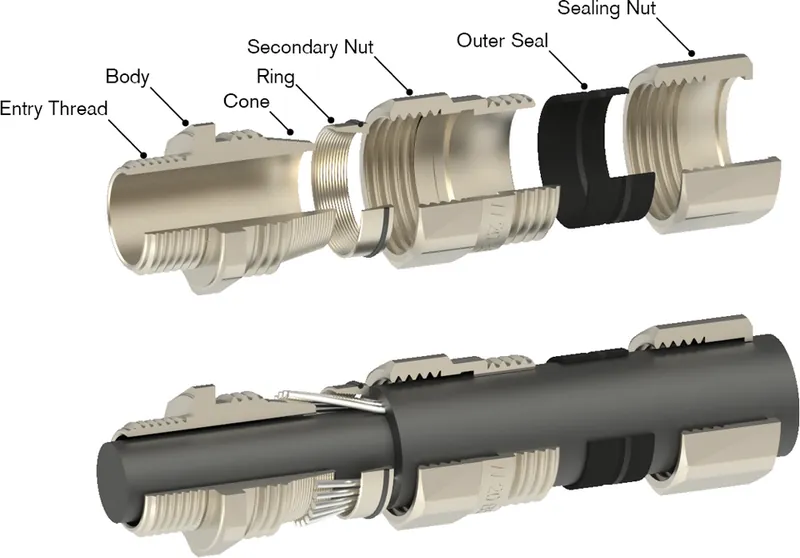
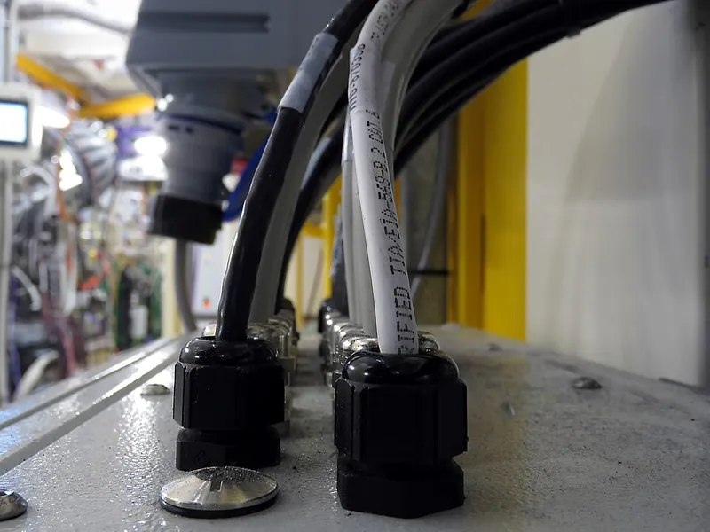

<figure class="eoc-pic eoc-pic-main"><figcaption><strong>Photo.</strong> <a href="https://commons.wikimedia.org/wiki/File:M16_cable_gland.jpg">M16 cable gland</a> by Phiarc, <a href="https://creativecommons.org/licenses/by-sa/4.0">CC BY-SA 4.0</a>, from Wikimedia Commons.</figcaption></figure>
<figure class="eoc-pic"><figcaption><strong>Cross-section.</strong> <a href="https://commons.wikimedia.org/wiki/File:Exploded_CW_Gland_annotated.png">Exploded CW Gland annotated</a> by Andyremel, <a href="https://creativecommons.org/licenses/by-sa/4.0">CC BY-SA 4.0</a>, from Wikimedia Commons.</figcaption></figure>
<figure class="eoc-pic"><figcaption><strong>How it works.</strong> <a href="https://commons.wikimedia.org/wiki/File:Cable_Connectors.jpg">Cable Connectors</a> by Prosthetic Head, <a href="https://creativecommons.org/licenses/by-sa/4.0">CC BY-SA 4.0</a>, from Wikimedia Commons.</figcaption></figure>

A threaded fitting that passes a cable through a wall or enclosure: tightening its dome nut presses a set of plastic fingers and a rubber seal round the cable, which seals the hole against dust and water and anchors the cable so pulling or twisting it doesn't strain the wires inside (strain relief).

**In plain words:** A plastic or metal fitting that screws into a hole in a box; you pass a cable through it and tighten its cap, which squeezes a rubber sleeve round the cable so water can't get in and the cable can't be yanked out. **Proper term:** Cable [gland](../glossary.md#gland) (with cable strain relief; called a cord grip in the US).

**Also called:** cord grip, cable strain relief, cable connector, cable fitting (US names; Wikipedia); cable screw gland, cable screw connection (Lapp product class 'Cable screw gland'); Kabelverschraubung (German); PG gland, PG7 gland (by thread size; PG7 is common on 3D-printer toolheads, Printables); metric gland M12 to M63; NPT gland; liquid-tight cordgrip (Heyco); split cable gland: fits round a cable that already has a plug on it (Wikipedia); armoured cable gland, CW gland (grips steel wire armour; Wikimedia Commons); EMC gland (connects a cable's shield to a metal box; Hummel product category); strain relief bushing, snap-in cordgrip (a one-piece plastic bush that clamps a power cord in a panel hole; Heyco); cable grommet ⚑ [uncertain] (loosely used; a grommet only lines a hole and doesn't grip); wire mesh cord grip (a woven wire sleeve that tightens as it is pulled; Wikipedia, Cable management), Kellems grip (brand) ⚑ [uncertain]; bend relief, cable boot, overmould; SKINTOP (Lapp, brand); HSK (Hummel, brand); Heyco (brand).

## How it works

You push the cable through the gland and turn the domed cap nut; its tapered inside pushes the clamping fingers inwards, and they squeeze the rubber insert evenly round the cable, which both seals the gap and grips the cable (Lapp MS-M: 'insert with lamellar cage' plus sealing ring). The body is sealed to the wall by its own [O-ring](../glossary.md#o-ring) or seal and held by the entry thread or a locknut (Lapp ST-M). Because the cable is gripped at the wall, a pull or twist on the outside is taken by the gland and not by the wire terminals inside; the standard IEC 62444 calls the static version of this 'cable retention' and the pull-and-twist version 'cable anchorage' (IEC 62444 preview). The seal only works if the cable's outside diameter is inside the gland's clamping range (Lapp data sheets).

## Parts

A small assembly that acts as one unit: a body (with an entry thread that screws into a threaded hole or through a hole with a locknut), a sealing insert (rubber such as CR/neoprene or NBR), a clamping cage of plastic fingers (lamellae), a domed cap nut, and often an O-ring or flat seal between the body and the wall (Lapp SKINTOP ST-M and MS-M data sheets; Hummel HSK-K). Variants add reducing or multi-hole inserts, split bodies for pre-terminated cables, armour clamps or EMC contact springs (Wikipedia; Lapp). Simpler strain reliefs are single-piece bushings, cable ties on an anchor, clamps or moulded boots (Wikipedia, Cable management; Heyco).

## Everyday examples

- The grey or black screw-cap fittings where cables enter outdoor junction boxes, lamps and solar boxes (Wikimedia Commons, category Cable glands)
- PG7 glands on 3D printers, where the toolhead cable bundle enters the print head (Printables Voron models)
- The tapered rubber boot where a laptop charger or phone cable leaves its plug (bend relief) ⚑ [uncertain]
- The moulded plastic bush that clamps the mains cord where it enters a power tool or appliance (strain relief bushing; Heyco) ⚑ [uncertain]

## When to use it

Use a cable gland whenever a cable enters a box that must stay sealed against dust and water (outdoor sensors, garden lights, pond pumps, boat electronics, printed enclosures) or where a tug on the cable must never pull on the wires or solder joints inside (robots, power tools, anything with a mains cord). It also neatly finishes the hole so sharp edges can't cut the cable. Pick a split gland when the cable already has a plug on it, and a multi-hole insert when several cables share one hole (Wikipedia; Lapp). Every electrical joint needs strain relief, not only the place where a cable enters a box. NASA's wiring workmanship standard requires that 'wires exiting from connectors shall be stress relieved' (given a formed length of slack, so the terminations aren't strained), that stress relief is provided where harness wires enter connectors ('connector backshells, encapsulation, and stress relief boots'), and that splices 'shall not be located in areas of the cable where flexing may occur' (NASA-STD-8739.4A, sections 7.2.20, 7.2.28 and 7.2.36). So clamp or tie the cable close to every soldered, crimped or screwed joint, so that pulls and bending stop at the clamp instead of at the joint. Inside the box, support the wires too ('to minimize shock and vibration induced stress', section 7.2.29): a neat way is cable lacing, which binds a bundle (loom) with waxed cord or flat lacing tape in running lockstitches plus single spot ties and 'does not create obstructions along the length of the cable' as cable ties do (Wikipedia 'Cable lacing'; NASA-STD-8739.4A chapter 9). An older, tool-free strain relief is the underwriter's knot (electrician's knot, ABOK #237), tied in the two inner wires of a lamp or appliance cord just inside the lamp holder or plug, so that 'strain on the line is taken by the knot and does not affect the connections' (Animated Knots; Wikipedia 'Underwriter's knot'); this entry gives no mains wiring steps.

## When not to use it

For a cable that moves constantly, a gland only fixes the end; add a cable carrier (drag chain) or bend relief for the moving part (Wikipedia, Cable management). For cables you want to unplug, use a panel-mount (bulkhead) connector instead ⚑ [uncertain]. For many pre-terminated cables through one cut-out, use a split cable-entry frame (Wikipedia). A plain rubber grommet (cable grommet; in electrical work an 'insulating bushing') is enough if you only need to protect the cable from the sharp edge of a punched or drilled hole: the commonest are moulded rubber bushings for holes up to about 51 mm (2 in), long or odd-shaped cut-outs get continuous 'grommet edging' instead, and tight rubber grommets also keep out some dirt, air and water (Wikipedia 'Grommet'). A membrane grommet has its hole closed by a thin skin that the cable is pushed through; the torn skin grips the cable and, in one patented design, 'forms a weatherproof seal' (the cable end is first dipped in water as a lubricant, US4460805A); suppliers sell closed membranes and pre-cut cross-cut or slit ones (A.R.T. Components catalogue). In furniture, a two-piece desk grommet (a liner in the hole and a cap with an often adjustable opening, which can be closed off by turning one piece 90°) tidies cables through a desk top (Wikipedia 'Cable grommet'). For flat cables use a flat-cable strain-relief bushing (Heyco lists Lockit bushings for flat cables) or a gland insert made for flat cable ⚑ [uncertain].

## Details

- **What it does (jobs):**
  - seal it, or pass cables or fluid through: seals the hole where a cable enters a box
  - join and hold: anchors the cable so pulls and twists don't reach the wires inside (strain relief)
- **Movement:** none: the cable is clamped
- **Directions it can move (degrees of freedom):** 0: once tightened the cable can't slide or twist in the gland (that is what the strain-relief tests check; IEC 62444)
- **Special behaviour:**
  - none: it simply clamps and seals. Useful variants: split glands that go round a cable that already has its plug fitted (Wikipedia; Wikimedia Commons, KVT split gland), multi-hole inserts for several cables and reducing inserts for thin cables (Lapp STR-M/MSR-M), and glands with a built-in bend protector that stops the cable kinking where it leaves (Wikimedia Commons)
- **How it holds:**
  - friction or clamping ([force-fit](../glossary.md#form-fit--force-fit--material-bond)): the rubber insert squeezed by the fingers grips the cable
  - shape (the parts interlock; form-fit): the entry thread or locknut holds the gland in the wall
- **Input and output:** not applicable: it passes a cable, not motion
- **Power:** passive (no power needed)
- **Load:** light to medium: rated for holding a cable against pulls and twists, not for carrying a structure. Glands are tested for cable retention (static pull) and anchorage (pull and twist) with forces that depend on cable diameter (IEC 62444, Table 2; values not seen); Lapp MS-M is rated strain relief 'Category A' to DIN EN 62444. Strongest against pull along the cable; the body is weakest against impact and side loads, which IEC 62444 also tests. Printed glands are weaker; their fingers can break if clamped too far (Printables 114283).
- **Play and precision:** not applicable
- **Taking it apart:** removable: loosen the cap nut to free the cable, unscrew the body or locknut to remove the gland
- **How often it can be reused:** many times for bought glands ⚑ [uncertain]; a few times for printed glands, whose clamping fingers can crack if over-tightened (Printables 114283: 'it wont be reusable that often as bought ones')
- **Sealing:** watertight: the squeezed rubber insert seals round the cable and an O-ring or seal seals the body to the wall. Industrial plastic glands are rated IP68 (for example 5 bar for 30 min, Lapp ST-M; 10 bar for 30 min with an extra O-ring, Hummel HSK-K) and IP69 against hot high-pressure washdown (Lapp). The rating only holds with a round cable inside the clamping range and the right tightening [torque](../glossary.md#torque) (Lapp). Plain strain-relief bushings and grommets range from none to dust-resistant ⚑ [uncertain]; 'liquid tight' versions exist (Heyco)
- **Adjustable:** yes: tightening the cap nut sets the grip within the clamping range; reducing inserts adapt a gland to thinner cables (Lapp STR-M, MSR-M)
- **Access needed:** both sides: the body goes through the wall and a locknut is fitted inside (Lapp: counter nut SKINTOP GMP-GL-M), unless the wall has a threaded hole, when you only need the outside (one side only). The cable itself must be threaded through before its ends are terminated, unless you use a split gland (Wikipedia)
- **Materials:** Bodies: polyamide (nylon, PA6) for most plastic glands, nickel-plated brass, stainless steel or aluminium for industrial use (Wikipedia; Lapp; Wikimedia Commons M16 nylon gland). Seals: CR (neoprene) or NBR rubber; inserts in PA (Lapp ST-M, MS-M; Hummel HSK-K). Cable sheaths of PVC, PUR or rubber; very soft insulation needs lower tightening torque (Lapp T21). Printed glands: PETG and 'soft PLA' worked better than ABS for the flexing fingers (Printables 114283); TPU for seals and O-rings with PLA+, ASA, PETG or PA rigid parts, and 'normal PLA is not recommended' for the clamping fingers (Printables 1389492); 95A TPU for printed strain-relief boots (Printables 1474155).
- **Heat, cold, water and wear:** Nylon glands: Lapp SKINTOP ST-M is rated -40 to +100 °C when fixed and -20 to +100 °C when the cable moves; Hummel HSK-K -40 to +100 °C; brass Lapp MS-M -40 to +100 °C static and -25 to +100 °C dynamic (manufacturers' data). Choose black glands for sunlight: Lapp marks the black version of its ST-M as UV-resistant. IEC 62444 tests plastic glands after 168 h in an oven at 70 °C (IEC 62444 preview), and IP69 versions withstand hot high-pressure cleaning (Lapp). Printed glands: PLA gives at about 60 °C, PETG about 80 °C, ASA about 110 °C (CNC Kitchen). Rubber seals may take a set over the years, so re-check tightness after heat cycles ⚑ [uncertain].

## Making it

- **Ways to make or get it:**
  - off-the-shelf part: nylon, brass and stainless glands in metric, PG and NPT sizes; strain-relief bushings; cord grips; cable entry frames
  - 3D print (FDM): printed glands and PG7-size copies, threaded holes or [bosses](../glossary.md#boss) for bought glands, TPU seals and bend reliefs, moulds for hot-glue overmoulded strain relief
  - sheet metal: punched or drilled [clearance](../glossary.md#clearance) holes in metal boxes
  - CNC: drilled or tapped entry holes in plastic or aluminium enclosures ⚑ [uncertain]
- **Printing it in one piece (print in place):** no: a gland is printed as separate parts (body, clamping cage or insert, cap nut, and usually a TPU seal) and screwed together round the cable (Printables 114283; Printables 1389492)
- **Tools:** Spanners (wrenches) for the cap nut and locknut (Lapp lists a wrench size per gland; M20 ST-M is 25 mm across flats), ideally a torque tool for rated IP sealing (Lapp T21 torques); a step drill, hole punch or hole saw for the clearance hole; cable strippers. Snap-in strain-relief bushings need special assembly pliers for some types and none for snap-in types (Heyco). Printed glands: none beyond hand tightening.
- **Difficulty:** easy: buy a nylon gland and drill a round hole (or print a threaded hole) for it; moderate to print a working gland yourself (fine threads, thin flexing fingers and a TPU seal)

### 3D printing tips

1) Easiest route: print the enclosure with a plain clearance hole and fit a bought gland with its locknut and O-ring; the metric clearance hole is the thread size +0 to +0.2 mm, e.g. 20.0-20.2 mm for M20 (Lapp T21; IEC 62444 Table 1). Make the hole a little larger in the model to allow for the printed hole shrinking ⚑ [uncertain], and give the O-ring a flat, smooth face: print that face against the bed or iron it, because parts touching rubber seals should be as smooth as possible (Prusa blog, Watertight 3D printing part 2). 2) Printed thread instead of a locknut: M12x1.5 to M20x1.5 threads print, but warp-prone materials such as ABS can distort the small thread (Printables 1117046 recommends a brim and notes Polymaker ABS warped on the M12 thread). 3) Printing a whole gland: PETG or 'soft PLA' worked better than ABS for the flexing fingers; use 0.1-0.15 mm layers for small threads and 2-3 [perimeters](../glossary.md#perimeters) filling the thin walls (Printables 114283). Normal PLA is too stiff for the clamping fingers; use TPU for the seal and O-ring (Printables 1389492). 4) Don't over-tighten printed fingers: they can snap, and the gland then won't be reusable (Printables 114283). 5) Sizing a printed gland: in one design the wall hole is always the cable channel D + 5 mm and the thread length is the wall thickness + 6 mm (5 mm nut + 1 mm) (Printables 114283). 6) TPU strain-relief boot: 95A TPU, one perimeter, little [infill](../glossary.md#infill), bore 1 mm smaller than the cable (Printables 1474155). 7) Printed gaskets between two printed surfaces didn't seal in Prusa's tests; O-rings with silicone grease were the reliable choice (Prusa blog, Watertight 3D printing part 2). 8) Hot-glue overmould: print a two-part mould in PETG (to survive hot glue), coat it with a release agent such as silicone or vegetable oil, and cast hot glue round the cable and connector for a moulded strain relief (Hackaday, 2020 and 2024). 9) Don't use printed glands where mains wiring or an inspected installation needs certified parts (Printables 1389492).

### Buying one (off-the-shelf parts)

Search for: 'cable gland M20x1.5' (and M12, M16, M25 ...), 'PG7 cable gland', 'nylon cable gland IP68', 'brass cable gland', 'cable gland locknut' (Lapp calls it a counter nut), 'cable gland O-ring' or 'sealing washer', 'reducing seal insert', 'multi-hole seal insert', 'split cable gland' (for cables with plugs), 'EMC cable gland', 'armoured cable gland', 'blanking plug', 'breather' or 'vent plug' (pressure equalisation; Heyco), 'liquid tight cordgrip' (US, NPT threads), 'strain relief bushing' or 'snap-in cordgrip' (Heyco), 'wire mesh cord grip', 'cable entry frame' or 'cable entry plate' (for pre-terminated cables), 'strain relief plate' or 'strain relief comb' used with cable ties (Wikipedia, Cable management), 'P-clip' and 'adhesive cable tie mount' ⚑ [uncertain]. Grommets: 'rubber grommet' or 'insulating bushing' for round holes, 'grommet edging' or 'grommet strip' for long or odd cut-outs (Wikipedia 'Grommet'), 'membrane grommet' (closed, or cross-cut or slit) (A.R.T. Components catalogue), 'desk grommet' or 'cable grommet' for furniture (Wikipedia 'Cable grommet'); for looms, 'lacing tape' or 'lacing cord' (Wikipedia 'Cable lacing').

## Rules of thumb

- Choose the gland by the cable's outside diameter, which must fall inside the clamping range, e.g. Lapp SKINTOP ST-M: M12 3.5-7 mm, M16 4.5-10 mm, M20 7-13 mm, M25 8-17 mm, M32 11-21 mm; reducing-insert versions take thinner cable (Lapp SKINTOP ST-M catalogue page; MSR-M M20: 5-10 mm, Lapp MS-M data sheet).
- Clearance holes for metric entry threads (EN 60423): M12 12.0, M16 16.0, M20 20.0, M25 25.0 mm, each +0.2 mm; M32 and M40 +0.3 mm (Lapp Technical Table T21; IEC 62444 Table 1). PG threads: PG7 12.8, PG9 15.5, PG11 18.9, PG13.5 20.7 mm (each -0.2 mm) (Lapp T21).
- Recommended tightening torques for plastic SKINTOP metric glands: M12 1.5 N·m, M16 3.0, M20 6.0, M25 8.0, M32 10.0 N·m; metal glands higher (M20 12 N·m). Use lower torques on soft cable insulation or it may be damaged (Lapp T21).
- Wall space: allow room for the hexagon; Lapp gives the across-corners diameter, e.g. 28.3 mm for a 25 mm hexagon (M20 ST-M) (Lapp T21 and ST-M table).
- An IP68 rating on a gland is tied to a test pressure and time, e.g. IP68 5 bar/30 min for plastic SKINTOP ST-M and 10 bar/30 min for brass MS-M M12 to M50 (Lapp); IP67 in the IP code means immersion in 1 m of fresh water for up to 30 min (Wikipedia, IP code).
- Strain relief placement: for PROFINET cables, strain relief is recommended about 1 m (3.5 ft) from the connection point (Wikipedia, Cable management).
- Printed gland (Printables 114283): hole in the wall = cable channel D + 5 mm; thread length = wall thickness + 6 mm.
- Printed TPU strain relief: bore about 1 mm smaller than the cable (Printables 1474155).
- Bend radius for finished cables and harnesses: a bundle of AWG 10 or thinner wires (no coax) should bend no tighter than 3 times its outside diameter, ideally 10 times; a single [coaxial](../glossary.md#coaxial) cable no tighter than 6 times, ideally 10 times; polyimide (Kapton) insulated wire 10 times, ideally 15 times (NASA-STD-8739.4A, Table 7-1, https://nepp.nasa.gov/files/27631/nstd87394a.pdf).
- Keep splices out of places where the cable flexes or bends tightly, and at least two harness diameters from where a branch leaves the bundle (NASA-STD-8739.4A, sections 7.2.36 and 7.2.37).

## Common failures

Leaks because the cable is too thin for the gland (the seal can't close), the cable isn't round, or the O-ring or seal under the body is missing; choose a gland whose clamping range includes the cable (Lapp). Crushed insulation or split seals from over-tightening; follow the torque table (Lapp T21). Printed glands: fingers snap when clamped too far (Printables 114283), small threads warp in ABS (Printables 1117046), and printed gaskets don't seal (Prusa blog). Cable breaks just outside the gland where it bends repeatedly: add a bend relief (Wikimedia Commons, glands with bend protection) or clamp the cable further along. Loosening from vibration: Lapp advertises 'permanent vibration protection', a sign that cheap glands can back off ⚑ [uncertain].

## Safety

For mains voltage use certified glands and follow wiring rules; a printed gland isn't a certified electrical component and has no fire rating (Printables 1389492). Good strain relief is a safety feature: without it a pulled cable can tear conductors out of their terminals, leaving live wires loose inside a box ⚑ [uncertain]. Over-tightening can crush and damage cable insulation (Lapp T21). Metal glands on armoured or shielded cable may be part of the earthing (grounding) path (Wikipedia). Mains work must follow local law (in England, Approved Document P requires 'reasonable provision' in the design and installation of electrical installations 'to protect persons operating, maintaining or altering the installations from fire or injury'); this entry gives no mains wiring steps.

## Related

- Rubber grommet (cable grommet, insulating bushing): lines a hole to protect the cable from the sharp edge but doesn't anchor it; membrane grommets also grip and seal (Wikipedia 'Grommet'; US4460805A)
- Strain-relief bushing (snap-in cordgrip): a one-piece plastic bush squeezed onto a cord and snapped into a panel hole; cheaper, often not sealed (Heyco)
- Wire mesh cord grip: a woven wire sleeve that tightens as the cable is pulled (Wikipedia, Cable management)
- Cable tie on a strain-relief plate or tie mount: cheap strain relief with no sealing (Wikipedia, Cable management)
- Overmoulded boot or bend relief: moulded rubber or hot glue round the cable where it leaves a plug (Hackaday)
- Panel-mount (bulkhead) connector: seals and lets you unplug the cable ⚑ [uncertain]
- Cable carrier (drag chain): guides a moving cable along an axis; glands or strain-relief plates fix its ends (Wikipedia, Cable management)
- Hose barb: the equivalent for joining a soft tube to a fitting
- O-ring seal and gasket: seal the lid or the gland body to the box
- Push-on edge trim: grommet edging, a continuous rubber or plastic strip that lines long or odd-shaped cut-outs where a round grommet won't fit (Wikipedia 'Grommet')
- Heat-shrink tubing: covers and protects a joint; NASA also uses it to build up a thin wire so a connector's sealing grommet grips it (NASA-STD-8739.4A)
- Soldered wire joint: a joint that needs strain relief close by; keep it out of places where the cable flexes (NASA-STD-8739.4A section 7.2.36)
- Crimp terminals: many have an insulation crimp (integral strain relief) that grips the wire's insulation as well as its conductor (NASA-STD-8739.4A)
- Binding knots and seizings: includes cable lacing, which ties a wire bundle into a neat loom with lacing cord or tape (Wikipedia 'Cable lacing')
- Stopper knots and cord-end anchors: the underwriter's knot (ABOK #237) is a stopper knot that takes the pull off the terminals inside a lamp holder or plug (Wikipedia 'Underwriter's knot')

## Make it yourself

- [Cable gland "all sizes" (93djen, Printables; URL from search results, details read through the Printables API)](https://www.printables.com/model/114283-cable-gland-all-sizes): 300+ ready-made STL sizes of a printable gland with clamping fingers and cap nut, with tested clamping reductions (e.g. D8 closes to 6.3 mm) and print settings *(licence: CC0 (Public Domain))*
- [Waterproof Cable Gland (theartfulbadger, Printables; URL from search results, details read through the Printables API)](https://www.printables.com/model/1389492-waterproof-cable-gland): A printable waterproof gland with a TPU compression sleeve and TPU seal, STEP file and a parametric Fusion 360 file (cable_OD, printer_tolerance, knockout diameter) *(licence: CC0 (Public Domain))*
- [Parametric TPU cable gland strain relief (Bene, Printables; URL from search results, details read through the Printables API)](https://www.printables.com/model/1474155-parametric-tpu-cable-gland-strain-relief): A TPU bend-relief boot that fits onto a printed gland; bore 1 mm smaller than the cable *(licence: CC0 (Public Domain))*
- [Cable Gland - split-able - customizable (Mark, Printables) (URL from Printables API, page not opened)](https://www.printables.com/model/608533-cable-gland-split-able-customizable): A split gland that fits round a cable with a plug already on it, with an O-ring groove and a parametric Fusion 360 file *(licence: CC BY)*
- [Cheap Strain Relief By Casting Hot Glue In A 3D Print (Hackaday, 2020)](https://hackaday.com/2020/02/11/cheap-strain-relief-by-casting-hot-glue-in-a-3d-print/): Printed PETG moulds for casting hot-glue strain relief round JST-XH connectors, with a video *(licence: link only)*

## Pictures, videos and models

- [File:Exploded CW Gland annotated.png (Wikimedia Commons)](https://commons.wikimedia.org/wiki/File:Exploded_CW_Gland_annotated.png): Exploded, labelled view of the parts of a CW-type steel-wire-armour cable gland *(licence: CC BY-SA 4.0 (Andyremel))*
- [File:M16 cable gland.jpg (Wikimedia Commons)](https://commons.wikimedia.org/wiki/File:M16_cable_gland.jpg): A metric polyamide (nylon) cable gland with M16x1.5 thread *(licence: CC BY-SA 4.0 (Phiarc))*
- [File:Cable glands with bend protection.jpg (Wikimedia Commons)](https://commons.wikimedia.org/wiki/File:Cable_glands_with_bend_protection.jpg): M16 and M12 cable glands with built-in bend protection sleeves *(licence: CC BY-SA 4.0 (Phiarc))*
- [Thread and hole dimensions / Tightening torques for cable glands (Lapp Technical Table T21)](https://t3.lappcdn.com/fileadmin/catalog/en_T_pdf/T21_Thread_dimensions_for_cable_glands_int.pdf): Drawings and tables of entry threads, clearance holes, tightening torques and hexagon clearances *(licence: link only)*
- [Fast fitting IP68 Cable Gland - no need for a locknut - Hylec KWIK FIX (YouTube, eFIXX; title confirmed through YouTube oEmbed, video not watched)](https://www.youtube.com/watch?v=v4E1c1ere5U): An electrician's demonstration of fitting an IP68 cable gland (a branded quick-fit type) *(licence: link only (standard YouTube licence))*

## Needs confirming

⚑ marks something nobody has confirmed yet: a fact the research could not confirm from a source, a finder value that is a best guess, or an open point from the research notes. Corrections are welcome (see `research/needs-confirming.md`).

- ⚑ 15 sentences on this page marked [uncertain].
- ⚑ Finder value `reuse_cycles` = many times (source uncertain): `reuse_cycles` is marked ⚑ [uncertain] here: "many times for bought glands ⚑ [uncertain];…"
- ⚑ Finder value `connects` = any solid parts (best guess): joins parts, but no specific kind of part found; set to any solid parts
- ⚑ Research note: **For a later pass:** *Slip ring and rotary union* (135) and *Genderless connector* (286) are tagged with the electrical family, but their `load` doesn't start with the fixed electrical lead-in. *Anti-twister mechanism* (291) still lists `materials` in `uncertain` without a marker (noted earlier). The underwriter's knot in *Cable gland and strain relief* (134) is described without tying steps, under the mains rule.

## Sources

- <https://en.wikipedia.org/wiki/Cable_gland>
- <https://en.wikipedia.org/wiki/Cable_management>
- <https://en.wikipedia.org/wiki/IP_code>
- <https://cdn.standards.iteh.ai/samples/14734/1c08c28add8e42c081d15fd1d239ae8e/IEC-62444-2010.pdf>
- <https://www.lapptannehill.com/media/datasheet/LAPP/SKINTOP/SKINTOP-ST-M-ST-R-M.pdf>
- <https://products.lappgroup.com/fileadmin/documents/technische_doku/datenblaetter/skintop/DB53112000EN.pdf>
- <https://t3.lappcdn.com/fileadmin/catalog/en_T_pdf/T21_Thread_dimensions_for_cable_glands_int.pdf>
- <https://www.hummel.com/en/cable-glands/products/plastic-cable-glands/hsk-k/>
- <https://www.heyco.com/products/strain-relief-bushings/>
- <https://blog.prusa3d.com/watertight-3d-printing-part-2_53638/>
- <https://www.cnckitchen.com/blog/comparing-pla-petg-amp-asa-feat-prusament>
- <https://hackaday.com/2020/02/11/cheap-strain-relief-by-casting-hot-glue-in-a-3d-print/>
- <https://hackaday.com/2024/08/02/over-molding-wires-with-hot-glue-and-3d-printed-molds/>
- <https://commons.wikimedia.org/wiki/Category:Cable_glands>
- <https://commons.wikimedia.org/wiki/File:Exploded_CW_Gland_annotated.png>
- <https://commons.wikimedia.org/wiki/File:M16_cable_gland.jpg>
- <https://commons.wikimedia.org/wiki/File:Cable_glands_with_bend_protection.jpg>
- <https://commons.wikimedia.org/wiki/File:KVT_Teilbare_Kabelverschraubung.jpg>
- <https://www.youtube.com/watch?v=v4E1c1ere5U>
- <https://api.printables.com/graphql/>
- <https://nepp.nasa.gov/files/27631/nstd87394a.pdf>
- <https://en.wikipedia.org/wiki/Grommet>
- <https://en.wikipedia.org/wiki/Cable_grommet>
- <https://patents.google.com/patent/US4460805 (read via WebFetch: Google Patents blocked direct download)>
- <https://www.artcomponents.com/en/cable-fastening-protection/membrane-grommets/closed-membrane-grommets/22169/dt-m-13520/2420t-rubber-membrane-grommet-with-closed-membrane-tpe-black>
- <https://www.animatedknots.com/underwriters-knot>
- <https://en.wikipedia.org/wiki/Underwriter%27s_knot>
- <https://en.wikipedia.org/wiki/Cable_lacing>
- <https://assets.publishing.service.gov.uk/government/uploads/system/uploads/attachment_data/file/441872/BR_PDF_AD_P_2013.pdf>
