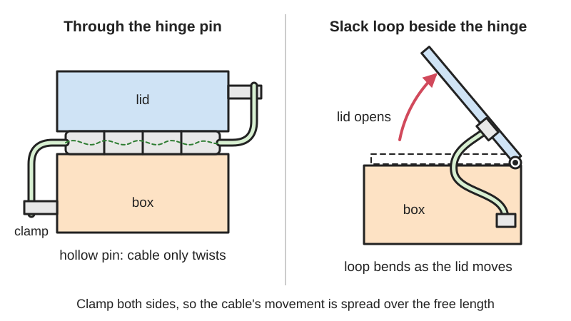
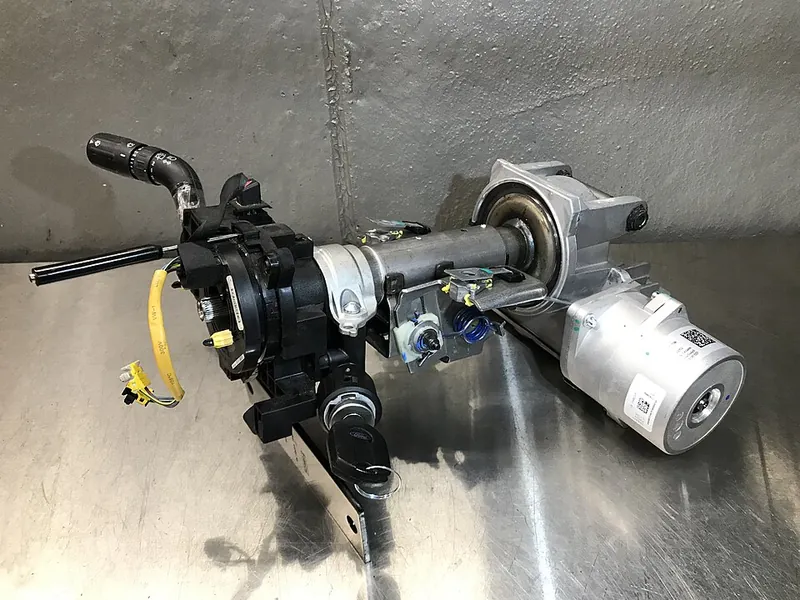
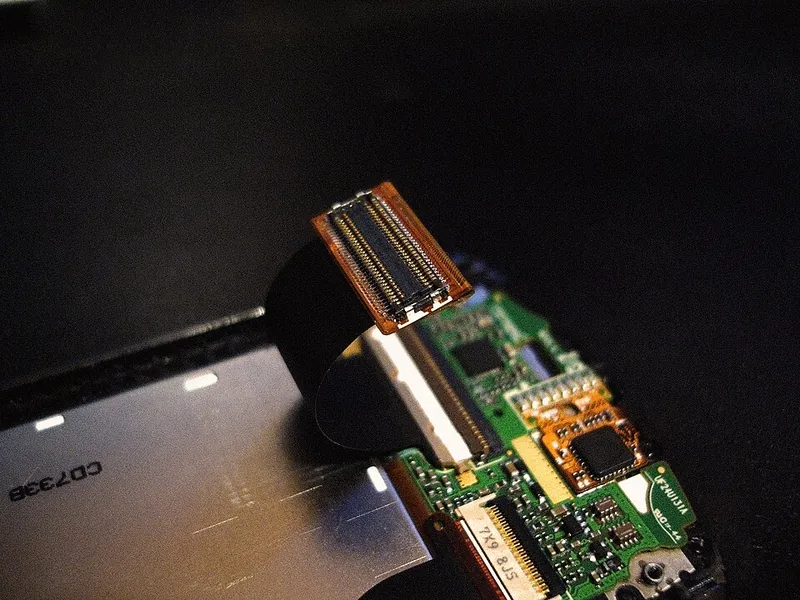

<figure class="eoc-pic eoc-pic-main"><picture><source media="(prefers-reduced-motion: reduce)" srcset="../media/drawn/cable-through-a-hinge.svg"></picture><figcaption><strong>Animation.</strong> Diagram drawn for the encyclopaedia from the research notes. ⚑ Needs confirming: a drawing can simplify or get details wrong; a real photo or a better diagram is welcome.</figcaption></figure>
<figure class="eoc-pic"><figcaption><strong>How it works.</strong> <a href="https://www.flickr.com/photos/43851301@N02/47156217491">Top_Case</a> by tony_duell, <a href="https://creativecommons.org/licenses/by/2.0/">CC BY 2.0</a>, from Flickr via Openverse.</figcaption></figure>
<figure class="eoc-pic"><figcaption><strong>Photo.</strong> <a href="https://commons.wikimedia.org/wiki/File:Samsung_SGH-U700_FFC.jpg">Samsung SGH-U700 FFC</a> by RobbertS, Public domain, from Wikimedia Commons.</figcaption></figure>

A planned route for wires, flat cables or tubes across a hinge or a joint that turns less than a full turn (or a few turns), either through a hollow pin or shaft on the turning axis so the cable only twists, or as a loose loop or wound flat cable that rolls instead of kinking, with clamps on each side so the flexing happens only where it is designed to.

**In plain words:** Ways to get wires, a flat ribbon cable or a thin tube across a hinge or a turning joint so they don't get pinched, pulled tight or worn through as it opens and closes: through a hollow hinge pin, along the line the joint turns about, or in a loose loop or rolled-up flat cable. **Proper term:** Cable through a hinge (hollow hinge pin or hollow shaft, cable on the pivot axis, service loop, wrapped flat cable or clockspring).

**Also called:** hollow-shaft hinge / hollow-axis friction hinge (e.g. Reell HTH60, brand); wire-passable hinge (laptop hinges, patent US12222773B2); electric hinge / electrified hinge / power transfer hinge (doors with electric locks); power transfer device, door loop, armoured door cord (doors); service loop (spare cable left in a loop at a moving joint); clockspring / clock spring / spiral cable / contact reel (car steering wheels); flex cable across a hinge: FFC (flat flexible cable) or FPC (flexible printed circuit); hollow-shaft [actuator](../glossary.md#actuator) / through-bore joint (robot joints); [torsion](../glossary.md#torsion) cable / twistable robot cable (cables rated for twisting).

## How it works

Every time the joint moves, a cable crossing it has to change shape, so the design decides what kind of change it gets and spreads that change over a length of cable. Run along the turning axis, through a hollow pin or shaft, the cable only twists, and the twist is shared out over the free length between the two clamps. Away from the axis it must bend, so it is given a loose loop (service loop) long enough for full travel, clamped so the loop can't be pinched, or a flat cable is wrapped round the hinge or wound in a spiral drum (clockspring) so it winds and unwinds rather than kinking. The clamps on each side keep all of this movement away from the solder joints and connectors.

## Parts

A few parts: the hinge or pivot (with a hollow pin, hollow shaft or room beside it), the cable or tube, and a clamp or strain relief on each side of the joint; sometimes a protective sleeve, grommet or cover, a drum or cassette for a wound flat cable (clockspring), and connectors that are fitted after the cable has been threaded through.

## Everyday examples

- the display cables passing through or beside a laptop's hinges (patent US12222773B2 background)
- the clockspring behind a car's steering wheel, which keeps the airbag, horn and other devices in the wheel connected while it turns (Wikipedia 'Clockspring')
- electric door hinges that carry wires to an electric lock or card reader in the door (Locksmith Ledger)
- the flat flexible cable joining the two halves of a folding or sliding mobile phone (Wikipedia 'Flexible electronics'; Commons photo of a Samsung SGH-U700)

## When to use it

Whenever wires, a ribbon cable or a thin tube must reach something on the moving side of a hinge or pivot that turns less than a full turn, or only a few turns: a lid with lights, a sensor or a screen on it, a flip-up display, a robot elbow, wrist or neck, a pan-tilt camera head, a door with an electric lock, a lamp arm. Choose a hollow pin or shaft when the cable can run along the axis (neatest, hidden, least bending); a service loop when it can't and there is room for slack; a wrapped or wound flat cable (clockspring) when many signals must cross a joint that turns more than half a turn.

## When not to use it

For endless turning, use a slip ring, a rotary union for fluids, or an anti-twister; a cable joint with no end stops will wind itself up and break, so fit a multi-turn rotation limiter if a loop or clockspring is used near its limit. For long straight-line travel, use a cable carrier (drag chain). For a cable through a fixed wall, use a cable [gland](../glossary.md#gland). Don't run mains wiring through a home-made hinge or pivot; mains work must follow local law (for example England's Approved Document P) and use certified parts. Where a connector must be swapped often, a hollow pin that needs re-threading is a poor choice; use a door-loop-style flexible conduit or an external loop with connectors.

## Details

- **What it does (jobs):**
  - seal it, or pass cables or fluid through: carries wires, a flat cable or a small tube across a moving joint
  - let it move (turn, slide or bend): the hinge keeps its full swing while the cable follows
- **Movement:** rotate: usually less than one full turn for hollow pins and service loops (Reell's hollow-shaft hinges allow 360°); a few turns for a clockspring (a typical car clockspring turns about five turns end to end); for endless turning use a slip ring instead
- **Directions it can move (degrees of freedom):** 1: the hinge's own turning; the cable has no freedom of its own but must twist or bend to follow
- **Special behaviour:**
  - none: it is a way of routing cables, not a mechanism with its own behaviour; a hollow-shaft friction hinge also holds its angle (see Friction hinge)
- **How it holds:** not a holding joint (it passes cables across a joint that moves); the cable itself is held at each side by friction or clamping ([force-fit](../glossary.md#form-fit--force-fit--material-bond)) in strain-relief clamps or ties
- **Input and output:** not applicable
- **Power:** passive (no power needed; it carries power or signals but needs none to work)
- **Load:** Electrical: up to about 3 A, extra-low voltage only for home-made hinges and joints (the limit is set by the thin, flexible wire that fits through the joint; commercial electric door hinges carry two 18 or 20 AWG wires at up to 3.5 to 5 A at 24 V DC, Locksmith Ledger). Mechanical: the cable must carry no load at all; the hinge carries it. A hollow pin or drilled knuckle is weaker than a solid one: an electric door hinge must never be the top or bottom hinge, because drilling it means it no longer meets its load rating (Locksmith Ledger). Reell's hollow-shaft friction hinges give up to 11.5 N·m of holding [torque](../glossary.md#torque).
- **Play and precision:** not applicable (it does not locate parts or pass motion on); the hinge keeps whatever play it had
- **Taking it apart:** removable but fiddly: wires threaded through a hollow pin or shaft must be pulled back out, or have their connectors cut off, to take it apart; the leaves of an electric door hinge 'must not be separated' or the wires break (Locksmith Ledger)
- **How often it can be reused:** a few times (each re-threading risks damaging the wires); the joint itself can swing many times if the cable's flex or twist rating is respected
- **Sealing:** none: it routes the cable but does not seal it; outdoors, leave a drip loop so water runs off before reaching a connector (Lectromec, quoting FAA AC 25.1701), and use a cable gland or grommet where the cable enters a housing
- **Adjustable:** partly: the loop length and clamp positions can be changed after assembly; a clockspring must be centred when it is fitted
- **Access needed:** end of a tube or shaft: wires are pushed through the hollow pin or shaft from one end, often before connectors are fitted ('Thread it first, join it second', humanoid.guide); a service loop needs both sides of the joint to fit its clamps
- **Materials:** Cables: fine-stranded copper wire (silicone insulation is 'super-flexible' and rated to 200 °C, Adafruit), torsion-rated robot cable, flat flexible cable (FFC) or flexible printed circuits (polyimide or PET film with thin, preferably rolled-annealed, copper). Hollow pins: brass, aluminium or steel tube ⚑ [uncertain: general practice], or a bought hollow-shaft hinge (zinc, Reell). Printed knuckles in PETG or PLA. Clockspring cassettes are plastic with a wound flat cable. Fluids: small flexible tubing can pass through a hollow shaft (Reell lists 'tubing').
- **Heat, cold, water and wear:** Vibration speeds up copper [fatigue](../glossary.md#fatigue) in flexing cables and flex circuits, even at small amplitudes (Fjelstad). Water can run along a cable into a connector, so leave a drip loop below it (Lectromec). Heat: silicone-insulated wire is rated to 200 °C (Adafruit); printed hinge parts soften long before that ⚑ [uncertain: no figure opened]. Cold stiffens ordinary PVC insulation and makes it more likely to crack when flexed ⚑ [uncertain: no source opened]. Cables gradually weaken with every cycle (fatigue), so flex life, not age, usually decides when they fail.

## Making it

- **Ways to make or get it:**
  - 3D print (FDM): hinge knuckles or robot joints with a bore or cable channel, and clamps for strain relief
  - off-the-shelf part: hollow-shaft friction hinges, electric (power transfer) hinges, door loops, clocksprings, FFC and FPC cables, torsion-rated cables, rotary cable carriers
  - CNC or lathe: a metal tube as the hollow pin, or through-bored shafts
  - woodwork: boxes and lids with a drilled hinge or a cable loop beside it ⚑ [uncertain: no example opened]
- **Printing it in one piece (print in place):** partly: a printed hinge can include a hollow core or a cable channel, but the cable is always threaded in afterwards ⚑ [uncertain: no tested printed example opened]
- **Tools:** wire strippers and a crimp tool or soldering iron (wires are often joined after threading), heat-shrink tube, cable ties or clamps, a screwdriver, and a drill if the hinge pin or knuckles must be bored
- **Difficulty:** moderate: printing or drilling a hinge with a hole through it is easy, but making it last needs the right wire, clamps on both sides and enough free length; buy a hollow-shaft hinge or a clockspring for anything that must survive thousands of cycles

### 3D printing tips

Put the cable on the turning axis whenever you can: then it only twists, while just 30 mm off the axis every swing also bends, stretches and drags it (humanoid.guide). Make the hinge pin hollow, for example by printing knuckles around a metal tube used as the pin ⚑ [uncertain: general practice], or design the knuckles with a large bore; the BOSL2 OpenSCAD hinge module lets you set the knuckle and pin-hole diameters. Size the bore for the wires, not the connectors, and thread the wires through before crimping or soldering ('Thread it first, join it second', humanoid.guide). Round off or [chamfer](../glossary.md#chamfer--fillet) the ends of the bore and any slot where the wire leaves it, so sharp printed edges can't cut the insulation ⚑ [uncertain: general practice]. Clamp the cable firmly on both sides of the joint so the free length between clamps is deliberate, then check the twist: degrees of swing divided by free length must stay within the cable's torsion rating (humanoid.guide; igus). Use fine-stranded wire, never solid-core, for anything that moves (SparkFun); silicone-insulated wire is the supple choice (Adafruit). If the cable can't go on the axis, leave a loop long enough for the full swing without tension and add clamp points so the slack can't be pinched when the lid closes (Lectromec, quoting FAA AC 25.1701). Wrap a flat cable round the hinge in a large, smooth curve, never a crease, and don't let all the bending happen at one spot (Fjelstad). Flex it many times while watching a meter for flickering connections before you close the case ⚑ [uncertain: general practice].

### Buying one (off-the-shelf parts)

Search terms: 'hollow shaft friction hinge' or 'hollow shaft hinge' (Reell HTH60, brand; 5 mm and 18 mm bores), 'electric hinge', 'electrified hinge' or 'power transfer hinge' and 'door loop' or 'armored door cord' (door hardware), 'clock spring' or 'spiral cable' (car steering wheels), 'FFC cable' with 'ZIF connector', 'flexible printed circuit', 'torsion cable' or 'robot cable' (e.g. chainflex ROBOT, igus brand), 'high flex' or 'silicone stranded wire', 'rotary energy chain' (e.g. twisterband, igus brand, for many turns), 'hollow shaft actuator' or 'through-bore' robot joints, 'slip ring' (for endless turning), plus grommets, cable ties, spiral wrap and braided sleeving.

## Rules of thumb

- Keep the cable on the axis: on the axis it only twists; 30 mm off the axis it also bends, stretches and drags at every swing (humanoid.guide, https://humanoid.guide/hollow-shaft-cable-routing-humanoid-joints/).
- Twist per metre = swing angle / free length between the clamps; keep it inside the cable's rating. Example: a joint swinging ±135° with 0.3 m of free cable loads it at ±450° per metre, beyond a ±360°/m rating; 0.375 m brings it back inside (humanoid.guide, as above). igus tests its ROBOT cables at ±180° over a 1 m clamp distance for at least 3 million cycles, and approves its standard unshielded CF5, CF77.UL.D and CF9 control cables for ±90° per 1 m (igus, https://www.igus.ca/cables/unharnessed-cables-robot-cable-overview).
- Slack: a harness across moving parts should 'have sufficient length to allow for full travel without tension', and may need extra clamp points so the slack isn't 'pinched when the equipment is retracted or closed' (Lectromec, quoting FAA AC 25.1701, https://lectromec.com/blog/in-aircraft-wire-systems-how-much-slack-should-i-give-a-wire/).
- Flat flexible circuits that bend in use: follow dynamic, not static, bend-radius rules; a bend radius of 100 times the copper thickness or more has been suggested for high-cycle use; use one copper layer through the bend, rolled-annealed copper, no creases, and don't concentrate all bending at one hinge point (Joe Fjelstad, I-Connect007, https://iconnect007.com/article/149506/flexible-thinking-designing-flex-circuits-for-dynamic-reliability/149503/pcb). Single-sided circuits 'are ideal for dynamic or high-flex applications' (Wikipedia 'Flexible electronics', https://en.wikipedia.org/wiki/Flexible_electronics).
- Clocksprings must be centred: count the turns from one end stop to the other (in most cars about five) and set it at half that, or the ribbon over-stretches and breaks at full lock (YouCanic, https://www.youcanic.com/properly-set-a-new-clock-spring/).
- Electric door hinges: the roughly 2 mm hole drilled through the leaf takes one 18 or 20 AWG wire or up to four 28 AWG wires; fit it as the centre hinge (second from the top on four-hinge doors), never at the top or bottom (Locksmith Ledger, https://www.locksmithledger.com/door-hardware/article/11176020/electrifying-door-mounted-locks-contacts-and-switches-with-power-transfer-devices).
- Use stranded wire where the wire moves, as in a robot arm; solid wire is for parts that don't move (SparkFun, https://learn.sparkfun.com/tutorials/working-with-wire/all).

## Common failures

(1) The cable breaks inside at the clamp or where it leaves the bore, because all the bending happens at one point; spread it out with a larger radius and a longer free length (Fjelstad; humanoid.guide). (2) Wires pinched or cut when the lid closes or the joint folds flat (Reell lists pinched wires and wear at bend points as the problems a hollow shaft solves; Lectromec). (3) Not enough slack, so the cable is pulled tight at full travel and tugs on its connector (Lectromec). (4) Free length too short for the swing, so the twist per metre exceeds the cable's rating (humanoid.guide). (5) A clockspring fitted off-centre, so its ribbon breaks the first time the joint reaches full travel (YouCanic). (6) Electric hinge leaves separated during fitting, breaking the wires (Locksmith Ledger). (7) A connector that won't fit through the bore after the joint is built (humanoid.guide: thread first, join second). (8) Solid-core wire used in a moving joint, which breaks quickly; use stranded (SparkFun). (9) A flat cable creased or bent too tightly (Fjelstad).

## Safety

Wire flexed again and again breaks inside its insulation: 'breaking of a conductor part and cracking of an insulating material part may be caused due to repeated flexing fatigue', which can interrupt power or signals or cause a 'short circuit to ground' (patent US9194761B2). The result is usually an intermittent fault that comes and goes as the joint moves, which is hard to find. A wire pinched or cut by the hinge can short a battery and start a fire; use a fuse sized for the wire ⚑ [uncertain: general practice]. Never overload thin hinge wires: joining a thin wire to a thick one lets the current melt its insulation, 'resulting in a short or possible fire' (Locksmith Ledger). Never route mains through a home-made hinge; mains work must follow local law (in England, Approved Document P covers electrical work in homes). A car's clockspring is part of the airbag circuit (Wikipedia 'Clockspring'), so work on it only by following the vehicle's service procedure ⚑ [uncertain: general caution]. A hinge is also a pinch point for fingers ⚑ [uncertain].

## Related

- Slip ring and rotary union: pass power, signals or fluid across a joint that keeps turning, through sliding contacts or seals; needed when there are no end stops
- Anti-twister mechanism: lets a joint turn endlessly with a plain cable and no sliding contacts
- Multi-turn rotation limiter: stops a joint after a set number of turns so a loop or clockspring isn't over-wound
- Cable carrier (drag chain), including rotary carriers such as twisterband (igus brand): guides cables along straight travel or through many turns
- Cable gland and strain relief: grips and seals a cable where it passes through a fixed wall; used at both ends of a hinge crossing
- Flat flexible cable and latching connector (FFC with ZIF connector): the thin ribbon cable often wrapped across hinges
- Friction hinge (torque hinge): the hinge type that also comes in hollow-shaft versions
- Knuckle hinge (butt hinge) and [print-in-place](../glossary.md#print-in-place) hinge: ordinary hinges that can be given a hollow pin or a bore
- Rotary transformer (contactless power transfer): passes power across a turning joint with no wire at all; inductive power transfer devices exist for doors (Locksmith Ledger)

## Make it yourself

- [BOSL2 hinges.scad (OpenSCAD library, knuckle_hinge module)](https://raw.githubusercontent.com/BelfrySCAD/BOSL2/master/hinges.scad): Parametric knuckle hinge generator whose knuckle_diam and pin_diam settings can be enlarged to take a metal tube as a hollow pin for wires (our suggested use; the library itself doesn't mention cables) *(licence: BSD 2-Clause)*

## Pictures, videos and models

- [Hollow-Shaft Joints in Humanoid Robots: How Power and Data Get Through Every Joint (humanoid.guide)](https://humanoid.guide/hollow-shaft-cable-routing-humanoid-joints/): Section drawing of a hollow-shaft robot joint and an animation of a cable in the bore twisting as the joint swings; table of bore sizes *(licence: link only)*
- [Reell Hollow Shaft Hinges (manufacturer page)](https://reell.com/products/hollow-shaft-hinges): Photos of friction hinges with a hollow centre through which wires, tubing and connectors pass *(licence: link only (manufacturer page))*
- [EPAS power steering column.jpg (Wikimedia Commons, by Samf4u)](https://commons.wikimedia.org/wiki/File:EPAS_power_steering_column.jpg): A car steering column; Wikipedia's 'Clockspring' article captions the small black drum with yellow wires at the front end as the clockspring *(licence: CC BY-SA 4.0 (reuse with credit))*
- [Samsung SGH-U700 FFC.jpg (Wikimedia Commons, by RobbertS)](https://commons.wikimedia.org/wiki/File:Samsung_SGH-U700_FFC.jpg): Close-up of the flat flexible cable and connector that join the two sliding halves of a mobile phone *(licence: public domain)*
- [Electrifying Door-Mounted Locks, Contacts and Switches With Power Transfer Devices (Locksmith Ledger)](https://www.locksmithledger.com/door-hardware/article/11176020/electrifying-door-mounted-locks-contacts-and-switches-with-power-transfer-devices): Photos of electric butt hinges with wires through the knuckle, electric continuous hinges and pivots, and door loops (flexible armoured cords) *(licence: link only)*

## Needs confirming

⚑ marks something nobody has confirmed yet: a fact the research could not confirm from a source, a finder value that is a best guess, or an open point from the research notes. Corrections are welcome (see `research/needs-confirming.md`).

- ⚑ 11 sentences on this page marked [uncertain].
- ⚑ Finder value `connects` = lid, door or cover, wires (best guess): worked out from its name, but joining parts is not one of its two main jobs
- ⚑ Finder value `load_max` = light (best guess): electrical entry whose mechanical load has no light/medium/heavy band; set to light

## Sources

- <https://reell.com/products/hollow-shaft-hinges>
- <https://humanoid.guide/hollow-shaft-cable-routing-humanoid-joints/>
- <https://www.igus.ca/cables/unharnessed-cables-robot-cable-overview>
- <https://press.igus.eu/?p=454>
- <https://lectromec.com/blog/in-aircraft-wire-systems-how-much-slack-should-i-give-a-wire/>
- <https://en.wikipedia.org/wiki/Clockspring>
- <https://en.wikipedia.org/wiki/Flexible_electronics>
- <https://en.wikipedia.org/wiki/Flexible_flat_cable>
- <https://www.youcanic.com/properly-set-a-new-clock-spring/>
- <https://iconnect007.com/article/149506/flexible-thinking-designing-flex-circuits-for-dynamic-reliability/149503/pcb>
- <https://www.locksmithledger.com/door-hardware/article/11176020/electrifying-door-mounted-locks-contacts-and-switches-with-power-transfer-devices>
- <https://patents.google.com/patent/US12222773B2/en>
- <https://patents.google.com/patent/US9194761B2/en>
- <https://learn.sparkfun.com/tutorials/working-with-wire/all>
- <https://www.adafruit.com/product/1877>
- <https://assets.publishing.service.gov.uk/government/uploads/system/uploads/attachment_data/file/441872/BR_PDF_AD_P_2013.pdf>
- <https://commons.wikimedia.org/wiki/File:EPAS_power_steering_column.jpg>
- <https://commons.wikimedia.org/wiki/File:Samsung_SGH-U700_FFC.jpg>
- <https://raw.githubusercontent.com/BelfrySCAD/BOSL2/master/hinges.scad>
