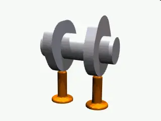
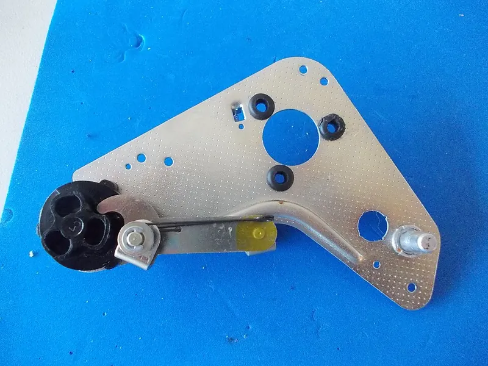
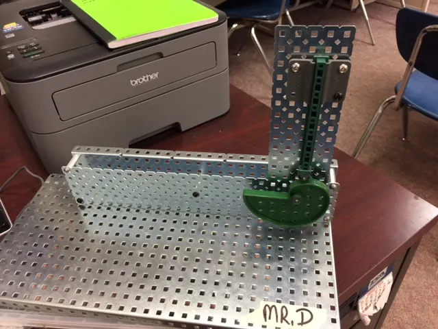

<figure class="eoc-pic eoc-pic-main"><picture><source media="(prefers-reduced-motion: reduce)" srcset="../media/cam-and-follower.still.webp"></picture><figcaption><strong>Animation.</strong> <a href="https://commons.wikimedia.org/wiki/File:Nockenwelle_ani.gif">Nockenwelle ani</a> by No machine-readable author provided. Borowski~commonswiki assumed (based on copyright claims)., Public domain, from Wikimedia Commons.</figcaption></figure>
<figure class="eoc-pic"><figcaption><strong>Photo.</strong> <a href="https://commons.wikimedia.org/wiki/File:Sanyo_G2605H_Turntable_Cam_Follower_(30001014985).jpg">Sanyo G2605H Turntable Cam Follower (30001014985)</a> by tony_duell, <a href="https://creativecommons.org/licenses/by/2.0">CC BY 2.0</a>, from Wikimedia Commons.</figcaption></figure>
<figure class="eoc-pic"><figcaption><strong>Photo.</strong> <a href="https://commons.wikimedia.org/wiki/File:Cam_Follower.jpg">Cam Follower</a> by Bteam75, <a href="https://creativecommons.org/licenses/by-sa/4.0">CC BY-SA 4.0</a>, from Wikimedia Commons.</figcaption></figure>

A cam is a shaped wheel, drum or plate that turns (or slides) and pushes a follower, so steady rotation becomes a back-and-forth or rocking motion with exactly the pattern of rises, pauses (dwells) and falls that the cam's shape was designed to give.

**In plain words:** A wheel with a lumpy or off-centre edge (or a drum with a wavy groove) that turns and pushes a rod or lever up and down or side to side, in whatever pattern of lifts, pauses and drops its shape has been cut to give. **Proper term:** [Cam and follower](../glossary.md#cam-and-follower) (cam mechanism): plate (disc, [radial](../glossary.md#axial--radial)) cam, barrel (cylindrical, drum) cam and face cam.

**Also called:** cam mechanism / cam and follower; plate cam / disc cam / radial cam; barrel cam / cylindrical cam / drum cam / grooved cylinder cam; face cam / end cam / groove cam (grooved plate cam); eccentric (cam) / eccentric circular cam; pear cam, heart cam (heart-shaped cam), snail cam (drop cam), multi-lobe cam; linear cam / wedge cam (a cam that slides instead of turning); camshaft (several cams on one shaft); cam follower / tappet / cam roller / track roller; knife-edge, roller, flat-faced (mushroom) and curved (spherical) followers; swashplate / oblique disc (a tilted-disc face cam); diamond screw / reversing screw (a crossed-groove barrel cam, as in fishing-reel level-winds); Nockenwelle (German, 'camshaft'); came (French).

## How it works

As the cam turns, the follower rides on its edge, face or groove. Where the cam's radius grows the follower is pushed out (rise), where it stays the same the follower stands still (dwell), and where it shrinks the follower comes back (fall or return) (Wikipedia; RoyMech). A plate cam moves its follower at right angles to the shaft, a barrel cam moves it along the shaft's direction, and a face cam uses a follower running on the flat face of a disc (Wikipedia 'Cam (mechanism)'). With a plain edge the follower must be held against the cam by a spring or gravity (force-closed); with a groove the follower is trapped and driven both ways, so no spring is needed (form-closed) (osamutake; DT Online).

## Parts

A few parts: the cam (a shaped disc, a drum with a groove or ridge, or a disc with a shaped face or groove) fixed to a shaft; the follower (a rod or lever with a pointed, flat, rounded or roller tip, or a pin or roller that rides in a groove); a guide or pivot for the follower; and, unless the cam has a groove, something to keep the follower pressed on the cam (a spring, gravity or its own weight).

## Everyday examples

- A car engine's camshaft, whose cams push the valves open (Wikipedia; Wikimedia Commons 'Nockenwelle ani.gif')
- The level-wind on a baitcasting fishing reel: a crossed-groove screw (a barrel cam) moves a line guide back and forth so line winds evenly (Mike's Reel Repair)
- A sash window lock, where turning a lever swings a cam that pulls the windows together (Wikipedia)
- Automata and moving toys, where cams under the base make figures nod, peck or wave (Rob Ives; Teaching Tech)

## When to use it

Use a cam when one steady rotation must produce a specific back-and-forth pattern: lift, wait, drop; several motions timed together from one shaft (a camshaft); a sudden drop or strike once per turn (snail cam); an even to-and-fro traverse (heart cam or barrel cam for winding line or wire evenly); or a lever that locks something by turning (cam lock). Cams are ideal for automata, toys, timers, pumps, stamping and sorting mechanisms, and anywhere a cheap cam can replace an extra motor or [actuator](../glossary.md#actuator) (Hackaday on Teaching Tech's guide).

## When not to use it

If you need to change the motion pattern often, use a servo or stepper under software control instead. For a plain smooth back-and-forth, an eccentric, Scotch yoke or slider-crank is simpler. For long [strokes](../glossary.md#stroke), a lead screw, rack and pinion, belt or [linkage](../glossary.md#linkage) suits better than a huge cam. For stepped rotation (index a turntable), use a Geneva drive or intermittent gear. Avoid plastic cams under heavy load or at high speed, where wear, follower jump and noise take over (UC3M; Yan & Tsai); use hardened metal and cycloidal profiles there.

## Details

- **What it does (jobs):**
  - change the kind of motion: turns steady rotation into back-and-forth straight motion or rocking motion with a planned pattern
  - slow it, stop it or keep its speed steady: dwells make the follower wait still for a set part of each turn, and a heart cam gives a steady, even traverse (507 Mechanical Movements no. 96)
  - lock, and release by hand: a cam turned by a handle can push a bolt or latch into place, as in sash window locks (Wikipedia) and a printed latching lid (Teaching Tech)
- **Movement:** multiple: the cam rotates (continuously, or back and forth by a handle) and the follower slides (translating follower) or rotates through a small angle ([oscillating](../glossary.md#oscillating) or rocking follower); strokes range from millimetres in toys to engine valve lifts ⚑ [uncertain: no typical figure found]
- **Directions it can move (degrees of freedom):** 1: while the follower stays in contact, its position is set completely by the cam's angle
- **Special behaviour:**
  - motion conversion (e.g. rotary to linear): rotation becomes [reciprocating](../glossary.md#reciprocating) (back-and-forth) straight or rocking motion of almost any planned pattern (Wikipedia; osamutake)
  - indexing (clicks into set positions): dwells hold the follower still for a set part of each turn, and cam plates with notches can hold set positions (Teaching Tech's dial with notched cam; Hackaday)
  - one-way (moves freely one way, locks the other): a snail (drop) cam can only rotate in one direction, because turned backwards the follower meets the sudden step (DT Online)
  - quick-release: a snail cam lifts the follower slowly and then lets it drop suddenly once per turn, used for hammers, punches and automata (DT Online)
- **How it holds:**
  - not a holding joint (it moves or passes on motion): it converts rotation into follower motion
  - spring force (a spring or springy part presses it in place): plain-edged (force-closed) cams rely on a spring, gravity or other force to keep the follower on the cam (RoyMech; DT Online)
  - shape (the parts interlock; [form-fit](../glossary.md#form-fit--force-fit--material-bond)): grooved (form-closed) plate, face and barrel cams trap the follower so it is driven both ways (osamutake; DT Online 'Cylindrical Cam'); the same is done with a grooved heart cam (507 Mechanical Movements no. 97) or a cam working between two rollers in a yoke, once used to drive steam-engine valves (no. 117)
- **Input and output:** Continuous (or hand-turned) rotation -> reciprocating straight-line motion or oscillating (rocking) motion, with any planned pattern of rise, dwell and return. Plate cam: follower moves at right angles to the cam shaft. Barrel (cylindrical) cam: follower moves parallel to the shaft (DT Online; Wikipedia). Face cam: follower runs on the face of a disc; a grooved face captures it so it moves both ways without a spring (Wikipedia). Timing: one follower cycle per lobe per turn; a groove that winds round twice gives one stroke per two turns (osamutake). A constant-lead barrel cam moves its follower in proportion to rotation, like a lead screw (Wikipedia). Efficiency: roller followers have 'the least friction' (mechref, UIUC) ⚑ [uncertain: no efficiency figure found]; losses grow with the pressure angle (UC3M). Back-drivable: generally no in useful terms, since pushing the follower tends to jam it in its guide rather than turn the cam, especially at high pressure angles (UC3M) ⚑ [uncertain].
- **Power:** passive (no power needed); driven by a hand [crank](../glossary.md#crank) or motor. If the drive stops, the follower stays where the cam leaves it (a spring-closed follower may push the cam round a little on a falling slope ⚑ [uncertain])
- **Load:** Light to heavy depending on size and material: from card automata to engine camshafts and steam hammers (Wikipedia). Strong in the direction the cam pushes; the return force of a spring-closed follower is only as strong as its spring or gravity. Side force on the follower grows with the pressure angle, and above about 30° a translating follower can jam in its guide (UC3M). Plastic cams suit only low loads and low speeds (UC3M).
- **Play and precision:** Force-closed (spring or gravity) followers have no play while contact is kept, and the follower repeats the same motion every turn; grooved cams need running [clearance](../glossary.md#clearance), so the follower can shift slightly when its direction reverses ⚑ [uncertain]. Precision depends on how accurately the profile is made and how smooth it is; a pointed follower traces fine detail more accurately but is weaker (Rob Ives). [Misalignment](../glossary.md#misalignment): a crowned (barrel-shaped) cam-follower roller tolerates up to about 0.5° of misalignment, a cylindrical one only about 0.06° (Wikipedia 'Cam follower').
- **Taking it apart:** removable: cams and followers are fixed to shafts and pivots with screws, keys, [set screws](../glossary.md#set-screw) or push-fit axles, and can be taken apart and swapped
- **How often it can be reused:** many times: the parts can be dismantled and refitted; interchangeable cams are a common teaching design (Rob Ives' interchangeable cam kit; Teaching Tech's three swappable cams)
- **Sealing:** none: it is an open mechanism (engine camshafts run inside an oiled housing, but the cam itself seals nothing)
- **Adjustable:** Usually no: the motion is fixed by the cam's shape. Stroke or timing can be changed by swapping cams (Rob Ives; Teaching Tech), by sliding a stepped set of cams of different throw along the shaft (507 Mechanical Movements no. 150), by moving the follower's pivot or linkage ⚑ [uncertain], or with a specially designed adjustable cam (Wikipedia: patented by Waldo J. Kelleigh in 1956).
- **Access needed:** not applicable: the cam and follower sit on shafts in a frame, reached wherever the frame opens
- **Materials:** Industrial cams: hard steels and cast iron, heat-treated; brass, bronze and plastic cams for low-load, low-speed uses (UC3M). Followers: needle-roller or ball-bearing cam followers and track rollers in steel (Wikipedia 'Cam follower'; McMaster-Carr). Maker cams: card and wood for automata (Rob Ives), 3D-printed PLA or PETG (Teaching Tech; osamutake), and self-lubricating 'tribo' filaments for sliding wear parts (igus iglidur I150, claimed up to 50 times more abrasion-resistant than standard printing plastics).
- **Heat, cold, water and wear:** Printed PLA cams soften above about 60 °C (Prusa) and wear if run dry; igus rates its wear-resistant I150 tribo-filament for continuous use up to +149 °F (65 °C). Dirt and grit in grooves and on the follower cause jerky, sticky motion; clean and lightly grease them (Mike's Reel Repair). Bushing-type cam followers are limited to about 200 °F (93 °C) (Wikipedia 'Cam follower'). At speed, spring-closed followers can separate from the cam (Yan & Tsai).

## Making it

- **Ways to make or get it:**
  - 3D print (FDM): plate, groove and barrel cams, followers and frames all print well for light duty (Teaching Tech; osamutake)
  - laser cut: ⚑ [uncertain] plate cams are flat profiles that suit plywood or acrylic, no tested example opened
  - woodwork: wooden and card cams drive traditional automata and toys (Rob Ives)
  - CNC: industrial cams are milled with rotating cutters on numerically controlled machines and often ground and heat-treated afterwards (UC3M)
  - off-the-shelf part: cam followers and track rollers, shafts, springs and bearings (McMaster-Carr; Wikipedia 'Cam follower')
- **Printing it in one piece (print in place):** partly: a few demo models print already assembled (e.g. ForgeFiles' [print-in-place](../glossary.md#print-in-place) pear cam demo on Printables, found through its API), but most printable cams are printed as separate parts and assembled with bolts or pins, and plain-edged cams need a spring or gravity to keep the follower in contact (Teaching Tech; osamutake)
- **Tools:** A screwdriver or hex key for the shaft fixings and follower guides (Teaching Tech's models use M3 and M4 bolts), a spring if the follower isn't held by gravity or a groove, and optionally lubricant for sliding surfaces
- **Difficulty:** easy for simple plate cams (eccentric, pear, snail), which print flat without supports and need only a shaft, a follower guide and gravity or a spring; moderate for grooved face and barrel cams and for designing smooth profiles that don't jam; hard for fast, heavily loaded cams, which need calculated motion curves and hardened metal

### 3D printing tips

1) Print plate cams flat on the bed: Teaching Tech's cam set is oriented to print without supports, in PLA, with 15-20 % [infill](../glossary.md#infill) because 'strength is not important' in demos; use more walls and infill for loaded cams ⚑ [uncertain]. 2) Make sliding surfaces smooth: osamutake uses 0.1 or 0.08 mm layers, a 'random' seam position so seams wear in instead of catching, and slow speed for [overhangs](../glossary.md#overhang--bridging). 3) For barrel (cylindrical) cams, give the groove a rounded cross-section rather than the usual square one so it prints without support (osamutake). 4) Clearances: osamutake designs 0.15 mm radial clearance on printed shafts and uses well-dried PETG for [accuracy](../glossary.md#repeatability--accuracy); sand stringing off shafts and open elephant's-foot holes with a round file. Teaching Tech found clearance for notched ([detent](../glossary.md#detent)) cam dials hard to get right and suggests trying a TPU cam. 5) Key the cam to its shaft: a flat on the shaft (D-shaft) or a bolt through the cam stops it slipping (osamutake; Teaching Tech). 6) Keep the pressure angle (the slope the follower climbs) under about 30° for a sliding follower and 35° for a lever follower; if it is too steep, make the base circle bigger or spread the rise over more of the turn (UC3M). 7) Use a roller follower where you can, e.g. a small ball bearing on a pin ⚑ [uncertain: no tested maker source], and keep the cam's tightest convex curve at least 2-3 times the roller's radius to avoid undercutting (UC3M). 8) A pointed follower traces detail well but is weak and gets pushed sideways; a separate follower that slides on the cam and pushes a guided rod helps (Rob Ives). 9) For grooves that cross themselves (a groove winding round twice), use an elongated or crescent-shaped follower that can swivel, so it doesn't take the wrong branch at the crossing (osamutake). 10) For long wear, print sliding parts in a wear-resistant tribo-filament (igus) or add lubricant; PLA softens above about 60 °C (Prusa).

### Buying one (off-the-shelf parts)

Cam followers / track rollers: stud-mount (threaded) cam followers and shaft-mount (yoke) track rollers, needle-roller, crowned, flanged and V-groove versions (Wikipedia 'Cam follower'; McMaster-Carr 'Track Rollers'); small ball bearings as DIY rollers ⚑ [uncertain]; compression and extension springs for follower return; D-profile or keyed shafts, set-screw shaft collars and hubs; linear bushings or guide blocks for follower rods; bearings for the camshaft; gear motors or hand cranks; for industrial stepping, ready-made cam indexers ⚑ [uncertain: not checked in a catalogue].

## Rules of thumb

- Keep the pressure angle (between the follower's direction of motion and the push from the cam) below 30° for translating followers and 35° for oscillating followers, or the follower may jam in its guides (UC3M Machine Theory 'Cams design II'; mechref, UIUC). MechSimulator's cam tool flags angles over 30°.
- To reduce the pressure angle, enlarge the base (prime) circle, add a sideways offset (eccentricity) to the follower, or spread the rise over more degrees of rotation; a smaller cam is cheaper but has steeper angles (UC3M).
- Keep the cam [pitch](../glossary.md#pitch) curve's smallest radius of curvature at least 2-3 times the roller follower's radius; a roller larger than the smallest convex curve '[undercuts](../glossary.md#undercut)' the profile and loses the intended motion (UC3M).
- Choose a smooth motion law for anything but slow cams: constant velocity gives infinite acceleration at the ends, simple harmonic gives infinite jerk at the joins, and cycloidal or polynomial profiles keep acceleration continuous and jerk finite, which cuts vibration (mechref 'Fundamental Law of Cam Design').
- A follower must be kept in contact by gravity, a spring, air or hydraulic pressure, or a groove (form closure) (RoyMech; osamutake).
- At high speed, spring-closed followers can lose contact and hammer back ('follower separation' or jump); the traditional fix is more spring [preload](../glossary.md#preload) or a stiffer spring (Yan & Tsai 2008).
- Plastic, brass and bronze cams suit low loads and low speeds; heavily loaded cams are hardened steel or cast iron (UC3M).
- Snail (drop) cams can only run in one direction (DT Online).
- Crowned cam-follower rollers tolerate about 0.5° misalignment versus 0.06° for cylindrical ones; bushing-type stud followers carry only about 25 % of the load of roller types (Wikipedia 'Cam follower').

## Common failures

1) Follower jams or sticks in its guide because the cam is too steep (pressure angle over about 30°): enlarge the base circle or spread the rise (UC3M). 2) Follower loses contact and bangs back at speed: add spring preload or [stiffness](../glossary.md#stiffness), lighten the follower, or slow down (Yan & Tsai). 3) Roller too big for the cam's tight curves, so the motion is wrong (undercutting): keep the curve radius at least 2-3 times the roller radius (UC3M). 4) Rough, noisy motion from a constant-velocity or simple-harmonic profile at speed: use cycloidal or polynomial motion (mechref). 5) Worn flats or grooves on printed cams and followers: use smoother surfaces, a roller follower, a harder or tribo-filament material and some lubricant (osamutake; igus). 6) Snail cam turned backwards jams against its step (DT Online). 7) Pointed follower pushed sideways and tilted in its guide: use a separate follower and push rod, or a roller (Rob Ives). 8) Follower takes the wrong branch where a groove crosses itself: use an elongated, swivelling follower (osamutake). 9) Cam slips on the shaft: key it with a flat, pin or set screw (osamutake). 10) Level-wind style barrel cams jam when the follower ([pawl](../glossary.md#pawl)) wears, especially at the groove crossovers (Mike's Reel Repair).

## Safety

The gap between a turning cam and its follower is a pinch point, and snail cams drop the follower suddenly, as in hammers and punches (DT Online); keep fingers out from under the follower of powered cams ⚑ [uncertain: general practice]. Compressed follower springs store energy and can fly out during disassembly ⚑ [uncertain]. Guard motor-driven camshafts.

## Related

- Eccentric cam lever (cam clamp, quick-release skewer): uses a cam's rising edge to clamp and lock rather than to make repeated motion
- Scotch yoke and slider-crank: turn rotation into back-and-forth motion too, but only a fixed smooth pattern with no dwells
- Geneva drive and intermittent gear: give stop-go rotation of a wheel rather than a follower's back-and-forth; cam indexers are the smooth high-speed alternative
- Lead screw and nut: a constant-lead barrel cam acts like a lead screw (Wikipedia); a diamond (reversing) screw turns this into automatic back-and-forth
- Swashplate (wobble plate): a tilted disc acting as a face cam that drives rods parallel to the shaft (507 Mechanical Movements no. 95; DT Online)
- Click-pen mechanism and push-push latch: use small cams or heart-shaped cam tracks to step or latch a plunger
- Linkages (four-bar and others): can make complex paths with pivots only, avoiding sliding contact and springs

## Make it yourself

- [Cam mechanism examples (Teaching Tech, Printables)](https://www.printables.com/model/490289-cam-mechanism-examples): Printable set: a simple lifter with three swappable cams, a latching lid, a notched dial and a reverse-profile dispenser; prints without supports in PLA; source CAD on Onshape *(licence: CC BY)*
- [Educational Model of Cylindrical Cam (osamutake, Printables)](https://www.printables.com/model/1504616-educational-model-of-cylindrical-cam): Barrel cam whose groove winds round twice so the follower makes one near-constant-speed stroke per two turns; rounded groove for easy printing; video at youtu.be/tSPfPqlc5QA *(licence: CC BY)*
- [Educational Model of Groove Cam (osamutake, Printables)](https://www.printables.com/model/1504580-educational-model-of-groove-cam): Grooved plate (face) cam that rocks an output arm with no spring; crescent follower crosses the groove's intersection; video at youtu.be/t_w5ab848ZU *(licence: CC BY)*
- [Snail Cam (Frozensnakes, Printables)](https://www.printables.com/model/483105-snail-cam): Printable model of a snail (drop) cam *(licence: CC BY)*
- [Cam & Follower simulator (MechSimulator)](https://mechsimulator.com/tools/cam-follower/): Interactive cam profile tool: choose motion law (SHM, cycloidal, uniform velocity or acceleration), base circle, lift and follower type; shows the profile, displacement, velocity and acceleration graphs and flags pressure angles over 30° *(licence: link only ⚑ [uncertain])*
- [cam_profile.scad (Kit Wallace, OpenSCAD)](https://raw.githubusercontent.com/KitWallace/openscad/master/cam_profile.scad): Short OpenSCAD script that builds a cam from radius-and-angle control points (example: a snail cam) and extrudes it for printing *(licence: not stated ⚑ [uncertain])*
- [Cams (Rob Ives, paper-automata mechanism page)](https://www.robives.com/mechanism/cams/): Beginner explanation of cams and followers for card automata, with a downloadable interchangeable cam kit to try different profiles *(licence: not stated ⚑ [uncertain])*
- [Level wind mechanism (baitcasting fishing reel) (C. Yamahata, Sketchfab)](https://sketchfab.com/3d-models/level-wind-mechanism-baitcasting-fishing-reel-0d4a3f6123eb409a9ce6391ddcd72048): Downloadable 3D model of a diamond-screw level-wind, a crossed-groove barrel cam *(licence: CC BY 4.0)*

## Pictures, videos and models

- [Nockenwelle ani.gif (Wikimedia Commons, by Borowski)](https://commons.wikimedia.org/wiki/File:Nockenwelle_ani.gif): Animation of a camshaft whose rotating cams push followers up and down *(licence: Public domain)*
- [Cam-disc-1 3D animated.gif (Wikimedia Commons, by Silberwolf)](https://commons.wikimedia.org/wiki/File:Cam-disc-1_3D_animated.gif): 3D animation of a cam disc lifting a tappet (flat follower) *(licence: CC BY-SA 2.5)*
- [Knife edge cam follower.svg (Wikimedia Commons, by Enl public); flat and radiussed versions are in Category:Diagrams of cams](https://commons.wikimedia.org/wiki/File:Knife_edge_cam_follower.svg): Simple diagram of a plate cam with a pointed (knife-edge) follower *(licence: CC BY-SA 3.0)*
- [Cylindrical Calm and Swash Plate.jpg (Wikimedia Commons, by Aliva Sahoo)](https://commons.wikimedia.org/wiki/File:Cylindrical_Calm_and_Swash_Plate.jpg): Photo of science-exhibit models of a cylindrical (barrel) cam and a swashplate converting motion *(licence: CC BY-SA 4.0)*
- [Barrel cam mechanism 1 (Nguyen Duc Thang, YouTube thang010146)](https://www.youtube.com/watch?v=JZgez4C2HUQ): CAD animation of a barrel (cylindrical) cam driving a follower *(licence: link only (standard YouTube licence))*
- [Cams are simple to design but oh so versatile - Guide with examples (Teaching Tech, YouTube)](https://www.youtube.com/watch?v=lm49nYb77HY): Video guide to cam terms and printed examples: lifting, latching, detent dial, dispenser and an automaton *(licence: link only (standard YouTube licence))*

## Needs confirming

⚑ marks something nobody has confirmed yet: a fact the research could not confirm from a source, a finder value that is a best guess, or an open point from the research notes. Corrections are welcome (see `research/needs-confirming.md`).

- ⚑ 16 sentences on this page marked [uncertain].
- ⚑ Finder value `made_of` = 3D prints, plastic sheet, tube or moulded parts, wood, metal, paper or card (best guess): proposed from the words in the research text (R37); not yet checked

## Sources

- <https://en.wikipedia.org/wiki/Cam_(mechanism)>
- <https://en.wikipedia.org/wiki/Cam_follower>
- <https://commons.wikimedia.org/wiki/Category:Cams>
- <https://commons.wikimedia.org/wiki/Category:Animations_of_cam_discs>
- <https://commons.wikimedia.org/wiki/Category:Diagrams_of_cams>
- <https://commons.wikimedia.org/wiki/File:Nockenwelle_ani.gif>
- <https://commons.wikimedia.org/wiki/File:Cam-disc-1_3D_animated.gif>
- <https://commons.wikimedia.org/wiki/File:Knife_edge_cam_follower.svg>
- <https://commons.wikimedia.org/wiki/File:Cylindrical_Calm_and_Swash_Plate.jpg>
- <https://roymech.org/Useful_Tables/Cams_Springs/Cams.html>
- <https://ocw.uc3m.es/pluginfile.php/2605/mod_page/content/13/unit8_cams_design2.pdf>
- <https://www.mechref.org/md/Cams/>
- <https://www.jstage.jst.go.jp/article/jamdsm/2/1/2_1_12/_article>
- <https://www.robives.com/mechanism/cams/>
- <https://wiki.dtonline.org/index.php/Category:Cams>
- <https://wiki.dtonline.org/index.php/Snail_Cam>
- <https://wiki.dtonline.org/index.php/Cylindrical_Cam>
- <https://wiki.dtonline.org/index.php/Radial_Cam>
- <https://www.notesandsketches.co.uk/Cams.html>
- <https://507movements.com/toc.html>
- <https://507movements.com/mm_095.html>
- <https://507movements.com/mm_096.html>
- <https://507movements.com/mm_097.html>
- <https://507movements.com/mm_117.html>
- <https://507movements.com/mm_150.html>
- <https://mechsimulator.com/mechanisms/>
- <https://mechsimulator.com/tools/cam-follower/>
- <https://hackaday.com/2023/05/31/a-simple-guide-to-cams/>
- <https://www.youtube.com/watch?v=lm49nYb77HY>
- <https://www.youtube.com/watch?v=JZgez4C2HUQ>
- <https://www.youtube.com/watch?v=tSPfPqlc5QA>
- <https://www.youtube.com/watch?v=t_w5ab848ZU>
- <https://api.printables.com/graphql/>
- <https://www.printables.com/model/490289-cam-mechanism-examples>
- <https://www.printables.com/model/1504616-educational-model-of-cylindrical-cam>
- <https://www.printables.com/model/1504580-educational-model-of-groove-cam>
- <https://www.printables.com/model/483105-snail-cam>
- <https://raw.githubusercontent.com/KitWallace/openscad/master/cam_profile.scad>
- <https://www.mcmaster.com/products/cam-followers/>
- <https://www.igus.com/product/iglidur_I150_PF>
- <https://www.mikesreelrepair.com/blog/the-levelwind-system-in-baitcasting-reels-a-detailed-technical-examination/>
- <https://sketchfab.com/3d-models/level-wind-mechanism-baitcasting-fishing-reel-0d4a3f6123eb409a9ce6391ddcd72048>
- <https://help.prusa3d.com/article/pla_2062>
