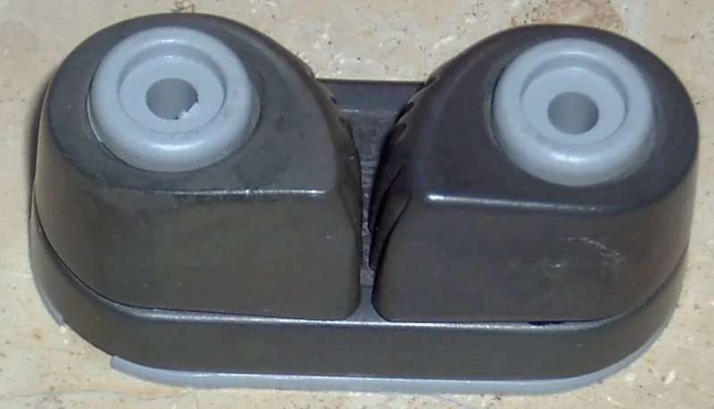

*Picture: [Curry2.jpg](https://commons.wikimedia.org/wiki/File:Curry2.jpg) by Jörg Steinwiese, [CC BY-SA 3.0](http://creativecommons.org/licenses/by-sa/3.0/), from Wikimedia Commons.*

A pair of spring-loaded toothed cams on a small base that let a rope be pulled through in one direction, grip it harder the more the load pulls back, and let it go when the rope is lifted up and out of the jaws.

**In plain words:** A rope holder with two springy toothed jaws side by side: pull the rope back between them and it slides through, let go and the teeth bite and hold it, then flick the rope up and out to free it. **Proper term:** Cam cleat.

**Also called:** spring-loaded cam cleat; ball-bearing cam cleat (the bearing type used by Harken and others); swivel cam cleat (a cam cleat on a turning base); Curry clamp / Curryklemme (German name, after the sailor Manfred Curry); bulldog jam cleat (early US name, according to German Wikipedia); jam cleat (loose usage; the name is also used for clam cleats); Cam-Matic and Carbo-Cam (Harken brands); C-Cleat and T-Cleat (Ronstan brands).

## How it works

Two cams sit side by side on pivots, and springs turn them so their toothed, curved faces meet in the middle. The curve is off-centre (eccentric): the teeth get further from the pivot along the cam, so turning the cams one way widens the gap and turning them the other way narrows it (US 4,620,499). Pulling the rope toward you drags the teeth the opening way and the rope slides through; when the load pulls back, the rope drags the teeth the closing way and wedges itself in, so 'as the load on the line increases, the cams' pressure and grip increase as well' (SAIL Magazine). German Wikipedia notes the jaws usually follow a logarithmic spiral so the rope is gripped at the same angle whatever its diameter. To free it you tension the tail and lift it up and out of the jaws (Upffront, Wikipedia). The basic version with no moving parts is the horn cleat, the traditional fitting with two 'horns' (Wikipedia 'Cleat (nautical)'): the rope is made fast with a cleat hitch (ABOK #1615), a turn round the far horn, figure-eight crossings over the top and often a final locking half hitch (Wikipedia 'Cleat hitch'; Animated Knots 'Cleat Hitch (Dock Line)'). It holds bigger loads and can't be flicked loose, but it is slower to tie and untie.

## Parts

A small assembly that acts as one unit: a base plate with two pivot posts; two toothed cams (jaws, which Harken calls [pawls](../glossary.md#pawl)); one or two [torsion](../glossary.md#torsion) springs per cam; and, on better cleats, ball bearings (Harken's standard 150 uses 66 small Delrin balls in three rows), washers and cam caps. Often fitted with add-ons: a fairlead (guide loop) over the jaws, a riser or a 15° wedge. Some designs gear the two cams together so they open and close as a mirrored pair (US 4,620,499).

## Everyday examples

- Sailing dinghies: the mainsheet and small control lines (cunningham, outhaul, vang) run through cam cleats (SAIL Magazine, Practical Sailor)
- Kayaks and small boats: anchor or fishing lines held in a small nylon cam cleat ⚑ [uncertain: seen only in retail search results]
- Hunting climbing sticks: a Printables adapter holds a Harken 150 cam cleat on a climbing stick used for saddle hunting
- Awnings, flag lines and tarps held by a cam cleat on a post ⚑ [uncertain]

## When to use it

When a light to moderately loaded rope needs frequent, quick adjustment and fast release, with one hand and no knot: sheets and control lines on small boats, tarp and awning lines, hauling or hoisting lines where the load is held by hand, and lines on kayaks and camping gear. It is faster and easier than a knot on a horn cleat, especially for beginners (Practical Sailor), and holds at any point along the rope.

## When not to use it

Avoid it for loads beyond what a person can hold by hand, or loads that must be released under high tension: use a rope clutch or jammer, a winch, or a horn cleat with a cleat hitch (Upffront; Practical Sailor). Avoid it anywhere a foot, elbow or flapping line could knock the rope upward and release it, such as critical lines or anything over people (SAIL Magazine; Practical Sailor): use a horn cleat and a proper hitch. Avoid it for flat webbing (use a cam buckle) and for ropes outside its diameter range (they slip or won't seat). Where you want no springs or moving parts, a clam cleat is simpler but harder to release under load (Wikipedia).

## Details

- **What it does (jobs):**
  - stop it moving back (one-way): the rope pulls through toward you and is held against the load pulling the other way
  - lock, and release by hand: lift the rope up and out of the jaws and it runs free
  - tighten and hold tension: pull the tail to tighten a line and it holds wherever you stop
- **Movement:** slide: the rope runs straight through the jaws in one direction only, with no fixed steps (stepless); the cams themselves only rock a little on their pivots
- **Directions it can move (degrees of freedom):** 1 for the rope: it moves only along its length, and only in the tightening direction while it sits in the jaws. Each cam also turns about its own pivot (1 each, or 1 shared when the cams are geared together). Lifting the rope out of the top is the release path, not a working motion.
- **Special behaviour:**
  - one-way (moves freely one way, locks the other): the rope pulls through toward you and locks against the load
  - [self-locking](../glossary.md#self-locking) (holds under load, won't back-drive): the load drags the cams tighter, so the harder it pulls the harder they grip
  - hand-release only (locks under load, releases when a person operates it): you lift the rope up and out; lever-release and pull-down-release versions also exist (Nash cam cleat, US 3,765,061, described in US 4,620,499; Nash Trigger Cleat in Practical Sailor)
  - quick-release: one upward flick frees the line, which is also why a line knocked upward by accident can come loose
  - tensioning (takes up slack and holds): pull the tail to tension a line and it holds at any point
- **How it holds:**
  - friction or clamping ([force-fit](../glossary.md#form-fit--force-fit--material-bond)): the toothed jaws pinch the rope, and the load wedges them tighter
  - spring force (a spring or springy part presses it in place): torsion springs keep the cams closed so they catch the rope as soon as you let go
- **Input and output:** not applicable: it holds a rope rather than passing motion on (back-drivable: no while the rope stays down in the jaws; lifting the rope out releases it)
- **Power:** passive (no power needed)
- **Load:** Light to medium, and only as a pull along the rope. Makers' maximum working loads: Harken Micro Cam-Matic 91 kg (200 lb); Harken Standard Cam-Matic 150 136 kg (300 lb), breaking load 340 kg (750 lb); Ronstan Small C-Cleat 165 lb (breaking 330 lb); Ronstan Large C-Cleat 510 lb (breaking 1,010 lb). Weak against any upward pull on the rope, which releases it, and against leads from the side or from above, which make the rope pop out (Harken). Lewmar's catalogue warns that cam cleats are 'designed to hold only the load that can be applied manually' (quoted by Practical Sailor).
- **Play and precision:** Small: the rope [creeps](../glossary.md#creep) back a little while the cams swing shut and the teeth bite ⚑ [uncertain: no source gives an amount]. There are no fixed positions (stepless). Each cleat takes a range of rope sizes (for example 3 to 12 mm for Harken's standard 150), but it does not tolerate a crooked lead: the line must come in straight, or it pops out of the cams (Harken Quick Service).
- **Taking it apart:** tool-free quick release: lift the rope up and out of the jaws; the cleat itself is screwed or bolted down and comes off with a screwdriver
- **How often it can be reused:** effectively unlimited: it grips and releases thousands of times (Practical Sailor ran 1,000-cycle cleat-and-release tests). What wears is the rope, the teeth, the springs and the bearings; Harken sells springs, balls, washers and base plates as spares.
- **Sealing:** none: nothing makes it seal
- **Adjustable:** yes: stepless; pull more rope through to tighten, or tension the tail, lift it and let some run to ease it; it holds at any point along the rope
- **Access needed:** one side only (blind): the rope is loaded and released from the top. Mounting needs the back only if you through-bolt it; screws into wood or a thick deck go in from the front.
- **Materials:** Cams: hard-anodised aluminium, glass-fibre-reinforced or carbon-fibre composite, stainless steel or bronze. Bases: glass-fibre-reinforced polymer, aluminium or stainless steel. Springs: stainless steel. Bearings: Delrin (acetal) balls, or PTFE-impregnated acetal slotted bearings (Harken, Ronstan, Allen Brothers, Practical Sailor). Holds most braided and laid ropes within its rated diameter range; very slippery, very stiff or out-of-range ropes grip poorly ⚑ [uncertain].
- **Heat, cold, water and wear:** Salt, sand and dirt make the cams stiff: flush with fresh water and clean with mild detergent at regular intervals (Harken Quick Service). Aluminium cleats are highly resistant to UV (Upffront); carbon-composite cams resist heat and abrasion, and slotted bearings resist sand and salt better than ball bearings, which 'may deform under high load' (Ronstan). Springs corrode, tire or break over time and the cams then stop snapping shut (Harken). For printed cleats: PLA softens above about 60 °C and degrades in UV; PETG is fine outdoors below about 80 °C; ASA is UV-resistant up to 93 °C (Prusa material pages). A wet, icy or muddy rope grips less well ⚑ [uncertain].

## Making it

- **Ways to make or get it:**
  - off-the-shelf part: by far the usual route (Harken, Ronstan, Holt/Allen, Barton, Spinlock and others)
  - 3D print (FDM): cams, base and fairlead, assembled with metal torsion springs and screw pivots
  - 3D print (resin): possible for small, light-duty cams ⚑ [uncertain: no tested example found]
  - CNC: aluminium cams (Helms's patent cut the cam jaws from extruded aluminium bar, US 3,730,129)
  - woodwork: mounting pads, risers and wedges to set the angle
- **Printing it in one piece (print in place):** no: working versions are printed as separate cams and base and assembled with metal springs and screw pivots (Erik Stensmo's Printables cam cleat uses four metal springs). A [print-in-place](../glossary.md#print-in-place) version with printed springs exists, but its maker says it grips only 'sometimes'.
- **Tools:** none to use; a drill and screwdriver (plus a spanner for through-bolts) to mount it. Harken's standard 150 takes #10 (5 mm) flat-head fasteners; its micro cleats take #8 (4 mm) round-head screws (Harken Quick Service sheet).
- **Difficulty:** moderate: printed cams and a printed base work for light lines, but you need metal pivot screws and springs and a sensible tooth shape; for anything carrying real load, buy one

### 3D printing tips

Print each cam lying flat, with its pivot hole vertical, so the teeth are drawn by the [perimeters](../glossary.md#perimeters) in one layer plane and the rope's pull runs along the layers rather than trying to split them (FFF prints are stronger in one direction than another, Prusa). Use a metal screw, shoulder bolt or pin as the pivot rather than a printed peg, and metal torsion springs: Erik Stensmo's CC BY Printables cam cleat needs only the springs as metal parts and recommends two springs per cam (four per cleat), with the bearing ideally printed in PTFE. Leave the cams free to turn: Harken warns that over-tightening the mounting screws makes the cams (pawls) bind, so let the screw clamp a spacer or post, not the cam itself. Keep teeth slightly rounded rather than knife-sharp: Helms's patent found tips rounded to about 0.25 mm best (0.13 to 0.76 mm acceptable), which a 0.4 mm nozzle gives naturally, and Practical Sailor reports that too-sharp teeth chew rope. Add a fairlead or guide over the jaws so the rope enters straight, and a riser or wedge if the line comes from above the cleat's plane (Harken). Material: PETG, ASA or PC outdoors; PLA softens above about 60 °C and degrades in sunlight (Prusa PLA page), PETG suits outdoor parts below about 80 °C, and ASA resists UV and heat up to 93 °C (Prusa). Nylon or PTFE-filled filaments may run more smoothly on the pivots ⚑ [uncertain]. Typical failures: cams too tight on their pivots to snap shut, springs too weak to catch the line, and teeth wearing smooth; printed cams wear much faster than anodised aluminium ones ⚑ [uncertain], so treat a printed cleat as light-duty and replaceable.

### Buying one (off-the-shelf parts)

Cam cleats in micro, standard and large sizes (search 'cam cleat', 'Cam-Matic', 'Carbo-Cam', 'C-Cleat', 'T-Cleat'); cam cleat fairleads (wire, bullseye or 'X-Treme angle' fairleads), 15° wedge kits, flat and 15° angled risers, cam caps and adapter plates (Harken Quick Service list); replacement torsion springs and Delrin ball kits (e.g. Harken 150KIT); swivel cleat bases (Ronstan); 316 stainless flat-head machine screws with nyloc nuts or washers. For DIY builds: small stainless torsion springs and stainless shoulder bolts or pins for the pivots.

## Rules of thumb

- Match the rope to the cleat's diameter range and the load to its maximum working load: Harken Micro Cam-Matic 2-6 mm, 91 kg (200 lb); Harken Standard 150 3-12 mm, 136 kg (300 lb), breaking load 340 kg (Harken product pages); Ronstan Small C-Cleat 3/32-5/16 in, 165 lb; Large C-Cleat 1/4-5/8 in, 510 lb (Ronstan product pages).
- Makers set the maximum working load at roughly 40-50% of the breaking load: Harken 150 136 of 340 kg; Ronstan C-Cleats 165 of 330 lb and 510 of 1,010 lb (Harken and Ronstan product pages).
- Use it only for loads a person can hold by hand: Lewmar's catalogue warns cam cleats are 'designed to hold only the load that can be applied manually' (quoted by Practical Sailor, 'The Civilization of Cam Cleats'). For higher, longer-held loads such as halyards, use a clutch or jammer (Upffront).
- Lead the line straight into the cams: 'Line pops out of cams: Lead is not fair. Use risers or wedges so line enters straight into the cam' (Harken Quick Service sheet); Harken's wedges and angled risers are 15°.
- When a cleat is mounted upside down, 'add a second spring to each cam alongside the original', and 'do not over-tighten mounting screws; pawls will bind' (Harken Quick Service sheet).
- Tooth shape from Helms's extruded cam cleat patent (US 3,730,129): tooth tips rounded to about 10 mils (0.25 mm), with 5-30 mils (0.13-0.76 mm) satisfactory; the rear face of each tooth at about 90° (85-95°) to the cam arc; and the cam arc's centre set back about one-third of its radius and out about one-sixth, giving a fairly flat arc so 'at least four teeth of each jaw' grip the line.
- Strength is rarely the limit; release is. In Practical Sailor's 1992 test of 16 cleats the best 'easily withstood a 1,000-lb linear pull, without slipping', but freeing a heavily loaded line is hard and risky (Practical Sailor).
- Blunter teeth are kinder to rope: early cam cleats' 'too-sharp cam teeth chewed voraciously on any line', and makers moved to 'blunter, more line-lenient teeth' (Practical Sailor).
- If you use a horn cleat instead: lead the rope round the far horn first, because 'starting round the wrong horn increases the risk of a Cleat Hitch jamming'; don't take a full round turn under the first horn, which can jam so the rope can't be released while loaded; two figure-eight crossovers are 'the bare minimum, and only for temporary use in sheltered conditions'; and leave off the final locking half hitch on lines that must be let go quickly, such as towlines and sail sheets (Animated Knots 'Cleat Hitch (Dock Line)').

## Common failures

Line pops out of the cams: the lead is not fair; add a riser, wedge or fairlead so the line enters straight (Harken). Cams do not snap shut: springs damaged or missing; replace them (Harken). Line drops out of an upside-down cleat: fit a second spring per cam (Harken). Stiff or uneven cam motion: dirt or salt, or missing bearing balls; flush with fresh water and refit the right number of balls (Harken). Cams bind after fitting: mounting screws over-tightened (Harken). Rope slips: rope too thin, worn, slippery or outside the rated range, or teeth worn smooth; use the right cleat size and replace worn parts. Rope fuzzes or wears: sharp teeth; choose line-friendly cleats (Practical Sailor's abrasion tests rated Harken Carbo-Cam, Ronstan C-Cleat, Spinlock PX and RWO Carbocleat best).

## Safety

Fingers can be caught 'when snapping a taut line out of a cam cleat, especially one that has an integral fairlead' (Practical Sailor). A heavily loaded line may be impossible to lift out, so keep a knife close at hand and a mechanical way (winch or purchase) to take the load off (Practical Sailor). A line released under load runs out fast and can burn hands ⚑ [uncertain]. A line accidentally knocked upward 'will scuttle off along the deck' (SAIL Magazine), so never rely on a cam cleat alone for anything that could fall on people or for a person's weight.

## Related

- Clam cleat (grooved V-cleat): one solid piece with no springs, more compact and cheaper, but the rope is less easily released under load (Wikipedia); in Practical Sailor's 1997 abrasion test Clamcleats and Ronstan V-Cleats wore rope less than cam cleats
- Hitches to a post, rail, ring or eye: includes the cleat hitch on a horn cleat, slower to tie and untie, but holds higher loads and can't be knocked loose by accident
- Rope clutch or jammer: a lever-operated cam that holds higher loads for longer, such as halyards, and releases under load (Upffront)
- Rope grab and ascender (cam rope clamp): a single toothed cam presses the rope against a fixed wall, for climbing and hauling
- Cord lock (spring toggle): a spring plunger that pinches a thin cord, for very light loads
- Cam buckle (webbing cam buckle): the same one-way toothed-cam idea for flat straps, released by pressing a lever
- Binding-plate lock (tilting friction plate): a tipped plate wedges on a rod instead of cams wedging a rope
- [Sprag](../glossary.md#sprag) clutch: the same wedge-tighter-under-load principle, used between rotating shafts
- Tensioning and adjustable hitches: knots such as the trucker's hitch and taut-line hitch that pull a line tight and hold it with no hardware at all

## Make it yourself

- [Cam cleat (clam cleat) by Erik Stensmo, Printables](https://www.printables.com/model/1524534-cam-cleat-clam-cleat): A printable two-cam cam cleat with CAD files included; the only metal parts are the springs (two per cam, four per cleat); the maker suggests printing the bearing in PTFE. Details read through the Printables public API; the page URL appeared in search results but the page itself blocks automated access. *(licence: CC BY (Creative Commons Attribution))*
- [Print in place cam cleat by Jack, Printables (URL from Printables API, page not opened)](https://www.printables.com/model/1484479-print-in-place-cam-cleat): A print-in-place cam cleat with no springs or assembly; the maker admits it 'can grip things. Sometimes', so it shows the idea rather than a working part *(licence: CC Public Domain)*
- [Cam Cleat by metaform3d, Thingiverse](https://www.thingiverse.com/thing:767593): A pair of printed toothed cams, mounted with screws as pivots, used to hold and adjust surgical tubing on a catapult ⚑ [uncertain: description taken from search-result summaries; the page needs JavaScript and could not be read] *(licence: ⚑ [uncertain: not visible])*
- [replica cam cleat by gbrspratt, Thingiverse](https://www.thingiverse.com/thing:2694861): An attempt to print a whole ball-bearing cam cleat apart from the spring (a printed leaf-spring version is also offered), using 66 printable 4 mm balls and a basic fairlead ⚑ [uncertain: description taken from search-result summaries; the page needs JavaScript and could not be read] *(licence: ⚑ [uncertain: not visible])*

## Pictures, videos and models

- [Curry2.jpg (Holt Allen HA 77 cam cleat), Wikimedia Commons, photo by Jörg Steinwiese](https://commons.wikimedia.org/wiki/File:Curry2.jpg): Close-up of a plastic cam cleat: the two cams on their pivots with the gap between them where the rope is gripped *(licence: GFDL 1.2 or later, or CC BY-SA 3.0 / 2.5 / 2.0 / 1.0 (choose one); credit Jörg Steinwiese)*
- [Cam cleat.jpg, Wikimedia Commons, photo by Paul Fox (Pjf33)](https://commons.wikimedia.org/wiki/File:Cam_cleat.jpg): A cam cleat in use on a yacht's mainsheet: 'The rope passes between two cams, which resist a pull in a direction away from the camera' *(licence: CC BY-SA 3.0)*
- [US 4,620,499: Cam cleat (Slemmons, 1986), USPTO full-text PDF](https://image-ppubs.uspto.gov/dirsearch-public/print/downloadPdf/4620499): Plan-view drawings of two opposed, geared, toothed cams gripping a rope, releasing it, and closing with the rope clear; the background section reviews earlier cam cleat designs *(licence: US patent document; public domain in the US; link only)*
- [Harken Cam Cleats & Accessories, Cam-Matic & Carbo-Cam Quick Service (PDF)](https://gallery.harken.com/gallery/complementaryhardwarequickserviceonline.pdf): Exploded drawing of a Harken 150 cam cleat (cam caps, 66 Delrin balls, left and right pawls, torsion springs, washer, base plate) and a fault-finding list *(licence: © Harken; link only)*
- [Harken: How-To Service a Cam-Cleat (JamestownTV)](https://www.youtube.com/watch?v=B2MrlDfcJ1k): Taking a ball-bearing cam cleat apart and putting it back together ⚑ [uncertain: title and channel confirmed through YouTube's oEmbed data; the video itself was not watched] *(licence: YouTube standard licence; link only)*

## Needs confirming

⚑ marks something nobody has confirmed yet: a fact the research could not confirm from a source, a finder value that is a best guess, or an open point from the research notes. Corrections are welcome (see `research/needs-confirming.md`).

- ⚑ 14 sentences on this page marked [uncertain].
- ⚑ Finder value `connects` = strap, cord or fabric (best guess): worked out from its name, but joining parts is not one of its two main jobs

## Sources

- <https://en.wikipedia.org/wiki/Cleat_(nautical)>
- <https://de.wikipedia.org/wiki/Curryklemme>
- <https://sailmagazine.com/diy/know-how-cleats-clutches-and-jammers/>
- <https://www.practical-sailor.com/sails-rigging-deckgear/the-civilization-of-cam-cleats/>
- <https://www.upffront.com/blog/guides-4/a-beginners-guide-to-cam-cleats-232>
- <https://www.allenbrothers.co.uk/2023/09/28/exploring-cam-cleats-part-1-understanding-cam-cleats/>
- <https://www.ronstan.com/us/cleat-selection-advice>
- <https://www.ronstan.com/us/large-c-cleat-cam-cleat-greygrey-base.html>
- <https://www.ronstan.com/us/small-c-cleat-cam-cleat-greygrey-base.html>
- <https://www.harken.com/en/shop/cam-cleats-kits/standard-cam-matic-cleat-150/>
- <https://www.harken.com/en/shop/cam-cleats-kits/micro-cam-matic-cleat/>
- <https://www.harken.com/en/shop/cam-cleat-accessories/standard-wedge-kit/>
- <https://gallery.harken.com/gallery/complementaryhardwarequickserviceonline.pdf>
- <https://image-ppubs.uspto.gov/dirsearch-public/print/downloadPdf/4620499>
- <https://patents.google.com/patent/US3730129A/en>
- <https://commons.wikimedia.org/wiki/File:Curry2.jpg>
- <https://commons.wikimedia.org/wiki/File:Cam_cleat.jpg>
- <https://www.youtube.com/watch?v=B2MrlDfcJ1k>
- <https://www.youtube.com/oembed?url=https://www.youtube.com/watch?v=B2MrlDfcJ1k&format=json>
- <https://api.printables.com/graphql/>
- <https://www.printables.com/model/1524534-cam-cleat-clam-cleat>
- <https://www.thingiverse.com/thing:767593>
- <https://www.thingiverse.com/thing:2694861>
- <https://help.prusa3d.com/article/modeling-with-3d-printing-in-mind_164135>
- <https://help.prusa3d.com/article/pla_2062>
- <https://help.prusa3d.com/article/petg_2059>
- <https://help.prusa3d.com/article/asa_1809>
- <https://en.wikipedia.org/wiki/Cleat_hitch>
- <https://www.animatedknots.com/cleat-hitch-knot-dock-line>
