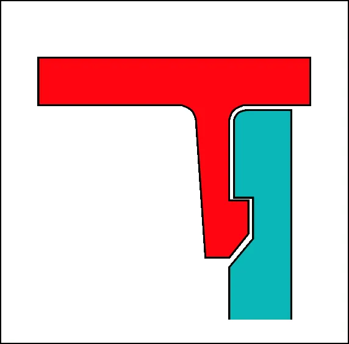
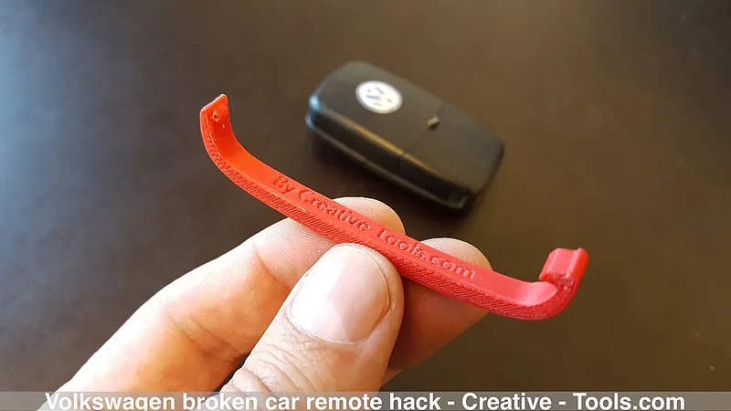
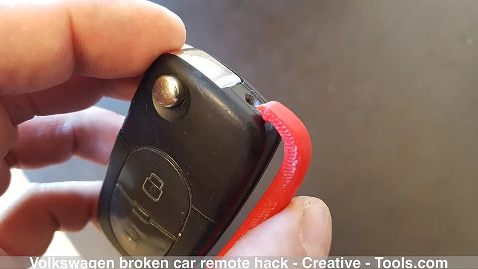

<figure class="eoc-pic eoc-pic-main"><picture><source media="(prefers-reduced-motion: reduce)" srcset="../media/cantilever-snap-fit.still.webp"></picture><figcaption><strong>Animation.</strong> <a href="https://commons.wikimedia.org/wiki/File:Cantilever_Snap-fit.gif">Cantilever Snap-fit</a> by Original PNG Drawing: Ootsuka02GIF Animation: MichaelFrey (talk), <a href="https://creativecommons.org/licenses/by-sa/3.0">CC BY-SA 3.0</a>, from Wikimedia Commons.</figcaption></figure>
<figure class="eoc-pic"><figcaption><strong>Photo.</strong> <a href="https://commons.wikimedia.org/wiki/File:Volkswagen_broken_car_remote_hack_-_21473319590.jpg">Volkswagen broken car remote hack - 21473319590</a> by Creative Tools, <a href="https://creativecommons.org/licenses/by/2.0">CC BY 2.0</a>, from Wikimedia Commons.</figcaption></figure>
<figure class="eoc-pic"><figcaption><strong>How it works.</strong> <a href="https://commons.wikimedia.org/wiki/File:Volkswagen_broken_car_remote_hack_-_21661213595.jpg">Volkswagen broken car remote hack - 21661213595</a> by Creative Tools, <a href="https://creativecommons.org/licenses/by/2.0">CC BY 2.0</a>, from Wikimedia Commons.</figcaption></figure>

A flexible arm made as part of one part, with a hook at its tip that bends aside as the parts are pushed together and springs back behind a ledge ([undercut](../glossary.md#undercut)) on the other part, locking them together without screws or glue.

**In plain words:** A springy plastic finger with a hook on the end that bends aside as you push two parts together, then clicks back to catch behind a ledge and hold them, like the tab on a battery cover. **Proper term:** [Cantilever](../glossary.md#cantilever) snap fit (cantilever snap joint, snap-fit hook).

**Also called:** snap-fit hook / snap hook / snap-fitting hook (Covestro term); clip, plastic clip, latch tab, catch; snap arm, snap finger, snap lug, cantilever lug (DuPont term); U-shaped snap fit: the arm is folded back on itself for more flex in a small space (Covestro; HP); L-shaped snap fit: a slot at the arm's root makes it longer and more flexible (HP MJF handbook); discontinuous (slotted or segmented) annular snap: a ring split into fingers, designed as cantilevers (Covestro); separable (releasable) snap fit vs inseparable (permanent) snap fit; clip-on / clip-off feature, push-fit clip.

## How it works

As you push the parts together, the sloped front face of the hook (lead angle) rides over the edge of the other part and bends the arm sideways by the depth of the hook (the undercut). Once the hook passes the edge, the arm springs back straight and the back face of the hook ([return angle](../glossary.md#return-angle)) catches behind the ledge; after joining, the arm should be back in a stress-free state (Covestro p. 3). How hard it is to push together depends on the arm's [stiffness](../glossary.md#stiffness), the hook depth and the lead angle; whether it can be pulled apart again depends on the return angle: a 90° back face 'can never be disassembled' by pulling, while one as sloped as the lead face needs the same force in both directions (HP MJF handbook). U- and L-shaped arms work the same way but fold the arm back or slot it at the root, making it longer and more flexible in a small space (HP MJF handbook).

## Parts

Single piece on each side: a springy arm (the beam) with a hook at its tip (the [overhang](../glossary.md#overhang--bridging), with a sloped lead-in face and a retaining face) moulded or printed on one part, and a ledge, hole or slot (the undercut) on the other; usually paired with rigid locating lugs or pins that line the parts up and carry sideways loads (Covestro Fig. 2; Hubs).

## Everyday examples

- The battery cover on a TV remote or toy, which clicks shut with a springy tab (Wikipedia 'Snap-fit'; HP MJF handbook, for U-shaped arms on battery lids)
- Plastic housings of chargers, lamps and electronics that click together with no screws, including 3D-printed Raspberry Pi cases (Covestro; Formlabs; Printables 'Malolo's screw-less / snap fit Raspberry Pi case')
- Plastic buckles on backpacks and bags (Formlabs), which use two cantilever snaps (see the separate side-release buckle entry)
- Control-panel modules held in their openings by four hooks yet still removable, and traffic-light housings whose parts all snap together (Covestro Figs. 1 and 7)

## When to use it

Use a cantilever snap fit whenever you want two plastic parts to click together quickly without screws, glue or extra parts: lids, covers, battery doors, enclosures, cases, clips and toy kits. It is the most common and most flexible type of snap fit (Wikipedia; HP): it works on any shape, can be made permanent or releasable, needs only a push to assemble, and costs nothing extra in a 3D print. Choose U- or L-shaped arms when there isn't room for a long straight arm or when parts must be pulled apart often (HP).

## When not to use it

Avoid it when the joint must carry high or continuous loads (use screws into [heat-set inserts](../glossary.md#heat-set-insert) or a bolted joint), when it must seal (use a gasket, [O-ring](../glossary.md#o-ring) or annular snap on a round part), when it will be opened hundreds of times in a [brittle](../glossary.md#brittle--ductile) material such as PLA or standard resin (use screws, magnets or a purpose-made latch), in parts that get hot (PLA in a car), or when the arm would have to stay bent in service, because plastics [creep](../glossary.md#creep) and the grip fades. For round lids and caps an annular snap fit is usually stronger and neater; for frequent quick opening a torsional snap fit, magnet joint or latch may suit better.

## Details

- **What it does (jobs):**
  - join and hold: the main job; clicks two parts together without screws or glue
  - lock, and release by hand: separable designs open by pressing a tab, pushing the hook through a slot, or pulling hard against a sloped back face (Covestro Figs. 3 and 7)
- **Movement:** none: it is a fixed joint once latched; the arm only flexes while snapping together or apart
- **Directions it can move (degrees of freedom):** 0 once latched: the hook, the ledge and any locating lugs block all movement between the parts; the arm's bending is an internal motion used only during assembly
- **Special behaviour:**
  - quick-release (tool-free): separable designs with a release tab or a sloped back face come apart by hand (Covestro Fig. 3; HP MJF handbook)
  - hand-release only: designs with a steep back face hold under load and only let go when someone presses the hook clear, e.g. Covestro's traffic-light door, which 'can be opened again by pressing the hook through the slit in the housing'
  - none, for permanent designs that can only be undone by breaking the hook (Wikipedia 'Snap-fit')
- **How it holds:**
  - shape (the parts interlock; [form-fit](../glossary.md#form-fit--force-fit--material-bond)): the hook sits behind the ledge
  - spring force (a spring or springy part presses it in place): the arm's springiness pushes the hook into place; some designs leave the arm slightly bent to pull the parts tight (DuPont p. 75)
- **Input and output:** not applicable
- **Power:** passive (no power needed)
- **Load:** light to medium: strongest against pulling apart in the direction the hook resists (Covestro says its positive snap joint 'can transmit considerable forces'), weaker in side-to-side [shear](../glossary.md#peel-vs-shear), which locating lugs should carry (Hubs), and weakest if the arm is pried or bent further. Assembly force for fingers is usually kept below about 50-100 N (HP MJF handbook).
- **Play and precision:** small to noticeable: a [clearance](../glossary.md#clearance) gap between hook and ledge is needed to cover [tolerances](../glossary.md#tolerance) (HP MJF handbook), e.g. 0.5 mm for FDM and 0.3 mm for SLA, SLS and MJF prints (Hubs), so parts can rattle unless locating lugs, ribs or a slightly pre-bent arm take up the play; once latched, it returns to the same position each time
- **Taking it apart:** removable when designed to separate (sloped back face, release tab or access slot); permanent versions with a hidden 90° hook can only be undone by breaking the hook (Wikipedia 'Snap-fit'; HP MJF handbook)
- **How often it can be reused:** many times if the arm is designed for repeated use, i.e. bent to only about 60% of the one-time strain limit (Covestro Table 2) or to DuPont's 'used frequently' values (e.g. acetal 2-4% instead of 8%); a few times, or once, if the arm is strained near its limit, is printed in brittle PLA, or is printed standing up so its layers peel ⚑ [uncertain] (no cycle counts found for printed arms)
- **Sealing:** none: a snap fit holds parts but doesn't seal; add a gasket or O-ring if needed
- **Adjustable:** no: position and [holding force](../glossary.md#holding-force) are fixed by the arm and hook shape; some designs take up tolerances by leaving the arm slightly bent after assembly (DuPont p. 75)
- **Access needed:** one side only (blind) to assemble, since you simply push the parts together; to release you need to reach the hook through a slot or a pressing tab, unless the back face is sloped enough to pull apart
- **Materials:** Tough, springy plastics that tolerate a lot of bending (a high allowable strain): acetal (POM, Delrin (brand)), nylon (PA, Zytel (brand)), polycarbonate and PC/ABS, ABS, and polyester elastomer (Hytrel (brand)) (Covestro Table 2; DuPont Table 10.06). Glass-filled plastics allow much less bending (about 0.5-2% strain). For 3D printing: nylon (PA12, especially SLS or MJF), ABS, PETG and TPU are recommended, while PLA and standard SLA resins are 'less suitable' because they are brittle (Hubs); tough and durable SLA resins are made for snap fits (Formlabs). Spring steel is used for metal clips.
- **Heat, cold, water and wear:** A plastic arm left bent creeps and loses its grip, so design it to relax once latched (Covestro p. 3; Hubs); in a creep test on printed clips PLA crept most, then ABS, then PETG, with nylon the least (thrinter). PLA softens from about 60 °C and PETG from about 80 °C (CNC Kitchen), so a PLA clip in a hot car can let go. Allowable stress falls more with temperature than allowable strain, so designs are based on strain (Covestro p. 9). Nylon's allowable strain depends on moisture: Zytel 101 4% dry but 6% at 50% relative humidity (DuPont Table 10.06). Cold makes many plastics more brittle, so snaps can crack if assembled cold ⚑ [uncertain]; sunlight (UV) weakens many plastics outdoors ⚑ [uncertain].

## Making it

- **Ways to make or get it:**
  - 3D print (FDM): very common; print the arm flat so it bends within the layers
  - 3D print (resin): tough or durable resins only; standard resin is too brittle (Hubs; Formlabs)
  - 3D print (SLS / MJF nylon): the most reliable printed snap fits (Hubs; HP MJF handbook)
  - injection moulding: the classic process, with hooks formed by side cores or slots in the part (DuPont p. 75)
  - laser cut: flat springy tabs in acrylic, POM or plywood; brittle acrylic needs long, gentle arms ⚑ [uncertain]
  - sheet metal: spring-steel clips
- **Printing it in one piece (print in place):** no: the arm prints as part of one piece and snaps into a separately printed mating part; no extra hardware is needed
- **Tools:** none to assemble; a finger, or a small flat screwdriver or pry tool to press the hook clear, for release ⚑ [uncertain]
- **Difficulty:** easy to moderate: the hook is just part of the printed shape, but getting the arm length, thickness and hook depth right for your material and printer usually takes one or two test prints

### 3D printing tips

1) Orientation first: never build the arm standing up in Z, because layers peel apart when it bends (Hubs; HP; CNC Kitchen measured upright PLA at 31 MPa against 63 MPa flat). Lay the part so the arm bends within the layers; you can choose the direction the hook bends independently of the direction the parts join, to suit the build orientation (Anderson quick guide). 2) Round the root: a fillet of at least half the arm's base thickness (Hubs; HP MJF handbook); Covestro found [stress concentration](../glossary.md#stress-concentration) falls steeply up to a root radius of about 0.6 times the thickness. 3) [Taper](../glossary.md#taper) the arm: making it thin down to half its root thickness at the hook spreads the bending evenly and allows more than 60% more [deflection](../glossary.md#deflection) than a straight arm (Covestro pp. 8 and 12). 4) Minimums for prints: arm at least 1 mm thick at the root, hook at least 1 mm deep, at least 5 mm wide (Hubs; HP). 5) Size it with the Covestro formula y = 0.67 x strain x length squared / thickness (straight arm) or 1.09 x ... (thickness tapering to half): for example Formlabs' Raspberry Pi case used a 20 mm arm with a 1.2 mm hook, which on a 2 mm thick straight arm works out at about 0.9% strain. Keep printed arms below about one third of the material's elongation at yield (HP). 6) Longer arms and shallower hooks lower both the stress and the push force; the width at the root does not change the strain (Formlabs). 7) Lead-in face about 35-40° from the direction of insertion for easy assembly; back face 90° for permanent, sloped for removable (HP). Remove the sharp edge at the hook tip with a small [chamfer](../glossary.md#chamfer--fillet) (HP). 8) Clearance: 0.5 mm between hook and slot for FDM, 0.3 mm for SLA, SLS and MJF (Hubs). Sloped faces printed in Z show a staircase effect that adds friction and can make the hook bind (Anderson quick guide), so put the sloped faces in the XY plane where possible. 9) Add locating lugs or pins so the hook only holds the parts together and doesn't carry side loads (Hubs; Covestro Fig. 2). 10) Material: PETG, ABS, nylon or TPU for snaps you'll open often; PLA only for stiff, rarely opened or one-time snaps (Hubs). PLA creeps most under constant load, then ABS, then PETG, then nylon (thrinter creep test on printed clips), so design the arm to be relaxed once latched (Covestro p. 3; Hubs). 11) Let parts cool before snapping them: kaje notes that a [torsion](../glossary.md#torsion) arm used while warm takes a permanent twist, and the same applies to bending arms ⚑ [uncertain]. 12) Print a test piece (e.g. kaje's eight-version snap-fit test prints) in your material before committing to a big enclosure.

### Buying one (off-the-shelf parts)

Usually none: the hook is moulded or printed into the part. Ready-made parts that use the same idea, searchable in catalogues: 'side-release buckle', 'panel clip' or 'trim clip', 'DIN rail clip', 'snap rivet' or 'push rivet', 'cable clip', and spring-steel 'U-clip' or 'spring clip' ⚑ [uncertain].

## Rules of thumb

- Permissible deflection (hook depth) of a rectangular arm: y = 0.67 x strain x L squared / h for a straight arm; y = 1.09 x strain x L squared / h if the thickness tapers to h/2 at the hook; y = 0.86 x strain x L squared / h if the width tapers to a quarter (Covestro Table 1 and p. 16; HP MJF handbook Fig. 13). Strain is a decimal (2% = 0.02), L is the arm length, h the root thickness.
- Force to bend the arm: P = (b h squared / 6) x (Es x strain / L), with Es the secant modulus; push-in (mating) force W = P x (friction + tan lead angle) / (1 - friction x tan lead angle) (Covestro pp. 12-16). Worked example: a polycarbonate hook 19 mm long, 9.5 mm wide, 2.4 mm deep, 30° lead angle and 3.28 mm root thickness needs 32.5 N to bend and 58.5 N to push on (Covestro p. 16).
- Allowable short-term strain for a single snap: polycarbonate 4%, PC/ABS 2.5%, PC blends 3.5%, 10-20% glass-filled PC 2.0-2.2%; for frequent separation use about 60% of these (Covestro Table 2, p. 12).
- DuPont allowable strains for lug-type snaps, used once / used frequently: acetal Delrin 100 8% / 2-4%, Delrin 500 6% / 2-3%, nylon Zytel 101 dry 4% / 2%, at 50% humidity 6% / 3%, glass-filled nylon 0.8-2.0% / 0.5-1.0%, Hytrel 20% / 10% (DuPont 'General Design Principles', Table 10.06, p. 75).
- During a single brief snap, semi-crystalline plastics may be strained almost to their yield point, amorphous ones to about 70% of yield strain, and glass-filled ones to about half their elongation at break (Covestro p. 11).
- Root radius: stress concentration drops sharply up to R/h of about 0.6, but never use less than 0.015 in (0.38 mm) (Covestro p. 8); for prints, at least 0.5 x root thickness (Hubs; HP).
- Printed snap minimums: root thickness 1 mm, hook depth 1 mm, width 5 mm; clearance 0.5 mm (FDM) or 0.3 mm (SLA, SLS, MJF) (Hubs; HP MJF handbook).
- Lead (assembly) angle 35-40°; a 90° return angle can never be pulled apart; keep finger assembly force under about 50-100 N; allowable strain for printed parts below one third of elongation at yield (HP MJF handbook). Worked example: an MJF PA12 arm 8.5 mm long, 9.5 mm wide and 1.5 mm thick with a 1 mm hook needs 23.5 N and sees 3% strain.
- Too short an arm breaks: 'Too short a bending length may cause breakage' (DuPont p. 75, Fig. 10.20).
- The joint should be stress-free after assembly; bend the arm only while assembling, not in service (Covestro p. 3; Hubs).

## Common failures

The arm cracks at its root because of a sharp inside corner, an arm that is too short or a hook that is too deep (DuPont Fig. 10.20), a brittle material such as PLA, or printing it standing up so the layers peel (Hubs; CNC Kitchen). The arm takes a permanent set and the joint goes loose, from over-straining or being left bent in service (Covestro; thrinter). The hook rounds off or the parts pop apart because the hook is too shallow or its back face too sloped. It is too hard to push together because the lead angle is too steep or the arm too stiff (aim for 35-40° and under 50-100 N; HP). It won't engage because there is too little clearance for printer tolerances (0.5 mm for FDM; Hubs) or the stair-stepped print surface binds (Anderson quick guide). It rattles because there is too much clearance: add locating lugs or ribs. It breaks when someone pries open a permanent 90° hook.

## Safety

Generally none known. Over-bent arms can snap and send small sharp fragments flying ⚑ [uncertain]. Small snap-together parts can be a choking hazard for young children ⚑ [uncertain]. Permanent hidden snaps make a product hard to open without breaking it, so plan how batteries or electronics inside will be reached.

## Related

- Annular snap fit: a continuous bead all the way round a round part instead of separate fingers; stronger but needs more force, and suits round parts only
- Torsional snap fit: the hook sits on a rocker held by a twisting bar; press the other end to release, good for covers opened often
- Snap pin (split-leg push-in pin, rabbit clip): two cantilever legs on a pin that snaps through a hole
- Push-in plastic rivet (fir-tree clip, push rivet): many small flexible fins that grip in a hole, for panels and trim
- Side-release buckle: two cantilever snaps in a housing, released by squeezing both sides
- DIN-rail clip (top-hat rail snap mount): a spring clip that snaps onto a standard rail
- Compliant one-piece latch ([flexure](../glossary.md#flexure) latch): a flexing latch designed to be opened and closed often
- Compliant [detent](../glossary.md#detent) (flexure click arm): the same bending arm used to click into positions rather than lock
- Press fit ([interference fit](../glossary.md#interference-fit)): held by tightness alone, with no hook
- Heat-set threaded insert and Self-tapping screw into plastic: screwed joints for parts opened often or carrying higher loads
- Magnet joint (embedded magnets, magnetic catch): tool-free and endlessly reusable, but weaker and easier to knock apart
- [Living hinge](../glossary.md#living-hinge): often combined with a cantilever snap to close a hinged lid

## Make it yourself

- [Snap-Fit Joint Test Prints - Eight Versions (kaje, Printables)](https://www.printables.com/model/151102-snap-fit-joint-test-prints-eight-versions): Eight printable snap-fit test pieces based on the Bayer/Covestro guide: width-tapered and thickness-tapered cantilevers, cantilever plus rigid lugs, two separable designs opened by squeezing buttons or pushing lugs, segmented and continuous annular snaps, and a torsion snap; details read through the Printables public API *(licence: CC0 / public domain (Printables: Creative Commons Public Domain))*
- [Snap Fit Test / Press Fit Test (Wilko, Printables) (URL from Printables API, page not opened)](https://www.printables.com/model/9185-snap-fit-test-press-fit-test): A test print for finding the clearance your printer, material and settings need for snap and press fits *(licence: CC BY (Printables listing))*
- [Parametric Hinged Storage Box with Snap-Fit Lid (Customizable SCAD) (Luca Koch, Printables) (URL from Printables API, page not opened)](https://www.printables.com/model/1517296-parametric-hinged-storage-box-with-snap-fit-lid-cu): OpenSCAD (BOSL2) box with a hinged lid and snap closure; dimensions, wall thickness and tolerances are adjustable; PETG recommended for flexible snaps *(licence: CC BY (Printables listing))*
- [BOSL2 joiners.scad: half_joiner(), joiner() and rabbit_clip() (OpenSCAD library source)](https://raw.githubusercontent.com/BelfrySCAD/BOSL2/master/joiners.scad): OpenSCAD modules for snap-together joiners for separately printed parts, and a rabbit-eared clip with two flexible ears that snaps into a slot, optionally with locking flanges *(licence: BSD 2-Clause)*
- [Snap-fit joint calculators (Designerdata)](https://designerdata.nl/calculators/snap-fit-joints): Online calculators for straight and tapered snap-fitting hooks (rectangle, trapezoid, ring segment, any cross-section): deflection force, mating force and maximum strain, or the thickness needed *(licence: link only (free online tool))*
- [Snap-Fit Calculator (Fictiv)](https://www.fictiv.com/tools/snap-fit-calculator): Online calculator giving root strain, safety factor and a pass/fail verdict for cantilever (and annular) snap fits, with material presets *(licence: link only (free online tool))*
- [Plastic Snap Fit Straight Beam Dynamic Strain Equation Calculator (Engineers Edge)](https://www.engineersedge.com/snap_fit_straight.htm): Calculates the strain in a straight snap-fit finger from its deflection, root thickness and length (a tapered-arm version is also offered) *(licence: link only (free online tool))*

## Pictures, videos and models

- [Cantilever Snap-fit.gif (Wikimedia Commons; drawing by Ootsuka02, animation by MichaelFrey)](https://commons.wikimedia.org/wiki/File:Cantilever_Snap-fit.gif): Animation of a cantilever arm being pushed into another part, bending as it slides across it, then springing back into the depression *(licence: CC BY-SA 3.0)*
- [Snapfit principle.svg (Wikimedia Commons; Yves Mulleneers, modified by CQui)](https://commons.wikimedia.org/wiki/File:Snapfit_principle.svg): Cross-section diagram of a snap-fit hook with its length, spacing and entry angle labelled *(licence: GFDL 1.2 or later / CC BY-SA 1.0, 2.0, 2.5 and 3.0 (dual licensed))*
- [Snapfit principe reversibilite.svg (Wikimedia Commons; CQui after Yves Mulleneers)](https://commons.wikimedia.org/wiki/File:Snapfit_principe_reversibilite.svg): Cross-section diagrams of snap-fit reversibility options: how the hook shape makes a joint releasable or permanent *(licence: GFDL 1.2 or later / CC BY-SA 1.0-3.0 (dual licensed))*
- [Snap-Fit Joints for Plastics - A Design Guide (Covestro, 2015)](https://solutions.covestro.com/-/media/covestro/solution-center/brands/downloads/imported/1557218421.pdf): Polarised-light photo comparing a straight and a tapered snap arm, drawings of cantilever, U-shaped, torsion and annular snaps, product examples (control panel, housing, traffic light) and design charts *(licence: link only (manufacturer design guide))*
- [Cantilever Snap-Fits : Design, Key Features, Limits and Tips (YouTube, Xometry EMEA & APAC)](https://www.youtube.com/watch?v=9wTnYj_vOvY): Video explaining cantilever snap-fit design, features and limits *(licence: link only (standard YouTube licence))*

## Needs confirming

⚑ marks something nobody has confirmed yet: a fact the research could not confirm from a source, a finder value that is a best guess, or an open point from the research notes. Corrections are welcome (see `research/needs-confirming.md`).

- ⚑ 9 sentences on this page marked [uncertain].
- ⚑ Finder value `tools` = none, hand tools (source uncertain): `tools_needed` is marked ⚑ [uncertain] here: "…all flat screwdriver or pry tool to press the hook clear, for release ⚑ [uncertain]…"
- ⚑ Finder value `made_of` = 3D prints, plastic sheet, tube or moulded parts, wood, metal (best guess): proposed from the words in the research text (R37); not yet checked

## Sources

- <https://en.wikipedia.org/wiki/Snap-fit>
- <https://solutions.covestro.com/-/media/covestro/solution-center/brands/downloads/imported/1557218421.pdf>
- <https://www.distrupol.com/General_Design_Principles_for_Engineering_Polymers.pdf>
- <https://endeavor3d.com/wp-content/uploads/2024/12/Snap-Fits-Design-for-HP-MJF-Union-Joints-Design.pdf>
- <https://www.hubs.com/knowledge-base/how-design-snap-fit-joints-3d-printing/>
- <https://formlabs.com/blog/designing-3d-printed-snap-fit-enclosures/>
- <https://aarontyleranderson.com/wp-content/uploads/2022/02/SnapFit_Quick_Guide.pdf>
- <https://www.machinedesign.com/fastening-joining/article/21834620/fundamentals-of-annular-snap-fit-joints>
- <https://hackaday.com/2022/03/14/3d-printing-snap-fit-joints/>
- <https://www.youtube.com/watch?v=9wTnYj_vOvY>
- <https://commons.wikimedia.org/wiki/Category:Snap-fit>
- <https://commons.wikimedia.org/wiki/File:Cantilever_Snap-fit.gif>
- <https://commons.wikimedia.org/wiki/File:Snapfit_principle.svg>
- <https://commons.wikimedia.org/wiki/File:Snapfit_principe_reversibilite.svg>
- <https://www.cnckitchen.com/blog/stop-printing-flat-the-45-secret-for-stronger-parts>
- <https://www.cnckitchen.com/blog/comparing-pla-petg-amp-asa-feat-prusament>
- <http://thrinter.com/creep-abs-pla-petg-alloy-910/>
- <https://raw.githubusercontent.com/BelfrySCAD/BOSL2/master/joiners.scad>
- <https://raw.githubusercontent.com/BelfrySCAD/BOSL2/master/LICENSE>
- <https://api.printables.com/graphql/>
- <https://www.printables.com/model/151102-snap-fit-joint-test-prints-eight-versions>
- <https://designerdata.nl/calculators/snap-fit-joints>
- <https://designerdata.nl/calculators/snap-fit-joints/snap-fitting-hook-straight-ring-segment>
- <https://www.fictiv.com/tools/snap-fit-calculator>
- <https://www.engineersedge.com/snap_fit_straight.htm>
