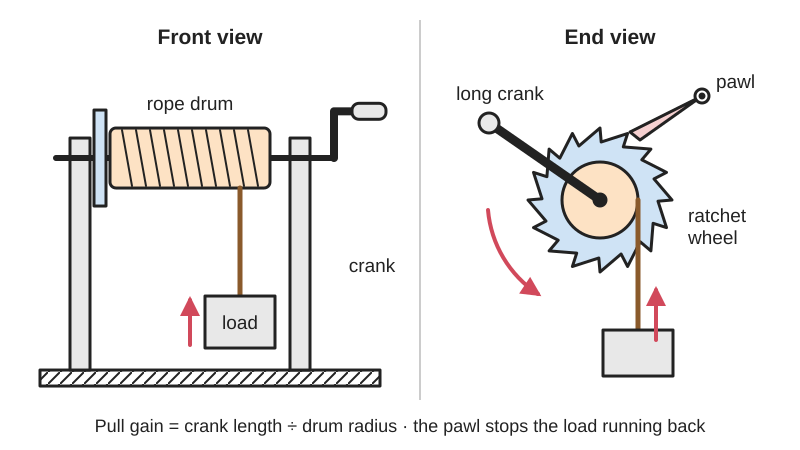
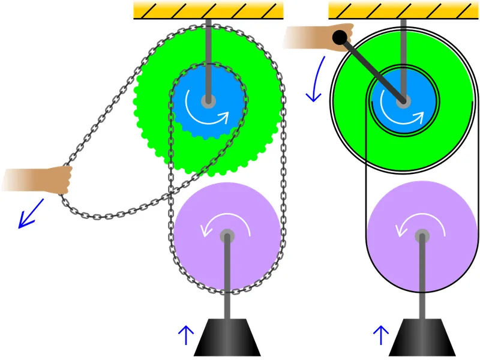
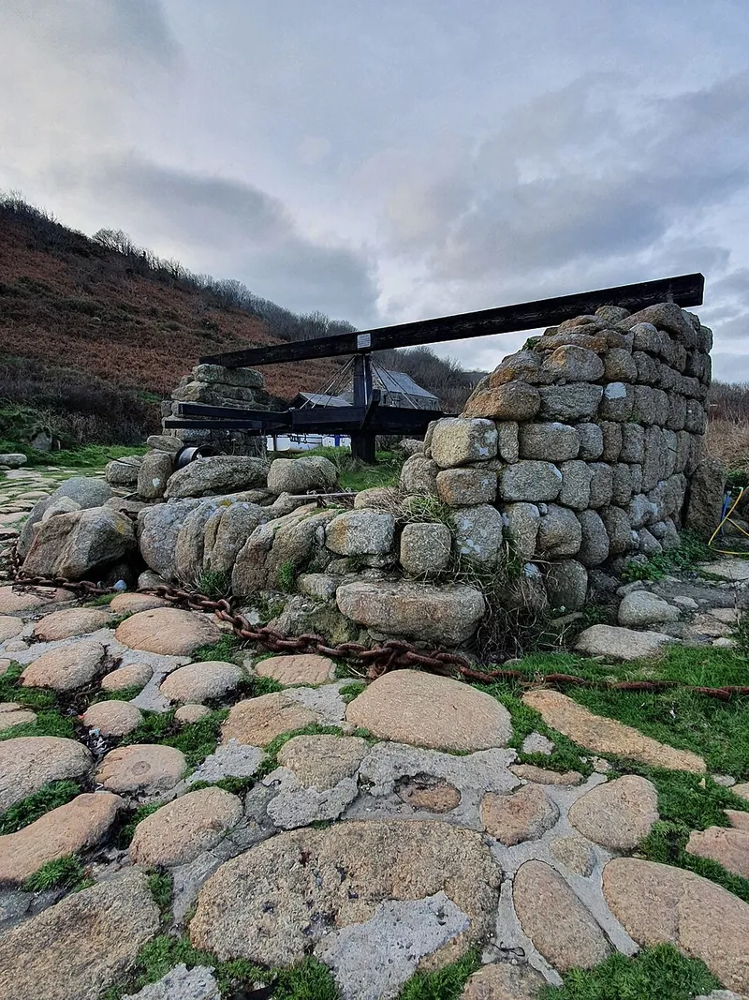

<figure class="eoc-pic eoc-pic-main"><picture><source media="(prefers-reduced-motion: reduce)" srcset="../media/drawn/capstan-and-windlass.svg"></picture><figcaption><strong>Animation.</strong> Diagram drawn for the encyclopaedia from the research notes. ⚑ Needs confirming: a drawing can simplify or get details wrong; a real photo or a better diagram is welcome.</figcaption></figure>
<figure class="eoc-pic"><figcaption><strong>Photo.</strong> <a href="https://commons.wikimedia.org/wiki/File:Capstan_from_af_Chapman_ship_1888_01.jpg">Capstan from af Chapman ship 1888 01</a> by Sinikka Halme, <a href="https://creativecommons.org/licenses/by-sa/4.0">CC BY-SA 4.0</a>, from Wikimedia Commons.</figcaption></figure>
<figure class="eoc-pic"><figcaption><strong>Photo.</strong> <a href="https://commons.wikimedia.org/wiki/File:Penberth_Cove_windlass_in_2020.jpg">Penberth Cove windlass in 2020</a> by Jowaninpensans, <a href="https://creativecommons.org/licenses/by-sa/4.0">CC BY-SA 4.0</a>, from Wikimedia Commons.</figcaption></figure>

A rope drum turned by a [crank](../glossary.md#crank) or bars (a windlass if the axle is horizontal, a capstan if it is vertical) that winds rope in with a force multiplied by the ratio of handle radius to drum radius, usually with a [ratchet](../glossary.md#ratchet) to hold the load; the friction of a few turns of rope round a drum also lets a small pull hold a large load (capstan effect), and a differential windlass winds rope onto one drum while unwinding it from a slightly smaller one for a huge force gain.

**In plain words:** A drum you turn with a handle to wind in a rope, so you can pull or lift something heavy with little effort; wrapping a rope a few turns round a drum or post also lets a small pull hold a big load. **Proper term:** Windlass and capstan (hand winch; differential or Chinese windlass).

**Also called:** hand winch / crank winch / hand-crank winch; trailer winch or boat-trailer winch (a geared hand winch with a clicking ratchet); brake winch / automatic-brake hand winch (holds the load by itself when you let go of the handle); capstan (vertical-axle version, pushed round with bars; the rope takes a few turns and is pulled off the other side instead of being stored); sailing winch / self-tailing winch (yachting name for a geared capstan; Wikipedia 'Winch'); snubbing winch (a ratcheting drum with no handle, used to hold a line; Wikipedia 'Winch'); anchor windlass; wheel and axle (the simple-machine name); differential windlass = Chinese windlass (two drums of different sizes on one axle; Wikipedia 'Windlass'); Spanish windlass (a loop of rope tightened by twisting a stick in it; a simpler, different device); windlass (UK canal term for the removable crank handle used to work lock paddles; not a rope drum); capstan effect / belt friction / Euler-Eytelwein formula (the friction grip of rope wrapped round a drum; Wikipedia 'Capstan equation').

## How it works

Turning the crank turns the drum and winds the rope on, so turning becomes a straight pull (a wheel and axle). The force gain is the crank radius divided by the drum radius, times any [gear ratio](../glossary.md#gear-ratio), less friction (Wikipedia 'Wheel and axle'). A ratchet wheel and spring- or gravity-loaded [pawl](../glossary.md#pawl) let the drum turn only in the winding direction, so the load stays put when you let go; to let rope out you hold the handle and lift the pawl, or use a brake (Curt and Fulton winch instructions; 507 Mechanical Movements #491). On a capstan or sailing winch the rope is not stored: it takes three or four turns round the drum and someone pulls (tails) the free end, and the friction of the turns multiplies that small pull enormously (capstan equation), so the drum can haul or hold a heavy load (Harken; Wikipedia 'Capstan equation'). In a differential windlass the rope unwinds from the small drum while winding onto the big one, so each turn raises the hanging pulley by only half the difference of the two drum circumferences, giving a very large force gain but very slow lifting (Wikipedia 'Windlass'; 507 Mechanical Movements #129). The Spanish windlass, also covered here, needs no drum: a rope or cable is looped round two points, a stick is pushed through the loop and twisted as a lever, and the twisting tightens the rope and pulls the two points towards each other (Wikipedia 'Windlass').

## Parts

A small assembly that acts as one unit: a drum (barrel) on an axle, a frame with bearings, a crank handle (or bars pushed round, for a capstan), the rope, cable or strap and its anchor on the drum, and usually a ratchet wheel and pawl to hold the load; many add reduction gears, a hand brake or an automatic load-holding brake. A differential (Chinese) windlass has two drums of different diameters fixed on one axle plus a loose pulley hanging in the loop of rope between them (Wikipedia 'Windlass'; Make: 'The Chinese Windlass').

## Everyday examples

- A boat-trailer or wall-mounted hand winch that clicks as you crank it (Curt; Fulton)
- A well with a bucket on a rope wound up by a crank (Wikipedia 'Windlass')
- Sailing-yacht winches, where one person cranks and another tails the rope (Wikipedia 'Winch'; Harken)
- A climber holding (belaying) a heavier partner because the rope bends round the gear: the same capstan effect (Wikipedia 'Capstan equation')
- A rope loop twisted tight with a stick (Spanish windlass) to move a heavy pipe or post a short distance, or to pull a car out of mud (Wikipedia 'Windlass')

## When to use it

Use a windlass or hand winch when you need to pull or lift something much heavier than you could by hand, slowly, over a long run of rope: hauling a boat onto a trailer, tensioning a line, raising a bucket, opening a hatch, rolling a shade net over a vegetable bed (the use of the Printables hand-cranked winch), or driving a model crane. Use a capstan or a few turns round a post or snubbing winch when you need to hold or ease a heavily loaded line with little effort, then tie it off. Use a differential windlass when you want a huge force gain from simple parts and don't mind slow lifting and a long loop of rope (Make). Use a Spanish windlass when all you have is rope and a stick and you need to pull two things together a short way, such as a post, a pipe or a bogged-down car (Wikipedia 'Windlass').

## When not to use it

Don't lift people, or loads over people, with a hand winch; use a rated hoist (Curt: never for lifting equipment or humans; Larson: not a hoist for people). Don't rely on the winch to hold a load for a long time; tie or block the load once it is in place (Curt; Larson). For precise positioning use a lead screw or rack instead. For small tension adjustments on a fixed line a turnbuckle or ratchet strap is simpler. A differential windlass is a poor choice when you need speed or a large lift height, because it needs so much rope. Never use a drum with no ratchet or brake under load.

## Details

- **What it does (jobs):**
  - tighten and hold tension: haul a rope, cable or strap tight and keep it there
  - change speed or turning force: a long crank on a small drum trades many turns of the handle for a big pull
  - change the kind of motion: turning the crank becomes a straight pull on the rope
  - stop it moving back (one-way): a ratchet and pawl stop the drum unwinding when you let go
  - slow it, stop it or keep its speed steady: a hand brake, an automatic brake winch or easing the turns on a capstan lets a load down under control
- **Movement:** rotate: the crank and drum turn continuously for as many turns as the drum holds rope; the rope itself moves in a straight line (rotary to linear)
- **Directions it can move (degrees of freedom):** 1: the drum turns about its axle and the rope's travel is tied to that turning; with the pawl engaged it can only turn one way
- **Special behaviour:**
  - motion conversion (e.g. rotary to linear): turning the crank winds rope in as a straight pull
  - one-way (moves freely one way, locks the other): a ratchet wheel and pawl let the drum wind in with a loud clicking but not unwind (Curt; Fulton; 507 Mechanical Movements #491 capstan with a pawl in a circular ratchet at its base)
  - hand-release only (locks under load, releases when a person operates it): to let rope out you must hold the handle and lift the pawl, or turn a brake winch's handle backwards (Curt; Larson Electronics brake-winch manual)
  - [self-locking](../glossary.md#self-locking) (holds under load, won't back-drive): a brake winch's built-in brake holds the load wherever you release the handle (Larson Electronics manual); Nguyen Duc Thang's 'Safety crank for windlass' animation shows a cone clutch and pawl doing the same job
  - tensioning (takes up slack and holds): hauls a line tight and keeps it tight; on a capstan or snubbing winch a small pull on the tail holds a large load through the friction of the turns (Wikipedia 'Capstan equation'; 'Winch')
- **How it holds:**
  - shape (the parts interlock; [form-fit](../glossary.md#form-fit--force-fit--material-bond)): the pawl drops between the ratchet teeth so the drum cannot unwind
  - friction or clamping (force-fit): turns of rope grip the drum (capstan effect), and brake winches hold the load with a friction brake
  - not a holding joint (it moves or passes on motion): its main job is to wind rope in and let it out
- **Input and output:** Crank rotation -> straight pull on the rope (rotary to linear). Ideal force gain = crank radius / drum radius (Wikipedia 'Wheel and axle'), multiplied by any gearing: e.g. the Curt 900 lb trailer winch has a 6.5 in handle and 3.25:1 gears. Harken describes a winch as a rotating lever whose ungeared gain is handle length divided by drum radius, with two- and three-speed gearing 'in effect' lengthening the lever. The gain falls as rope builds up in layers, because the drum's effective radius grows; winch capacities are rated on the first layer (Fulton; Larson). Differential windlass: ideal gain = 2 x crank radius / (big-drum radius - small-drum radius); Make's example (6 in crank, 3 in and 2.75 in diameter barrels) gives 96:1, i.e. 600 lb lifted with 12.5 lb of force in theory. Efficiency: not measured in the sources found; bearing, gear and rope-bending friction reduce the real gain ⚑ [uncertain]. Shafts: the crank is in line with the drum, or on a parallel pinion shaft in geared winches. Back-drivable: yes; a plain drum unwinds under load unless the pawl or brake is engaged, and a capstan's grip slips if the tail is let go.
- **Power:** passive (no power needed): hand-cranked. Powered capstans and winches (electric, hydraulic, pneumatic or engine-driven) do the same job (Wikipedia 'Capstan (nautical)'; 'Winch'); what a powered winch does when power is lost depends on its brake ⚑ [uncertain]
- **Load:** Light to heavy. Hand trailer winches are rated for a few hundred to a few thousand pounds of straight pull (Curt 900 lb; Fulton models listed from 600 to 3,700 lb), on the first layer of line; a differential windlass can lift very heavy loads slowly by hand (Make's 600 lb example). Strong only in a straight pull on the rope; an off-angle pull piles rope at one flange and loads the frame sideways. The mounting must be far stronger than the winch (Fulton asks for a stand good for five times the rated capacity), and the rope's anchor on the drum is not rated for the full load, so turns must always stay on the drum (Curt).
- **Play and precision:** Not a precision locator. A ratchet holds only at tooth boundaries, so the load can [creep](../glossary.md#creep) back up to one tooth spacing before the pawl catches ([backlash](../glossary.md#backlash); Wikipedia 'Ratchet (device)'), and rope or cable stretches under load. The rope should meet the drum close to square: Harken wants the hauling part at 95-100 degrees to the winch drum to avoid a riding turn, and wire-rope drums are kept to small fleet angles (about 0.5-2 degrees for a smooth drum, up to 4 degrees for a grooved drum with ordinary 6- and 8-strand rope; LiftQuip).
- **Taking it apart:** removable: the winch bolts to a post, stand, wall or vehicle, and the rope unhooks and unwinds; a capstan just needs the turns taken off
- **How often it can be reused:** effectively unlimited for the drum, crank and ratchet with occasional cleaning and inspection (Larson asks for at least a yearly check); the rope, strap or cable wears and is replaced at the first sign of kinks, broken wires or fraying (Larson; Curt)
- **Sealing:** none: the drum, gears and rope are open to the weather; hand winches need occasional cleaning and light [lubrication](../glossary.md#lubrication), but never on the brake parts (Larson)
- **Adjustable:** Yes: rope length and tension are set by cranking in or letting out; a ratchet holds at each tooth and a brake winch holds at any point. Multi-speed sailing winches let you change the gear ratio as the load grows (Harken).
- **Access needed:** not applicable: it is mounted on a frame, post, wall or deck; you need room to swing the crank and a straight lead for the rope
- **Materials:** Drums and frames of steel, cast iron, bronze or aluminium (historic ones were largely of timber, e.g. the early capstan was a timber turned with bars; Wikipedia 'Capstan (nautical)'); rope of natural or synthetic fibre, polyester strap, or steel wire rope. Only winches made for steel cable should use it, because steel needs a larger drum hub to limit bending [fatigue](../glossary.md#fatigue) (Fulton). Maker versions use PVC and iron pipe on a wooden frame (Make), or 3D-printed drums and frames in ABS or PETG with steel bolts, threaded rod or a wooden dowel as the axle (Printables models).
- **Heat, cold, water and wear:** In freezing, icy conditions the pawl can stick: Larson suggests silicone spray on the pawl but no oil or grease on the brake parts. Dirty or wet use calls for more frequent inspection (Larson: at least once a year). Printed plastic drums creep under constant load, especially PLA (Printables 'Compact winch for 6mm rope'), and PLA can soften in a hot car (Printables 'Ratchet strap reel'). Synthetic ropes and straps lose strength in sunlight (UV) and natural-fibre rope rots if stored wet ⚑ [uncertain]. Steel cable corrodes and fatigues if bent round too small a drum (Fulton; Mazzella). Oil or water on the drum lowers the friction that a capstan relies on ⚑ [uncertain].

## Making it

- **Ways to make or get it:**
  - 3D print (FDM): drums, frames, cranks and pawls for light loads (Printables hand-cranked and compact winches)
  - woodwork: frames, uprights and traditional well windlasses (Make's Chinese windlass uses a wooden base and uprights)
  - CNC: a lathe-turned steel differential drum, one end turned slightly smaller (suggested in Make's article)
  - off-the-shelf part: trailer winches, brake winches, sailing winches, rope, cable, straps and bearings
- **Printing it in one piece (print in place):** no: the drum, frame, crank and pawl are printed separately and assembled on a bolt, threaded rod or wooden dowel axle (Printables 'Hand cranked winch for 6mm rope' and 'Compact winch for 6mm rope')
- **Tools:** None to operate. Spanners or sockets to bolt the winch down (Curt specifies three 3/8 in grade 5 bolts with lock washers) and to fit the handle with its lock nut; for steel cable, fittings such as wire rope clips or crimps at the hook end ⚑ [uncertain]
- **Difficulty:** easy to moderate: a drum, crank and bearings are easy to print or build from pipe and wood, but a reliable ratchet or brake takes care, and for lifting or heavy pulls you should buy a rated winch

### 3D printing tips

1) Use a metal or wooden axle and a real bearing rather than a printed axle: the 'Compact winch for 6mm rope' uses a 608 bearing and M8 bolts for the axle and handle and an M6 bolt as the pawl pivot; the 'Hand cranked winch for 6mm rope' uses a 24 mm broomstick as the main axle and M5 and M3 threaded rod (Printables). 2) Avoid PLA if the rope will stay loaded: the compact-winch designer warns the drum might fail under constant load; the hand-cranked winch was printed in carbon-filled ABS with 3-4 walls, 3 top and bottom layers and 20% [infill](../glossary.md#infill) and lifts about 20 kg without gears (Printables). PLA also softens in a hot car (Printables 'Ratchet strap reel' notes). 3) Use many walls and orient parts so the pull runs along the layers, since prints are stronger in one direction, like wood (Prusa). 4) [Clearances](../glossary.md#clearance): Prusa suggests starting at about 0.3 mm for parts that must move; the hand-cranked winch used 0.05-0.1 mm gaps and reamed the holes afterwards, so test-fit on your printer. 5) Make the flanges tall enough: a loaded rope should never come closer than two rope diameters to the top of the flange (Curt). 6) Anchor the rope through a hole in the drum (the hand-cranked winch threads 6 mm rope through a 6 mm hole that locks it under tension) but never rely on the anchor: keep at least 3-5 turns on the drum (Fulton; Larson; Curt). 7) Add a ratchet pawl on the frame (gravity-dropped like the hand-cranked winch, or spring-loaded) and check it holds before letting go of the crank (Curt). 8) Make the drum wall thick or solid: many turns under tension squeeze the drum, and a capstan must withstand the crushing force of its rope (Wikipedia 'Capstan equation') (how thick is enough for a printed drum is ⚑ [uncertain]). 9) For a capstan, flare the base of the drum slightly so the rope turns can't slide down, as ship capstans and jib winches do (Wikipedia 'Capstan equation'). 10) For a differential windlass, print both drums on one part so they can't slip against each other, keep the diameter difference small for a big gain, and wind the rope in opposite senses so one drum pays out while the other takes in; it gives no gain if the rope is arranged wrongly (Make). Printed diameters must be accurate because the gain depends on their small difference ⚑ [uncertain]. 11) Smooth the drum where the rope runs so layer ridges don't abrade it ⚑ [uncertain].

### Buying one (off-the-shelf parts)

Hand winch (trailer winch, ratchet winch, wall winch), brake winch (automatic-brake hand winch), winch strap with hook, winch cable or synthetic winch rope, sailing winch or self-tailing winch with a winch handle, snubbing winch, anchor windlass, capstan winch / capstan rope puller ⚑ [uncertain], ratchet wheel and pawl, 608 ball bearings, wire rope clips and thimbles, snatch block (a pulley that opens to take a rope mid-length, used to change direction or double the pull; Wikipedia 'Winch'), fairlead or rope guide, come-along (lever hoist).

## Rules of thumb

- Ideal force gain of a crank and drum = crank radius / drum radius; real gain = efficiency x that ratio (Wikipedia 'Wheel and axle').
- Differential windlass: each turn raises the hanging pulley by pi x (big radius - small radius), i.e. half the difference of the two circumferences (Wikipedia 'Windlass'; 507 Mechanical Movements #129). Make's purchase formula (crank radius / big-drum radius) x (big-drum circumference / difference in circumferences) x 2 gives 96:1 for a 6 in crank on 3 in and 2.75 in diameter barrels (Make: 'The Chinese Windlass').
- Differential windlass rope length (arithmetic from the formula above): to lift a height h the hanging loop must be at least 2h long, and the big drum winds on 2h x R / (R - r) of rope, which is 24 times the lift height with Make's 3 in and 2.75 in drums, so both drums need room for a lot of rope.
- Capstan friction: [holding force](../glossary.md#holding-force) x e^(friction coefficient x wrap angle in radians). With a friction coefficient of 0.3, one turn multiplies the grip about 6.6 times, two turns 43 times and three turns 286 times (Wikipedia 'Capstan equation' table). Sailing sheets are seldom wound more than three turns because extra turns risk a riding turn (same article); Harken says to make three or four turns before cranking.
- Feed the rope onto a sailing winch at 95-100 degrees to the drum to avoid a riding turn (override) (Harken). For wire rope on a smooth drum keep the fleet angle between about 0.5 and 2 degrees; grooved drums allow up to about 4 degrees with 6- and 8-strand rope (LiftQuip).
- Always keep turns on the drum: at least three full turns (Fulton; Larson) or at least five (Curt); the anchor on the drum is not rated for the full load (Curt).
- Winch capacity is rated on the first layer of line and falls as line builds up on the drum (Fulton; Larson). Keep at least two rope diameters of flange above the last layer (Curt).
- Mounting: the winch stand must support at least five times the winch's rated capacity (Fulton); a winch strap should be rated at 1.5 times the winch capacity and its hook at 1.5 times the strap's (Curt).
- If a hand winch can't be cranked easily with one hand it is probably overloaded; this brake winch needs at least 50 lb (23 kg) of load for its brake to work when letting out (Larson Electronics manual).
- Rope or cable life rises steeply with drum-to-rope diameter ratio (D/d): in Mazzella's example a wire rope's relative service life goes from 17 at D/d 26 to 32 at D/d 35 (Mazzella).

## Common failures

1) Rope runs out to the anchor and the anchor fails: always keep 3-5 turns on the drum (Curt; Fulton; Larson). 2) Riding turn (override): the rope crosses over itself and jams, often because it feeds onto the drum at a bad angle; lead it on nearly square (Harken; Wikipedia 'Capstan equation'). 3) Pawl not engaged or slipping, so the handle spins and the load drops: listen for the click and release the handle slowly (Curt). 4) Overload: bent frames or stripped gears; if it can't be cranked easily with one hand it is probably overloaded (Larson). 5) Rope piled at one flange or climbing over it from off-angle pulls or overfilling (Curt; LiftQuip). 6) Kinked, frayed or fatigued cable from messy winding or too small a drum (Fulton). 7) Printed drum cracking or creeping under a constant load (Printables 'Compact winch for 6mm rope'). 8) Capstan slipping because there are too few turns or the tail was let go (Wikipedia 'Capstan equation'). 9) Brake winch won't let out light loads because the brake needs a minimum load (Larson). 10) Differential windlass gives no gain because the rope is wound the wrong way on one drum, or [set screws](../glossary.md#set-screw) slip on the axle (Make).

## Safety

Stand back and stay out of the line the cable is pulling: if it slips or breaks it whips back along that line (Curt). Never let go of the handle before the ratchet pawl is engaged; the handle can spin dangerously and the load can drop (Curt). Hand winches are not for lifting people and many are not for lifting at all (Curt; Larson). Never put a brake winch into [freewheel](../glossary.md#freewheel) if the cable might take a load (Larson). Keep hands, gloves, hair and loose clothing away from the drum and the rope turns, which can slip under a sudden load (Harken; Curt); wear impact safety glasses and heavy work gloves (Curt). Broken strands on steel cable are sharp ⚑ [uncertain]. A Spanish windlass stores twist in the rope, so hold or tie off the stick, because it can spin back if let go ⚑ [uncertain]. This entry describes it only for pulling and tightening things; it is not first-aid guidance, and a home-made twist tensioner is not a tourniquet.

## Related

- Pulley system (block and tackle, differential hoist): gains force with rope running through pulleys instead of winding on a drum; often combined with a winch through a snatch block
- Ratchet tie-down strap (ratchet buckle): a tiny ratchet winch with a slotted spool for webbing, built into a strap
- Capstan cable drive (tendon drive): uses the same wrapped-rope friction, but the cable is anchored to a second drum to pass on limited rotation with no backlash
- Constant-force spring (spring-return reel): winds the line back with a spring instead of a crank
- Ratchet and pawl: the holding part inside most winches
- Worm drive: a gear that usually can't be back-driven, used in some winches so the load holds itself ⚑ [uncertain]
- Turnbuckle: tightens a line by a short, fixed amount with a screw; stores no rope
- Cam cleat and clam cleat: hold the tail of a rope after a winch or capstan has tightened it
- Come-along (lever hoist): a ratcheting, lever-worked winch for manual pulling (listed alongside winches in Wikipedia 'Winch')
- Spanish windlass (covered in this entry): tightens a rope loop by twisting a stick in it; no drum or ratchet (Wikipedia 'Windlass')
- Twisted-string [actuator](../glossary.md#actuator): the same twist-to-shorten idea as a Spanish windlass, with a motor twisting two or more strings together for a strong, compact pull

## Make it yourself

- [Hand cranked winch for 6mm rope (Jay 974, Printables)](https://www.printables.com/model/941964-hand-cranked-winch-for-6mm-rope (URL from Printables API, page not opened)): Supports-free printed hand winch with a gravity latch (pawl), a broomstick axle and threaded-rod frame; lifts about 20 kg with no gears *(licence: CC BY-NC)*
- [Compact winch for 6mm rope (floano, Printables)](https://www.printables.com/model/963686-compact-winch-for-6mm-rope (URL from Printables API, page not opened)): Printed winch with a ratchet pawl, a 608 bearing and M8 bolt axle; designer warns against PLA under constant load *(licence: CC BY-NC-SA)*
- [Ratcheting Capstan Winch (peterbraden, Printables)](https://www.printables.com/model/1516725-ratcheting-capstan-winch (URL from Printables API, page not opened)): Parametric model of a two-speed ratcheting capstan (sailing) winch driven with a hex key; one direction drives directly, the other through gearing *(licence: CC BY-NC-SA)*
- [Chinese Windlass (Henly, Printables)](https://www.printables.com/model/1550343-chinese-windlass (URL from Printables API, page not opened)): Student crane project using a printed differential windlass to lift a 5 kg weight with a 6 N counterweight *(licence: CC BY-NC-ND)*
- [The Chinese Windlass (Make: project)](https://makezine.com/projects/the-chinese-windlass/): Build instructions for a demonstration differential windlass from PVC pipe, iron pipe, pipe fittings, bolts, a pulley and a wooden frame *(licence: link only (licence not stated on the page))*

## Pictures, videos and models

- [Comparison differential pulley windlass.svg (Wikimedia Commons, by Cmglee)](https://commons.wikimedia.org/wiki/File:Comparison_differential_pulley_windlass.svg): Side-by-side diagram of a differential pulley (chain hoist) and a differential (Chinese) windlass with its two drums and hanging pulley *(licence: CC BY-SA 3.0 (also GFDL 1.2 or later))*
- [129. Chinese windlass (507 Mechanical Movements)](https://507movements.com/mm_129.html): Original 1868 drawing plus an animation of the differential windlass; text explains the pulley moves half the difference of the circumferences per turn *(licence: book public domain; website animation link only)*
- [Differential (Chinese) windlass (Nguyen Duc Thang, thang010146, YouTube)](https://www.youtube.com/watch?v=vhPTuOiembA): CAD animation of a differential windlass lifting a load *(licence: link only (standard YouTube licence))*
- [Capstan equation diagram.svg (Wikimedia Commons, by Krishnavedala)](https://commons.wikimedia.org/wiki/File:Capstan_equation_diagram.svg): Diagram of a rope wrapped round a cylinder, with the small holding force and large load force of the capstan effect *(licence: CC0 1.0 (public domain dedication))*
- [The Chinese Windlass (Make:, William Gurstelle, 2012)](https://makezine.com/projects/the-chinese-windlass/): Photos and build steps for a PVC and iron-pipe differential windlass on a wooden frame, with the mechanical-advantage formula *(licence: link only)*

## Needs confirming

⚑ marks something nobody has confirmed yet: a fact the research could not confirm from a source, a finder value that is a best guess, or an open point from the research notes. Corrections are welcome (see `research/needs-confirming.md`).

- ⚑ 12 sentences on this page marked [uncertain].
- ⚑ Finder value `clicks` = clicks (best guess): the text uses both clicking and silent words
- ⚑ Finder value `tools` = none, crimper, hand tools (source uncertain): `tools_needed` is marked ⚑ [uncertain] here: "…eel cable, fittings such as wire rope clips or crimps at the hook end ⚑ [uncertain]…"

## Sources

- <https://en.wikipedia.org/wiki/Windlass>
- <https://en.wikipedia.org/wiki/Capstan_(nautical)>
- <https://en.wikipedia.org/wiki/Winch>
- <https://en.wikipedia.org/wiki/Wheel_and_axle>
- <https://en.wikipedia.org/wiki/Capstan_equation>
- <https://en.wikipedia.org/wiki/Ratchet_(device)>
- <https://commons.wikimedia.org/wiki/File:Comparison_differential_pulley_windlass.svg>
- <https://commons.wikimedia.org/wiki/File:Capstan_equation_diagram.svg>
- <https://makezine.com/projects/the-chinese-windlass/>
- <https://507movements.com/toc.html>
- <https://507movements.com/mm_129.html>
- <https://507movements.com/mm_352.html>
- <https://507movements.com/mm_280.html>
- <https://507movements.com/mm_412.html>
- <https://507movements.com/mm_491.html>
- <https://www.youtube.com/watch?v=vhPTuOiembA>
- <https://www.youtube.com/watch?v=47BMeSY9soA>
- <https://www.youtube.com/watch?v=6QsLCAuC_B0>
- <https://www.youtube.com/watch?v=WIDOMtw_R0Q>
- <https://assets.curtmfg.com/masterlibrary/29433/installsheet/29433_INS.pdf>
- <https://images.carid.com/fulton/pdf/t2605z0101-installation-instructions.pdf>
- <https://www.larsonelectronics.com/images/product/manual/105498.pdf>
- <https://www.harken.com/en/support/tech-articles/choosing-winch-power/>
- <https://www.liftquip.com.au/fleet-angles-wire-rope/>
- <https://www.mazzellacompanies.com/learning-center/why-sheave-design-is-critical-to-wire-rope-service-life/>
- <https://help.prusa3d.com/article/modeling-with-3d-printing-in-mind_164135>
- <https://api.printables.com/graphql/>
