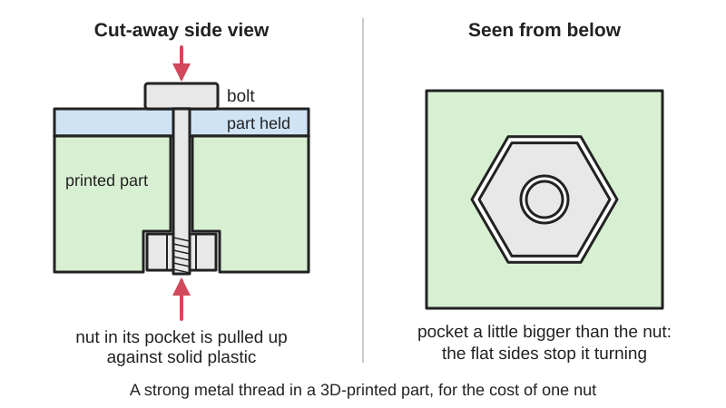

<figure class="eoc-pic eoc-pic-main"><figcaption>Diagram drawn for the encyclopaedia from the research notes. ⚑ Needs confirming: a drawing can simplify or get details wrong; a real photo or a better diagram is welcome.</figcaption></figure>
<figure class="eoc-pic"><figcaption><strong>Photo.</strong> <a href="https://www.flickr.com/photos/68272764@N05/8362079991">infill</a> by Robosprout, <a href="https://creativecommons.org/licenses/by/2.0/">CC BY 2.0</a>, from Flickr via Openverse.</figcaption></figure>

A hexagonal or square pocket shaped to hold a standard nut so it can't spin, giving a printed part a strong metal thread for a bolt at almost no cost.

**In plain words:** A six-sided hole or a side slot in a 3D print that an ordinary nut drops into and can't turn in, so you can tighten a bolt into it from the other side with just a screwdriver or hex key, and no spanner holding the nut. **Proper term:** Nut trap ([captive nut](../glossary.md#captive-nut) pocket).

**Also called:** nut trap (the usual 3D-printing and RepRap term; used by the NopSCADlib library's nut_trap() and BOSL2's nut_trap_side() and nut_trap_inline()); captive nut or captured nut (general term; Wikipedia 'Threaded insert' uses 'captive nut' for nuts held in a part, including cage nuts); nut pocket, hex pocket or hex nut pocket; embedded nut (Hubs; CNC Kitchen); nut [boss](../glossary.md#boss) (Hubs: 'a nut-shaped cavity (often referred to as a nut boss)'); side nut trap, nut slot or side-loading nut trap (the nut slides in from the side; BOSL2 nut_trap_side()); inline nut trap (pocket in line with the bolt; BOSL2 nut_trap_inline()); square nut slot (the same idea with a square nut, as used throughout Prusa printers; Prusa 'M3nS' nuts); buried nut (a nut sealed in by printing over it mid-print; nophead, HydraRaptor blog; covered in its own entry 'Mid-print embedding').

## How it works

The pocket is shaped to the nut's flats, only a few tenths of a millimetre bigger, so the nut slides in but cannot turn: its flat sides press on the flat walls of the pocket (Hubs; BOSL2). When the bolt is screwed in from the other side, the pocket holds the nut still, and as the bolt is tightened it pulls the nut hard against the solid plastic behind it, clamping the parts together. The pull is spread over the nut's whole face instead of the thin plastic threads a screw would cut, which is why a nut pulled against a solid face held more than screwing straight into the plastic in CNC Kitchen's tests. A pocket that opens on a face is filled from that face; a side slot lets the nut slide in from the side where the back can't be reached.

## Parts

A few parts: the printed part with a hex (or square) pocket or side slot and a [clearance](../glossary.md#clearance) hole for the bolt, a standard nut, and a bolt or machine screw. Optional extras: a small 'poke hole' behind a side slot for pushing the nut back out (BOSL2 nut_trap_side), and a one-layer 'sacrificial bridge' over the pocket so the hole above it prints without support, drilled or poked through afterwards (NopSCADlib nut_trap 'supported'; Hackaday 'Sacrificial Bridge Avoids 3D Printed Supports').

## Everyday examples

- Hobby 3D printers built partly from printed parts, such as the Original Prusa MINI+, whose assembly manual has builders pull M3 nuts into printed nut traps and slide square nuts into slots (Prusa MINI+ kit assembly manual)
- Plastic star knobs and clamp knobs with a nut pressed into a hex recess (e.g. Printables 'Captive Nut Star Knob 1/4-20')
- Camera and phone mounts that hold a 1/4 in tripod nut in a hex pocket (e.g. Printables 'GoPro Tripod Mount w/ 1/4" HexNut Pocket Hole') ⚑ [uncertain]
- Laser-cut plywood and acrylic boxes held together with a nut in a T-shaped slot, the flat-sheet cousin (see 'T-slot joint')

## When to use it

Use a nut trap when you want strong, reusable metal threads in a printed part with no extra tools or special parts: just a hex pocket and a nut you already have. It is ideal for parts that are bolted together and taken apart now and then, for bolts that will be tightened hard, for places you can't get a spanner onto the nut, and for larger sizes, where big [heat-set inserts](../glossary.md#heat-set-insert) soak up a lot of heat and are harder to melt in (CNC Kitchen 'Tips & Tricks for Heat-Set Inserts'). It is strongest when the bolt pulls the nut into a thick, solid part.

## When not to use it

Avoid it where you can't reach the pocket to put the nut in (use a heat-set insert, which needs only the front face), where the part is too thin to fit a nut-sized pocket with enough plastic around it (use a heat-set insert or a through-bolt with the nut outside), where the nut would sit in a side slot with the load pushing it out (put the pocket behind the part instead), or for parts assembled once and never opened, where a self-tapping screw is simpler. If the nut must never fall out or be lost, bury it during printing (see 'Mid-print embedding') or use a heat-set insert.

## Details

- **What it does (jobs):**
  - join and hold: gives a printed part a strong, reusable metal thread so another part can be bolted on and taken off again
- **Movement:** none
- **Directions it can move (degrees of freedom):** 0: once the bolt is tight, the joined parts can't move. Before tightening, the nut can shift slightly inside its pocket by the clearance.
- **Special behaviour:**
  - none: it just holds a nut still while a bolt is tightened. (A nylon-insert lock nut (nyloc) in a deeper pocket adds resistance to shaking loose; Wikipedia 'Nut (hardware)')
- **How it holds:**
  - shape (the parts interlock; [form-fit](../glossary.md#form-fit--force-fit--material-bond)): the nut's flats sit against the pocket's flat walls, so it can't turn, and the pocket floor or wall stops it pulling through
  - friction or clamping (force-fit): the bolt and nut then clamp the parts together
- **Input and output:** not applicable
- **Power:** passive (no power needed)
- **Load:** medium: in CNC Kitchen's M3 tests in PETG, a nut in a pocket underneath the part (pulled against solid plastic) held 166 kg before pulling out, the best result, compared with 118 kg for a screw straight into the plastic and 119 kg for a heat-set insert; a nut in a side pocket was weakest at 86 kg. Both nut versions took 2 Nm of twisting before the PETG was crushed, against 3 Nm for a heat-set insert and 1 Nm for a plain screw ('Helicoils, Threaded Insets and Embedded Nuts in 3D Prints', 2020). Strongest when the bolt pulls the nut into thick, solid plastic; weakest when the load pushes the nut towards an open slot or a thin wall.
- **Play and precision:** small: the nut can move by the pocket clearance (typically 0.1-0.2 mm each side) until the bolt is tightened, so hole positions may be off by that much. Once tightened it is rigid. It tolerates small [misalignment](../glossary.md#misalignment) because the bolt pulls the nut into line ⚑ [uncertain].
- **Taking it apart:** removable: the bolt screws out and back in, and the nut usually stays in its pocket; a nut in a side slot can be pushed back out, especially if the design has a poke hole behind it (BOSL2 nut_trap_side). A nut buried by printing over it mid-print is permanent (see 'Mid-print embedding').
- **How often it can be reused:** many times: the bolt runs in the nut's metal thread, so the thread doesn't wear like a printed or self-tapped plastic thread. Hubs lists embedded nuts with inserts as the most popular methods partly for their 'ease of repeated assembly and disassembly'; CNC Kitchen calls nuts 'a cheap and viable alternative' to heat-set inserts. The pocket can be damaged if the nut is allowed to spin or is overtightened.
- **Sealing:** none
- **Adjustable:** no: it is a fixed anchor point for a bolt. (A nut trap at the end of a long bolt can be used as a simple screw adjuster, e.g. a printed C-clamp whose screw runs in a trapped nut; Printables 'Nut-trap C-Clamp')
- **Access needed:** both sides: you need to reach the pocket opening to put the nut in (the back face, or the side for a side slot) and the front to put the bolt in, but once the nut is in place the bolt is tightened from the front only, with no tool on the nut. CNC Kitchen notes the method 'can't always be used if you don't have access from the back and from the side'.
- **Materials:** Standard steel, stainless-steel, brass or nylon hex or square nuts (NopSCADlib draws steel, brass and nylon nuts). The pocket can be printed in any printable plastic (PLA, PETG, ABS/ASA, nylon, resin). The same idea is used in laser-cut plywood and acrylic as a T-slot (see 'T-slot joint') and in wood as a routed pocket ⚑ [uncertain].
- **Heat, cold, water and wear:** The metal nut is unaffected, but the plastic around it softens with heat: PLA started to give at 60 °C and failed at about 65 °C in an oven test, PETG at 80 °C and ASA at 110 °C (CNC Kitchen 'Comparing PLA, PETG & ASA'), so a nut trap in PLA near a motor, heater or in a hot car can let the nut pull in or spin. PLA [creeps](../glossary.md#creep) (slowly squashes) under constant load more than PETG or ABS (thrinter creep test), so a bolt clamping a PLA part can lose tightness over time ⚑ [uncertain for nut traps specifically]. Vibration can shake an ordinary nut loose; nylon-insert lock nuts resist this (Wikipedia 'Nut (hardware)').

## Making it

- **Ways to make or get it:**
  - 3D print (FDM): the usual way; the pocket is modelled into the part
  - 3D print (resin) and 3D print (SLS or MJF): work the same way; powder-bed and resin parts have no [bridging](../glossary.md#overhang--bridging) problem over the pocket ⚑ [uncertain]
  - laser cut: the equivalent is a T-shaped slot that holds a square or hex nut in the edge of a sheet (see the separate entry 'T-slot joint (captive nut and bolt joint)')
  - CNC or woodwork: a hex recess can be milled or chiselled, though wood and metal parts more often use T-nuts or threaded inserts ⚑ [uncertain]
  - off-the-shelf part: the nut and bolt
- **Printing it in one piece (print in place):** partly: the pocket prints as part of the object, and a standard nut is pushed or pulled in afterwards (or dropped in during a pause and printed over; see 'Mid-print embedding').
- **Tools:** a screwdriver or hex key for the bolt; no spanner on the nut. Helpful extras: a longer, fully threaded screw to pull a tight nut into its pocket (Prusa's 'screw pulling technique'), a piece of tape to stop a nut falling out of a side slot, a 2 mm hex key or a pin to line up a nut in a slot (Prusa MINI+ assembly manual), and a drill bit or pin to open a sacrificial bridge layer (Hackaday).
- **Difficulty:** easy: it is just a hexagonal hole in the model and a nut you already own; the only fiddly parts are getting the pocket size right for your printer and designing it so the nut can be inserted

### 3D printing tips

1) Size the pocket from the nut's width across the flats, not across the corners: measure your nuts or use the standard sizes (M3 nuts are 5.5 mm across the flats and 2.4 mm thick; Wikipedia 'Nut (hardware)'). Across the corners is about 1.155 times the width across the flats (NopSCADlib computes flat radius = corner radius x cos 30 degrees), e.g. about 6.35 mm for M3. 2) Clearance: Hubs suggests starting with a 0.2 mm offset all round (0.1 mm each side) for a loose fit, more for nuts bigger than M12; BOSL2 enlarges its nut traps by 2 x $slop, a setting you tune for your printer. Print a strip of test pockets first (e.g. Printables 'Nut Fit Test Generator'). 3) Depth: typically just below flush with the surface (Hubs); NopSCADlib uses 3 mm deep traps for M3 and 4 mm for M4. Lock nuts with a nylon ring (nyloc) are thicker and need a deeper pocket. 4) Put the pocket where the bolt will pull the nut into solid plastic: a pocket underneath the part held nearly twice as much as a side pocket in CNC Kitchen's tests (166 kg vs 86 kg). Keep at least a screw-diameter's thickness of plastic around it (Hubs rule: wall at least equal to the screw diameter). 5) The hole above a nut pocket starts in mid-air when printed upside down or in a slot. Either leave one solid layer over the pocket (a sacrificial bridge) and drill or poke through it afterwards (Hackaday 'Sacrificial Bridge Avoids 3D Printed Supports'; NopSCADlib nut_trap supported option), or use stepped bridging layers that shrink the opening layer by layer so the hole prints cleanly with no drilling (nophead, HydraRaptor 'Buried nuts and hanging holes'; Hackaday 'Look Ma, No Support For My Floating Holes!'). 6) Side slots: the flat roof of the slot is bridged by the printer; keep it short. When the pocket's axis lies sideways (horizontal), holes and pockets sag slightly at the top, so NopSCADlib makes horizontal nut traps a quarter of a layer height larger. 7) Add a poke hole behind a side slot so the nut can be pushed out again (BOSL2 nut_trap_side poke_len). 8) Fitting the nut: if it's tight, don't hammer it; use a fully threaded screw (e.g. M3x10 or M3x18) from the other side to pull it in, then remove the screw (Prusa MINI+ assembly manual, 'screw pulling technique'). You can also press it in warm ⚑ [uncertain]. 9) If a nut keeps falling out, hold it with a piece of tape until the bolt is in (Prusa). Hubs suggests a drop of superglue on the back of the nut, but Prusa advises against glue because it can run into the thread and stop the screw tightening properly; if you glue, keep it off the thread. 10) Don't overtighten: in PETG both nut designs failed at about 2 Nm when the plastic under the nut was crushed (CNC Kitchen), yet 1 Nm on an M3 bolt already gives more than 1500 N of clamping (CNC Kitchen).

### Buying one (off-the-shelf parts)

Hex nuts (ISO 4032 / DIN 934 'hex nut') ⚑ [uncertain for standard numbers], thin 'jam nuts' for shallow pockets, square nuts (DIN 562 'square nut, thin') for side slots ⚑ [uncertain for standard numbers], nylon-insert lock nuts ('nyloc', 'prevailing-torque nut'), and matching machine screws such as M3 socket-head cap screws. Standard metric hex nut sizes: M2 4 mm across the flats x 1.6 mm thick, M3 5.5 x 2.4, M4 7 x 3.2, M5 8 x 4, M6 10 x 5, M8 13 x 6.5 (Wikipedia 'Nut (hardware)').

## Rules of thumb

- Start with a pocket 0.2 mm larger than the nut all round (0.1 mm per side) for a loose fit, and more for nuts larger than M12; make the pocket just below flush (Hubs 'How to assemble 3D printed parts with threaded fasteners').
- Minimum wall around a threaded fastener equals the fastener diameter, e.g. 5 mm for M5 (Hubs).
- Metric hex nut sizes across the flats x thickness: M3 5.5 x 2.4 mm, M4 7 x 3.2 mm, M5 8 x 4 mm, M6 10 x 5 mm (Wikipedia 'Nut (hardware)'); across the corners is the width across the flats divided by cos 30 degrees, about 1.155 times (geometry, as used in NopSCADlib nut.scad).
- NopSCADlib's defaults: nut trap depth 3 mm for M3 and 4 mm for M4; horizontal traps a quarter of a layer height larger in radius; an optional one-layer 'supported' roof over the trap (NopSCADlib vitamins/nuts.scad and nut.scad).
- BOSL2 nut traps are enlarged by 2 x $slop (default 0, set for your printer); side traps can have a poke hole whose diameter defaults to the nut thickness (BOSL2 screws.scad).
- M3 nut in PETG, pull-out: 166 kg with the nut in a pocket underneath, 86 kg in a side pocket; both twisted out at 2 Nm when the plastic crushed (CNC Kitchen, 2020).
- A tight nut is pulled into its pocket with a fully threaded screw from the opposite side (typically M3x10 or M3x18), not hammered; tape, not glue, holds a loose one (Prusa Original Prusa MINI+ kit assembly manual, step 10).
- Holes starting above a nut pocket can be printed without support by stepped bridging: two parallel bridges, then crossing bridges forming a square, then an octagon, each one layer thick (nophead, HydraRaptor 'Buried nuts and hanging holes', 2014).

## Common failures

1) Nut won't go in: the pocket prints small; pull it in with a screw from the other side (Prusa) and make the next pocket slightly bigger (Hubs). 2) Nut spins when tightening: the pocket is too big, printed oval, or its corners have been rounded by overtightening; tighten the clearance or print a test strip. 3) Nut keeps falling out of a side slot during assembly: CNC Kitchen found this 'constantly' annoying; hold it with tape (Prusa), add a small bump or tighter fit, or move the pocket to the back of the part. 4) Hole above the pocket is messy or blocked because it was printed in mid-air: use a sacrificial bridge or stepped bridging (Hackaday; nophead). 5) Plastic crushes or cracks around the nut: overtightened or thin walls; in PETG the plastic crushed at about 2 Nm (CNC Kitchen); keep walls at least one screw diameter thick (Hubs). 6) Nut pulls through or the side of the slot breaks out: the load pushes the nut towards the open side of a side slot, which held only 86 kg against 166 kg for a nut pulled into solid plastic (CNC Kitchen). 7) Glue in the thread stops the screw tightening (Prusa).

## Safety

None known for the joint itself. Loose nuts are small parts that children could swallow ⚑ [uncertain]. If you embed nuts by pausing a print, keep fingers away from the hot nozzle and bed (see 'Mid-print embedding').

## Related

- Heat-set threaded insert: a knurled brass insert melted into a plain hole; needs a soldering iron but only the front face, takes more twisting (3 Nm vs 2 Nm in CNC Kitchen's M3 PETG test) and never falls out
- Mid-print embedding (captive nuts, magnets and bearings): the nut is dropped in during a print pause and printed over, so it is trapped for good and needs no access later
- T-slot joint (captive nut and bolt joint): the laser-cut version, with a T-shaped slot holding a square nut in the edge of a sheet
- Self-tapping screw into plastic (thread-forming screw): no nut at all; simplest, but held only about 1 Nm in CNC Kitchen's tests and wears out after a few uses
- Press-fit and expanding inserts (tap-in insert): pushed in cold and held by barbs or expansion; no pocket access from behind needed
- Cage nut: a spring-steel cage that clips a square nut into a square hole in sheet metal, for places that are hard to reach (Wikipedia 'Nut (hardware)')
- Rivet nut: a threaded blind rivet installed from one side into sheet material (Wikipedia 'Threaded insert')
- Ordinary screw joint (bolt and nut): the baseline; a nut trap is simply a way of holding the nut so no spanner is needed

## Make it yourself

- [BOSL2 screws.scad: nut_trap_side() and nut_trap_inline() (OpenSCAD library)](https://raw.githubusercontent.com/BelfrySCAD/BOSL2/master/screws.scad): Parametric OpenSCAD masks for hex or square nut traps, either sliding in from the side (with an optional poke hole) or in line with the screw, sized from standard metric or inch nut tables plus a $slop allowance for your printer *(licence: BSD 2-Clause)*
- [NopSCADlib nut.scad: nut_trap() (OpenSCAD library by nophead)](https://raw.githubusercontent.com/nophead/NopSCADlib/master/vitamins/nut.scad): OpenSCAD module that cuts a nut trap and screw clearance hole, with options for horizontal traps (slightly enlarged, teardrop screw hole) and a one-layer supported roof for printing without support *(licence: GPL-3.0 or later)*
- [Nut Fit Test Generator (OpenSCAD Parametric) (Brandon Beaumia, Printables) (URL from Printables API, page not opened)](https://www.printables.com/model/1789534-nut-fit-test-generator-openscad-parametric): OpenSCAD customiser that makes a strip of labelled hex pockets stepping up by a chosen increment, to find the best nut fit for your printer. Read through the Printables public API. *(licence: Creative Commons Public Domain)*
- [Nut-trap C-Clamp (DaveX, Printables) (URL from Printables API, page not opened)](https://www.printables.com/model/295885-nut-trap-c-clamp): Configurable printed C-clamp whose clamping screw runs in a nut held in a nut trap, with nut sizes from M1.6-M12 and #6-32 to 1"-8. Read through the Printables public API. *(licence: CC BY-SA (Creative Commons Attribution-ShareAlike))*

## Pictures, videos and models

- [Sacrificial Bridge Avoids 3D Printed Supports (Hackaday, 2017)](https://hackaday.com/2017/10/17/sacrificial-bridge-avoids-3d-printed-supports/): Pictures of a hex nut pocket with a thin printed bridge over it so the bolt hole above prints cleanly; the bridge is drilled out afterwards *(licence: link only)*
- [Buried nuts and hanging holes (nophead, HydraRaptor blog, 2014)](https://hydraraptor.blogspot.com/2014/03/buried-nuts-and-hanging-holes.html): Photos and layer-by-layer images of M4 nuts buried in a printed knob and of the stepped bridging that prints the hole above a nut without support *(licence: link only)*
- [HELICOIL®, Threaded Insert or Embedded Nut in 3D Prints? (YouTube, CNC Kitchen)](https://www.youtube.com/watch?v=2wRc1KbEAU8): Video testing M3 nuts in side and bottom pockets against heat-set inserts, Helicoils and plain screws in PETG, with pull-out and torque results; title and channel confirmed via YouTube oEmbed, video not watched *(licence: link only (standard YouTube licence))*
- [3D Print Floating Holes Without Support! (With This One Weird Trick :P ) (YouTube, Maniacal Labs LLC)](https://www.youtube.com/watch?v=W8FbHTcB05w): Video showing stepped bridging layers that let a hole start in mid-air above a counterbore or nut pocket, as described by Hackaday; title and channel confirmed via YouTube oEmbed, video not watched *(licence: link only (standard YouTube licence))*
- [Hexagon nuts (Wikimedia Commons, photo by Oytun 73, 2007)](https://commons.wikimedia.org/wiki/File:Hexagon_nuts.jpg): Photo of a pile of hex nuts, showing the flats that a hex pocket grips *(licence: Public domain (released by the author))*

## Needs confirming

⚑ marks something nobody has confirmed yet: a fact the research could not confirm from a source, a finder value that is a best guess, or an open point from the research notes. Corrections are welcome (see `research/needs-confirming.md`).

- ⚑ 10 sentences on this page marked [uncertain].

## Sources

- <https://www.hubs.com/knowledge-base/how-assemble-3d-printed-parts-threaded-fasteners/>
- <https://www.cnckitchen.com/blog/helicoils-threaded-insets-and-embedded-nuts-in-3d-prints-strength-amp-strength-assessment>
- <https://www.cnckitchen.com/blog/comparing-pla-petg-amp-asa-feat-prusament>
- <https://help.prusa3d.com/wp-content/uploads/generated/original-prusa-mini-kit-assembly_1215_en_2025-03-25.pdf>
- <https://hydraraptor.blogspot.com/2014/03/buried-nuts-and-hanging-holes.html>
- <https://hackaday.com/2017/10/17/sacrificial-bridge-avoids-3d-printed-supports/>
- <https://hackaday.com/2020/05/17/look-ma-no-support-for-my-floating-holes/>
- <https://raw.githubusercontent.com/BelfrySCAD/BOSL2/master/screws.scad>
- <https://raw.githubusercontent.com/BelfrySCAD/BOSL2/master/constants.scad>
- <https://raw.githubusercontent.com/BelfrySCAD/BOSL2/master/LICENSE>
- <https://raw.githubusercontent.com/nophead/NopSCADlib/master/vitamins/nut.scad>
- <https://raw.githubusercontent.com/nophead/NopSCADlib/master/vitamins/nuts.scad>
- <https://en.wikipedia.org/wiki/Nut_(hardware)>
- <https://en.wikipedia.org/wiki/Threaded_insert>
- <https://commons.wikimedia.org/wiki/File:Hexagon_nuts.jpg>
- <https://www.youtube.com/watch?v=2wRc1KbEAU8>
- <https://www.youtube.com/watch?v=W8FbHTcB05w>
- <https://api.printables.com/graphql/>
- <http://thrinter.com/creep-abs-pla-petg-alloy-910/>
- <https://www.cnckitchen.com/blog/tips-and-tricks-for-heat-set-inserts>
