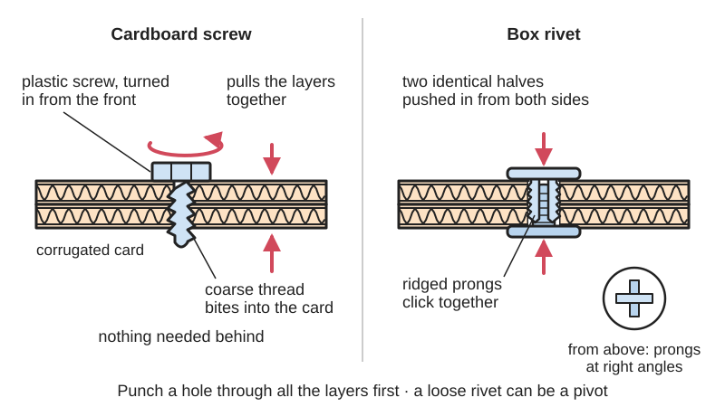

<figure class="eoc-pic eoc-pic-main"><figcaption>Diagram drawn for the encyclopaedia from the research notes. ⚑ Needs confirming: a drawing can simplify or get details wrong; a real photo or a better diagram is welcome.</figcaption></figure>

Reusable plastic fasteners made for corrugated cardboard: a coarse-threaded plastic screw driven into a punched hole from one side, or a pair of plastic rivet halves pressed together through the hole from both sides, which clamp box panels together without tape or glue and can be taken out and reused, with smooth-shank rivets and plastic hinges for swinging joints.

**In plain words:** Chunky plastic screws, or plastic studs that click together from both sides, made for joining pieces of cardboard box without tape or glue, which can be undone and used again, and can also make doors and flaps that swing. **Proper term:** Cardboard construction fasteners: plastic cardboard screws and snap-together box rivets (with zip-tie rivets as a home-made version).

**Also called:** cardboard screw; cardboard construction screw; plastic cardboard connector (Adafruit 'Cardboard fundamentals'; Printables model titles); Makedo Scru and Scru+ (brand): the best-known plastic cardboard screws, part of the Makedo cardboard construction system (Makedo FAQ; V&A object record); box rivet; cardboard rivet; plastic pop rivet for cardboard (Cool Tools; TinkerLab; Adafruit 'Plastic Pop Rivets for Cardboard Crafts'); Mr. McGroovy's Box Rivets (brand): click-together plastic rivets for large boxes (Cool Tools; TinkerLab; Make:); zip-tie rivet; cable-tie rivet: one cable tie pushed through the board with a second slipped onto its tail (Adafruit 'Cardboard fundamentals'); cardboard hinge, spin hinge, roto ring: plastic add-ons fixed with cardboard screws to make swinging and turning joints (Makedo Spin-Hinge and 3D printables pages; Printables).

## How it works

A hole is punched through all the layers first (Makedo 'Using the Makedo tools'). A cardboard screw is then turned in from the front with its driver: its coarse thread bites into the soft board and pulls the layers together, and 'the friction between the layers maintains a firm connection', so no nut or access to the back is needed and it comes out again by turning it the other way (Makedo 'Using the Makedo tools'). A box rivet is two plastic halves pushed into the hole from opposite sides 'with the prongs at a 90-degree angle from one another'; when pressed together 'the ridged prongs click securely and hold the two layers of cardboard together' (TinkerLab), and the [ratchet](../glossary.md#ratchet) 'clinches them close, yet enables them to be reused' (Cool Tools). Because a rivet has a smooth shaft, a loosely clinched one also works as a pivot for joints that swing (Adafruit; Cool Tools).

## Parts

Single piece or a few parts. Cardboard screw: one plastic screw with a hexagonal head, plus a plastic driver that has a pointed punch on the end of its handle (V&A record: 'a saw, a screwdriver, two sizes of screws, and a multipurpose mini tool for punching holes and screwing screws'). Box rivet: two identical halves with ridged prongs ('One shape does both sides', Cool Tools). Zip-tie rivet: two cable ties (Adafruit). Optional add-ons: plastic hinges, turning rings and angle brackets fixed with the same screws (Makedo).

## Everyday examples

- Classroom and home cardboard-box forts, playhouses and castles, including a castle 'with a working drawbridge' (V&A object record; TinkerLab)
- Cardboard costumes such as helmets, shields, masks and wings (V&A; Makedo FAQ project list)
- Large cardboard mazes at events, taken apart afterwards with a powered driver (Makedo 3D printables page)
- Cardboard robots and models with wheels and swinging doors (Makedo Spin-Hinge and Roto-Ring; Printables)

## When to use it

For big, quick cardboard builds by children or groups: forts, playhouses, costumes, mazes, stage sets and classroom design challenges, where you want strong joints without waiting for glue, without hot-glue burns, and with the option of taking it apart and reusing both fasteners and cardboard (Makedo FAQ; Cool Tools; TinkerLab). For prototypes you expect to change, since screws can be undone and moved (Makedo). For doors, flaps, drawbridges and wheels, using rivets as pivots or plastic hinge and turning-ring add-ons (Adafruit; Makedo). Instead of duct tape, which Cool Tools calls 'clumsy, expensive', 'will unpeel outdoors in weather' and 'won't take paint' (Make: also says 'avoid tape if you can - especially duct tape').

## When not to use it

For paper or thin card, where a split-pin paper fastener or glue is neater. For small, precise models, where glued tabs or tab-and-slot joints look cleaner and fit better (Make: notes 'Enlarged slot and tab systems' for easy assembly and disassembly). For wood, plywood, metal or rigid plastic: use real screws, bolts, rivets or glue. For anything that must hold a person's weight, get wet or stay outdoors ⚑ [uncertain]. For permanent display pieces where you want no visible fasteners: use glue (hot glue or PVA, Adafruit) instead. Where children under 3 will be playing with loose parts (Makedo FAQ).

## Details

- **What it does (jobs):**
  - join and hold: joins overlapping panels, corners, brackets and patches in cardboard builds (Makedo 'Connections and joints'; TinkerLab)
  - let it move (turn, slide or bend): smooth-shank rivets, zip-tie rivets and plastic hinge and turning-ring add-ons make doors, flaps, wheels and swinging joints (Adafruit; Cool Tools; Makedo Spin-Hinge page; Printables 'Zip tie cardboard connector')
- **Movement:** none for a tightened screw or rivet (it clamps the panels rigidly); rotate when a rivet or zip-tie rivet is used as a pivot, or with a plastic hinge add-on, which Makedo gives a range of 0 to 270 degrees (Makedo 3D printables page)
- **Directions it can move (degrees of freedom):** 0 when used as a clamp; 1 (turning about the fastener) when used as a pivot or with a hinge add-on
- **Special behaviour:**
  - none: no locking or clever behaviour beyond being reusable. A box rivet's ratchet prongs click shut (a simple snap fit) but can be taken apart again (Cool Tools; TinkerLab)
- **How it holds:**
  - friction or clamping ([force-fit](../glossary.md#form-fit--force-fit--material-bond)): the screw thread squeezes the layers together and 'the friction between the layers maintains a firm connection' (Makedo 'Using the Makedo tools')
  - shape (the parts interlock; form-fit): the screw thread is buried in the board, and the rivet halves' ridged prongs interlock like a ratchet (TinkerLab; Cool Tools)
- **Input and output:** not applicable
- **Power:** passive (no power needed)
- **Load:** light to medium: enough for forts, playhouses, mazes, costumes and props. Makedo: 'It's amazing how much just one or two Scrus can hold!'; a child-built riveted playhouse was 'still standing solid' after a week in child care, including being moved by small children (TinkerLab). The cardboard, not the fastener, is usually the weak part: it crushes, tears around the hole or folds next to the joint ⚑ [uncertain: no load tests found]. Strongest in shear between overlapped panels and weakest when panels are levered apart ([peel](../glossary.md#peel-vs-shear)), which bends the board around the fastener ⚑ [uncertain]. Not for anything that carries a person's weight ⚑ [uncertain].
- **Play and precision:** Screw joints: no play once tight, but not precise, since the punched holes and soft board allow a few millimetres of placement error ⚑ [uncertain]. Rivet or zip-tie pivots and hinge add-ons: noticeable play, fine for doors, flaps and wheels in play structures ⚑ [uncertain]. Tolerates holes that don't line up exactly and uneven board thickness (Cool Tools: on thin cardboard box rivets 'aren't as prettily snug, but still will hold fine').
- **Taking it apart:** removable: unscrew the screw ('Twist to the left to remove the Scru and separate the cardboard pieces', Makedo 'Using the Makedo tools'), which leaves the cardboard 'clean and ready to be reused or recycled'. Box rivets also come apart for reuse (Cool Tools; Make: 'easy tear down'). Zip-tie rivets are cut off and are single-use ⚑ [uncertain: cable ties as normally sold do not release].
- **How often it can be reused:** many times: Makedo says its screws 'can be reused over and over (and over) again' and its tools are 'endlessly re-usable' (Makedo tools guide and FAQ); box rivets are reusable (Cool Tools). Each new hole in the cardboard is a fresh grip, while an old hole gets looser ⚑ [uncertain]. Zip-tie rivets: once.
- **Sealing:** none
- **Adjustable:** yes, by undoing and refitting: 'If something doesn't look right, it's easy to undo the Scru connectors and reposition your cardboard, then reattach' (Makedo 'Connections and joints'). The angle of a joint can be set with printed angle brackets for set angles from 90 to 270 degrees (Printables 'Cardboard angle brackets compatible with Makedo').
- **Access needed:** Cardboard screw: one side only (blind); it threads into the layers without a nut (Makedo 'Using the Makedo tools'), except that joints of more than 5 layers are screwed from both sides. Box rivets and zip-tie rivets: both sides, since a half or a second tie goes on from the back (TinkerLab; Cool Tools; Adafruit).
- **Materials:** Fasteners are moulded plastic: Makedo's are 'made in China using both RPP (recycled polypropylene) and virgin plastic' (Makedo FAQ; V&A: 'Injection-moulded plastic'); Mr. McGroovy's rivets are a tough plastic ('Kevlar-like', Cool Tools). Made for corrugated cardboard: Makedo is 'specifically designed to be used with standard corrugated cardboard' but 'can work well on all other kinds of cardboard too' (Makedo FAQ); box rivets 'are really made for the double wall corrugated cardboard of the kind you find in large appliance boxes' and also hold on thinner board (Cool Tools). Printed add-ons join fabric, LEGO parts and micro:bit boards to cardboard (Makedo 3D printables page). Not meant for wood, plywood, metal or rigid plastic sheet, which are too hard for the plastic thread to bite into ⚑ [uncertain]; paper and thin card tear ⚑ [uncertain].
- **Heat, cold, water and wear:** The plastic fasteners are not harmed by water or normal temperatures, but cardboard is: corrugated board's compression strength falls as its moisture content rises (Wikipedia 'Corrugated fiberboard': moisture above about 9.5% 'will reduce the compression strength'), so builds sag and joints loosen in damp or rain. Cardboard [creeps](../glossary.md#creep) and softens under long-term load, so heavy joints work loose over time ⚑ [uncertain]. Polypropylene fasteners become [brittle](../glossary.md#brittle--ductile) after long sun exposure ⚑ [uncertain: general plastics knowledge]. Printed PLA screws can soften in a hot car ⚑ [uncertain].

## Making it

- **Ways to make or get it:**
  - off-the-shelf part: Makedo screws and kits, box rivets, plastic pop rivets and cable ties (Makedo; Cool Tools; Adafruit)
  - 3D print (FDM): many free printable cardboard screws, drivers, hinges, angle and step brackets and turning rings (Makedo 3D printables page; Printables)
  - laser cut: laser-cut cardboard panels can be joined with these fasteners ⚑ [uncertain: no page opened]
- **Printing it in one piece (print in place):** no: screws, hinges and brackets print as separate parts and are assembled with screws. The printable hinge is one part that is fixed with 2-3 Makedo screws (Makedo 3D printables page) ⚑ [uncertain whether its two leaves are printed already linked].
- **Tools:** Something to punch the hole: the spike on the end of the Makedo Scru-Driver or Mini-Tool handle (Makedo), a nail punch or drill (TinkerLab), an awl, bamboo skewer or single hole punch (Adafruit). A matching plastic driver to turn the screws: Makedo screws 'can only be used with the Makedo Scru-Driver, Mini-Tool or 3d-printed Scru-Bit' and metal tools such as socket wrenches 'will result in irreversible damage' (Makedo tools guide). A 3D-printed Scru-Bit can go in a cordless electric screwdriver 'on a low [torque](../glossary.md#torque) setting', not a power drill (Makedo 3D printables page). Box rivets need no tool to fit, but often two people or long arms to squeeze both sides (Cool Tools). Zip-tie rivets need scissors or cutters to trim the tails (Adafruit).
- **Difficulty:** easy: designed for children; 'Children aged 4+ can make with the assistance of an adult' and 6+ independently (Makedo FAQ), and a 9-year-old built a playhouse with box rivets after one demonstration (TinkerLab). Screws and add-ons can also be 3D printed at home.

### 3D printing tips

Many free printable cardboard screws exist, most made to fit Makedo drivers and accessories. Print them upright with no supports; one classroom design printed at 0.2 mm layers with no supports and fitted 36 screws on a 220 x 220 mm bed, but notes that deeper threads 'would require supports' (Printables 'Cardboard construction screws for the classroom'). Settings that worked: 100% [infill](../glossary.md#infill) ('PLA is plenty strong for its intended use', Printables 'Cardboard screw jumbo'); 15% to 100% infill with a brim if bed adhesion is poor (Printables 'Redesigned Makedo style cardboard screw', redesigned with a stronger shank after children kept breaking them); 0.3 mm layers and 20% infill in PLA, about 12 minutes per screw or 120 screws in about 19.5 hours (Printables 'Knurled cardboard screw Makedo compatible'); 25% infill at 0.12 mm layers 'for maximum strength' (Printables 'Cardboard screw compatible with Makedo'). Design the thread so it doesn't sag on the bed, size the head to fit the driver, and add knurling for grip (Printables 'Knurled cardboard screw'). That design also has an 'anti-suffocation hole' through the head, an idea borrowed from pen caps ⚑ [uncertain: it does not make the screw safe for small children]. Printed hinges and brackets: about 0.3 mm layers, 25% infill, no supports (Printables 'Cardboard hinge compatible Makedo'); hinge holes may need adjusting to fit the screws you have (same page). Use the longer screw (Scru+) to attach printed add-ons (Pimoroni Scru+ listing). A printed Scru-Bit lets a cordless screwdriver drive the screws, on low torque (Makedo).

### Buying one (off-the-shelf parts)

Plastic cardboard screws and drivers (Makedo Scru, Scru+, Scru-Driver, Mini-Tool, Safe-Saw, Fold-Roller; brand, sold as kits and refill packs: Makedo FAQ; Pimoroni listing https://shop.pimoroni.com/en-au/products/makedo-scru-120). Plastic box rivets / cardboard rivets (Mr. McGroovy's, brand; Cool Tools). Plastic pop rivets for cardboard crafts (Adafruit listing, no longer stocked). Cable ties (zip ties) for zip-tie rivets (Adafruit). Plastic hinge and turning-ring add-ons (Makedo Spin-Hinge, Roto-Ring). Alternatives: brass paper fasteners (Adafruit), push-in plastic rivets, or small nuts and bolts with large washers ⚑ [uncertain: no page opened].

## Rules of thumb

- Punch a hole first, through all the layers, with a smooth firm push, not a stab; for tough surfaces tilt the punch side to side, and for many layers separate them and punch one or two at a time (Makedo 'Using the Makedo tools').
- Layers per length: the short Makedo Scru joins 'up to 3x layers' and the long Scru+ 'up to 5x layers' of corrugated cardboard (Makedo 'Using the Makedo tools'; Makedo FAQ). Other Makedo pages say the Scru+ handles 'four to six layers' (Pimoroni listing) or 'up to six layers' (Makedo FAQ, Invent kit list), and Adafruit says the short ones suit 'two or three layers' and the long one 'the thick, 5-ply cardboard from heavy-duty shipping boxes'. For more than 5 layers, 'Punch a hole from both sides and attach an additional Scru+ from behind', offsetting the screws (Makedo).
- Don't over-tighten: 'Once the Scru stops turning, that will be enough' (Makedo 'Using the Makedo tools').
- Fit box-rivet halves with their prongs at 90 degrees to each other, then press together until they click (TinkerLab).
- Overlap panels, and put the [flutes](../glossary.md#flute) of the two layers in different directions for a stronger joint; fold brackets and ribs across (perpendicular to) the flutes (Makedo 'Connections and joints'). Where edges don't overlap, bridge them with a cardboard patch fastened on both sides (TinkerLab; Makedo).
- Plan where the fasteners go and use as few as needed; one or two screws often hold (Makedo 'Connections and joints'). Fit the hard-to-reach rivets first and the ones near the edge last (TinkerLab).
- For a hinged door, fix the hinge to the fixed (non-moving) panel first, with two screws per hinge half (Makedo Spin-Hinge page).
- Know your board: common flutes are A (about 4.8 mm thick), B (3.2 mm), C (4.0 mm), E (1.6 mm) and F (0.8 mm), and Wikipedia says C flute is the most common in boxes (Wikipedia 'Corrugated fiberboard'), while Adafruit says A flute is (Adafruit 'Cardboard fundamentals').

## Common failures

Screw spins without tightening because the hole is too big or reused too often, or the board is too thin: move to fresh board, add a layer or patch, or use the shorter screw ⚑ [uncertain]. Screw won't reach through too many layers: use the longer Scru+ or screw from both sides (Makedo). Driver or screw head damaged by metal tools or a power drill: use only the plastic driver or a printed bit in a cordless screwdriver on low torque (Makedo). Printed screws snap at the shank: print stronger designs with more infill (Printables 'Redesigned Makedo style cardboard screw'). Board bends or creases when punching: support it from behind (Makedo 'Connections and joints'). Box rivets loose on thin board (Cool Tools). Joint folds next to the fastener: add an L-bracket, folded rib or patch with flutes crossing (Makedo 'Connections and joints'). Tape used as a stop-gap fails where rivets don't (TinkerLab).

## Safety

Punching holes: punch away from yourself and never into a hand held behind the board; TinkerLab began with 'a quick safety review for the punch (to avoid punching directly into one's hand)'. Support the board on a table, a block or a helper's flat panel rather than your palm ⚑ [uncertain: Makedo says to 'support the cardboard from behind' without saying how]. Makedo also says to keep tools moving 'never towards the face of an active maker'. Small parts: screws and rivet halves are a choking hazard for under-3s; Makedo says 'Children 3 years or younger are not advised to have unsupervised access to Makedo' (Makedo FAQ), and the US small-parts rule covers products for children under 3 because of 'choking, aspiration, or ingestion' hazards (CPSC). Home-printed screws are not safety-tested toys; keep them away from small children even if they have an 'anti-suffocation hole' ⚑ [uncertain]. Cutting: Makedo's Safe-Saw has 'no sharp edges', tears rather than cuts, is tested to toy standards for ages 3+ and recommended for ages 5+ (Makedo tools guide); a box cutter should be used by an adult (TinkerLab: 'a box cutter for the adult is useful').

## Related

- Split-pin paper fastener: the brass pin with folding legs for paper and card; cheaper and smaller, but weaker and less reusable in cardboard
- Push-in plastic rivet (fir-tree clip, push rivet): a one-piece plastic rivet pushed into a hole in a car panel or enclosure; holds by springy fins rather than a thread or two clicking halves
- Linear ratchet (cable-tie ratchet): the cable tie itself, used here as a zip-tie rivet
- Self-tapping screw into plastic: a metal screw that cuts or forms its own thread in plastic, for rigid parts
- Tab-and-slot joint and Cross-halving slot joint: fastener-free cardboard joints made by cutting slots
- Hot-melt adhesive, PVA wood glue, Glued tab joint and Adhesive tape joint: permanent glued or taped cardboard joints
- Plain pivot and rolling bearing: the general pin-in-hole pivot for harder materials
- Score-and-fold hinge: a hinge made by creasing the cardboard itself, with no parts
- Blind rivet (pop rivet) and Leather and textile rivets: metal rivets for sheet metal and leather, set with tools and permanent
- Chicago screw: a metal two-part screw post, a stronger reusable pivot through card or leather

## Make it yourself

- [3D Printable add-ons for the Makedo cardboard construction system (Makedo Resource Hub)](https://hub.make.do/at-home/objects/3d-printables): Free STL files for a free-swinging hinge (0-270 degrees), a Scru-Bit for a cordless screwdriver, a fabric connector, a step bracket, a LEGO adapter and a micro:bit mount, all fixed with cardboard screws (files hosted on Thingiverse) *(licence: free download; licence shown on Thingiverse ⚑ [uncertain])*
- [Cardboard construction screws for the classroom (Printables) (URL from Printables API, page not opened)](https://www.printables.com/model/257606-cardboard-construction-screws-for-the-classroom): Printable cardboard screws and a handle; 0.2 mm layers, no supports for the screws, 36 per 220 x 220 mm bed. Read through the Printables public API. *(licence: GNU GPL v2.0)*
- [Redesigned Makedo style cardboard screw (Printables) (URL from Printables API, page not opened)](https://www.printables.com/model/1162368-redesigned-makedo-style-cardboard-screw): A stronger-shank cardboard screw redesigned after children broke weaker ones; no supports. Read through the Printables public API. *(licence: CC BY-NC (Creative Commons Attribution-NonCommercial))*
- [Cardboard hinge compatible Makedo (Printables) (URL from Printables API, page not opened)](https://www.printables.com/model/752677-cardboard-hinge-compatible-makedo): A printable hinge for cardboard doors fixed with Makedo-style screws, with adjusted screw holes (Thingiverse re-upload). Read through the Printables public API. *(licence: CC BY (Creative Commons Attribution))*
- [Cardboard angle brackets compatible with Makedo (Printables) (URL from Printables API, page not opened)](https://www.printables.com/model/749862-cardboard-angle-brackets-compatible-with-makedo): Brackets that hold cardboard at set angles (90/270, 105/255, 120/240, 135/225, 165/195 and 180 degrees), each fixed with two screws; original by Makedo. Read through the Printables public API. *(licence: CC BY-SA (Creative Commons Attribution-ShareAlike))*
- [Zip tie cardboard connector (Printables) (URL from Printables API, page not opened)](https://www.printables.com/model/10184-zip-tie-cardboard-connector): A two-part printed connector for 'easy rotations joints on cardboard creations'. Read through the Printables public API. *(licence: CC BY (Creative Commons Attribution))*
- [Makedo Roto-ring (Printables) (URL from Printables API, page not opened)](https://www.printables.com/model/1581939-makedo-roto-ring): A printable turning ring for wheels and other rotating parts on cardboard, used with cardboard screws. Read through the Printables public API. *(licence: CC BY-NC-SA (Creative Commons Attribution-NonCommercial-ShareAlike))*

## Pictures, videos and models

- [Connections and Joints: How to use Flanges, Tabs and Patches (Makedo Resource Hub)](https://hub.make.do/at-home/maker-tips/connections-and-joints-how-to-use-flanges-tabs-patches): Photos of overlapped joints, L-brackets, tabs, flanges on tubes, patches and folded ribs fixed with cardboard screws *(licence: link only (Makedo copyright))*
- [How to use the Spin-Hinge (Makedo Resource Hub)](https://hub.make.do/at-home/maker-tips/how-to-use-the-spin-hinge): Step photos and a video of fitting plastic hinges to a cardboard door with cardboard screws *(licence: link only (Makedo copyright))*
- [How to Build with Box Rivets (TinkerLab)](https://tinkerlab.com/build-box-rivets/): Photos of a child punching holes and pressing box rivets together to build a cardboard playhouse *(licence: link only)*
- [Cardboard Fundamentals (Adafruit Learning System)](https://learn.adafruit.com/cardboard-fundamentals?view=all): Photos of cardboard types, hole-punching tools and joining methods: paper fasteners, plastic rivets, cardboard screws and zip-tie rivets *(licence: link only)*
- [Corrugated Cardboard.JPG (Wikimedia Commons, by Richard Wheeler (Zephyris))](https://commons.wikimedia.org/wiki/File:Corrugated_Cardboard.JPG): Close-up of corrugated fibreboard showing the fluted middle layer between two liners *(licence: CC BY-SA 3.0 (also GFDL 1.2 or later))*

## Needs confirming

⚑ marks something nobody has confirmed yet: a fact the research could not confirm from a source, a finder value that is a best guess, or an open point from the research notes. Corrections are welcome (see `research/needs-confirming.md`).

- ⚑ 21 sentences on this page marked [uncertain].
- ⚑ Research note: *Cardboard screws and rivets* (414): layers the long screw grips: 5 (Makedo tools guide and FAQ), "4-6" (Pimoroni), "up to six" (Makedo kit list), "5-ply" (Adafruit). Most common flute: C (Wikipedia) versus A (Adafruit) (also in 410).

## Sources

- <https://make.do/pages/faqs>
- <https://www.make.do/pages/using-the-makedo-tools>
- <https://hub.make.do/at-home/maker-tips/connections-and-joints-how-to-use-flanges-tabs-patches>
- <https://hub.make.do/at-home/maker-tips/how-to-use-the-spin-hinge>
- <https://hub.make.do/at-home/objects/3d-printables>
- <https://shop.pimoroni.com/en-au/products/makedo-scru-120>
- <https://collections.vam.ac.uk/item/O1584581/makedo-explore-cardboard-construction-system-construction-toy-paul-justin>
- <https://api.vam.ac.uk/v2/museumobject/O1584581>
- <https://kk.org/cooltools/?p=1518>
- <https://tinkerlab.com/build-box-rivets/>
- <https://learn.adafruit.com/cardboard-fundamentals?view=all>
- <https://makezine.com/article/craft/working-with-cardboard-tips-cut-fold-mold-papier-mache/>
- <https://en.wikipedia.org/wiki/Corrugated_fiberboard>
- <https://www.cpsc.gov/Business--Manufacturing/Business-Education/Business-Guidance/Small-Parts-for-Toys-and-Childrens-Products>
- <https://commons.wikimedia.org/wiki/File:Corrugated_Cardboard.JPG>
- <https://api.printables.com/graphql/>
