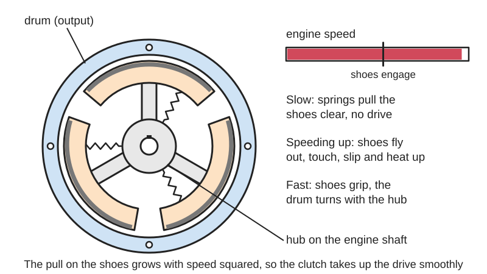
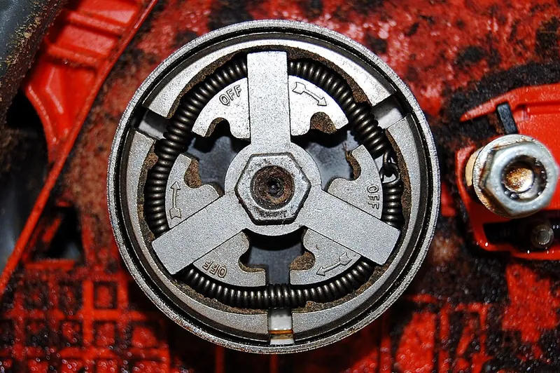
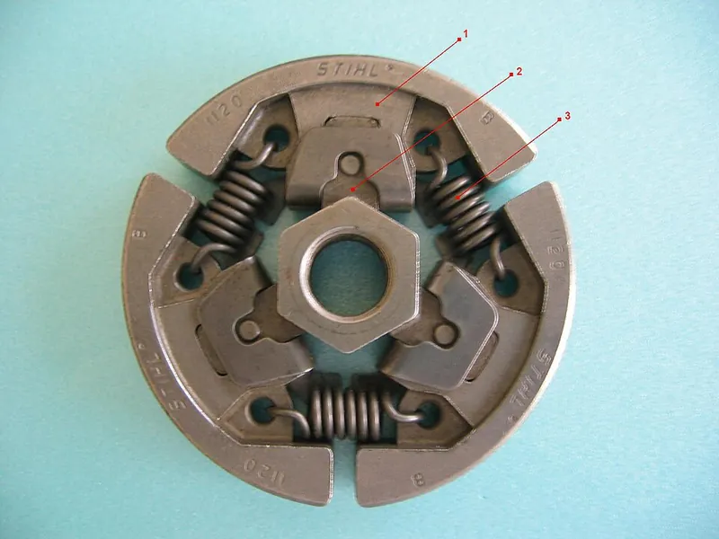
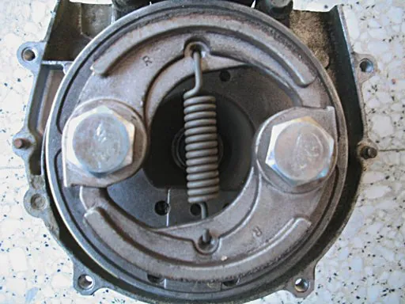

<figure class="eoc-pic eoc-pic-main"><picture><source media="(prefers-reduced-motion: reduce)" srcset="../media/drawn/centrifugal-clutch.svg"></picture><figcaption><strong>Animation.</strong> Diagram drawn for the encyclopaedia from the research notes. ⚑ Needs confirming: a drawing can simplify or get details wrong; a real photo or a better diagram is welcome.</figcaption></figure>
<figure class="eoc-pic"><figcaption><strong>Photo.</strong> <a href="https://commons.wikimedia.org/wiki/File:CentrifugalClutch.jpg">CentrifugalClutch</a> by Fletcher6, <a href="https://creativecommons.org/licenses/by-sa/3.0">CC BY-SA 3.0</a>, from Wikimedia Commons.</figcaption></figure>
<figure class="eoc-pic"><figcaption><strong>How it works.</strong> <a href="https://commons.wikimedia.org/wiki/File:Dry_clutch.JPG">Dry clutch</a> by unknown, <a href="http://creativecommons.org/licenses/by-sa/3.0/">CC BY-SA 3.0</a>, from Wikimedia Commons.</figcaption></figure>
<figure class="eoc-pic"><figcaption><strong>How it works.</strong> <a href="https://commons.wikimedia.org/wiki/File:Frizione_centrifuga.jpg">Frizione centrifuga</a> by A7N8X, <a href="https://creativecommons.org/licenses/by-sa/3.0">CC BY-SA 3.0</a>, from Wikimedia Commons.</figcaption></figure>

A clutch that engages by itself as it speeds up: spinning weights are flung outwards against a drum and drive it by friction, and they let go again when the speed drops.

**In plain words:** A clutch that connects itself: weighted shoes on a spinning hub are held in by springs at low speed, then fly outwards as the engine speeds up and rub against a surrounding drum until they grip it and drive it round. Slow down and the springs pull the shoes back in, so the engine can idle without driving the wheels, chain or blade. **Proper term:** Centrifugal clutch (automatic shoe clutch).

**Also called:** automatic clutch / auto-clutch (Wikipedia; Wikipedia 'Motorcycle transmission'); shoe clutch; the shoes are also called flyweights, weights or clutch shoes, and the drum is called the clutch bell or clutch drum (BLM Automatic Clutch; Wikipedia); go-kart clutch / mini-bike clutch / dry centrifugal clutch (Go Kart Supply); chainsaw clutch (the chain sprocket is part of the clutch drum) (Wikipedia); centrifugal pulley clutch (belt-drive version) (Go Kart Supply); floating-opposing-arm (FOA) clutch or compliant centrifugal clutch (spring-less one-piece shoe design from BYU) (Crane thesis; BYU CMR); 'traffic clutch' (1930s Talbot (brand) car name) (Wikimedia Commons); Saxomat (brand; automatic clutch system listed under 'See also' on Wikipedia); frizione centrifuga (Italian; Wikimedia Commons file name), Fliehkraftkupplung (German).

## How it works

The shoes are fixed to the input shaft so they always turn with the engine, while the drum around them is free to turn on its own. The faster they spin, the harder the shoes pull outwards (centrifugal force, which grows with the square of the speed); below a set speed the springs win and the shoes stay clear of the drum, but above it they touch the drum, slip at first and then grip it fully (lock up) so the drum turns with the engine (Wikipedia; LNCT lecture notes). If the load drags the engine speed down, the shoes pull back in and the clutch slips or lets go, which stops the engine stalling (Wikipedia; Go Kart Supply). It works like a drum brake turned inside out (Wikipedia).

## Parts

A small assembly that acts as one unit: a hub (spider) fixed to the engine or motor shaft, two to six shoes (weights) lined with friction material, springs that pull the shoes inwards (or springy arms in one-piece compliant designs), and a drum (bell) that turns freely on a bushing or bearing and carries the output sprocket or pulley. Some racing-kart versions use weighted arms that squeeze a stack of friction discs instead of shoes (Wikipedia).

## Everyday examples

- Chainsaws and petrol string trimmers: the chain or line only moves when you squeeze the throttle (Wikipedia; BYU CMR on Printables)
- Go-karts and mini-bikes: the kart sits still at idle and moves off as you press the accelerator (Wikipedia; Go Kart Supply)
- Mopeds, automatic scooters and step-through motorcycles such as the Honda Super Cub (brand) (Wikipedia 'Motorcycle transmission')
- Lawn mowers and fuel-powered model cars (Wikipedia)

## When to use it

Use it when an engine or motor must start and idle without load, then pick up the load smoothly by itself as it speeds up: small petrol engines driving a chain, belt or blade (go-karts, mini-bikes, chainsaws, trimmers), and electric drives that need a soft, load-free start so a smaller motor can be used (SUCO). It also protects the engine from stalling when the output jams or is overloaded, since the slowing engine lets the clutch slip (Wikipedia; Go Kart Supply). Choose it when you want a single control (the throttle) and no clutch lever (Go Kart Supply).

## When not to use it

Avoid it when the drive must engage at low speed or hold a load at standstill (it cannot hold anything when stopped; use a dog clutch, a one-way clutch or a brake), when you need engine braking or to hold back a vehicle going downhill (it [freewheels](../glossary.md#freewheel) at idle; Wikipedia 'Motorcycle transmission'), when the load is heavy for the engine, such as big wheels, heavy riders or hills, because it will slip and overheat (use a [torque](../glossary.md#torque) converter, the belt-type variable-ratio drive Go Kart Supply recommends for bigger karts), or when you need a precise, fixed torque limit (use a ball-detent or friction slip clutch). For cars it has been replaced by fluid couplings, torque converters and automated manual gearboxes (Wikipedia).

## Details

- **What it does (jobs):**
  - hold or release using power: it connects the drive automatically once the engine or motor is spinning fast enough, and disconnects it at idle, with no lever or pedal (Go Kart Supply: 'the throttle becomes the single control')
  - slip or let go when overloaded: if the load slows the engine too much, the shoes slip or retract so the engine does not stall (Wikipedia; Go Kart Supply)
  - join and hold: once locked up it joins the engine shaft to the output sprocket, pulley or shaft so they turn as one
- **Movement:** rotate: continuous rotation; the shoes also move outwards a small distance (just enough to close the gap to the drum) as speed rises
- **Directions it can move (degrees of freedom):** Below engagement speed: 1, the drum turns freely relative to the hub. Once locked up: 0 between hub and drum (they turn together). Each shoe has its own small outward sliding or swinging movement.
- **Special behaviour:**
  - [fail-safe](../glossary.md#fail-safe--fail-secure) or breakaway: it disengages by itself at idle and when the engine is dragged down by an overload, so the engine does not stall and the drive stops when the throttle is released (Wikipedia; Go Kart Supply; Michigan chainsaw rule)
  - torque-limiting (slips or clicks at a set force/torque): while engaging it slips, and the torque it can pass rises with speed, so it acts as a soft start and a speed-dependent slip clutch rather than a fixed-torque limiter (LNCT lecture notes; SUCO)
  - one-way in a special sense: the engine can drive the output, but at idle the output cannot drive the engine, so there is no engine braking when coasting (Wikipedia 'Motorcycle transmission')
- **How it holds:**
  - friction or clamping ([force-fit](../glossary.md#form-fit--force-fit--material-bond)): the shoes press on the drum and the drive passes by friction
  - spring force (a spring or springy part presses it in place): springs (or springy arms in compliant designs) hold the shoes away from the drum until the set speed is reached; this sets when it engages rather than holding the drive
- **Input and output:** Continuous rotation in -> the same rotation out (1:1) once locked up, nothing out at idle, and slipping rotation in between. Shafts: in line (the drum sits concentrically around the shoes on the same shaft axis). Torque capacity rises with the square of the speed above engagement: T = n x mu x m x r x (w^2 - w1^2) x R (LNCT lecture notes). Efficiency: close to 100% once locked up, but slipping turns power into heat (Wikipedia notes 'a fair bit of waste heat') ⚑ [uncertain: no efficiency figure found]. Back-drivable: no at idle (the wheels or chain cannot turn the engine, so it freewheels downhill); yes only while the engine is already above lock-up speed, which then gives engine braking (Wikipedia 'Motorcycle transmission').
- **Power:** passive (no power needed): it is driven purely by the speed of the input shaft and needs no external power or control; industrial makers stress it needs no power supply (SUCO). If the engine or motor stops, the clutch simply disengages.
- **Load:** Light to medium: typical go-kart clutches suit 3 to 8 horsepower engines (Go Kart Supply), and centrifugal clutches have been replaced in cars by fluid couplings and torque converters (Wikipedia). Strong in twist once locked up; weak at low speed, because the torque it can pass falls quickly as speed drops. It is not meant to carry side loads: the drum runs on a bushing or bearing on the shaft.
- **Play and precision:** not applicable for positioning: it slips while engaging, so it does not keep an exact angle between input and output. Once locked up there is no [backlash](../glossary.md#backlash) between hub and drum. It tolerates little [misalignment](../glossary.md#misalignment), because the drum must run true around the shoes ⚑ [uncertain: no figure found].
- **Taking it apart:** removable: it bolts onto a keyed shaft end (for example with a bolt into the tapped crankshaft end, a key and [set screws](../glossary.md#set-screw)) and comes off with ordinary tools (Go Kart Supply)
- **How often it can be reused:** effectively unlimited: it engages and disengages every time the engine speeds up and slows down; the friction shoes and the drum bushing wear and are replaced as parts (Go Kart Supply; BLM Automatic Clutch)
- **Sealing:** none: shoe clutches are usually dry and open, often behind a guard; keep oil and grease off the friction faces ⚑ [uncertain: general advice, not found in a source]. Some motorcycle-type multi-disc versions run in oil inside the engine case ⚑ [uncertain]
- **Adjustable:** yes, by changing parts rather than a knob: stronger springs or lighter shoes raise the engagement speed, weaker springs or heavier shoes lower it (follows from the balance of spring force and m x w^2 x r; LNCT lecture notes). Many off-the-shelf clutches are preset (Max-Torque (brand) engages at about 2,200 rpm; Go Kart Supply). The engine's idle speed must be set below the engagement speed (Michigan chainsaw rule; BLM).
- **Access needed:** end of a tube or shaft: it slides onto the end of the engine or motor shaft and is held by a bolt, key or set screws
- **Materials:** Steel or cast hub and drum; sintered-metal or bonded friction-lined shoes (Max-Torque (brand) uses six sintered metal shoes; Go Kart Supply); music-wire or stainless-steel springs (stainless tolerates more heat; Go Kart Supply). The BYU compliant clutch was first milled from steel and is also offered as a 3D-printable model (BYU CMR on Printables). Printed demonstration models use PLA or similar with rubber bands as return springs (Printables model 982812).
- **Heat, cold, water and wear:** Heat is the main limit: long slipping overheats the shoes and drum, dries the oil-soaked bushing and can anneal the spring; shoes turning purple is a sign the clutch is ruined (Go Kart Supply); heat damage is not covered by warranty (BLM Automatic Clutch). Music-wire springs are rated to about 250 F and stainless to about 550 F (Go Kart Supply, citing the Spring Manufacturers Institute). Stainless springs don't rust (Go Kart Supply). Printed clutches: PLA softens above about 60 C and PETG is suitable below about 80 C (Prusa). Dirt and old lubricant in the bushing make it drag and can make it engage at idle (Go Kart Supply).

## Making it

- **Ways to make or get it:**
  - off-the-shelf part: go-kart, mini-bike, pulley, chainsaw, scooter and industrial centrifugal clutches are cheap and widely sold
  - 3D print (FDM): demonstration models and light-duty spring-less compliant clutches (BYU CMR, Pinshape, Printables)
  - CNC: milled steel hubs, shoes and drums; the BYU FOA clutch was originally milled from steel (BYU CMR on Printables)
  - 3D print (resin): ⚑ [uncertain] possible for small models, but [brittle](../glossary.md#brittle--ductile) resin is a poor choice for parts that rub and heat up
- **Printing it in one piece (print in place):** no: printed versions are separate parts (a hub, a shoe piece and a drum, plus bearings) that are assembled; spring-less compliant designs avoid adding separate springs (BYU CMR: 'only two components' for hub and shoes; Pinshape model: shoe pulley, bell pulley and bearing bracket)
- **Tools:** To fit: spanner or socket, hex key for set screws, the shaft key, and a way to stop the crankshaft turning while tightening the bolt; for chain drives a chain tool (Go Kart Supply). To operate: none.
- **Difficulty:** moderate: fitting an off-the-shelf go-kart or pulley clutch to a small engine is easy, and a printed demonstrator is easy to make, but a home-made clutch that carries real power is hard because the friction surfaces get hot and must be balanced and strong at speed

### 3D printing tips

1) Start from a spring-less compliant design, where the shoes are joined by thin flexible links that act as the springs, such as BYU's floating-opposing-arm (FOA) clutch: only two printed parts for the hub and shoes, works in either direction of rotation (BYU CMR on Printables). 2) Remember the physics: outward force = shoe mass x radius x (speed)^2, so heavier shoes or shoes further out engage at lower speed; the spring (or [flexure](../glossary.md#flexure)) force sets the speed where engagement starts (LNCT lecture notes). You can add mass by embedding nuts or steel balls in the shoes ⚑ [uncertain: design idea, not from a tested source]. 3) Keep the shoes symmetrical so the spinning part is balanced ⚑ [uncertain: general practice]. 4) Hand-cranked demonstrators work at 'humanly possible' speeds and can use rubber bands as the return springs and 20 mm bore ball bearings to carry the shafts (Printables model 982812 by Mortal 2020). 5) Expect supports on some designs: the Pinshape spring-less clutch prints in about 8 hours with full supports (RONRAYSING on Pinshape). 6) Heat is the enemy: slipping makes heat, PLA softens above about 60 C and PETG is good to about 80 C (Prusa), so do not let a printed clutch slip for long under load; PETG or nylon are better than PLA ⚑ [uncertain: material ranking for this use not tested]. 7) Printed plastic on printed plastic has low grip; a rubber or TPU lining on the shoes or inside the drum can add friction ⚑ [uncertain: not from a tested source]. 8) Leave a small, even gap between shoes and drum at rest so it does not rub at idle ⚑ [uncertain: no figure found].

### Buying one (off-the-shelf parts)

Search for: 'centrifugal clutch' with bore size (5/8 in, 3/4 in, 1 in) and sprocket teeth and chain size (#35, #40/41, #420) for go-karts and mini-bikes (Max-Torque (brand), Hilliard (brand), Noram (brand), Comet (brand); Go Kart Supply); 'centrifugal pulley clutch' for belt drives (Go Kart Supply); 'clutch bushing' and 'clutch spring' spares; 'chainsaw clutch' and 'clutch drum' (rim or spur sprocket); scooter CVT 'clutch bell' and 'clutch shoes'; nitro RC car 'clutch shoes', 'clutch springs' and 'clutch bell'; industrial 'centrifugal clutches and brakes' (SUCO (brand), BLM Automatic Clutch (brand)). For compliant designs, the BYU FOA clutch is patented (US 6,736,249) and licensed through BYU (BYU CMR on Printables).

## Rules of thumb

- Torque capacity: each shoe presses on the drum with its centrifugal force minus the spring force, Pc - Ps, where Pc = m x w^2 x r and the spring is set so Ps = m x w1^2 x r (w1 = speed where engagement starts). Total torque T = n x mu x (Pc - Ps) x R, so torque rises with the square of speed above w1 (LNCT Group of Colleges, ME403 Unit 4 clutch notes).
- In the textbook worked example, engagement begins at 3/4 of running speed, and a lining pressure of about 0.1 N/mm^2 is used 'to ensure reasonable life' when sizing the shoes (LNCT lecture notes).
- Idle speed must be below engagement speed so the output stops at idle: Michigan's chainsaw rule requires that releasing the throttle drops idle below clutch engagement so the chain comes to a complete stop (Mich. Admin. Code R 408.13882). Go-kart engines idle at about 1,650 +/- 200 rpm (Go Kart Supply).
- Typical go-kart clutch: starts to engage around 2,000 rpm and locks up around 2,600 rpm; suits 3 to 8 hp engines; gear about 1:6 between clutch sprocket and axle sprocket (e.g. 12 teeth to 72); wheels no taller than 15 in; kart plus driver no more than about 400 lb (Go Kart Supply).
- Don't let it slip for long: drive at full throttle so it locks up; slipping 'causes tremendous heat' that dries the bushing and can anneal (soften) the spring (Go Kart Supply).
- Spring heat limits quoted from the Spring Manufacturers Institute: music-wire springs about 250 F (121 C), 302 stainless-steel wire about 550 F (288 C) (Go Kart Supply).

## Common failures

1) Slipping and overheating from driving slowly or with part throttle, stop-start use, riding the brake, bigger tyres, too much weight or the wrong gearing; it smells of burning lining and can end up ruined (Go Kart Supply; BLM). Fix: gear it correctly, keep weight down and use full throttle so it locks up. 2) Engages at idle because the idle speed is set too high or the springs are weak, worn or annealed by heat (BLM; Go Kart Supply). Fix: lower the idle with a tachometer, replace springs. 3) Won't engage because the engine can't reach the clutch's engagement speed (BLM). Fix: change the spring or the engine speed. 4) Worn or dry bushing between drum and shaft, from not oiling it (Go Kart Supply says oil it at least every two hours of driving) or from cleaning it with brake cleaner. 5) Chain and sprocket wear from wrong chain tension or misalignment (Go Kart Supply).

## Safety

If the idle speed is set too high the clutch engages at idle, so a kart can move off or a chain can run by itself: be ready to switch the engine off when starting (Go Kart Supply), and chainsaws must be set so the chain stops at idle (Michigan chainsaw rule). There is no engine braking at idle, so a kart or scooter can run away downhill (Wikipedia 'Motorcycle transmission'). The drum and guard get hot after slipping (Go Kart Supply). Spinning drums, chains and belts are pinch and entanglement hazards: keep guards on (Michigan chainsaw rule requires the clutch to be guarded). A printed clutch spun fast could break and throw pieces ⚑ [uncertain: no test found]; keep printed ones to hand-cranked or low-speed demonstrations and use a guard.

## Related

- Friction clutch (plate or cone clutch): engaged by a lever or pedal instead of by speed; can hold at any speed you choose
- Torque converter / belt variable-ratio drive (CVT): used on bigger go-karts; also changes the [gear ratio](../glossary.md#gear-ratio) as speed rises (Go Kart Supply); scooters combine a CVT with a centrifugal clutch
- Fluid coupling: an oil-filled automatic coupling that replaced centrifugal clutches in cars (Wikipedia)
- Speed governor (fly fan, centrifugal governor): uses the same flung-out weights, but to keep speed steady instead of to connect a drive
- Centrifugal brake: the same flyweights pressing on a fixed drum, used to limit speed, e.g. for descending loads or fire doors (SUCO)
- Friction slip clutch: slips at a set torque regardless of speed; a centrifugal clutch's slip torque depends on speed
- Dog clutch (claw clutch): teeth that lock with no slip, but must be engaged by hand and only at matched speed
- Inertia-locking reel (seat-belt lock): uses a flung-out weight to catch [ratchet](../glossary.md#ratchet) teeth and lock, instead of to create friction

## Make it yourself

- [Compliant Centrifugal Clutch (BYU CMR, Printables)](https://www.printables.com/model/581039-compliant-centrifugal-clutch): Printable version of BYU's floating-opposing-arm clutch: two components, shoes joined by flexible segments so no springs are needed, works in either direction (details read via the Printables API) *(licence: Creative Commons Attribution-NonCommercial (as listed on Printables))*
- [Compliant Centrifugal Clutch by BYU_CMR (Thingiverse)](https://www.thingiverse.com/thing:3007264): Thingiverse copy of the same BYU FOA clutch (page appeared in search results; its content did not load for us) *(licence: ⚑ [uncertain] not seen)*
- [Centrifugal Clutch hand-cranked educational model (Mortal 2020, Printables) (URL from Printables API, page not opened)](https://www.printables.com/model/982812-centrifugal-clutch-hand-cranked-educational-model): Hand-cranked teaching model using 20 mm bore bearings, wooden supports and rubber bands as the return springs *(licence: Creative Commons Attribution-NonCommercial (as listed in the Printables API))*
- [Two Way Rotation Spring-less Centrifugal Clutch (RONRAYSING, Pinshape)](https://pinshape.com/items/36916-3d-printed-two-way-rotation-spring-less-centrifugal-clutch): Printable spring-less clutch in three parts (shoe pulley, bell pulley, bearing bracket) that engages in either direction and freewheels when the motor stops; about 8 hours to print with supports *(licence: CC BY-SA (as listed on Pinshape))*

## Pictures, videos and models

- [CentrifugalClutch.jpg (Wikimedia Commons, by Fletcher6)](https://commons.wikimedia.org/wiki/File:CentrifugalClutch.jpg): Close-up photo of a chainsaw's centrifugal clutch: three shoes on a star-shaped hub, held in by coil springs, inside the drum *(licence: CC BY-SA 3.0)*
- [Dry clutch02.JPG (Wikimedia Commons, by StNick at Bulgarian Wikipedia)](https://commons.wikimedia.org/wiki/File:Dry_clutch02.JPG): Photo of a Stihl (brand) three-shoe centrifugal clutch with numbered labels on the shoes, springs and hub *(licence: Public domain)*
- [Centrifugal clutch 1 (Nguyen Duc Thang, YouTube)](https://www.youtube.com/watch?v=QpwWZloh-cw): 17-second CAD animation: sliders on the input shaft move outwards as speed rises and press on the inside of the output drum *(licence: link only)*
- [3D Printed Compliant Centrifugal Clutch (BYU Compliant Mechanisms Research Group, YouTube)](https://www.youtube.com/watch?v=qANs9G38rzA): Video of BYU's printed spring-less floating-opposing-arm clutch (linked from the model's Printables page; title verified, video not reviewed) *(licence: link only)*
- [US Patent 598314 detail centrifugal clutch.png (Wikimedia Commons)](https://commons.wikimedia.org/wiki/File:US_Patent_598314_detail_centrifugal_clutch.png): Drawing from an 1898 US patent for an electric car, highlighting its centrifugal clutch *(licence: Public domain)*

## Needs confirming

⚑ marks something nobody has confirmed yet: a fact the research could not confirm from a source, a finder value that is a best guess, or an open point from the research notes. Corrections are welcome (see `research/needs-confirming.md`).

- ⚑ 12 sentences on this page marked [uncertain].
- ⚑ Finder value `connects` = shaft (best guess): worked out from its name, but joining parts is not one of its two main jobs
- ⚑ Finder value `clicks` = clicks (best guess): one-way or indexing, but neither clicking nor silent named; defaulted to clicks
- ⚑ Finder value `powered_does` = brake or engage (best guess): set by Claude from the entry's name and power text (R33), for "What should it do?" under "Hold or let go using power"

## Sources

- <https://en.wikipedia.org/wiki/Centrifugal_clutch>
- <https://en.wikipedia.org/wiki/Motorcycle_transmission>
- <https://commons.wikimedia.org/wiki/Category:Centrifugal_clutches>
- <https://commons.wikimedia.org/wiki/File:CentrifugalClutch.jpg>
- <https://commons.wikimedia.org/wiki/File:Dry_clutch02.JPG>
- <https://commons.wikimedia.org/wiki/File:Talbot_%27Traffic_Clutch%27_automatic_centrifugal_clutch_(Autocar_Handbook,_13th_ed,_1935).jpg>
- <https://commons.wikimedia.org/wiki/File:US_Patent_598314_detail_centrifugal_clutch.png>
- <https://www.gokartsupply.com/clutches.htm>
- <https://lnct.ac.in/wp-content/uploads/2020/04/ME403_Unit4_Clutches.pdf>
- <https://www.law.cornell.edu/regulations/michigan/Mich-Admin-Code-R-408-13882>
- <https://www.centrifugalclutches.com/blog/centrifugal-clutches-common-problems-solutions/>
- <https://www.suco.de/en/transmission-technology/centrifugal-clutches-and-brakes>
- <https://scholarsarchive.byu.edu/etd/79/>
- <https://www.printables.com/model/581039-compliant-centrifugal-clutch>
- <https://api.printables.com/graphql/>
- <https://pinshape.com/items/36916-3d-printed-two-way-rotation-spring-less-centrifugal-clutch>
- <https://www.youtube.com/watch?v=QpwWZloh-cw>
- <https://www.youtube.com/watch?v=qANs9G38rzA>
- <https://help.prusa3d.com/article/pla_2062>
- <https://help.prusa3d.com/article/petg_2059>
