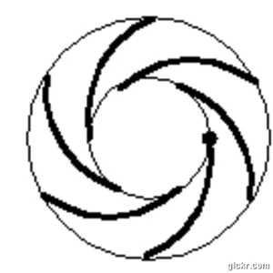
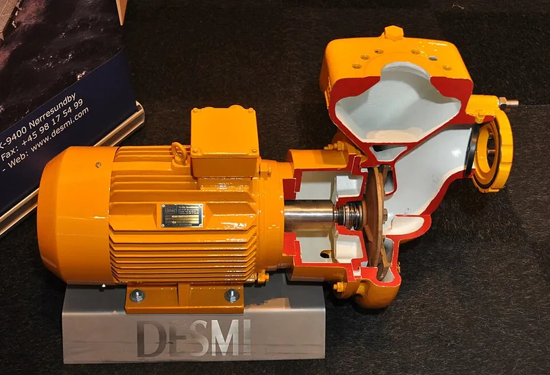
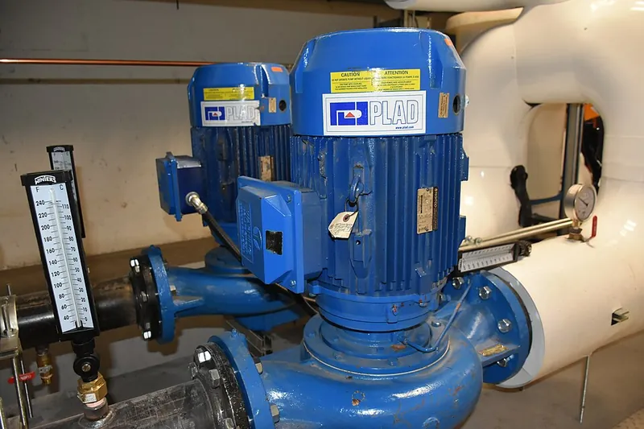

<figure class="eoc-pic eoc-pic-main"><picture><source media="(prefers-reduced-motion: reduce)" srcset="../media/centrifugal-pump.still.webp"></picture><figcaption><strong>Animation.</strong> <a href="https://commons.wikimedia.org/wiki/File:Centrifugal_pump.gif">Centrifugal pump</a> by Nguyen thanh chinh, <a href="https://creativecommons.org/licenses/by-sa/4.0">CC BY-SA 4.0</a>, from Wikimedia Commons.</figcaption></figure>
<figure class="eoc-pic"><figcaption><strong>Cross-section.</strong> <a href="https://commons.wikimedia.org/wiki/File:Pump_(Cut-Away).JPG">Pump (Cut-Away)</a> by S.J. de Waard, <a href="https://creativecommons.org/licenses/by/2.5">CC BY 2.5</a>, from Wikimedia Commons.</figcaption></figure>
<figure class="eoc-pic"><figcaption><strong>Photo.</strong> <a href="https://commons.wikimedia.org/wiki/File:Centrifugal_Pump.jpg">Centrifugal Pump</a> by Saud, <a href="https://creativecommons.org/licenses/by-sa/4.0">CC BY-SA 4.0</a>, from Wikimedia Commons.</figcaption></figure>

A motor spins a wheel of curved blades (the impeller) inside a spiral casing (the volute); water entering at the centre is whirled outwards, gains speed and pressure, and leaves through the outlet, giving a large, smooth flow at fairly low pressure, as long as the pump is already full of water (Wikipedia 'Centrifugal pump').

**In plain words:** A pump with a little spinning wheel of curved blades inside a snail-shaped case: water comes in at the middle, gets flung outwards by the spinning blades and is squeezed out of a pipe at the side. It moves lots of water but can't push it very high, and it only works when it is already full of water. **Proper term:** Centrifugal pump (impeller pump; a radial-flow rotodynamic pump).

**Also called:** impeller pump; rotodynamic pump, dynamic pump or velocity pump (the wider class it belongs to; Wikipedia 'Pump'); radial-flow pump (Wikipedia 'Pump'); volute pump (when the casing is a spiral volute rather than guide vanes; Wikipedia 'Centrifugal pump'); submersible pump, fountain pump, pond pump, aquarium pump (the small sealed pumps that sit under water; Atlantic Water Gardens manual; FAO 2014); magnetic drive pump, mag-drive pump, sealless or canned pump (motor drives the impeller through the sealed case with magnets; Wikipedia 'Centrifugal pump'); circulating pump or circulator (pumps hot water round central-heating systems; Wikipedia 'Centrifugal pump' photo caption); multistage centrifugal pump (several impellers in a row for more pressure; Wikipedia); self-priming centrifugal pump (garden pumps with a separating chamber that can clear air from the suction pipe; Wikipedia); mini DC submersible water pump, 3 V water pump (Adafruit), brushless DC water pump (Topsflo); drill pump, drill-powered water pump (printed pumps turned by a cordless drill; Printables); centrifugal fan or blower (the same idea for air, as in a vacuum cleaner; Wikipedia 'Centrifugal fan'); Kreiselpumpe (German).

## How it works

Water enters along the shaft into the eye at the centre of the spinning impeller, is caught between the vanes and is whirled outwards, so it leaves the rim fast and under some pressure; the widening spiral casing (volute) or diffuser then slows it down, which turns that speed into more pressure before it leaves the outlet at right angles to the shaft (Wikipedia 'Centrifugal pump', 'Pump', 'Volute (pump)'; The Engineering Mindset). As water is thrown out of the eye, the low pressure left behind draws more water in through the inlet (The Engineering Mindset). Because the impeller only 'throws' the water rather than trapping and pushing a fixed amount, the flow falls as the outlet gets higher or more restricted: at the pump's maximum height (shut-off head) the flow drops to nothing and the impeller just churns (Wikipedia 'Pump'; waterfountainonline.com). Air is far lighter than water, so an air-filled impeller can't make enough suction to pull water up; the casing must be filled with water (primed) first, which is why most sit below the water level or under water (Wikipedia 'Centrifugal pump', Priming; Printables 444761).

## Parts

A small assembly that acts as one unit: an impeller (a hub with vanes and a central inlet called the eye), a casing with a spiral volute or a ring of guide vanes (diffuser), a shaft with bearings or bushings, a shaft seal (or a magnetic drive so no shaft passes through the wall), and a motor (Wikipedia 'Centrifugal pump', 'Impeller'). A typical fountain pump has a pre-filter, a threaded inlet cover, a flow adjuster, and an impeller assembly of six small parts: the impeller and magnetic rotor in one piece, a ceramic shaft, rubber bushings and a friction washer, all inside a sealed rotor chamber in the motor body (Atlantic Water Gardens Fountain Series manual). A printed drill pump is a housing, lid, impeller, shaft sleeve, inlet and outlet couplers and TPU gaskets, held together with nine M4 bolts and an M6 bolt as the shaft (Printables 444761).

## Everyday examples

- Garden fountain, pond and water-feature pumps, and the pumps in aquarium filters (Atlantic Water Gardens manual; Wikipedia 'Centrifugal pump', Magnetically coupled pumps)
- The circulating pump that pushes hot water round a central-heating system (Wikipedia 'Centrifugal pump')
- The drain pump in a washing machine or dishwasher, and pool filter pumps, which have small plastic impellers (Printables replacement impellers 310558, 302288, 227655)
- A vacuum cleaner's fan, or the small blower fan that cools electronics: the same spinning-impeller idea moving air instead of water (Wikipedia 'Centrifugal fan', 'Centrifugal pump')

## When to use it

Choose a centrifugal pump when you want to move a lot of water at low pressure, smoothly and cheaply: fountains, waterfalls, aquarium and pond filters, cooling loops, emptying a flooded sump, and circulating water in aquaponics and hydroponics, where FAO recommends a submersible impeller pump as 'the heart' of the system (FAO 2014; Atlantic Water Gardens manual; Printables 201592). It is simple, has no valves, gives steady (non-pulsing) flow, can be throttled with a valve without damage for short periods, and copes with some dirt in the water (Wikipedia 'Centrifugal pump', 'Pump'). A magnetic-drive version has no shaft seal to leak, which is why fountain and aquarium pumps use it (Wikipedia 'Centrifugal pump').

## When not to use it

Don't use it when you need pressure rather than flow, a measured dose, or suction from a dry pipe. For high pressure (hydraulics, spraying, lifting water very high) use a positive-displacement pump such as a gear, piston or diaphragm pump, with a relief valve (Wikipedia 'Centrifugal pump', 'Pump'). For measured doses use a peristaltic or syringe pump. If the pump must sit above the water and pull it up a dry hose, use a self-priming pump (diaphragm, peristaltic or a self-priming garden pump) or fit a foot valve and prime it (Wikipedia 'Centrifugal pump', 'Pump'; Printables 1383048). Avoid it for thick liquids (efficiency falls), large solids (clogging), liquids full of air or foam (it loses prime) and anything where running dry is likely (Wikipedia 'Centrifugal pump'; Adafruit 4547). For very low lifts in deep tanks an airlift (air pump bubbling up a pipe) can be more efficient and does not clog (FAO 2014). Never use a fountain pump for fuel, oil, salt water or food (Atlantic Water Gardens manual), or for drinking water (Adafruit 4547).

## Details

- **What it does (jobs):**
  - change the kind of motion: turns the spin of a motor or drill into a steady flow of water through a pipe (Wikipedia 'Centrifugal pump')
  - seal it, or pass cables or fluid through: moves water round fountains, ponds, aquariums, aquaponic and hydroponic systems, coolers and drains, with a sealed or magnetically driven motor so the water stays in the pipes (FAO 2014; Wikipedia 'Centrifugal pump', Magnetically coupled pumps)
- **Movement:** rotate: the impeller turns continuously in one set direction, from a few hundred to a few thousand turns a minute (a printed pump was tested at 1800 rpm on a drill; Hackaday 2021); the water moves, the casing stays still
- **Directions it can move (degrees of freedom):** 1: only the impeller and shaft turn relative to the casing
- **Special behaviour:**
  - motion conversion: the turning impeller becomes a smooth, continuous flow of water, with no pulses and no valves (Wikipedia 'Centrifugal pump', 'Pump')
  - torque-limiting (slips or clicks at a set force/[torque](../glossary.md#torque)): if the outlet is blocked the water simply slips round inside the casing, so pressure tops out at the pump's shut-off head instead of rising until something bursts, as it would with a gear, piston or diaphragm pump; this is safe only for short periods, because the trapped water heats up (Wikipedia 'Pump')
- **How it holds:**
  - not a holding joint (it moves or passes on motion): it moves water rather than holding parts together
  - shape (the parts interlock; [form-fit](../glossary.md#form-fit--force-fit--material-bond)): the impeller fits its drive shaft by a [spline](../glossary.md#spline), key or thread (Wikipedia 'Impeller'), or by a hex recess on a bolt in printed pumps (Printables 201592)
  - magnetic: in magnetic-drive fountain and aquarium pumps the motor turns a magnet rotor through the sealed case (Wikipedia 'Centrifugal pump'; Atlantic Water Gardens manual)
  - friction or clamping (force-fit): casing halves are bolted together over gaskets (Printables 444761; Hackaday 2021)
- **Input and output:** Continuous rotation -> continuous, smooth flow of liquid. Flow, pressure and power change with speed: flow rises in step with speed, pressure (head) with the square of speed and power with the cube, so running 20% slower needs only about half the power (affinity laws, Wikipedia 'Affinity laws'; the last figure is our own arithmetic from the cube law). Flow drops as the lift rises: a 33 W fountain pump gives 525 US gal/h (about 2000 L/h) at zero lift, 430 at 2.5 ft, 300 at 5 ft and 75 at 7.5 ft (about 2.3 m) (Atlantic Water Gardens FP500 flow chart). FAO's rough guide is about 40 L of water per hour for every watt for submersible pumps, with 2000 L/h at 1.5 m lift costing 25-50 W (FAO 2014). A printed PLA pump turned by a drill at 1800 rpm gave 13 L/min, or lifted water at most 1.2 m (Hackaday 2021). Efficiency: highest at the middle of a pump's range (best efficiency point) and lower either side, falling over time as wear opens the [clearances](../glossary.md#clearance) (Wikipedia 'Pump'); for small hobby pumps no measured figure was found ⚑ [uncertain]. Arrangement: water enters along the shaft and leaves at right angles to it (Wikipedia 'Pump'). Back-drivable: it does not hold back the water; when the pump stops, water can run back through it and siphon away unless a [check valve](../glossary.md#check-valve) is fitted (Wikipedia 'Centrifugal pump'); the same machine run in reverse, turning water pressure into rotation, is a water turbine (Wikipedia 'Centrifugal pump'). Reversing the motor does not reverse the flow: 'Reversing the polarity does not turn it into a suction device, it will only pump water!' (Adafruit 4547).
- **Power:** powered: needs a motor (a mains submersible pump, a 3-12 V DC motor or brushless DC pump, a 775-size DC motor, or a cordless drill) (Atlantic Water Gardens manual; Adafruit 4547; The Engineering Mindset DIY pump; Printables 444761). When power is lost the flow stops at once; water can drain back through the pump and siphon out of a tank unless the pipework has a check valve or an anti-siphon hole, and a pump above the water may lose its prime (Wikipedia 'Centrifugal pump'; FAO 2014)
- **Load:** light for hobby pumps: lots of flow but low pressure, typically lifting water from about 1 m (printed pump, Hackaday 2021) to a few metres (fountain pump, Atlantic Water Gardens manual). Big industrial multistage pumps reach very high pressures (a boiler feed pump gives 150 L/s at 21 MPa; Wikipedia), but 'other pump types may be more suitable for high pressure applications' (Wikipedia 'Centrifugal pump'). The impeller sees mostly twisting load from the motor; side loads on the shaft rise when the pump runs far from its design flow (Wikipedia 'Volute (pump)')
- **Play and precision:** Not a metering pump: the amount delivered changes with the lift, pipe size and fittings, so it can't measure doses (Wikipedia 'Pump'; FAO 2014). A close gap between the vanes and the casing stops water slipping back, and efficiency falls as wear opens this gap (Wikipedia 'Impeller'); a [print-in-place](../glossary.md#print-in-place) pump used a 0.4 mm gap (twice the layer height) (Hackaday.io 'Can you print-in-place a water pump'). Running far from the design flow causes uneven side thrust and vibration, shortening bearing and seal life (Wikipedia 'Volute (pump)')
- **Taking it apart:** removable: a submersible pump just unplugs from its tube and lifts out; the inlet cover twists off by hand to take out the impeller for cleaning (Atlantic Water Gardens manual). Printed pumps come apart by undoing the casing bolts (Printables 444761)
- **How often it can be reused:** many times: the impeller assembly is meant to be removed and cleaned regularly (Atlantic Water Gardens manual: monthly inspection); the pump itself lasts about 3-5 years for good-quality submersible pumps (FAO 2014)
- **Sealing:** watertight: the casing joints are sealed with gaskets or [O-rings](../glossary.md#o-ring) (printed pumps use TPU gaskets and silicone grease; Printables 444761; Atlantic Water Gardens manual: intake O-ring). Where the shaft passes through the casing it needs a stuffing box, mechanical seal or close-fitting throttle bushing, or a magnetic drive that leaves the case unbroken so it cannot leak along the shaft (Wikipedia 'Centrifugal pump'). A printed pump with no shaft seal 'does leak a bit' (Hackaday 2021). The pressures are low, so it is not a pressure-holding seal
- **Adjustable:** yes: flow can be turned down with a flow adjuster or valve on the outlet (Atlantic Water Gardens manual), by slowing a DC pump with PWM (Adafruit 4547; Printables 201592), or permanently by trimming the impeller diameter (Wikipedia 'Affinity laws'). Changing the impeller shape changes the flow: makers found short and straight-bladed impellers moved more water than tall or curved ones on their motors (Printables 201592)
- **Access needed:** not applicable: it is a self-contained unit; a submersible pump only needs reaching for its inlet filter and impeller cover
- **Materials:** Fountain and aquarium pumps: plastic body, a magnet rotor with the impeller, a ceramic shaft and rubber bushings (Atlantic Water Gardens manual). Industrial impellers are often cast, sometimes in one piece with the shaft (Wikipedia 'Impeller'). Printed pumps: PLA housings and impeller with TPU gaskets and ball bearings (Hackaday 2021; Printables 444761); one PLA pump worked under a house in dirty water for nearly a year (Printables 201592); PLA and BVOH soluble support for a print-in-place pump (Hackaday.io). A DIY pump used marine plywood, acrylic and stainless threaded rod (The Engineering Mindset DIY pump). Liquids: fountain pumps are for clean water only, not salt water, sewage, oils, food waste, or flammable or corrosive liquids (Atlantic Water Gardens manual); special centrifugal pumps handle sewage, slurries and chemicals, and mag-drive pumps handle acids (Wikipedia). Thick (viscous) liquids lower efficiency (Wikipedia)
- **Heat, cold, water and wear:** Water: it must stay full and, for submersible pumps, fully submerged; water cools and lubricates the motor and bearings, so running dry overheats and wrecks it (Adafruit 4547; Topsflo; FAO 2014; Atlantic Water Gardens manual). Heat: fountain pumps are rated for water up to 35 C (95 F) (Atlantic Water Gardens manual); hot water also makes cavitation more likely because it boils at a lower suction pressure (Wikipedia 'Net positive suction head', Example 3). Cold: never leave a pump in frozen water; store it indoors over winter (Atlantic Water Gardens manual). Hard or well water leaves a crusty scale on the magnet rotor that has to be scrubbed off with white vinegar (Atlantic Water Gardens manual). Low flow: running against a closed outlet heats the water inside (Wikipedia 'Pump'). Wear: performance falls over time as the impeller and clearances wear, faster with grit or cavitation (Wikipedia 'Centrifugal pump', 'Pump'); good submersible pumps keep their output 1-2 years and last 3-5 years (FAO 2014). Printed PLA pumps can survive a year in dirty water (Printables 201592), but PLA softening in warm water was not checked ⚑ [uncertain].

## Making it

- **Ways to make or get it:**
  - off-the-shelf part: submersible fountain, pond and aquarium pumps, mini 3 V DC pumps and brushless DC pumps are cheap and sealed (Atlantic Water Gardens manual; Adafruit 4547; FAO 2014)
  - 3D print (FDM): drill-driven and motor-driven water pumps in PLA with TPU gaskets (Hackaday 2021; Printables 444761, 1383048, 201592), and a print-in-place pump using soluble support (Hackaday.io)
  - woodwork: a demonstration pump built from marine plywood with an acrylic impeller and window (The Engineering Mindset DIY pump)
  - CNC: industrial impellers are cast and machined ⚑ [uncertain: casting from Wikipedia 'Impeller'; machining not checked]
- **Printing it in one piece (print in place):** partly: most printed pumps are separate parts bolted together with bearings, gaskets and a bolt for a shaft (Printables 444761; Hackaday 2021). One maker printed impeller and casing as a single piece by printing the gap in BVOH soluble support and dissolving it out in warm water for 3 days, but it still needs a shaft drive (Hackaday.io 'Can you print-in-place a water pump')
- **Tools:** none to use a submersible pump: push the tube on and drop it in the water (Adafruit 4547; Atlantic Water Gardens manual). For a printed pump: hex keys or spanners for M4 bolts and nuts (nuts are dropped in during a print pause), adhesive for the shaft sleeve, silicone grease for sealing, and a drill or motor to drive it (Printables 444761); a soldering iron and a motor driver or PWM controller for DC pumps (Adafruit 4547; Printables 201592)
- **Difficulty:** easy to use a bought one: drop a submersible pump in the water and push a tube on (Adafruit 4547; FAO 2014). Moderate to print your own: the casing has to be watertight, the shaft needs bearings and ideally a seal (printed ones leak a little), and it still has to be primed or sat in the water (Hackaday 2021; Printables 444761, 1383048)

### 3D printing tips

1) Make the casing watertight: use at least 3-4 [perimeters](../glossary.md#perimeters) (5-6 if the shape allows), about 0.15 mm layers, 5-10% more extrusion and a slightly hotter nozzle; leaks often start at seams, uneven walls and poor overlap between [infill](../glossary.md#infill) and perimeters (Prusa Knowledge Base 'Watertight prints'). One popular printed pump uses 0.10 mm layers, 4 perimeters and 15% infill, with the drive shaft at 100% infill (Printables 1383048). 2) Seal the joints with gaskets printed in TPU, or print them in rigid filament to keep the spacing and add silicone sealant, and grease the impeller faces and shaft sleeve with silicone grease (Printables 444761; Hackaday 2021). 3) Embed nuts for the casing bolts by pausing the print at the right layer (Printables 444761: pause at 12.2 mm for nine M4 nuts). 4) Give the shaft proper bearings: ball bearings inside the casing (Hackaday 2021), or brass nuts drilled out to 4 mm as simple bushings (Printables 201592). Keep the motor above the water with a long collar and shaft (Printables 201592). 5) Impeller shape: backward-curved vanes are the most common and efficient design for water (The Engineering Mindset), but makers testing printed pumps found short or straight blades moved more water than tall or curved ones with their motors (Printables 201592), and another designer switched to forward-facing blades expecting more pressure as speed rises (Printables 1383048); try a couple of impellers. 6) For a print-in-place pump, make the gap an exact multiple of your layer height (0.4 mm, twice a 0.2 mm layer) and fill it with a soluble support such as BVOH (Hackaday.io). 7) Mark the turning direction and always spin it that way (Printables 444761). 8) Prime it before starting: submerge the pump or pour water into the inlet first; a printed pump 'cannot create enough suction to pull from a hose' and must be mostly under water (Printables 444761, 1383048). 9) Expect some leaking without a shaft seal, so keep drills and mains electrics clear of drips (Hackaday 2021). 10) Never use a printed pump to hold stored pressure; it is for open, low-pressure water circuits only.

### Buying one (off-the-shelf parts)

Pumps: 'submersible fountain pump', 'pond pump' or 'magnetic drive pump' with flow adjuster and pre-filter (Atlantic Water Gardens manual); 'aquarium pump'; 'submersible 3V DC water pump' (Adafruit 4547); 'brushless DC water pump' (Topsflo); 'circulating pump' for heating loops; 'self-priming garden pump' (Wikipedia). Spares: replacement 'impeller assembly' or 'magnetic rotor', 'ceramic shaft' (Atlantic Water Gardens manual), and printable replacement impellers for washing-machine, dishwasher, pool and aquarium pumps (Printables 310558, 302288, 227655, 715869). For printed pumps: deep-groove ball bearings (e.g. 625), 775 DC motor, rigid shaft couplers, M3-M6 bolts and nuts, TPU filament for gaskets, silicone grease (Printables 1576255, 444761; The Engineering Mindset DIY pump). Around the pump: vinyl or silicone tubing, check valve or foot valve to keep it primed (Wikipedia 'Centrifugal pump'), float switch to switch a sump pump on (Printables 201592; Wikipedia 'Bilge pump'), PWM speed controller for DC pumps (Adafruit 4547), and an RCD or GFCI-protected outlet for mains pumps (FAO 2014; Atlantic Water Gardens manual)

## Rules of thumb

- Pick a pump whose maximum head (lift) is at least 1.5 times the height you need: at the maximum head the flow drops to zero, and the advertised flow is measured at zero height (sunnydazedecor.com and waterfountainonline.com fountain pump guides; both are vendor guides)
- Affinity laws: flow changes in proportion to speed, head with speed squared and power with speed cubed; flow also rises with the cube of impeller diameter and head with its square (Wikipedia 'Affinity laws'). They are only a rough guide over small changes
- Rough efficiency of small submersible pumps: about 40 L/h of water per watt; a small aquaponic unit needing 2000 L/h at 1.5 m lift uses a 25-50 W pump (FAO 2014, section 4.2)
- Plumbing: up to 5% of the flow can be lost at each pipe fitting, and a 30 mm pipe carries about twice the flow of a 20 mm pipe from the same pump, so use few fittings and wide tube (FAO 2014); 'always use the widest diameter tubing that fits your pump's outlet' (waterfountainonline.com)
- Put the pump below the water it draws from (or under water) so it stays primed; ordinary centrifugal pumps can't pull air out of a suction pipe (Wikipedia 'Centrifugal pump', Priming). Even in theory atmospheric pressure only gives about 10 m of 'push' into a pump inlet, less friction losses and the pump's own suction needs (Wikipedia 'Net positive suction head')
- Run it near the middle of its range, where efficiency peaks (best efficiency point); very low flow overheats it and very high flow wastes power (Wikipedia 'Pump')
- Fountain pumps: water no hotter than 35 C (95 F), fully submerged at all times, never in frozen water (Atlantic Water Gardens manual)
- Print-in-place clearance: make the impeller-to-casing gap an exact multiple of layer height, e.g. 0.4 mm with 0.2 mm layers (Hackaday.io 'Can you print-in-place a water pump')
- What a printed pump can do: a PLA drill-driven pump at 1800 rpm gave 13 L/min or lifted water at most 1.2 m (Hackaday 2021)

## Common failures

1) Won't pump at all: no prime or an air lock in the impeller chamber; submerge it, fill the inlet, or switch it on and off 2-3 times under water (Atlantic Water Gardens manual; Printables 444761). 2) Placed above the water, it can't pull water up the hose: put it below the water level or use a self-priming pump or foot valve (Printables 1383048; Wikipedia 'Centrifugal pump'). 3) Burned out from running dry: keep the water level up and the reservoir large enough (FAO 2014; Adafruit 4547). 4) Flow falls off: clogged pre-filter or impeller, or scale on the magnet rotor; clean every few weeks (FAO 2014: internal filter every 2-3 weeks; Atlantic Water Gardens manual: monthly). 5) Too little flow at the outlet: the lift is too high for the pump, or the tube is too narrow with too many fittings; choose a pump with 1.5 times the needed head and wide tubing (fountain pump guides; FAO 2014). 6) Noise, vibration and pitting of the impeller from cavitation, when suction pressure is too low (Wikipedia 'Net positive suction head'; The Engineering Mindset DIY pump found air and cavitation at the eye as speed rose). 7) Overheating when run with the outlet shut or nearly shut (Wikipedia 'Pump'). 8) Leaks along the shaft (Wikipedia 'Centrifugal pump'; Hackaday 2021). 9) Spinning the wrong way: always turn it in the direction of the arrow (Printables 444761); swapping a DC pump's wires does not make it suck backwards (Adafruit 4547). 10) Damage from frequent stopping and starting or from debris in the inlet (Atlantic Water Gardens manual). 11) Water draining back and the pump losing prime when switched off: fit a check valve (Wikipedia 'Centrifugal pump').

## Safety

Electric shock is the main hazard: plug mains pumps into an RCD- or GFCI-protected outlet kept away from water, unplug before putting hands in the water, never lift the pump by its cord, and throw away a pump with a damaged cord (Atlantic Water Gardens manual; FAO 2014). Keep fingers out of the inlet while it runs; switch off and wait for it to stop before clearing a blockage (Atlantic Water Gardens manual). Running dry can overheat a pump and cause electrical leakage (Atlantic Water Gardens manual). Stored pressure is low: unlike a positive-displacement pump it can't build up pressure until a pipe bursts when the outlet is blocked, but it heats the water if left running that way (Wikipedia 'Pump'), and slamming a valve shut on a moving water column can cause [water hammer](../glossary.md#water-hammer) (Wikipedia 'Pump'). When it stops, water can siphon back through it and empty a tank: a small anti-siphon hole in the return pipe stops a fish tank draining in a power cut (FAO 2014, Appendix 8). Printed and drill-driven pumps leak a little (Hackaday 2021), so keep drills, batteries and motor wiring dry; a 12 V motor pump drew up to 18 A (Printables 201592), so use suitably thick wire and a fuse ⚑ [uncertain: fuse advice is general, not from the source]. Don't pump flammable liquids or drinking water with hobby pumps (Atlantic Water Gardens manual; Adafruit 4547).

## Related

- Gear pump: two meshing gears carry a fixed amount of liquid each turn; gives pressure rather than flow and must have a relief valve (Wikipedia 'Pump')
- Diaphragm pump and squeeze bulb: a flexing disc between two check valves; self-priming and good for air or small flows, but pulsing and lower flow
- Peristaltic pump: rollers squeeze a tube; self-priming, measures doses and keeps the liquid clean, but gives far less flow per watt
- Syringe pump: a screw pushes a plunger for small, exact doses; nothing like the flow of an impeller
- Flexible-impeller pump: looks similar, with rubber vanes, but it is classed as a positive-displacement pump that moves a set amount each turn (Wikipedia 'Pump'; 'Impeller' shows one from an outboard engine's cooling pump)
- Regenerative turbine (side-channel) pump: a bladed wheel that builds pressure in many small swirls, reaching 4-20 bar from a small pump but with low efficiency and tight clearances (Wikipedia 'Pump')
- Axial-flow pump (propeller pump): even more flow at even lower pressure, with water flowing straight along the shaft (Wikipedia 'Pump')
- Airlift pump: an air pump bubbles water up a pipe; no moving parts in the water and no clogging, but only for small lifts (FAO 2014)
- Hydraulic ram pump: uses water hammer from a flowing stream to lift part of the water higher, with no motor
- Magnetic coupling: drives the impeller through the sealed pump case so there is no shaft seal to leak, as in fountain and aquarium pumps (Wikipedia 'Centrifugal pump')
- Check valve (foot valve): keeps a centrifugal pump full of water (primed) and stops back-siphoning when it stops (Wikipedia 'Centrifugal pump')
- Centrifugal fan or blower: the same impeller-and-volute idea for air (Wikipedia 'Centrifugal fan')
- Water turbine: a centrifugal pump run backwards, turning water pressure into rotation (Wikipedia 'Centrifugal pump')

## Make it yourself

- [Centrifugal impeller style water pump- drill powered (MW-Mechanical, Printables)](https://www.printables.com/model/444761-centrifugal-impeller-style-water-pump-drill-powere (URL from Printables API, page not opened)): Popular drill-driven printed pump about 80 x 80 x 50 mm with TPU gaskets, nine M4 bolts with nuts embedded during a print pause, an M6 bolt as the shaft and couplers for 1/2 in ID tubing; includes priming and assembly notes *(licence: CC BY-NC)*
- [Dynamic Pump (Centrifugal) (Robert Lang, Printables)](https://www.printables.com/model/1383048-dynamic-pump-centrifugal (URL from Printables API, page not opened)): Printed pump held together with zip ties, with alternative impellers and full print settings; the designer notes it must be mostly submerged because it can't suck from a hose *(licence: CC BY-NC)*
- [Centrifugal Water Pump (PlasticyBits, Printables)](https://www.printables.com/model/201592-centrifugal-water-pump (URL from Printables API, page not opened)): PLA sump pump driven by a 12 V motor above the water, switched by a float switch, with several impeller versions; used under a house for about a year *(licence: CC BY)*
- [Parametric Centrifugal Pump/Compressor (Maaz Anis, Printables)](https://www.printables.com/model/1583661-parametric-centrifugal-pumpcompressor (URL from Printables API, page not opened)): Parametric CAD files with an equations file for trying different impeller and volute shapes *(licence: CC BY-NC)*
- [3D Printed Centrifugal Water Pump (Connor, Hackaday.io)](https://hackaday.io/project/179514-3d-printed-centrifugal-water-pump): Build log of the closed-vane printed pump featured on Hackaday, with a link to its Onshape CAD; no shaft seal in this first version *(licence: not stated)*
- [Can you Print-in-Place a Water Pump (Ben, Hackaday.io, 2025)](https://hackaday.io/project/204344-can-you-print-in-place-a-water-pump): Experiments printing impeller and casing as one piece with a 0.4 mm gap filled with BVOH soluble support, after testing several vane designs *(licence: not stated)*
- [DIY Centrifugal Pump - How to make a pump from wood (The Engineering Mindset)](https://theengineeringmindset.com/diy-centrifugal-pump/): Plywood-and-acrylic see-through pump driven by a 775 DC motor, comparing backward-curved, straight and forward-curved blades and showing cavitation at the eye *(licence: link only)*

## Pictures, videos and models

- [Centrifugal pump.gif (Nguyen thanh chinh; Wikimedia Commons)](https://commons.wikimedia.org/wiki/File:Centrifugal_pump.gif): Simple animation of a blob of water entering the centre of a rotating impeller and being flung out to the casing *(licence: CC BY-SA 4.0)*
- [Centrifugal Pump.png (Fantagu; Wikimedia Commons)](https://commons.wikimedia.org/wiki/File:Centrifugal_Pump.png): Labelled photo of a cutaway centrifugal pump model (from Delmenhorst waterworks) naming its parts; used on Wikipedia's 'Centrifugal pump' page *(licence: Public domain)*
- [Pump Impellers-1.jpg (Meisam; Wikimedia Commons)](https://commons.wikimedia.org/wiki/File:Pump_Impellers-1.jpg): Photo of four impellers side by side, from an axial-flow propeller through mixed-flow to two centrifugal impellers, showing how blade shape changes with the job *(licence: CC BY-SA 3.0)*
- [How Centrifugal Pumps Work | 3D Animation (saVRee, YouTube)](https://www.youtube.com/watch?v=WUal9LXc0iM): 3D animated cutaway of a centrifugal pump, its impeller, volute and seals (title and channel confirmed via YouTube oEmbed; video not watched) *(licence: link only)*
- [3D Printing A Centrifugal Water Pump (Hackaday, 2021)](https://hackaday.com/2021/05/28/3d-printing-a-centrifugal-water-pump/): Article with photos of a fully printed PLA pump with TPU gaskets, driven by a drill, with its measured flow and head *(licence: link only)*

## Needs confirming

⚑ marks something nobody has confirmed yet: a fact the research could not confirm from a source, a finder value that is a best guess, or an open point from the research notes. Corrections are welcome (see `research/needs-confirming.md`).

- ⚑ 4 sentences on this page marked [uncertain].
- ⚑ Finder value `made_of` = 3D prints, plastic sheet, tube or moulded parts, wood, metal (best guess): proposed from the words in the research text (R37); not yet checked

## Sources

- <https://en.wikipedia.org/wiki/Centrifugal_pump>
- <https://en.wikipedia.org/wiki/Pump>
- <https://en.wikipedia.org/wiki/Impeller>
- <https://en.wikipedia.org/wiki/Volute_(pump)>
- <https://en.wikipedia.org/wiki/Affinity_laws>
- <https://en.wikipedia.org/wiki/Net_positive_suction_head>
- <https://en.wikipedia.org/wiki/Centrifugal_fan>
- <https://en.wikipedia.org/wiki/Bilge_pump>
- <https://theengineeringmindset.com/how-do-centrifugal-pumps-work/>
- <https://theengineeringmindset.com/centrifugal-pump-basics/>
- <https://theengineeringmindset.com/diy-centrifugal-pump/>
- <https://webbsonline.com/media/ecom/prodpdf/atlantic_mag_drive_fountain_pumps_product_manual.pdf>
- <https://www.fao.org/4/i4021e/i4021e.pdf>
- <https://www.adafruit.com/product/4547>
- <https://www.linkedin.com/pulse/pump-knowledge-why-brushless-dc-water-pumps-can-dry-run-topsflopump>
- <https://sunnydazedecor.com/blogs/news/how-to-find-the-perfect-size-pump-for-your-water-fountain>
- <https://waterfountainonline.com/blogs/inspiration-guides/fountain-pump-sizing-setup-tuning-guide>
- <https://help.prusa3d.com/article/watertight-prints_112324>
- <https://hackaday.com/2021/05/28/3d-printing-a-centrifugal-water-pump/>
- <https://hackaday.io/project/179514-3d-printed-centrifugal-water-pump>
- <https://hackaday.io/project/204344-can-you-print-in-place-a-water-pump>
- <https://api.printables.com/graphql/ (models 444761, 1383048, 201592, 1583661, 1576255, 310558, 302288, 227655, 715869)>
- <https://commons.wikimedia.org/wiki/File:Centrifugal_pump.gif>
- <https://commons.wikimedia.org/wiki/File:Centrifugal_Pump.png>
- <https://commons.wikimedia.org/wiki/File:Pump_Impellers-1.jpg>
- <https://www.youtube.com/watch?v=WUal9LXc0iM>
