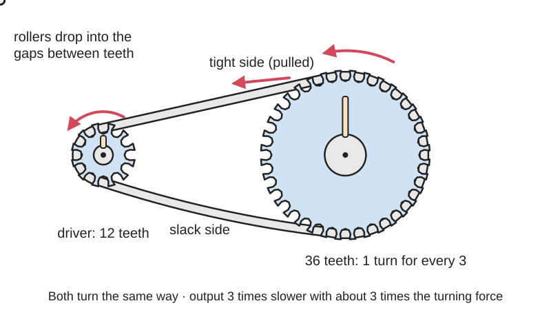
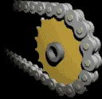
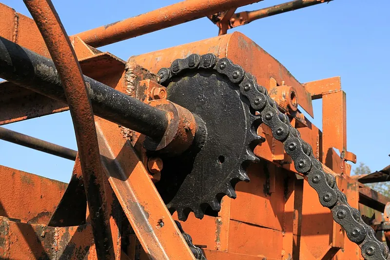
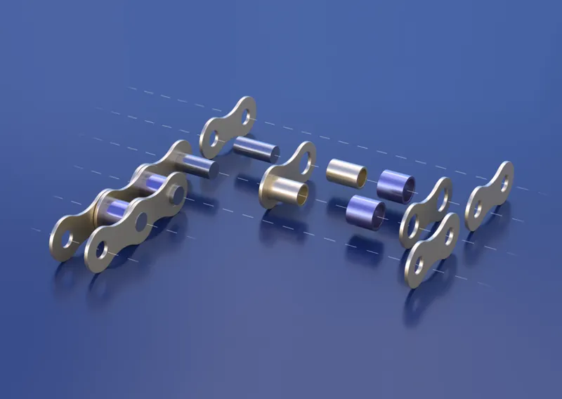

<figure class="eoc-pic eoc-pic-main"><picture><source media="(prefers-reduced-motion: reduce)" srcset="../media/drawn/chain-and-sprocket-drive.svg"></picture><figcaption><strong>Animation.</strong> Diagram drawn for the encyclopaedia from the research notes. ⚑ Needs confirming: a drawing can simplify or get details wrong; a real photo or a better diagram is welcome.</figcaption></figure>
<figure class="eoc-pic"><picture><source media="(prefers-reduced-motion: reduce)" srcset="../media/chain-and-sprocket-drive.still.webp"></picture><figcaption><strong>Animation.</strong> <a href="https://commons.wikimedia.org/wiki/File:Chain.gif">Chain</a> by Occupational Safety &amp; Health Administration (OSHA) part of the U.S. Department of Labor, Public domain, from Wikimedia Commons.</figcaption></figure>
<figure class="eoc-pic"><figcaption><strong>How it works.</strong> <a href="https://commons.wikimedia.org/wiki/File:Bar%C3%9Fel_-_Moor-_und_Fehnmuseum_-_Gro%C3%9Fer_Strenge-Bagger_19_ies.jpg">Barßel - Moor- und Fehnmuseum - Großer Strenge-Bagger 19 ies</a> by Frank Vincentz, <a href="https://creativecommons.org/licenses/by-sa/3.0">CC BY-SA 3.0</a>, from Wikimedia Commons.</figcaption></figure>
<figure class="eoc-pic"><figcaption><strong>How it works.</strong> <a href="https://commons.wikimedia.org/wiki/File:Roller_Chain_Render.png">Roller Chain Render</a> by Niabot, <a href="https://creativecommons.org/licenses/by-sa/3.0">CC BY-SA 3.0</a>, from Wikimedia Commons.</figcaption></figure>

A steel (or plastic) roller chain runs round toothed wheels called sprockets on two parallel shafts, passing strong rotation between them without slipping and changing speed according to the tooth counts.

**In plain words:** A bicycle-style chain looped round two toothed wheels, so that turning one wheel turns the other without ever slipping, even when the wheels are far apart. **Proper term:** Roller chain drive (chain and sprocket drive).

**Also called:** chain drive; roller chain and sprockets, bush roller chain; sprocket, sprocket wheel, chainwheel, chain wheel (the toothed wheels); chainring (a bicycle's front sprocket), cog or cassette (a bicycle's rear sprockets); ANSI #25 / #35 / #40 chain (US sizes: 1/4, 3/8 and 1/2 inch [pitch](../glossary.md#pitch)); ISO 606 / BS 228 chain, e.g. 05B, 06B, 08B (European sizes, pitch in sixteenths of an inch); simplex, duplex, triplex chain (one, two or three strands side by side); bicycle chain, motorcycle chain (e.g. 420 chain); timing chain (the chain that drives the camshaft in a car engine); master link, connecting link, quick link (the removable joining link); Rollenkette (German, roller chain).

## How it works

The chain is a string of short links joined by pins, so it can bend round a wheel but not stretch. Each roller drops into the gap between two sprocket teeth, so when the driving sprocket turns, its teeth pull the chain along, and the chain's rollers push the teeth of the other sprocket round (a positive, non-slip drive). Both sprockets turn the same way, and the speed changes by the ratio of their tooth counts: a 12-tooth sprocket driving a 36-tooth one turns the output three times slower with about three times the turning force. Because the chain wraps a sprocket as a polygon rather than a circle, its speed ripples slightly as each link comes on (chordal action), which is worst on sprockets with few teeth.

## Parts

A few parts: a driving sprocket, a driven sprocket, a loop of roller chain (made of outer plates, inner plates, pins, bushings and rollers), a way to join the chain (a riveted link or a removable master link), and a way to take up slack (slotted mounts, an adjustable shaft or an [idler](../glossary.md#idler) sprocket). Plus shafts and bearings to carry the sprockets.

## Everyday examples

- A bicycle: the pedals turn the front chainring, and the chain drives the rear sprocket (Wikipedia 'Sprocket')
- Motorcycles: most sporty motorcycles use a chain to the back wheel (Wikipedia 'Chain drive')
- Car engines: a timing chain turns the camshaft (Wikipedia 'Roller chain')
- Conveyors, farm machinery and printing presses (Wikipedia 'Roller chain'), and student competition robots (Game Manual 0)

## When to use it

Use a chain when you need strong, non-slipping rotation between parallel shafts that are too far apart for gears, especially where there is dirt, shock loads or heavy [torque](../glossary.md#torque): robot drive trains and arms, go-karts, bikes, lifts and conveyors. It is easy to change the length or the ratio by breaking the chain and swapping sprockets, the parts are cheap and standard, and a chain keeps working for long periods even with little [lubrication](../glossary.md#lubrication) (RoyMech). It also handles higher power and longer centre distances than belts (RoyMech).

## When not to use it

Avoid a chain where quiet, smooth, oil-free running matters (3D printers, camera sliders): use a toothed timing belt. Avoid it for precise positioning without a good tensioner, because the chain stretches and adds slop (Game Manual 0): use gears or a timing belt. Avoid it for shafts close together or for big reductions in small spaces, because sprockets are large (Game Manual 0): use spur, planetary or worm gears. Avoid it where the load must hold when the motor stops: add a brake, a worm drive or a lead screw. Avoid it for shafts that are not parallel: use bevel gears, a universal joint or a flexible shaft.

## Details

- **What it does (jobs):**
  - change speed or turning force: passes rotation between parallel shafts that can be far apart, faster or slower according to the tooth counts
  - change the kind of motion: a chain fixed to a carriage, lift or conveyor turns a sprocket's rotation into straight-line motion (e.g. continuous chain elevators on competition robots)
- **Movement:** rotate: continuous rotation in either direction with unlimited range; driver and driven sprockets turn the same way. A chain run fixed to a carriage can also drive it in a straight line (slide)
- **Directions it can move (degrees of freedom):** 1: the chain ties the two sprockets together, so turning one sets the position of the other (apart from a little slack and chain stretch)
- **Special behaviour:**
  - motion conversion (rotary to linear): an open chain run clamped to a carriage, or a conveyor chain, turns rotation into straight-line motion
  - none of the other clever behaviours: it does not slip on purpose (unlike a friction belt), it does not lock, and it can be driven backwards. A loose or worn chain can jump teeth under load, but that is a fault, not a safety slip
- **How it holds:**
  - not a holding joint (it moves or passes on motion): it transmits rotation
  - shape (the parts interlock; [form-fit](../glossary.md#form-fit--force-fit--material-bond)): the chain's rollers sit in the gaps between the sprocket teeth, so the drive cannot slip
- **Input and output:** Continuous rotation -> continuous rotation in the same direction (or rotation -> straight-line motion with a chain fixed to a carriage). Ratio = teeth on driven sprocket / teeth on driving sprocket. RoyMech gives a normal single-stage maximum of about 6:1 (up to 114 teeth on the big wheel with 19 on the small one); BSC's 'Chain and Sprockets 101' guide (Bearing Service Pty Ltd) says limit ratios to 7:1. Efficiency: about 98% for well-lubricated roller chain (Wikipedia 'Roller chain'; RoyMech uses 98%), and one bicycle-chain study measured up to 98.6% (Wikipedia 'Bicycle chain'). Shafts: parallel. Back-drivable: yes, the output can drive the input backwards, so a lifted load will run the motor backwards unless there is a brake or a [self-locking](../glossary.md#self-locking) stage.
- **Power:** passive (no power needed); it only passes on the motor's power. If the motor stops or loses power, nothing holds the output, and a load (such as a robot arm or lift) can back-drive the chain
- **Load:** Medium to heavy: steel roller chain carries high torque in a compact space (RoyMech). Examples: #25 (1/4 inch) chain holds about 930 lb before breaking (Game Manual 0); a single-strand 08B (1/2 inch) chain has a breaking force of 18,000 N (RoyMech table from BS 228 / ISO 606). A chain only works in tension (pull): the tight side pulls the two shafts towards each other, loading their bearings sideways. It is weak against sideways [misalignment](../glossary.md#misalignment) and twisting, and chains usually fail by wear or [fatigue](../glossary.md#fatigue), not by snapping (RoyMech)
- **Play and precision:** Small [backlash](../glossary.md#backlash) when properly tensioned (Game Manual 0: 'roller chain doesn't have very much slop'), but play grows as the chain stretches, so an adjustable tensioner is needed. Speed ripples slightly each time a link engages (chordal action): about 4% with an 11-tooth sprocket, 1% with 21 teeth and 0.5% with 30 teeth (BSC guide). Tolerates very little misalignment: the sprockets must be in the same plane and the shafts parallel, or the chain wears, runs rough or comes off (RoyMech; BSC guide)
- **Taking it apart:** removable: sprockets are fixed to shafts with [set screws](../glossary.md#set-screw), keys, hex bores or bolted hubs; the chain comes off by undoing a master link or pressing out a pin with a chain breaker
- **How often it can be reused:** many times: chains and sprockets can be taken apart and refitted repeatedly; the chain itself wears (stretches) and is replaced as a consumable, and removable master links are the least reliable part (Game Manual 0)
- **Sealing:** none: the chain and sprockets are open. Industrial drives run in closed oil-filled cases (RoyMech), and [O-ring](../glossary.md#o-ring) chains have rubber rings in each link that keep grease in and dirt out of the joints (Wikipedia 'Roller chain'), but the drive itself seals nothing
- **Adjustable:** Yes. Tension: slide one shaft or the motor in slotted holes, or add an idler or spring-loaded tensioner sprocket on the slack side (RoyMech; Game Manual 0). Length: add or remove links with a chain breaker. Ratio: swap sprockets, or use a derailleur and several sprockets as on a bicycle
- **Access needed:** end of a tube or shaft: sprockets slide onto the shaft ends. The chain itself can be broken and rejoined in place, often without removing it from the machine (Game Manual 0)
- **Materials:** Chains: high-grade steel for power transmission (RoyMech), also stainless steel and plastic chains that need no oil but carry much less (RoyMech). Sprockets: steel (hardened teeth for small, highly loaded sprockets), cast iron or steel plate for large ones (RoyMech); robotics teams also use plastic and 3D-printed sprockets for light loads. 3D-printed chains and sprockets: PLA, PETG or nylon for light duty (LoboCNC chain; unionfab guide)
- **Heat, cold, water and wear:** Steel chains need oil and rust if left wet unless they are stainless or coated; dirt mixed with oil speeds up wear, which is why O-ring chains keep dirt out of the joints (Wikipedia 'Roller chain'). RoyMech treats 0-80 C as normal and derates chain capacity above that. Chains stretch with wear over time, so tension must be re-checked (Game Manual 0). Printed plastic sprockets and chains: PLA softens above about 60 C and degrades in sunlight (Prusa); plastic parts under constant load can [creep](../glossary.md#creep). Vibration can loosen set screws and master-link clips.

## Making it

- **Ways to make or get it:**
  - off-the-shelf part (roller chain, sprockets, idler sprockets, tensioners, master links)
  - 3D print (FDM): sprockets for standard metal chain in light-duty uses, idler sprockets, and complete light-duty plastic chains
  - laser cut or CNC: flat plate sprockets from a generated outline (metal, polycarbonate or plywood)
  - 3D print (resin): small display or light-duty sprockets ⚑ [uncertain]
- **Printing it in one piece (print in place):** no: sprockets are printed separately and fitted to shafts; printed chains are printed as separate links that are snapped or bolted together (LoboCNC's chain links snap together; the 'Let's Print' chain used bolts and nuts)
- **Tools:** A chain breaker (chain tool) to shorten or join chain, or pliers for a master link's spring clip; hex keys or a screwdriver for set screws and hub bolts; a straightedge or level to line up the sprockets; oil or chain lube. Game Manual 0 recommends a chain breaker over master links
- **Difficulty:** easy to moderate: chain, sprockets, tensioners and chain tools are cheap standard parts, and sprockets print or laser-cut well from free generators; the main skills are lining the sprockets up, getting the chain length and tension right, and joining the chain

### 3D printing tips

1) Generate the teeth, don't draw them: kresty's OpenSCAD 'Roller Chain Sprockets' module (and Dallen Wilson's GitHub fork with keyways and set-screw holes) makes sprockets for ANSI #25 to #80, motorcycle and bicycle chain from the chain size and tooth count, with 'fudge' settings to loosen the bore and roller seats for your printer; cq_warehouse's Sprocket class has a [clearance](../glossary.md#clearance) setting between rollers and teeth. 2) Print the sprocket flat, with the shaft axis vertical, so each layer traces the whole tooth outline (unionfab guide). 3) Make the teeth solid: set enough walls ([perimeters](../glossary.md#perimeters)) that the teeth have no [infill](../glossary.md#infill) at all (FRC team 3005, whose PLA sprocket survived a season in a low-torque joint); Engineerdog warns that tiny teeth can still have gaps inside at 100% infill. 4) Leave 0.1-0.3 mm clearance on the bore (unionfab) or at least 0.3 mm between moving parts (Prusa); bores tend to print small, so plan to ream or oversize them (Engineerdog). 5) Material: nylon or carbon-fibre nylon for working sprockets, PETG for prototypes; unionfab advises against PLA for loaded sprockets because it is [brittle](../glossary.md#brittle--ductile) and softens with heat, and Prusa says PLA softens above about 60 C. 6) Fix the hub to the shaft firmly: a hex bore, a set screw on a flat, or a bolted metal hub, with a thick hub wall (Engineerdog). 7) Use at least about 17-19 teeth on the small sprocket where smoothness matters (RoyMech); very small printed sprockets wear the chain faster (Game Manual 0). 8) Printed chains: LoboCNC's 9 mm pitch PLA chain orients each link so the pull runs along the printed lines, prints at 0.2 mm layers, and is rated about 5 kgf working load (22 kgf theoretical yield); the 'Let's Print' tests found printed ABS, PLA and PETG chains worked, but only at minimal load (Hackaday). 9) Typical failures: teeth shearing off along [layer lines](../glossary.md#layer-lines), bores cracking or slipping on the shaft, and printed teeth wearing into hooks that let the chain jump.

### Buying one (off-the-shelf parts)

Roller chain (ANSI #25 1/4 inch, #35 3/8 inch, #40 1/2 inch; ISO 04B/05B/06B/08B; 8 mm pitch robotics chain as used in FTC); plate sprockets (flat, bolt-on), hub sprockets with set screw or keyway, idler sprockets with built-in bearings; chain tensioners (spring-loaded or screw-adjusted); master links / connecting links / half links (offset links); chain breaker tool (chain tool); O-ring or X-ring chain for dirty places; bicycle chainrings, cogs and cassettes; motorcycle chain and sprockets; chain guards. Search terms: 'roller chain', 'plate sprocket', 'idler sprocket', 'chain tensioner', 'connecting link', 'chain breaker'.

## Rules of thumb

- Speed ratio = teeth on driven sprocket / teeth on driving sprocket, so the ratio is changed by swapping sprocket sizes (Wikipedia 'Chain drive'); driver and driven turn the same way (DT Online 'Chain and Sprocket').
- Sprocket pitch diameter D = p / sin(180 degrees / z), where p is the chain pitch and z the number of teeth (RoyMech 'Roller chains').
- Smallest sprocket: about 9 teeth is possible, but normally at least 19, and 23 or more for smooth, fast drives; the big sprocket normally has at most 114 teeth (never more than 150), giving a normal maximum ratio of about 6:1 (RoyMech). BSC guide: limit ratios to 7:1 so a worn chain does not jump teeth on the big sprocket.
- Chordal speed ripple: about 4% with 11 teeth, 1% with 21 teeth and 0.5% with 30 teeth (BSC guide).
- Chain wrap on the small sprocket: more than 120 degrees (RoyMech); Game Manual 0 says at least 90 degrees and ideally 180 degrees or more.
- Centre distance: about 40 chain pitches is recommended (RoyMech); on 1:1 low-ratio drives keep the tooth counts of both sprockets adding up to no more than 50 (RoyMech).
- Chain length and centre distance: L = 2C/P + (N + n)/2 + P((N - n)/(2 pi))^2 / C, in pitches, where N and n are the tooth counts (Game Manual 0); round L up to a whole, preferably even, number of links, because a full link covers two pitches (RoyMech).
- Tension: slack-side sag of about 2-4% of the shaft centre distance (BSC guide); Game Manual 0's hand test is that the chain should move slightly under a gentle push without much resistance.
- Wear limit: replace chain at about 1.5-2% elongation in most industrial drives (Tsubaki); Wikipedia gives 3% on adjustable drives and 1.5% on fixed-centre drives. Bicycle chains: replace before 20 half-links measure 10 1/16 inch (256 mm) instead of 10 inch (Wikipedia 'Bicycle chain').
- Sizes: ANSI #25 = 1/4 inch, #35 = 3/8 inch, #40 = 1/2 inch pitch (Wikipedia 'Roller chain'); in ISO names like 06B the first two digits are the pitch in sixteenths of an inch (06 = 3/8 inch) and B means the European standard (RoyMech).
- Strength example: #25 chain breaks at about 930 lb (Game Manual 0); ISO 08B-1 breaks at 18,000 N (RoyMech table).

## Common failures

1) Too loose: the chain skips teeth or falls off (Game Manual 0); fix with proper tension, an idler or a spring tensioner. 2) Too tight: burns out motors and wastes power (Game Manual 0). 3) Misaligned sprockets: rough running, side wear and derailing; line sprockets up with a straightedge or level (BSC guide). 4) Chain stretch from wear at the pins and bushings: the chain rides higher on the teeth and eventually jumps; replace chain at the wear limit, and sprockets too if their teeth have worn into hooks (Tsubaki; Wikipedia 'Roller chain'). 5) Master link coming undone: Game Manual 0 reports teams losing matches to failed master links; use a chain breaker and a permanent link where possible. 6) Too few teeth or too little wrap: faster stretch, rough running and skipping (RoyMech; Game Manual 0). 7) No lubrication on steel chain: faster wear and lower capacity (RoyMech). 8) Printed sprockets: teeth shearing off along layer lines, or the hub slipping on the shaft; make teeth solid and use a hex or keyed bore.

## Safety

The point where the chain runs onto a sprocket is an in-running nip point that can catch fingers, hair, gloves or clothing (OSHA machine guarding eTool); OSHA requires sprockets and chains on powered machinery to be enclosed unless more than 7 feet above the floor. Unguarded chains can cause cuts, punctures and amputations. Switch off and unplug before touching or tensioning a chain, and keep a chain guard on bikes and machines. A chain that breaks under load can whip. Chain oil makes surfaces slippery.

## Related

- Belt drives (timing belt, V-belt): quieter, lighter, no oil, and better for precise positioning; carry less torque and prefer clean places (see Belt drives entry)
- Spur gear pair: for shafts close together; stiffer and more compact, but no long reach
- Silent (inverted-tooth) chain: a chain with toothed plates that meshes like a gear; higher power and speed and smoother, but needs lubrication (RoyMech)
- Leaf chain: a chain of plates for lifting loads over a pulley, as on forklifts; it has no rollers and does not run on toothed sprockets (RoyMech)
- Lantern gear (pin gear): a wheel with pins meshing directly with a toothed wheel; a sprocket is shaped similarly but the chain wraps round it (Chief Delphi)
- Belt tensioner (spring-loaded idler): the usual way to keep a chain tight when the shafts can't move
- Cable carrier (drag chain): looks like a chain but only carries cables and hoses; it passes on no power
- Rigid chain [actuator](../glossary.md#actuator) (push chain): a chain whose links lock into a column so it can push as well as pull
- Shaft drive: a spinning shaft with bevel gears, used on some bicycles and touring motorcycles instead of a chain (Wikipedia 'Chain drive')

## Make it yourself

- [Roller Chain and Sprockets (LoboCNC, Printables)](https://www.printables.com/model/283151-roller-chain-and-sprockets): A fully printable 9 mm pitch roller chain whose links snap together, plus STL and STEP sprockets from 8 to 30 teeth; PLA recommended, about 5 kgf working load *(licence: CC BY-SA)*
- [420 roller chain, modular, with chain lock and sprockets (Hartvik Line, Printables) (URL from Printables API, page not opened)](https://www.printables.com/model/407208-420-roller-chain-modular-with-chain-lock-and-sproc): A printed copy of 420-size motorcycle chain with a chain lock, in several lengths, plus 9-48 tooth sprockets *(licence: CC BY-SA)*
- [Educational Gear Examples 3 - Lantern (osamutake, Printables)](https://www.printables.com/model/1451958-educational-gear-examples-3-lantern): A set of small printable demonstration models including a chain and sprocket, lantern gears and a pin rack, with an explanation of why sprocket teeth are shaped the way they are *(licence: CC BY)*
- [Roller Chain Sprockets OpenSCAD Module (kresty / Shawn Steele, Thingiverse) (from search results; page loads only with scripts)](https://www.thingiverse.com/thing:197896): OpenSCAD module that generates sprockets for ANSI #25-#80, motorcycle and bicycle chain from chain size, tooth count and bore *(licence: MS-PL (stated in the Sprockets.scad header))*
- [OpenSCAD-Sprockets (Dallen Wilson, GitHub)](https://github.com/dallenwilson/OpenSCAD-Sprockets): Fork of the Sprockets.scad module that adds keyways, set-screw holes and printer 'fudge' settings; tested with ANSI chain *(licence: Sprockets.scad MS-PL; threads.scad GPL-3)*
- [cq_warehouse sprocket (and chain) generator](https://cq-warehouse.readthedocs.io/en/latest/sprocket.html): Python/CadQuery classes that generate parametric sprockets (chain pitch, roller diameter, tooth count, clearance) and a chain wrapped round a set of sprockets, exportable to STEP *(licence: Apache 2.0)*

## Pictures, videos and models

- [Chain.gif (Wikimedia Commons, OSHA)](https://commons.wikimedia.org/wiki/File:Chain.gif): Animation of a chain running onto a sprocket, highlighting the in-running nip point where they meet *(licence: Public domain (work of the US Department of Labor, OSHA))*
- [Roller Chain.svg (Wikimedia Commons)](https://commons.wikimedia.org/wiki/File:Roller_Chain.svg): Labelled diagram of a roller chain: outer plate, inner plate, pin, bushing and roller *(licence: Attribution (free use with credit to the copyright holder, M. Roeder; SVG by Hk kng))*
- [Rollenketten.gif (Wikimedia Commons, Kettentechnik Roeder GmbH)](https://commons.wikimedia.org/wiki/File:Rollenketten.gif): Animated roller chain *(licence: Public domain (released by the copyright holder))*
- [Roller chain (Wikipedia)](https://en.wikipedia.org/wiki/Roller_chain): Photos of roller chain and sprocket, chain construction, Leonardo da Vinci's roller chain sketch, and a layout diagram *(licence: Text CC BY-SA 4.0; images per file)*
- [Roller Chain (Game Manual 0)](https://gm0.org/en/latest/docs/common-mechanisms/power-transmission/chain.html): Photos of chain drives on student robots, a disassembled master link, and good chain wrap with tensioners *(licence: link only ⚑ [uncertain])*

## Needs confirming

⚑ marks something nobody has confirmed yet: a fact the research could not confirm from a source, a finder value that is a best guess, or an open point from the research notes. Corrections are welcome (see `research/needs-confirming.md`).

- ⚑ 2 sentences on this page marked [uncertain].
- ⚑ Finder value `shaft_layout` = parallel, far apart (best guess): worked out from the name: a belt, chain, cable or flexible shaft links the two shafts

## Sources

- <https://en.wikipedia.org/wiki/Roller_chain>
- <https://en.wikipedia.org/wiki/Chain_drive>
- <https://en.wikipedia.org/wiki/Sprocket>
- <https://en.wikipedia.org/wiki/Bicycle_chain>
- <https://roymech.org/Useful_Tables/Drive/Chain_Drives.html>
- <https://roymech.org/Useful_Tables/Drive/Roller_chain.html>
- <https://gm0.org/en/latest/docs/common-mechanisms/power-transmission/chain.html>
- <https://raw.githubusercontent.com/gamemanual0/gm0/main/source/docs/common-mechanisms/power-transmission/chain.rst>
- <https://partners.bsc.com.au/Content/+2332>
- <https://www.ustsubaki.com/resources/knowledge-center/chain-wear-indicator-kit/>
- <https://www.osha.gov/laws-regs/regulations/standardnumber/1910/1910.219>
- <https://www.osha.gov/etools/machine-guarding/introduction/hazardous-motions-actions>
- <https://wiki.dtonline.org/index.php/Chain_and_Sprocket>
- <https://507movements.com/mm_254.html>
- <https://hackaday.com/2021/05/15/putting-3d-printed-chain-through-its-paces/>
- <https://www.unionfab.com/blog/2025/06/3d-print-sprocket>
- <https://www.chiefdelphi.com/t/3005-robochargers-cad-release-2025/504887>
- <https://www.chiefdelphi.com/t/geometry-correct-lantern-gears-in-onshape/473561>
- <https://engineerdog.com/2017/01/07/a-practical-guide-to-fdm-3d-printing-gears/>
- <https://help.prusa3d.com/article/modeling-with-3d-printing-in-mind_164135>
- <https://help.prusa3d.com/article/pla_2062>
- <https://commons.wikimedia.org/wiki/Category:Roller_chains>
- <https://commons.wikimedia.org/wiki/File:Chain.gif>
- <https://commons.wikimedia.org/wiki/File:Roller_Chain.svg>
- <https://commons.wikimedia.org/wiki/File:Rollenketten.gif>
- <https://api.printables.com/graphql/>
- <https://raw.githubusercontent.com/dallenwilson/OpenSCAD-Sprockets/master/README.md>
- <https://raw.githubusercontent.com/dallenwilson/OpenSCAD-Sprockets/master/Sprockets.scad>
- <https://cq-warehouse.readthedocs.io/en/latest/sprocket.html>
- <https://cq-warehouse.readthedocs.io/en/latest/chain.html>
- <https://raw.githubusercontent.com/gumyr/cq_warehouse/main/LICENSE>
