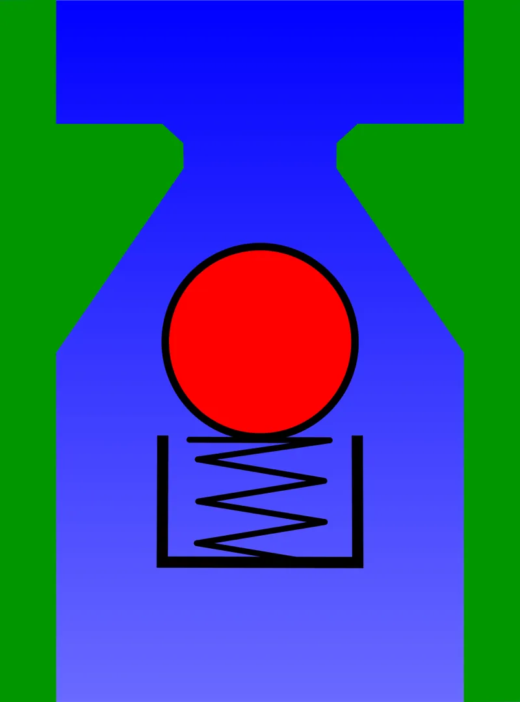
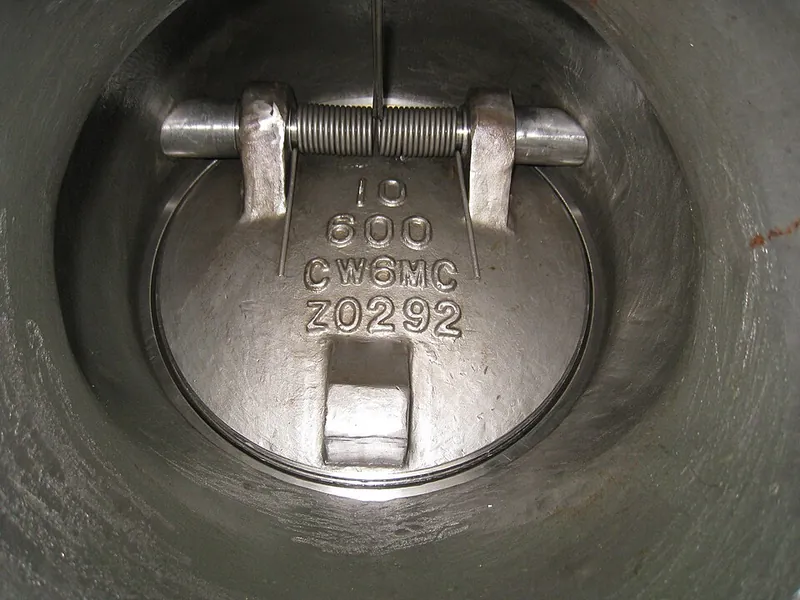
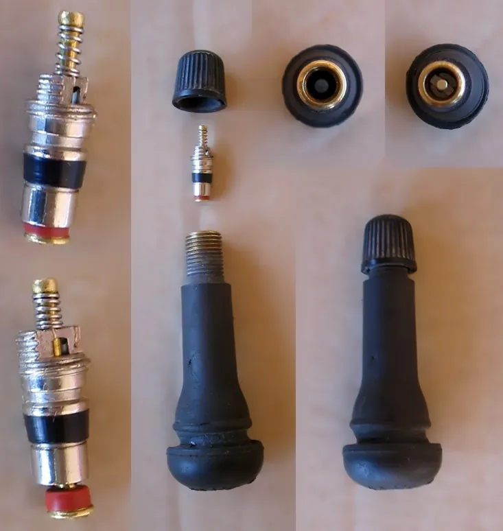

<figure class="eoc-pic eoc-pic-main"><picture><source media="(prefers-reduced-motion: reduce)" srcset="../media/drawn/check-valve.svg"></picture><figcaption><strong>Animation.</strong> Diagram drawn for the encyclopaedia from the research notes. ⚑ Needs confirming: a drawing can simplify or get details wrong; a real photo or a better diagram is welcome.</figcaption></figure>
<figure class="eoc-pic"><figcaption><strong>Diagram.</strong> <a href="https://commons.wikimedia.org/wiki/File:Checkvalveopen.svg">Checkvalveopen</a> by Original: Mion Vector: Chris828, <a href="http://creativecommons.org/licenses/by-sa/3.0/">CC BY-SA 3.0</a>, from Wikimedia Commons.</figcaption></figure>
<figure class="eoc-pic"><figcaption><strong>How it works.</strong> <a href="https://commons.wikimedia.org/wiki/File:Inside-tilting-disc-check-valve-The-Alloy-Valve-Stockist.jpg">Inside-tilting-disc-check-valve-The-Alloy-Valve-Stockist</a> by Heather Smith, <a href="https://creativecommons.org/licenses/by/3.0">CC BY 3.0</a>, from Wikimedia Commons.</figcaption></figure>
<figure class="eoc-pic"><figcaption><strong>How it works.</strong> <a href="https://commons.wikimedia.org/wiki/File:Valvola_Schrader.jpg">Valvola Schrader</a> by A7N8X, <a href="https://creativecommons.org/licenses/by-sa/3.0">CC BY-SA 3.0</a>, from Wikimedia Commons.</figcaption></figure>

A two-port valve that works by itself: when the pressure on the inlet side beats the outlet side by a small 'cracking pressure', a flap, ball, poppet, reed or rubber beak moves aside and lets fluid through, and when the flow stops or reverses the same part is pressed back onto its seat to block it, making it the fluid version of a [ratchet](../glossary.md#ratchet).

**In plain words:** A little gate inside a pipe or tube that lets air or water through one way only: the flow pushes it open, and anything trying to flow back pushes it shut. The gate can be a hinged flap, a ball (often pushed by a spring), a thin springy reed, or a soft rubber 'duck's beak' whose lips are squeezed together by backflow. **Proper term:** [Check valve](../glossary.md#check-valve) (non-return valve, one-way valve).

**Also called:** non-return valve (NRV); one-way valve; reflux valve, retention valve (Wikipedia); foot valve (a check valve at the bottom of a pump's suction pipe that keeps debris out and the pump primed; Tameson); ball check valve; spring check valve; poppet check valve; in-line check valve; swing check valve, flapper valve, flap valve, clapper valve; tilting-disc and butterfly (double-flap) check valves; lift check valve; Y-check valve; stop-check valve (can also be shut by hand); silent check valve or non-slam check valve (spring-closed); diaphragm check valve; exhalation valve (on respirator masks); duckbill valve (also called a spear valve or flutter valve); joker valve (three-flap version); cross-slit valve; reed valve; tyre valve: Schrader valve (American valve, AV, car valve), Presta valve (French valve, FV, Sclaverand valve) and Dunlop valve (Woods valve); backflow preventer, double check valve, backwater valve (sewers); aquarium check valve (air-line non-return valve); fluid 'diode' (Wikipedia calls the electrical diode the electrical analogue of a check valve).

## How it works

Every check valve has a closing part that is pushed one way by the flow and the other way by back-pressure, gravity or a spring. Forward flow only gets through once the pressure difference across the valve exceeds the cracking pressure, which lifts the ball, swings the flap, bends the reed or parts the rubber lips (Wikipedia; Tameson). When the inlet pressure falls or reverses, the part is pressed back onto its seat; a cone-shaped seat guides a ball back into place, and in a duckbill or reed valve higher back-pressure squeezes the lips or petal tighter, so the seal improves (Wikipedia). A spring makes it shut quickly in any position, while unsprung flaps and balls rely on gravity and so must be fitted the right way up (Tameson).

## Parts

A few parts, or a single piece. Ball or poppet type: a body with inlet and outlet, a seat (a tapered ring), a ball or disc, and often a spring and a guide (Tameson; Wikipedia). Swing type: body, hinged disc and seal (Tameson). Reed type: a thin flexible petal over a hole in a plate, with a stop plate that limits how far it opens (Wikipedia; Commons Mota-10 diagram). Duckbill: one moulded rubber piece (Wikipedia 'Duckbill valve'). Tyre valves: a valve stem with a removable spring-loaded core plus a cap (Schrader), or a stem with an inner valve body held shut by air pressure and a small locking nut (Presta) (Wikipedia).

## Everyday examples

- The valve on a bike or car tyre (Schrader or Presta) that lets air in from the pump but not out (Wikipedia)
- The little one-way valve in an aquarium air line that stops tank water siphoning back into the pump (Aquarium Co-op)
- The flapper in a toilet cistern, and the valve on an inflatable mattress or pool toy (Wikipedia)
- The ball valves inside a soap-dispenser pump or a rubber squeeze bulb, and the exhale valve on a dust mask (Wikipedia)

## When to use it

Use one wherever fluid must only ever go one way without anyone operating a valve: keeping air in a tyre, ball or inflatable; stopping water siphoning back into an air pump; keeping a pump primed or a pipe full when the pump stops; making a pump work at all (a pair of check valves turns the in-and-out movement of a diaphragm, piston or squeeze bulb into one-way flow); letting a hydraulic jack build pressure; holding air in a soft [actuator](../glossary.md#actuator) after the pump stops; and keeping two gas streams, or clean and dirty water, from mixing (Wikipedia 'Check valve'; Wikipedia 'Diaphragm pump'; Tameson; Aquarium Co-op). For drains, sewer outfalls and slurries, rubber duckbill valves are used because they don't slam and cope with suspended solids (Fluid Handling Pro).

## When not to use it

Don't rely on a check valve to shut a line off for maintenance or safety: it can stick or leak, so add a proper shut-off valve and vent the pressure first (Wikipedia 'Backflow prevention device' notes check valves are 'not considered to be reliable' compared with backflow assemblies). For drinking-water connections use an approved backflow preventer or an air gap (Wikipedia). To limit pressure use a pressure relief valve; to choose or switch the flow on command use a switching (directional) valve; to stop flow both ways by hand use a shut-off valve. A swing check valve is a poor choice for pulsing or frequently reversing flow; use a spring check valve instead (Tameson).

## Details

- **What it does (jobs):**
  - stop it moving back (one-way): lets air, water or oil flow one way and blocks the reverse, automatically and with no handle (Wikipedia)
  - seal it, or pass cables or fluid through: passes fluid along a tube while sealing against backflow, back-siphoning and contamination (Tameson; Wikipedia 'Backflow prevention device')
- **Movement:** multiple: a ball, poppet or disc slides off its seat along the flow, a flap swings on a hinge, a reed bends, or a duckbill's lips flex apart; the movement is small and happens by itself
- **Directions it can move (degrees of freedom):** 1: the closing part moves only between shut and open (along one line for a ball or poppet, about one hinge for a flap); a duckbill or reed bends instead of moving on a joint
- **Special behaviour:**
  - one-way (moves freely one way, locks the other): forward flow opens it and reverse flow shuts it (Wikipedia)
  - self-aligning or self-centring: the seat of a ball check valve is tapered like a cone, which guides the ball back onto the seat to seal (Wikipedia)
  - [fail-safe](../glossary.md#fail-safe--fail-secure): a spring-closed valve shuts on its own as soon as the flow stops, for example when an aquarium air pump loses power and tank water would otherwise siphon back into it (Tameson; Aquarium Co-op)
  - quick-release (tyre valves only): pressing the centre pin of a Schrader valve, or undoing the small nut of a Presta valve and pressing it, opens it on purpose to let air out (Wikipedia)
- **How it holds:**
  - suction or air pressure: back-pressure pushes the ball, flap, reed or rubber lips onto the seat, so the seal gets tighter as the reverse pressure rises (Wikipedia: a reed valve's 'seal improves with back pressure'; a Presta valve is held shut by the air pressure in the tyre)
  - spring force: a spring holds a ball or poppet shut until the cracking pressure is reached; the springiness of a rubber duckbill or a thin reed does the same job (Tameson; Wikipedia)
  - shape ([form-fit](../glossary.md#form-fit--force-fit--material-bond)): a ball sits in a cone-shaped seat that is too small for it to pass through (Tameson; Wikipedia)
- **Input and output:** not applicable (it passes fluid one way, not motion)
- **Power:** passive (no power needed): the pressure difference across the valve opens and closes it, and it stays shut against backflow when a pump stops or the power fails (Wikipedia; Aquarium Co-op)
- **Load:** light to heavy pressure depending on the body: polypropylene spring check valves are rated up to about 6 bar and stainless or steel ones up to about 400 bar (Tameson); metal-printed hydraulic check valves have been tested to 400 bar (Hackaday). Home-printed plastic valves are for low pressures only. It is not a structural part: don't hang weight on it or use it to support pipes
- **Play and precision:** not applicable (it doesn't locate parts or pass on motion)
- **Taking it apart:** removable: most are threaded, push-fit, barbed or clamped into the line and can be taken out again; tyre-valve cores unscrew with a valve-core tool, and a duckbill is stretched over the end of a supply pipe (Wikipedia 'Schrader valve'; Wikipedia 'Duckbill valve'; Tameson)
- **How often it can be reused:** effectively unlimited opening and closing in normal use, though balls and seats wear or crack, springs tire and metal reeds [fatigue](../glossary.md#fatigue), so these parts are made replaceable (Wikipedia; Tameson); valves can be fitted and removed many times
- **Sealing:** airtight or pressure in the blocked direction: the closing part is pressed onto its seat by back-pressure, a spring or the rubber's springiness; a stronger spring seals better but needs more pressure to open (Tameson). Unsprung, gravity-closed and many 3D-printed valves may let a little through at low back-pressure (a printed ping-pong-ball valve is claimed 'about 99% effective', Printables), and a Tesla valve, which has no moving parts, always leaks (Wikipedia). On tyre valves, a cap with a rubber washer or [O-ring](../glossary.md#o-ring) is a second seal (Wikipedia 'Schrader valve')
- **Adjustable:** usually no: the cracking pressure is fixed by the spring or the [stiffness](../glossary.md#stiffness) of the rubber, and is chosen when buying (Tameson). Some printed flap valves let you swap springs to change how easily they open (nolibert, Printables). A stop-check valve can also be shut by hand, and a heating-system 'flow check' has a screw to hold it open (Wikipedia)
- **Access needed:** end of a tube or shaft: fitted in line where a tube or pipe is cut, or screwed into a port; an aquarium valve goes in the air line outside the water (Aquarium Co-op); a duckbill is stretched over the outlet end of a pipe (Wikipedia)
- **Materials:** Bodies: brass (often nickel-plated), stainless steel, PVC, polypropylene (PP) or nylon (PA) (Tameson). Seals and seats: EPDM, nitrile (NBR), FKM, PTFE, FEP or metal (Tameson). Balls: usually metal; ruby and sapphire balls and seats in high-pressure lab pumps (Wikipedia). Duckbills: rubber or synthetic elastomer (Wikipedia), often silicone. Reeds: leather in traditional pumps and bellows; flexible metal, fibreglass or carbon fibre in engines (Wikipedia). Printed: TPU for one-piece duckbill and cross-slit valves, PETG for duct flaps, with an O-ring, airsoft BB or ping-pong ball as the closing part (Printables models)
- **Heat, cold, water and wear:** Heat: plastic bodies are limited to about 60 C (PVC), 80 C (PP) and 90 C (PA); most brass valves to about 100 C; stainless steel to about -25 to 200 C (Tameson). Chemicals: pick body and seal materials (EPDM, NBR, FKM, PTFE) to suit the fluid; brass isn't suitable for seawater or chlorinated water (Tameson). Wear and fatigue: balls and seats wear or crack after long use, springs fatigue, and metal reeds suffer fatigue from fast, repeated impacts (Wikipedia; Tameson). Dirt: debris on the seat stops it sealing, and grit can get into a Schrader valve's spring-loaded pin (Wikipedia 'Schrader valve'; Tameson advises removing debris regularly). Printed TPU valves: TPU absorbs moisture but stays flexible in the cold (Prusa); printed PLA parts soften in hot water ⚑ [uncertain: not checked for valves].

## Making it

- **Ways to make or get it:**
  - off-the-shelf part: aquarium, plumbing, pneumatic, tyre and medical check valves in plastic and metal (Tameson; Aquarium Co-op; Wikipedia)
  - 3D print (FDM): one-piece TPU duckbill and cross-slit valves, [print-in-place](../glossary.md#print-in-place) 'compliant' check valves, flap valves for ducts, and ball check valves with a ball dropped in during a print pause (Printables models)
  - 3D print (metal, laser powder bed): compact hydraulic check valves tested to 400 bar (SunShine, via Hackaday)
  - moulded rubber: duckbill and joker valves are single moulded rubber or elastomer parts (Wikipedia)
- **Printing it in one piece (print in place):** yes for some designs: one-piece TPU duckbill and cross-slit valves (tuyere, Printables) and SunShine's 'Print in Place Check-Valve!' (Printables) print complete and working. Partly for ball valves, where a ball (a 6 mm airsoft BB or a ping-pong ball) is dropped in at a print pause (Clough42 and xA59rhR8FF, Printables). Flap valves are printed as separate parts and assembled with springs and screws (nolibert, Printables)
- **Tools:** none for push-in, barbed or aquarium valves (cut the tube and push the valve in); a spanner and PTFE tape for threaded valves, tightened hand-tight plus about half a turn (Tameson); a valve-core tool for Schrader and removable-core Presta valves (Wikipedia); a soldering iron to weld printed TPU valves into a printed part (tuyere, Printables)
- **Difficulty:** easy to buy and fit: they are small, cheap and often push straight onto a tube (Wikipedia; Aquarium Co-op). Moderate to print one that seals well, because flexible TPU is hard to print and printed seats leak; printed valves suit low-pressure air and water, not pressure lines (Printables makers; Prusa)

### 3D printing tips

1) Easiest reliable print: a one-piece TPU duckbill. tuyere's designs (Printables) work well for air; the duckbill style leaks back less, while the cross-slit style flows more but leaks more. Print TPU slowly, one object at a time to limit stringing, and clean off stray hairs with a hot-air gun; when building valves into a squeeze-bulb pump, weld the seams with a soldering iron or the inlet valve can pop off when squeezed hard. 2) Ball valves: pause the print at the right layer and drop in the ball, e.g. a 6 mm airsoft BB at about 7.6 mm height in a TPU (85A) squeeze-bulb duster (Clough42, Printables), or a 40 mm ping-pong ball at about 65 mm in a 50 mm pipe valve printed solid (effectively 100% [infill](../glossary.md#infill) from many walls) with organic supports (xA59rhR8FF, Printables). Give the ball room to lift, and add a cross bar or posts so it can't block the outlet or rattle. 3) Sealing faces: add an O-ring or soft washer where you can; Duane's in-line valve for 19 mm (3/4 in) tube uses an O-ring from a tap fitting and prints without supports in the orientation shown (Printables). 4) Duct flaps: print the flap and inner ring in PETG and support the hinges; a light spring lets the flap open at low air pressure (nolibert, Printables). 5) Orientation: unsprung ball or flap valves must be mounted so gravity closes them (Tameson). 6) TPU absorbs moisture, so keep it dry, and print it slowly with little retraction (Prusa). 7) Printed valves are for low-pressure air and water, not 'mission critical or high pressure applications' (xA59rhR8FF, Printables). 8) A printed Tesla valve is not a substitute: with no moving parts it always leaks a little (Wikipedia 'Tesla valve').

### Buying one (off-the-shelf parts)

In-line spring check valves (push-in, barbed or threaded: NPT, BSP or metric); ball check valves; swing and lift check valves; Y-check valves; foot valves; aquarium air-line check valves for standard airline tubing; silicone duckbill, cross-slit and joker valves; diaphragm check valves and respirator exhalation valves; reed valve blocks and reed petals (two-stroke engines, compressors); double check valves and backflow preventer assemblies (plumbing); Schrader and Presta valve stems and cores, valve-core tools, sealing valve caps, Presta-to-Schrader adapters. Check valves also come built into hand pumps, squeeze bulbs, dispenser pumps, hydraulic jacks and diaphragm pumps (Tameson; Wikipedia; Aquarium Co-op)

## Rules of thumb

- Cracking pressure: many check valves open at 1 bar (14.5 psi) or less. Choose one whose cracking pressure is below your normal working pressure so it doesn't chatter, and whose maximum pressure rating is above the highest pressure in the system (Tameson)
- A stronger spring gives a higher cracking pressure and a better seal, but more pressure drop (Tameson 'Spring loaded check valves')
- Orientation: spring-loaded valves work in any position; gravity-closed swing and lift valves go in horizontal pipes; an unsprung ball valve must be vertical with the flow going upwards; for upward flow, the weight of the liquid above adds to the cracking pressure (Tameson)
- Fit it with the arrow pointing along the flow; if there's no arrow, push the closing part with a finger or thin rod to see which way it opens (Tameson)
- Threaded valves: screw in hand-tight, then about half a turn more with a spanner; tightening further can damage the valve (Tameson 'Swing check valve')
- Aquarium air lines: put the check valve outside the tank near the rim, with the flapper end facing the pump (Aquarium Co-op)
- Where flow can reverse suddenly (a pump stopping, especially in vertical pipes), use spring-closed 'silent' or 'non-slam' check valves rather than swing checks, to limit [water hammer](../glossary.md#water-hammer) (Tameson; Wikipedia 'Hydraulic shock')
- A check valve alone is usually not an approved way to protect drinking water from backflow; codes ask for an air gap, a double check valve assembly or a reduced-pressure device (Wikipedia 'Backflow prevention device')
- Reed valves open at very low pressure and respond quickly because the moving part is light, and their seal improves with back-pressure (Wikipedia 'Reed valve')
- Tyre valves: Presta stems are 6 mm and Schrader and Dunlop stems 8 mm across; a Presta stem should be at least 10 mm longer than the rim is deep so a pump can be attached (Wikipedia 'Schrader valve'; 'Presta valve')
- A Tesla valve is only 'a slightly leaking valve': a simulation found its reverse flow resistance only about 15-40 times its forward resistance, so use a real check valve where backflow must stop (Wikipedia 'Tesla valve')

## Common failures

1) Fitted backwards, so nothing flows and pressure builds up behind it (Tameson; Aquarium Co-op). 2) A gravity-closed valve fitted the wrong way up: a swing check in a downward-flow pipe stays open and never shuts (Tameson). 3) Dirt, scale or debris holding the ball or flap off its seat, so it leaks back: clean it regularly and check the ball and seat for wear (Tameson). 4) Chattering and wear when the cracking pressure is close to the working pressure (Tameson). 5) Slamming and water hammer from swing checks when flow reverses (Tameson; Wikipedia). 6) Worn or cracked seats and balls, tired springs and fatigue-cracked reeds after long use (Wikipedia; Tameson). 7) Leaking tyre-valve cores: tighten or replace the core, and use a cap with a seal as a backup, since simple caps don't stop leaks (Wikipedia 'Schrader valve'). 8) Printed valves: leaks past rough or uneven seats, and pressed-in TPU valves popping out when squeezed hard unless welded in (tuyere, Printables).

## Safety

1) Water hammer: a check valve that slams shut when a pump stops and the flow reverses ('check valve slam') sends a pressure surge through the pipe that can break pipes and fittings; water hammer has caused accidents and deaths (Wikipedia 'Hydraulic shock'). Use non-slam or spring check valves. 2) Trapped pressure: a check valve keeps pressure on its outlet side after the supply stops (that's how inflatables keep their air, Wikipedia), so a line or actuator can still be pressurised; vent it before undoing fittings (HSE HSG39 recommends vent valves that can be locked). 3) Never remove a Schrader valve core while the tyre or system is under pressure; let the air out first (moovmoov guide). 4) Compressed air can penetrate skin and blow particles into eyes, and a burst hose can whip (HSE HSG39). 5) Drinking water: a single check valve is usually not an approved backflow preventer (Wikipedia). 6) Aquariums: without a working check valve, siphoned water can damage the pump, flood the floor and, in extreme cases, reach electrics and start a fire (Aquarium Co-op). 7) Don't use printed check valves on pressure tanks or anything safety-critical, and never hold stored pressure in a 3D-printed part.

## Related

- Tesla valve: a channel with looping pockets and no moving parts; it only slows backflow and always leaks a little (Wikipedia)
- Ratchet and [pawl](../glossary.md#pawl): the mechanical version of 'one way only' for turning parts
- Pressure relief valve: also spring-loaded, but it opens only when the pressure gets too high, to stop things bursting
- Switching valve (directional control or [solenoid](../glossary.md#solenoid) valve): opened, closed or switched on command, by hand, electricity or air
- Shut-off valve (ball valve, tap): opened and closed by hand and stops flow in both directions; a ball check valve is not the same as a ball valve (Wikipedia)
- Iris valve and pinch valve: closed on purpose by twisting or squeezing a soft sleeve, not by the direction of flow
- Diaphragm pump and squeeze bulb: a flexing chamber between two check valves, which together make a pump (Wikipedia 'Diaphragm pump')
- Backflow preventer (double check valve assembly, reduced-pressure zone device): two or more check valves plus test points, required to protect drinking water (Wikipedia)
- Hose barb and quick couplers: the tube fittings check valves are usually connected with

## Make it yourself

- [TPU Check/One-Way Valves - No Moving Parts! - and a Demonstration Keyboard Duster (Hand Pump) (tuyere, Printables) (URL from Printables API, page not opened)](https://www.printables.com/model/1133240-tpu-checkone-way-valves-no-moving-parts-and-a-demo): One-piece print-in-place TPU duckbill and cross-slit check valves, plus an all-TPU squeeze-bulb air pump that uses two duckbills *(licence: CC BY-NC-SA)*
- [Print in Place Check-Valve! (SunShine, Printables) (URL from Printables API, page not opened)](https://www.printables.com/model/243964-print-in-place-check-valve): Print-in-place plastic check valve from the maker of the metal-printed compliant check valves (0.4 mm nozzle, 0.2 mm layers) *(licence: CC BY)*
- [Squeeze Bulb Duster with Gridfinity Tray and One-Way Valve (Clough42, Printables) (URL from Printables API, page not opened)](https://www.printables.com/model/999195-squeeze-bulb-duster-with-gridfinity-tray-and-one-w): 85A TPU squeeze bulb with a ball check valve in its base, using a 6 mm airsoft BB dropped in at a print pause *(licence: BSD)*
- [Captive Ping Pong Ball One-Way Valve for 50mm Pipe (xA59rhR8FF, Printables) (URL from Printables API, page not opened)](https://www.printables.com/model/568665-captive-ping-pong-ball-one-way-valve-for-50mm-pipe): Gravity-closed ball check valve for 50 mm PVC pipe with a ping-pong ball inserted at a print pause; for low-pressure air *(licence: GPL v3)*
- [Air System / Ventilation - Check Valve / Flap for 100mm / 4inch (nolibert, Printables) (URL from Printables API, page not opened)](https://www.printables.com/model/783642-air-system-ventilation-check-valve-flap-for-100mm-): Spring-assisted flap check valve for 100 mm ventilation ducts, with interchangeable springs to set the opening pressure *(licence: CC BY)*
- [Check Valve - Inline (Duane, Printables) (URL from Printables API, page not opened)](https://www.printables.com/model/506442-check-valve-inline): In-line check valve for 19 mm (3/4 in) tube for air or water, sealed with an O-ring from a tap fitting *(licence: CC BY-SA)*

## Pictures, videos and models

- [Checkvalveopen.svg (Mion, vectorised by Chris828; Wikimedia Commons), used with Checkvalveclosed.svg](https://commons.wikimedia.org/wiki/File:Checkvalveopen.svg): Cutaway of a spring-loaded ball check valve open to forward flow; the companion file shows it closed against reverse flow *(licence: CC BY-SA 3.0)*
- [Swing Check Valve Opening and Closing (savree.com; Wikimedia Commons)](https://commons.wikimedia.org/wiki/File:Swing_Check_Valve_Opening_and_Closing.webm): Animation of a hinged swing check valve opening with flow and closing when it stops *(licence: CC BY-SA 3.0)*
- [Duck valve.png (Cowlinator; Wikimedia Commons)](https://commons.wikimedia.org/wiki/File:Duck_valve.png): Cross-section of a duckbill valve: open with forward flow (top) and squeezed shut by backflow (bottom) *(licence: CC BY-SA 4.0)*
- [Mota-10.gif (unknown author; Wikimedia Commons)](https://commons.wikimedia.org/wiki/File:Mota-10.gif): Diagram of a reed valve: flexible petals over the holes in a reed block, with stop plates that limit how far they open *(licence: Public domain)*
- [Valvola Schrader.jpg (A7N8X; Wikimedia Commons)](https://commons.wikimedia.org/wiki/File:Valvola_Schrader.jpg): Schrader tyre valve taken apart: the core shown closed and open, the order of assembly, the stem with and without its core, and the cap *(licence: CC BY-SA 3.0)*

## Needs confirming

⚑ marks something nobody has confirmed yet: a fact the research could not confirm from a source, a finder value that is a best guess, or an open point from the research notes. Corrections are welcome (see `research/needs-confirming.md`).

- ⚑ 1 sentence on this page marked [uncertain].

## Sources

- <https://en.wikipedia.org/wiki/Check_valve>
- <https://en.wikipedia.org/wiki/Duckbill_valve>
- <https://en.wikipedia.org/wiki/Reed_valve>
- <https://en.wikipedia.org/wiki/Schrader_valve>
- <https://en.wikipedia.org/wiki/Presta_valve>
- <https://en.wikipedia.org/wiki/Hydraulic_shock>
- <https://en.wikipedia.org/wiki/Backflow_prevention_device>
- <https://en.wikipedia.org/wiki/Tesla_valve>
- <https://en.wikipedia.org/wiki/Diaphragm_pump>
- <https://tameson.com/pages/check-valves>
- <https://tameson.com/pages/spring-loaded-check-valves>
- <https://tameson.com/pages/swing-check-valve>
- <https://tameson.com/pages/ball-check-valve>
- <https://www.aquariumcoop.com/blogs/faqs/how-to-use-a-check-valve>
- <https://fluidhandlingpro.com/news/what-is-a-duckbill-check-valve-and-how-does-it-work/>
- <https://hackaday.com/2022/07/21/3d-printing-a-check-valve-in-metal/>
- <https://www.youtube.com/watch?v=1E3Ajqaapqk>
- <https://moovmoov.com/blogs/tuto/remove-schrader-valve-core>
- <https://www.hse.gov.uk/pubns/priced/hsg39.pdf>
- <https://help.prusa3d.com/article/flexible-materials_2057>
- <https://api.printables.com/graphql/>
- <https://www.printables.com/model/1133240-tpu-checkone-way-valves-no-moving-parts-and-a-demo>
- <https://www.printables.com/model/243964-print-in-place-check-valve>
- <https://www.printables.com/model/999195-squeeze-bulb-duster-with-gridfinity-tray-and-one-w>
- <https://www.printables.com/model/568665-captive-ping-pong-ball-one-way-valve-for-50mm-pipe>
- <https://www.printables.com/model/783642-air-system-ventilation-check-valve-flap-for-100mm->
- <https://www.printables.com/model/506442-check-valve-inline>
- <https://commons.wikimedia.org/wiki/File:Checkvalveopen.svg>
- <https://commons.wikimedia.org/wiki/File:Checkvalveclosed.svg>
- <https://commons.wikimedia.org/wiki/File:Swing_Check_Valve_Opening_and_Closing.webm>
- <https://commons.wikimedia.org/wiki/File:Duck_valve.png>
- <https://commons.wikimedia.org/wiki/File:Mota-10.gif>
- <https://commons.wikimedia.org/wiki/File:Valvola_Schrader.jpg>
- <https://commons.wikimedia.org/wiki/File:Schrader_valve_opening_and_closing_on_a_tire.gif>
