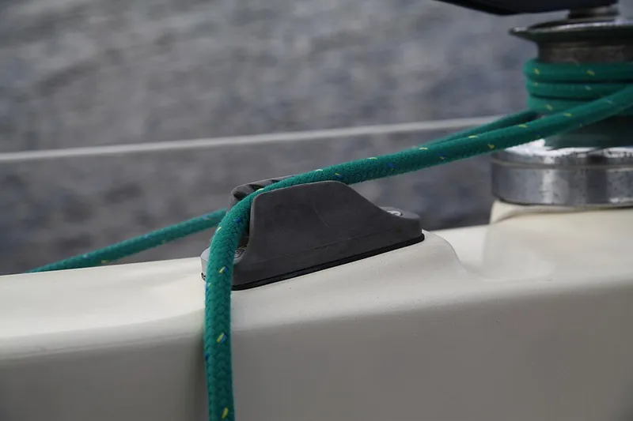

*Picture: [Kammklemme.jpg](https://commons.wikimedia.org/wiki/File:Kammklemme.jpg) by Jeuwre, [CC BY-SA 4.0](https://creativecommons.org/licenses/by-sa/4.0), from Wikimedia Commons.*

A one-piece block with a narrow V-shaped groove lined with slanted ridges: a tensioned rope pressed into the groove is pulled deeper by its own load and jams, and a short upward-and-backward pull lifts it free.

**In plain words:** A small block with a ridged V-shaped slot: press a pulled-tight rope down into the slot and the load drags it deeper until it jams, then lift the rope up and back to let it go; nothing on it moves. **Proper term:** Clam cleat (grooved V-cleat; jamming cleat).

**Also called:** Clamcleat (brand; Clamcleats Ltd, England); jam cleat / jamming cleat (Wikipedia and patent term; 'jam cleat' is also used for cam cleats and tapered horn-type cleats); V-cleat (Ronstan's V-Cleat range); grooved cleat; rope cleat; Kammklemme (German); Loop cleat and Line-Lok (Clamcleat brands: versions for tensioning guy lines; Line-Lok seen only in search results); fender cleat (in-line version for fender lines); Jiffy Tie (Clamcleat brand: a small tie for light loads).

## How it works

The groove narrows toward the bottom, and both walls carry ridges that slope toward the end the load pulls from (45° in Reginald Emery's original design, US 3,574,900). When a tensioned rope is laid in and the load pulls it along the groove, the sloping ridges drag it down into the narrowing V, so 'the stronger the pull, the more the rope is forced into the V-shaped slot and hence the firmer is the grip' (US 3,574,900). Nothing moves except the rope, so there are no springs to break or seize (Ronstan). To release, pull the tail 'upward and backward' so the rope rides up the ridges and out of the mouth of the groove (Ronstan; US 3,574,900). The basic version with no moving parts is the horn cleat, the traditional fitting with two 'horns' (Wikipedia 'Cleat (nautical)'): the rope is made fast with a cleat hitch (ABOK #1615), a turn round the far horn, figure-eight crossings over the top and often a final locking half hitch (Wikipedia 'Cleat hitch'; Animated Knots 'Cleat Hitch (Dock Line)'). It holds bigger loads and can't be flicked loose, but it is slower to tie and untie.

## Parts

single piece: one moulded or cast block (two ridged walls joined by a base), fixed with two screws or bolts. Some versions add a built-in fairlead (guide loop) that steers the rope into the teeth, a becket (a loop to tie a rope end to), a cage or keeper that holds the rope near the cleat, or a tapered pad to set the angle.

## Everyday examples

- Sailing dinghies and yachts: small control lines and halyards held in black nylon or aluminium clam cleats (Ronstan; Wikimedia Commons photo)
- Sunshades, awnings, tents and antenna masts: guy lines tensioned with clam-type cleats ('one use is for tensioning sunshades', Premium Ropes; Mastrant, which makes guying rope for antenna masts, sells Clamcleat tensioners)
- Boat fender lines held in an in-line fender cleat (McSail's Printables fender cleat)
- Light-pull cords: the first Clamcleat grew out of a 1963 idea for attaching a knob to a light pull-cord (Rope44)

## When to use it

When a light to moderately loaded rope needs holding and quick adjustment and you want the simplest, cheapest, most compact option with no springs or moving parts to break, seize or corrode: small-boat control lines, guy lines for tents, awnings and antennas, blind and light cords, tarps, fender lines and kit on kayaks. Clamcleat's makers describe grip 'proportional to the load, without the need for complex moving parts' (Rope44). It is easy to print at home in one piece.

## When not to use it

Avoid it for heavy loads, lines that must be released while heavily loaded, or lines constantly pulled back and forth through the cleat: use a cam cleat, whose opening action releases more easily (Ronstan; Wikipedia), or a rope clutch or winch. Avoid it where the rope might be knocked upward and released, or for anything carrying a person or hanging over people: tie off on a horn cleat with a cleat hitch or use a rated device. Avoid it for flat webbing (use a cam buckle or ladder-lock buckle) and for ropes much thinner or thicker than the cleat's range (they slip or won't seat). Avoid dirty, sandy ropes on nylon cleats, which wear the ridges quickly (Mastrant).

## Details

- **What it does (jobs):**
  - stop it moving back (one-way): the rope can be pulled through toward you but is held against the load
  - lock, and release by hand: a short upward and backward pull frees the rope
  - tighten and hold tension: tension the rope, drop it into the groove and it holds at that length
- **Movement:** slide: the rope slides along and down into the groove, stepless; the cleat itself has no moving parts
- **Directions it can move (degrees of freedom):** 0 inside the cleat, because it is one solid piece. The rope has 1 (along its length), and while it is jammed it can move only in the tightening direction.
- **Special behaviour:**
  - one-way (moves freely one way, locks the other): the rope can be pulled forward through the groove but jams when the load pulls back
  - [self-locking](../glossary.md#self-locking) (holds under load, won't back-drive): the sloping ridges pull the rope deeper the harder the load pulls, so grip grows with load
  - hand-release only (locks under load, releases when a person operates it): a short upward and backward pull lifts the rope out; it is 'less easily released under load' than a cam cleat (Wikipedia)
  - quick-release: no knot to untie, so the line comes free in one move
  - tensioning (takes up slack and holds): used on guy lines, awnings and sunshades to keep a line tight
- **How it holds:**
  - friction or clamping ([force-fit](../glossary.md#form-fit--force-fit--material-bond)): the rope is wedged between the ridged walls of a narrowing V, and the load pulls it deeper
- **Input and output:** not applicable: it holds a rope rather than passing motion on (back-drivable: no while the rope stays in the groove; lifting it up and back releases it)
- **Power:** passive (no power needed)
- **Load:** Light to medium, as a pull along the rope only. Example: the Clamcleat CL231 nylon cleat with fairlead, for 4-8 mm rope, is listed with a breaking strength of 670 kg (Premium Ropes). Grip depends on seating the rope fully: Emery found that a rope held only by the front ridges can take as much as 50% less load than one gripped by all the ridges (US 5,675,872). Weak against any upward pull, which is how it is released. Ronstan recommends cam cleats instead 'for applications where constant line draw-through or high loads are expected'.
- **Play and precision:** Small: the rope [creeps](../glossary.md#creep) back a little as it is drawn down into the V and beds in ⚑ [uncertain: no source gives an amount]. Stepless. Each cleat suits a narrow band of rope sizes (for example 3-6 mm or 4-8 mm); ropes toward the middle of the stated range work best, and the listed extremes are just that (Mastrant), and in Emery's design the rope's diameter should run from 'a little larger than, down to a little smaller than' the width of the slot mouth (US 3,574,900). It dislikes a crooked lead unless it has a fairlead: the CL231's integral fairlead guides the rope into the teeth 'from up to 90 degrees' (Premium Ropes).
- **Taking it apart:** tool-free quick release: lift the rope up and back out of the groove; the cleat itself is screwed or bolted on and comes off with a screwdriver
- **How often it can be reused:** effectively unlimited: there are no moving parts; only the ridges and the rope wear. Nylon cleats used for light loads on control lines are often over 10 years old, but 'tensioning a rope by dragging it back through the teeth will quickly burn out a nylon cleat' (Clamcleat FAQ text reproduced by Mastrant).
- **Sealing:** none: nothing makes it seal
- **Adjustable:** yes: stepless; lift the rope out, adjust its length and press it back in. Tension the rope first rather than dragging it back through the teeth, which wears the ridges (Mastrant, reproducing Clamcleat's FAQ).
- **Access needed:** one side only (blind): the rope is loaded and released from the top. Mounting needs the back only if you through-bolt it.
- **Materials:** Marine-grade nylon, aluminium and hard-anodised aluminium (the Clamcleat range, as described by Ronstan); PTFE-impregnated glass- and carbon-fibre-reinforced composite (Ronstan V-Cleats). Nylon: corrosion-proof and lasts for years outdoors, for most light-load uses; aluminium: for high loads or surges, unaffected by the heat of a rope surging back through the cleat ('rope burn') and suitable for sub-zero temperatures; hard-anodised aluminium: best protection against corrosion and against wear from 'aggressive modern fibres' (Ronstan). Emery's patent names injection-moulded nylon (US 3,574,900). It works on 'deformable' rope that can be wedged into the groove (US 3,574,900), so soft braided rope suits it better than stiff wire.
- **Heat, cold, water and wear:** Nylon cleats are 'completely resistant to salt water corrosion' and to many acids and chemicals; aluminium has 'excellent' corrosion resistance, and hard-anodised aluminium slightly better corrosion and wear resistance than plain (Clamcleat FAQ text reproduced by Mastrant). Aluminium cleats are unaffected by the heat of a rope surging back through them and work below freezing (Ronstan). A sandy rope 'will wear out any fitting' (Mastrant). Clamcleat makes some items from UV-resistant material for outdoor use (Jiffy Tie, Mastrant). For printed cleats: PLA softens above about 60 °C and degrades in UV; PETG is fine outdoors below about 80 °C; ASA is UV-resistant up to 93 °C (Prusa material pages).

## Making it

- **Ways to make or get it:**
  - off-the-shelf part: the usual route (Clamcleat, Ronstan V-Cleats and others)
  - 3D print (FDM): one solid piece with no assembly
  - 3D print (resin): small cleats for light cords ⚑ [uncertain: no tested example found]
  - CNC: machined aluminium versions
  - woodwork: mounting pads and tapered pads to set the rope angle ⚑ [uncertain]
- **Printing it in one piece (print in place):** yes: it is one solid piece with no moving parts, so it comes off the printer complete and working; only two screws are added to mount it
- **Tools:** none to use; a drill and screwdriver (or spanner for bolts) to fit it ('Fix with bolts or screws', Premium Ropes listing for the Clamcleat CL231)
- **Difficulty:** easy: a single printed block and two screws make a working cleat, but printed ridges wear faster and are weaker than injection-moulded nylon, so keep printed ones to light loads

### 3D printing tips

Orientation matters because the rope's pull tries to split the ridges from the walls. The makers of printed clam cleats on Printables disagree on orientation: Patrice Peccard stood his polycarbonate clam cleat upright with a large brim (16 loops, 2 layers) at 40% [infill](../glossary.md#infill) and also printed it in PETG; JMAW prints his 'Marine Lines Clamp Cleat' at 45° 'for ultimate strength', with 2 mm walls, 25% honeycomb infill and light-coloured PETG, fixed with M5 countersunk screws for 5 mm line (scale it to 80% with M4 screws for 4 mm paracord). Whichever way you print, use thick walls round the groove, since FFF prints are stronger in one direction than another (Prusa). Copy the proven geometry from Emery's patent (US 3,574,900): walls 8-20° apart (14° best), ridges sloping 20-50° toward the loaded end (45° best), ridge tips about 90° with a chamfered lead-in at the mouth, and a groove mouth about as wide as the rope. Make the rearmost ridges reach deep enough that the rope is gripped by all of them (US 5,675,872). Material: PETG, ASA or PC outdoors; PLA softens above about 60 °C and degrades in sunlight (Prusa PLA page), PETG suits outdoor parts below about 80 °C, and ASA resists UV and heat up to 93 °C (Prusa). McSail's printed fender cleat has held boat fenders for two seasons in PETG, but he plans ASA once UV damage shows and warns a printed part 'will not be equivalent in strength' to an injection-moulded nylon one. Typical failures: ridges rounding off or delaminating, the rope slipping because the V is too wide for it, and screw heads that stand proud and snag the rope ⚑ [uncertain].

### Buying one (off-the-shelf parts)

Clamcleat (brand) cleats by rope size, e.g. CL274 Micro 1-4 mm, CL204 Mini 3-6 mm, CL209 Midi 4-8 mm, CL205 Major 6-12 mm, CL201 Vertical 10-16 mm (Toplicht); aluminium and hard-anodised aluminium versions for higher loads (Ronstan); versions with an integral fairlead (e.g. CL231, Premium Ropes), becket, cage, keeper or tapered pads ⚑ [uncertain: becket, cage, keeper and pads seen only in search results]; the Clamcleat CL223 Loop Cleat for tensioning lines (Clamcleats Ltd video) and the CL806 Jiffy Tie (Mastrant); Ronstan V-Cleats for 3-6, 5-8 and 8-12 mm line; stainless countersunk screws or bolts.

## Rules of thumb

- Groove angle: the two walls should be 'inclined relative to each other at an angle of between 8 and 20°'; 'the angle of 14° is the optimum' (Emery, US 3,574,900).
- Ridge slope: ridges sloping toward the loaded end at 20-50° to the base, '45° having been found to be generally desirable' (US 3,574,900); Emery's later racquet cleat also uses 45° ridges (US 5,675,872).
- Ridge shape: ridge apex angle 40-100°, '90° having been found to be generally desirable', with the wall tops chamfered to give a lead-in to the slot (US 3,574,900).
- Rope size: the rope's diameter may run from 'a little larger than, down to a little smaller than, the width of the slot at its mouth' (US 3,574,900); choose rope toward the middle of a cleat's stated range, because the listed extremes are just that (Mastrant).
- Seat the rope on all the ridges: if the rearmost ridges don't grip, 'the loading the string can withstand can be as much as fifty per cent less than when all of the ridges grip' (US 5,675,872). The same patent angles the ridge crests so they close in by about 2.5° (range 0.5-8°) from front to rear to improve grip.
- Nylon cleats suit light loads; where 'high loads or surges are encountered aluminium cleats are recommended' (Ronstan).
- Don't tension by dragging the rope back through the teeth: it 'will quickly burn out a nylon cleat'; alloy cleats cope, as long as the rope is clean (Clamcleat FAQ text reproduced by Mastrant).
- Where the rope can't be led straight in, use a cleat with an integral fairlead: the Clamcleat CL231 guides rope into the teeth 'from up to 90 degrees' (Premium Ropes).
- If you use a horn cleat instead: lead the rope round the far horn first, because 'starting round the wrong horn increases the risk of a Cleat Hitch jamming'; don't take a full round turn under the first horn, which can jam so the rope can't be released while loaded; two figure-eight crossovers are 'the bare minimum, and only for temporary use in sheltered conditions'; and leave off the final locking half hitch on lines that must be let go quickly, such as towlines and sail sheets (Animated Knots 'Cleat Hitch (Dock Line)').

## Common failures

Slipping: rope too thin for the groove, worn or glazed, or not pressed down far enough to reach all the ridges (up to 50% less holding, US 5,675,872); fix by using the right cleat size and seating the rope fully. Ridges burnt or worn smooth: rope dragged back through the teeth under load, or sandy rope (Mastrant); use aluminium or hard-anodised cleats for this kind of use. Rope pops out or won't enter: poor lead angle; add a fairlead, cage or tapered pad, or re-site the cleat. Can't release: too much load for the cleat; take the load off first. Rope fuzz and wear: sharp or damaged ridges.

## Safety

It is 'less easily released under load' than a cam cleat (Wikipedia), and a jammed, heavily loaded rope may come out suddenly and run, which can burn hands or let a sail or load drop ⚑ [uncertain]. A rope knocked upward can pop out, so don't use it for life-safety or overhead loads. Keep fingers clear of the groove when snapping a taut rope out ⚑ [uncertain].

## Related

- Cam cleat: two spring-loaded toothed cams instead of fixed ridges; easier to release under load and better for constant pulling-through, but has springs and moving parts (Wikipedia; Ronstan)
- Hitches to a post, rail, ring or eye: includes the cleat hitch on a horn cleat; slower, but holds bigger loads and can't be knocked loose
- Tapered jam cleat (horn type): the rope is wedged under a tapering horn rather than in a ridged groove (Wikipedia gallery)
- Guy-line slider (friction line tensioner): a plate with holes that holds a tent line by friction, even simpler and lighter
- Cord lock (spring toggle): a spring plunger for thin cords
- Rope clutch or jammer: a lever-operated cam for high, long-held loads
- Ladder-lock buckle: the flat-webbing equivalent that holds by friction when loaded and slides when tilted
- Tensioning and adjustable hitches: knots such as the trucker's hitch and taut-line hitch that pull a line tight and hold it with no hardware at all

## Make it yourself

- [clam cleat by Patrice Peccard, Printables](https://www.printables.com/model/551560-clam-cleat): A printable clam cleat for a halyard, printed in polycarbonate (and PETG), stood upright with a 16-loop, 2-layer brim, 40% infill and no supports. Details read through the Printables public API; the page URL appeared in search results. *(licence: CC BY-NC-SA)*
- [Marine Lines Clamp Cleat by JMAW, Printables](https://www.printables.com/model/568698-marine-lines-clamp-cleat): A scalable clam-style line cleat for 5 mm line with M5 countersunk screws (scale to 80% with M4 screws for 4 mm paracord); print at 45°, 2 mm walls, 25% honeycomb infill, PETG; snap-off built-in support. Details read through the Printables public API; the page URL appeared in search results. *(licence: CC BY-NC-ND)*
- [Fender Rope Cleat / Jammer V2 by McSail, Printables (URL from Printables API, page not opened)](https://www.printables.com/model/1415318-fender-rope-cleat-jammer-v2): An in-line grooved rope cleat for 6-11 mm rope, used for two seasons to hang boat fenders; printed in PETG with organic supports; the maker warns it is not as strong as the injection-moulded commercial part *(licence: CC BY-NC)*

## Pictures, videos and models

- [Kammklemme.jpg, Wikimedia Commons, photo by Jeuwre](https://commons.wikimedia.org/wiki/File:Kammklemme.jpg): A black nylon clam cleat on a sailing yacht with a green rope led into its groove *(licence: CC BY-SA 4.0)*
- [US 3,574,900: Jamming cleat (Reginald John Emery, priority 1968, published 1971), Google Patents](https://patents.google.com/patent/US3574900A/en): Drawings of the V-shaped slot and its sloping ridges, with the design angles in the text *(licence: US patent document; public domain in the US; link only)*
- [US 5,675,872: Jamming cleat (Howard Emery, 1997), USPTO full-text PDF](https://image-ppubs.uspto.gov/dirsearch-public/print/downloadPdf/5675872): Cross-section of a small V-groove cleat with inclined ridges gripping a string, and a plan view of an earlier cleat *(licence: US patent document; public domain in the US; link only)*
- [Sailboat Clam Cleat Options Explained | Expert Advice (APS - Annapolis Performance Sailing)](https://www.youtube.com/watch?v=ats0voB-Zkg): Different clam cleats found on sailboats and what they are used for ⚑ [uncertain: title and channel confirmed through YouTube's oEmbed data; the video itself was not watched] *(licence: YouTube standard licence; link only)*
- [CL223 Loop Cleat for tensioning lines | Clamcleats Ltd](https://www.youtube.com/watch?v=of7DDcyxO0s): Using a clam-type loop cleat to tension a line ⚑ [uncertain: title and channel confirmed through YouTube's oEmbed data; the video itself was not watched] *(licence: YouTube standard licence; link only)*

## Needs confirming

⚑ marks something nobody has confirmed yet: a fact the research could not confirm from a source, a finder value that is a best guess, or an open point from the research notes. Corrections are welcome (see `research/needs-confirming.md`).

- ⚑ 9 sentences on this page marked [uncertain].
- ⚑ Finder value `connects` = strap, cord or fabric (best guess): worked out from its name, but joining parts is not one of its two main jobs
- ⚑ Finder value `clicks` = clicks (best guess): one-way or indexing, but neither clicking nor silent named; defaulted to clicks
- ⚑ Finder value `usual_process` = off-the-shelf part (best guess): first-listed process is off-the-shelf, but `print_in_place` is yes

## Sources

- <https://en.wikipedia.org/wiki/Cleat_(nautical)>
- <https://patents.google.com/patent/US3574900A/en>
- <https://image-ppubs.uspto.gov/dirsearch-public/print/downloadPdf/5675872>
- <https://image-ppubs.uspto.gov/dirsearch-public/print/downloadPdf/5522120>
- <https://www.ronstan.com/us/cleat-selection-advice>
- <https://www.ronstan.com/us/products/cleats-clutches/clamcleat.html>
- <https://www.ronstan.com/us/products/cleats-clutches/v-cleats.html>
- <https://www.ronstan.com/us/v-cleat-5-8mm-3-16-5-16-open.html>
- <https://www.mastrant.com/on-line-shop/product/5979-jiffy-tie>
- <https://www.premiumropes.com/clam-cleat-231-clamcleat-with-fair-lead-nylon-4-8mm>
- <https://www.toplicht.com/detail/0192fd1bfc8970709cd5e4ba72b9ec58>
- <https://www.rope44.com/blogs/the-pin-end/supplier-focus-clamcleat>
- <https://www.practical-sailor.com/sails-rigging-deckgear/the-civilization-of-cam-cleats/>
- <https://commons.wikimedia.org/wiki/File:Kammklemme.jpg>
- <https://www.youtube.com/watch?v=ats0voB-Zkg>
- <https://www.youtube.com/watch?v=of7DDcyxO0s>
- <https://www.youtube.com/oembed?url=https://www.youtube.com/watch?v=ats0voB-Zkg&format=json>
- <https://api.printables.com/graphql/>
- <https://www.printables.com/model/551560-clam-cleat>
- <https://www.printables.com/model/568698-marine-lines-clamp-cleat>
- <https://help.prusa3d.com/article/modeling-with-3d-printing-in-mind_164135>
- <https://help.prusa3d.com/article/pla_2062>
- <https://help.prusa3d.com/article/petg_2059>
- <https://help.prusa3d.com/article/asa_1809>
- <https://en.wikipedia.org/wiki/Cleat_hitch>
- <https://www.animatedknots.com/cleat-hitch-knot-dock-line>
